## Introduction — The "Last Mile" Problem of AI Agents

LLMs can now call tools on their own, and multiple agents can coordinate on complex tasks. How agent output reaches the user gets much less attention.

Agents run for a long time, stream intermediate results, ask the user for approval, and update UI state. The one-request, one-response model of REST APIs and GraphQL doesn't handle this well. Today each agent framework has its own event format, so frontends write an adapter per framework and end up tightly coupled to it.

<strong>AG-UI (Agent-User Interaction Protocol)</strong> standardizes this communication between agents and users.

### Three Agent Protocols

Three open protocols cover different connections around an AI agent.

| Protocol | Connection | Origin |
|----------|-----------|--------|
| MCP (Model Context Protocol) | Agent ↔ Tools & Data | Anthropic |
| A2A (Agent to Agent) | Agent ↔ Agent | Google |
| AG-UI (Agent-User Interaction) | Agent ↔ User (UI) | CopilotKit |

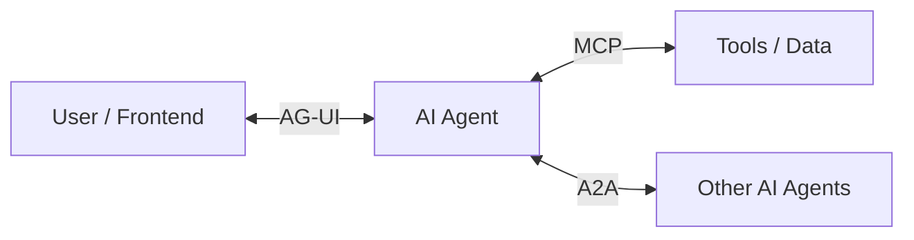

MCP standardizes how agents connect to external tools and A2A standardizes how agents coordinate with each other. AG-UI standardizes how agents connect to user-facing applications. With all three, an agent's connections to tools and data, to other agents, and to the user can all go through standard protocols.

### The World Without AG-UI

Without AG-UI, frontend developers repeat the following work for every framework or application.

1. <strong>Framework-specific connection code</strong>: Use LangGraph? Write a LangGraph-specific client. Use CrewAI? Write CrewAI-specific code.
2. <strong>Reimplementing streaming</strong>: Build text streaming, tool call display, and state synchronization for each framework.
3. <strong>Reimplementing Human-in-the-Loop</strong>: Design a user approval flow for each application.

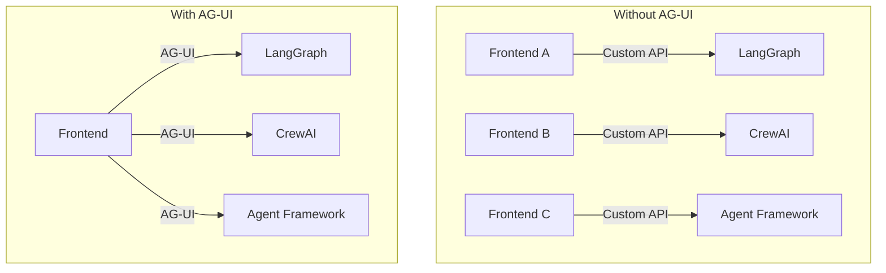

With AG-UI, a frontend implements one protocol and can talk to any agent backend that supports AG-UI. A backend that emits AG-UI events works with any frontend that implements AG-UI.

---

## Design Principles of AG-UI

### 1. Event-Driven Communication

Agents emit events of standardized types while they run, and the client processes the stream in order. Unlike REST, where one response ends the exchange, events keep arriving until the run finishes.

### 2. Bidirectional Interaction

Agents can take input from users, so AI and humans can work together in one workflow. Models where the agent just returns a result one way can't do this.

### 3. Transport Agnostic

AG-UI does not dictate how events are delivered. SSE (Server-Sent Events), WebSockets, Webhooks — choose the transport that fits your architecture.

### 4. Flexible Event Structure

Events don't need to match AG-UI's format exactly; they only need to be AG-UI-compatible. Existing agent frameworks can therefore adapt their own event formats with small changes.

---

## Architectural Overview

AG-UI uses a client-server architecture.

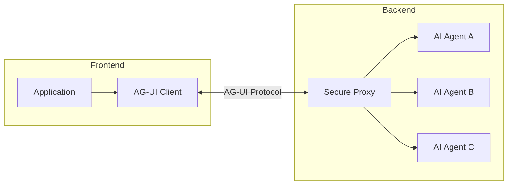

| Component | Role |
|-----------|------|
| Application | User-facing app (chat UI, AI-powered app, etc.) |
| AG-UI Client | Generic communication client like `HttpAgent` |
| Secure Proxy | Backend service providing additional capabilities and acting as a secure proxy |
| Agents | AI agents processing requests and generating streaming responses |

### Protocol Layer

At the center of the protocol layer is a simple abstraction: run an agent and get back a stream of events.

```typescript
// The core AG-UI abstraction
type RunAgent = () => Observable<BaseEvent>

class MyAgent extends AbstractAgent {
  run(input: RunAgentInput): RunAgent {
    const { threadId, runId } = input
    return () =>
      from([
        { type: EventType.RUN_STARTED, threadId, runId },
        {
          type: EventType.MESSAGES_SNAPSHOT,
          messages: [
            { id: "msg_1", role: "assistant", content: "Hello!" }
          ],
        },
        { type: EventType.RUN_FINISHED, threadId, runId },
      ])
  }
}
```

The `run()` method accepts `RunAgentInput` and returns a function that returns an `Observable<BaseEvent>`. All communication is expressed as a stream of `BaseEvent`.

### Standard HTTP Client

AG-UI provides `HttpAgent`, a standard HTTP client that sends POST requests to any endpoint and receives a stream of `BaseEvent`.

```typescript
import { HttpAgent, type AgentSubscriber } from "@ag-ui/client"
import { EventType } from "@ag-ui/core"

const agent = new HttpAgent({
  url: "https://your-agent-endpoint.com/agent",
  agentId: "my-agent",
  threadId: "conversation-123",
})

const subscriber: AgentSubscriber = {
  onEvent: ({ event }) => {
    switch(event.type) {
      case EventType.TEXT_MESSAGE_CONTENT:
        // Display text in UI
        break
      case EventType.TOOL_CALL_START:
        // Show tool call in progress
        break
    }
  },
  onRunFailed: ({ error }) => console.error("Agent error:", error),
  onRunFinalized: () => console.log("Run complete")
}

await agent.runAgent({
  tools: [...],
  context: [...]
}, subscriber)
```

`HttpAgent` supports two transports.

| Transport | Characteristics |
|-----------|----------------|
| HTTP SSE | Text-based streaming. Easy to debug |
| HTTP Binary Protocol | High-performance, space-efficient binary serialization |

---

## The Event System — The Unit of Communication

All AG-UI communication happens through typed events, and every event inherits from `BaseEvent`.

```typescript
interface BaseEvent {
  type: EventType       // Event type identifier
  timestamp?: number    // Event creation time (optional)
  rawEvent?: any        // Original event data if transformed (optional)
  metadata?: Record<string, any> // Extra event metadata (optional)
}
```

Events are classified into 8 categories by purpose.

| Category | Purpose | Example Events |
|----------|---------|---------------|
| Lifecycle Events | Monitor agent run progression | `RUN_STARTED`, `RUN_FINISHED`, `RUN_ERROR` |
| Text Message Events | Handle streaming textual content | `TEXT_MESSAGE_START`, `TEXT_MESSAGE_CONTENT`, `TEXT_MESSAGE_END` |
| Tool Call Events | Manage tool executions | `TOOL_CALL_START`, `TOOL_CALL_ARGS`, `TOOL_CALL_END`, `TOOL_CALL_RESULT` |
| State Management Events | Synchronize state between agent and UI | `STATE_SNAPSHOT`, `STATE_DELTA`, `MESSAGES_SNAPSHOT` |
| Activity Events | Represent ongoing activity progress | `ACTIVITY_SNAPSHOT`, `ACTIVITY_DELTA` |
| Reasoning Events | Visualize reasoning processes | `REASONING_START`, `REASONING_MESSAGE_CONTENT`, `REASONING_END` |
| Subagent Events | Track nested agent execution | `SUBAGENT_STARTED`, `SUBAGENT_FINISHED`, `SUBAGENT_ERROR` |
| Special Events | Support custom functionality | `RAW`, `CUSTOM` |

### Lifecycle Events — Execution Boundaries

Lifecycle Events mark the start, intermediate steps, and end of a single agent run. A typical flow looks like this.

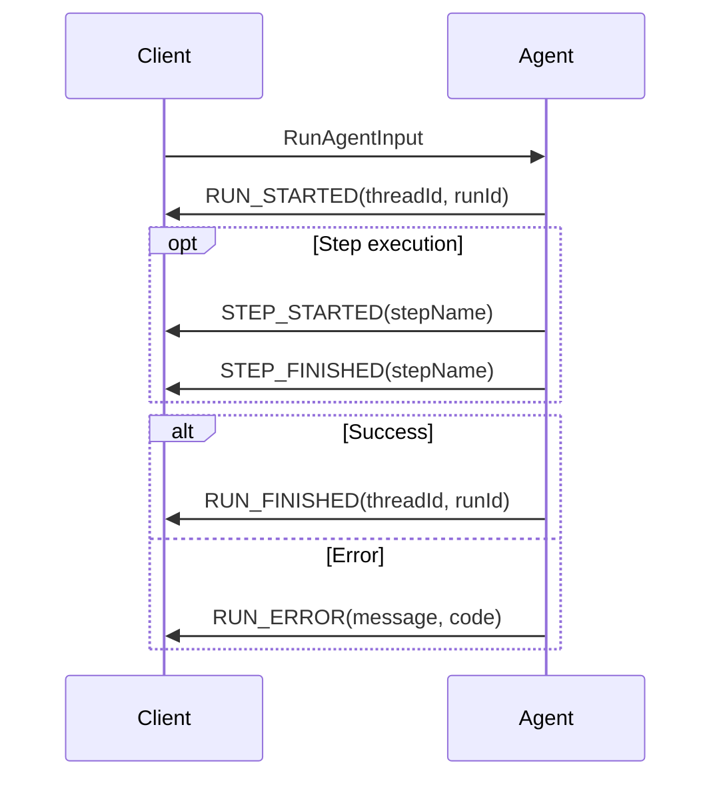

| Event | Required | Description |
|-------|----------|-------------|
| `RUN_STARTED` | Always | Start of execution. Uniquely identified by `threadId` and `runId`. Optional `parentRunId` supports branching/time travel |
| `RUN_FINISHED` | On success | Successful completion. Optional `result` field for output data |
| `RUN_ERROR` | On error | Execution interrupted by error. Provides `message` and `code` |
| `STEP_STARTED` | Optional | Start of a subtask or phase. Enables fine-grained progress tracking |
| `STEP_FINISHED` | Optional | Completion of a subtask. Used in pair with `STEP_STARTED` |

`RUN_STARTED` and `RUN_FINISHED` (or `RUN_ERROR`) mark the boundaries of a run, and any number of step events can come between them.

### Text Message Events — Streaming Text

Text messages are sent chunk by chunk as they are generated, without waiting for the whole message.

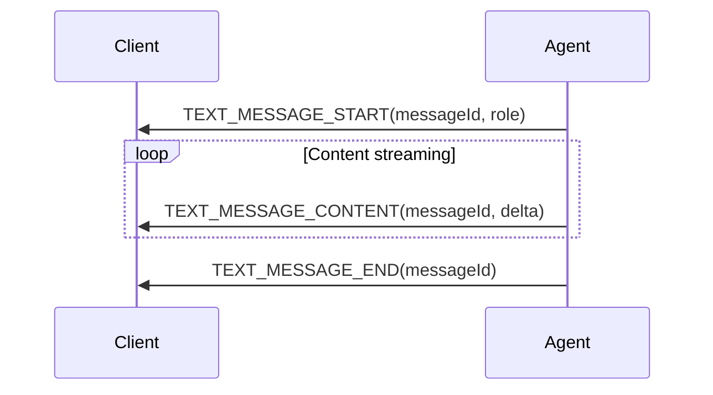

| Event | Description |
|-------|-------------|
| `TEXT_MESSAGE_START` | Initializes a message. Sets `messageId` and `role` (developer, system, assistant, user, tool) |
| `TEXT_MESSAGE_CONTENT` | Text chunk. The text in the `delta` property should be appended to previous chunks |
| `TEXT_MESSAGE_END` | Message completion. UI removes loading indicators and finalizes rendering |

The convenience event `TEXT_MESSAGE_CHUNK` expands to Start → Content → End automatically. Including `messageId` on the first chunk implicitly emits `TEXT_MESSAGE_START`, and `TEXT_MESSAGE_END` is emitted automatically when the stream switches to a new message ID or completes.

### Tool Call Events — Visualizing Tool Calls

Tool calls are streamed the same way as text messages.

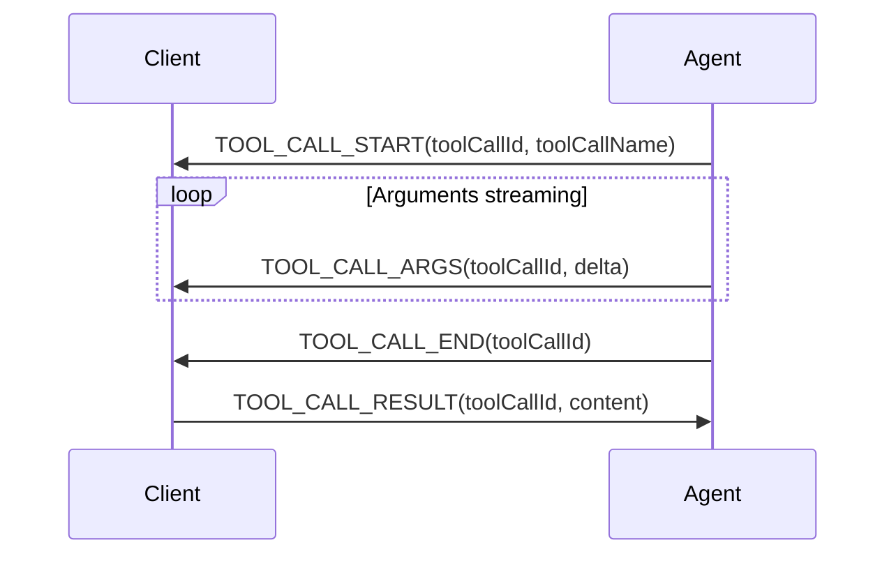

In AG-UI, <strong>tools are defined in the frontend and passed to the agent</strong>. That makes Human-in-the-Loop workflows like this possible:

1. Agent requests a tool call (TOOL_CALL_START → TOOL_CALL_ARGS → TOOL_CALL_END)
2. Frontend executes the tool (may include user judgment)
3. Result is returned to the agent (TOOL_CALL_RESULT)
4. Agent continues reasoning with the result

Tool calls also have a convenience event, `TOOL_CALL_CHUNK`, that corresponds to `TEXT_MESSAGE_CHUNK`. Including `toolCallId` and `toolCallName` on the first chunk implicitly emits `TOOL_CALL_START`, and `TOOL_CALL_END` is emitted automatically when the stream switches to a new `toolCallId` or completes.

### State Management Events — Efficient State Synchronization

State management follows a snapshot-delta pattern: snapshots send the whole state, and deltas send only what changed.

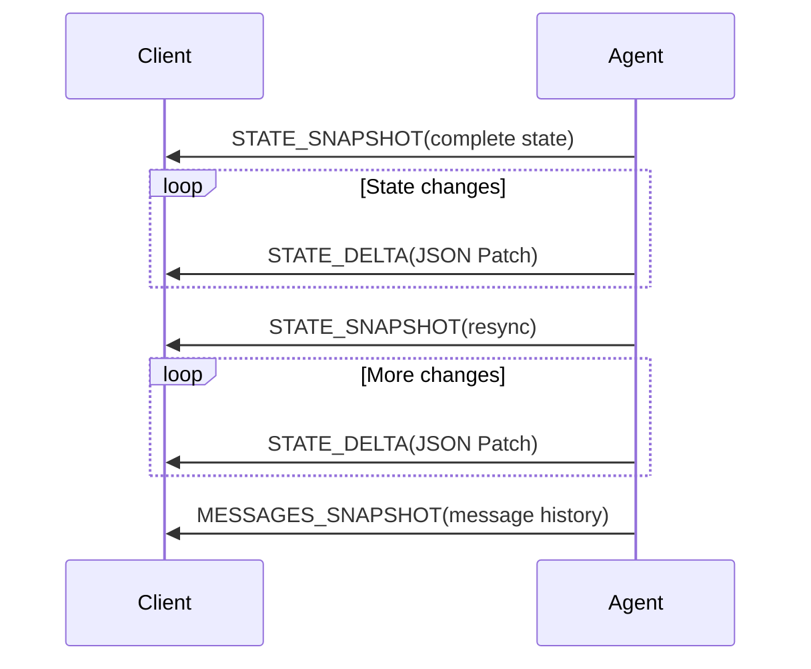

| Event | Description |
|-------|-------------|
| `STATE_SNAPSHOT` | Complete state snapshot. Sent initially or for resynchronization |
| `STATE_DELTA` | Incremental update via JSON Patch (RFC 6902). Bandwidth-efficient |
| `MESSAGES_SNAPSHOT` | Complete conversation message history. For chat initialization or resync |

A snapshot brings the client's whole state in line, and changes between snapshots go out as deltas. The state stays correct while traffic stays low.

### Event Flow Patterns

The events covered so far fall into three patterns, based on how they are sent.

| Pattern | Use Case | Examples |
|---------|----------|---------|
| Start-Content-End | Streaming content | TextMessage, ToolCall |
| Snapshot-Delta | State synchronization | STATE_SNAPSHOT + STATE_DELTA |
| Lifecycle | Execution monitoring | RUN_STARTED → RUN_FINISHED |

---

## Middleware — Intercepting Event Streams

AG-UI middleware sits between the agent and whatever consumes its events. It can transform the event stream, filter it, or add information to it.

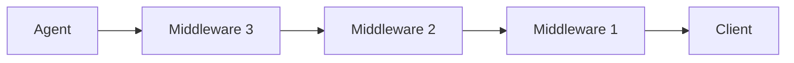

### Function-Based Middleware

For simple transformations, you can write middleware as a function.

```typescript
import { MiddlewareFunction } from "@ag-ui/client"
import { EventType } from "@ag-ui/core"

// Middleware that prefixes text messages
const prefixMiddleware: MiddlewareFunction = (input, next) => {
  return next.run(input).pipe(
    map(event => {
      if (
        event.type === EventType.TEXT_MESSAGE_CHUNK ||
        event.type === EventType.TEXT_MESSAGE_CONTENT
      ) {
        return { ...event, delta: `[AI]: ${event.delta}` }
      }
      return event
    })
  )
}

agent.use(prefixMiddleware)
```

### Class-Based Middleware

When the middleware needs its own state or configuration, implement it as a class.

```typescript
import { Middleware } from "@ag-ui/client"

class MetricsMiddleware extends Middleware {
  private eventCount = 0

  run(input: RunAgentInput, next: AbstractAgent): Observable<BaseEvent> {
    const startTime = Date.now()
    return this.runNext(input, next).pipe(
      tap(event => {
        this.eventCount++
        this.metricsService.recordEvent(event.type)
      }),
      finalize(() => {
        this.metricsService.recordDuration(Date.now() - startTime)
      })
    )
  }
}
```

### Built-in Middleware

Built-in middleware includes `FilterToolCallsMiddleware`, which filters tool calls with an allow list or a block list.

```typescript
import { FilterToolCallsMiddleware } from "@ag-ui/client"

// Allow list
const filter = new FilterToolCallsMiddleware({
  allowedToolCalls: ["search", "calculate"]
})

// Block list
const blocker = new FilterToolCallsMiddleware({
  disallowedToolCalls: ["delete", "modify"]
})

agent.use(filter)
```

Middleware runs in the order it was added, and each one wraps the next. Events returned by the agent pass back through the middleware in reverse order before reaching the client.

```text
→ middleware1
  → middleware2
    → middleware3
      → agent.run()
    ← events flow back through middleware3
  ← events flow back through middleware2
← events flow back through middleware1
```

---

## Reasoning Events — Visualizing the Reasoning Process

Reasoning Events carry reasoning summaries or metadata provided by the model so the UI can show them. They are not a way to expose the model's private raw chain-of-thought to the user.

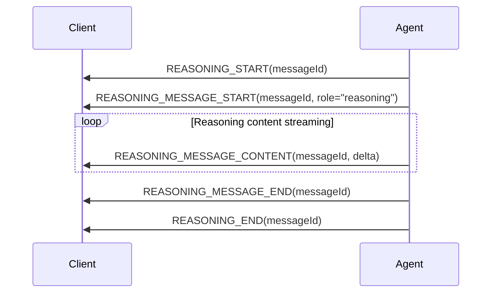

The `REASONING_ENCRYPTED_VALUE` event carries encrypted reasoning state across turns. The value is an opaque continuity token for the model or provider; the client only stores and forwards it and cannot read or render its contents. Reasoning can therefore continue across turns without exposing private chain-of-thought.

| Event | Description |
|-------|-------------|
| `REASONING_START` | Start of reasoning process |
| `REASONING_MESSAGE_START` | Start of reasoning message (visible portion) |
| `REASONING_MESSAGE_CONTENT` | Reasoning content chunk |
| `REASONING_MESSAGE_END` | Completion of reasoning message |
| `REASONING_MESSAGE_CHUNK` | Convenience event auto-expanding Start/End |
| `REASONING_END` | Completion of reasoning process |
| `REASONING_ENCRYPTED_VALUE` | Opaque encrypted reasoning continuity value |

---

## Security Considerations

AG-UI endpoints do not enforce authentication by default. In production, add authentication with FastAPI's dependency injection.

```python
import os
from fastapi import Depends, FastAPI, HTTPException, Security
from fastapi.security import APIKeyHeader
from agent_framework import Agent
from agent_framework.ag_ui import add_agent_framework_fastapi_endpoint

# API key authentication setup
API_KEY_HEADER = APIKeyHeader(name="X-API-Key", auto_error=False)
EXPECTED_API_KEY = os.environ.get("AG_UI_API_KEY")


async def verify_api_key(
    api_key: str | None = Security(API_KEY_HEADER),
) -> None:
    """Verify the API key in request headers."""
    if not api_key or api_key != EXPECTED_API_KEY:
        raise HTTPException(status_code=401, detail="Invalid or missing API key")


app = FastAPI()

# Assume agent was created in a previous section
# agent = simple_agent(chat_client)

# Register endpoint WITH authentication
add_agent_framework_fastapi_endpoint(
    app,
    agent,
    "/",
    dependencies=[Depends(verify_api_key)],
)
```

The `dependencies` parameter accepts any FastAPI dependency, so instead of an API key you can plug in OAuth 2.0, JWT, or Azure AD / Entra ID authentication, or add rate limiting.

---

## Agent Capabilities

AG-UI agents are implemented by extending `AbstractAgent` and can have the following capabilities.

### Bidirectional Communication

Agents exchange events with the frontend in both directions through the event stream. This covers real-time streaming of responses, immediate feedback, progress display for long-running work, and passing structured data back and forth.

### Multi-Agent Collaboration

Agents can delegate tasks to other agents. You can build workflows across several agents and pass state and context between them. When a different agent takes over, the frontend can handle it without knowing about the switch.

### Human-in-the-Loop

Agents can ask the user for input on specific decisions, pause execution, and resume after human feedback. This lets you build workflows that combine AI speed with human judgment.

### Conversational Memory

Agents keep the full history of conversation messages and use past exchanges in later responses. The message history is synchronized between client and server.

---

## Implementing AG-UI with Microsoft Agent Framework

The rest of the article implements the events and features described so far with Microsoft Agent Framework.

### The agent-framework-ag-ui Package

Microsoft Agent Framework ships AG-UI support as the first-party `agent-framework-ag-ui` package, which converts Agent Framework events into AG-UI events.

```text
pip install agent-framework-ag-ui
```

#### Architecture

The package consists of the following components.

| Component | Role |
|-----------|------|
| AgentFrameworkAgent | Lightweight wrapper making Agent Framework agents AG-UI compatible |
| Orchestrators | Handle different execution flows (default, human-in-the-loop, etc.) |
| AgentFrameworkEventBridge | Converts Agent Framework events to AG-UI events |
| Message Adapters | Bidirectional conversion between AG-UI and Agent Framework message formats |
| FastAPI Endpoint | Streaming HTTP endpoint with Server-Sent Events (SSE) |

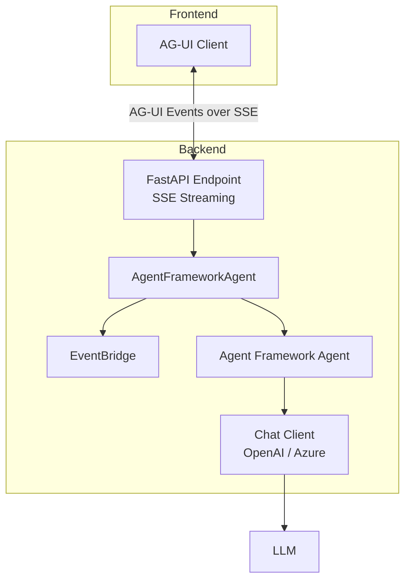

### Feature 1: Agentic Chat — Basic Conversational Agent

Agentic Chat is a basic conversational agent with streaming chat and tool calling.

```python
# simple_agent.py
from typing import Any
from agent_framework import Agent, SupportsChatGetResponse


def simple_agent(client: SupportsChatGetResponse[Any]) -> Agent[Any]:
    """Create a simple chat agent."""
    return Agent[Any](
        name="simple_chat_agent",
        instructions="You are a helpful assistant. Be concise and friendly.",
        client=client,
    )
```

An Agent Framework `Agent` runs with just a name, instructions, and a chat client. To expose it as an AG-UI endpoint, use `add_agent_framework_fastapi_endpoint`.

```python
# server.py
from fastapi import FastAPI
from agent_framework.openai import OpenAIChatCompletionClient
from agent_framework.ag_ui import add_agent_framework_fastapi_endpoint
from agents.simple_agent import simple_agent

app = FastAPI(title="AG-UI Demo Server")

# Create chat client
chat_client = OpenAIChatCompletionClient(model="gpt-4o")

# Register as AG-UI endpoint
add_agent_framework_fastapi_endpoint(app, simple_agent(chat_client), "/agentic_chat")
```

`add_agent_framework_fastapi_endpoint` does the following:

1. Registers a POST endpoint on the FastAPI route
2. Receives `RunAgentInput` from the AG-UI client
3. Runs the Agent Framework agent
4. Converts events to AG-UI format through `AgentFrameworkEventBridge`
5. Returns them as streaming SSE (Server-Sent Events)

A request to this endpoint returns AG-UI events such as the following:

```text
→ RUN_STARTED(threadId, runId)
  → TEXT_MESSAGE_START(messageId, role="assistant")
    → TEXT_MESSAGE_CONTENT(messageId, delta="Hel")
    → TEXT_MESSAGE_CONTENT(messageId, delta="lo")
    → TEXT_MESSAGE_CONTENT(messageId, delta="!")
  → TEXT_MESSAGE_END(messageId)
→ RUN_FINISHED(threadId, runId)
```

### Feature 2: Backend Tool Rendering — Tool Execution and Result Streaming

With Backend Tool Rendering, tools run on the backend and their results stream to the client.

```python
# weather_agent.py
from typing import Any
from agent_framework import Agent, SupportsChatGetResponse, tool


@tool
def get_weather(location: str) -> dict[str, Any]:
    """Get current weather for a location.

    Args:
        location: The city to get weather for.

    Returns:
        Dictionary with temperature, conditions, humidity, etc.
    """
    weather_data = {
        "tokyo": {
            "temperature": 22,
            "conditions": "sunny",
            "humidity": 55,
            "wind_speed": 8,
        },
        "osaka": {
            "temperature": 24,
            "conditions": "partly cloudy",
            "humidity": 60,
            "wind_speed": 6,
        },
    }
    location_lower = location.lower()
    if location_lower in weather_data:
        return weather_data[location_lower]
    return {"temperature": 21, "conditions": "unknown", "humidity": 50, "wind_speed": 10}


@tool
def get_forecast(location: str, days: int = 3) -> str:
    """Get weather forecast for a location.

    Args:
        location: The city to get forecast for.
        days: Number of days to forecast (default: 3).

    Returns:
        Forecast information string.
    """
    forecast: list[str] = []
    for day in range(1, min(days, 7) + 1):
        forecast.append(f"Day {day}: Partly cloudy, {20 + day}°C")
    return f"{days}-day forecast for {location}:\n" + "\n".join(forecast)


def weather_agent(client: SupportsChatGetResponse[Any]) -> Agent[Any]:
    """Create a weather agent."""
    return Agent[Any](
        name="weather_agent",
        instructions=(
            "You are a helpful weather assistant. "
            "Use the get_weather and get_forecast functions to help users. "
            "Always provide friendly and informative responses."
        ),
        client=client,
        tools=[get_weather, get_forecast],
    )
```

Adding the `@tool` decorator to a function makes Agent Framework generate the tool schema and pass it to the LLM. When the agent calls a tool, these AG-UI events flow:

```text
→ RUN_STARTED
  → TOOL_CALL_START(toolCallId, toolCallName="get_weather")
    → TOOL_CALL_ARGS(toolCallId, delta='{"location":')
    → TOOL_CALL_ARGS(toolCallId, delta=' "Tokyo"}')
  → TOOL_CALL_END(toolCallId)
  → TOOL_CALL_RESULT(toolCallId, content='{"temperature": 22, ...}')
  → TEXT_MESSAGE_START(messageId, role="assistant")
    → TEXT_MESSAGE_CONTENT(messageId, delta="The current weather in Tokyo is...")
  → TEXT_MESSAGE_END(messageId)
→ RUN_FINISHED
```

The frontend can show an in-progress indicator such as a loading spinner when it receives `TOOL_CALL_START`, and show the result on `TOOL_CALL_RESULT`. Because these are standardized events, this display logic doesn't depend on the backend framework.

### Feature 3: Human-in-the-Loop — User Approval Flow

With Human-in-the-Loop, the agent can ask for user approval before running a tool.

```python
# human_in_the_loop_agent.py
from typing import Any
from agent_framework import Agent, SupportsChatGetResponse, tool


@tool(approval_mode="always_require")
def delete_file(filename: str) -> str:
    """Delete a file (requires approval).

    Args:
        filename: Name of the file to delete.

    Returns:
        Deletion result message.
    """
    return f"File '{filename}' has been deleted."


@tool(approval_mode="always_require")
def send_email(to: str, subject: str, body: str) -> str:
    """Send an email (requires approval).

    Args:
        to: Recipient address.
        subject: Email subject.
        body: Email body.

    Returns:
        Send result message.
    """
    return f"Email sent to {to} with subject '{subject}'."


def human_in_the_loop_agent(
    client: SupportsChatGetResponse[Any],
) -> Agent[Any]:
    """Create a Human-in-the-Loop agent."""
    return Agent[Any](
        name="hitl_agent",
        instructions=(
            "You are a helpful assistant that can delete files and send emails. "
            "Always confirm with the user before performing these actions."
        ),
        client=client,
        tools=[delete_file, send_email],
    )
```

Tools declared with `@tool(approval_mode="always_require")` always ask for user approval before they run. The event flow looks like this:

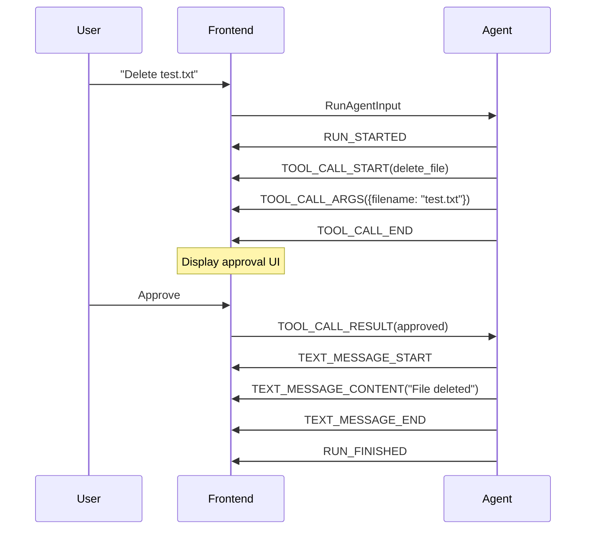

The orchestrator detects the approval response automatically, runs the tool if approved, and skips it if rejected. The approval flow is expressed with standard AG-UI events, so a frontend can implement a generic approval UI once and reuse it with other AG-UI agents.

### Feature 4: Shared State — Bidirectional State Synchronization

Shared State synchronizes structured state between the agent and the frontend in both directions.

```python
# recipe_agent.py
from typing import Any
from agent_framework import Agent, SupportsChatGetResponse, tool
from agent_framework.ag_ui import AgentFrameworkAgent


@tool
def update_recipe(recipe_data: dict[str, Any]) -> str:
    """Update recipe information.

    Args:
        recipe_data: Recipe info (name, ingredients, etc.)

    Returns:
        Update result message.
    """
    return f"Recipe '{recipe_data.get('name', 'Unknown')}' has been updated."


def recipe_agent(client: SupportsChatGetResponse[Any]) -> AgentFrameworkAgent:
    """Create a recipe management agent."""
    agent = Agent[Any](
        name="recipe_agent",
        instructions=(
            "You are a recipe assistant. Help users create and modify recipes. "
            "Use the update_recipe tool to save changes."
        ),
        client=client,
        tools=[update_recipe],
    )

    # Define state schema
    state_schema = {
        "recipe": {
            "type": "object",
            "properties": {
                "name": {"type": "string"},
                "ingredients": {"type": "array"},
                "instructions": {"type": "array"},
            },
        }
    }

    return AgentFrameworkAgent(
        agent=agent,
        state_schema=state_schema,
        name="RecipeAgent",
        description="A recipe management agent with shared state",
    )
```

The `state_schema` defines the structure of state shared with the frontend. When the agent calls `update_recipe`, the state is updated and `STATE_DELTA` events are sent to the frontend.

### Feature 5: Predictive State Updates — Optimistic State Updates

Predictive State Updates write tool arguments into state while they are still being generated, during tool execution.

```python
# document_writer_agent.py
from typing import Any
from agent_framework import Agent, SupportsChatGetResponse, tool
from agent_framework.ag_ui import AgentFrameworkAgent


@tool
def write_document(title: str, content: str) -> str:
    """Create a document.

    Args:
        title: Document title.
        content: Document content.

    Returns:
        Creation result message.
    """
    return f"Document '{title}' has been created."


def document_writer_agent(
    client: SupportsChatGetResponse[Any],
) -> AgentFrameworkAgent:
    """Create a document writer agent."""
    agent = Agent[Any](
        name="document_writer",
        instructions="You are a document writer. Create documents based on user requests.",
        client=client,
        tools=[write_document],
    )

    # Predictive State configuration
    predict_state_config = {
        "current_title": {"tool": "write_document", "tool_argument": "title"},
        "current_content": {"tool": "write_document", "tool_argument": "content"},
    }

    return AgentFrameworkAgent(
        agent=agent,
        state_schema={
            "current_title": {"type": "string"},
            "current_content": {"type": "string"},
        },
        predict_state_config=predict_state_config,
        require_confirmation=True,
    )
```

`predict_state_config` defines which argument of which tool maps to which state field. As the LLM streams tool arguments, each chunk is written to the matching state field as it arrives.

```text
→ RUN_STARTED
  → TOOL_CALL_START(write_document)
    → TOOL_CALL_ARGS(delta='{"title": "AG-')
      → STATE_DELTA(op: replace, path: /current_title, value: "AG-")
    → TOOL_CALL_ARGS(delta='UI Guide"')
      → STATE_DELTA(op: replace, path: /current_title, value: "AG-UI Guide")
    → TOOL_CALL_ARGS(delta=', "content": "AG-UI is...')
      → STATE_DELTA(op: replace, path: /current_content, value: "AG-UI is...")
  → TOOL_CALL_END
→ RUN_FINISHED
```

Users can watch the document being written without waiting for the tool to finish.

### Feature 6: Workflow AG-UI Integration

Agent Framework's workflows (graph-based multi-step execution engines) can also be exposed as AG-UI endpoints.

```python
from fastapi import FastAPI
from agent_framework import WorkflowBuilder, WorkflowContext, executor
from agent_framework.ag_ui import add_agent_framework_fastapi_endpoint


@executor(id="start")
async def start(message: str, ctx: WorkflowContext) -> None:
    """Start step of the workflow."""
    await ctx.yield_output(f"Workflow received: {message}")


@executor(id="analyze")
async def analyze(data: str, ctx: WorkflowContext) -> None:
    """Analysis step."""
    result = f"Analysis of '{data}': positive sentiment detected."
    await ctx.yield_output(result)


workflow = (
    WorkflowBuilder(start_executor=start)
    .add_executor(analyze)
    .add_edge("start", "analyze")
    .build()
)

app = FastAPI()
add_agent_framework_fastapi_endpoint(app, workflow, "/workflow")
```

Workflow events (run/step/activity/tool/custom) are automatically converted to the corresponding AG-UI events.

### Combining into One Server

Here is what it looks like to put the agents from Features 1–5 on a single server.

```python
"""AG-UI Demo Server — All features integrated"""
import os
from fastapi import FastAPI
from agent_framework.openai import OpenAIChatCompletionClient
from agent_framework.ag_ui import add_agent_framework_fastapi_endpoint

# Import agents
from agents.simple_agent import simple_agent
from agents.weather_agent import weather_agent
from agents.human_in_the_loop_agent import human_in_the_loop_agent
from agents.recipe_agent import recipe_agent
from agents.document_writer_agent import document_writer_agent

app = FastAPI(title="AG-UI Demo Server")

# Shared chat client
chat_client = OpenAIChatCompletionClient(
    model=os.getenv("OPENAI_CHAT_MODEL", "gpt-4o"),
    api_key=os.getenv("OPENAI_API_KEY"),
)

# Register endpoints for each feature
add_agent_framework_fastapi_endpoint(
    app, simple_agent(chat_client), "/agentic_chat"
)
add_agent_framework_fastapi_endpoint(
    app, weather_agent(chat_client), "/backend_tool_rendering"
)
add_agent_framework_fastapi_endpoint(
    app, human_in_the_loop_agent(chat_client), "/human_in_the_loop"
)
add_agent_framework_fastapi_endpoint(
    app, recipe_agent(chat_client), "/shared_state"
)
add_agent_framework_fastapi_endpoint(
    app, document_writer_agent(chat_client), "/predictive_state_updates"
)

if __name__ == "__main__":
    import uvicorn
    uvicorn.run(app, host="0.0.0.0", port=8888)
```

### Connecting from an AG-UI Client

To connect to an AG-UI server from Python, use `AGUIChatClient`.

```python
import asyncio
from agent_framework.ag_ui import AGUIChatClient


async def main():
    async with AGUIChatClient(endpoint="http://localhost:8888/agentic_chat") as client:
        # Streaming response
        async for update in client.get_response("Hello!", stream=True):
            for content in update.contents:
                if content.type == "text" and content.text:
                    print(content.text, end="", flush=True)
        print()


asyncio.run(main())
```

`AGUIChatClient` supports streaming and non-streaming responses, hybrid tool execution that combines client-side and server-side tools, and automatic thread management.

---

## Integration with CopilotKit

[CopilotKit](https://docs.copilotkit.ai/) is a framework for adding AI copilot features to React applications and a well-known AG-UI client. It supports the AG-UI protocol natively.

CopilotKit's `useCopilotAction` hook gives a concise way to define AG-UI frontend tools.

```typescript
import { useCopilotAction } from "@copilotkit/react-core"

// Define a tool on the frontend
useCopilotAction({
  name: "confirmAction",
  description: "Ask user to confirm an action",
  parameters: [
    { name: "action", type: "string", description: "Action to confirm" },
    { name: "importance", type: "string", enum: ["low", "medium", "high"] },
  ],
  handler: async ({ action, importance }) => {
    // Show confirmation dialog to user
    const confirmed = await showConfirmDialog(action, importance)
    return confirmed ? "approved" : "rejected"
  },
})
```

The tool defined here is passed to the agent, and when the agent calls it, the frontend `handler` runs. AG-UI standardizes this round trip, so no code specific to the backend framework is needed.

---

## Building Blocks Provided by AG-UI

The official AG-UI documentation lists the following building blocks.

| Building Block | Description | Status |
|---------------|-------------|--------|
| Streaming Chat | Real-time token and event streaming | Supported |
| Multimodality | File, image, audio attachments | Supported |
| Generative UI (Static) | Output rendered as typed components | Supported |
| Generative UI (Declarative) | Declarative UI language | Supported |
| Shared State | Read-only/read-write shared state | Supported |
| Thinking Steps | Intermediate reasoning visualization | Supported |
| Frontend Tool Calls | Frontend-executed tool handoff | Supported |
| Backend Tool Rendering | Backend tool output visualization | Supported |
| Interrupts (HITL) | Pause, approve, retry | Supported |
| Sub-agents | Nested delegation | Supported |
| Agent Steering | Real-time user input for guiding agent | Supported |
| Tool Output Streaming | Real-time tool result streaming | Supported |
| Custom Events | Custom data exchange beyond protocol | Supported |

> <strong>Update (as of August 2026)</strong>: the table above still matches the current official documentation. The surrounding ecosystem has changed in these ways.
>
> - <strong>Composing with generative UI specs.</strong> AG-UI supports generative UI specifications such as Google's [A2UI](https://github.com/google/A2UI) and [MCP Apps](https://blog.modelcontextprotocol.io/posts/2025-11-21-mcp-apps/). A2UI and MCP Apps specify <em>how an agent describes a UI widget</em>. AG-UI is the protocol for <em>how a frontend and an agent backend talk to each other</em>. They work at different layers, so you can use them together.
> - <strong>Microsoft Agent Framework is a first-party integration</strong> listed as Supported, so the implementation approach in this article still applies.
> - <strong>Wider SDK coverage.</strong> Including community contributions, SDKs for Kotlin, Go, Dart, Java, Rust, Ruby, C++, and .NET are now listed as Supported.
> - <strong>Clients beyond web apps.</strong> AG-UI specifies an event stream, not a rendering target, so terminals, mobile apps, and chat platforms such as Slack and Microsoft Teams can also act as clients.

---

## Supported Integrations

AG-UI was born from CopilotKit, and these agent frameworks now support it.

### Agent Frameworks

| Framework | Status |
|-----------|--------|
| LangGraph | Supported |
| CrewAI | Supported |
| Microsoft Agent Framework | Supported |
| Google ADK | Supported |
| AWS Strands Agents | Supported |
| Mastra | Supported |
| Pydantic AI | Supported |
| Agno | Supported |
| LlamaIndex | Supported |
| AG2 | Supported |
| AWS Bedrock AgentCore | Supported |

### SDKs

At the time of writing, community-led SDKs for Kotlin, Golang, Dart, Java, and Rust were available alongside TypeScript, and .NET and Nim SDKs were in progress. For the status as of August 2026, see the update note in the previous section.

---

## Conclusion — The Significance of AG-UI

AG-UI is a protocol that standardizes communication over the "last mile" between agents and users.

### Complementary Nature of the Three Protocols

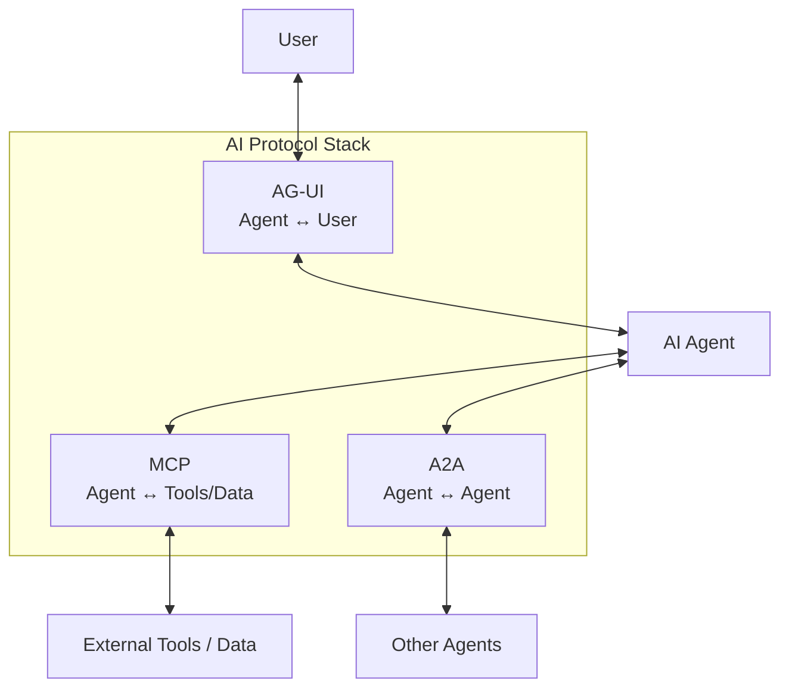

MCP handles the agent's connection to tools and data, A2A handles its connection to other agents, and AG-UI handles its connection to the user. With all three, every connection between an agent and the outside world can go through an open standard protocol.

### Why Use AG-UI

1. <strong>Framework-agnostic</strong>: One protocol connects to every backend that supports AG-UI, including LangGraph, CrewAI, Microsoft Agent Framework, and Google ADK.
2. <strong>Real-time</strong>: Text, tool calls, and state changes arrive as events one by one, so the UI can show what the agent is doing while it runs.
3. <strong>Standardized Human-in-the-Loop</strong>: User approval flows are defined as part of the standard protocol.
4. <strong>State Synchronization</strong>: Snapshots plus deltas keep agent and frontend state in sync in both directions with little traffic.
5. <strong>Extensibility</strong>: You can extend it with middleware, custom events, and custom orchestrators.

Microsoft Agent Framework supports these features first-party through the `agent-framework-ag-ui` package. A single call to `add_agent_framework_fastapi_endpoint` exposes an existing agent as an AG-UI-compatible endpoint.
