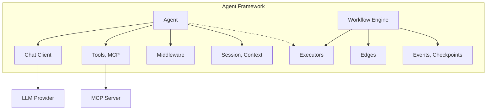
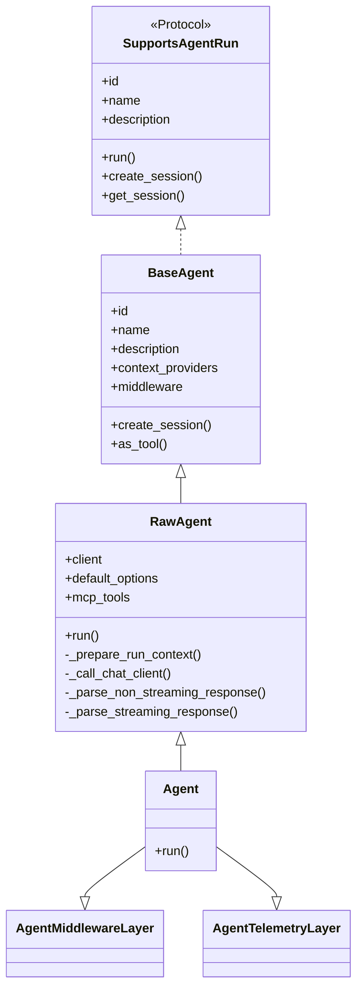
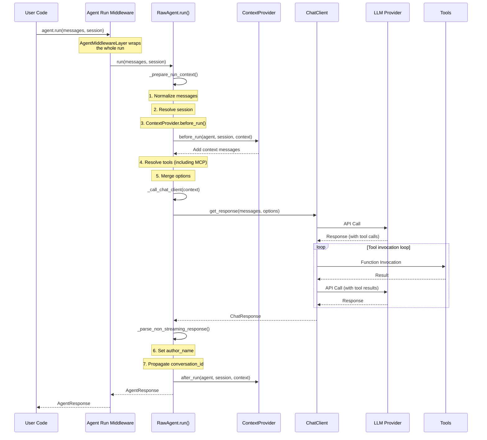
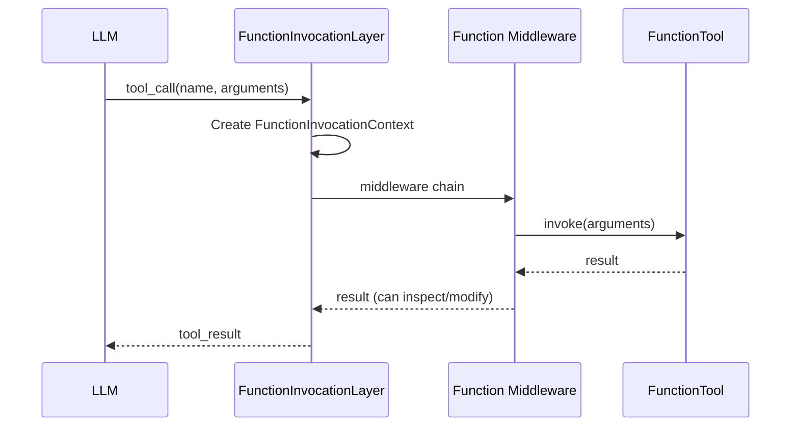
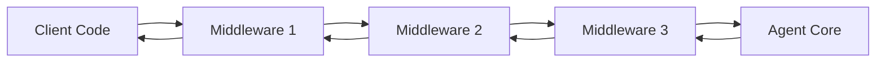
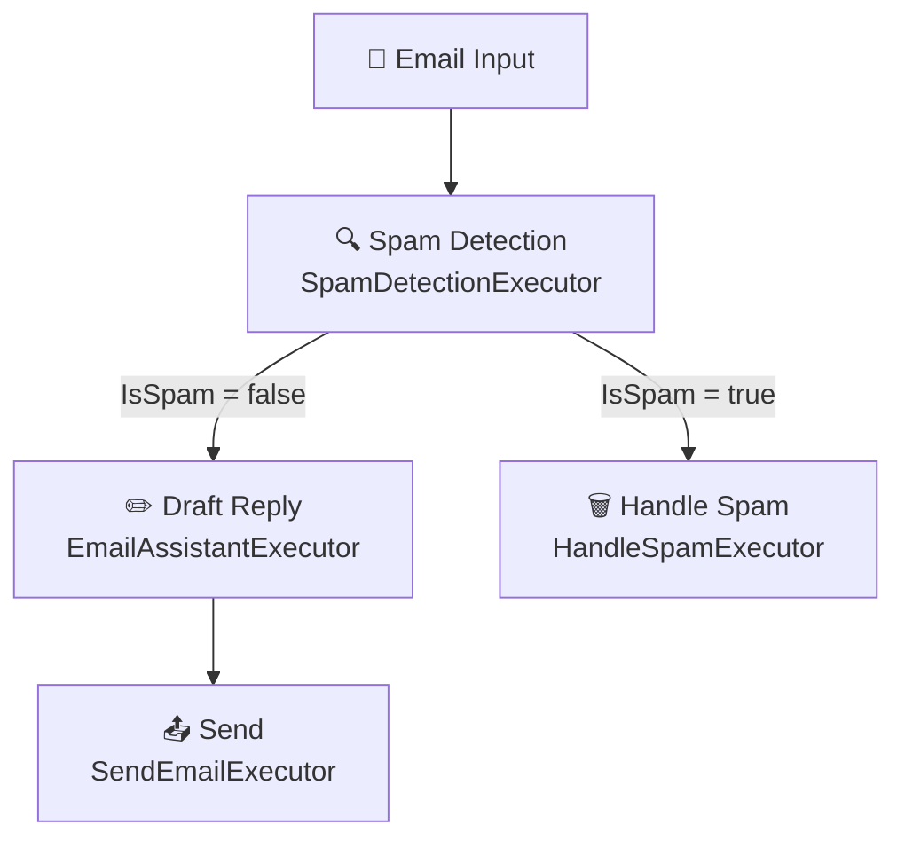

## Introduction

Since around 2025, AI agents have been a major topic among developers: LLMs that call tools on their own, make plans, and work with other agents to finish complex tasks. Building such an agent from scratch means implementing session management, the tool-calling loop, error handling, telemetry, and multi-agent coordination yourself, which is a lot of work. [Microsoft Agent Framework](https://github.com/microsoft/agent-framework) is the framework Microsoft released to take on that work.

Agent Framework is positioned as the direct successor to Microsoft's [Semantic Kernel](https://github.com/microsoft/semantic-kernel) and [AutoGen](https://github.com/microsoft/autogen). It combines Semantic Kernel's enterprise features (session management, type safety, middleware, telemetry) with AutoGen's simple agent abstractions, and adds a graph-based workflow engine.

The framework has two pillars: Agent, for building individual agents, and Workflow, for connecting multiple agents and functions. An agent's `run()` executes a single pipeline—message normalization, ContextProviders, the Chat Client, and response post-processing—and tools, middleware, and sessions plug into that pipeline. A workflow runs as a directed graph of Executors connected by Edges. The sections below trace these mechanisms through the Python source code and then cover integration, deployment, and observability.

## Overall Architecture

### Two Pillars of the Framework

Agent Framework's capabilities fall into two categories:

| Category | Description |
|----------|-------------|
| Agents | Individual agents that use LLMs to process inputs, call tools and MCP servers, and generate responses |
| Workflows | Graph-based workflows that connect agents and functions for multi-step tasks with type-safe routing, checkpointing, and human-in-the-loop support |

Underneath these sit the foundational building blocks: model clients (Chat Completions / Responses API), AgentSession (state management), ContextProvider (agent memory), Middleware (interception), and MCP clients (tool integration).



### Package Structure

The Python code is split into these packages:

| Package | Purpose |
|---------|---------|
| `core` | Core abstractions: `Agent`, `RawAgent`, `BaseAgent`, `Workflow`, `WorkflowBuilder`, etc. |
| `foundry` | Microsoft Foundry integration via `FoundryChatClient` |
| `openai` | OpenAI / Azure OpenAI via `OpenAIChatClient` |
| `anthropic` | Anthropic Claude via `AnthropicChatClient` |
| `ollama` | Local Ollama via `OllamaChatClient` |
| `orchestrations` | Multi-agent orchestration patterns |
| `a2a` | Agent-to-Agent protocol integration |
| `ag-ui` | AG-UI protocol integration |
| `devui` | Developer debugging UI |

The .NET side mirrors this structure, with `Microsoft.Agents.AI` as the foundation and `Microsoft.Agents.AI.OpenAI`, `Microsoft.Agents.AI.Foundry`, `Microsoft.Agents.AI.Workflows`, etc.

> <strong>Update (as of September 10, 2026)</strong>: Agent Framework has reached stable status — `Microsoft.Agents.AI` ships on NuGet as a released 1.x line (1.20.0 at the time of this update). The Python packages `agent-framework` / `agent-framework-core` are also available on PyPI as 1.17.0, so normal installs no longer need `--pre`. Go has also joined the supported languages ([microsoft/agent-framework-go](https://github.com/microsoft/agent-framework-go), public preview). The official documentation now organizes the foundational concepts around Agents / Workflows / Agent Harness, with Integrations & Hosting documented as a separate area. The [Harness Agent](/en/blog/agent-harness-doc-reviewer), which ships planning, todos, context compaction, and tool approval, is treated as one of those foundational concepts.

### Quick Start

A minimal Python agent needs three things: a ChatClient to talk to the LLM, instructions that define the agent's behavior, and `run()` to process user input.

```python
# pip install agent-framework azure-identity
import asyncio
from agent_framework import Agent
from agent_framework.foundry import FoundryChatClient
from azure.identity import AzureCliCredential

async def main():
    agent = Agent(
        client=FoundryChatClient(
            project_endpoint="https://your-project.services.ai.azure.com",
            model="gpt-4o",
            credential=AzureCliCredential(),
        ),
        name="HaikuBot",
        instructions="You are a poet who writes beautiful haikus.",
    )
    print(await agent.run("Write a haiku about Microsoft Agent Framework."))

asyncio.run(main())
```

In this code, `FoundryChatClient` handles the connection to models on Microsoft Foundry, and `AzureCliCredential()` provides local development authentication. Passing `instructions` to the `Agent` constructor sends them as a system prompt to the LLM, and calling `run()` with a user message calls the configured chat/model provider and returns the response. The code is short, but behind it runs the pipeline described in the next section: message normalization → ContextProvider → Chat Client → response post-processing.

In .NET it looks like this:

```csharp
using Microsoft.Agents.AI;
using Azure.AI.Projects;
using Azure.Identity;

var agent = new AIProjectClient(
        new Uri(Environment.GetEnvironmentVariable("FOUNDRY_PROJECT_ENDPOINT")!),
        new DefaultAzureCredential())
    .AsAIAgent(
        model: Environment.GetEnvironmentVariable("FOUNDRY_MODEL") ?? "gpt-4o-mini",
        name: "HaikuBot",
        instructions: "You are a poet who writes beautiful haikus.");

Console.WriteLine(await agent.RunAsync("Write a haiku about Agent Framework."));
```

The .NET version uses the `AsAIAgent()` extension method on `AIProjectClient` to create an agent directly from the project client. The API style differs from Python's, but the same three pieces appear: a client that connects to the model, instructions, and a run method (`RunAsync()`).

## Agent Execution Model — Inside `run()`

### Class Hierarchy

The Python agent consists of the `SupportsAgentRun` Protocol and a 3-layer class hierarchy: `BaseAgent` → `RawAgent` → `Agent`. Each layer adds different features, so you can pick the class that has the features you need.



- <strong>`SupportsAgentRun`</strong> — A Protocol (duck-typing interface) defining `run()`, `create_session()`, and `id`/`name`/`description` properties
- <strong>`BaseAgent`</strong> — Base class implementing context providers, middleware, and session management. Can become a tool for other agents via `as_tool()`
- <strong>`RawAgent`</strong> — Implements the LLM invocation via Chat Client. No middleware or telemetry
- <strong>`Agent`</strong> — Full-featured class mixing in `AgentMiddlewareLayer` (middleware) and `AgentTelemetryLayer` (OpenTelemetry)

### The `run()` Execution Flow

When you call `Agent.run()`, processing proceeds in this order:



#### Step 1: `_prepare_run_context()`

`_prepare_run_context()` does all the preparation before the Chat Client is called. In the source code ([`_agents.py`](https://github.com/microsoft/agent-framework/blob/main/python/packages/core/agent_framework/_agents.py)), it performs five steps:

1. Message normalization: `normalize_messages()` converts input into a list of `Message` objects. If a string is passed, it becomes a `user`-role `Message`
2. Automatic history provider: If `session` is provided, no `HistoryProvider` that loads messages is registered, and nothing hands history to the service (such as a conversation ID or the `store` option), an `InMemoryHistoryProvider` is automatically added
3. ContextProvider execution: `before_run()` runs in forward order. History messages and system prompts are added to `SessionContext`
4. Tool resolution: Default tools + runtime tools + MCP server tools are unified. Unconnected MCP servers are connected via `AsyncExitStack`
5. Options merging: `_merge_options()` merges default and runtime options. Tools are merged by unique name; `instructions` are concatenated; `logit_bias` and `metadata` are dict-merged

```python
# Simplified _merge_options() behavior
def _merge_options(base, override):
    result = dict(base)
    for key, value in override.items():
        if value is None:
            continue
        if key == "tools":
            # Tools merged by unique name
            result["tools"] = _append_unique_tools(base_tools, override_tools)
        elif key == "instructions" and result.get("instructions"):
            # Instructions concatenated
            result["instructions"] = f"{result['instructions']}\n{value}"
        elif key == "logit_bias" and result.get("logit_bias"):
            # logit_bias dict-merged
            result["logit_bias"] = {**result["logit_bias"], **value}
        elif key == "metadata" and result.get("metadata"):
            # metadata dict-merged
            result["metadata"] = {**result["metadata"], **value}
        else:
            result[key] = value
    return result
```

#### Step 2: Chat Client Invocation

`_call_chat_client()` calls the Chat Client based on the `_RunContext`:

```python
def _call_chat_client(self, context, *, stream):
    return self.client.get_response(
        messages=context["session_messages"],
        stream=stream,
        options=context["chat_options"],
        compaction_strategy=context["compaction_strategy"],
        tokenizer=context["tokenizer"],
        function_invocation_kwargs=context["function_invocation_kwargs"],
        client_kwargs=context["client_kwargs"],
    )
```

Inside the Chat Client, the <strong>tool invocation loop</strong> executes. When the LLM requests a tool call, the `FunctionInvocationLayer` executes the tool and re-sends the results to the LLM. This loop repeats until the LLM returns a final response.

#### Step 3: Response Post-processing

In the non-streaming path, `_parse_non_streaming_response()` does the following:

- Setting `author_name` (attaching the agent name to each message)
- Propagating `conversation_id` to the session
- Calling `after_run()` on ContextProviders (in reverse order)

### Streaming

Generating an LLM response can take several seconds, and if you wait for the whole response, the user sees nothing in the meantime. With streaming, tokens are shown as they are generated, so the wait feels shorter. In Agent Framework you only need to pass `stream=True` to `run()`.

With `stream=True`, `_parse_streaming_response()` returns a `ResponseStream`. This `AsyncIterator` yields `AgentResponseUpdate` objects, and `get_final_response()` also gives you the complete `AgentResponse`.

```python
# Streaming usage
stream = agent.run("Hello", stream=True)
async for update in stream:
    print(update.text, end="")
final = await stream.get_final_response()
print(f"\nTokens used: {final.usage_details}")
```

Internally, `map()` transforms updates, and `with_transform_hook()` handles `conversation_id` propagation and `response_id` suppression.

## Tool Integration

An LLM on its own can only generate text. Give it tools, and the agent can act on the outside world by calling external APIs, querying databases, and working with files.

### Tool Types

Agent Framework supports these tool types:

| Tool Type | Description |
|-----------|-------------|
| Function Tools | Custom code that agents can call during conversations |
| Tool Approval | Human-in-the-loop approval for tool invocations |
| Code Interpreter | Execute code in a sandboxed environment |
| File Search | Search through uploaded files |
| Web Search | Search the web for information |
| Hosted MCP Tools | MCP tools hosted by Microsoft Foundry |
| Local MCP Tools | MCP tools running locally or on custom servers |

### Defining Function Tools

In Python, you define a tool by adding the `@tool` decorator to a function:

```python
from agent_framework import Agent, tool

@tool
def get_weather(location: str) -> str:
    """Get the weather for a given location."""
    return f"The weather in {location} is sunny."

agent = Agent(
    client=client,
    name="WeatherBot",
    instructions="You are an assistant that answers weather questions.",
    tools=[get_weather],
)
```

Internally, the `@tool` decorator generates a JSON Schema from the function signature and docstring and creates a `FunctionTool` instance. When the LLM calls this tool, the `FunctionInvocationLayer` runs it as follows:



### Agent-as-Tool Pattern

An agent can also be used as a tool for another agent. With this, one coordinator agent can call several specialist agents as needed.

```python
# Define a specialist agent
weather_agent = Agent(
    client=client,
    name="weather_agent",
    description="An agent that answers weather questions.",
    tools=[get_weather],
)

# Main agent uses weather_agent as a tool
main_agent = Agent(
    client=client,
    name="coordinator",
    instructions="You are a coordinator that delegates to specialists.",
    tools=[weather_agent.as_tool()],
)
```

Internally, `as_tool()` does the following:

1. A `FunctionTool` is generated from the agent's `name` and `description`
2. On invocation, `agent.run(task, stream=True)` is called
3. The response text is returned as a string

```python
# Simplified as_tool() internals
def as_tool(self, *, name=None, description=None):
    async def _agent_wrapper(ctx, **kwargs):
        stream = self.run(
            str(kwargs.get(arg_name, "")),
            stream=True,
            session=ctx.session if propagate_session else None,
        )
        final_response = await stream.get_final_response()
        return final_response.text
    
    return FunctionTool(
        name=tool_name,
        description=tool_description,
        func=_agent_wrapper,
    )
```

### MCP (Model Context Protocol) Integration

[MCP](https://modelcontextprotocol.io/) is a standard protocol connecting LLMs to tools. Agent Framework supports three connection modes: `MCPStdioTool`, `MCPStreamableHTTPTool`, and `MCPWebsocketTool`.

```python
from agent_framework import Agent, MCPStdioTool

# Use filesystem tools via MCP server
mcp_tool = MCPStdioTool(
    name="filesystem",
    command="npx",
    args=["-y", "@modelcontextprotocol/server-filesystem", "/tmp"],
)

async with Agent(client=client, tools=[mcp_tool]) as agent:
    response = await agent.run("List the files in /tmp")
```

MCP tool resolution happens inside `_prepare_run_context()`. Unconnected MCP servers are connected via `AsyncExitStack`, and tool lists are retrieved from their `functions` property.

The example uses `async with Agent(...) as agent:` because the MCP server connection is opened in the Agent's `__aenter__` and closed in `__aexit__`. The connection's lifetime is tied to the agent's scope, so connections are not left open. When not using MCP, you can call `agent.run()` directly without `async with`.

## Middleware System

Agent Framework's middleware works like ASP.NET or Express.js middleware: it inserts cross-cutting concerns such as logging, validation, and error handling into the agent's execution pipeline. Without changing the agent's own code, you can require approval before every tool call or add guardrails that block certain inputs.

### Three Types of Middleware

| Type | Target | Use Case |
|------|--------|----------|
| Agent Run Middleware | Entire `agent.run()` | Input/output inspection, guardrails |
| Function Calling Middleware | Tool invocations | Tool call inspection, approval flows |
| Chat Client Middleware | LLM API calls | Request/response inspection |

### Python Middleware Implementation

In the example below, `logging_middleware` logs the input/output message count for every agent call, and `approval_middleware` inserts an approval flow before dangerous tool calls (file deletion, SQL execution).

```python
from agent_framework import (
    Agent,
    AgentContext,
    FunctionInvocationContext,
    agent_middleware,
    function_middleware,
)

@agent_middleware
async def logging_middleware(context: AgentContext, call_next):
    """Middleware that logs all agent invocations."""
    print(f"Input: {len(context.messages)} messages")
    await call_next()
    print(f"Output: {len(context.result.messages)} messages")

@function_middleware
async def approval_middleware(context: FunctionInvocationContext, call_next):
    """Middleware that requires approval for dangerous tool calls."""
    if context.function.name in ["delete_file", "execute_sql"]:
        print(f"Approval required for: {context.function.name}")
    await call_next()

agent = Agent(
    client=client,
    instructions="You are a helpful assistant.",
    middleware=[logging_middleware, approval_middleware],
)
```

Inside middleware, `await call_next()` hands processing to the next middleware. Code before `call_next()` runs on the request path, and code after it runs on the response path. This is the same mechanism as Express.js's `next()` or ASP.NET Core's `await next(context)`. If you don't call `call_next()`, the chain stops there and the agent core is never reached.

### .NET Middleware Implementation

In .NET, you use the Builder pattern to create a new agent that wraps an existing one with middleware. `AsBuilder()` creates a builder with the existing agent as its inner agent, `Use()` chains middlewares, and `Build()` produces a new agent. The original agent is left unchanged.

```csharp
var middlewareAgent = originalAgent
    .AsBuilder()
        .Use(runFunc: async (messages, session, options, innerAgent, ct) =>
        {
            Console.WriteLine($"Input: {messages.Count()} messages");
            var response = await innerAgent.RunAsync(messages, session, options, ct);
            Console.WriteLine($"Output: {response.Messages.Count} messages");
            return response;
        })
        .Use(async (agent, context, next, ct) =>
        {
            Console.WriteLine($"Function: {context.Function.Name}");
            return await next(context, ct);
        })
    .Build();
```

### Middleware Internals

`AgentMiddlewareLayer` manages the middleware chain. When several middlewares are registered, they nest like a call stack: the request passes through each middleware in order to reach the agent core, and the response comes back in reverse order.



Throwing a `MiddlewareTermination` exception stops the chain partway and returns a response. For example, if input validation finds a problem, you can return an error response right away without calling the LLM.

## Sessions and Context Providers

The execution flow, tools, and middleware covered so far all complete within a single request and response. LLM APIs, however, are stateless: each call has no memory of the previous conversation. Conversations with users span multiple turns, so something has to carry earlier turns forward. In Agent Framework, AgentSession and ContextProvider do this.

### AgentSession

`AgentSession` is the container that holds an agent's conversation state:

```python
session = agent.create_session()

# First call
response1 = await agent.run("I live in Tokyo.", session=session)

# Second call — session preserves conversation history
response2 = await agent.run("Where do I live?", session=session)
# → "You live in Tokyo."
```

The main session properties are:

- `session_id` — Local session ID (auto-generated)
- `service_session_id` — Service-side session ID (e.g., Foundry Agents thread ID)
- `state` — Dictionary holding per-provider state

### ContextProvider

`ContextProvider` is the extension point that hooks before and after agent invocations. `before_run()` injects additional context (history messages, system prompts, extra tools), and `after_run()` persists the response.

```python
from agent_framework import ContextProvider, SessionContext, AgentSession

class CustomContextProvider(ContextProvider):
    """Example custom context provider."""
    
    async def before_run(self, agent, session, context, state):
        # Inject additional system prompt
        context.instructions.append("Always respond in English.")
    
    async def after_run(self, agent, session, context, state):
        # Log the response
        if context.response:
            state["last_response"] = context.response.text
```

The main built-in provider is `InMemoryHistoryProvider`, which keeps the conversation history. As noted earlier, if you pass a session and no history provider is configured, the Agent adds one automatically, so passing `session` is enough for multi-turn conversation, as in the AgentSession example above.

### CompactionStrategy

The longer a conversation runs, the more tokens each LLM request carries. `CompactionStrategy` provides strategies that compress messages to keep the token count down:

| Strategy | Description |
|----------|-------------|
| `TruncationStrategy` | Drops oldest messages |
| `SlidingWindowStrategy` | Retains the most recent N messages |
| `SummarizationStrategy` | Summarizes old messages using an LLM |
| `TokenBudgetComposedStrategy` | Combines multiple strategies within a token budget |

## Workflow Engine — Graph-Based Orchestration

Some business processes run several steps in a fixed order and branch partway through. For example: classify an email as spam, generate a reply if it is legitimate, and quarantine it if it is spam. A single agent often can't handle such a process alone, and you build it with the workflow engine instead.

### Agent vs Workflow

| Use Agent when | Use Workflow when |
|----------------|-------------------|
| The task is open-ended or conversational | The process has well-defined steps |
| You need autonomous tool use and planning | You need explicit control over execution order |
| A single LLM call suffices | Multiple agents or functions must coordinate |

A workflow is a directed graph connecting <strong>Executors</strong> (processing nodes) via <strong>Edges</strong> (connections).

### Executor (Processing Node)

An Executor is the fundamental processing unit. It receives messages, processes them, and produces output messages.

```python
from agent_framework import Executor, handler, WorkflowContext

class UppercaseExecutor(Executor):
    """Executor that converts input strings to uppercase."""
    
    @handler
    async def handle(self, message: str, context: WorkflowContext) -> str:
        return message.upper()
```

In .NET, `partial` classes with the `[MessageHandler]` attribute use source generation:

```csharp
internal sealed partial class UppercaseExecutor() : Executor("UppercaseExecutor")
{
    [MessageHandler]
    private ValueTask<string> HandleAsync(string message, IWorkflowContext context)
    {
        return ValueTask.FromResult(message.ToUpperInvariant());
    }
}
```

Executors can be stateful. If the same instance is shared across runs, implement `IResettableExecutor` to clear stale state between runs.

### Edge (Connection)

Edges define message flow. These types are available:

| Edge Type | Description | Use Case |
|-----------|-------------|----------|
| Direct | Simple one-to-one connection | Pipelines |
| Conditional | Condition-based routing | if/else branching |
| Switch-Case | Multi-branch routing based on conditions | 3+ branch routing |
| Fan-out | One executor to multiple targets | Parallel processing |
| Fan-in | Multiple sources to single target | Aggregation |

### Workflow Example — Email Classification Pipeline

The following workflow classifies incoming email as spam or legitimate, then quarantines spam or auto-drafts a reply. It covers defining Executors, conditional branching with Edges, and assembling the graph with `WorkflowBuilder`, in that order.



```python
from agent_framework import (
    Agent, Executor, handler, WorkflowBuilder, WorkflowContext,
)

class SpamDetectionExecutor(Executor):
    def __init__(self, agent):
        super().__init__("SpamDetection")
        self._agent = agent
    
    @handler
    async def handle(self, message: str, context: WorkflowContext):
        response = await self._agent.run(message)
        is_spam = "spam" in response.text.lower()
        return {"is_spam": is_spam, "content": message}

class EmailAssistantExecutor(Executor):
    def __init__(self, agent):
        super().__init__("EmailAssistant")
        self._agent = agent
    
    @handler
    async def handle(self, message: dict, context: WorkflowContext):
        response = await self._agent.run(
            f"Draft a professional reply to: {message['content']}"
        )
        await context.yield_output(f"Reply: {response.text}")

class SpamHandler(Executor):
    @handler
    async def handle(self, message: dict, context: WorkflowContext):
        await context.yield_output(f"Marked as spam: {message['content'][:50]}...")

# Build the workflow
spam_detector = SpamDetectionExecutor(detection_agent)
assistant = EmailAssistantExecutor(reply_agent)
spam_handler = SpamHandler("SpamHandler")

workflow = (
    WorkflowBuilder(start_executor=spam_detector)
    .add_edge(
        spam_detector,
        assistant,
        condition=lambda msg: not msg["is_spam"],
    )
    .add_edge(
        spam_detector,
        spam_handler,
        condition=lambda msg: msg["is_spam"],
    )
    .build()
)

# Run the workflow
async for event in workflow.run("Important meeting announcement", stream=True):
    print(event)
```

`WorkflowBuilder` builds the execution graph declaratively. Passing a condition function to `add_edge(source, target, condition=...)` defines a runtime branch. `workflow.run(..., stream=True)` runs the workflow in-process and streams an event each time a message moves between Executors.

In .NET you write it with `WorkflowBuilder` as follows. This version also includes the send step (`sendEmailExecutor`) shown in the diagram:

```csharp
var workflow = new WorkflowBuilder(spamDetectionExecutor)
    .AddEdge(spamDetectionExecutor, emailAssistantExecutor,
             condition: GetCondition(expectedResult: false))
    .AddEdge(emailAssistantExecutor, sendEmailExecutor)
    .AddEdge(spamDetectionExecutor, handleSpamExecutor,
             condition: GetCondition(expectedResult: true))
    .WithOutputFrom(handleSpamExecutor, sendEmailExecutor)
    .Build();
```

### Switch-Case Pattern

For three or more branches, `AddSwitch()` lets you write all the branches in one place. Each case gets a condition function, and you can also specify a default branch.

```csharp
builder.AddSwitch(spamDetectionExecutor, switchBuilder =>
    switchBuilder
        .AddCase(GetCondition(SpamDecision.NotSpam), emailAssistantExecutor)
        .AddCase(GetCondition(SpamDecision.Spam), handleSpamExecutor)
        .WithDefault(handleUncertainExecutor)
);
```

### Fan-out / Fan-in Pattern

One executor distributes work to multiple targets that run in parallel, and the results are aggregated. In fan-out, the `targetSelector` picks targets based on the input; the fan-in barrier waits for all sources to finish.

```csharp
// Fan-out: 1 → N
builder.AddFanOutEdge(
    analysisExecutor,
    targets: [spamHandler, emailAssistant, summarizer, uncertainHandler],
    targetSelector: (result, targetCount) =>
    {
        if (result.IsSpam) return [0];
        var targets = new List<int> { 1 };
        if (result.EmailLength > 100) targets.Add(2);
        return targets;
    }
);

// Fan-in: N → 1
builder.AddFanInBarrierEdge(
    sources: [worker1, worker2, worker3],
    target: aggregator
);
```

### Workflow Execution and Events

Workflows execute in a <strong>superstep</strong> fashion. In each superstep, active executors run concurrently, and output messages route along edges to the next superstep's executors.

`WorkflowEvent` types include the following. The names are the .NET class names; Python distinguishes the same events by the `type` of a `WorkflowEvent` (`"output"`, `"executor_invoked"`, and so on).

| Event | Description |
|-------|-------------|
| `WorkflowOutputEvent` | Workflow output (what an Executor emits via `context.yield_output()`) |
| `ExecutorInvokedEvent` / `ExecutorCompletedEvent` | Executor lifecycle (invocation and completion) |
| Custom events | Any event an Executor emits via `context.add_event()` |

### Checkpointing

Long-running workflows can fail partway through. If you persist workflow state with `CheckpointStorage`, a workflow can resume from where it stopped after a failure or a process restart.

```python
from agent_framework import FileCheckpointStorage

storage = FileCheckpointStorage("./checkpoints")
runner_context = InProcRunnerContext(workflow, checkpoint_storage=storage)
```

## Deployment and Integrations

Agents and workflows built with Agent Framework can connect to other systems over the A2A and AG-UI protocols, be deployed to Azure Functions or Container Apps, or be exposed as MCP servers.

### A2A (Agent-to-Agent) Protocol

A2A is an open protocol proposed by Google for connecting agents across different frameworks. Agent Framework supports both A2A server and client roles, so it can interoperate with agents built on other frameworks.

```python
from agent_framework.a2a import A2AServer

# Expose an agent as an A2A server
server = A2AServer(agent=my_agent)
await server.start(host="0.0.0.0", port=8080)
```

### AG-UI (Agent-User Interface) Protocol

AG-UI is a protocol proposed by CopilotKit for real-time connection between agents and frontends. It provides a standard interface for showing agent behavior to users, such as streaming responses, tool-call progress indicators, and human-in-the-loop approval UIs.

### Azure Functions / Container Apps

Agents can be deployed as serverless functions or containers. With Azure Functions, you can set up an HTTP-triggered agent in just a few lines. Container Apps support long-running workflows and streaming responses.

### Export as MCP Server

You can also convert an agent into an MCP server, making it callable from other tools and agents.

```python
# Convert agent to MCP server
server = agent.as_mcp_server(server_name="MyAgent", version="1.0.0")
```

The `as_mcp_server()` implementation converts the agent to a tool via `as_tool()` and registers it as the MCP server's `call_tool` handler. As a result, MCP clients can call the agent as a single tool.

### DevUI

DevUI is an interactive developer UI for developing, testing, and debugging agents. It visualizes workflow execution graphs in real time, so you can inspect each Executor's inputs/outputs and the message flow along Edges.

## Observability

Agent Framework natively supports OpenTelemetry — the `AgentTelemetryLayer` (a mixin on the `Agent` class) automatically generates spans for every `run()` invocation.

```python
from opentelemetry import trace
from opentelemetry.sdk.trace import TracerProvider
from opentelemetry.sdk.trace.export import ConsoleSpanExporter, SimpleSpanProcessor

# OpenTelemetry setup
provider = TracerProvider()
provider.add_span_processor(SimpleSpanProcessor(ConsoleSpanExporter()))
trace.set_tracer_provider(provider)

# Agent automatically emits spans
agent = Agent(client=client, name="TracedAgent")
response = await agent.run("Hello")
```

Traces include:

- Agent name and ID
- Message counts
- Tool call details
- Token usage
- Response time

If you export these to an OpenTelemetry-compatible backend such as Jaeger or Azure Monitor, you can use response times to find bottlenecks and token usage to estimate cost.

## Design Characteristics

### Protocol-Based Extensibility

`SupportsAgentRun` is defined as a Protocol, so you can create compatible agents without inheriting from any Agent Framework class — just implement the required methods. This follows the same idea as Python's duck typing, and it helps when introducing Agent Framework into an existing codebase step by step.

### Layered Middleware Separation

Middleware is split into three layers — Agent Run Middleware → Function Calling Middleware → Chat Client Middleware — and each layer intercepts a different target. So "add logging to all agent calls," "add approval only to specific tool calls," and "add retries to LLM requests" can each be written as independent middleware.

### Migration Paths from Semantic Kernel / AutoGen

Agent Framework officially provides migration guides from both Semantic Kernel and AutoGen, so you can migrate step by step while keeping your existing code.

### Python and .NET Symmetry

Python and C#/.NET share the same concepts and API patterns, so what you learn in one language carries over to the other. That helps teams that work in several languages. A Go implementation (public preview) has since been added, bringing the total to three languages, but maturity varies: Go does not yet offer declarative agents, RAG, CodeAct, or functional workflows.

## Conclusion

Agent Framework's internals can be viewed as the following layers:

1. Agent layer — A pipeline of message normalization → ContextProvider → ChatClient → response post-processing that manages LLM interactions
2. Tool layer — `@tool` decorators, MCP integration, and Agent-as-Tool connect agents to the outside world
3. Middleware layer — Three levels (Agent / Function / ChatClient) for injecting cross-cutting concerns
4. Session layer — AgentSession and ContextProvider enable multi-turn conversations on top of the stateless LLM API
5. Workflow layer — A graph of Executors and Edges for declaratively describing conditional branching, parallel processing, and human-in-the-loop steps
6. Observability layer — OpenTelemetry traces for monitoring and debugging agent behavior

Agent Framework combines Semantic Kernel's enterprise features with AutoGen's simple agent abstractions and supports MCP, A2A, and AG-UI. Microsoft positions it as the unified foundation for agent development and the successor to both.

## References

- [Microsoft Agent Framework — GitHub](https://github.com/microsoft/agent-framework)
- [Official Documentation — MS Learn](https://learn.microsoft.com/en-us/agent-framework/)
- [Python Package — PyPI](https://pypi.org/project/agent-framework/)
- [.NET Package — NuGet](https://www.nuget.org/profiles/MicrosoftAgentFramework/)
