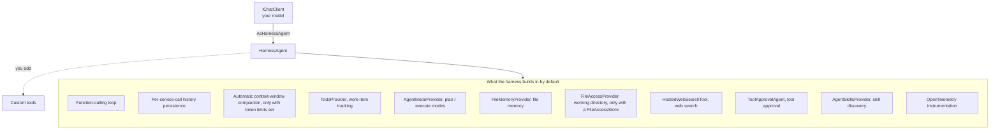
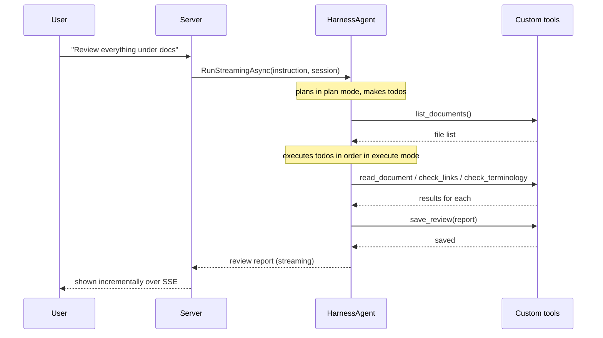

## Introduction

In the companion article, "[Letting Go of Orchestration — Building a Document Review Agent by Just Adding Tools with the GitHub Copilot SDK](/en/blog/copilot-doc-reviewer)," we implemented this idea:

> Stop writing the agent's control tower (the plan → choose tool → execute → evaluate loop) yourself, and hand it entirely to a production-tested runtime. Your only job is to provide the capabilities a review needs, as tools.

Here we build the same document review agent with Microsoft Agent Framework's Agent Harness (`HarnessAgent`). As before, it works once you add tools and instructions, but the design decisions differ from the Copilot SDK version in two ways: the runtime you hand things to is a .NET library in your own process rather than a separate CLI process, and the agent's capabilities are narrowed by choosing them at configuration time rather than by approving operations at runtime.

> For an overview of Microsoft Agent Framework itself, see "[Microsoft Agent Framework Internals](/en/blog/agent-framework)." This article covers only the Agent Harness.

## What the Agent Harness Is

The usual way to use Microsoft Agent Framework is to create a `ChatClientAgent` and combine tools and context providers yourself. That is flexible, but an agent that carries out long tasks on its own also needs <strong>operational scaffolding (a harness)</strong>: planning, todo management, context compaction, and tool approval. You would have to build that yourself.

The Agent Harness (`HarnessAgent`), from the `Microsoft.Agents.AI.Harness` package, is an agent with that scaffolding built in. It lets you set up a Claude-Code-style autonomous agent in one line. Calling `AsHarnessAgent()` on an `IChatClient` configures all of the following.



As with the Copilot SDK version, the developer writes only tools and instructions.

The `AgentModeProvider` has two default modes, "plan" and "execute," and the `TodoProvider` tracks work items. So the harness comes with a Claude-Code-style way of working: make a plan, break it into todos, then execute them in order. The Copilot CLI runtime has a plan mode and a todo list too, and the Copilot SDK exposes them through experimental RPCs (as of SDK 1.0.28, November 2026): `session.rpc.mode.set({ mode: "plan" })` switches the session into plan mode, and `session.rpc.plan.read()` and `session.rpc.plan.readSqlTodos()` read the plan and the todos. The difference is where these pieces live. In the harness they are context providers in your own process, which you configure or switch off with options; in the Copilot SDK they stay inside the CLI runtime, and you reach them over RPC.

> <strong>Update (as of September 10, 2026)</strong>: at the time of writing, `HarnessAgent` was an experimental (preview) API that produced the diagnostic warning `MAAI001` at compile time. It now ships as a stable API in the `Microsoft.Agents.AI.Harness` package ([1.20.0](https://www.nuget.org/packages/Microsoft.Agents.AI.Harness/1.20.0) at the time of this update), and the [official documentation](https://learn.microsoft.com/agent-framework/concepts/) lists the Agent Harness as one of Agent Framework's foundational concepts (Agents / Workflows / Agent Harness).

## Contrast with the Copilot SDK — Two Kinds of "Delegation"

In both, the runtime handles orchestration and the developer just adds tools. But the runtimes differ in nature, so the design decisions differ too.

| Aspect | GitHub Copilot SDK | Agent Harness (`HarnessAgent`) |
|------|--------------------|-------------------------------|
| Runtime shape | Connects to a separate Copilot CLI process via JSON-RPC | A .NET library in your own process |
| Model | Via Copilot, or your own model via BYOM/BYOK | You bring your own model (Azure OpenAI / OpenAI, etc.) |
| Billing | Usage-based (GitHub AI Credits, metered by tokens) | You pay only the model provider you use |
| Planning / todos | The runtime has a plan mode and a todo list; experimental RPCs (`session.rpc.mode` / `session.rpc.plan`) switch the mode and read the plan | plan/execute modes and a TodoProvider are built in |
| Narrowing capability | At runtime, approve/reject via `onPermissionRequest` | At configuration time, via `Disable*` flags and the tools you provide |
| Languages | Node/Python/Go/.NET/Java/Rust | .NET is most mature (Python is officially supported too; Go has no packaged harness yet) |
| Distribution | Bundled CLI runtime | NuGet library (stable) |

The difference with the most effect on the design is how you narrow capability. In the Copilot SDK version, safety came from a <strong>dynamic gate</strong>: each time the runtime requested an operation with one of its built-in tools, such as shell execution or file writes, we allowed or rejected it at runtime. With the harness, safety comes from <strong>static assembly</strong>: you choose at configuration time which capabilities to build in. You switch off built-in capabilities you don't need, as with `DisableWebSearch = true`, and you never pass opt-in ones such as `FileAccessStore`.

## Design — the Same Five Tools

The tools are the same five as in the Copilot SDK version.

1. `list_documents` — list the documents to review
2. `read_document` — read the contents
3. `check_links` — check for broken links
4. `check_terminology` — check terminology variants
5. `save_review` — save the review

What differs is that the harness already knows how to make a plan, break it into todos, and execute them in order. In the Copilot SDK version we didn't use the runtime's plan mode; we steered the agent toward that approach through the system message. With the harness, the `AgentModeProvider` (plan/execute) and `TodoProvider` supply that skeleton, so the instructions need only one sentence about the approach and can focus on the review aspects (links, terminology, clarity) and the output format.



## Implementation

### Project Layout and Dependencies

The file layout mirrors the Copilot SDK version.

```text
agent-harness-doc-reviewer/
├── AgentHarnessDocReviewer.csproj
├── Program.cs              # ASP.NET minimal API + SSE server
├── ReviewTools.cs          # the five custom tools (AIFunctions)
├── ReviewPrompt.cs         # review instructions
├── glossary.json           # canonical-term dictionary for terminology checks
├── docs/                   # documents to review
├── reviews/                # output destination
└── wwwroot/
    └── index.html          # browser UI (vanilla JS; same as the Copilot SDK version except title and accent color)
```

Add the dependencies. At the time of writing the Agent Harness was experimental and needed `--prerelease`. `Microsoft.Agents.AI.Harness` now has a stable release, so the harness no longer needs that flag.

```bash
dotnet add package Microsoft.Agents.AI.Harness
dotnet add package Microsoft.Extensions.AI.OpenAI
dotnet add package Azure.AI.OpenAI
dotnet add package Azure.Identity
```

`MAAI001` is the diagnostic ID that Agent Framework for .NET puts on its experimental APIs. `HarnessAgent` was one of them at the time of writing, so the `.csproj` suppresses it. Since the harness went stable in 1.14.0 (July 2026), the options this code uses no longer raise it, but some `HarnessAgentOptions` properties still do, such as `MaxContextWindowTokens` / `MaxOutputTokens` and `FileAccessStore`. The other ID, `OPENAI001`, is what the OpenAI .NET library puts on its experimental APIs, such as the Responses API client; the Chat Completions client used here doesn't raise it.

```xml
<PropertyGroup>
  <TargetFramework>net9.0</TargetFramework>
  <NoWarn>$(NoWarn);MAAI001;OPENAI001</NoWarn>
</PropertyGroup>
```

### Defining the Tools

The Copilot SDK version defined tools with `defineTool` and Zod. In Agent Framework, a tool is a `Microsoft.Extensions.AI` `AIFunction`, created from a delegate with `AIFunctionFactory.Create()`. As in the Copilot SDK version, each tool closes over an `emit` for UI notifications.

```csharp
// ReviewTools.cs
using System.ComponentModel;
using Microsoft.Extensions.AI;

public static class ReviewTools
{
    private static readonly string DocsRoot = Path.GetFullPath("docs");
    private static readonly string ReviewsRoot = Path.GetFullPath("reviews");

    // Path-traversal guard: ensure the resolved path stays under the root
    private static string ResolveWithin(string root, string target)
    {
        string resolved = Path.GetFullPath(Path.Combine(root, target));
        if (!resolved.StartsWith(root + Path.DirectorySeparatorChar, StringComparison.Ordinal)
            && resolved != root)
        {
            throw new InvalidOperationException($"Disallowed path: {target}");
        }
        return resolved;
    }

    public static IList<AITool> Create(Action<string, string> emit)
    {
        return new List<AITool>
        {
            AIFunctionFactory.Create(() =>
            {
                var files = Directory
                    .EnumerateFiles(DocsRoot, "*.*", SearchOption.AllDirectories)
                    .Where(f => f.EndsWith(".md") || f.EndsWith(".mdx"))
                    .Select(f => Path.GetRelativePath(DocsRoot, f))
                    .ToArray();
                emit("list_documents", $"Found {files.Length} documents");
                return new { files };
            }, "list_documents", "Return the list of documents under docs/ to be reviewed"),

            AIFunctionFactory.Create((
                [Description("path relative to docs/")] string filePath) =>
            {
                string abs = ResolveWithin(DocsRoot, filePath);
                string content = File.ReadAllText(abs);
                emit("read_document", $"Read {filePath} ({content.Length} chars)");
                return new { filePath, content };
            }, "read_document", "Read and return the contents of a given document"),

            AIFunctionFactory.Create(async (
                [Description("the text to check")] string content) =>
            {
                var urls = System.Text.RegularExpressions.Regex
                    .Matches(content, @"https?://[^\s)\]]+")
                    .Select(m => m.Value)
                    .Distinct()
                    .ToArray();
                var broken = new List<object>();
                using var http = new HttpClient { Timeout = TimeSpan.FromSeconds(5) };
                foreach (var url in urls)
                {
                    try
                    {
                        using var reqMsg = new HttpRequestMessage(HttpMethod.Head, url);
                        var res = await http.SendAsync(reqMsg);
                        if (!res.IsSuccessStatusCode)
                            broken.Add(new { url, status = ((int)res.StatusCode).ToString() });
                    }
                    catch
                    {
                        broken.Add(new { url, status = "unreachable" });
                    }
                }
                emit("check_links", $"{broken.Count} of {urls.Length} unreachable");
                return new { checked_ = urls.Length, broken };
            }, "check_links", "Check whether HTTP(S) links in the text are alive; return unreachable ones"),

            AIFunctionFactory.Create((
                [Description("the text to check")] string content) =>
            {
                var glossary = System.Text.Json.JsonSerializer
                    .Deserialize<Dictionary<string, string[]>>(File.ReadAllText("glossary.json"))
                    ?? new();
                var hits = new List<object>();
                foreach (var (canonical, variants) in glossary)
                    foreach (var variant in variants)
                        if (content.Contains(variant))
                            hits.Add(new { canonical, found = variant });
                emit("check_terminology", $"{hits.Count} terminology candidates");
                return new { issues = hits };
            }, "check_terminology", "Detect terminology variants against the canonical terms in glossary.json"),

            AIFunctionFactory.Create((
                [Description("file name to save")] string fileName,
                [Description("the review body in Markdown")] string markdown) =>
            {
                string abs = ResolveWithin(ReviewsRoot, fileName);
                Directory.CreateDirectory(Path.GetDirectoryName(abs)!);
                File.WriteAllText(abs, markdown);
                emit("save_review", $"Saved to {fileName}");
                return new { saved = fileName };
            }, "save_review", "Save the finished review as Markdown under reviews/"),
        };
    }
}
```

Passing a delegate to `AIFunctionFactory.Create(delegate, name, description)` turns it into a tool, and the `[Description]` attribute on each argument becomes the parameter description the model sees. The returned anonymous object is serialized to JSON and sent back to the model. As in the Copilot SDK version, all the actual work happens in your own code: you control both the outbound requests through `HttpClient` (the counterpart of `fetch`) and the file write in `save_review`.

### Assembling the Harness — Narrowing Capability

In the Copilot SDK version, a permission handler rejected operations at runtime. With the harness, you <strong>leave out unneeded capabilities at configuration time.</strong>

A document review doesn't need the harness's built-in web search, file memory, or skill discovery. Because the agent reads untrusted documents, any capability it doesn't use only widens the attack surface. So we turn those off with `Disable*` flags and keep just the planning features (`TodoProvider`, `AgentModeProvider`) and our own tools. Arbitrary file I/O is enabled only when you pass a `FileAccessStore`, so this example doesn't pass one.

```csharp
// Program.cs (excerpt) — assembling the harness
using Microsoft.Agents.AI;
using Microsoft.Extensions.AI;

AIAgent CreateReviewer(IChatClient client, Action<string, string> emit) =>
    client.AsHarnessAgent(new HarnessAgentOptions
    {
        Name = "DocReviewer",
        Description = "An agent that reviews technical documents",

        // ── Narrowing capability (minimizing the attack surface) ──
        DisableWebSearch = true,          // disable broad web search (use only our own check_links)
        DisableFileMemory = true,         // disable file memory too
        DisableAgentSkillsProvider = true,// disable skill discovery
        DisableToolAutoApproval = true,   // no approval-required tools: leave out the auto-approval middleware

        // Keep TodoProvider and AgentModeProvider (plan/execute) → leverage planning
        // No FileAccessStore and no shell tool (ShellExecutor) → arbitrary file I/O and shell execution are impossible from the start

        ChatOptions = new ChatOptions
        {
            Instructions = ReviewPrompt.Instructions,
            Tools = ReviewTools.Create(emit),
        },
    });
```

With no `FileAccessStore` set and no shell tool added, arbitrary file I/O and shell execution are never configured. At the time of writing, `HarnessAgentOptions` had a `ShellExecutor` property; it was removed when the harness went stable in 1.14.0 (July 2026). `ShellExecutor` now lives in the separate prerelease package `Microsoft.Agents.AI.Tools.Shell` (namespace `Microsoft.Agents.AI.Tools.Shell`), and to give the agent a shell you add `ShellExecutor.AsAIFunction()` to `ChatOptions.Tools` yourself. The server uses no tools that require approval, only its own tools, so `DisableToolAutoApproval = true` also removes the auto-approval middleware. Rather than relying on runtime approval, we keep the agent safe by giving it only safe capabilities. That is the basic defense with the harness.

The `Disable*` flags switch off only the harness's built-in components, such as `HostedWebSearchTool` and `FileMemoryProvider`. Your own tools are `AIFunction`s you passed in, not harness components, so even with the flags set, `save_review` still writes files and `check_links` still makes outbound requests. As in the Copilot SDK version, the defenses for custom tools live inside the tools: the path-traversal check, the timeout, and, if needed, a domain allowlist.

### The Server and Streaming

Create the `IChatClient` (the model client) once at startup. Because the tools close over each request's `emit`, create a harness agent per request. Stream the response with `RunStreamingAsync` and push it to the UI over SSE.

```csharp
// Program.cs
using System.Text.Json;
using Azure.AI.OpenAI;
using Azure.Identity;
using Microsoft.Agents.AI;
using Microsoft.Extensions.AI;

var builder = WebApplication.CreateBuilder(args);
var app = builder.Build();
app.UseDefaultFiles(); // map "/" to wwwroot/index.html
app.UseStaticFiles();  // serve wwwroot

// Create the model client once at startup
string endpoint = Environment.GetEnvironmentVariable("AZURE_OPENAI_ENDPOINT")!;
string deployment = Environment.GetEnvironmentVariable("AZURE_OPENAI_DEPLOYMENT") ?? "gpt-5";
IChatClient chatClient = new AzureOpenAIClient(new Uri(endpoint), new DefaultAzureCredential())
    .GetChatClient(deployment)
    .AsIChatClient();

app.MapPost("/api/review", async (HttpContext ctx) =>
{
    var req = await ctx.Request.ReadFromJsonAsync<ReviewRequest>();
    var instruction = req?.Instruction ?? "Review everything under docs and save to report.md";

    ctx.Response.Headers.ContentType = "text/event-stream";
    ctx.Response.Headers.CacheControl = "no-cache";

    // Serialize writes so a tool's emit can't write to the response body
    // concurrently with the streaming loop.
    var writeLock = new SemaphoreSlim(1, 1);
    async Task Send(string type, object data)
    {
        await writeLock.WaitAsync();
        try
        {
            var payload = JsonSerializer.Serialize(new { type, data });
            await ctx.Response.WriteAsync($"data: {payload}\n\n");
            await ctx.Response.Body.FlushAsync();
        }
        finally
        {
            writeLock.Release();
        }
    }

    // Build the harness with tools that close over this request's emit
    void Emit(string tool, string detail) =>
        _ = Send("tool", new { tool, detail });

    AIAgent agent = CreateReviewer(chatClient, Emit);
    AgentSession session = await agent.CreateSessionAsync();

    try
    {
        // Stream the review report
        await foreach (var update in agent.RunStreamingAsync(instruction, session))
        {
            if (!string.IsNullOrEmpty(update.Text))
                await Send("delta", new { text = update.Text });
        }
        await Send("done", new { });
    }
    catch (Exception ex)
    {
        await Send("error", new { message = ex.Message });
    }
});

app.Run();

record ReviewRequest(string Instruction);
```

The `.Text` of each update returned by `agent.RunStreamingAsync(instruction, session)` goes out as an SSE `delta` event. Tool activity is reported by the `emit` inside each tool, which sends a `tool` event.

> The harness has OpenTelemetry instrumentation built in, so internal activity such as tool calls, model calls, and context compaction can be collected as traces (set `DisableOpenTelemetry = true` to turn it off). Separately, as in the Copilot SDK version, the UI's "which tool did what" comes from `emit` calls inside the tool handlers. What the runtime handles tends to be hard to see from outside, but tool activity can always be shown, because your own code reports it.

### Review Instructions

The harness supplies the skeleton of the approach (plan → execute), so the instructions center on the review aspects and the output format, with a single sentence on how to proceed.

```csharp
// ReviewPrompt.cs
public static class ReviewPrompt
{
    public const string Instructions = """
        You are a technical document reviewer. Use the provided tools to review documents.

        Review aspects:
        - Broken links (use check_links)
        - Terminology variants (use check_terminology)
        - Clarity, structure, and possible errors in the prose

        First make a plan and break it into work items, verify each aspect with the tools,
        and finally save the review as Markdown with save_review.

        Write the report concisely, in this structure:
        ## Summary
        ## Critical issues
        ## Minor issues
        ## Items checked
        """;
}
```

These instructions go into `HarnessAgentOptions.ChatOptions.Instructions` and are appended after the harness's own instructions (`HarnessInstructions`), which set general rules for tool use and approach. The harness provides the general approach, and we provide the review-specific aspects.

### The UI

The server's SSE event shapes (`tool` / `delta` / `error`) match the Copilot SDK version, so the frontend changes only its title and accent color, and the SSE-handling script is reused as is. Being able to swap the runtime and keep the same tool set and UI is one advantage of the delegation approach, which leaves orchestration to the runtime.

```html
<!-- wwwroot/index.html -->
<!DOCTYPE html>
<html lang="en">
  <head>
    <meta charset="utf-8" />
    <title>Document Review Agent (Agent Harness edition)</title>
    <style>
      body { font-family: system-ui, sans-serif; max-width: 760px; margin: 2rem auto; }
      #timeline div { padding: 4px 8px; border-left: 3px solid #16a34a; margin: 4px 0; }
      #report { white-space: pre-wrap; background: #f6f8fa; padding: 1rem; border-radius: 8px; }
    </style>
  </head>
  <body>
    <h1>Document Review Agent (Agent Harness edition)</h1>
    <input id="instruction" size="60" value="Review everything under docs and save to report.md" />
    <button id="run">Run review</button>
    <h2>Tool activity</h2>
    <div id="timeline"></div>
    <h2>Review report</h2>
    <div id="report"></div>
    <script>
      const $ = (id) => document.getElementById(id);
      $("run").onclick = async () => {
        $("timeline").innerHTML = "";
        $("report").textContent = "";
        const res = await fetch("/api/review", {
          method: "POST",
          headers: { "Content-Type": "application/json" },
          body: JSON.stringify({ instruction: $("instruction").value }),
        });
        const reader = res.body.getReader();
        const decoder = new TextDecoder();
        let buffer = "";
        while (true) {
          const { value, done } = await reader.read();
          if (done) break;
          buffer += decoder.decode(value, { stream: true });
          const parts = buffer.split("\n\n");
          buffer = parts.pop() ?? "";
          for (const part of parts) {
            if (!part.startsWith("data: ")) continue;
            const evt = JSON.parse(part.slice(6));
            if (evt.type === "tool") {
              const div = document.createElement("div");
              div.textContent = `🔧 ${evt.data.tool}: ${evt.data.detail}`;
              $("timeline").appendChild(div);
            } else if (evt.type === "delta") {
              $("report").textContent += evt.data.text;
            } else if (evt.type === "error") {
              $("report").textContent += `\n[error] ${evt.data.message}`;
            }
          }
        }
      };
    </script>
  </body>
</html>
```

### Running It

Create the project with the Web SDK (`dotnet new web`) and add the packages with the `dotnet add package` commands above. The Web SDK enables implicit usings for types such as `WebApplication`. `CreateReviewer` is a local function in the same `Program.cs`. With top-level statements, put the `using` directives at the top of the file, local functions after them, and `record ReviewRequest` at the end.

Place `glossary.json` at the root in the same shape as the Copilot SDK version (canonical term → array of variants). Before running, set up authentication to Azure OpenAI (anything `DefaultAzureCredential` can resolve, e.g. `az login`) and the endpoint environment variables.

```bash
az login
export AZURE_OPENAI_ENDPOINT="https://<your-resource>.openai.azure.com/"
export AZURE_OPENAI_DEPLOYMENT="gpt-5"   # deployment name

dotnet run   # → open the URL printed at startup (e.g. http://localhost:5000)
```

## Pros

The benefit shared by every delegation approach, not having to write orchestration yourself, is covered in the companion article. Here are the benefits of using the harness.

1. <strong>Operational scaffolding is built in</strong> — planning (plan/execute modes), todo management, tool approval, and file memory are available without writing them yourself.
2. <strong>In-process, with your own model</strong> — there is no separate CLI runtime process to depend on, and you can plug in Azure OpenAI or OpenAI as an `IChatClient`. No extra subscription is needed; you pay only your model provider.
3. <strong>Capability is assembled by configuration</strong> — `Disable*` flags keep only the capabilities you need. Safety comes from choosing at configuration time rather than approving at runtime, which suits non-interactive environments such as a server, where no person is there to approve.
4. <strong>Context compaction is built in</strong> — pass `MaxContextWindowTokens` / `MaxOutputTokens` and the harness compacts automatically so the function-calling loop doesn't overflow the context. Long reviews are less likely to fail on context limits.
5. <strong>OpenTelemetry is included</strong> — tool calls, model calls, compaction, and more are emitted as traces that follow the Semantic Conventions.
6. <strong>An open-source .NET library</strong> — you can read and extend the source, and all you need is a package reference.

## Cons and Caveats

The costs shared by every delegation approach (non-determinism, harder testing, cost and latency) are covered in detail in the companion article. Here are the points to watch when you use the harness.

### API Stability

At the time of writing, `HarnessAgent` was experimental (`MAAI001`), which set it apart from the generally available (GA) Copilot SDK. It now ships in the stable `Microsoft.Agents.AI.Harness` (1.20.0 at the time of this update) without the `[Experimental]` attribute, so that gap has closed.

The harness itself is stable, but some features around it are still experimental. In .NET (as of 1.27.0, October 2026), compaction, file access, a custom file-memory store (`FileMemoryStore`), background agents, and looping (`LoopEvaluators`) are still marked `MAAI001`. A2A, Mem0, DevUI, and shell tools ship as preview packages, and declarative agents as a release candidate. In Python, background agents, file access, and looping are experimental, and shell tooling ships in a pre-release package. Before adopting it in production, check the stability of each feature you plan to use.

### Non-determinism and Cost

The model decides which tools to call, in what order, and whether to call them at all, so there is no guarantee that the steps will be the same each run. The harness also tends to call the model more often for planning, todos, and compaction, which makes its token cost and latency harder to estimate than a homegrown loop's. Just as the Copilot SDK is billed by usage in GitHub AI Credits, harness usage is billed by the tokens consumed. The only difference is that you pay your own model provider instead of GitHub; the more you use it, the more it costs either way.

### Security

Letting an agent that can call tools read untrusted documents carries the same risk as in the Copilot SDK version. What changes is where the defense goes: with the harness, it lives in the configuration rather than in runtime approvals.

- <strong>Prompt injection</strong> — with the harness, the defense against malicious instructions embedded in a document centers on minimizing capability. The more you enable `FileAccessStore` or web search, or add a shell tool built on `ShellExecutor`, the more damage an injection can do.
- <strong>SSRF</strong> — give tools that make outbound requests, such as `check_links`, a timeout and a domain allowlist.
- <strong>Choosing an approval model</strong> — this implementation is a non-interactive server, so it sets `DisableToolAutoApproval = true` and narrows capability instead of relying on approval. For interactive use, you can instead enable tool approval and let a person decide.

### Language Support

The .NET implementation is the most mature. The Agent Framework harness is also officially available in Python (`create_harness_agent`; the repository has a [Python harness sample](https://github.com/microsoft/agent-framework/tree/main/python/samples/02-agents/harness)). Agent Framework itself has a Go implementation (public preview), but Go has no packaged harness yet, so you have to combine the individual packages yourself. For teams working in several languages, these differences between languages can be a constraint. Here I used C#, the implementation I verified.

## Which to Choose

The delegation approach can be implemented in more than one way, and an explicit workflow is also an option. Here is where each fits.

| Option | When it fits |
|--------|--------------|
| GitHub Copilot SDK | You want to build quickly in one of many languages, especially Node/TS. You want to work within the GitHub ecosystem or subscription. You want fine-grained permission control at runtime. |
| Agent Harness | You develop mainly in .NET. You want to use your own model (Azure OpenAI, etc.). You want an autonomous agent with planning, todos, and compaction in one line. You want to narrow capability at configuration time. |
| Explicit workflows ([Agentic Workflow](/en/blog/agentic-workflow) / [Agent Framework's workflow engine](/en/blog/agent-framework)) | You need deterministic steps, reproducibility, testability, or cost control. |

In practice, <strong>combining them</strong> is also a strong option. Fix the routine parts in an explicit workflow and leave only the parts that need exploratory judgment to the harness (or the Copilot SDK). That way you can decide, use case by use case, how much to control the steps and how much flexibility to allow.

## Conclusion

Leaving orchestration to the runtime and just adding tools worked with the Agent Harness as well. We wrote the same five tools and review instructions as for the Copilot SDK version, and the harness handled planning, todos, context compaction, tool approval, and telemetry.

The difference lies in the runtime you hand things to. The Copilot SDK version hands orchestration to a CLI in a separate process; the harness version hands it to a .NET library in your own process and uses your own model. Capability is narrowed by choosing it at configuration time rather than by approving operations at runtime. Because the SSE event shapes match, the frontend was shared apart from its title and accent color.

Non-determinism, cost, and security risk come with both approaches. The "experimental API" constraint the harness had at the time of writing is gone; it now ships as a stable release.

Which to choose is not a question of which is better but of which fits your constraints: language, model, operations, and stability requirements. Read this article alongside the companion and pick the approach that fits your situation.

### References

- Microsoft. *[Microsoft Agent Framework (GitHub)](https://github.com/microsoft/agent-framework)*.
- Microsoft. *[Agent Harness samples (.NET)](https://github.com/microsoft/agent-framework/tree/main/dotnet/samples/02-agents/Harness)*.
- Microsoft. *[Agent Harness samples (Python)](https://github.com/microsoft/agent-framework/tree/main/python/samples/02-agents/harness)*.
- Yoichi Ozaki. *[Letting Go of Orchestration — Building a Document Review Agent by Just Adding Tools with the GitHub Copilot SDK](/en/blog/copilot-doc-reviewer)*.
- Yoichi Ozaki. *[Microsoft Agent Framework Internals — From the Agent Execution Model to the Workflow Engine](/en/blog/agent-framework)*.
