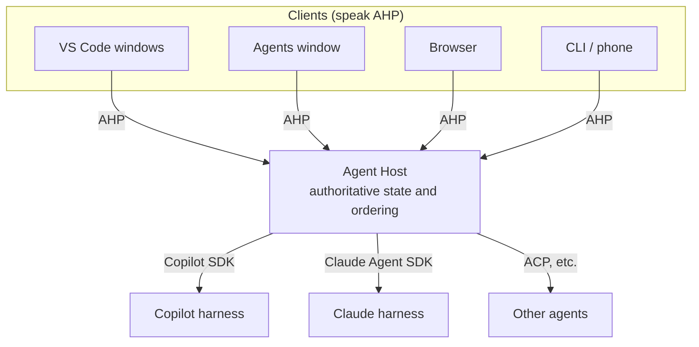
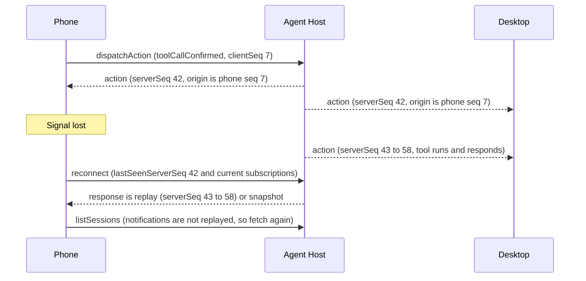
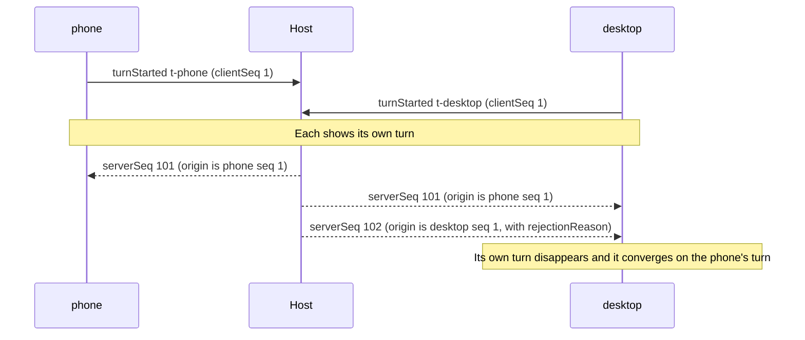
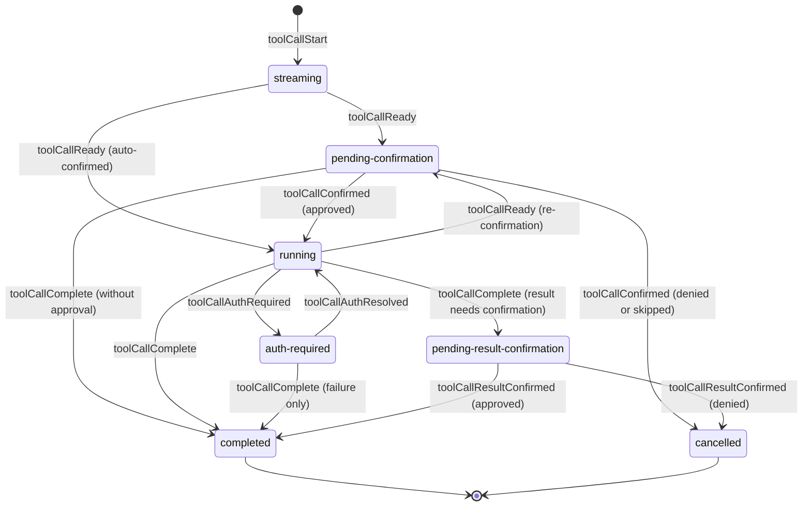

## Introduction

On August 26, 2026, the VS Code team announced the Agent Host in the blog post "[Introducing the Agent Host for persistent, portable agent sessions](https://code.visualstudio.com/blogs/2026/08/26/agent-host-architecture)". It moves agent sessions out of editor windows and into a dedicated process. Locally the Agent Host runs as a VS Code utility process; remotely it runs as a standalone server. A turn keeps running after you close its folder, and the same session can be opened from an editor window, from the Agents window, or from a browser.

The protocol between that host and its clients is the Agent Host Protocol (AHP), the subject of this article. The spec reached v1.0.0 on October 2, 2026, and the [VS Code 1.144 release notes](https://code.visualstudio.com/updates/v1_144) of October 28 introduced it with "With language servers in mind, we designed the Agent Host Protocol (AHP) to allow any client to interact with agent sessions." The repository describes it as "Synchronized multi-client state for AI agent sessions."

MCP defines how agents connect to tools, and the Agent Client Protocol (ACP) defines a one-to-one conversation between an editor and an agent. AHP addresses a different problem:

> What has to be agreed on so that an agent session — one that runs for a long time, stops to wait for human decisions, and can be opened from anywhere — can be shared consistently across several screens?

This article reads how the AHP spec answers that question and organizes what you need to get right when implementing a client or a host. Rather than just paraphrasing the spec, I ran the published canonical reducers to check behaviors that the documents do not spell out.

Sources:

- The spec, guides, canonical type definitions (`types/`), and SDKs in [microsoft/agent-host-protocol](https://github.com/microsoft/agent-host-protocol): the `spec/v1.0.0` tag and `main` as of November 2, 2026, Japan time (commit [`ff7d6a1`](https://github.com/microsoft/agent-host-protocol/tree/ff7d6a1c7b4f5e47925d3ce1c3bcf685266a6d49))
- `@microsoft/agent-host-protocol` 1.0.0 from npm. All verification code in this article runs against the reducers in this package
- VS Code's [Agent Host documentation](https://code.visualstudio.com/docs/agents/concepts/agent-host) and `src/vs/platform/agentHost` in [microsoft/vscode](https://github.com/microsoft/vscode/tree/main/src/vs/platform/agentHost) (`main` as of November 2, 2026)

One caveat up front. AHP moves fast: there were 11 releases in a little over four months, from 0.2.0 in May 2026 to 1.0.0 in October. Work on the next development version (1.1.0) is already under way on `main`, and since v1.0.0 it has gained windowed delivery (per-subscription flow control), a TCP channel, multiple steering messages, per-chat configuration and per-chat agents, and more. This article treats the v1.0.0 spec as the baseline and labels everything else "draft (`main`)". Note that VS Code tracks `main`: at the time of writing it vendors an AHP commit newer than v1.0.0 (`d7a5579b`, October 30).

Here is the plan. Chapter 1 sets up the problem; chapters 2–3 cover the protocol's skeleton and the connection lifecycle. Chapters 4–6 are the core of the article: implementing optimistic updates, the division of labor between reducers and the host (including a minimal host and how to prepare for host restarts), and reconnection and resending, all with running code. Chapters 7–11 cover human decisions, client-provided tools, terminals, security, and large sessions; chapters 12–14 cover versioning, comparisons with other protocols, and the state of implementations; chapters 15–16 close with an implementation checklist and a discussion.

## The Short Answer

| Question | AHP's answer | Main mechanisms | Chapter |
|---|---|---|---|
| Who holds the correct state? | The host. Clients subscribe and keep replicas | Per-channel state, snapshots | 1, 2 |
| How does state change? | Typed actions go through pure reducers. The same reducers run on both the host and the clients | `ActionEnvelope`, `chatReducer`, … | 2 |
| How does a screen that joins late, or comes back from a disconnect, catch up? | A screen that joins late subscribes and receives a snapshot. A screen that comes back from a disconnect reports the last sequence number it saw and receives either the missed actions or a fresh snapshot | `subscribe` and `fromSeq`, `serverSeq`, `reconnect` | 3 |
| How does a client wait for the result of an operation? | It does not wait. It applies the operation locally first and treats the action the host sends back with a sequence number (the echo) as the confirmation | `dispatchAction`, `clientSeq`, `origin` | 4 |
| What happens with concurrent operations? | The host decides the order and sends back operations it does not accept, with a reason. Nothing is merged | `rejectionReason`, host validation | 4, 5 |
| Who enforces invariants? | The host, not the reducers. Reducers only drop operations whose target does not match; they do not decide what to accept | Validation tables, turn admission | 5 |
| What about operations sent during a disconnect? | The protocol does not say. Determine whether they arrived, then decide per kind of operation whether to resend | Matching echoes, client-chosen IDs | 6 |
| How does the session wait for human decisions? | Approvals, questions, and authentication are states in a state machine, answerable from any screen | Tool call states, `inputNeeded`, `SessionStatus` | 7 |
| How are capabilities that only a client has used? | Tool registration and execution are both shared state, not RPC | `session/activeClientSet`, `contributor` | 8 |
| What does AHP leave undefined? | Agent reasoning, tool definitions, models, authentication of the connection itself, filesystem assumptions, agent-to-agent coordination | The doctrine's anti-goals, the Transport chapter | 1, 10 |

## 1. The Problem: Who Owns the Session?

### 1.1 The limits of a window owning the session

Before the Agent Host, VS Code ran the agent harness (the implementation that calls the model, runs tools, and drives the agent loop) inside each window's extension host. According to the VS Code team's blog post, this tied agent execution to a window: closing the window stopped it, and every window loaded its own copy of the machinery. So they moved session state, harness adapters, and baseline workspace capabilities into a dedicated process, and windows became clients connecting to it.

This is not specific to VS Code. Agent sessions have properties that ordinary chats never had:

- <strong>They run for a long time.</strong> Work continues for minutes to hours, including while nobody is watching
- <strong>They stop to wait for humans.</strong> Approving a tool call, answering the agent's question, authenticating
- <strong>Output arrives incrementally.</strong> Both text and tool progress are streamed
- <strong>Where they run and where they are viewed differ.</strong> They run on the machine or container that has the repository and are viewed from a laptop, a browser, or a phone
- <strong>They are opened from several screens at once.</strong> And they can be operated from several screens at once

As long as a UI process owns the session, the first four are hard to satisfy. But once the session is separated from the UI, the last property — keeping state consistent across several screens — becomes the problem.

### 1.2 What happens when several screens share a session

Consider a concrete scenario. On your desktop, you ask an agent to fix the build. On the move, you check progress on your phone and approve a tool call. Back home, you look at the result in a browser.

A straightforward design would have the host stream events to each screen over WebSocket or SSE while screens send operations over HTTP. You would quickly run into problems like these:

- <strong>A screen that joins late.</strong> It has none of the past events, so it needs the current state in one piece from somewhere
- <strong>Disconnects.</strong> It is unclear where to resume the events that were sent while the phone had no signal
- <strong>Concurrent operations.</strong> If you approve on the phone and deny on the desktop at the same moment, which wins? How does the losing screen roll back what it shows?
- <strong>Latency.</strong> Waiting for the server's response after pressing send makes the UI lag on a mobile connection
- <strong>Different agents.</strong> Every screen would have to understand the event formats of Copilot, Claude, and Codex alike

Each of these is a restatement of a classic distributed-systems problem: keeping replicated state consistent.

### 1.3 AHP's answer

AHP's answer can be summarized like this:

1. The host (the Agent Host) holds the authoritative state
2. State is split into "channels" named by URIs, and clients subscribe only to the channels they want
3. On subscribing, a client first receives a snapshot of the current state, then the actions that change it, in the order of sequence numbers assigned by the host
4. Actions are applied to state by pure-function reducers, and the host and the clients use the same reducers
5. Clients send their own operations as actions too, and apply them locally at the same time. An operation is confirmed when the host sends it back with a sequence number
6. When the connection drops, the client reports the last number it saw and receives either what it missed or a fresh snapshot

Keeping state in one place and changing it with actions and reducers is the same as Redux. Applying locally first and confirming in the order the server decides resembles client-side prediction and server reconciliation in multiplayer game netcode, or sync engines such as Replicache. AHP does not, however, take the CRDT route of merging concurrent changes. The host resolves conflicts by ordering, and operations that do not go through are sent back with a reason. Section 4.6 explains why that is enough.



Downstream, the host talks to agents through each agent's SDK or through ACP and translates their events into AHP actions. VS Code's Agent Host has adapters for Copilot (via the Copilot SDK), Claude (via the Claude Agent SDK), and Codex. The AHP spec defines only the upper half of the diagram: the link between clients and the host.

The official guide "[AHP and the Agent Client Protocol](https://microsoft.github.io/agent-host-protocol/guide/ahp-and-acp)" describes the relationship as "AHP is a mutex over ACP." ACP defines a conversation between one client and one agent; AHP wraps that conversation in ordering and synchronization machinery so that N clients can participate without stepping on each other.

The design principles are collected in a document called the "[doctrine](https://microsoft.github.io/agent-host-protocol/guide/doctrine)". In summary:

| Principle | Meaning |
|---|---|
| State-first | New features start from "what durable state does a client need to render or reconcile?", not "which backend event happened?" User-visible truth must be recoverable from state |
| Host-authoritative and client-responsive | Clients may apply their own operations first, but the host is authoritative, and it sequences the outcome of conflicts |
| Easy to adopt incrementally | A useful host or client should be possible with just the root and session channels, session creation, and basic turns |
| Opinionated about synchronization, not agent implementation | It does not prescribe the agent loop, model provider, tool schema, authentication system, or filesystem assumptions |
| Channel-oriented | Everything pushed belongs to a URI-addressed channel |
| A client-facing presentation model | Backend-specific details such as private tool names do not become part of the client contract |
| Explicit escape hatches | Provider-specific information goes in places like `_meta` and is not required for the baseline experience |
| Evolution through compatibility and capabilities | Optional fields, ignored unknown metadata, and capability checks are preferred over forcing everyone to upgrade at once |

Conversely, the things AHP explicitly does not define (its anti-goals) are how agents reason, plan, call tools, or manage context; model providers or credential flows; a universal backend tool registry; UI layout; a requirement that every workspace has a local filesystem or Git repository; agent-to-agent coordination; and a replacement for ACP.

## 2. The Big Picture: Channels, State, Actions, Reducers

### 2.1 Channels

In AHP, everything that is pushed belongs to a "channel". A channel is identified by a URI and each one holds a state tree (state is never modified in place; each change produces a new object). The channels in v1.0.0 are as follows (stability levels are explained in chapter 12).

| URI | State type | Contents | Stability |
|---|---|---|---|
| `ahp-root://` | `RootState` | Available agents and models, the terminal list, host configuration. Exactly one always exists | 2 (Stable) |
| `ahp-session:/<uuid>` | `SessionState` | Session metadata, the list of chats, the default chat, participating clients, the aggregate of pending input | 2 (Stable) |
| `ahp-chat:/<uuid>` | `ChatState` | One conversation: turns, the streaming response, tool calls, pending messages, input requests | 2 (Stable) |
| `ahp-terminal:/<id>` | `TerminalState` | One pseudo-terminal (pty) | 2 (Stable) |
| `ahp-changeset:/<id>` | `ChangesetState` | A set of file changes (a branch diff, uncommitted changes, …) | 1.2 (Release candidate) |
| `ahp-resource-watch:/<id>` | `ResourceWatchState` | A file watch | 2 (Stable) |
| URIs starting with `ahp-otlp:` | Empty | OpenTelemetry logs, traces, and metrics. Data arrives only as notifications | 2 (Stable) |
| `ahp-automations://` and `ahp-automation-run:/<id>` | `AutomationState`, … | Automations triggered by schedules or events, and their runs | 1.0 (Early development) |
| `ahp-canvas:/<id>` | `CanvasState` | A canvas | 1 (Experimental) |

There are also session annotations (`ahp-session:/<uuid>/annotations`) and an `mcp://` channel for MCP Apps (section 13.3). The draft (`main`) adds an `ahp-tcp:` channel that forwards a TCP connection on the host's network.

Channels are also the routing key on the wire. The `params` of every request and every notification must contain a member called `channel`. Session commands carry the session's URI; connection-level commands (`initialize`, `ping`, `reconnect`, `listSessions`, `authenticate`, the `resource*` file operations, and so on) carry `ahp-root://`. As a result, servers, clients, and any proxy in between can route a message by looking only at `(method, params.channel)`. The canonical TypeScript definitions even include a compile-time check for this rule (`types/version/message-checks.ts`).

Note that clients choose session URIs. For chat URIs, the spec's prose says the server allocates them at creation time, while the type definition's `CreateChatParams.chat` says "client-chosen" and makes it a required parameter (in both v1.0.0 and `main`). Since the type definitions decide the wire format, the caller of `createChat` supplies the URI. Either way, receivers treat both kinds of URI as opaque.

### 2.2 What a phone subscribes to

Let's walk through a concrete flow. For a phone client to show the session list and open one conversation, the steps are:

1. Start the connection with `initialize`, putting `ahp-root://` in `initialSubscriptions`. The response contains a snapshot of `RootState` (available agents and models, the terminal list, and so on)
2. Fetch the session list with `listSessions`. It can be paginated with `limit` and `cursor`, and results come most recently modified first
3. From then on, keep the list current with the `root/sessionAdded`, `root/sessionRemoved`, and `root/sessionSummaryChanged` notifications on the root channel
4. When a session is opened, subscribe to `ahp-session:/<uuid>`. This delivers the list of chats, the default chat (`defaultChat`), and the aggregate of pending input (`inputNeeded`)
5. When a conversation is opened, subscribe to `ahp-chat:/<uuid>`. To receive only the last 20 turns, pass `view: { turns: 20 }`, and load older turns with `fetchTurns` when needed

Notice that the session list is not part of the state tree. Because it can grow without bound, it is fetched imperatively and kept fresh through lightweight notifications. For the same reason, each session's summary (title, status, modification time, …) is distributed via `root/sessionSummaryChanged`, so a list screen does not have to subscribe to every session.

### 2.3 State and notifications

A channel delivers two kinds of things: actions that change state, and notifications that are not kept in state.

| | Actions | Notifications |
|---|---|---|
| Examples | `chat/delta`, `chat/toolCallReady`, `session/titleChanged` | `root/sessionAdded`, `auth/required`, `root/progress` |
| Effect on state | Change state through a reducer | None |
| Sequence number | Carry a `serverSeq` | None |
| On reconnect | Missed ones are replayed | Not replayed; fetch again if needed |

This distinction is why the doctrine says that user-visible truth must be recoverable from state. Notifications are kept to short-lived signals, and every fact that must persist lives in state. As long as that rule holds, a screen that joins late and a screen that comes back from a disconnect both arrive at the same view from snapshots and actions alone.

### 2.4 Actions and envelopes

Actions form a discriminated union keyed by `type`, and they are the only way to change state. On the wire they always arrive wrapped in an envelope.

```json
{
  "jsonrpc": "2.0",
  "method": "action",
  "params": {
    "channel": "ahp-chat:/3f1c...",
    "action": { "type": "chat/toolCallConfirmed", "turnId": "t1", "toolCallId": "tc1", "approved": true, "confirmed": "user-action" },
    "serverSeq": 6,
    "origin": { "clientId": "client-1", "clientSeq": 1 }
  }
}
```

| Member | Meaning |
|---|---|
| `channel` | The channel the action changes. The action body does not carry a session or terminal URI; the envelope gives the destination |
| `action` | The action itself |
| `serverSeq` | A monotonically increasing sequence number assigned by the host |
| `origin` | The `clientId` of the client that sent the action, and the `clientSeq` that client assigned. Absent for actions the host itself originates |
| `rejectionReason` | A human-readable reason, present only when the host did not accept a client's operation |

Some actions can be sent by clients (client-dispatchable) and some can only be originated by the host. For example, `chat/turnStarted` (send a message), `chat/toolCallConfirmed` (approve or deny a tool call), `chat/turnCancelled` (cancel), and `session/titleChanged` (rename) can be sent by clients. `chat/delta` (append response text), `chat/responsePart` (create a response part), and `chat/toolCallStart` / `chat/toolCallReady` (a tool call starting and becoming ready) come from the agent backend, so only the host originates them. The distinction is generated from the `@clientDispatchable` JSDoc tag in the type definitions and can be checked with `isClientDispatchable()` in the SDKs. The example above is the echo of an approval a client sent. Note that the envelope example in the spec's subscriptions chapter puts an `origin` on `chat/delta`, but actions the host originates carry no `origin`.

### 2.5 Commands versus actions

AHP messages are JSON-RPC 2.0 and come in two forms: requests, which get responses, and notifications, which do not.

| Kind | Examples | Response |
|---|---|---|
| Commands (requests) | `initialize`, `reconnect`, `subscribe`, `createSession`, `disposeSession`, `createChat`, `listSessions`, `fetchTurns`, `completions`, `authenticate`, `resourceRead`, … | Yes (a result or a JSON-RPC error) |
| Sending an action | `dispatchAction` | None. The echoed envelope stands in for a reply |
| Ending a subscription | `unsubscribe` | None |

The important point is that `dispatchAction` is a notification. It is fire-and-forget, and no JSON-RPC response comes back. Whether an operation was accepted is shown by the envelope the host sends back with a `serverSeq` — the one whose `origin` carries your own `clientId` and `clientSeq`.

Also, the operations at the heart of the interaction are sent as actions themselves, not as commands. When a client sends `chat/turnStarted`, the host applies it to state and, as a side effect, starts the agent's processing. `chat/turnCancelled` stops it. The Actions guide explains that this avoids a separate layer that translates commands into actions. Only operations that need to return a result, such as creating a session or reading a file, are commands.

### 2.6 Pure reducers and their conformance tests

Actions are applied to state by a reducer for each kind of channel.

```typescript
rootReducer(state: RootState, action: RootAction): RootState
sessionReducer(state: SessionState, action: SessionAction): SessionState
chatReducer(state: ChatState, action: ChatAction): ChatState
terminalReducer(state: TerminalState, action: TerminalAction): TerminalState
```

Reducers are pure functions without side effects, and the same code runs on both the host and the clients. This is what allows a client to apply its own operations first (write-ahead). Side effects such as forwarding a message to the agent are handled by a separate layer.

If the reducer read the current time, the host and each client would get different results. So timestamps travel inside actions too. `chat/turnStarted` carries `startedAt` (an ISO 8601 timestamp) and `chat/turnComplete` carries `duration` (milliseconds), and the reducer computes `modifiedAt` as `startedAt + duration`. A comment in the type definitions stresses that clients must not compute elapsed times from their own clocks, because clocks can differ between clients.

Unknown actions are also handled. The reducers' `switch` statements are exhaustive, so forgetting to handle a newly added type is a compile error. At run time, however, an unknown `type` only produces a log message instead of an exception (`softAssertNever`). That way, an old client connected to a newer host does not crash on an action it does not know.

The types are generated from the canonical TypeScript definitions into Rust, Kotlin, Swift, Go, and .NET. Reducer behavior is kept consistent by language-independent JSON fixtures in `types/test-cases`. As of v1.0.0 there are 308 reducer fixtures, 68 serialization round-trip fixtures, and a set of version-negotiation fixtures, and each SDK's tests load them. A reducer fixture has a simple three-part shape: an initial state, a list of actions, and the expected state.

```json
{
  "description": "session/ready",
  "reducer": "session",
  "initial": { "provider": "copilot", "title": "Test Session", "status": 1, "lifecycle": "creating", "activeClients": [], "chats": [] },
  "actions": [{ "type": "session/ready" }],
  "expected": { "provider": "copilot", "title": "Test Session", "status": 1, "lifecycle": "ready", "activeClients": [], "chats": [] }
}
```

If you implement a host or a client yourself, passing these fixtures first is the shortest path.

## 3. The Connection Lifecycle

### 3.1 initialize and version negotiation

A connection starts with the client's `initialize` request.

```json
{
  "jsonrpc": "2.0",
  "id": 1,
  "method": "initialize",
  "params": {
    "channel": "ahp-root://",
    "protocolVersions": ["1.0.0", "0.9.0"],
    "clientId": "phone-7f3c",
    "clientInfo": { "name": "my-ahp-client", "version": "0.1.0" },
    "initialSubscriptions": ["ahp-root://"],
    "locale": "ja"
  }
}
```

`clientId` identifies the same logical client across reconnects (section 6.4), and `clientInfo` is the implementation's name and version. `clientInfo`, along with the `serverInfo` the host returns, is modeled on LSP and is purely informational, for logs and display. The spec says peers SHOULD NOT gate behavior on parsing the other side's version string; feature availability is determined by capabilities. `locale` lets the host localize strings such as the labels on tool-approval buttons.

The host's response contains the selected protocol version, the current `serverSeq`, and snapshots for `initialSubscriptions`, plus host capabilities such as `defaultDirectory` (a starting point for file pickers), `completionTriggerCharacters` (characters that trigger `@`-mention completion), `terminalCommandPrefix` (the prefix that marks a message as a terminal command; the convention is `!`, and if it is absent the host does not support it), `telemetry` (telemetry channels), and `automations` (automation support).

Version negotiation resembles WebSocket subprotocol negotiation: the client lists the versions it can speak and the host picks one. The selection rule needs care, though. The spec describes the array as ordered by preference, but the host picks the newest offered version within the ranges it supports (caret-compatible ranges — in v1.0.0, `>=1.0.0 <2.0.0` and `>=0.9.0 <0.10.0`), regardless of order. Checking with the SDK's `negotiateProtocolVersion`:

```text
negotiateProtocolVersion(['0.9.0', '1.0.0'])  → '1.0.0'   the newer one, regardless of order
negotiateProtocolVersion(['1.2.99', '1.10.0']) → '1.10.0'  compared numerically, not as strings
negotiateProtocolVersion(['2.0.0', '0.10.0'])  → undefined nothing in a supported range
```

If nothing can be selected, the host returns `UnsupportedProtocolVersion` (`-32005`) with the list of supported versions in `data.supportedVersions` and closes the connection. If even one malformed string such as `1.0` or `1.0.0-beta` is offered, negotiation fails with an error.

This selection rule has another consequence. Because the host picks "the newest string the client offered that falls within my ranges", a host that implements only 1.0.0 features still returns `1.10.0` if the client offers `1.10.0` (the second example above). The negotiated version string does not tell you which features the host has. Always check capabilities for that.

The spec says clients SHOULD offer as wide a range of versions as they can, because hosts may be remote machines or cloud services that the user cannot update, whereas clients are easy to update. Each SDK exports the versions its build can speak as `SUPPORTED_PROTOCOL_VERSIONS`, and normally you just pass that.

### 3.2 subscribe and snapshots

After connecting, a client subscribes to channels to receive state.

```json
{ "jsonrpc": "2.0", "id": 3, "method": "subscribe", "params": { "channel": "ahp-session:/9b2e..." } }
```

```json
{
  "jsonrpc": "2.0",
  "id": 3,
  "result": {
    "snapshot": {
      "resource": "ahp-session:/9b2e...",
      "state": { "provider": "copilot", "title": "New Session", "status": 1, "lifecycle": "creating", "chats": [], "activeClients": [] },
      "fromSeq": 5
    }
  }
}
```

`fromSeq` is the `serverSeq` at which the snapshot was taken. The spec guarantees that every action the host sends after the snapshot has a `serverSeq` greater than `fromSeq`. So an action at or below `fromSeq` is already reflected in the snapshot.

`subscribe` in v1.0.0 has two optional parameters:

- <strong>`delivery.maxLatencyMs`</strong>: the longest the host may hold updates in order to batch them. The host may batch updates within that window, but only if the result is the same state the client would have reached had each update been sent immediately (the draft adds the condition that the client still receives every event the channel requires). Merging two `chat/delta` actions for the same response part into one is the typical use. `0` asks the host to send each update immediately without batching
- <strong>`view.turns`</strong>: roughly how many completed turns to include in a chat snapshot. If older turns remain, `ChatState.turnsNextCursor` is present; passing it to `fetchTurns` makes the host prepend older turns to the state via `chat/turnsLoaded`. Before accepting an operation that references an older turn outside the loaded window (a fork, truncation to an older turn, and so on), the host must load that turn into state

The draft (`main`) adds a rule that a client has at most one subscription per channel, and that sending `subscribe` again for a channel it is already subscribed to changes the existing subscription's settings (it arrived together with windowed delivery and is not in v1.0.0).

One implementation note: a channel's actions can arrive immediately after the `subscribe` response. If you set up the receiver only after the response arrives, you can lose actions in between. The TypeScript SDK's `subscribe()` registers the receiver before sending the request. Do the same in your own code.

### 3.3 Properties of serverSeq

A few properties of `serverSeq` are worth knowing before you implement anything:

- <strong>It is treated as a single sequence for the whole host.</strong> The `serverSeq` in the `initialize` response, each snapshot's `fromSeq`, and each action's `serverSeq` come from the same sequence, and on reconnect the client sends a single `lastSeenServerSeq`
- <strong>Clients see gaps.</strong> A client receives actions only for the channels it subscribes to, so the numbers it sees skip. Do not treat gaps as loss
- <strong>Loss on the wire is prevented by the transport's properties.</strong> The spec requires a transport that delivers messages in order, reliably (no silent drops), bidirectionally, and completely (no partial messages). On WebSocket, each text frame carries exactly one JSON-RPC message. Loss on the wire can happen only when the connection drops, and the next `reconnect` fills the gap

Events can still be lost inside the client after they arrive, though. The TypeScript SDK buffers up to 4096 events per subscription by default (1024 for the stream into which `MultiHostClient` merges events from several hosts), and when a reader falls behind and the limit is exceeded, it drops the oldest events and moves the reader forward. Since gaps are normal, the client cannot detect this as loss. The SDK's own comments advise that if you cannot afford to drop a single event, you should drain promptly or raise the limit. Do not let rendering or other heavy work stall event processing.

To check that a connection is alive, you can use AHP's `ping` command. The host must answer `ping` even before `initialize` and even without subscriptions. It also helps keep proxies and load balancers in between from closing an idle connection on a timeout. WebSocket's own ping frames are also allowed, but as the TypeScript SDK points out, browsers cannot send WebSocket ping frames, so browser clients should use the `ping` command.

Chapter 16 returns to the property that the whole host shares one sequence.

### 3.4 reconnect

When the connection drops, the client sends `reconnect` on a new connection.

```json
{
  "jsonrpc": "2.0",
  "id": 2,
  "method": "reconnect",
  "params": {
    "channel": "ahp-root://",
    "clientId": "phone-7f3c",
    "lastSeenServerSeq": 42,
    "subscriptions": ["ahp-root://", "ahp-session:/9b2e...", "ahp-chat:/3f1c..."]
  }
}
```

The host answers in one of two ways. If it still has the missed actions, it returns them all inside the response (`type: "replay"`). Channels it can no longer resume (disposed sessions, or channels the client is no longer permitted to observe) are listed in `missing`, and the client drops them from its subscription set. If the gap is too large to replay, it returns fresh snapshots of each channel instead (`type: "snapshot"`). This form has no `missing`, so a channel that has state but for which no snapshot comes back should be treated as one that could not be resumed. Channels without state, such as `ahp-otlp:`, never have snapshots in the first place; v1.0.0 says such channels are re-subscribed and missed messages are dropped (whether a new `subscribe` is needed is discussed in section 11.3; the draft also allows omitting snapshots for channels whose state is empty). How far back the host can replay — the size of its replay buffer — is up to the implementation; VS Code's host keeps the most recent 1000 actions.

```json
{
  "jsonrpc": "2.0",
  "id": 2,
  "result": {
    "type": "replay",
    "actions": [
      { "channel": "ahp-chat:/3f1c...", "action": { "type": "chat/delta", "turnId": "t1", "partId": "p1", "content": "..." }, "serverSeq": 43 },
      { "channel": "ahp-chat:/3f1c...", "action": { "type": "chat/turnComplete", "turnId": "t1", "duration": 5300 }, "serverSeq": 44 }
    ],
    "missing": []
  }
}
```

It matters that the replayed actions are inside the response: once the client has processed the response, it knows every gap has been filled.

Ordinary `action` notifications can still arrive before the response, however. v1.0.0 requires the replayed actions to be inside the response, but it does not say the host must not send ordinary notifications before it (the draft forbids that only for windowed subscriptions). With a store that drops duplicates by `serverSeq`, like the one in chapter 4, processing a newer action before the response would cause every replayed action with a lower number to be discarded. Clients should buffer incoming notifications until the `reconnect` response has been applied, then process them in order (section 6.6 puts the whole reconnect procedure in one place). On the host side, it is safest to send the response first and only then resume ordinary delivery to that client (the section 5.5 code does this).



Notifications, on the other hand, are not replayed. A reconnected client must fetch the session list again with `listSessions` and re-check the state of resources that require authentication (`auth/required` is also a notification, so any sent during the disconnect are lost).

### 3.5 When the host goes down

For the case where the host process terminates unexpectedly, the spec says in-progress turns SHOULD be considered failed. Clients reconnect to the restarted host through the normal reconnection flow.

VS Code's documentation also cautions that being able to reconnect does not mean work continued while the host was stopped. VS Code manages the local Agent Host, so to keep local sessions running, you must keep the application itself running even after closing the folder. A session cannot outlive its host process.

## 4. Implementing Optimistic (Write-Ahead) Updates

### 4.1 Three states

The AHP guide "[Write-Ahead Reconciliation](https://microsoft.github.io/agent-host-protocol/guide/reconciliation)" has each client keep three things per subscription:

- <strong>`confirmedState`</strong>: the state the host has confirmed
- <strong>`pendingActions`</strong>: your own operations that you have applied locally but whose echo has not come back yet
- <strong>`optimisticState`</strong>: `confirmedState` with `pendingActions` applied in order. It is computed, not stored

The UI always renders `optimisticState`. The message appears the moment you press send, stays when the host confirms it, and disappears if the host rejects it.

When an envelope arrives, there are three cases. In every case, recompute `optimisticState` at the end.

1. <strong>The echo of your own operation.</strong> `origin.clientId` is you and it matches the head of `pendingActions`. Remove the head and apply it to `confirmedState`
2. <strong>Someone else's operation, or the host's own.</strong> Apply it to `confirmedState`. The remaining `pendingActions` are rebased onto the new `confirmedState`
3. <strong>A rejected operation.</strong> It carries a `rejectionReason`. Remove it from `pendingActions` (which undoes the optimistic effect). The reason may be shown to the user

Because the reducers are pure, "rebasing" needs no special logic: after `confirmedState` changes, you simply apply the pending operations again.

### 4.2 A store for one channel

Written directly in TypeScript, it looks like this. I wrote it to verify this article: it passes `tsc --strict` against the types of `@microsoft/agent-host-protocol` 1.0.0 from npm, and it runs in the simulation shown below.

```typescript
import type { ActionEnvelope, StateAction } from '@microsoft/agent-host-protocol';

type Reducer<S> = (state: S, action: StateAction) => S;
type Pending = { clientSeq: number; action: StateAction };

/** Keeps one channel's replica as confirmed state plus pending operations */
export class OptimisticChannel<S> {
  private confirmed: S;
  private appliedSeq: number;
  private pending: Pending[] = [];
  private readonly clientId: string;
  private readonly reduce: Reducer<S>;

  constructor(clientId: string, reduce: Reducer<S>, snapshot: { state: S; fromSeq: number }) {
    this.clientId = clientId;
    this.reduce = reduce;
    this.confirmed = snapshot.state;
    this.appliedSeq = snapshot.fromSeq;
  }

  /** The UI always renders this */
  get view(): S {
    return this.pending.reduce((s, p) => this.reduce(s, p.action), this.confirmed);
  }

  get pendingCount(): number {
    return this.pending.length;
  }

  /** Record with the same clientSeq you send in dispatchAction */
  addPending(clientSeq: number, action: StateAction): void {
    this.pending.push({ clientSeq, action });
  }

  /** Called for each action notification from the host */
  receive(env: ActionEnvelope): void {
    if (env.serverSeq <= this.appliedSeq) return; // already in the snapshot or already applied
    this.appliedSeq = env.serverSeq;

    const origin = env.origin;
    if (origin?.clientId === this.clientId) {
      // Echo of our own operation. Match by clientSeq instead of relying on arrival order
      this.pending = this.pending.filter(p => p.clientSeq !== origin.clientSeq);
    }
    if (env.rejectionReason === undefined) {
      this.confirmed = this.reduce(this.confirmed, env.action);
    }
  }

  /** Call after the reconnect result and any notifications buffered until then have been processed. Takes out the operations that never got an echo */
  takeUnacknowledged(): Pending[] {
    const unacknowledged = this.pending;
    this.pending = [];
    return unacknowledged; // whether to resend is the app's decision (chapter 6)
  }

  /** Called when reconnect returns a snapshot (take out pending operations with takeUnacknowledged() after processing buffered notifications) */
  resetTo(snapshot: { state: S; fromSeq: number }): void {
    this.confirmed = snapshot.state;
    this.appliedSeq = snapshot.fromSeq;
  }
}
```

### 4.3 The decisions in this code

The code is short, but it encodes several decisions that come from reading the spec.

<strong>1. Do not wait for a reply.</strong> `dispatchAction` is a notification, so no JSON-RPC response arrives. Acceptance is signaled by an envelope whose `origin` carries your `clientId` and `clientSeq`.

<strong>2. Drop duplicates by `serverSeq`.</strong> Actions at or below the snapshot's `fromSeq` are already in the snapshot. As we will see, applying the same `chat/delta` twice appends the text twice. Deduplication is the receiver's job, not the reducer's.

<strong>3. Match echoes by `clientSeq`, and deal with operations that never get an echo at reconnect time.</strong> The guide's algorithm assumes the echo matches the head of the pending queue. But the spec never states that one client's operations are echoed in the order they were sent. Matching by `clientSeq` removes any dependence on order. On the other hand, some operations can be left without an echo. Operations sent just before the connection dropped are the typical case. Beyond that, VS Code's host implementation (`_dispatchClientActionNow` in `protocolServerHandler.ts`) abandons processing without an echo when it notices mid-validation that the connection has been closed. And the host MUST ignore operations addressed to a nonexistent channel without an echo. Take such operations out with `takeUnacknowledged()` once the reconnect result and the buffered notifications have been processed, and handle them by the chapter 6 policy (section 6.6 gives the procedure). Note that `resetTo()` replaces the channel's applied number with the snapshot's `fromSeq`; section 5.6 shows why that number can go down. If an operation goes without an echo for a long time while the connection is up, it can also be worth telling the user.

<strong>4. Do not apply rejected operations to confirmed state.</strong> This sounds obvious, but the convenience mirrors bundled with the SDKs (TypeScript's `AhpStateMirror` and `MultiHostStateMirror`, and the mirrors in Rust, Swift, Go, and .NET) all apply envelopes without checking `rejectionReason` at the commit I read. Moreover, as we will see, VS Code's host delivers rejected envelopes to all subscribers (section 5.2). If you use a convenience mirror as your confirmed state, filter out envelopes that carry `rejectionReason` before passing them in. Also note that neither of the two TypeScript mirrors handles `ahp-chat:` channels (the Rust mirror does), so in TypeScript you have to keep chat state yourself using the reducers directly.

<strong>5. Recompute the rebase every time.</strong> `view` re-applies the pending operations on every call. There are usually only a handful of pending operations, so this is fast enough.

### 4.4 Wiring it to the SDK

Combined with the TypeScript SDK, it looks like this (assume the app provides `loadOrCreateClientId`, `render`, `hostUrl`, and `chatUri`; this also passes `tsc --strict`).

```typescript
import { chatReducer, SUPPORTED_PROTOCOL_VERSIONS, ActionType, MessageKind } from '@microsoft/agent-host-protocol';
import type { ChatAction, ChatState, StateAction } from '@microsoft/agent-host-protocol';
import { AhpClient } from '@microsoft/agent-host-protocol/client';
import { WebSocketTransport } from '@microsoft/agent-host-protocol/ws';
import { OptimisticChannel } from './optimistic-channel';

const clientId = await loadOrCreateClientId(); // an ID persisted on the device (section 6.4)
const transport = await WebSocketTransport.connect(hostUrl); // authenticating the connection itself depends on the host (chapter 10)
const client = new AhpClient(transport);
client.connect();
await client.initialize({ clientId, protocolVersions: SUPPORTED_PROTOCOL_VERSIONS, initialSubscriptions: ['ahp-root://'] });

// subscribe() registers the receiver before sending the request, so actions right after the response are not lost
const { result, subscription } = await client.subscribe(chatUri, { view: { turns: 20 } });
const snapshot = result.snapshot!;
const chat = new OptimisticChannel<ChatState>(
  clientId,
  (state, action) => chatReducer(state, action as ChatAction),
  { state: snapshot.state as ChatState, fromSeq: snapshot.fromSeq },
);

void (async () => {
  for await (const event of subscription) {
    if (event.type === 'action') {
      chat.receive(event.params);
      render(chat.view);
    }
  }
})();

let nextClientSeq = 1; // assign clientSeq yourself (section 6.4)
function send(action: StateAction): void {
  const clientSeq = nextClientSeq++;
  chat.addPending(clientSeq, action);
  client.dispatch(chatUri, action, clientSeq);
  render(chat.view);
}

send({
  type: ActionType.ChatTurnStarted,
  turnId: crypto.randomUUID(),
  startedAt: new Date().toISOString(),
  message: { text: 'Fix the build', origin: { kind: MessageKind.User } },
});
```

There is one TypeScript-specific snag. The type declarations (`.d.ts`) in the npm 1.0.0 package declare `ActionType`, `SessionStatus`, and others as `declare const enum`. The runtime code does contain ordinary enum objects, but in projects with `isolatedModules` (the default in Next.js and Vite) or `verbatimModuleSyntax` enabled, referencing them as values, as in `ActionType.ChatTurnStarted`, fails with error TS2748. In that case, import the types only, use them in type position as in `'chat/turnStarted' as ActionType.ChatTurnStarted`, and add `satisfies StateAction` to the whole object to keep type checking.

### 4.5 When two screens act at the same time

I created two of these stores, connected them to a simple in-memory host, and reproduced a phone and a desktop operating at the same time. The host has only two validations: one the spec requires (reject `chat/toolCallConfirmed` for a tool call that is not awaiting confirmation) and one the spec does not mention (reject `chat/turnStarted` on a chat that already has an active turn; section 5.3 discusses the latter).



At each stage, the screens showed the following (`status` is the bitset explained in section 7.2; 8 means in progress and 24 means input needed).

| Stage | Phone shows | Desktop shows |
|---|---|---|
| 1. Right after both sent `chat/turnStarted` | Its own turn "fix the build", 1 pending | Its own turn "write tests", 1 pending |
| 2. After the echoes arrive | "fix the build", 0 pending | "fix the build", 0 pending (its operation was rejected) |
| 3. The tool call awaits confirmation | Awaiting confirmation (`status` 24) | Awaiting confirmation (`status` 24) |
| 4. Right after the phone approves and the desktop denies | Running (`running`) | Cancelled (`cancelled`) |
| 5. After the echoes arrive | Running | Running (its denial was rejected) |

Finally, I serialized both screens' state to JSON and compared them: they were identical. Each screen reflects its own operation the moment it is pressed, and both converge on the same state once the host's ordering arrives.

In this simulation, rejected envelopes were sent back only to the sender, but with an implementation that delivers them to everyone, as VS Code's host does, the outcome is the same as long as receivers check `rejectionReason` and skip applying.

The experiment also surfaces a UX problem. The "write tests" typed on the desktop appears for a moment and then vanishes. That is correct as far as the protocol is concerned, but to the user it looks like their input was lost. Showing the rejection reason and either putting the text back into the input box or re-submitting it to the queue (`chat/pendingMessageSet`, covered later) is up to the client.

### 4.6 Why no merging is needed

Collaborative editors merge concurrent changes with OT or CRDTs. AHP does not, because the operations it handles are of a different nature. The guide gives these reasons:

- Most chat operations are <strong>appends</strong>: adding a turn, appending text, adding a tool call, adding a response part. Rebasing pending operations onto a new confirmed state leaves the turn you created in place, and what you appended is still valid
- The operations that can truly conflict — approving and denying the same tool call, cancelling the same turn — are adequately resolved by <strong>whichever arrives first wins</strong>. The loser just needs to learn it was rejected and roll back its display

In addition, most operations target things by ID: `turnId`, `partId`, `toolCallId`, the `id` of a pending message, and so on. Reducers drop operations whose target cannot be found or whose state does not match (we will verify this in the next chapter). Stale operations do not corrupt state, which is what makes rebasing safe.

## 5. Reducers Do Not Enforce Invariants

### 5.1 What I verified

The AHP guide says "only one turn runs at a time per chat." So what happens if another `chat/turnStarted` arrives at a chat that already has an active turn? I ran the `chatReducer` from npm 1.0.0 directly to find out.

```js
import { chatReducer, ActionType, SessionStatus } from '@microsoft/agent-host-protocol';

const chat0 = { resource: 'ahp-chat:/c1', title: 'Chat', status: SessionStatus.Idle, modifiedAt: '2026-11-01T00:00:00.000Z', turns: [] };
const started = (turnId, text) => ({
  type: ActionType.ChatTurnStarted, turnId, startedAt: '2026-11-01T00:00:01.000Z',
  message: { text, origin: { kind: 'user' } },
});

const s = [started('t1', 'from A'), started('t2', 'from B')].reduce(chatReducer, chat0);
console.log(s.activeTurn.id, s.turns.length); // → t2 0
```

The second `chat/turnStarted` simply overwrote the first turn. The first turn does not even remain in the list of completed turns (`turns`); it is gone. Here is what I found when checking other cases the same way.

| Input | Result | What it tells us |
|---|---|---|
| Another `chat/turnStarted` while a turn is active | The new turn overwrites it; the previous turn is not kept in `turns` | The reducer does not enforce "one turn per chat" |
| The same `chat/turnStarted` again | Already-streamed response parts disappear (1 → 0). Sending it again after completion produces two turns with the same ID | Resending is dangerous (chapter 6) |
| The same `chat/delta` twice | The text is appended twice (`Hello` becomes `HelloHello`) | Appends are not idempotent. Drop duplicates by `serverSeq` |
| `chat/delta` before `chat/responsePart` | Nothing happens | Create the part first, then append (create-then-append) |
| `chat/toolCallConfirmed` for a tool call that is not awaiting confirmation | Nothing happens (a denial after an approval is ignored and the call stays `running`) | "First one wins" holds through the reducer alone |
| `chat/turnComplete` with a stale `turnId` | Nothing happens (the same state object is returned) | Stale operations are harmless |
| `chat/turnComplete` | Unfinished tool calls become `cancelled` (reason `skipped`). `modifiedAt` becomes `startedAt` plus `duration` | Cleanup and time arithmetic are also done deterministically by the reducer |

Reducers drop operations whose IDs or state do not match, but apply everything else exactly as given. They do not judge who may send an action, or whether it should be accepted right now.

### 5.2 Invariants live in the host's validation layer

Enforcing invariants is the host's job. The spec says the host MUST validate client-dispatched actions before applying them, and gives this table for the chat channel (excerpt):

| Action | Condition | Host behavior |
|---|---|---|
| Any action addressed to a nonexistent chat | Channel URI not found | Ignore without an echo (MUST) |
| `chat/toolCallConfirmed` | The tool call is not awaiting confirmation | Reject (MUST) |
| `chat/turnCancelled` | No active turn | Reject (MUST) |
| `chat/turnResume` | A turn is active, the turn is not the latest errored turn, or its error is not resumable | Reject (MUST) |
| `chat/inputAnswerChanged`, `chat/inputCompleted` | No matching input request, a mismatched answer shape, or required questions unanswered | Reject (SHOULD) |
| `chat/pendingMessageRemoved` | No pending message with a matching ID and kind | Reject (SHOULD) |

The same idea shows up elsewhere. A session with several working directories can make its first directory a fixed "immutable primary", and the spec states plainly that the pure reducers apply these mutations verbatim, so the immutable-primary guarantee lives in the dispatch-validation and host-acceptance layer, not in the reducer. For results of client-provided tools (chapter 8), too, the host SHOULD reject a completion from a client that does not own the tool call.

To reject, the host sends back the original action in an envelope with a `rejectionReason`. VS Code's host implementation (`rejectClientAction` in `agentHostStateManager.ts`) documents this: it assigns a fresh `serverSeq` even to the rejected action and emits an envelope with the original `origin` and the reason, so that the originating client can roll back its optimistic write-ahead action through the normal path instead of leaving it pending until reconnect. The reducer is deliberately not run. And as far as I can tell from `protocolServerHandler.ts`, this envelope goes to all subscribers of the channel, except for certain relay connections. Receivers must check `rejectionReason` even when they are not the sender.

The whole design becomes clearer if you think of it this way: <strong>an action a client sends is a "proposal" until the host echoes it, and becomes a "fact" once it is echoed without rejection.</strong> Actions the host originates itself (such as `chat/delta`) are facts from the start. Reducers are functions that apply facts to state; reviewing proposals is the host's job. It is the same split as in event sourcing, where commands are validated by the aggregate and events are applied without validation.

### 5.3 What the spec leaves open

However, the v1.0.0 validation table says nothing about `chat/turnStarted` when a turn is already active. The error-code list does define `TurnInProgress` (`-32004`, "the operation requires no active turn, but one is in progress"), but nothing in the v1.0.0 documents or type definitions references it. And since `dispatchAction` is a notification, a JSON-RPC error cannot be returned anyway; the only way to signal a rejection is `rejectionReason`.

In other words, what happens when two screens send a message at almost the same time depends on the host implementation. There are two plausible policies:

- <strong>Reject.</strong> The host in the section 4.5 simulation does this: a later `chat/turnStarted` comes back with a `rejectionReason`
- <strong>Queue it.</strong> The host treats the later message as a pending message (section 7.5) and starts it after the current turn ends

Looking at VS Code's host, the protocol layer (`protocolServerHandler.ts`) rejects with `rejectionReason` only for server-only actions, unsupported actions, read-only connections, unauthenticated relay connections, non-writable configuration, and the like. Whether a turn may start is decided further along, by turn admission (`startTurn` in `agentHostTurnStarter.ts`). A turn refused there is represented not with `rejectionReason` but by the host ending that turn with `chat/error` — that is, it is recorded as "a turn that started and immediately ended in an error". A comment explains that clients keep their composer draft, so a refusal does not lose the user's input. However, I could not confirm from the code whether, when a second `chat/turnStarted` arrives at a chat with an active turn, VS Code's host runs it through the reducer before the admission check.

Clients have a convention too. The official Swift sample app, when sending a message, sends the action that starts a turn if the chat is idle and the action that queues a message (kind `queued`) if a turn is running. The sample still uses the style from before turns moved from sessions to chat channels (`session/turnStarted` and `session/pendingMessageSet`), but the idea applies directly to today's `chat/turnStarted` and `chat/pendingMessageSet`. Not sending `chat/turnStarted` to a chat with a running turn is the baseline client behavior. Even so, two screens sending at almost the same moment cannot be avoided, so make sure a rejection does not lose the user's input.

### 5.4 Why not enforce it in the reducer?

Enforcing invariants in the reducer might look safer. I see two reasons not to.

First, a reducer must return the same result on every replica when the same sequence of actions is applied in the same order. If the reducer decided "ignore if a turn is active", that decision would depend on local state. The result would differ between the optimistic state with pending operations on top and the confirmed state, and even on confirmed state the host and a client could diverge in their judgment. It is easier to guarantee that everyone converges if the reducer decides only how an accepted fact changes state, and the question of whether to accept is concentrated in one place: the host, which decides the order.

Second, acceptance decisions need information reducers do not have: how the connection was authenticated, the agent's capabilities, the backend's actual state (a message already handed to the provider cannot be withdrawn, for example), and which client owns a tool call.

The consequence of this split is that sharing the reducers does not finish the job for an AHP host author. You have to implement which actions to reject under which conditions, following the spec's validation tables, and decide the cases the tables do not cover yourself.

### 5.5 A minimal host

Let's put the host side of all this into one piece of code. It is a minimal setup that handles a single chat; a real host shares `serverSeq` and the log across the whole host and delivers to each client only the channels it subscribes to. This also passes `tsc --strict` against the npm 1.0.0 types, and I ran it with two clients that use the chapter 4 store.

```typescript
import { chatReducer, isClientDispatchable, ActionType, ResponsePartKind, ToolCallStatus } from '@microsoft/agent-host-protocol';
import type { ActionEnvelope, ChatAction, ChatState, Snapshot, StateAction } from '@microsoft/agent-host-protocol';

type Send = (env: ActionEnvelope) => void;
/** A reconnect result narrowed to one channel (shaped like the spec's replay and snapshot results) */
type ChatReconnectResult =
  | { type: 'replay'; actions: ActionEnvelope[]; missing: string[] }
  | { type: 'snapshot'; snapshots: Snapshot[] };

/** A minimal host for a single chat (a real host shares serverSeq and the log across the whole host) */
export class ChatChannelHost {
  private state: ChatState;
  private serverSeq = 0;
  private readonly log: ActionEnvelope[] = []; // log kept for replay
  private evictedUpTo = 0;                      // highest serverSeq evicted from the log
  private readonly baselined = new Set<string>(); // clients this process has given a snapshot to
  private readonly subscribers = new Map<string, Send>();
  private readonly uri: string;
  private readonly logLimit: number;

  constructor(uri: string, initial: ChatState, logLimit = 1000) {
    this.uri = uri;
    this.state = initial;
    this.logLimit = logLimit;
  }

  subscribe(clientId: string, send: Send): { state: ChatState; fromSeq: number } {
    this.subscribers.set(clientId, send);
    this.baselined.add(clientId);
    return { state: this.state, fromSeq: this.serverSeq };
  }

  disconnect(clientId: string): void {
    this.subscribers.delete(clientId);
  }

  /** dispatchAction from a client */
  dispatchFromClient(clientId: string, clientSeq: number, action: StateAction): void {
    const rejectionReason = this.validate(action);
    if (rejectionReason === undefined) {
      this.state = chatReducer(this.state, action as ChatAction);
    }
    this.publish({
      channel: this.uri,
      action,
      serverSeq: ++this.serverSeq,
      origin: { clientId, clientSeq },
      ...(rejectionReason !== undefined ? { rejectionReason } : {}),
    });
    // Side effects of an accepted operation (forwarding to the agent, etc.) run after the echo, outside the reducer
  }

  /** An action translated from an agent event */
  emit(action: StateAction): void {
    this.state = chatReducer(this.state, action as ChatAction);
    this.publish({ channel: this.uri, action, serverSeq: ++this.serverSeq, origin: undefined });
  }

  /** Send the result first, then resume ordinary delivery to this client */
  reconnect(clientId: string, lastSeenServerSeq: number, send: Send, sendResult: (r: ChatReconnectResult) => void): void {
    // A client this process has never given state to (e.g. after a host restart) gets a snapshot, whatever its number
    const canReplay = this.baselined.has(clientId)
      && lastSeenServerSeq >= this.evictedUpTo
      && lastSeenServerSeq <= this.serverSeq;
    sendResult(canReplay
      ? { type: 'replay', actions: this.log.filter(e => e.serverSeq > lastSeenServerSeq), missing: [] }
      : { type: 'snapshot', snapshots: [{ resource: this.uri, state: this.state, fromSeq: this.serverSeq }] });
    this.baselined.add(clientId);
    this.subscribers.set(clientId, send);
  }

  private publish(env: ActionEnvelope): void {
    this.log.push(env); // rejected envelopes are logged too, so a reconnecting sender learns the outcome
    while (this.log.length > this.logLimit) {
      this.evictedUpTo = this.log.shift()!.serverSeq;
    }
    for (const send of this.subscribers.values()) send(env);
  }

  private validate(action: StateAction): string | undefined {
    // In 1.0.0 the parameter type of isClientDispatchable omits ChatAction, hence the cast (it works for any type at run time)
    if (!isClientDispatchable(action as Parameters<typeof isClientDispatchable>[0])) {
      return `server-only action: ${action.type}`;
    }
    switch (action.type) {
      case ActionType.ChatTurnStarted:
        if (this.state.activeTurn) return 'chat already has an active turn';
        return this.state.turns.some(t => t.id === action.turnId) ? 'duplicate turnId' : undefined;
      case ActionType.ChatTurnCancelled:
        return this.state.activeTurn?.id === action.turnId ? undefined : 'no matching active turn';
      case ActionType.ChatToolCallConfirmed: {
        const part = this.state.activeTurn?.responseParts.find(
          p => p.kind === ResponsePartKind.ToolCall && p.toolCall.toolCallId === action.toolCallId,
        );
        return part?.kind === ResponsePartKind.ToolCall && part.toolCall.status === ToolCallStatus.PendingConfirmation
          ? undefined
          : 'tool call not pending confirmation';
      }
      default:
        return undefined;
    }
  }
}
```

There are five key points:

- <strong>Validate, then number.</strong> Accepted and rejected operations alike go out on the same `serverSeq` sequence. Only accepted operations go through the reducer
- <strong>Log rejected operations too.</strong> Even if the sender was disconnected, it learns from the replay on reconnect that its operation was rejected
- <strong>Decide carefully whether a replay is valid.</strong> Answer with a replay only if `lastSeenServerSeq` is at or above the highest number evicted from the log (`evictedUpTo`) and at or below the host's current number, and this process has given that client state before. Otherwise answer with a snapshot. The last two conditions guard against host restarts (tested in section 5.6). The result follows the spec's `replay` (`actions` and `missing`) and `snapshot` (`snapshots`) shapes, narrowed to a single channel
- <strong>Send the result before resuming delivery.</strong> If an ordinary notification reached the client before the `reconnect` result, the client might discard the replayed actions (section 3.4). So the host sends the result first and only then adds the client back as a delivery target
- <strong>Run side effects afterwards.</strong> The reducer decides only how state changes; forwarding to the agent happens in a separate layer, after the echo has been delivered

The validation is part of the section 5.2 table (approving a tool call that is not awaiting confirmation; cancelling when there is no active turn or when the cancel names a different turn) plus the section 5.3 policy (reject `chat/turnStarted` while a turn is active) and rejecting duplicate `turnId`s. It omits ignoring operations addressed to nonexistent channels and checking the owner of client tool calls. Note that in 1.0.0 the parameter type of `isClientDispatchable` does not include `ChatAction`, hence the cast (at run time it works for any kind of action).

I connected this to two clients with the chapter 4 store (a desktop and a phone) and ran the following scenario. Both clients start a turn at almost the same time, and the phone's is rejected. While the phone is disconnected, the host streams a response and finishes the turn. The desktop tries to start a turn again with the finished turn's `turnId` and is rejected. Then the phone reconnects. With a log limit of 1000, the six actions from the disconnect (creating the response part, three appends, completing the turn, and the desktop's rejected operation) arrived by replay, and no operation was left without an echo. With a limit of 2, the host switched to a snapshot. In both cases, the reconnected phone's state was identical to the desktop's.

### 5.6 Preparing for host restarts

A host restart calls for care with `serverSeq`. I simulated a restart of the section 5.5 host: it restores its persisted state but starts numbering from 0 again. Under these conditions I checked the outcome in several reconnect situations (log limit 1000). Before the restart, the phone has received up to number 5. To see what each of the two replay conditions protects against, I also ran versions that keep only one of them. "Match" in the table means that, once the exchange that followed had finished, the phone's state matched the host's.

| Reconnect situation | Only "at or below the current number" | Only "has given state before" | Both |
|---|---|---|---|
| Right after the restart (host at 0) | Match | Match | Match |
| After the desktop came back first and ran a new turn, taking the host to 6 | Diverge | Match | Match |
| A client that keeps sending 5 even after receiving state and numbers 1–3 from the new host (host at 4) | Match | Diverge | Match |
| The same client, after the host has reached 6 | Diverge | Diverge | Diverge |

Either condition handles the first row. With both removed, the replay contains zero actions. The post-restart actions arrive with small numbers, so the chapter 4 store discards them. The second row is the case where the new numbers have already overtaken the client's old number, and only the "has given state before" condition handles it. Without it, only number 6 (the new turn's completion) was replayed, and the phone's store, which had never seen the turn start, ignored it. A comment in VS Code's host makes the same point: "A global cursor only proves the client saw every ACTION; it says nothing about whether a given channel ever received state from this process to apply them to."

The third and fourth rows cover a client that only ever raises the number it sends (like the TypeScript multi-host runtime). Even after receiving a snapshot from the new host, the number it sends stays at 5. The "at or below the current number" condition helps only until the host's number reaches the client's old one; once it does, the host cannot tell the difference. The client has to replace its number with the one it received in a snapshot or `initialize` (section 6.6). With that replacement, numbers 4 through 6 were replayed even in the fourth row's situation, and the states matched.

I also checked with random operation sequences. Each sequence has 400 steps that randomly mix three clients' operations (starting and cancelling turns, approving and denying), agent output, delayed, piecemeal delivery, disconnects and reconnects, and host restarts. I ran 500 sequences, with the replay log limit set to 3, 8, or 1000. At the end, I checked that everyone's state matched the host's, and that each operation was counted exactly once, either as echoed or as unacknowledged. With the host exactly as in section 5.5, about 2,400 of about 10,900 operations were rejected and there were about 2,000 restarts, and every sequence passed. Varying the host and clients gave these results:

| Host and clients | Failed sequences |
|---|---|
| As in section 5.5 (both conditions) | 0 / 500 |
| Without the "has given state before" condition | 162 / 500 |
| Without the "at or below the current number" condition | 0 / 500 |
| Without both conditions | 493 / 500 |
| Both conditions, but clients that only ever raise their number | 75 / 500 |
| Persisted numbers, without both conditions (even with clients that only ever raise their number) | 0 / 500 |

The "at or below the current number" condition is unnecessary if every client replaces its number with the one it received. It is a safeguard against clients that only ever raise it, but it cannot catch every case either. The real fix is for the client to replace its number.

VS Code's host keeps its client records in memory, so after a restart `reconnect` is refused with `NotFound` (`-32008`) and the client starts over with `initialize`. Channels a client subscribed to in `initialize` but has not yet been given a snapshot for (such as chats whose contents cannot be prepared until authentication completes) are remembered as channels "not yet given state", and while any remain, `reconnect` is answered with snapshots. According to the comments, this prevents a bug where an already-finished turn appears to run forever.

In short, there are two ways to prepare for host restarts:

- <strong>Persist the number.</strong> Save the state and `serverSeq` before delivering each action. If you save after delivering, a restarted host can reuse numbers the clients have already seen, with different contents. If you do not also save the replay log, treat everything up to the number at startup as impossible to replay (in the section 5.5 code, set `serverSeq` and `evictedUpTo` to the startup number). The "has given state before" condition then becomes unnecessary, and you can keep answering with replays across a restart
- <strong>Number from 0 again.</strong> Answer with snapshots for clients and channels this process has not yet given state to, and for clients whose `lastSeenServerSeq` exceeds the current number. Like VS Code, you can also refuse `reconnect` from an unknown `clientId` so the client starts over with `initialize`, and remember the channels you could not give a snapshot for

## 6. Reconnecting and Resending: What to Do With Operations You Thought You Sent

### 6.1 The guide and the SDK say different things

When the connection drops, what should happen to pending operations? The documents describe this differently.

The guide "Write-Ahead Reconciliation" says that after reconnecting, whether by replay or by snapshot, the client resets its confirmed state and clears `pendingActions`. The Swift SDK's README, on the other hand, states explicitly that optimistic outbound action replay is app policy that lives outside the SDK, and its reconnection steps end with "Resume any app-owned pending outbound actions that were not acknowledged." The reason given is that a chat message, a terminal resize, terminal input, and a transient UI toggle may each need different replay and coalescing behavior.

The two are not actually contradictory. What the protocol guarantees is that everyone converges on the host's state; it does not decide whether operations sent during a disconnect should be resent. The guide's wording can be read as showing the simplest policy (drop them). But simply dropping them means that a message sent just before the signal dropped can vanish without the user noticing. A practical client needs to determine whether each operation arrived and handle the ones that did not according to a per-kind policy.

### 6.2 Determining whether an operation arrived

How you determine this depends on the result of `reconnect`.

<strong>For a replay.</strong> Look at the `origin` of the actions in the response. If there is an envelope carrying your `clientId` and the `clientSeq` of a pending operation, the host received and processed it (if it has a `rejectionReason`, it was rejected). If there is none, the host had not processed it <strong>when it built the response</strong>. This echo is the only thing that proves an operation arrived. The absence of an echo, though, does not prove the operation will never be processed. v1.0.0 does not require the host to stop processing the old connection before answering `reconnect`. So an operation that reached an old connection, before the host noticed the disconnect, can be processed later. Its echo then arrives late, as an ordinary notification (the draft requires, for windowed subscriptions, that the old connection be closed before the new one is used and that delayed events from the old connection be ignored). VS Code's host actually expects one client's connections to overlap: it keeps the old connection around so that it can fall back to it if the new one closes first.

So settle things in the section 6.6 order: finish processing the replay and the buffered notifications, and only then call `takeUnacknowledged()` on the chapter 4 store. Whatever remains at the end is an operation that got no echo. Settle those before sending anything new. And when you resend, always use <strong>the same `turnId` or the same message `id`</strong>, so that if the original operation was processed late, the host can reject the resend as a duplicate.

<strong>For a snapshot.</strong> There are no echoes, so you have to inspect the state itself. Here, client-chosen IDs are your clue. The `turnId` in `chat/turnStarted`, the `id` of a pending message, and the session URI are chosen by the client, so if the ID <strong>is</strong> in the snapshot, the operation took effect. But an ID that is <strong>not</strong> there does not prove the operation never arrived. A pending message disappears from state once the host takes it and starts a turn: checking with the npm 1.0.0 reducer, the `queuedMessageId` in `chat/turnStarted` is not stored on the turn, and after consumption the ID appears nowhere in the state. And if you receive only recent turns via `view.turns`, an older turn may simply not have been loaded yet.

Commands with responses can be handled the same way. If the connection drops before the response to `createSession` arrives, send it again with the same URI. If the session already exists, you get `SessionAlreadyExists` (`-32003`), which you can interpret as "already created". Having clients choose IDs also makes these retries idempotent.

### 6.3 Which operations are safe to resend

Whether you know an operation did not arrive or cannot tell, resending it as is is not always right. Here is how the main actions break down:

| Action | Resend | Why |
|---|---|---|
| `chat/pendingMessageSet` | Carefully, if you cannot tell whether it arrived | It upserts by ID, so it does not duplicate while the message is still in the queue. But resending after it has been consumed re-adds it as a new message, and the same request can run again (section 6.2). In v1.0.0 steering has a single slot, so resending an old one erases a newer steering message sent from another screen |
| `chat/turnStarted` | Check state first | As section 5.1 showed, sending the same one again can wipe the response or create turns with duplicate IDs. If the `turnId` is not in the snapshot (if you omit older turns via `view.turns`, see the caveat in section 6.2) and no turn is active, send it with the same `turnId`. If a turn is active, switch to `chat/pendingMessageSet` (`queued`) |
| `chat/toolCallConfirmed` | Show the latest state rather than resending | If the call is no longer awaiting confirmation, the host rejects it. And another screen may have decided during the disconnect, so the user's intent may no longer be the same |
| `chat/toolCallComplete` (a client tool's result) | Check the state first | Resend only if the call is still running (`running`) and you are its `contributor`. Once the grace period (section 6.5) has passed and the host has completed the call as failed, the reducer ignores a late result. In that case, tell the user the result was not used |
| `chat/turnCancelled` | Check the `turnId` first | Unnecessary if the turn you wanted to cancel has already ended. Always match the `turnId` so that you do not stop a different turn |
| `session/titleChanged`, `chat/draftChanged`, read/archive toggles, … | Compare with the post-reconnect state, then send only the latest value | Only the last value matters. Even your latest local value can overwrite a change another screen made during the disconnect, so compare with the post-reconnect state and send it only if the user's intent still holds |
| `terminal/input` | Never resend | A side-effect-only action that does not change state (chapter 9). You cannot tell from state whether it arrived, and resending could type the same keystrokes twice |

Hosts should also guard against pending messages running twice — for example, by remembering the IDs of consumed messages for a while and refusing the same ID if it arrives again. The draft (`main`) spec says repeated identical upserts MUST NOT cause duplicate delivery to the provider, and honoring that effectively requires such a record.

### 6.4 clientId and clientSeq

The `clientId` used for reconnecting identifies the same logical client. If you want to reconnect to an in-progress turn even after restarting the app, you need to persist the `clientId`. The TypeScript SDK has a `ClientIdStore` interface whose default implementation keeps IDs only in memory, and the documentation recommends that production apps provide an implementation backed by the keychain, `localStorage`, or similar. The Swift SDK also ships a file-backed `FileClientIdStore`.

How you number `clientSeq` matters too. When you omit `clientSeq`, the TypeScript SDK's `AhpClient` numbers from 1 using an internal counter. That counter belongs to each `AhpClient` instance, and the multi-host runtime creates a new instance on every reconnect, so numbering restarts at 1 per connection. With the same `clientId` but a `clientSeq` that restarts, it becomes hard to tell the echoes of operations sent before the disconnect from those sent after it. If you keep pending operations across reconnects, it is safer to assign a monotonically increasing `clientSeq` in your app and pass it to `dispatch` explicitly, as the example in the Swift README does (the code in section 4.4 does this).

The same thing happens when the app restarts: an in-memory counter goes back to 1. If you persist the `clientId` to reconnect after a restart, persist the highest `clientSeq` you have used along with it. Otherwise, when echoes of operations from before the restart arrive in a replay, you cannot tell them apart from echoes of new operations.

### 6.5 Participating clients get a grace period

If a client provides tools (chapter 8), there is one more thing to consider. The host tracks the "active clients" of each session and removes a client when it unsubscribes, when it disconnects and does not come back within a grace period, or when it reconnects but omits that session from `subscriptions` (SHOULD). The host also SHOULD complete the tool calls the removed client was executing as failures. The length of the grace period is up to the host; VS Code's host uses 30 seconds (`CLIENT_TOOL_CALL_DISCONNECT_TIMEOUT` in `protocolServerHandler.ts`).

So a client that provides tools must include the sessions it was participating in in the `subscriptions` of its `reconnect`. If it forgets, its in-flight tool calls are treated as failed.

### 6.6 The reconnect procedure, end to end

Here is everything so far laid out as a client's reconnect procedure.

1. Open a new connection and set up receivers for the subscribed channels' notifications first. Hold incoming notifications unprocessed until step 5
2. Send `reconnect` with the same `clientId`, the last `serverSeq` you saw, and the list of subscribed channels. If the host refuses with a JSON-RPC error, start over from `initialize` with the same `clientId`, putting the subscribed channels in `initialSubscriptions`. VS Code's host refuses with `NotFound` (`-32008`) after it restarts, or after it has discarded the client's record about five minutes after a disconnect, so after a host restart this is the normal path
3. Apply the `reconnect` result. For a replay, apply each action in order and drop the channels in `missing`. For a snapshot, replace each channel with `resetTo()`, and drop channels that have state but got no snapshot. Advance the connection-wide `lastSeenServerSeq` to the last replayed action's number for a replay, or <strong>replace</strong> it with the highest `fromSeq` for a snapshot
4. If you started over with `initialize`, replace each channel that came with a snapshot using `resetTo()`, and <strong>replace</strong> the connection-wide `lastSeenServerSeq` with the response's `serverSeq`. If the host restarted, the number goes down (section 5.6). A channel that has state but got no snapshot stays subscribed, but treat your local state as stale and `subscribe` to it again in step 7. Its store still holds the old process's number, so as it stands it would discard the new actions
5. Process the buffered notifications in order (dropping duplicates by `serverSeq`)
6. Take out the operations that got no echo with `takeUnacknowledged()`. Do not send any new operations before this point
7. Authentication status is per connection, so hand tokens over again with `authenticate` if needed. If you provide tools, check whether you are still in the session's `activeClients`, and if you were removed, rejoin with `session/activeClientSet`. Send `subscribe` again here for channels that got no state in step 4 (hold that channel's notifications until you have applied the snapshot in the response)
8. Determine whether the operations taken out in step 6 arrived, using the methods in section 6.2. Then, following the section 6.3 policy, resend them with the same IDs or tell the user. Do not resend operations addressed to channels you dropped; tell the user instead
9. Fetch the session list again with `listSessions`

Step 6 takes the operations out first so that the operations sent in step 7 are not mistaken for ones that never got an echo. Step 7 comes before step 8 so that a resent turn does not start without a token. VS Code's host ties a turn to the credentials of the client whose operation started it (section 10.1). Section 11.3 covers channels without state (telemetry and the like). Windowed (draft) subscriptions also resume through the same `reconnect`, but you put a per-subscription number in `windows`, and the way each one resumes is decided per subscription (section 11.2).

The TypeScript SDK's multi-host runtime takes on part of this procedure. It sets up the receiver for a new connection's events before the handshake, tries `reconnect` if it has a previous `serverSeq` and subscription set, and if refused with a JSON-RPC error, starts over with `initialize` using the same `clientId` and subscription set. Once connected, it re-fetches the list with `listSessions`, delivers the replayed actions, and only then reports the host as "connected". However, it does not pass snapshots of channels other than the root to the app, and it only ever raises the connection-wide number (section 14.2). If you use `AhpClient` directly, create the receivers with `attachSubscription()` on the new `AhpClient` before you send `reconnect`. The SDK's queues hold only notifications that arrive after the receiver exists, so creating it late loses the notifications that arrived before the response. Create the receivers first and do not start reading them until you have applied the result, and the notifications from that interval will be waiting (mind the limit; section 3.3). Steps 6–8 belong to the app either way. With the multi-host runtime, snapshots of channels other than the root never reach the app, so instead of steps 3 and 4, `subscribe` to the sessions and chats again whenever a `connected` event arrives with a new generation, to fetch fresh snapshots (section 14.2).

## 7. Waiting for Human Decisions: Approvals, Input Requests, Authentication

### 7.1 The tool call state machine

What distinguishes an agent session from an ordinary chat is that it stops to wait for human decisions. AHP represents that waiting as state, not as a notification or an RPC. At its center is the tool call state machine. A tool call is a discriminated union keyed by `status`, and each state carries only the fields meaningful at that stage.



| State | Meaning |
|---|---|
| `streaming` | The model is still generating the tool's arguments |
| `pending-confirmation` | Arguments are complete and the user's approval is awaited. Can carry a description of what will run, the arguments, a preview of file changes (`edits`), and confirmation choices (`options`) |
| `running` | Executing. Records how it was approved (`confirmed`) |
| `auth-required` | An MCP server's tool has paused mid-execution, waiting for additional authentication |
| `pending-result-confirmation` | Execution has finished, and the user must confirm before the result goes to the model |
| `completed` | Finished. Carries success or failure (`success`) and the result |
| `cancelled` | Ended by denial, skip, or result denial |

The state machine has several details that matter in practice:

- <strong>Re-confirmation mid-execution.</strong> When a running shell command needs additional permission, for example, the host sends `chat/toolCallReady` again, moving the call from `running` back to `pending-confirmation`. Clients answer with the same flow as a normal approval
- <strong>Confirmation options.</strong> Beyond plain approve/deny, the host can offer choices such as "always approve in this session" or "deny with a reason" via `options`. Each option is classified as approve or deny (`kind`), and the host is supposed to localize the labels using the `locale` received in `initialize`
- <strong>Editing arguments.</strong> If `editable` is true, the user can modify the arguments before approving (`editedToolInput`). When the arguments are large and passed by reference (`ContentRef`), the host replaces the referenced content before accepting the approval, and clients must not cache referenced arguments across confirmation
- <strong>Waiting for authentication is its own state.</strong> `auth-required` is not a generic "blocked" state but one dedicated to MCP step-up authentication, because its resolution (obtain a token and call `authenticate`) differs from approve/deny. The reducer refuses to complete a call successfully from `auth-required`, which prevents skipping authentication by pretending to succeed. Completing it with a failed result cancels it without authenticating. The guide's state-model chapter says a client may send this. Yet the same guide's action list says a client may send `chat/toolCallComplete` only for tools it provides itself
- <strong>Completion from awaiting confirmation.</strong> The v1.0.0 reducer also accepts `chat/toolCallComplete` for a tool call that is awaiting confirmation (`pending-confirmation`) and completes it without approval (`confirmed` becomes `not-needed`). Passing such an action through from a client as is would let it skip approval. Hosts should narrow the states in which they accept completions from clients, and reject completions of calls that are awaiting confirmation
- <strong>Cleanup at the end of a turn.</strong> As section 5.1 showed, when a turn ends, tool calls that have not reached a terminal state are cancelled with `skipped`. No tool call is left dangling in "awaiting confirmation"

### 7.2 SessionStatus is a bitset

Session and chat status is represented as a numeric bitset.

| Name | Value | Meaning |
|---|---:|---|
| `Idle` | 1 | No active turn and no unanswered input request |
| `Error` | 2 | The most recent turn ended in an error |
| `InProgress` | 8 | A turn is running |
| `InputNeeded` | 24 | A turn is running and there is an unanswered input request or a tool call awaiting confirmation, result confirmation, or authentication (includes the `InProgress` bit) |
| `IsRead` | 32 | The user has viewed it since the last change |
| `IsArchived` | 64 | Archived |

The low bits (0–4) represent the activity and take exactly one of the values `Idle`, `Error`, `InProgress`, or `InputNeeded`. The higher bits are flags independent of activity, such as read and archived. Check them with bitwise operations, not equality. `(status & SessionStatus.InProgress) !== 0` is true both while in progress and while waiting for input; to test for waiting for input, use `(status & SessionStatus.InputNeeded) === SessionStatus.InputNeeded`. In the section 4.5 simulation, `status` went from 8 to 24 because the tool call started awaiting confirmation.

A chat's status is computed by the reducer from state. It looks at whether any input request is unanswered or any tool call is awaiting confirmation, result confirmation, or authentication, and recomputes the activity bits. The read flag is cleared automatically when a new turn starts. A session's status is built by the host by aggregating its chats' statuses (the spec makes this a SHOULD): it is based on the activity of the default chat (or, failing that, the most recently modified chat), but if any chat is waiting for input or has an error, that takes precedence.

### 7.3 inputNeeded: answering without subscribing to the chat

You want to show a "needs your approval" notification on the phone and let the user answer right there. But subscribing to every chat for that would be heavy. That is what `SessionState.inputNeeded` is for: an aggregated list of everything in the session's chats that is waiting on someone. Besides items waiting for a human decision, it also includes tool calls handed to a client for execution.

| Kind | Contents | How to answer |
|---|---|---|
| `chatInput` | A question from the agent (an input request) | Send `chat/inputCompleted` or similar to that chat |
| `toolConfirmation` | A tool call awaiting confirmation or result confirmation | Send `chat/toolCallConfirmed` or `chat/toolCallResultConfirmed` to that chat |
| `toolClientExecution` | A tool call that some client must execute (chapter 8) | The owning client sends `chat/toolCallComplete` |
| `toolAuthentication` | A tool call paused waiting for authentication | Pass a token with the `authenticate` command |

Each entry carries the chat's URI and the IDs needed to answer (such as `turnId` and `toolCallId`). The spec allows a client to answer by sending an action to that chat's channel without having subscribed to it.

There is a small trap here, though. Actions on channels you are not subscribed to are not delivered to you, and neither is the echo of your own operation. Do not put operations sent to unsubscribed channels into the pending list of the chapter 4 store; they would never be confirmed. Check the outcome by watching the entry disappear from `inputNeeded`.

The spec and the reducer disagree about how this list relates to the session's status. The v1.0.0 spec says that whenever the list is non-empty, the session's status carries the input-needed bit. But the v1.0.0 reducer does not set the bit for `toolClientExecution` entries alone. According to the reducer's comment, counting them would report the session as waiting for the user for the entire duration of every client tool call.

### 7.4 Input requests and shared drafts

When the agent asks the user a question, the host inserts an input request into the active turn as a response part with `chat/inputRequested`. Questions are typed — text, number, boolean, single select, multi select — and there are also requests that ask the user to open a URL and review something.

The interesting part is that answer drafts are state, too. With `chat/inputAnswerChanged`, a client can send a draft, an answer, or a skip for a single question. Because drafts live in the response part, everyone subscribed to the chat sees them. The guide notes that a user can answer one question on client A and another on client B, and every subscriber sees the merged answers. Finally, `chat/inputCompleted` with accept, decline, or cancel finalizes the request, which stays in the transcript as a record.

The chat's input box can be shared the same way. `ChatState.draft` is the message the user is composing, and clients may sync it with `chat/draftChanged` (debounced rather than on every keystroke). You can start a message on the desktop and finish and send it from the phone.

### 7.5 Pending messages: the queue and steering

Messages the user types while a turn is running are handled as pending messages. There are two kinds:

- <strong>Queued (`queued`).</strong> Started as a new turn after the current turn ends. When a turn completes, the host takes the first `queued` message and sends `chat/pendingMessageRemoved` followed by a `chat/turnStarted` carrying `queuedMessageId`. If one is added while the chat is idle, the host SHOULD start it immediately
- <strong>Steering (`steering`).</strong> Injected into the running turn to redirect the agent mid-flight. When to inject it is up to the host

Both are added or replaced with `chat/pendingMessageSet` and withdrawn with `chat/pendingMessageRemoved`. The queue is a list keyed by ID and can be reordered with `chat/queuedMessagesReordered`. In v1.0.0, steering has a single slot, and `chat/pendingMessageSet` overwrites it regardless of ID (withdrawal takes effect only when the ID matches). In the draft (`main`), steering and queued messages share a single list that can hold several of each (with a compatibility mechanism that also mirrors the latest steering message into the old single slot for older clients). The draft spec also states that the host MUST reject operations it can no longer honor, such as withdrawing or editing a message already handed to the provider.

How steering is displayed varies by implementation. An AHP turn's response parts have no place for "a user message that arrived mid-turn". hydra-ahp, one AHP host, ends the running turn when steering arrives and opens a new turn with the steering message. According to the hydra-ahp README, VS Code's own host does the same. The draft spec also allows representing the consumption of steering as a new presentation turn.

## 8. Client-Provided Tools: State Instead of RPC

### 8.1 From registration to execution

The agent runs on the host, but some things only a client can do: reading the selection in a file open in the editor, driving a browser, calling functionality provided by an extension. AHP lets clients provide such tools, and the whole mechanism is built on shared state.

A client first sends `session/activeClientSet` to join the session as a participant and register its tool list.

```typescript
dispatch({
  type: 'session/activeClientSet',
  activeClient: {
    clientId: 'my-client-id',
    displayName: 'VS Code',
    tools: [
      {
        name: 'runUnitTests',
        title: 'Run Unit Tests',
        description: 'Runs unit tests in the project',
        inputSchema: { type: 'object', properties: { pattern: { type: 'string' } } },
      },
    ],
    customizations: [],
  },
});
```

It is an upsert keyed by `clientId`, so adding or removing tools means sending the whole list again. Registered tools land in `SessionState.activeClients[].tools`, visible to everyone subscribed to the session.

When the model calls such a tool, things proceed like this:

1. The host sends `chat/toolCallStart`. The tool call's `contributor` carries the `clientId` of the owning client
2. When the arguments are complete, the host sends `chat/toolCallReady`. For client tools it often marks the call as not needing confirmation (`confirmed: 'not-needed'`) so it moves straight to `running`. If the host wants approval, it can insert the usual confirmation flow
3. The client whose ID appears in `contributor.clientId` executes the call. It reports progress with `chat/toolCallContentChanged` (each one replaces the whole content array) and the result with `chat/toolCallComplete`

`chat/toolCallComplete` is normally sent only by the host, but for client tools the owning client may send it. The host SHOULD reject completions from anyone other than the owner. On the reducer side, too, the owner of a tool call is fixed at `chat/toolCallStart`, and later attempts to switch it to another client are ignored.

For a client handed a tool it does not recognize (for example, after a stale registration), the guide says it MUST decline by sending `chat/toolCallConfirmed` with `approved: false`. But that only works while the call is awaiting confirmation. As noted above, client tools often go to `running` without passing through confirmation. In that case the reducer ignores `chat/toolCallConfirmed`, and the host must reject it as a confirmation of a call that is not awaiting one. The tool call stays `running`. The guide's instruction does not fit the flow the guide itself describes; in practice, if the call is `running`, the reliable way to end it is for the owner to send `chat/toolCallComplete` with `success: false`.

The guide also says hosts SHOULD keep names unique, for example by prefixing client tool names, because server tools and client tools share a single namespace.

### 8.2 Why not RPC?

The obvious design would be an RPC from the host to the client: "run this tool and return the result." After the previous chapters, the reasons AHP does not do that are easy to guess:

- <strong>Everyone can see it.</strong> Which tool is running on which client is state that every client sees. The phone can tell that "the desktop is running tests"
- <strong>It survives disconnects.</strong> With RPC, a dropped connection loses both the request and the response. As state, the tool call is still there after reconnecting, and sending the result picks up where things left off
- <strong>One state machine is enough.</strong> Client tools go through the same state machine as server tools, so approval and result confirmation work the same way
- <strong>It can be aggregated.</strong> It shows up in `inputNeeded` (section 7.3) as `toolClientExecution`, so you can see at the session level which client's work the session is waiting on

The price is that you need to decide what happens when a client goes away. As section 6.5 explained, after a grace period the host removes the client from the participants and finishes the tool calls it was executing as failures, with `chat/toolCallComplete` and `success: false` (both SHOULD; a failed completion, not the cancelled state). VS Code's documentation likewise says that tools provided by a client are available only while that client is connected.

### 8.3 File operations go both ways

There is another point that is easy to miss. The file commands (`resourceRead`, `resourceWrite`, `resourceList`, `resourceDelete`, and so on) can be sent not only from client to host but also from host to client. The spec mentions uses such as the host reading the content of a URI the client has published — for example, an agent on a remote host reading a file attached on your laptop. `resourceRequest`, which asks for access permission, can also be sent from either side.

From a client implementer's perspective, this means you have an endpoint that accepts file-operation requests from the host. Unless you register a handler, the TypeScript SDK's `AhpClient` answers such requests with `MethodNotFound`. What to allow is something the client has to decide for itself (chapter 10).

### 8.4 Customizations

Through the same `session/activeClientSet`, a client can also bring plugins (customizations in the [Open Plugins](https://open-plugins.com/) format). The host parses them and lists them in the session's customizations (`SessionState.customizations`), along with their children such as skills, agents, and MCP servers. The host's own plugins and directories appear in the same list. Which ones are enabled is toggled with `session/customizationToggled`. Here too, the list of customizations is state, and everyone sees the same thing.

## 9. Terminals: State Where Optimistic Updates Do Not Work

Terminals are channels that belong to the root, independent of sessions. A terminal created by a session can outlive it (a dev server started by the agent, for example).

Who is using a terminal is expressed as a "claim". Either a client is using it directly (`kind: 'client'`) or a session's chat holds it (`kind: 'session'`); in the latter case, having `turnId` and `toolCallId` means a tool call is actively using it, and lacking them means the chat merely holds it in the background. Every terminal always has an owner. If two clients try to claim a terminal at the same time, the host accepts one and rejects the other with a `rejectionReason`.

The spec uses terminals as an example of where optimistic updates do not work.

| Action | Sent by | Reducer effect |
|---|---|---|
| `terminal/input` | Clients | None. The host just forwards it to the pty |
| `terminal/data` | The host | Appends output to the end of the content |

Keystrokes (`terminal/input`) are side-effect-only actions that do not change state, and output (`terminal/data`) is sent only by the host. As the guide explains, a pty is a process that holds internal state and keeps changing, so applying input optimistically or predicting output would produce incorrect state. Input is therefore kept out of state, and output treats the host as authoritative. This is why section 6.3 said never to resend `terminal/input`.

With shell integration, terminal content is split into commands. `terminal/commandExecuted` and `terminal/commandFinished` produce parts that bundle the command line, its output, exit code, and duration; without shell integration, output accumulates without boundaries. The host MUST strip shell-integration escape sequences from `terminal/data` before sending it.

## 10. Authentication and Security

### 10.1 Authentication has two layers

Authentication in AHP comes in two layers of very different nature.

<strong>Authenticating the connection itself is outside AHP.</strong> The spec's Transport chapter says that gating access to an AHP endpoint is a transport-layer concern outside the scope of the wire protocol, and that implementations that need to gate the connection SHOULD do so during the transport handshake (for WebSocket, via query parameters, headers, or the HTTP upgrade request). In other words, verify the peer before `initialize`.

VS Code implements this as follows. The standalone host started with `code agent host` listens on localhost by default and is protected by a connection token; with `--tunnel`, it can be exposed through a dev tunnel. For other processes on the same machine, it listens for WebSocket connections on a Unix domain socket (a named pipe on Windows) and writes the endpoint information as files in the VS Code user data directory (according to `src/vs/platform/agentHost/LOCAL_ENDPOINT.md` in the VS Code source). The connection token in those files is passed in the query parameter `?tkn=` during the WebSocket upgrade, and a missing or wrong token is rejected with HTTP 403. Because the browser WebSocket API cannot set arbitrary headers, a host that lets browsers connect has no choice but to accept the token in the query string or a similar place.

<strong>`authenticate` is for handing tokens the agent uses to the host.</strong> The name invites a misunderstanding: this is not a way for the client to prove its identity to the host. It is a command for passing OAuth tokens from the client to the host, so that the agent can use external services (the GitHub API, MCP servers, and so on). The flow:

1. Each agent declares the resources that require authentication in `AgentInfo.protectedResources`. The format follows OAuth 2.0 Protected Resource Metadata (RFC 9728), with the resource identifier, authorization servers, scopes, and so on
2. The client reads this from root state and obtains a token from the authorization server through a normal OAuth flow
3. The client passes the resource identifier and token to the host with `authenticate`. Token handling follows the ideas of RFC 6750, which defines how Bearer tokens are used
4. If an operation lacks authentication, the host returns `AuthRequired` (`-32007`) with the list of required resources. Token expiry or revocation is announced with the `auth/required` notification

There is care in the details. `expiresIn` expresses the remaining lifetime in seconds from when `authenticate` is sent, not an absolute time, so the client and host clocks need not agree. Sending an empty token revokes authentication for that resource. Authentication status is kept out of the root state tree and handled per connection, because root state is visible to everyone while each client authenticates individually. The draft (`main`) adds `target`, which uses session and customization IDs to hand an MCP token to one specific MCP server only.

Authentication being per connection also means that when several clients share one session, the host has to decide whose token runs a turn. The spec does not decide this. VS Code's host attaches the credentials of the sending client (`credentials`) to the request that starts a turn (`ITurnStartRequest` in `agentHostTurnStarter.ts`), and it also has a mechanism that remembers the sender's credentials per ID for queued messages (`node/chatContributions/queueDrain/queueDrainContribution.ts`). In other words, it ties a turn to the credentials of the client that started it.

### 10.2 Threat model: an AHP endpoint is a shell

Anyone who can connect to an AHP host can at least:

- Read and write the host's files with `resourceRead`, `resourceWrite`, `resourceDelete`, and the rest
- Run arbitrary commands on the host with `createTerminal` and `terminal/input`
- Create sessions, instruct the agent, and approve its tool calls
- (Draft) connect into the host's network with a TCP channel

In other words, an unauthenticated AHP endpoint is no different from an unauthenticated SSH server. The README of hydra-ahp, one AHP host, puts this frankly. Its tokens come in levels, but "Every token can drive sessions, which means prompting agents and answering their permission requests, so any token can get a command run as you." The levels only limit what a client can do directly, without going through an agent.

This points to what you should do in operation:

- <strong>Always authenticate connections.</strong> Listen on localhost or a domain socket, and if you expose the host, use an authenticated tunnel or TLS (`wss://`)
- <strong>Treat connection tokens as secrets.</strong> The hydra-ahp README warns that VS Code stores remote hosts' connection tokens in plain text in `settings.json`, so you should exclude `chat.remoteAgentHosts` and `chat.workspaceRemoteAgentHosts` from Settings Sync and keep tokens out of a workspace's `.vscode/settings.json`
- <strong>Only use hosts you trust.</strong> Tokens passed with `authenticate` are used by the host on the agent's behalf. Handing a token to an untrusted host amounts to handing over that token's permissions. Prefer narrowly scoped tokens
- <strong>Hosts shared by several users need their own authorization.</strong> Root state is visible to every subscriber. Who may see which sessions is outside the spec and up to the host. This is why the spec notes that `missing` in a `reconnect` result can include channels the client is no longer permitted to observe. Hosts like ahpd, which has users, permissions, and usage tracking, build this part out
- <strong>Clients must vet the host's requests too.</strong> As section 8.3 explained, the host can also send requests to read and write the client's files. Clients need to refuse access outside what they have published
- <strong>Show enough on approval screens.</strong> Approving a shell command on a small phone screen without really seeing what it does is dangerous. `chat/toolCallReady` can carry a description of the invocation (`invocationMessage`), a preview of file changes (`edits`), and the risk assessment behind the confirmation requirement (`riskAssessment`); clients should show them rather than dropping them

The draft TCP channel spec spells out concrete obligations for hosts: have a policy for which destinations a client may connect to and check the resolved address, not just the name (which defends against attacks that use DNS changes to point at internal addresses); limit the number of connections per client; and bound the time to open a connection and to wait for a subscription. A TCP connection is private to the client that created it and appears neither in root state nor in any session.

## 11. Mechanisms for Large Sessions

Agent sessions get big: long conversations, huge tool outputs, images, endless build logs. AHP has several mechanisms for these.

### 11.1 Large content is passed by reference

Large content is not put directly into the state tree but referenced (`ContentRef`). A response part of `kind: 'contentRef'` carries only a URI, an approximate size (`sizeHint`), a content type (`contentType`), and a value that changes when the content changes (`nonce`); the client fetches the content with `resourceRead` when it needs it. Tool-call arguments can also be references, at the host's discretion. This keeps state small and easy to serialize.

There are also the two options from section 3.2. With `view.turns`, a client receives only the most recent turns and loads the rest with `fetchTurns` when needed. With `delivery.maxLatencyMs`, the host may batch small `chat/delta` actions. Both are in v1.0.0.

### 11.2 Windowed delivery (draft)

After v1.0.0, `main` gained windowed delivery (stability 1.0, early development). Each subscription gets a limit (a window) on the amount of data the receiver has not yet processed, and the sender stops sending until the receiver reports how much it has processed (credit). It is meant for channels that produce data faster than the receiver can process it, such as terminal output.

- <strong>Negotiation.</strong> It is enabled only when the client offers it with `flowControl.receive` in `subscribe` and the host accepts. There are two limits: `windowBytes`, a soft target beyond which the sender waits (it may overshoot slightly), and `maximumFrameBytes`, a hard limit on the size of a single JSON-RPC message (at least 1024)
- <strong>Measuring size.</strong> Everything is counted in UTF-16 bytes (2 bytes per UTF-16 code unit), even on transports that send UTF-8. In JavaScript, that is `text.length * 2`. The receiver must measure the text exactly as received and must not parse and re-serialize it to measure (whitespace and escapes may change)
- <strong>Fragmentation.</strong> A message larger than the limit is sent by splitting its JSON text into `channel/frame` notifications, with `final: true` on the last fragment. A fragment must not split a surrogate pair. Fragmenting also keeps one subscription's large message from blocking the whole connection, letting it take turns with other subscriptions
- <strong>Credit.</strong> The receiver reports the running total it has processed (`consumedBytes`) with `channel/credit`. When the window is full, the sender must not queue data without bound. It reduces the flow in a channel-specific way: a terminal stops reading from the pty, TCP stops reading from the socket, and a chat merges `chat/delta` actions for the same response part
- <strong>Both directions.</strong> The limits apply in both directions. The negotiated result carries two sets: limits for data from the host to the client (`clientReceive`) and for data from the client to the host (`hostReceive`); the latter applies to what the client sends on that subscription, such as `dispatchAction`. The draft TCP channel always uses this mode

Controlling flow per subscription resembles HTTP/2 flow control (`WINDOW_UPDATE`). But HTTP/2 also has a connection-wide window. AHP's credit exists only per subscription; for the connection as a whole, the spec only requires the host to share it fairly among subscriptions and to bound its outgoing queue. Also, HTTP/2's `WINDOW_UPDATE` sends an increment to the window, whereas AHP's `channel/credit` sends the running total consumed; and HTTP/2 counts octets of DATA frames, whereas AHP counts the JSON text in UTF-16 bytes.

The handling of reconnection shows the character of this mechanism well. Windowed subscriptions are not included in the `actions` or `snapshots` of a `reconnect` result. Instead, the client puts each subscription's own `lastAppliedServerSeq` (the last `serverSeq` applied on that channel) in the `windows` of its `reconnect` (and the channel MUST also be in `subscriptions`), and the host chooses per subscription whether to send a new snapshot, replay from where it left off, or send only data created after reconnection.

Why is the connection-wide `lastSeenServerSeq` not enough? The spec does not say, but the following reasoning makes sense. As long as the host sends all actions over one connection in `serverSeq` order, you can assume that every action numbered below the last one you saw — on any channel — has already been received. The data of a subscription throttled by its window, however, can arrive later than the others'. You might have received up to 500 on chat X while throttled terminal T is stuck at 300. Resuming from 500 would then lose T's 301 through 499. So a subscription that can lag needs its own resume position.

The same problem can arise with v1.0.0's `delivery.maxLatencyMs`. Nothing forbids the host from sending a newer-numbered action on one subscription while it is holding back updates on another. v1.0.0 does not say what a replay from `lastSeenServerSeq` should do in that case. If you implement a host, either do not send newer-numbered actions on a connection ahead of updates you are still holding, or make sure updates you have not yet sent are always included in the replay on reconnect. The former is simpler, but it makes even a subscription that asked for `maxLatencyMs: 0` wait on another subscription's batch.

### 11.3 Telemetry

A host can stream OpenTelemetry logs, traces, and metrics on `ahp-otlp:` channels. The payloads are OTLP/JSON `Export*ServiceRequest` objects verbatim; AHP only adds the routing wrapper. The channel URIs are announced in `telemetry` in the `initialize` response, and for logs a URI template with `{level}` lets you choose a minimum severity. The spec also suggests conventions for correlating telemetry with sessions, turns, and tool calls, using attributes such as `ahp.session.id`, `ahp.turn.id`, and `ahp.tool_call.id`. Telemetry consists of notifications, so it is not replayed on reconnect.

v1.0.0 does not make clear what happens to telemetry subscriptions after a reconnect. The subscriptions and telemetry chapters say "clients re-subscribe and resume from the live edge", while the lifecycle chapter says "Stateless channels are simply re-subscribed". Either reading is possible: listing the channel in `reconnect`'s `subscriptions` may be enough, or a new `subscribe` may be needed. The draft rewrote this so that a telemetry subscription resumed by the reconnect receives only batches emitted after reconnection. VS Code's host also rebuilds telemetry subscriptions from `reconnect`'s `subscriptions`. If you cannot confirm that another host keeps the subscription, you can send `subscribe` again after reconnecting (the draft defines `subscribe` on an already-subscribed channel as a change to the existing subscription that loses no data). Note also that the TypeScript `AhpClient` does not pass `otlp/export*` notifications to the app (section 14.2).

## 12. Versioning and Extensibility

### 12.1 The compatibility promise

The spec's Versioning chapter states up front how it differs from LSP and DAP: those effectively guarantee backward compatibility forever, but the design space for agent hosts is still open and moving quickly, so backward-incompatible changes to AHP are inevitable. With that said, it defines compatibility as follows:

- Versions are SemVer `MAJOR.MINOR.PATCH`, without prerelease or build metadata
- The same `MAJOR` at 1 or above means compatible. While at 0.x, the same `MINOR` means compatible
- Additions within a compatible range (new optional fields on existing types, new actions, new commands) must be ignored by older peers
- New features first arrive gated by a capability, and once mature may be promoted to required behavior in a future version

The spec and the client SDKs are each released independently on their own SemVer tracks. Each SDK exports the protocol versions it can speak as `SUPPORTED_PROTOCOL_VERSIONS`, and CI checks that they agree with `release-metadata.json`.

### 12.2 Per-channel stability

Complementing compatibility is a per-channel stability index modeled on Node.js. As of v1.0.0:

| Stability | Channels |
|---|---|
| 2 (Stable) | Root, session, chat, terminal, telemetry, resource watch |
| 1.2 (Release candidate) | Changeset, MCP |
| 1.1 (Active development) | Annotations |
| 1.0 (Early development) | Automation catalogue, automation run |
| 1 (Experimental) | Canvas |

The draft (`main`) adds the TCP channel at 1.0, and stability can now also be marked per field (the windowed-delivery entry points are 1.0). Root, session, and chat — the core of the conversation — are stable, so the realistic approach is to implement those first and add other channels while keeping an eye on their stability.

### 12.3 Where extensions go

There are also designated places for adding things outside the standard:

- <strong>The `x-` prefix.</strong> Channel URI schemes, commands, notifications, and action types starting with `x-` are reserved for implementation-defined extensions. No standard AHP name will start with `x-`. Using them requires prior agreement with the peer
- <strong>`_meta`.</strong> Many types — messages, model info, usage, actions, and more — have an optional metadata field, `_meta`. It follows MCP's `_meta` convention, and unknown keys must be ignored. `_meta` in the `initialize` response can advertise host-specific capabilities
- <strong>Promotion.</strong> The doctrine says that a feature that becomes necessary for interoperability should graduate from an escape hatch such as `_meta` into typed state or capability-gated behavior

There is a real example. pi-ahp has its own request for registering a webhook, `x-qusic/ahp-webhook/set`, and advertises support by putting `"me.qusic.ahp-webhook": 1` in the `_meta` of its `initialize` response. It stores one URL and body per client (`clientId`), and an iPhone client uses it to send push notifications. Adding a feature under an `x-` name and advertising it through `_meta` is exactly the usage the spec anticipates.

Behavior on encountering unknowns is consistent too: ignore unknown actions (the reducer only logs), ignore unknown `_meta` keys, and do not subscribe to channels with unknown URI schemes. The draft (`main`) adds a rule that a snapshot whose state has an unrecognized shape is ignored rather than treated as an error.

## 13. Comparison With Other Protocols

### 13.1 Comparison table

There are many protocols around agents. AHP takes on a different layer rather than competing with them.

| | AHP | ACP | MCP | AG-UI | A2A |
|---|---|---|---|---|---|
| Connects | Many clients and an agent host | One client (an editor, etc.) and one agent | An agent (or its host) and providers of tools and context | An agent backend and a user-facing frontend | Agents and agents |
| Owner of state | The host (authoritative); clients keep replicas | The agent | — | The agent; shared state is synchronized with snapshots and JSON Patch deltas | Each agent |
| Synchronizing many clients | The core purpose | Not addressed (assumes one client) | — | Not its main focus | — |
| Relation to AHP | — | Usable below the host to talk to agents | MCP servers can be embedded in a host's sessions | Different layer (section 13.4) | AHP explicitly leaves it out of scope |

### 13.2 ACP: the protocol spoken below the host

The official guide positions the two as "AHP is a coordination layer. ACP is a communication layer. They compose naturally." When a host speaks AHP upward and ACP downward, the flow is:

1. A client sends `chat/turnStarted` over AHP
2. The host assigns a `serverSeq`, applies it to state, and delivers it to all subscribers
3. The host sends an ACP `session/prompt` to the agent
4. The agent reports text chunks and tool-call progress with ACP `session/update` notifications, and asks whether a tool may run with a `session/request_permission` request (the AHP guide lumps these together as `session/update`)
5. The host's event-mapping layer translates them into AHP actions such as `chat/delta`, `chat/toolCallStart`, and `chat/toolCallReady`
6. The translated actions get `serverSeq` numbers and reach everyone through the normal synchronization path

Cancellation maps from `chat/turnCancelled` to ACP's `session/cancel`, and permission requests map to the `pending-confirmation` state. ACP's permission requests come with choices such as "allow once" or "always reject" (`allow_once`, `reject_always`, and so on), which map directly onto AHP's confirmation options (`options`). The guide's comparison table says reconnection and replay are "not specified at the protocol level" in ACP, and that is exactly what AHP adds. Indeed, the README of AHP-ACP Gateway, which exposes ACP agents over AHP, says it provides the persistent session state, reconnect and replay, and ACP subprocess lifecycle that ACP agents do not provide on their own.

### 13.3 MCP: embedded in sessions

AHP does not replace MCP. MCP servers are embedded as session customizations (`McpServerCustomization`), and their runtime state — starting, ready, waiting for authentication — appears in session state. Calls to an MCP server's tools go through the section 7.1 state machine as tool calls whose `contributor` kind is `mcp`. A call paused by step-up authentication becomes `auth-required`, as section 7.1 showed.

There is also an `mcp://` channel for MCP Apps (UI provided by MCP servers), at stability 1.2. A client can send MCP JSON-RPC verbatim, with `channel` added, to an MCP server the host is already running. Only methods within the capabilities declared by that customization (tools, resources, logging, sampling) are served; anything else the host MUST reject with `-32601` (method not found). MCP's `initialize` is not carried. Things already represented in AHP state, such as the agent's tool execution, are not handled on this channel either. However, `tools/call`, which lets an MCP App's own UI call the MCP server's tools, is available on this channel when the `serverTools` capability is present.

### 13.4 AG-UI: a conversation with one frontend

AG-UI is an event protocol between an agent backend and a user-facing app. It streams events such as text and tool calls per run, and synchronizes shared state with snapshots (`STATE_SNAPSHOT`) and JSON Patch (RFC 6902) deltas (`STATE_DELTA`). (For details, see "[AG-UI Protocol Deep Dive](/en/blog/ag-ui-protocol)".)

Both align state with snapshots and deltas, but their aims differ. AG-UI focuses on a vocabulary of events describing the interaction between one frontend and an agent. AHP focuses on the machinery for synchronizing many clients: a single sequence ordered by the host, echoes and rejections of client operations, and replay by number. One could also put an AG-UI agent under an AHP host and translate its events into AHP actions.

### 13.5 The LSP analogy

As the VS Code 1.144 release notes said ("with language servers in mind"), AHP has much in common with LSP. It uses JSON-RPC, leaves the transport open, exchanges capabilities during initialization, and trades `clientInfo` and `serverInfo`. Just as LSP separated "language knowledge" from the editor into a process any editor can use, AHP tries to separate "agent sessions" from screens into a process any screen can use.

The difference is in how state is handled. In LSP, the authoritative copy of a document's state is on the client (the editor), and the server answers requests. In AHP, the authoritative copy of the session's state is on the host, and clients keep replicas. The direction is reversed.

## 14. The State of Implementations

### 14.1 VS Code

The reference implementation lives inside VS Code. According to the [Agent Host architecture documentation](https://code.visualstudio.com/docs/agents/concepts/agent-host), the Agent Host runs locally as a utility process and remotely as a standalone server; VS Code uses a message port for local IPC and AHP JSON-RPC over WebSocket for remote connections. Inside the process are adapters for Copilot, Claude, and Codex, each translating its harness's events into AHP's session model.

- <strong>Remote.</strong> The Agents window can connect to hosts on the same machine or over SSH, dev tunnels, or WSL. Through a dev tunnel, the browser-based Agents window can also be a client. With the preview GitHub Environments feature, you register a machine with your GitHub account and can open its sessions from VS Code, the GitHub Copilot app, Copilot CLI, github.com, or GitHub Mobile (supported sessions and actions differ by client)
- <strong>Sessions that do not use the Agent Host.</strong> Sessions created with the Local harness, and sessions created before the Agent Host existed, still run in the window's extension host. Closing the window stops them, and they cannot be continued from other surfaces
- <strong>Extension tools.</strong> Tools contributed by extensions are available only in chats in a window where the extension is running — exactly the client-tool mechanism of chapter 8
- <strong>How the protocol is vendored.</strong> VS Code auto-generates AHP's types into `src/vs/platform/agentHost/common/state/protocol/` and records the vendored commit in `.ahp-version`. At the time of writing it is `d7a5579b`, a `main` commit newer than v1.0.0

### 14.2 SDKs

There are official SDKs in six languages.

| Language | Package | Notes |
|---|---|---|
| TypeScript | `@microsoft/agent-host-protocol` (npm) | Four entry points: types and reducers, `/client`, `/hosts` (multiple hosts), `/ws` (WebSocket). Runs in browsers and Node.js 21+ |
| Rust | `ahp-types`, `ahp`, `ahp-ws` (crates.io) | Split into types, client, and a WebSocket transport |
| Kotlin | `com.microsoft.agenthostprotocol:agent-host-protocol` (Maven Central) | Java 8 bytecode. No bundled transport; bring OkHttp or Ktor |
| Swift | SwiftPM (`AgentHostProtocol`, `AgentHostProtocolClient`) | Ships `URLSession` and `NWConnection` transports |
| Go | `github.com/microsoft/agent-host-protocol/clients/go` | `ahptypes`, `ahp`, `ahpws` |
| .NET | `Microsoft.VisualStudioCode.AgentHostProtocol` (NuGet) | `netstandard2.0` and `net8.0`. The namespace is `Microsoft.AgentHostProtocol` |

There is also a `MultiHostClient` for talking to several hosts at once (`/hosts` in TypeScript). It handles per-host reconnection supervision, backoff, a cache of session summaries, and so on.

The SDKs, however, stop at the protocol and client layer. The Swift README states explicitly that app-specific policy such as server selection, authentication, reconnect UX, durable session caches, and optimistic outbound action replay belongs in the app. You write the chapter 4 store and the chapter 6 resend policy yourself.

We have also seen several SDK caveats along the way. In summary (all checked at the commit I read and in npm 1.0.0):

- <strong>Convenience mirrors.</strong> The two TypeScript convenience mirrors (`AhpStateMirror` and `MultiHostStateMirror`) do not handle chat channels. The convenience mirrors in every language apply envelopes without checking `rejectionReason` (section 4.3; the only places in the SDKs that reference `rejectionReason` are the generated type definitions and tests)
- <strong>Event buffers.</strong> The TypeScript `AhpClient` buffers up to 4096 events per subscription, and the stream that `MultiHostClient` merges up to 1024; when a slow reader overflows them, the oldest events are dropped (section 3.3)
- <strong>Telemetry.</strong> The TypeScript `AhpClient` does not pass `otlp/export*` notifications to the app. They appear neither in the per-subscription streams nor in `events()`, the stream of every event (the source comment reads as if they were available through `events()`, but the code simply discards them). To receive telemetry, wrap the transport and pick the messages out of `recv()` yourself. Also, when `reconnect` comes back with snapshots, the multi-host runtime drops channels that got no snapshot from its subscriptions, whether or not they have state. So after a reconnect answered with snapshots, telemetry subscriptions are gone too; `subscribe` again if you need them
- <strong>The connection-wide number.</strong> The TypeScript multi-host runtime only ever raises the `serverSeq` it sends on reconnect. Even after a host restart, when the runtime has started over with `initialize` and the numbers have gone down, it keeps sending the larger pre-restart number (the third and fourth rows of the first table in section 5.6). VS Code's host does not check whether the number it receives exceeds its current number, so as far as the code shows, the next reconnect's replay can come back empty or miss part of the gap
- <strong>Snapshots received on reconnect.</strong> The TypeScript multi-host runtime uses the snapshots in a `reconnect` or `initialize` response only to update the root state and to prune subscriptions. Session and chat snapshots are not passed to the app, and the public API does not even tell you whether the host answered with a replay or with snapshots. If you keep session or chat state yourself, you end up calling `subscribe` again after every reconnect (when a `connected` event arrives with a new generation) to fetch fresh snapshots. The comment on `MultiHostStateMirror` also warns that a mirrored channel that missed envelopes stays out of sync until it is re-seeded from a fresh snapshot, and says the SDK "doesn't yet ship a lossless feeder"
- <strong>Offered versions.</strong> The TypeScript multi-host runtime offers only `PROTOCOL_VERSION` (`1.0.0`) in `initialize`, not `SUPPORTED_PROTOCOL_VERSIONS` (`1.0.0` and `0.9.0`). It cannot connect to a 0.9 host
- <strong>`clientSeq`.</strong> TypeScript's automatic numbering restarts at 1 per connection (section 6.4)
- <strong>Type declarations.</strong> The npm 1.0.0 `.d.ts` declares enums as `const enum`, so they cannot be referenced as values under `isolatedModules` (section 4.4). The parameter type of `isClientDispatchable` does not include `ChatAction` (section 5.5)
- <strong>README example.</strong> The first example in the README bundled with npm 1.0.0 still uses `ActionType.SessionTurnStarted`, which does not exist in 1.0.0, and `protocolVersions: ['0.3.0']`. That is how things were written before turns moved from sessions to chat channels, so if you copy it, read them as `ActionType.ChatTurnStarted` and `SUPPORTED_PROTOCOL_VERSIONS`

### 14.3 Hosts and clients beyond VS Code

The AHP repository's README lists community implementations:

- <strong>Clients.</strong> AHPX, a CLI and Node.js client; ahpc, a CLI and TUI that also runs as an MCP server; ahpw, a web client; and WeChat AHP, a VS Code extension that connects a local Agent Host chat to WeChat
- <strong>Hosts.</strong> pi-ahp, which exposes sessions of the pi coding agent; ahpd, a plugin-driven server with users, permissions, and usage tracking; hydra-ahp, which exposes hydra-acp (a daemon that shares ACP sessions among many clients) over AHP; and AHP-ACP Gateway, which makes ACP agents usable over AHP

For thinking about how much of the spec a host can leave out, pi-ahp's README is the most instructive. It tabulates its support for each AHP feature. It supports both v1.0.0 and 0.9.0, and supports streaming, tool calls, steering and queues, drafts, terminals, changesets, and more, while leaving out of scope multiple chats, tool confirmation ("pi has no built-in permission policy"), MCP, automations, authentication, and telemetry. It also notes that active work survives a temporary connection loss but not a host restart.

This is the doctrine's "easy to adopt incrementally" in practice. You do not have to implement features your agent does not have, and the host is still usable from existing clients such as VS Code's Agents window.

The AHP-ACP Gateway README shows concretely what a host adds when exposing ACP agents over AHP. It lazily starts one ACP subprocess per AHP chat; stores sessions, transcripts, the action log, and snapshots in SQLite; implements bounded reconnect replay with a fallback to snapshots; and after a restart, reloads a session with ACP's `session/load` when the agent supports it.

## 15. Implementation Checklist

Here is the material so far, condensed into items to check when implementing.

### 15.1 Clients

1. Persist the `clientId` and reuse it when reconnecting. Persist the highest `clientSeq` you have used along with it
2. Set up the receiver for a channel's events before sending `subscribe`
3. Drop actions at or below the snapshot's `fromSeq`. Do not worry about gaps in `serverSeq`
4. Keep confirmed state and pending operations separately, and render the state with pending operations applied
5. Never pass envelopes carrying `rejectionReason` to the reducer, whoever sent them
6. Match the echoes of your own operations by `clientSeq`, and deal with operations that got no echo at reconnect time
7. Do not put operations sent to unsubscribed channels into the pending list
8. Show the reason for rejected operations and do not lose the user's input (put it back in the input box, re-submit it to the queue, …)
9. For a chat with an active turn, send `chat/pendingMessageSet` (`kind: 'queued'`), not `chat/turnStarted`
10. Reconnect with the section 6.6 procedure: buffer incoming notifications until the response has been applied, take out the operations that got no echo, redo authentication and participation, and only then judge whether those operations arrived. Drop channels listed in `missing` and channels with state for which no snapshot came back. If you started over with `initialize`, `subscribe` again to channels that got no state
11. Replace the connection-wide `lastSeenServerSeq` with the number received in a snapshot or `initialize`. It can go down, so do not update it only when it grows
12. Decide per kind of operation whether to resend, and resend with the same IDs (section 6.3). Settle these before sending anything new
13. Assign `clientSeq` yourself, monotonically
14. If you provide tools, always include the sessions you participate in in `reconnect`'s `subscriptions`. Execute only calls whose `contributor.clientId` is yours, and if a tool you do not know is assigned to you while `running`, end it with `chat/toolCallComplete` and `success: false`
15. Do not let event processing stall (when the SDK's buffer overflows, old events are dropped)
16. Check status with bitwise operations
17. Ignore unknown actions, unknown `_meta` keys, and channels with unknown schemes
18. Decide feature availability by capabilities, not by branching on the negotiated version string or the version in `serverInfo`
19. Accept file-operation requests from the host only within what you have published

### 15.2 Hosts

1. Always authenticate the connection itself, during the transport handshake
2. Validate client actions — whether they are client-dispatchable (`isClientDispatchable`) and whether they are acceptable in the current state — and reject with a `rejectionReason`. Do not echo operations addressed to nonexistent channels. Accept `chat/toolCallComplete` from a client only if the sender is the `contributor` and the call is not awaiting confirmation
3. Keep at most one active turn per chat. Reject a second `chat/turnStarted` or route it to the queue
4. Deduplicate by `turnId`, and remember the IDs of consumed pending messages for a while so that resends do not run twice
5. Put timestamps (`startedAt`, `duration`) in actions and never read the clock inside reducers
6. Keep a replay buffer and switch to snapshots when it is not enough. Log rejected envelopes too
7. Send the `reconnect` response before resuming ordinary delivery to that client. `dispatchAction`s can still arrive late from the old connection, so make sure duplicate-ID checks can reject them
8. While holding back updates, either do not send newer-numbered actions on the same connection ahead of them, or include not-yet-sent updates in the replay on reconnect
9. Keep status aggregation in sync (from chats to the session, from the session to the root summary)
10. Give active clients a grace period, and complete the tool calls of removed clients as failures
11. Decide whose credentials run a turn in a shared session
12. Prepare for host restarts (section 5.6). If you persist `serverSeq`, save it together with the state before delivering each action, and if you do not save the replay log, treat everything up to the startup number as impossible to replay. If you number from 0 again, answer with snapshots for clients and channels this process has not yet given state to, and for clients whose `lastSeenServerSeq` exceeds the current number. Either way, treat turns that were in progress as failed
13. Root state is visible to everyone, so if the host is shared by several users, decide yourself what to show to whom
14. Run the fixtures in `types/test-cases` against your reducers

## 16. Discussion: How to Assess AHP's Design

### 16.1 What it gets right

<strong>It reduces hard problems to one mechanism.</strong> A screen that joins late, a screen that comes back from a disconnect, concurrent operations from several screens — all are handled by one mechanism: snapshots plus a host-ordered sequence of actions. When adding a feature, defining its state and actions gives you synchronization, reconnection, and late joining for free. Terminals, automations, and changesets being added as channels of the same shape is evidence of that.

<strong>It separates proposals from facts.</strong> A client's operation is a proposal until it is echoed and a fact once it is. That distinction lets optimistic display and host-decided ordering coexist without strain. Because the reducers are shared, the local prediction and the host's result agree as long as nothing conflicts.

<strong>It comes with tools for interoperability.</strong> Canonical type definitions, SDKs in six languages, and language-independent fixtures. If you write a client in another language, pass the fixtures first.

<strong>It contains agent differences inside the host.</strong> VS Code can handle Copilot, Claude, and Codex in the same UI because what the UI needs is defined as AHP state and each harness's differences stay inside its adapter. Even a host that implements only some features, like pi-ahp, is usable from existing clients.

### 16.2 What gives me pause

<strong>Some invariants live outside the spec.</strong> As chapter 5 showed, the handling of a second `chat/turnStarted` is not in the v1.0.0 validation tables, and the `TurnInProgress` error code is unused. Since the reducer overwrites, behavior can differ by host implementation. Clients must be prepared both for a rejection and for the turn being recorded as one that ended in an error.

<strong>The resend policy is described differently in different documents.</strong> As chapter 6 showed, the guide says to drop pending operations and the SDK README says the app resends them. It is not a contradiction at the protocol level, but implementers have to decide for themselves which to treat as the default.

<strong>Other inconsistencies remain, between documents and between documents and implementations.</strong> Here are the ones mentioned in the text.

| Topic | One source says | Another source says | What to do |
|---|---|---|---|
| Who chooses chat URIs (section 2.1) | Type definitions: the client chooses (`CreateChatParams.chat` is required) | Spec prose: the server allocates it at creation | Follow the types; the caller of `createChat` supplies it |
| Snapshots in the `initialize` response (sections 5.6 and 6.6) | Spec: included for every channel with state | VS Code's host: chats whose contents are not ready yet are subscribed without one | `subscribe` again if none arrives |
| Cancelling a tool call waiting for authentication (section 7.1) | Guide, state-model chapter: a client may send a failed `chat/toolCallComplete` | Guide, action list: a client may send it only for its own tools | Decide which one your host follows |
| `inputNeeded` and the input-needed bit (section 7.3) | Session channel chapter: the bit is set whenever the list is non-empty | Reducer: `toolClientExecution` entries alone do not set it | Follow the official reducer |
| Declining an unknown client tool (section 8.1) | Guide: decline with `chat/toolCallConfirmed` and `approved: false` (MUST) | Guide's own flow: client tools often go to `running` without confirmation | If it is `running`, end it with `chat/toolCallComplete` and `success: false` |
| Channels without state on reconnect (section 11.3) | Lifecycle chapter: simply re-subscribed | Subscriptions and telemetry chapters: clients re-subscribe | List them in `subscriptions`, and send `subscribe` again if needed |
| Which message carries ACP's permission request (section 13.2) | AHP guide: lumped into `session/update` | ACP spec: a `session/request_permission` request | Follow the ACP spec |

When in doubt, prefer the type definitions and the spec's normative statements (MUST and SHOULD), and check behavior against the official reducers and fixtures.

<strong>There are gaps between the SDKs and the spec.</strong> Convenience mirrors that do not check `rejectionReason`, TypeScript mirrors that do not handle chats, a multi-host runtime that does not pass session and chat snapshots to the app and keeps sending an old number across host restarts, and an outdated README example (section 14.2). The SDKs are convenient, but using them as confirmed state without reading the spec means accepting rejected operations as facts.

<strong>`serverSeq` is a single sequence for the whole host.</strong> As section 3.3 showed, a client sends just one number when reconnecting, and VS Code's host also numbers actions with a single counter in its state manager. This gives a simple, strong guarantee, but scaling a host out across machines requires either a mechanism that issues one global sequence or a layer that renumbers per connection. The fact that windowed delivery gives each subscription its own resume position (`lastAppliedServerSeq`) can also be read as a sign that a single resume position for the whole connection is no longer enough in some situations.

<strong>The core model assumes a chat.</strong> Its building blocks — turns, response parts, tool calls — are modeled on an exchange between a person and an agent. The author of Jido, an Elixir actor and agent SDK, wrote in a Hacker News post that AHP was close to what he needed "but was centered around 'chat'", and built a different protocol. AHP itself is trying to extend beyond chat by adding channels such as terminals, automations, and canvases.

<strong>It changes quickly.</strong> Eleven releases in a little over four months, with `main` already on the next development version and VS Code tracking `main`. A client of your own is safest if it offers a wide `SUPPORTED_PROTOCOL_VERSIONS`, decides features by capabilities, and minimizes its dependence on less stable channels.

<strong>It leaves most of security to implementations.</strong> Authenticating the connection is outside the spec, and the endpoint is as powerful as a shell. That is unavoidable for a spec that does not fix a transport, but it puts a heavy responsibility on host authors.

## Conclusion

To sum AHP up in one phrase: it is <strong>a protocol for treating an agent session as replicated state whose order the host decides</strong>.

The host holds the authoritative copy, numbers every change, and distributes it. Clients build replicas with the same reducers, apply their own operations ahead of time, and confirm them by echo. Reducers decide only how state changes; the host decides what to accept. Waiting for human decisions and using tools only a client has are both expressed as this shared state. Each of these is a long-known technique in distributed systems; AHP's value lies in reassembling them for agent sessions — things that run for a long time, wait for people, and are opened from anywhere.

LSP separated language knowledge from the editor into a process any editor can use. AHP is trying to separate agent sessions from screens into a process any screen can use. Whether it will become as widely used as LSP is still unknown: the spec changes fast, and some things remain unsettled. Still, I think it is one of the most concrete answers available today to the question "what has to be decided so that one session can be shared across several screens?"

## References

- [Agent Host Protocol documentation](https://microsoft.github.io/agent-host-protocol/) — guide, specification, and reference. Root URLs are v1.0.0; `/draft/` is `main`
- [microsoft/agent-host-protocol](https://github.com/microsoft/agent-host-protocol) — the spec, canonical type definitions (`types/`), fixtures (`types/test-cases`), and SDKs
- [What is the Agent Host Protocol?](https://microsoft.github.io/agent-host-protocol/guide/what-is-ahp) and [Doctrine](https://microsoft.github.io/agent-host-protocol/guide/doctrine) — design requirements and principles
- [Write-Ahead Reconciliation](https://microsoft.github.io/agent-host-protocol/guide/reconciliation) and [Actions](https://microsoft.github.io/agent-host-protocol/guide/actions) — optimistic updates and the list of actions
- [Connection Lifecycle](https://microsoft.github.io/agent-host-protocol/specification/lifecycle) and [Channels and Subscriptions](https://microsoft.github.io/agent-host-protocol/specification/subscriptions) — connecting, reconnecting, subscribing
- [Chat Channel](https://microsoft.github.io/agent-host-protocol/specification/chat-channel) and [Session Channel](https://microsoft.github.io/agent-host-protocol/specification/session-channel) — validation tables, pending messages, aggregated input requests
- [State Model](https://microsoft.github.io/agent-host-protocol/guide/state-model) — the state tree, the tool call state machine, the status bitset
- [Authentication](https://microsoft.github.io/agent-host-protocol/specification/authentication) and [Transport](https://microsoft.github.io/agent-host-protocol/specification/transport) — the two layers of authentication
- [Versioning](https://microsoft.github.io/agent-host-protocol/specification/versioning) — the compatibility promise and the stability index
- [AHP and the Agent Client Protocol](https://microsoft.github.io/agent-host-protocol/guide/ahp-and-acp) — the relationship with ACP
- [Windowed Delivery (draft)](https://microsoft.github.io/agent-host-protocol/draft/specification/windowed-delivery) — per-subscription flow control
- [Introducing the Agent Host for persistent, portable agent sessions](https://code.visualstudio.com/blogs/2026/08/26/agent-host-architecture) — the VS Code team's announcement (August 26, 2026)
- [Agent Host architecture](https://code.visualstudio.com/docs/agents/concepts/agent-host) — how VS Code's Agent Host is structured
- [VS Code 1.144 release notes](https://code.visualstudio.com/updates/v1_144) — introducing the Agent Host and AHP
- [src/vs/platform/agentHost in microsoft/vscode](https://github.com/microsoft/vscode/tree/main/src/vs/platform/agentHost) — the reference implementation (`node/protocolServerHandler.ts`, `node/agentHostStateManager.ts`, `node/agentHostTurnStarter.ts`, …)
- [Qusic/pi-ahp](https://github.com/Qusic/pi-ahp), [smagnuso/hydra-ahp](https://github.com/smagnuso/hydra-ahp), [formulahendry/ahp-acp-gateway](https://github.com/formulahendry/ahp-acp-gateway), [softov/ahpd](https://github.com/softov/ahpd) — hosts beyond VS Code
- [Show HN: Durable Actor Session Protocol (DASP)](https://news.ycombinator.com/item?id=49877270) — the post describing AHP as "centered around chat"
- Related posts on this blog: [Model Context Protocol (MCP) Deep Dive](/en/blog/model-context-protocol), [AG-UI Protocol Deep Dive](/en/blog/ag-ui-protocol), [What Should an Agentic UI Runtime Abstract?](/en/blog/agentic-ui-runtime-abstractions)
