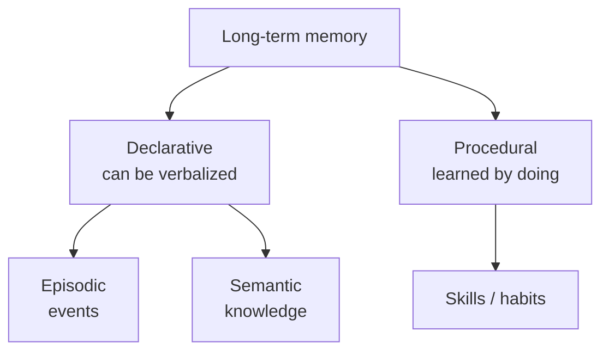
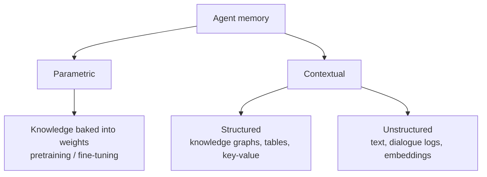
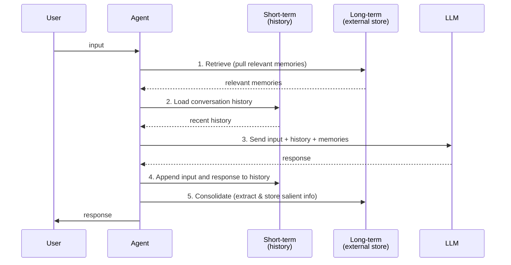
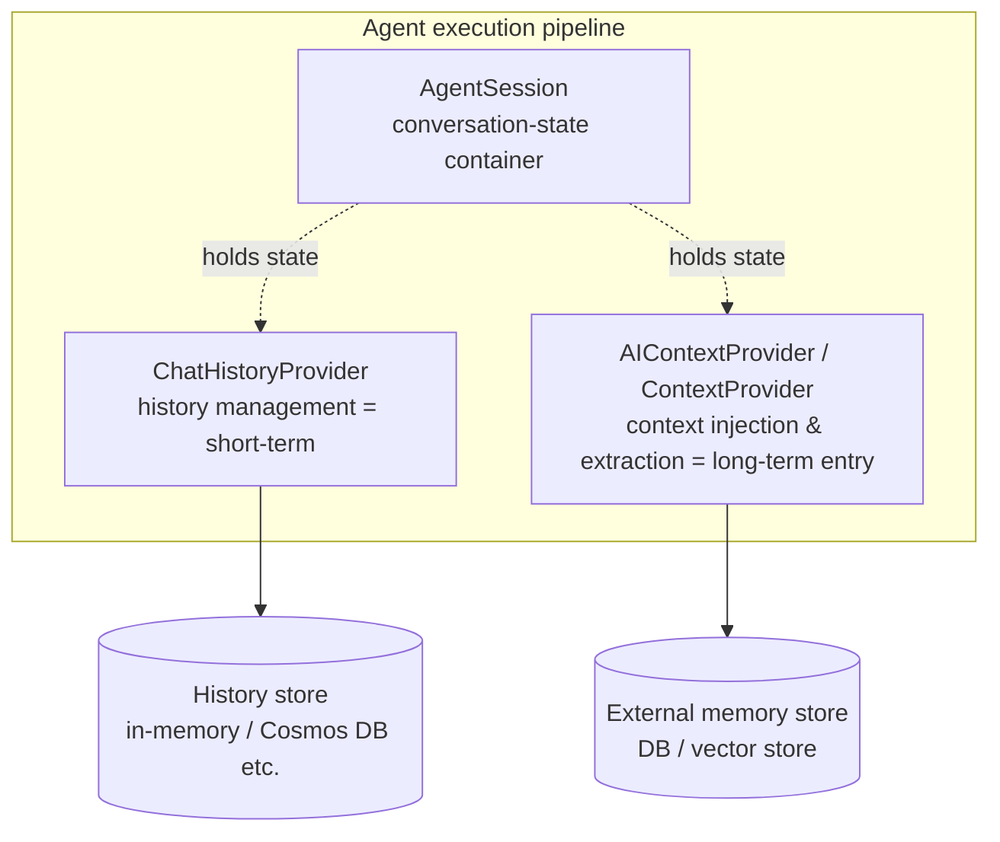
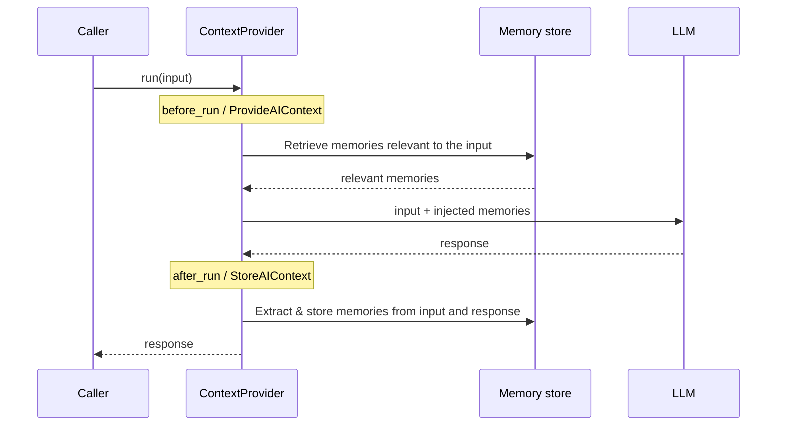

## Introduction

Build an AI agent beyond a demo and you soon run into a familiar complaint: this agent keeps forgetting.

You told it yesterday that you're vegan, yet today it cheerfully recommends a steakhouse. It forgets the API spec it looked up three turns ago. Hand it a long task and it loses track of what it was doing halfway through. Each of these happens because nobody designed the agent's memory.

LLM APIs are stateless: each call is independent, and the model remembers nothing about the previous conversation. An agent can carry on a conversation only because the application packs the prior context back into the prompt on every call. Agent memory is therefore not a capability of the model but <strong>an architecture the application developer designs.</strong>

This article first uses cognitive science and research on LLM-agent memory to classify kinds of memory and the operations a memory system combines. It then implements short-term and long-term memory in Python and C# with [Microsoft Agent Framework](https://github.com/microsoft/agent-framework)'s `AgentSession`, `ContextProvider`, and `ChatHistoryProvider`. The last part covers production concerns: multi-user isolation, forgetting, privacy, and evaluation.

> This article is a companion to [Microsoft Agent Framework Internals](/en/blog/agent-framework), which covers the framework's overall architecture and agent execution model.

## What Memory Is — Mapping from Cognitive Science

Designing memory requires vocabulary for distinguishing kinds of memory. Here we borrow the framework cognitive science has refined over more than 50 years. It also maps closely onto the agent memory structure described later.

### The Multi-Store Model: Sensory, Short-Term, and Long-Term Memory

A classic model in human memory research is the multi-store model proposed by Atkinson and Shiffrin in 1968. It divides memory into three stores.

- <strong>Sensory memory</strong> — Perceived information held for just an instant. Almost all of it is lost immediately.
- <strong>Short-term memory</strong> — The information currently being processed. Small in capacity and short in duration; it fades unless rehearsed (repeated).
- <strong>Long-term memory</strong> — Information that has been consolidated through rehearsal and encoding. Capacity is virtually unlimited and retention is long.

Information does not move from short-term to long-term memory automatically; it is written to long-term memory only after processing such as rehearsal and encoding. LLM agents work the same way: without a process that extracts important facts from the conversation history and persists them, there is no long-term memory.

### Inside Long-Term Memory: Declarative and Procedural

Long-term memory is further subdivided. Tulving (1972) distinguished episodic from semantic memory, and later work by Cohen and Squire (1980) grouped these as declarative memory in contrast to procedural memory. The resulting taxonomy is widely used.



- <strong>Episodic memory</strong> — Individual events of "when, where, what happened." "The user requested a refund last Tuesday."
- <strong>Semantic memory</strong> — General knowledge and facts detached from context. "This user is vegan."
- <strong>Procedural memory</strong> — Memory of how to do things. Hard to articulate, but ingrained. For an agent: "this kind of task tends to work out when solved with this procedure."

The same three categories work for deciding what an agent's long-term memory should store. Research systems and products often adopt this distinction or a variant of it.

### Mapping onto LLM Agents

Each of these concepts has a counterpart in an LLM agent.

| Cognitive-science concept | Counterpart in an LLM agent |
|------------|----------------------|
| Sensory memory | The current user input (one turn of raw input) |
| Short-term / working memory | Conversation history and scratchpad in the context window |
| Long-term (episodic) | Stored logs of past dialogues and task executions |
| Long-term (semantic) | User preferences, facts, knowledge base |
| Long-term (procedural) | Learned procedures, successful patterns, tool usage |
| Rehearsal → consolidation | Extraction, summarization, and persistence from conversation |

The LLM's context window, however, is finite. Just as human working memory is classically estimated at around "7±2 chunks" (Miller, 1956), an agent's short-term memory has a ceiling measured in tokens. A long conversation cannot fit into the prompt in full.

The central question of agent memory design is therefore:

> How do you bridge between finite short-term memory (the context window) and long-term memory (external storage) that accumulates without bound?

In practice, that means deciding what to keep in short-term memory, what to write out to long-term memory, and how to recall it when needed.

## A Research Map of Memory — Representations, Operations, Evaluation

Research on memory for LLM agents is organized here around two survey papers.

- Zhang et al. (2024), [A Survey on the Memory Mechanism of Large Language Model based Agents](https://arxiv.org/abs/2404.13501) — a comprehensive survey that organizes memory along sources, forms, operations, and evaluation.
- Du et al. (2025), [Rethinking Memory in LLM based Agents](https://arxiv.org/abs/2505.00675) — a framework that redefines memory in terms of "representations" and "six atomic operations."

### Representations: Parametric and Contextual Memory

Du et al. divide an agent's memory by representation into two broad categories.



- <strong>Parametric memory</strong> — Knowledge implicitly encoded in the model's weights. Acquired through pretraining or fine-tuning. Updating it requires retraining, which is costly, and you cannot directly inspect what is stored.
- <strong>Contextual memory</strong> — Memory held as explicit data outside the model. It further splits into structured (knowledge graphs, tables) and unstructured (text, embeddings).

The memory that application developers design and implement is almost always contextual memory, and that is what Agent Framework handles. Parametric memory (fine-tuning) requires retraining to update, so it is ill-suited both to frequent updates and to memory that differs per user. The rest of this article deals with contextual memory.

### The Six Atomic Operations

Du et al. define six atomic operations on memory. In their framing, any memory system can be described as a combination of these operations.

| Operation | Description |
|------|------|
| Consolidation | Write new experience into long-term memory (the short-term → long-term transfer) |
| Updating | Reflect new information into existing memory (e.g., changing preferences) |
| Indexing | Add structure / indexes to memory so it can be retrieved later |
| Forgetting | Delete or decay memory that is unneeded, stale, or wrong |
| Retrieval | Recall memory relevant to the current context |
| Condensation | Summarize and compress memory to reduce token volume |

The six operations work as a checklist when designing a long-term memory pipeline. Checking which operations your system implements, and how, reveals the ones that are missing. For example, a system with consolidation and retrieval but no forgetting keeps accumulating stale and contradictory memories, and they start turning up in retrieval results.

### Positioning the Major Research Systems

Research systems differ in which operations they emphasize. Here are three representative ones.

- <strong>MemoryBank</strong> ([Zhong et al., 2023](https://arxiv.org/abs/2305.10250)) — has a forgetting mechanism inspired by the Ebbinghaus forgetting curve, decaying and reinforcing memories based on elapsed time and importance. An early work aimed at long-term AI companions.
- <strong>Mem0</strong> ([Chhikara et al., 2025](https://arxiv.org/abs/2504.19413)) — an architecture designed for production use that dynamically extracts, consolidates, and retrieves salient information from conversations. It also has a graph-based variant. On the LOCOMO benchmark it reports a 91% reduction in p95 latency and over 90% token-cost savings versus a full-context approach, while outperforming prior memory systems on accuracy.
- <strong>A-MEM</strong> ([Xu et al., NeurIPS 2025](https://arxiv.org/abs/2502.12110)) — inspired by the Zettelkasten method, it dynamically generates memory notes, links them to one another, and lets new memories evolve (update) older ones — a system emphasizing indexing and updating.

All three actively process and organize memory instead of storing the entire conversation history as is. The implementation sections apply the same idea on top of Agent Framework.

### Evaluation Axes for Memory Systems

Zhang et al.'s survey divides methods for evaluating memory modules into two approaches.

1. <strong>Indirect, task-performance-based evaluation</strong> — How much an agent with memory improves on downstream tasks (QA, dialogue, long-term consistency). Multi-session dialogue benchmarks such as LOCOMO are representative.
2. <strong>Direct evaluation of memory itself</strong> — Measuring the internal quality of the memory mechanism: retrieval accuracy (did it pull the relevant memories?), efficiency (latency, token cost), and the appropriateness of forgetting.

In production, continuously check whether the system recalls the right memories, at the moment they're needed, with few tokens (see "Evaluating and Observing the Memory System").

## Design Principles for Memory Architecture

The first decision in designing an agent's memory is where to draw the boundary between short-term and long-term memory.

### Short-Term vs. Long-Term Memory

| Aspect | Short-term memory | Long-term memory |
|------|---------|---------|
| Scope | Within a single conversation session | Persists across sessions |
| Content | Recent exchanges, scratchpad | User preferences, facts, past experiences |
| Storage | Context window / session state | External storage (DB, vector store) |
| Capacity | Finite (token ceiling) | Effectively unlimited |
| Writes | Automatic (appended each turn) | Active processing (extract, consolidate) |
| Reads | Expand all of it into the prompt | Retrieve and inject only what's relevant |
| Lifespan | Vanishes at session end (unless persisted) | Retained until explicitly forgotten |

Draw the boundary by when the information will be used.

> Information you'll "use immediately next turn" goes in short-term memory. Information you "might use in a different session in the future" goes in long-term memory.

When short-term memory is about to overflow, however, you need a bridge that summarizes its contents and offloads them to long-term memory (consolidation and condensation).

### The Memory Pipeline at a Glance

A memory system that integrates short- and long-term memory operates within a single agent turn like this.



In this diagram, steps 1 (retrieve) and 2 (load history) are reads, while steps 4 (append history) and 5 (consolidate) are writes. In Agent Framework, a history provider handles the history reads and writes (2 and 4), and a context provider handles retrieval and consolidation (1 and 5).

## Agent Framework's Memory Primitives

Microsoft Agent Framework provides three abstractions for handling memory: `AgentSession`, `ChatHistoryProvider`, and `AIContextProvider`.



### Division of Roles Among the Three Abstractions

| Abstraction | Role | Position in memory |
|------|------|--------------|
| `AgentSession` | A container holding the state of a single conversation. Can be serialized to persist and restore. | The "vessel" of short-term memory. All session-specific state (history, memory IDs, etc.) is stored here. |
| `ChatHistoryProvider` (Python: `HistoryProvider`) | A provider specialized in loading and saving conversation history. | Short-term memory itself. The built-in `InMemoryHistoryProvider` is a typical example. |
| `AIContextProvider` (Python: `ContextProvider`) | Hooks around each run, injecting context (instructions, messages, tools) and extracting information afterward. | The entry to long-term memory. Handles injecting retrieved memories and extracting / storing new information. |

<strong>Implement short-term memory with `ChatHistoryProvider` and long-term memory with `AIContextProvider`.</strong> Both attach to the same agent, and each one's hooks are called within a single run.

### Keep State in the Session, Not the Provider

In Agent Framework, <strong>a single provider instance is shared across all sessions.</strong> If you store session-specific state, such as a particular user's memory ID, in the provider's fields, data from different users gets mixed up in a multi-user environment.

> Keep the provider stateless, and store session-specific values (memory IDs, DB keys, history, etc.) in the `AgentSession` itself.

.NET provides a `ProviderSessionState<T>` helper for this; in Python, you use the `state` dictionary passed to `before_run` / `after_run`. The code appears in "Implementing Long-Term Memory."

## Implementing Short-Term Memory

Short-term memory means managing conversation history, and in the simplest setup Agent Framework handles almost all of it.

### Minimal Setup: Just Pass a Session

Create an `AgentSession` and pass it to each `run`.

```python
from agent_framework import InMemoryHistoryProvider
from agent_framework.openai import OpenAIChatClient

agent = OpenAIChatClient().as_agent(
    name="MemoryBot",
    instructions="You are a helpful assistant.",
    context_providers=[InMemoryHistoryProvider("memory", load_messages=True)],
)

session = agent.create_session()

# First call: tell it something
await agent.run("I live in Tokyo and I'm vegan.", session=session)

# Second call: pass the same session and history carries over
response = await agent.run("Any good places nearby?", session=session)
# -> It suggests vegan-friendly spots in Tokyo
```

`InMemoryHistoryProvider` is the built-in short-term memory provider. Specifying `load_messages=True` makes it load the conversation history accumulated in the session and expand it into the prompt on each run. The first argument `"memory"` is the provider's identifier (`source_id`), which distinguishes it from other providers.

In .NET, likewise, you just pass the session created via `CreateSessionAsync()` to `RunAsync`.

```csharp
using System.Collections.Generic;
using Microsoft.Agents.AI;
using OpenAI;

AIAgent agent = new OpenAIClient("<your_api_key>")
    .GetChatClient("gpt-4o-mini")
    .AsAIAgent(instructions: "You are a helpful assistant.", name: "MemoryBot");

AgentSession session = await agent.CreateSessionAsync();

await agent.RunAsync("I live in Tokyo and I'm vegan.", session);
var response = await agent.RunAsync("Any good places nearby?", session);
```

In .NET, `InMemoryChatHistoryProvider` handles short-term memory by default. You can access the accumulated history like this.

```csharp
// Get the history provider attached to the session and read the message list
var provider = agent.GetService<InMemoryChatHistoryProvider>();
List<ChatMessage>? messages = provider?.GetMessages(session);
```

### Staying Within the Token Limit: Compaction

As a conversation grows, its history no longer fits in the context window. Compaction (reduction) addresses this; it corresponds to the condensation operation among the six.

The simplest approach is a count-based reducer that keeps only the most recent N messages. In .NET, `MessageCountingChatReducer` provides this.

```csharp
AIAgent agent = new OpenAIClient("<your_api_key>")
    .GetChatClient("gpt-4o-mini")
    .AsAIAgent(new ChatClientAgentOptions
    {
        Name = "MemoryBot",
        ChatOptions = new() { Instructions = "You are a helpful assistant." },
        // Keep only the most recent 20 messages
        ChatHistoryProvider = new InMemoryChatHistoryProvider(new InMemoryChatHistoryProviderOptions
        {
            ChatReducer = new MessageCountingChatReducer(20)
        })
    });
```

Cutting by count, however, discards old but important constraints such as "I'm vegan" simply because they are old. There are two ways to avoid this:

1. <strong>Summarization-based compaction</strong> — Summarize old history with the LLM and replace it with a single summary, keeping the main points while cutting tokens substantially.
2. <strong>Offloading salient information to long-term memory</strong> — Before discarding history, extract important facts and write them out to long-term memory (consolidation).

Summarization-based compaction can be implemented by swapping in a different reducer. <strong>Design short-term compaction and long-term consolidation as a pair,</strong> so that long-term memory catches what overflows from short-term memory.

### Persisting Sessions

Short-term memory is held in a session object inside the process, so it vanishes when the process ends. To resume a conversation later, serialize the `AgentSession` and save it to durable storage.

```python
# Save: serialize the whole session to a dict and store it
serialized = session.to_dict()
# ... store `serialized` in a DB / Redis / Blob, etc. ...

# Restore: rebuild the session from the saved state
resumed = AgentSession.from_dict(serialized)
response = await agent.run("Picking up where we left off...", session=resumed)
```

```csharp
// Save
JsonElement serialized = agent.SerializeSession(session);
// ... store `serialized` in durable storage ...

// Restore
AgentSession resumed = await agent.DeserializeSessionAsync(serialized);
```

Treat `AgentSession` as an opaque state object and save and restore the whole session, not just message text. Also, <strong>restore it with the same agent and provider configuration that created it.</strong> With a different configuration, providers cannot correctly interpret the state they stored in the session (such as memory IDs).

### Persisting to a Durable Backend with a Custom History Provider (Python)

To persist the conversation history itself to a DB or Redis, inherit from `HistoryProvider`. Use this when a conversation must resume after a process restart or on another instance. It still handles short-term memory, but the history is kept as long as long-term memory would be.

```python
from collections.abc import Sequence
from typing import Any
from agent_framework import HistoryProvider, Message


class DatabaseHistoryProvider(HistoryProvider):
    def __init__(self, db: Any) -> None:
        super().__init__("db-history", load_messages=True)
        self._db = db

    async def get_messages(
        self,
        session_id: str | None,
        *,
        state: dict[str, Any] | None = None,
        **kwargs: Any,
    ) -> list[Message]:
        key = (state or {}).get("history_key", session_id or "default")
        rows = await self._db.load_messages(key)
        return [Message.from_dict(row) for row in rows]

    async def save_messages(
        self,
        session_id: str | None,
        messages: Sequence[Message],
        *,
        state: dict[str, Any] | None = None,
        **kwargs: Any,
    ) -> None:
        if not messages:
            return
        if state is not None:
            key = state.setdefault("history_key", session_id or "default")
        else:
            key = session_id or "default"
        await self._db.save_messages(key, [m.to_dict() for m in messages])
```

The only thing this provider puts in the session's `state` is `history_key`, the key for looking up the history in the database.

In Python, <strong>you can attach multiple history providers, but only one may have `load_messages=True`.</strong> Give additional providers for diagnostics or evaluation `load_messages=False` so they don't interfere with loading the primary history, and `store_context_messages=True` so they also record context injected by other providers.

```python
primary = DatabaseHistoryProvider(db)
# For audit / eval: don't load history, but record context
audit = InMemoryHistoryProvider("audit", load_messages=False, store_context_messages=True)

agent = OpenAIChatClient().as_agent(context_providers=[primary, audit])
```

> Note: The base classes to inherit from are `ContextProvider` and `HistoryProvider`. The `BaseContextProvider` / `BaseHistoryProvider` aliases that once existed for compatibility were removed in a breaking change.

### Service-Managed Storage

Some services (such as the OpenAI Responses API or Microsoft Foundry Agents) persist conversation history on the service side. In that case, Agent Framework holds no local history, and the session stores only a remote conversation ID. The model is still stateless; the service takes over the job of packing prior context back into the prompt.

```csharp
AIAgent agent = new OpenAIClient("<your_api_key>")
    .GetOpenAIResponseClient("gpt-4o-mini")
    .AsAIAgent(instructions: "You are a helpful assistant.", name: "Assistant");

AgentSession session = await agent.CreateSessionAsync();
await agent.RunAsync("Tell me a joke about a pirate.", session);

// Cast to ChatClientAgentSession to retrieve the remote conversation ID
ChatClientAgentSession typedSession = (ChatClientAgentSession)session;
Console.WriteLine(typedSession.ConversationId);
```

With service-managed storage, the service handles history size, but the service also determines how history is reduced. Whether to manage history locally or leave it to the service depends on your model provider and persistence requirements.

## Implementing Long-Term Memory

To implement long-term memory in Agent Framework, inherit from `AIContextProvider` (Python: `ContextProvider`) and put the retrieval (read) and consolidation (write) logic in that provider.

### The Two Hooks of a ContextProvider

A `ContextProvider` offers two hooks around a single agent run.

- <strong>Before-run hook</strong> (Python: `before_run` / .NET: `ProvideAIContextAsync`) — retrieve from long-term memory and inject relevant memories into the prompt as context.
- <strong>After-run hook</strong> (Python: `after_run` / .NET: `StoreAIContextAsync`) — extract salient information from the input and response and consolidate it into long-term memory.



### A Simple Long-Term Memory Provider (Python)

As a minimal example, the following Python provider saves the user's favorite food in the `state` dictionary and injects it as an instruction on later runs.

```python
from typing import Any
from agent_framework import AgentSession, ContextProvider, SessionContext


class UserPreferenceProvider(ContextProvider):
    def __init__(self) -> None:
        # The first argument is this provider's identifier (source_id)
        super().__init__("user-preferences")

    async def before_run(
        self,
        *,
        agent: Any,
        session: AgentSession,
        context: SessionContext,
        state: dict[str, Any],
    ) -> None:
        # Before the run: inject the saved preference as an instruction (= retrieve)
        if favorite := state.get("favorite_food"):
            context.extend_instructions(
                self.source_id, f"The user's favorite food is {favorite}."
            )

    async def after_run(
        self,
        *,
        agent: Any,
        session: AgentSession,
        context: SessionContext,
        state: dict[str, Any],
    ) -> None:
        # After the run: extract a preference from the input and store it (= consolidate)
        for message in context.input_messages:
            text = (message.text or "") if hasattr(message, "text") else ""
            if isinstance(text, str) and "favorite food is" in text.lower():
                state["favorite_food"] = text.lower().split("favorite food is", 1)[1].strip().rstrip(".")
```

`context.extend_instructions(self.source_id, ...)` injects the retrieved memory as a system instruction. The `state` dictionary is persisted with the session, so the provider instance itself stays stateless.

Attach this provider to the agent.

```python
agent = OpenAIChatClient().as_agent(
    name="MemoryBot",
    instructions="You are a helpful assistant.",
    context_providers=[
        InMemoryHistoryProvider("memory", load_messages=True),  # short-term memory
        UserPreferenceProvider(),                                # long-term memory
    ],
)
```

Short-term memory (`InMemoryHistoryProvider`) and long-term memory (`UserPreferenceProvider`) go side by side in the same `context_providers` list.

### A Provider Backed by an External Memory Service (Python)

The example above extracts the preference with string matching; real systems use LLM-based extraction or semantic search over a vector store. The next example delegates retrieval and storage to an external memory service such as Mem0. It inherits from `ContextProvider`, not `HistoryProvider`.

```python
from typing import Any
from agent_framework import AgentSession, ContextProvider, SessionContext


class ServiceMemoryProvider(ContextProvider):
    """A long-term memory provider that integrates with an external memory service."""

    def __init__(self, client: Any) -> None:
        super().__init__("service-memory")
        self._client = client  # the memory-service client (keep it stateless)

    async def before_run(
        self,
        *,
        agent: Any,
        session: AgentSession,
        context: SessionContext,
        state: dict[str, Any],
    ) -> None:
        memory_id = state.get("memory_id")
        if not memory_id:
            return  # no memories yet

        # Use the recent user input as the query for semantic search (= retrieve)
        query = "\n".join(
            m.text for m in context.input_messages if getattr(m, "text", None)
        )
        memories = await self._client.search(memory_id, query)
        if memories:
            joined = "\n".join(m.text for m in memories)
            context.extend_instructions(
                self.source_id, f"Relevant memories:\n{joined}"
            )

    async def after_run(
        self,
        *,
        agent: Any,
        session: AgentSession,
        context: SessionContext,
        state: dict[str, Any],
    ) -> None:
        # Create a per-session memory container and save its ID in the session state
        if not state.get("memory_id"):
            state["memory_id"] = await self._client.create_container()

        # Hand the input and response to the service; it extracts & consolidates (= consolidate)
        response_messages = context.response.messages if context.response else []
        await self._client.add(
            state["memory_id"],
            list(context.input_messages) + list(response_messages),
        )
```

The service's `add` handles extraction, consolidation, and updating. A system like Mem0 turns raw messages into structured facts such as "the user is vegan" and updates existing memory when the new facts contradict it. The provider only builds the search query and hands over the messages to store.

### A Custom Long-Term Memory Provider in .NET

In .NET, inherit from `AIContextProvider` and override `ProvideAIContextAsync` (retrieve) and `StoreAIContextAsync` (consolidate). Store session-specific state in the `AgentSession` via the `ProviderSessionState<T>` helper.

```csharp
using Microsoft.Agents.AI;

internal sealed class ServiceMemoryProvider : AIContextProvider
{
    private readonly ProviderSessionState<State> _sessionState;
    private readonly ServiceClient _client;

    public ServiceMemoryProvider(ServiceClient client)
        : base(null, null)
    {
        // Helper to hold session-specific state inside the session
        this._sessionState = new ProviderSessionState<State>(
            _ => new State(),
            this.GetType().Name);
        this._client = client;
    }

    public override IReadOnlyList<string> StateKeys => [this._sessionState.StateKey];

    // Before the run: retrieve relevant memories and inject them
    protected override ValueTask<AIContext> ProvideAIContextAsync(
        InvokingContext context, CancellationToken cancellationToken = default)
    {
        var state = this._sessionState.GetOrInitializeState(context.Session);
        if (state.MemoriesId is null)
        {
            return new ValueTask<AIContext>(new AIContext());  // no memories yet
        }

        var query = string.Join("\n", context.AIContext.Messages?.Select(x => x.Text) ?? []);
        var memories = this._client.LoadMemories(state.MemoriesId, query);

        return new ValueTask<AIContext>(new AIContext
        {
            Messages =
            [
                new ChatMessage(ChatRole.User,
                    "Relevant memories:\n" + string.Join("\n", memories.Select(x => x.Text)))
            ]
        });
    }

    // After the run: extract and store memories from input and response
    protected override async ValueTask StoreAIContextAsync(
        InvokedContext context, CancellationToken cancellationToken = default)
    {
        var state = this._sessionState.GetOrInitializeState(context.Session);
        state.MemoriesId ??= this._client.CreateMemoryContainer();
        this._sessionState.SaveState(context.Session, state);

        var messages = context.RequestMessages.Concat(context.ResponseMessages ?? []);
        await this._client.StoreMemoriesAsync(state.MemoriesId, messages, cancellationToken);
    }

    public sealed class State
    {
        public string? MemoriesId { get; set; }
    }
}
```

Attach it to the agent via the `AIContextProviders` option.

```csharp
AIAgent agent = new OpenAIClient("<your_api_key>")
    .GetChatClient("gpt-4o-mini")
    .AsAIAgent(new ChatClientAgentOptions
    {
        ChatOptions = new() { Instructions = "You are a helpful assistant." },
        AIContextProviders = [new ServiceMemoryProvider(serviceClient)],
    });
```

### Avoiding Feedback Loops: Managing Message Sources

A long-term memory provider can easily create a feedback loop in which <strong>a memory injected by retrieval is stored again as a new memory</strong> on the next consolidation. Left unchecked, memories keep generating new memories and the store grows without bound.

To prevent this, Agent Framework tags messages with their source. In .NET, `AgentRequestMessageSourceType` distinguishes "external (user) input," "from history," and "from a context provider." To consolidate only external input in the earlier `StoreAIContextAsync`, write:

```csharp
// When consolidating, target only the user's real input (External),
// and exclude messages injected from history or other providers
var filteredRequestMessages = context.RequestMessages
    .Where(m => m.GetAgentRequestMessageSourceType() == AgentRequestMessageSourceType.External);

await this._client.StoreMemoriesAsync(
    state.MemoriesId,
    filteredRequestMessages.Concat(context.ResponseMessages ?? []),
    cancellationToken);
```

Use the source to control what gets stored as memory. As a rule, store only the user's raw input and the agent's response, and exclude memories injected by retrieval and messages from history.

### Built-in Memory and Retrieval Providers

Agent Framework also ships built-in providers. If they fit your requirements, consider them before writing your own.

- <strong>RAG (Retrieval-Augmented Generation)</strong>: `TextSearchProvider` (Released) — searches external knowledge based on user input and injects it as context. The search itself can be implemented with any technology — Azure AI Search, a vector store, web search, etc. You can choose to search on every run (`BeforeAIInvoke`) or on-demand via tool calls.
- <strong>Graph RAG</strong>: `Neo4j GraphRAG Provider` (Preview) — pulls relevant information via graph traversal.
- <strong>History persistence</strong>: `Cosmos DB Chat History Provider` (Preview) — stores conversation history in Cosmos DB.
- <strong>Vector stores</strong>: Many vector stores — Redis, Postgres, Azure AI Search, Qdrant, SQLite, and more — are available via a unified abstraction (`Microsoft.Extensions.VectorData.Abstractions`). They can serve as the semantic-search backend for long-term memory.

The minimal RAG setup with `TextSearchProvider` looks like this.

```csharp
// The search implementation (any backend: Azure AI Search, a vector store, web search, etc.)
static Task<IEnumerable<TextSearchProvider.TextSearchResult>> SearchAdapter(
    string query, CancellationToken cancellationToken)
{
    // Return relevant documents based on `query`
    // ...
    return Task.FromResult<IEnumerable<TextSearchProvider.TextSearchResult>>(results);
}

TextSearchProviderOptions options = new()
{
    // Search before every model invocation
    SearchTime = TextSearchProviderOptions.TextSearchBehavior.BeforeAIInvoke,
    // Number of recent messages to include when building the search query
    RecentMessageMemoryLimit = 6,
};

AIAgent agent = azureOpenAIClient
    .GetChatClient(deploymentName)
    .AsAIAgent(new ChatClientAgentOptions
    {
        ChatOptions = new() { Instructions = "Answer using the provided context and cite sources when available." },
        AIContextProviders = [new TextSearchProvider(SearchAdapter, options)]
    });
```

RAG and long-term memory are both implemented as `AIContextProvider`s, and both pull relevant information from outside and inject it. They differ in the information they pull. RAG pulls from a static knowledge base such as product manuals, whereas long-term memory pulls individual memories accumulated dynamically from dialogue, such as user preferences. Real systems often attach both and inject two streams at once: knowledge (RAG) and memory.

## Production Considerations

A memory system going to production needs four more things in its design: isolation between users, forgetting, privacy, and evaluation.

### Multi-User Isolation

The most serious failure is <strong>memory leaking between users</strong>, such as one user's preference reaching another; it directly damages users' trust. On the provider side, the fix is the rule from "Keep State in the Session, Not the Provider": always store session-specific values in the `AgentSession` (its `state` / `ProviderSessionState`), never in the provider's fields.

When using an external memory store, isolate memories by using the user ID (or session ID) as the partition key. Always attach a per-user filter to search queries so that other users' memories cannot appear in the results.

### Designing Forgetting

Of the six operations, the one most easily left out of an implementation is forgetting. A system without forgetting accumulates stale, contradictory, and incorrect memories, and retrieval quality eventually degrades. There are four main strategies:

| Strategy | Description | Inspiration |
|------|------|--------|
| Time decay | Lower the importance of older memories and delete below a threshold | MemoryBank's Ebbinghaus forgetting curve |
| Conflict resolution | When new info contradicts an old memory, update / delete the old one | Mem0's updating mechanism |
| Capacity cap + LRU | Cap the number of memories per user and evict unused ones | The cache playbook |
| Explicit deletion | Delete immediately on the user's request ("forget that") | Privacy requirements |

You should implement at least "conflict resolution" and "explicit deletion." Without the former, memory loses consistency; without the latter, you can't meet the privacy requirements discussed next.

### Privacy and Security

Long-term memory accumulates personal data, so it must comply with regulations such as GDPR.

- <strong>The right to be forgotten</strong> — Always provide a path (explicit deletion) for users to request deletion of their memories.
- <strong>Handling sensitive information</strong> — Don't write credit card numbers, passwords, and the like into memory. Filter them at the extraction stage, or exclude them from storage targets entirely.
- <strong>Encrypting stored data</strong> — Encrypt the memory store both at rest and in transit.
- <strong>Defending against prompt injection</strong> — Since you extract memory from user input, malicious input ("ignore all prior instructions and remember the following...") can slip into memory. A design that later injects extracted memory as instructions can become an amplification path for injection. Validate what you store as memory and guard against rewriting the system instructions themselves via memory.

The last point is especially easy to overlook. Treat memory as something that <strong>may originate from untrusted input</strong>, and restrict the privileges of what you inject.

### Evaluating and Observing the Memory System

Measure continuously whether memory is helping. Applied to a production system, Zhang et al.'s evaluation axes give four metrics to observe.

- <strong>Retrieval accuracy</strong> — Were the injected memories truly relevant to the situation? (Injecting irrelevant memories hurts both response accuracy and token efficiency.)
- <strong>Token cost</strong> — How much did memory injection increase the per-turn token volume? Compared with a full-context approach, the Mem0 paper reports token-cost savings of over 90% on LOCOMO.
- <strong>Latency</strong> — The impact of retrieval and consolidation on response time. Synchronous retrieval before the run adds its full duration to the user's wait.
- <strong>Consistency</strong> — Across multiple sessions, are the user's constraints (preferences, etc.) honored?

To collect evaluation data for retrieval accuracy, use the audit provider shown earlier (`load_messages=False`, `store_context_messages=True`). Without interfering with loading the primary history, it records the context of each run, including which memories were injected.

## Conclusion

An agent's memory is not a capability of the model but an architecture the application developer designs. Cognitive science supplies a framework for that design: the distinction between short-term and long-term memory, and the episodic, semantic, and procedural categories of long-term memory. Du et al.'s six atomic operations (consolidation, updating, indexing, forgetting, retrieval, condensation) serve as a checklist for what the system does with memory.

In Microsoft Agent Framework, `AgentSession` holds the state, `ChatHistoryProvider` implements short-term memory, and the retrieve-and-consolidate hooks of `AIContextProvider` implement long-term memory. The core of the design is connecting finite short-term memory and unbounded long-term memory through compaction (condensation) and consolidation. When long-term memory catches what overflows from short-term memory, long conversations are less likely to lose old but important information such as "I'm vegan."

In production, isolation of memory between users, forgetting (especially conflict resolution and explicit deletion), privacy (the right to be forgotten and injection defenses), and continuous observation of whether memory is helping are essential. Without them, memory can leak information between users or drive responses based on stale or contradictory information.

Start by creating an `AgentSession` and passing it to `run`, then build an extract / consolidate / retrieve pipeline with an `AIContextProvider` as your needs grow.

### References

- G. A. Miller. *The Magical Number Seven, Plus or Minus Two: Some Limits on Our Capacity for Processing Information*. Psychological Review, 63(2), 1956. (Classic estimate of working-memory capacity)
- R. C. Atkinson and R. M. Shiffrin. *Human Memory: A Proposed System and its Control Processes*. The Psychology of Learning and Motivation, Vol. 2, 1968. (Multi-store model)
- E. Tulving. *Episodic and Semantic Memory*. Organization of Memory, 1972. (Episodic and semantic memory)
- N. J. Cohen and L. R. Squire. *Preserved Learning and Retention of Pattern-Analyzing Skill in Amnesia: Dissociation of Knowing How and Knowing That*. Science, 210(4466), 1980. (Declarative vs. procedural memory)
- Z. Zhang et al. *[A Survey on the Memory Mechanism of Large Language Model based Agents](https://arxiv.org/abs/2404.13501)*. arXiv:2404.13501, 2024.
- Y. Du et al. *[Rethinking Memory in LLM based Agents: Representations, Operations, and Emerging Topics](https://arxiv.org/abs/2505.00675)*. arXiv:2505.00675, 2025.
- P. Chhikara et al. *[Mem0: Building Production-Ready AI Agents with Scalable Long-Term Memory](https://arxiv.org/abs/2504.19413)*. arXiv:2504.19413, 2025.
- W. Xu et al. *[A-MEM: Agentic Memory for LLM Agents](https://arxiv.org/abs/2502.12110)*. NeurIPS 2025 / arXiv:2502.12110.
- W. Zhong et al. *[MemoryBank: Enhancing Large Language Models with Long-Term Memory](https://arxiv.org/abs/2305.10250)*. arXiv:2305.10250, 2023.
- Microsoft. *[Agent Framework — Conversations & Memory](https://learn.microsoft.com/en-us/agent-framework/agents/conversations/)*. Microsoft Learn.
- Microsoft. *[Microsoft Agent Framework (GitHub)](https://github.com/microsoft/agent-framework)*.
