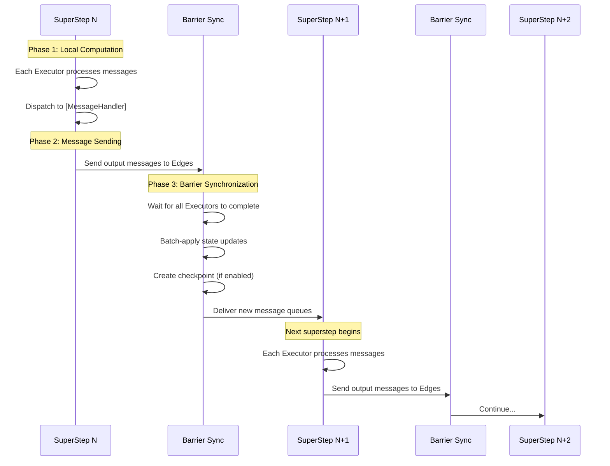
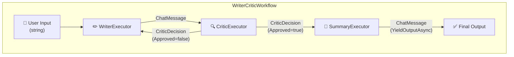

## Introduction

Over 2025 and into 2026, a design called the Agentic Workflow has spread quickly. Rather than using an LLM only to answer chat messages, it coordinates multiple agents to complete complex tasks.

An Agentic Workflow places LLM-powered agents at the nodes of a graph and lets the developer define the execution order, branching, and parallelism. As a result, it can carry out multistep processes that involve judgments no rule can express while still following the flow the developer defined. This article compares Agentic Workflows with traditional automation, chatbots, and single agents, and implements the common workflow patterns in C# with [Microsoft Agent Framework](https://github.com/microsoft/agent-framework). It also covers the framework's execution model (Pregel / BSP), implementation gotchas, production considerations, and when to choose an agent or a workflow. Interactive visualizers show how messages flow in each pattern.

## What Is an Agentic Workflow?

### Definition

An <strong>Agentic Workflow</strong> is a system design pattern that coordinates one or more AI agents within an explicitly defined execution graph to accomplish complex tasks.

The definition has two parts:

1. Agents that reason with an LLM act as nodes in the workflow
2. The workflow definition explicitly sets the agents' execution order, conditional branching, and parallelism. Instead of letting agents decide freely what to do next, developers design the execution flow as a graph

An Agentic Workflow therefore combines the flexibility of LLMs with the deterministic control of a workflow.

### Comparison with Conventional Approaches

The table below compares the four approaches qualitatively. Flexibility is the ability to handle unexpected inputs and ambiguous decisions; controllability is the degree to which the developer can decide the execution flow in advance. Only Agentic Workflow combines high flexibility with high controllability.

| Property | Traditional Automation (RPA etc.) | Chatbot | Single Agent | Agentic Workflow |
|----------|----------------------------------|---------|--------------|-----------------|
| Flexibility | Low (rule-based) | Moderate | High | High |
| Controllability | Very high | Low | Low | High |
| Complex Tasks | Hard-coded | Not suited | Single perspective | Multi-perspective |
| Error Handling | Branch handling | LLM-dependent | LLM-dependent | Structural handling |
| Quality Assurance | Testable | Difficult | Difficult | Review loops |
| Implementation Cost | High | Low | Low to moderate | Moderate |

Traditional automation (RPA etc.) strictly follows predefined rules, which makes it highly controllable, but it cannot handle unexpected inputs or ambiguous decisions. You can write "if the email subject contains keyword X, do Y," but not "understand this email's intent and reply appropriately."

Chatbots use the flexibility of LLMs but respond one turn at a time, so they are poorly suited to carrying out complex business processes. A chatbot can hold a conversation about "help me book a trip," but it has difficulty reliably completing the whole sequence of booking, payment, and confirmation email.

Single agents can act on the outside world through tool calls and handle fairly complex tasks. Because all the logic sits in one agent, however, concerns are hard to separate and quality control becomes a black box.

Agentic Workflows address these problems: each agent has its own specialty, the workflow controls the execution order, and quality gates such as a Critic review loop are built into the graph.

### Why Agentic Workflow Now?

Four technical advances made Agentic Workflows practical:

1. Post-GPT-4 models became better at tool calling, structured output, and role-playing, good enough to act as nodes within workflows
2. LLMs can now reliably generate output that conforms to a JSON schema (Structured Output), which makes type-safe message passing between agents practical
3. The Model Context Protocol standardized how agents connect to tools, reducing the cost of integrating them
4. Frameworks such as Microsoft Agent Framework, LangGraph, and CrewAI have matured, so workflows can be built with little code

## Workflow Design Patterns

A few design patterns recur in Agentic Workflows. Each can be used alone or combined with others to build complex workflows.

Use the visualizer below to see how each pattern routes messages: switch patterns with the buttons and step through the message flow.

<AgenticWorkflowVisualizer />

### Pattern 1: Sequential (Serial Pipeline)

The simplest pattern chains agents in series: each agent's output becomes the next agent's input.

<SequentialPatternDiagram />

Use cases: Translation chains, data transformation pipelines, staged document processing

Benefits: Easy to implement and debug, because each step has a clear input and output.

Trade-offs: The steps cannot run in parallel, so total latency is the sum of all steps.

In Microsoft Agent Framework, `AgentWorkflowBuilder.BuildSequential()` builds this pattern in a single line.

```csharp
// Sequential: Building a translation chain
// AgentWorkflowBuilder.BuildSequential() internally generates
// AddEdge(agent[0], agent[1]), AddEdge(agent[1], agent[2]), ...
Workflow workflow = AgentWorkflowBuilder.BuildSequential(
    from lang in new[] { "French", "Spanish", "English" }
    select new ChatClientAgent(
        chatClient,
        instructions: $"You are a translation assistant. Translate the input to {lang}.",
        name: $"{lang}Translator"
    )
);

// Execute the workflow
await using StreamingRun run =
    await InProcessExecution.RunStreamingAsync(workflow, "Hello, world!");

await foreach (WorkflowEvent evt in run.WatchStreamAsync())
{
    if (evt is AgentResponseUpdateEvent e)
        Console.Write(e.Update.Text);
    else if (evt is WorkflowOutputEvent output)
        Console.WriteLine($"\nFinal: {output.Data}");
}
```

### Pattern 2: Concurrent (Fan-out / Fan-in)

Input is distributed to multiple agents simultaneously, and all results are aggregated.

<ConcurrentPatternDiagram />

Use cases: Simultaneous multi-language translation, multi-angle analysis, parallel data processing

Benefits: Total latency is set by the slowest agent instead of being the sum of all steps, as in Sequential.

Trade-offs: More API calls run at the same time, so watch for rate limits. You also need logic to aggregate the results.

```csharp
// Concurrent: Parallel translation
// BuildConcurrent() internally generates Fan-out and Fan-in Barrier Edges
// Fan-out: Delivers messages from input node to all agents simultaneously
// Fan-in Barrier: Waits for all agents to complete before aggregating results
Workflow workflow = AgentWorkflowBuilder.BuildConcurrent(
    from lang in new[] { "French", "Spanish", "English" }
    select new ChatClientAgent(
        chatClient,
        instructions: $"Translate the input to {lang}. Output only the translation.",
        name: $"{lang}Translator"
    )
);
```

### Pattern 3: Conditional Routing

This pattern chooses the next Executor (a processing node in the workflow) based on the current Executor's output, like `if-else` or `switch-case`.

<ConditionalPatternDiagram />

Use cases: Email classification (spam/legitimate), ticket routing, content moderation

```csharp
// Conditional Routing: Spam classification example
// AddSwitch() branches based on the ClassificationResult's Category property
// Type-safe condition evaluation via lambda expressions
WorkflowBuilder builder = new WorkflowBuilder(classifier)
    .AddSwitch(classifier, sw => sw
        .AddCase<ClassificationResult>(
            result => result?.Category == "spam",
            spamHandler)
        .AddCase<ClassificationResult>(
            result => result?.Category == "normal",
            replyGenerator)
        .WithDefault(manualReviewHandler)
    )
    .WithOutputFrom(spamHandler, replyGenerator, manualReviewHandler);
```

With `AddSwitch`, only the target of the first matching case receives the message, as in `switch-case`. Multiple conditional Edges added with `AddEdge` behave like independent `if` statements instead: the message goes to the target of every Edge whose condition matches. "Implementation Gotchas" shows the source code behind this difference.

### Pattern 4: Handoff (Delegation)

A triage agent analyzes the input and delegates it to the appropriate specialist agent. In Conditional Routing, a condition in the workflow definition chooses the branch; in Handoff, the agent itself chooses whom to delegate to.

<HandoffPatternDiagram />

Use cases: Customer support routing, educational tutoring, specialist teams

```csharp
// Handoff: Triage → Specialist agent delegation
// CreateHandoffBuilderWith() builds starting from the triage agent
// WithHandoffs() defines bidirectional handoff routes
ChatClientAgent triageAgent = new(chatClient,
    instructions: "Determine which specialist to use. ALWAYS hand off.",
    name: "triage_agent",
    description: "Routes to the right specialist.");

ChatClientAgent mathTutor = new(chatClient,
    instructions: "You help with math. Explain step by step.",
    name: "math_tutor",
    description: "Math specialist.");

ChatClientAgent historyTutor = new(chatClient,
    instructions: "You help with history. Explain events and context.",
    name: "history_tutor",
    description: "History specialist.");

// Build the Handoff workflow
// WithHandoffs(source, targets) injects targets' descriptions
// as tool definitions into source, so the LLM calls a handoff tool
// and the workflow engine automatically routes to the correct Executor
Workflow workflow = AgentWorkflowBuilder
    .CreateHandoffBuilderWith(triageAgent)
    .WithHandoffs(triageAgent, [mathTutor, historyTutor])
    .WithHandoffs([mathTutor, historyTutor], triageAgent)
    .Build();
```

Internally, calling `WithHandoffs(triageAgent, [mathTutor, historyTutor])` injects the `name` and `description` of `mathTutor` and `historyTutor` into `triageAgent` as tool definitions. When the LLM generates a tool call such as `handoff_to_math_tutor`, the workflow engine detects it and routes the message to the corresponding Executor. The LLM decides where the message goes; the workflow engine carries out the routing.

> <strong>Note</strong>: The Handoff API (`CreateHandoffBuilderWith` / `HandoffWorkflowBuilder`) is marked `[Experimental("MAAIW001")]`. You must suppress compiler warning `MAAIW001` to use it, and the API may change in future releases. (Rechecked in August 2026: it is still experimental even though Agent Framework itself has reached a stable 1.x release. Separately, the older `HandoffsWorkflowBuilder` — with an "s" — is now `[Obsolete]`; prefer `HandoffWorkflowBuilder`.)

### Pattern 5: Writer-Critic Loop (Iterative Refinement)

This pattern adds a review loop: a Writer generates output, a Critic reviews it, and the loop repeats until the Critic approves, much as people review and revise a draft.

<WriterCriticPatternDiagram />

Use cases: Content generation, code review, translation quality management

Benefits: The quality gate is part of the graph, and each round refines the output.

Trade-offs: The number of LLM calls grows in proportion to the number of iterations, and a maximum iteration count is required as a safety valve.

```csharp
// Writer-Critic Loop: Iterative refinement workflow
// WorkflowBuilder declaratively defines the graph structure
WorkflowBuilder builder = new WorkflowBuilder(writer)
    .AddEdge(writer, critic)                    // Writer → Critic
    .AddSwitch(critic, sw => sw
        .AddCase<CriticDecision>(                // Approved → Summary
            cd => cd?.Approved == true, summary)
        .AddCase<CriticDecision>(                // Rejected → back to Writer
            cd => cd?.Approved == false, writer))
    .WithOutputFrom(summary);                    // Summary output = workflow output
```

### Pattern 6: Group Chat

Multiple agents converse in rounds. In Handoff, the current agent picks the next agent; in Group Chat, a `GroupChatManager` decides who speaks next.

<GroupChatPatternDiagram />

Use cases: Brainstorming, multi-perspective review, debate-style analysis

```csharp
// Group Chat: Manager controls turn-taking among multiple agents
// CreateGroupChatBuilderWith() takes a GroupChatManager factory
// RoundRobinGroupChatManager: simplest manager — agents speak in order
Workflow workflow = AgentWorkflowBuilder
    .CreateGroupChatBuilderWith(
        agents => new RoundRobinGroupChatManager(agents) { MaximumIterationCount = 3 })
    .AddParticipants(researchAgent, criticAgent, synthesizerAgent)
    .Build();
```

`GroupChatManager` is an abstract class, so you can subclass it with your own turn-selection logic. For example, a custom manager could analyze each utterance and pick the most relevant agent to speak next.

### Advanced Composition Patterns

Agent Framework also lets you nest one workflow inside another, expose a workflow as an agent, and define a workflow in YAML.

#### Sub-Workflows

A workflow can be embedded as an Executor in another workflow, so complex systems can be built hierarchically from reusable workflows.

```csharp
// Sub-Workflow: Embedding a workflow as an Executor
// 1. Build the child workflow normally
Workflow textProcessingWorkflow = new WorkflowBuilder(uppercase)
    .AddEdge(uppercase, reverse)
    .AddEdge(reverse, append)
    .WithOutputFrom(append)
    .Build();

// 2. Convert workflow to Executor via BindAsExecutor()
ExecutorBinding subWorkflowExecutor =
    textProcessingWorkflow.BindAsExecutor("TextProcessingSubWorkflow");

// 3. Connect it in the parent workflow like any other Executor
Workflow mainWorkflow = new WorkflowBuilder(prefix)
    .AddEdge(prefix, subWorkflowExecutor)
    .AddEdge(subWorkflowExecutor, postProcess)
    .WithOutputFrom(postProcess)
    .Build();
```

#### Workflow-as-Agent

Conversely, an entire workflow can be exposed as a single `AIAgent`. Callers don't need to know about the workflow's internal structure.

```csharp
// Workflow-as-Agent: Expose a workflow as an AIAgent
// AsAIAgent() wraps the workflow in the AIAgent interface
Workflow workflow = WorkflowFactory.BuildWorkflow(chatClient);
AIAgent agent = workflow.AsAIAgent("workflow-agent", "Workflow Agent");

// Interact just like with any other agent
AgentSession session = await agent.CreateSessionAsync();
await foreach (AgentResponseUpdate update in
    agent.RunStreamingAsync("Hello!", session))
{
    Console.Write(update.Text);
}
```

Because callers see an ordinary agent, you can start with a single agent and, when requirements grow, replace it with a workflow without changing the calling code.

#### Declarative Workflows (YAML)

Instead of building graphs in C#, you can define workflows declaratively in YAML files. Non-engineers can then read and edit the workflow structure, and a workflow can be changed without deploying code.

The `Declarative/` samples in Agent Framework include YAML workflow definitions for customer support, marketing, deep research, and other scenarios. The YAML is parsed and executed on the same engine as code-based workflows.

## Microsoft Agent Framework C# Implementation

In Agent Framework, a workflow is a graph of Executors (processing nodes) connected by Edges and assembled by `WorkflowBuilder`.

### Package Structure

A .NET project needs these packages:

```xml
<!-- Add to your .csproj -->
<PackageReference Include="Microsoft.Agents.AI" Version="1.1.0" />
<PackageReference Include="Microsoft.Agents.AI.Workflows" Version="1.1.0" />
<PackageReference Include="Microsoft.Agents.AI.Workflows.Generators" Version="1.1.0"
                OutputItemType="Analyzer" ReferenceOutputAssembly="false" />
<PackageReference Include="Microsoft.Agents.AI.OpenAI" Version="1.1.0" />
<!-- or Microsoft.Agents.AI.Foundry for Azure AI Foundry -->
```

`Microsoft.Agents.AI` is the framework core and contains the basic agent types, such as `AIAgent`, `ChatClientAgent`, and `AgentResponseUpdate`. `Microsoft.Agents.AI.Workflows` contains the workflow types (`WorkflowBuilder`, `Executor`, `InProcessExecution`, `StreamingRun`, etc.). `Microsoft.Agents.AI.Workflows.Generators` is the source generator that auto-generates dispatch code for `[MessageHandler]` attributes. `Microsoft.Agents.AI.OpenAI` provides OpenAI / Azure OpenAI integration, and `Microsoft.Agents.AI.Foundry` provides Microsoft Foundry (formerly Azure AI Foundry) integration.

### Core Concept: Executor

An <strong>Executor</strong> is a processing node in the workflow graph. It receives messages, processes them, and produces output messages. Agent Framework uses C# partial classes and source generators so that an Executor needs little boilerplate.

```csharp
// Basic Executor form
// The partial keyword and source generators auto-generate
// message dispatch code
internal sealed partial class UpperCaseExecutor() : Executor("UpperCase")
{
    // [MessageHandler] attribute defines a message handler
    // The argument type (string) determines message routing
    [MessageHandler]
    public ValueTask<string> HandleAsync(
        string message,
        IWorkflowContext context,
        CancellationToken cancellationToken = default)
    {
        return ValueTask.FromResult(message.ToUpperInvariant());
    }
}
```

The source generator registers each method marked `[MessageHandler]` in the message dispatch table, keyed by the method's argument type: a `string` message calls `HandleAsync(string)`, and a `CriticDecision` message calls `HandleAsync(CriticDecision)`. One Executor can therefore handle several message types type-safely.

#### Executor with ChatClientAgent

To call an LLM from an Executor, use `ChatClientAgent`, an adapter that lets an `IChatClient` act as an `AIAgent`.

```csharp
// Executor that calls an LLM
// ChatClientAgent wraps IChatClient and provides the AIAgent interface
internal sealed partial class WriterExecutor : Executor
{
    private readonly AIAgent _agent;

    public WriterExecutor(IChatClient chatClient) : base("Writer")
    {
        // ChatClientAgent: IChatClient → AIAgent adapter
        // instructions are sent to the LLM as the system prompt
        this._agent = new ChatClientAgent(
            chatClient,
            name: "Writer",
            instructions: """
                You are a skilled writer. Create clear, engaging content.
                If you receive feedback, revise to address all concerns.
                """
        );
    }

    // Handler for initial requests (string type)
    [MessageHandler]
    public async ValueTask<ChatMessage> HandleInitialRequestAsync(
        string message,
        IWorkflowContext context,
        CancellationToken cancellationToken = default)
    {
        // RunStreamingAsync sends a streaming request to the LLM
        StringBuilder sb = new();
        await foreach (AgentResponseUpdate update in
            this._agent.RunStreamingAsync(
                new ChatMessage(ChatRole.User, message),
                cancellationToken: cancellationToken))
        {
            if (!string.IsNullOrEmpty(update.Text))
            {
                sb.Append(update.Text);
                Console.Write(update.Text); // Real-time output
            }
        }

        return new ChatMessage(ChatRole.User, sb.ToString());
    }

    // Handler for revision requests (CriticDecision type)
    // The same Executor handles different message types
    [MessageHandler]
    public async ValueTask<ChatMessage> HandleRevisionAsync(
        CriticDecision decision,
        IWorkflowContext context,
        CancellationToken cancellationToken = default)
    {
        string prompt =
            $"Revise based on this feedback:\n{decision.Feedback}\n\n" +
            $"Original:\n{decision.Content}";

        StringBuilder sb = new();
        await foreach (AgentResponseUpdate update in
            this._agent.RunStreamingAsync(
                new ChatMessage(ChatRole.User, prompt),
                cancellationToken: cancellationToken))
        {
            if (!string.IsNullOrEmpty(update.Text))
                sb.Append(update.Text);
        }

        return new ChatMessage(ChatRole.User, sb.ToString());
    }
}
```

`HandleInitialRequestAsync` and `HandleRevisionAsync` live in the same Executor. The workflow engine dispatches `string` messages to the first and `CriticDecision` messages to the second, so one Writer Executor handles both initial writing requests and revision requests that carry Critic feedback.

### Core Concept: Edge

An <strong>Edge</strong> is a connection that defines how messages flow between Executors.

```csharp
// Direct Edge: Unconditionally routes messages from A → B
builder.AddEdge(executorA, executorB);

// Conditional Edge: Routes only when the condition is met
builder.AddEdge<ClassificationResult>(executorA, executorB,
    condition: r => r?.Category == "normal");

// Switch-Case Edge: Multiple conditional branches
builder.AddSwitch(executorA, sw => sw
    .AddCase<ResultType>(r => r?.IsSuccess == true, successHandler)
    .AddCase<ResultType>(r => r?.IsSuccess == false, failureHandler)
    .WithDefault(fallbackHandler));

// Fan-out Edge: 1 → N parallel distribution
builder.AddFanOutEdge<RoutingResult>(
    sourceExecutor,
    targets: [handlerA, handlerB, handlerC],
    targetSelector: (result, count) =>
    {
        // Select targets based on result content
        // Return value is a list of target indices
        if (result?.NeedsAll == true) return Enumerable.Range(0, count);
        return [0]; // handlerA only
    });

// Fan-in Barrier Edge: N → 1 aggregation (waits for all sources)
builder.AddFanInBarrierEdge(
    sources: [workerA, workerB, workerC],
    target: aggregator);
```

Edges carry messages from one superstep (a round of execution, explained below) to the next. In each superstep, the active Executors run, and their output messages go to the next Executors according to the Edge conditions. Each Edge evaluates its condition independently, so when several conditional Edges are created with `AddEdge`, one output can match more than one Edge. "Implementation Gotchas" covers this and related pitfalls.

### Core Concept: WorkflowBuilder

<strong>WorkflowBuilder</strong> combines Executors and Edges to construct the workflow's directed graph.

```csharp
// Full WorkflowBuilder usage example
Workflow workflow = new WorkflowBuilder(entryExecutor)
    // Direct Edge: entry → processor
    .AddEdge(entryExecutor, processorExecutor)
    // Switch-Case: Branch based on processor output
    .AddSwitch(processorExecutor, sw => sw
        .AddCase<ProcessResult>(r => r?.Status == "approved", approvedHandler)
        .AddCase<ProcessResult>(r => r?.Status == "rejected", rejectedHandler)
        .WithDefault(manualReviewHandler))
    // Output sources: These executors' outputs become the workflow's output
    .WithOutputFrom(approvedHandler, rejectedHandler, manualReviewHandler)
    // Build: Generate the Workflow instance
    .Build();
```

The Executor passed to the `WorkflowBuilder` constructor becomes the workflow's entry point. `.Build()` validates graph integrity (no orphaned nodes, output sources specified, etc.) and returns a `Workflow` instance.

### Workflow Execution

Use `InProcessExecution` to run workflows. Both streaming and non-streaming modes are supported.

```csharp
// Streaming execution
// InProcessExecution.RunStreamingAsync() returns a StreamingRun
// StreamingRun is IAsyncDisposable, so using ensures resource cleanup
await using StreamingRun run =
    await InProcessExecution.RunStreamingAsync(workflow, "Input message");

// WatchStreamAsync() subscribes to events in real-time
await foreach (WorkflowEvent evt in run.WatchStreamAsync())
{
    switch (evt)
    {
        case AgentResponseUpdateEvent agentUpdate:
            // Agent streaming output (per-token)
            Console.Write(agentUpdate.Update.Text);
            break;

        case WorkflowOutputEvent output:
            // Workflow's final output
            Console.WriteLine($"\n=== Final Output ===");
            Console.WriteLine(output.Data);
            break;
    }
}
```

`InProcessExecution` runs the workflow in the current process. The workflow engine uses a superstep model derived from Pregel and based on BSP (Bulk Synchronous Parallel). [Pregel](https://research.google/pubs/pregel-a-system-for-large-scale-graph-processing/) is the large-scale graph processing framework Google published in 2010; Agent Framework applies its computational model from distributed graph processing to AI agent workflows.

#### What Is Pregel / BSP?

<strong>BSP (Bulk Synchronous Parallel)</strong> is a parallel computing model proposed by Leslie Valiant in a [1990 paper](https://doi.org/10.1145/79173.79181). It structures computation as a repeated sequence of rounds called supersteps, each with three phases:

1. Local computation — Each processor (Executor) reads its local message queue and performs computation
2. Message sending — The results are sent as messages to other processors
3. Barrier synchronization — All processors wait until every one has finished, and state updates are applied as a batch. The new messages become available in the next superstep

Pregel specializes BSP for vertex-centric computation on directed graphs: in a loop, each vertex processes the messages it received, sends messages to adjacent vertices, and updates its own state.



The simulator below runs a Concurrent translation workflow one phase at a time (Local Computation → Message Sending → Barrier Synchronization) and shows how the messages addressed to each Executor, and the state, change.

<BSPVisualizer />

#### Concrete Execution Flow in Agent Framework

In the source code ([`InProcessRunner.cs`](https://github.com/microsoft/agent-framework/blob/main/dotnet/src/Microsoft.Agents.AI.Workflows/InProc/InProcessRunner.cs)), the `RunSuperStepAsync` method runs one superstep as follows:

```csharp
// InProcessRunner.RunSuperStepAsync() internals (simplified)
// https://github.com/microsoft/agent-framework/blob/main/dotnet/src/Microsoft.Agents.AI.Workflows/InProc/InProcessRunner.cs
async ValueTask<bool> RunSuperStepAsync(CancellationToken cancellationToken)
{
    // 1. AdvanceAsync(): Move messages queued in the previous superstep
    //    to the current superstep's StepContext
    StepContext currentStep = await RunContext.AdvanceAsync(cancellationToken);

    // No messages means no superstep needed
    if (!currentStep.HasMessages && !RunContext.HasQueuedExternalDeliveries)
        return false;

    // 2. Raise SuperStepStartedEvent
    await RaiseWorkflowEventAsync(StepTracer.Advance(currentStep));

    // 3. Deliver messages to all target Executors in parallel
    //    Task.WhenAll runs all Executors within the same superstep concurrently
    List<Task> receiverTasks = currentStep.QueuedMessages.Keys
        .Select(receiverId =>
            DeliverMessagesAsync(receiverId,
                currentStep.MessagesFor(receiverId),
                cancellationToken).AsTask())
        .ToList();
    await Task.WhenAll(receiverTasks);

    // 4. Drive sub-workflows in parallel if any
    List<Task> subworkflowTasks = [];
    foreach (var subRunner in RunContext.JoinedSubworkflowRunners)
        subworkflowTasks.Add(subRunner.RunSuperStepAsync(cancellationToken).AsTask());
    await Task.WhenAll(subworkflowTasks);

    // 5. Barrier synchronization: Batch-apply state updates
    //    StateManager.PublishUpdatesAsync() applies all updates
    //    queued via QueueStateUpdateAsync() in one batch
    await StateManager.PublishUpdatesAsync(StepTracer);

    // 6. Create checkpoint (if enabled)
    await CheckpointAsync(cancellationToken);

    // 7. Raise SuperStepCompletedEvent
    await RaiseWorkflowEventAsync(
        StepTracer.Complete(
            RunContext.NextStepHasActions,
            RunContext.HasUnservicedRequests));
}
```

The engine calls this method repeatedly until no messages remain to be delivered. The workflow then completes, unless it is waiting for external input.

Three steps in this method matter for workflow design:

Parallel execution: Step 3 uses `Task.WhenAll` to run all Executors in the same superstep concurrently. This is how the agents in a Fan-out run simultaneously. In a Sequential workflow, only one Executor is active per superstep, so execution is effectively serial.

Barrier synchronization: Step 5 calls `PublishUpdatesAsync()`, which applies as a batch all the state updates queued via `QueueStateUpdateAsync()` during the superstep. Executors that read the same state within one superstep therefore see a consistent snapshot: an update queued by one Executor does not become visible to other Executors until the next superstep.

Checkpointing: When checkpointing is enabled, step 6 creates a checkpoint at the end of each superstep. A checkpoint includes:
- `StepContext` — Message queues scheduled for delivery in the next superstep
- `StateManager` — All Executor states
- `EdgeMap` — Edge states (Fan-in barrier wait states, etc.)
- `WorkflowInfo` — Workflow graph structure information

#### StepContext — The Message Queue Mechanism

Message management for each superstep is handled by [`StepContext`](https://github.com/microsoft/agent-framework/blob/main/dotnet/src/Microsoft.Agents.AI.Workflows/Execution/StepContext.cs).

```csharp
// StepContext: Superstep message queue management
// https://github.com/microsoft/agent-framework/blob/main/dotnet/src/Microsoft.Agents.AI.Workflows/Execution/StepContext.cs
internal sealed class StepContext
{
    // Target Executor ID → Message queue
    // ConcurrentDictionary + ConcurrentQueue for thread safety
    public ConcurrentDictionary<string, ConcurrentQueue<MessageEnvelope>>
        QueuedMessages { get; } = [];

    public bool HasMessages =>
        !QueuedMessages.IsEmpty &&
        QueuedMessages.Values.Any(q => !q.IsEmpty);
}
```

`MessageEnvelope` holds the message body plus the source Executor ID, message type information, and trace context (OpenTelemetry). Edge routing logic (`EdgeRunner`) evaluates output messages against conditions and enqueues them into the `StepContext` for the next superstep.

#### Execution Mode Selection

`InProcessExecution` provides three execution modes:

| Mode | Description | Use Case |
|------|-------------|----------|
| `OffThread` (default) | Runs supersteps on a background thread, streaming events in real time | Production, streaming UI |
| `Lockstep` | Runs supersteps on the event-watching thread, batching events after each step | Testing, debugging |
| `Concurrent` | `OffThread` + allows multiple concurrent runs of the same workflow instance | High-throughput scenarios |

```csharp
// Execution mode selection
// Default (OffThread): Real-time streaming
await using var run = await InProcessExecution.RunStreamingAsync(workflow, input);

// Lockstep: For testing/debugging (events delivered in batches)
await using var run = await InProcessExecution.Lockstep
    .RunStreamingAsync(workflow, input);

// Concurrent: Parallel runs of the same workflow
// All Executors in the workflow must implement IResettableExecutor
await using var run = await InProcessExecution.Concurrent
    .RunStreamingAsync(workflow, input);
```

#### SuperStepStartedEvent / SuperStepCompletedEvent

The engine raises an event when each superstep starts and when it completes, so you can follow the workflow's progress in real time.

```csharp
await foreach (WorkflowEvent evt in run.WatchStreamAsync())
{
    switch (evt)
    {
        case SuperStepStartedEvent stepStarted:
            // SendingExecutors: IDs of Executors that sent messages in the previous step
            Console.WriteLine(
                $"[Step Start] Senders: {string.Join(", ", stepStarted.StartInfo.SendingExecutors)}");
            break;

        case SuperStepCompletedEvent stepCompleted:
            // ActivatedExecutors: IDs of Executors that ran in this step
            // HasPendingMessages: Whether messages are queued for the next step
            // StateUpdated: Whether state was updated
            Console.WriteLine(
                $"[Step Done] Activated: {string.Join(", ", stepCompleted.CompletionInfo.ActivatedExecutors)}, " +
                $"Pending: {stepCompleted.CompletionInfo.HasPendingMessages}, " +
                $"StateUpdated: {stepCompleted.CompletionInfo.StateUpdated}");
            break;

        case AgentResponseUpdateEvent agentUpdate:
            Console.Write(agentUpdate.Update.Text);
            break;

        case WorkflowOutputEvent output:
            Console.WriteLine($"\nFinal: {output.Data}");
            break;
    }
}
```

#### Why Pregel / BSP?

The model gives Agent Framework workflows these properties:

1. Deterministic execution order: Barrier synchronization guarantees that messages sent in superstep N are processed in superstep N+1, which makes debugging and testing easier
2. Consistent state: Because state updates are applied as a batch at the barrier, Executors that read and write the same state within a single step never conflict
3. Natural checkpoints: The barriers are natural places to take checkpoints, which makes failure recovery and workflow resumption straightforward to implement
4. Concurrency control: Combining `Task.WhenAll` parallel execution with barrier synchronization controls the degree of parallelism
5. Observability: Events mark the start and completion of each superstep, so you can track the workflow's progress step by step

#### Two Queues — Message Queue vs. Event Queue

The workflow engine has two independent queues with different purposes: one carries messages between Executors, and the other carries events to client code. The architecture diagram below shows how `currentStep` and `_nextStep` are swapped and where the Event Queue fits.

<BSPArchitectureDiagram />

##### Message Queue (`StepContext.QueuedMessages`)

What flows through it: Business messages between Executors (`MessageEnvelope`)

Executors don't hold their own queues. [`StepContext`](https://github.com/microsoft/agent-framework/blob/main/dotnet/src/Microsoft.Agents.AI.Workflows/Execution/StepContext.cs) holds a `ConcurrentDictionary<string, ConcurrentQueue<MessageEnvelope>>` and routes messages using the Executor ID as the key.

A message travels this path:

```text
Executor A calls context.SendMessageAsync(output)
  → InProcessRunnerContext.SendMessageAsync(sourceId, output) is called
    → All Edges attached to sourceId are traversed
      → EdgeMap.PrepareDeliveryForEdgeAsync() evaluates conditions
        → DeliveryMapping.MapInto(_nextStep) enqueues into
          the StepContext for the next superstep
            → _nextStep.MessagesFor(targetId).Enqueue(envelope)
```

At the superstep boundary, [`InProcessRunnerContext.AdvanceAsync()`](https://github.com/microsoft/agent-framework/blob/main/dotnet/src/Microsoft.Agents.AI.Workflows/InProc/InProcessRunnerContext.cs) atomically swaps `_nextStep`:

```csharp
// InProcessRunnerContext.AdvanceAsync() — Superstep transition
// https://github.com/microsoft/agent-framework/blob/main/dotnet/src/Microsoft.Agents.AI.Workflows/InProc/InProcessRunnerContext.cs
public async ValueTask<StepContext> AdvanceAsync(CancellationToken cancellationToken = default)
{
    // First, route external messages into _nextStep via Edges
    while (_queuedExternalDeliveries.TryDequeue(out var deliveryPrep))
        await deliveryPrep();

    // Atomically swap _nextStep with a fresh empty StepContext
    return Interlocked.Exchange(ref _nextStep, new StepContext());
}
```

Step 3 of the `RunSuperStepAsync()` excerpt above then hands the returned `StepContext` to the Executors. For each Executor ID in `QueuedMessages`, it takes that Executor's queue with `MessagesFor(receiverId)` and starts one `DeliverMessagesAsync()` call; calls for different Executors run in parallel. Inside `DeliverMessagesAsync()`, one Executor's queue is drained one message at a time, so messages addressed to the same Executor are processed in the order they were queued:

```csharp
// InProcessRunner.DeliverMessagesAsync() — Process one Executor's queue in order (excerpt)
// https://github.com/microsoft/agent-framework/blob/main/dotnet/src/Microsoft.Agents.AI.Workflows/InProc/InProcessRunner.cs
private async ValueTask DeliverMessagesAsync(string receiverId, ConcurrentQueue<MessageEnvelope> envelopes, CancellationToken cancellationToken)
{
    Executor executor = await this.RunContext.EnsureExecutorAsync(receiverId, this.StepTracer, cancellationToken).ConfigureAwait(false);

    this.StepTracer.TraceActivated(receiverId);

    // ...
    IWorkflowContext tracelessContext = this.RunContext.BindWorkflowContext(receiverId);

    try
    {
        await executor.OnMessageDeliveryStartingAsync(tracelessContext, cancellationToken)
                      .ConfigureAwait(false);

        while (envelopes.TryDequeue(out var envelope))
        {
            (object message, TypeId messageType) = await TranslateMessageAsync(envelope).ConfigureAwait(false);

            await executor.ExecuteCoreAsync(
                message,
                messageType,
                this.RunContext.BindWorkflowContext(receiverId, envelope.TraceContext),
                this.TelemetryContext,
                cancellationToken
            ).ConfigureAwait(false);
        }
    }
    finally
    {
        await executor.OnMessageDeliveryFinishedAsync(tracelessContext, cancellationToken)
                      .ConfigureAwait(false);
    }

    // (The local function TranslateMessageAsync, which restores each message's type, is omitted)
}
```

##### Event Queue (`ConcurrentEventSink`)

What flows through it: Workflow observation/control events (`WorkflowEvent`)

[`ConcurrentEventSink`](https://github.com/microsoft/agent-framework/blob/main/dotnet/src/Microsoft.Agents.AI.Workflows/Execution/ConcurrentEventSink.cs) is a single event sink held by `InProcessRunner`. It plays no part in routing messages between Executors.

```csharp
// ConcurrentEventSink — Event notification mechanism
// https://github.com/microsoft/agent-framework/blob/main/dotnet/src/Microsoft.Agents.AI.Workflows/Execution/ConcurrentEventSink.cs
internal class ConcurrentEventSink : IEventSink
{
    public ValueTask EnqueueAsync(WorkflowEvent workflowEvent)
        => this.EventRaised?.Invoke(this, workflowEvent) ?? default;

    public event Func<object?, WorkflowEvent, ValueTask>? EventRaised;
}
```

Events that flow through here include:

| Event | When it fires |
|-------|-------------|
| `SuperStepStartedEvent` | At superstep start |
| `SuperStepCompletedEvent` | At superstep completion |
| `AgentResponseUpdateEvent` | On each LLM streaming update (per token) |
| `WorkflowOutputEvent` | When `YieldOutputAsync()` produces final output |
| `RequestInfoEvent` | When the workflow requests external input (Human-in-the-Loop) |
| `WorkflowErrorEvent` | On exception |

Client code receives these events through `StreamingRun.WatchStreamAsync()`.

##### Summary of Differences

| Aspect | Message Queue | Event Queue |
|--------|--------------|-------------|
| Implementation | `StepContext.QueuedMessages` | `ConcurrentEventSink` |
| Data type | `MessageEnvelope` (business data) | `WorkflowEvent` (observation events) |
| Purpose | Message routing between Executors | External notification of execution status |
| Routing | Edge condition evaluation determines targets | None (all events flow externally) |
| Superstep relationship | Atomically swapped at step boundary | Fires in real time during steps |
| Checkpointed | Yes (persisted) | No |
| Consumer | Executors in the next superstep | Client code via `WatchStreamAsync()` |

### Type-Safe Branching with Structured Output

In the Writer-Critic pattern, the branch after the Critic depends on its approve/reject decision. If the Critic returns that decision as free-form text, parsing it for the branch is unreliable. Structured Output makes the LLM return JSON that conforms to a schema, so the branch conditions can test typed properties.

```csharp
// CriticDecision: DTO for Structured Output
// Description attributes map to JSON Schema description fields,
// giving the LLM hints about each field's meaning
[Description("Critic's review decision")]
internal sealed class CriticDecision
{
    [JsonPropertyName("approved")]
    [Description("Whether the content is approved (true) or needs revision (false)")]
    public bool Approved { get; set; }

    [JsonPropertyName("feedback")]
    [Description("Specific feedback for improvements if not approved")]
    public string Feedback { get; set; } = "";

    // Fields for workflow-internal use (not included in JSON)
    [JsonIgnore]
    public string Content { get; set; } = "";

    [JsonIgnore]
    public int Iteration { get; set; }
}

// Critic Executor: Review using Structured Output
internal sealed class CriticExecutor : Executor<ChatMessage, CriticDecision>
{
    private readonly AIAgent _agent;

    public CriticExecutor(IChatClient chatClient) : base("Critic")
    {
        this._agent = new ChatClientAgent(chatClient, new ChatClientAgentOptions
        {
            Name = "Critic",
            ChatOptions = new()
            {
                Instructions = """
                    You are a constructive critic. Review content and provide feedback.
                    Provide your decision as structured output.
                    """,
                // ChatResponseFormat.ForJsonSchema<T>() sends
                // CriticDecision's JSON Schema to the LLM
                // The LLM is guaranteed to return JSON conforming to this schema
                ResponseFormat = ChatResponseFormat.ForJsonSchema<CriticDecision>()
            }
        });
    }

    public override async ValueTask<CriticDecision> HandleAsync(
        ChatMessage message,
        IWorkflowContext context,
        CancellationToken cancellationToken = default)
    {
        // Get streaming response
        IAsyncEnumerable<AgentResponseUpdate> updates =
            this._agent.RunStreamingAsync(message, cancellationToken: cancellationToken);

        // Display streaming output in real-time
        await foreach (AgentResponseUpdate update in updates)
        {
            if (!string.IsNullOrEmpty(update.Text))
                Console.Write(update.Text);
        }

        // Convert stream to AgentResponse and deserialize JSON
        AgentResponse response = await updates.ToAgentResponseAsync(cancellationToken);
        CriticDecision decision = JsonSerializer.Deserialize<CriticDecision>(
            response.Text, JsonSerializerOptions.Web)
            ?? throw new JsonException("Failed to deserialize CriticDecision");

        return decision;
    }
}
```

`ChatResponseFormat.ForJsonSchema<CriticDecision>()` makes the LLM output JSON that conforms to the JSON schema of the `CriticDecision` class. `[Description]` attributes convey each field's meaning to the LLM, and `[JsonPropertyName]` specifies the JSON key names. Fields marked `[JsonIgnore]` are excluded from the schema, so they can hold workflow-internal state.

### State Management with IWorkflowContext

Use `IWorkflowContext` to share state between Executors.

```csharp
// Reading and writing shared state
// IWorkflowContext is injected into each Executor
// scopeName isolates scopes, key identifies individual state entries

// Read state
FlowState? state = await context.ReadStateAsync<FlowState>(
    key: "singleton",
    scopeName: "FlowStateScope");

// Write state (queued, applied at superstep end)
await context.QueueStateUpdateAsync(
    key: "singleton",
    value: updatedState,
    scopeName: "FlowStateScope");
```

`ReadStateAsync` reads the current state. `QueueStateUpdateAsync` only queues an update, which is applied at the end of the superstep, so Executors running in the same superstep read consistent state.

### IResettableExecutor — Reusing Stateful Executors

When stateful Executors (those with internal lists, counters, etc.) are reused as shared instances across multiple workflow runs, implementing the `IResettableExecutor` interface is required. The framework calls `ResetAsync()` at the end of each run to clear accumulated internal state.

```csharp
// IResettableExecutor: Reusing stateful shared Executors
// Framework-provided Executors (ChatForwardingExecutor, etc.) already implement this
// Custom stateful Executors must implement it themselves
internal sealed class AggregationExecutor()
    : Executor<List<ChatMessage>>("Aggregator"), IResettableExecutor
{
    private readonly List<ChatMessage> _messages = [];

    public override async ValueTask HandleAsync(
        List<ChatMessage> message,
        IWorkflowContext context,
        CancellationToken cancellationToken = default)
    {
        this._messages.AddRange(message);
        if (this._messages.Count >= 2)
            await context.YieldOutputAsync(
                string.Join("\n", this._messages.Select(m => m.Text)),
                cancellationToken);
    }

    // Framework calls this automatically between workflow runs
    public ValueTask ResetAsync()
    {
        this._messages.Clear();
        return default;
    }
}
```

Attempting to reuse a stateful shared Executor that does not implement `IResettableExecutor` throws `InvalidOperationException`. The interface is unnecessary if a factory creates new instances for every run, but required when you share instances for performance.

### Implementation Gotchas

Several behaviors of Agent Framework workflows are easy to miss if you only read the documentation. Each one below was confirmed in the source code.

#### 1. Conditional Edges via `AddEdge` Are Non-Exclusive

When multiple conditional Edges are added to the same source via `AddEdge`, each Edge is evaluated independently, like multiple `if` statements rather than `if-else`.

```csharp
// ⚠️ If both conditions are true, BOTH processorA and processorB execute!
builder
    .AddEdge<MyResult>(source, processorA, r => r?.Score > 50)
    .AddEdge<MyResult>(source, processorB, r => r?.Score > 30);
// Score = 70 → Messages delivered to BOTH processorA and processorB
```

[`InProcessRunnerContext.SendMessageAsync()`](https://github.com/microsoft/agent-framework/blob/main/dotnet/src/Microsoft.Agents.AI.Workflows/InProc/InProcessRunnerContext.cs) shows why: it traverses all Edges with `foreach` and delivers the message to the target of every matching Edge:

```csharp
// InProcessRunnerContext.SendMessageAsync() — All Edges evaluated independently
foreach (Edge edge in edges)  // No break, no return
{
    DeliveryMapping? maybeMapping =
        await _edgeMap.PrepareDeliveryForEdgeAsync(edge, envelope, cancellationToken);
    maybeMapping?.MapInto(this._nextStep);  // Delivers to ALL matches
}
```

<strong>Use `AddSwitch` for exclusive branching.</strong> `AddSwitch` generates a single `FanOutEdge`, and the `EdgeSelector` built by [`SwitchBuilder.ReduceToFanOut()`](https://github.com/microsoft/agent-framework/blob/main/dotnet/src/Microsoft.Agents.AI.Workflows/SwitchBuilder.cs) returns on the first match:

```csharp
// SwitchBuilder's internal EdgeSelector (simplified)
IEnumerable<int> EdgeSelector(object? input, int targetCount)
{
    for (int i = 0; i < caseMap.Count; i++)
    {
        if (caseMap[i].Predicate(input))
            return caseMap[i].OutgoingIndicies;  // Returns on first match
    }
    return defaultIndicies;  // Falls through to default
}
```

| API | Internal Edge | Semantics | Multiple Match |
|------|----------|------------|--------|
| `AddEdge` × N | Multiple `DirectEdge`s | Multiple independent `if`s | Possible |
| `AddSwitch` | Single `FanOutEdge` | `switch-case` (first match wins) | No |

#### 2. Type-Mismatched Messages Are Silently Dropped

`DirectEdgeRunner` silently discards messages whose type doesn't match any `[MessageHandler]` on the target Executor (`DroppedTypeMismatch`). No exception is thrown.

```csharp
// DirectEdgeRunner.ChaseEdgeAsync() — Type mismatch = silent drop
if (CanHandle(target, messageType))
{
    return new DeliveryMapping(envelope, target);  // Delivered
}
// ↓ Falls through here: DroppedTypeMismatch — no exception
return null;
```

The drop is intentional: it allows polymorphic message routing, in which one source sends different message types. But it also means that an unintended type mismatch causes a silent bug. When debugging, check OpenTelemetry traces for the `DroppedTypeMismatch` tag.

#### 3. `FanOutEdge` Without `targetSelector` Delivers to All Targets

If you omit `targetSelector` from `AddFanOutEdge`, messages are delivered to every target Executor. That suits broadcasting; for selective delivery, specify `targetSelector`.

```csharp
// ⚠️ No targetSelector → delivers to ALL targets
builder.AddFanOutEdge(source, [handlerA, handlerB, handlerC]);

// ✅ targetSelector controls delivery
builder.AddFanOutEdge<MyResult>(source, [handlerA, handlerB, handlerC],
    targetSelector: (result, count) =>
    {
        if (result?.Category == "urgent") return [0];  // handlerA only
        return Enumerable.Range(0, count);              // All targets
    });
```

#### 4. `FanInBarrierEdge` Waits for All Sources

`AddFanInBarrierEdge` holds delivery to the target until every source Executor has sent at least one message. If any source never sends a message, the target never runs, and the workflow does not get past the barrier.

```csharp
// ⚠️ If workerC never sends a message, aggregator never executes
builder.AddFanInBarrierEdge(
    sources: [workerA, workerB, workerC],
    target: aggregator);
```

To avoid this, consider having each source Executor send a response message even when it has nothing to process (an empty one is enough), or adding a timeout safety valve.

#### 5. `QueueStateUpdateAsync` Updates Are Not Immediately Visible to Other Executors

Whether a state update queued via `QueueStateUpdateAsync()` is visible depends on which Executor reads it. `StateManager.ReadValueOrDefaultAsync()` checks the unpublished queue (`_queuedUpdates`) first, so an Executor can read its own writes immediately. Updates queued by other Executors, however, are not visible until `PublishUpdatesAsync()` runs at the end of the superstep.

```csharp
// ✅ Within the same Executor, your own writes are immediately readable
await context.QueueStateUpdateAsync("key", newValue, scopeName: "MyScope");
var value = await context.ReadStateAsync<MyState>("key", scopeName: "MyScope");
// value IS newValue (StateManager checks _queuedUpdates first)

// ⚠️ But writes from OTHER Executors in the same superstep are NOT visible
// Executor A's queued update cannot be read by Executor B in the same superstep
// It only becomes visible after PublishUpdatesAsync() at the superstep boundary
```

#### 6. Duplicate Unconditional Edges Throw an Exception

Calling `AddEdge` twice for the same source → target pair without conditions throws `InvalidOperationException`. Pass `idempotent: true` to make the second call a NoOp.

```csharp
// ⚠️ Throws exception
builder.AddEdge(source, target);
builder.AddEdge(source, target);  // InvalidOperationException!

// ✅ Safe with idempotent
builder.AddEdge(source, target, idempotent: true);
builder.AddEdge(source, target, idempotent: true);  // OK (2nd is NoOp)
```

## Practice: Full Writer-Critic Loop Implementation

This section combines the concepts above into a complete Writer-Critic loop. It uses the same graph as the official Microsoft Agent Framework sample [`07_WriterCriticWorkflow`](https://github.com/microsoft/agent-framework/tree/main/dotnet/samples/03-workflows/_StartHere/07_WriterCriticWorkflow), rewritten to use `IChatClient`.

### Overall Structure



### Program.cs — Workflow Assembly and Execution

```csharp
// Program.cs — Writer-Critic workflow entry point
// https://github.com/microsoft/agent-framework/blob/main/dotnet/samples/03-workflows/_StartHere/07_WriterCriticWorkflow/Program.cs
using System.ComponentModel;
using System.Text;
using System.Text.Json;
using System.Text.Json.Serialization;
using Azure.AI.OpenAI;
using Azure.Identity;
using Microsoft.Agents.AI;
using Microsoft.Agents.AI.Workflows;
using Microsoft.Extensions.AI;

public static class Program
{
    public const int MaxIterations = 3; // Safety valve: max 3 iterations

    private static async Task Main()
    {
        // ── 1. Initialize an IChatClient ──
        string endpoint = Environment.GetEnvironmentVariable("AZURE_OPENAI_ENDPOINT")
            ?? throw new InvalidOperationException("AZURE_OPENAI_ENDPOINT is not set.");
        string deploymentName =
            Environment.GetEnvironmentVariable("AZURE_OPENAI_DEPLOYMENT_NAME")
            ?? "gpt-4o-mini";

        // IChatClient: unified interface from Microsoft.Extensions.AI.
        // The current official sample initializes via AIProjectClient.AsAIAgent();
        // this variant uses ChatClientAgent over IChatClient to keep providers swappable.
        IChatClient chatClient = new AzureOpenAIClient(
            new Uri(endpoint),
            new AzureCliCredential()
        ).GetChatClient(deploymentName).AsIChatClient();

        // ── 2. Create Executors ──
        WriterExecutor writer = new(chatClient);
        CriticExecutor critic = new(chatClient);
        SummaryExecutor summary = new(chatClient);

        // ── 3. Build workflow graph ──
        // WorkflowBuilder constructor arg = entry point
        WorkflowBuilder workflowBuilder = new WorkflowBuilder(writer)
            .AddEdge(writer, critic)           // Writer → Critic
            .AddSwitch(critic, sw => sw        // Conditional branch at Critic
                .AddCase<CriticDecision>(
                    cd => cd?.Approved == true,
                    summary)                   //   Approved → Summary
                .AddCase<CriticDecision>(
                    cd => cd?.Approved == false,
                    writer))                   //   Rejected → Writer (loop)
            .WithOutputFrom(summary);          // Summary output = final output

        // ── 4. Execute workflow ──
        Workflow workflow = workflowBuilder.Build();
        await using StreamingRun run =
            await InProcessExecution.RunStreamingAsync(
                workflow,
                "Write a 200-word blog post about AI ethics.");

        // ── 5. Subscribe to events ──
        await foreach (WorkflowEvent evt in run.WatchStreamAsync())
        {
            switch (evt)
            {
                case AgentResponseUpdateEvent agentUpdate:
                    if (!string.IsNullOrEmpty(agentUpdate.Update.Text))
                        Console.Write(agentUpdate.Update.Text);
                    break;

                case WorkflowOutputEvent output:
                    Console.WriteLine($"\n\n=== FINAL APPROVED CONTENT ===");
                    Console.WriteLine(output.Data);
                    break;
            }
        }
    }
}
```

### FlowState — Shared State

```csharp
// FlowState: Shared state for iteration tracking across Executors
// Read/written via IWorkflowContext's ReadStateAsync / QueueStateUpdateAsync
internal sealed class FlowState
{
    public int Iteration { get; set; } = 1;
    public List<ChatMessage> History { get; } = [];
}

// Constants for state scope and key
internal static class FlowStateShared
{
    public const string Scope = "FlowStateScope";
    public const string Key = "singleton";
}

// Helper methods
internal static class FlowStateHelpers
{
    public static async Task<FlowState> ReadFlowStateAsync(IWorkflowContext context)
    {
        FlowState? state = await context.ReadStateAsync<FlowState>(
            FlowStateShared.Key,
            scopeName: FlowStateShared.Scope);
        return state ?? new FlowState();
    }

    public static ValueTask SaveFlowStateAsync(
        IWorkflowContext context, FlowState state)
        => context.QueueStateUpdateAsync(
            FlowStateShared.Key,
            state,
            scopeName: FlowStateShared.Scope);
}
```

### Safety Valve: MaxIterations

Any workflow with a loop needs a safety valve: if the LLM never makes the decision that exits the loop, the loop runs forever.

```csharp
// Safety valve logic inside CriticExecutor
if (!decision.Approved && state.Iteration >= Program.MaxIterations)
{
    Console.WriteLine(
        $"⚠️ Max iterations ({Program.MaxIterations}) reached - auto-approving");
    decision.Approved = true;
    decision.Feedback = "";
}
```

Human reviews often use a similar rule, such as "at most three revision rounds, then ship the best version." Auto-approving at the iteration limit applies the same idea to an AI workflow.

## Production Considerations

### Error Handling and Failure Modes

Error handling is harder in Agentic Workflows than in traditional applications, because LLM calls are non-deterministic and can fail in several ways, including rate limiting, timeouts, and malformed output.

#### Exception Handling within Executors

When a message handler throws, the Executor emits an `ExecutorFailedEvent`, and the exception propagates to the superstep. The other Executors in that superstep still run to completion, but the step ends without a checkpoint or a `SuperStepCompletedEvent`. [`InProcessRunner`](https://github.com/microsoft/agent-framework/blob/main/dotnet/src/Microsoft.Agents.AI.Workflows/InProc/InProcessRunner.cs) then catches the exception and raises a `WorkflowErrorEvent`, whose `Exception` is a `TargetInvocationException` wrapping the original. `WatchStreamAsync()` does not rethrow it, so check for this event in your event loop. In the default `OffThread` mode, the event also stops the run loop and the run ends (status `Ended`). `Lockstep` mode only reports it and keeps running supersteps while messages remain queued. Microsoft.Agents.AI.Workflows 1.1.0 and 1.27.0 (October 2026) both behave this way. For transient LLM errors, implement retry logic within the Executor.

```csharp
// Retry and error handling inside an Executor
[MessageHandler]
public async ValueTask<ChatMessage> HandleAsync(
    string message,
    IWorkflowContext context,
    CancellationToken cancellationToken = default)
{
    const int maxRetries = 3;
    for (int attempt = 1; attempt <= maxRetries; attempt++)
    {
        try
        {
            StringBuilder sb = new();
            await foreach (AgentResponseUpdate update in
                this._agent.RunStreamingAsync(
                    new ChatMessage(ChatRole.User, message),
                    cancellationToken: cancellationToken))
            {
                if (!string.IsNullOrEmpty(update.Text))
                    sb.Append(update.Text);
            }
            return new ChatMessage(ChatRole.User, sb.ToString());
        }
        catch (HttpRequestException ex) when (attempt < maxRetries)
        {
            // Exponential backoff for rate limits and timeouts
            int delay = (int)Math.Pow(2, attempt) * 1000;
            Console.WriteLine($"⚠️ Attempt {attempt} failed: {ex.Message}. Retrying in {delay}ms...");
            await Task.Delay(delay, cancellationToken);
        }
    }
    throw new InvalidOperationException("All retry attempts exhausted");
}
```

#### Common Failure Modes

| Failure Mode | Symptom | Mitigation |
|-------------|---------|------------|
| Rate limiting | HTTP 429 | Retry with exponential backoff |
| Malformed output | Structured Output parse failure | Fallback to defaults, or retry |
| Infinite loop | Writer-Critic never converges | MaxIterations safety valve |
| Timeout | LLM unresponsive | CancellationToken + timeout configuration |
| Partial failure | One Concurrent leg fails | Catch the exception inside each leg's Executor and send an error result; have the Fan-in Barrier's aggregation logic exclude it |

### Checkpointing

Restarting a long-running workflow from scratch after a failure wastes the work already done. Agent Framework's checkpointing persists workflow state so that a run can resume where it stopped.

```csharp
// Checkpoint storage configuration
// FileSystemJsonCheckpointStore persists state to the file system
// Production typically uses Cosmos DB or Azure Table Storage-based ICheckpointStore
var store = new FileSystemJsonCheckpointStore("./checkpoints");
var checkpointManager = new CheckpointManager(store);

// Workflow execution with checkpointing
await using StreamingRun run =
    await InProcessExecution.RunStreamingAsync(
        workflow,
        input,
        checkpointManager);
```

### Observability

Agent Framework has built-in OpenTelemetry support, so you can trace each Executor's execution time, input and output, and LLM token usage.

```csharp
// OpenTelemetry setup example
using var tracerProvider = Sdk.CreateTracerProviderBuilder()
    .SetResourceBuilder(ResourceBuilder.CreateDefault()
        .AddService("WriterCriticWorkflow"))
    .AddSource("Microsoft.Agents.AI")     // Agent Framework traces
    .AddOtlpExporter()                     // Send to Jaeger / Azure Monitor etc.
    .Build();
```

Workflow events also help: `ExecutorInvokedEvent` and `ExecutorCompletedEvent` show which Executor ran and when, so you can trace the execution flow in detail.

### Human-in-the-Loop

Some workflows need a user's approval before they continue. Agent Framework handles this with a request/response mechanism built around `RequestPort` and `RequestInfoEvent`: the workflow pauses until it receives the response to its request, then resumes. For example, when the Critic decides that a human should review the content, the workflow can pause and wait for user feedback.

## Design Guidelines: Agent vs. Workflow

[Microsoft's official documentation](https://learn.microsoft.com/en-us/agent-framework/overview/) gives this guidance:

| Use an Agent when... | Use a Workflow when... |
|---------------------|----------------------|
| The task is open-ended or conversational | The process has well-defined steps |
| Autonomous tool use and planning needed | Explicit control over execution order needed |
| A single LLM call (+ tools) suffices | Multiple agents/functions must coordinate |

The most important guideline is this: <strong>If a function can handle the task, you don't need an AI agent.</strong> LLM calls add cost, latency, and non-determinism, so implement deterministic logic as ordinary functions and use agents only where LLM reasoning is actually needed. This keeps costs down and makes the system more reliable.

### Workflow Design Best Practices

1. Give each Executor one responsibility. Separate "write," "review," and "format"
2. Use Structured Output and C#'s type system to guarantee the shape of messages between Executors
3. Always set MaxIterations for loops. LLMs are non-deterministic and won't always behave as expected
4. Keep shared state to the minimum necessary. More state means harder debugging
5. Use workflow events for observability, so you can trace what happened in production
6. Start with simple patterns (Sequential) and evolve to complex patterns (Writer-Critic) as needed
7. Use `AddSwitch` for exclusive branching. Conditional Edges via `AddEdge` are non-exclusive, so a message can unintentionally reach more than one target
8. Monitor `DroppedTypeMismatch` via OpenTelemetry traces. Type-mismatched messages are silently dropped

## Summary

An Agentic Workflow gives AI agents a deterministic control structure. For business processes too complex for a single agent, the workflow graph structures the work, each agent handles its own specialty, and quality gates are part of the graph, so the developer controls both the order of execution and the quality checks.

Microsoft Agent Framework provides the building blocks for this in C#. Executors and Edges define the directed graph, `WorkflowBuilder` assembles it declaratively, Structured Output makes messages between agents type-safe, `IWorkflowContext` manages state, checkpointing enables failure recovery, and OpenTelemetry provides observability.

The six basic patterns (Sequential, Concurrent, Conditional, Handoff, Writer-Critic, Group Chat) can be combined with composition patterns such as Sub-Workflows to build more complex business processes. Workflow-as-Agent lets you move from a single agent to a workflow step by step, and Declarative Workflows let you change a workflow without deploying code. The most important design principle remains: if a function suffices, use a function, and use agents only where LLM reasoning is actually needed.

## References

- [Microsoft Agent Framework — GitHub](https://github.com/microsoft/agent-framework)
- [Official Documentation — MS Learn](https://learn.microsoft.com/en-us/agent-framework/)
- [Workflows Overview](https://learn.microsoft.com/en-us/agent-framework/workflows/)
- [.NET Workflow Samples](https://github.com/microsoft/agent-framework/tree/main/dotnet/samples/03-workflows)
- [Writer-Critic Sample](https://github.com/microsoft/agent-framework/tree/main/dotnet/samples/03-workflows/_StartHere/07_WriterCriticWorkflow)
- [NuGet Packages](https://www.nuget.org/profiles/MicrosoftAgentFramework/)
