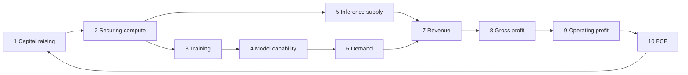

## Introduction — three documents in the same week

In the last week of October 2026, a cluster of documents laid out where the AI industry stands.

- <strong>October 26</strong>: Anthropic filed its [Form S-1](https://www.sec.gov/Archives/edgar/data/2130357/000162828026067168/anthropicpbc-sx1.htm) registration statement for an initial public offering (IPO) with the U.S. Securities and Exchange Commission (SEC). It has applied to list on the Nasdaq Global Select Market under the ticker "ANT"
- <strong>Late October</strong>: Microsoft, Amazon and Alphabet filed their quarterly reports for July–September 2026 (the 10-Qs of [Microsoft](https://www.sec.gov/Archives/edgar/data/789019/000119312526436133/msft-20260930.htm), [Amazon](https://www.sec.gov/Archives/edgar/data/1018724/000101872426000040/amzn-20260930.htm) and [Alphabet](https://www.sec.gov/Archives/edgar/data/1652044/000165204426000084/goog-20260930.htm))
- <strong>End of October</strong>: The Wall Street Journal reported that [OpenAI's latest round had raised less than half of its USD 30 billion target](https://www.wsj.com/tech/ai/openai-raises-less-than-half-of-30-billion-target-in-latest-round-91aecdc5)

Put side by side, the contrast is stark. Anthropic's revenue for all of 2023 was USD 41 million. In the first half of 2026 alone it reached USD 16.3 billion, and in the April–June quarter it posted an operating profit of USD 974 million. Operating cash flow also turned positive, at USD 3.9 billion for the half (including interest income on its cash, among other items). OpenAI, by contrast, initially sought up to USD 30 billion at a USD 1.4 trillion valuation; even after lowering the valuation to USD 1.25 trillion and the amount sought to up to USD 20 billion, it had secured only about USD 11 billion at the time of the WSJ report. And at the three hyperscalers, even as Azure grew 48%, AWS 39% and Google Cloud 103%, capital expenditure has begun to consume their operating cash flow. Amazon's trailing-twelve-month free cash flow (FCF) is now −USD 42.4 billion, and in June 2026 Alphabet raised about USD 50 billion through common stock and mandatory convertible preferred stock.

This article uses these three documents as a starting point to ask where the AI industry goes from here. It centres on two questions:

1. <strong>What does a frontier AI lab such as OpenAI or Anthropic need to show to justify its next giant round of capital?</strong>
2. <strong>What should be scaled next for AI capability to grow substantially and predictably?</strong>

The method is to break down the causal chain in which capital becomes compute, compute becomes models, models become revenue, and revenue becomes FCF that attracts the next round of capital, and to examine what changed at each link between three years ago (autumn 2023) and now (autumn 2026). I then lay out how the business environment has changed and how the technical constraints have changed — power, low precision, process nodes, memory, advanced packaging and model architecture — including the next moves visible through 2030 and their limits. Finally, I apply the same chain to Microsoft and discuss how it differs from OpenAI.

Here are the conclusions up front.

- <strong>Three years ago, capital for frontier labs was a prepayment for future capability.</strong> In 2023, Anthropic spent about USD 10.6 on compute for every dollar of revenue. In the first half of 2026 that fell to USD 0.55. The second half of the chain — gross profit and operating profit — can now be verified in financial statements for the first time
- <strong>The condition for raising the next round has shifted from expectations about capability to proof of unit economics.</strong> Concretely, three things: (a) revenue per dollar of compute exceeds 1 and keeps improving, and gross margin on inference survives price competition, (b) demand is backed by contracts and continued use, and (c) the period over which revenue comes in matches the compute payment obligations that run many years into the future — with recovery of training investment and governance added on top (Chapter 6). This shift has been reinforced by single raises now exceeding tens of billions of dollars, which narrows the set of parties able to supply that much capital
- <strong>The centre of gravity of the technical constraints moved from GPUs and CoWoS in 2023 to power, data centres and memory.</strong> All of these take years to expand. Compute payment obligations therefore precede revenue by years, and who bears that time gap has become a capital-markets question
- <strong>Amazon and Alphabet can no longer fund AI investment from operating cash flow alone, and Microsoft's headroom is shrinking.</strong> The suppliers of compute have also started relying on debt and equity issuance
- <strong>The most predictable axes to scale next are "reinforcement learning and inference-time compute on verifiable tasks" and "effective compute per dollar and per watt".</strong> Scaling pretraining still works as predicted in terms of loss, but how that translates into revenue has become harder to read
- <strong>On the same chain, Microsoft is at once a provider of capital, a seller of compute, a buyer of models and a shareholder of OpenAI.</strong> Its biggest difference from OpenAI is that it can fund the entrance of the chain — capital — from its own operating cash flow, and that the exit of the chain — revenue — does not depend on which model wins

> <strong>A note on the numbers.</strong> Unless stated otherwise, figures in this article are primary data from documents filed with the SEC (S-1, 10-Q, 10-K and XBRL data). Figures based on press reports are explicitly marked as "reported". Anthropic's S-1 is a preliminary registration statement, and some amounts — including July–September 2026 figures and the total of its commitments — were left blank, so July–September figures rely on press reports. All amounts are in U.S. dollars and rounded.

---

## 1. Then and now, side by side

### 1.1 The map in autumn 2023

Three years ago, in November 2023, the AI industry revolved around OpenAI. At its DevDay developer conference on November 6 it announced GPT-4 Turbo and said ChatGPT had reached 100 million weekly users. Eleven days later its board removed CEO Sam Altman, and five days after that he was reinstated. Its main source of capital was Microsoft, which in January 2023 had decided on an additional investment reported at around USD 10 billion.

Anthropic was still small. According to the S-1, its revenue for all of 2023 was only USD 41 million. In September 2023 it signed agreements under which Amazon would buy up to USD 4 billion and Google up to USD 2 billion of its convertible notes, establishing a pattern of receiving capital and compute at the same time from two major cloud providers.

Hyperscaler capital expenditure looks small in hindsight. According to SEC XBRL data, 2023 capex (cash basis) was USD 52.7 billion at Amazon, USD 32.3 billion at Alphabet and USD 27.3 billion at Meta, and USD 28.1 billion at Microsoft for fiscal 2023 (the year ended June 2023) — about USD 140 billion for the four combined. Each company still had large FCF left after capex, and Microsoft, Alphabet and Meta kept buying back shares.

The technical constraint was the shortage of NVIDIA H100s — or, more precisely, the production capacity of TSMC's advanced packaging, CoWoS, was said to be the bottleneck. BF16 was the standard for training, and large-scale FP8 training was not yet common. Among models with public architectures, dense Transformers dominated, and Mixtral 8x7B, released by Mistral AI in December, was only beginning to draw renewed attention to Mixture of Experts (MoE). The whole industry operated on the premise of the pretraining scaling laws: increase parameters, data and compute, and capability grows.

### 1.2 The key numbers compared

| Metric | Autumn 2023 | Autumn 2026 | Source |
|---|---|---|---|
| Anthropic revenue | USD 41 million (FY2023) | USD 16.29 billion (Jan–Jun 2026); Jul–Sep reported at USD 16.8 billion | S-1, reports |
| Anthropic compute expense ÷ revenue | 10.6x (FY2023) | 0.55x (Jan–Jun 2026) | S-1 |
| Anthropic operating cash flow | −USD 1.63 billion (FY2023) | +USD 3.93 billion (Jan–Jun 2026) | S-1 |
| Anthropic financing cash flow (capital raised) | USD 2.32 billion (FY2023) | USD 110.77 billion (Jan–Jun 2026) | S-1 |
| Microsoft Cloud quarterly revenue | USD 31.8 billion (Jul–Sep 2023) | USD 63.9 billion (Jul–Sep 2026) | 10-Q |
| Microsoft Cloud gross margin | 73% | 66% | 10-Q |
| AWS quarterly revenue (operating income) | USD 23.1 billion (USD 7.0 billion) | USD 46.0 billion (USD 17.8 billion) | 10-Q |
| Google Cloud quarterly revenue | USD 8.4 billion | USD 30.7 billion | 10-Q |
| Microsoft quarterly capex (cash) | USD 9.9 billion | USD 39.4 billion | 10-Q |
| Amazon quarterly capex (purchases) | USD 12.5 billion | USD 77.3 billion | 10-Q |
| Amazon trailing-twelve-month FCF (Amazon's definition) | +USD 21.4 billion | −USD 42.4 billion | 10-Q |
| Hyperscaler backlog (RPO) | Microsoft commercial USD 212 billion | Microsoft commercial USD 677 billion; Amazon (primarily AWS) about USD 578 billion; Google Cloud USD 560.8 billion | 10-Q |
| Length of tasks, in skilled-human time, that agents built on frontier models complete with 50% probability (METR) | About 4 minutes (GPT-4 Turbo) | About 12 hours (Claude Opus 4.6, Feb 2026) | METR |

Google Cloud's growth includes sales of TPU systems, and from January–March 2026 its backlog definition was changed to include contracts of one year or less (it also includes USD 16.8 billion with Crux AI, a related party). Amazon's backlog, by contrast, counts only contracts with original terms of more than one year, and Microsoft's commercial RPO also includes commercial contracts other than cloud. Amazon's FCF follows its own definition, which uses capex net of proceeds from sales and incentives. These differences should be kept in mind when comparing.

Revenue is not the only thing that changed by an order of magnitude. So did the size of payment obligations and the sources of the money behind them. The following sections trace this along the causal chain.

---

## 2. The causal chain from capital to FCF

### 2.1 Ten links in the chain

The business of a frontier AI lab can be written as the following causal chain.

1. <strong>Capital raising</strong>: equity, convertible notes, debt, leases, financing from suppliers and partners
2. <strong>Securing compute</strong>: cloud contracts, chip leases, own data centres — bounded by the supply of power, chips, HBM and packaging
3. <strong>Training</strong>: pretraining, post-training such as reinforcement learning, and compute for research
4. <strong>Model capability</strong>: the capability the model itself gains from training. What drives revenue is how much paid work it completes once combined with a harness and inference compute (Section 5.2)
5. <strong>Inference supply</strong>: the capacity to generate tokens, and its unit cost
6. <strong>Demand</strong>: users, customers, token consumption
7. <strong>Revenue</strong>: usage-based billing and subscriptions
8. <strong>Gross profit</strong>: revenue minus the cost of serving customers
9. <strong>Operating profit</strong>: gross profit minus training and research compute, personnel, and sales costs
10. <strong>FCF</strong>: operating cash flow minus capital expenditure (and lease principal repayments). This sets the terms for the next round of capital (for consistency, the tables in this article compute it as operating cash flow minus capex, excluding finance leases)

Writing FCF as an equation makes it easier to see what acts on which link.

$$
\mathrm{FCF}_t = R_t - C^{\mathrm{serve}}_t - C^{\mathrm{train}}_t - O_t - \Delta W_t - I_t
$$

Here $R_t$ is revenue, $C^{\mathrm{serve}}_t$ the cost of serving customers, $C^{\mathrm{train}}_t$ compute for training and research, $O_t$ personnel and sales costs, $\Delta W_t$ the increase in working capital, and $I_t$ capital expenditure (a conceptual equation that omits taxes, interest, non-cash items such as stock-based compensation, and lease principal repayments). In 2023, frontier labs had small $R_t$ and large $C^{\mathrm{train}}_t$, and filled the negative FCF with outside capital. What changed in 2026 is that $R_t$ began to exceed $C^{\mathrm{serve}}_t + C^{\mathrm{train}}_t$, and that the shift from renting compute through cloud contracts to owning it through leases and own facilities is starting to make $I_t$ and lease obligations jump.

### 2.2 What changed at each link — centred on Anthropic's S-1

Anthropic's S-1 is the first document in which a standalone frontier lab discloses its income and cash flows, annually from 2023 and quarterly from 2025. SpaceX's prospectus for its 2026 IPO also disclosed segment results for its xAI unit, reported as an operating loss of USD 6.4 billion on revenue of USD 3.2 billion in 2025 (including X's revenue). There is no better material for testing the chain, so I start with it.

#### Link 1: Capital raising — from strategic investors to public markets

Anthropic's financing cash flow in 2023 was USD 2.3 billion: USD 1.75 billion of convertible notes taken up by Amazon and Google, USD 0.45 billion of Series C preferred stock, and USD 0.12 billion of SAFEs (simple agreements for future equity). Much of the money received through the convertible notes went back to the investors as cloud fees. Financing cash flow in the first half of 2026 was USD 110.8 billion, almost all of it from issuing preferred stock. According to the S-1, the Series G (January–May 2026, USD 259.14 per share) raised about USD 45.2 billion (USD 23.5 billion of voting G-1 and USD 21.7 billion of non-voting G-2), and the Series H (May–June, USD 589.01 per share) about USD 65.2 billion (USD 45.7 billion of H-1 and USD 19.5 billion of H-2). The non-voting G-2 and H-2 were taken up by only five and eleven investors respectively, and Google (USD 10 billion) and Amazon (USD 5 billion) also took part in the Series H. The announced valuations were USD 380 billion for the Series G and USD 965 billion for the Series H, roughly 50 times the less-than-USD 20 billion of two years earlier.

The forms of financing also multiplied. The S-1 lists, among others, an agreement under which Google may purchase up to USD 30 billion of convertible notes or common stock through the end of 2030 (of which USD 10 billion has been used up by its Series H investment), a facility under which Amazon takes up as much as USD 20 billion of convertible notes or stock as compute-delivery milestones are met (USD 15 billion remains after its USD 5 billion Series H investment), and an arrangement under which Anthropic leases TPU-based racks from Broadcom and may finance part of the rent with convertible notes issued to Broadcom. <strong>The seller of compute is also arranging the buyer's financing.</strong>

OpenAI's financing moved in the same direction. Microsoft's additional investment in January 2023 was reported at about USD 10 billion. In March 2025 OpenAI reportedly raised USD 40 billion led by SoftBank (at a USD 300 billion valuation), and in March 2026 USD 122 billion (at a USD 852 billion valuation) from Amazon (about USD 50 billion), NVIDIA (USD 30 billion), SoftBank (USD 30 billion) and others. Amazon's 10-Q confirms that it invested a total of USD 50 billion in OpenAI's Series C preferred stock during January–September 2026 and entered into an AWS commercial arrangement at the same time. Here too, the investor doubles as the seller of compute.

#### Link 2: Securing compute — from short-term procurement to obligations spanning a decade or more

The constraint in 2023 was that GPUs simply could not be had. What the S-1 describes in 2026 is a system of contracting compute 12–18 months in advance and paying for it for many years. These are the main agreements named in the S-1's contractual obligations section.

| Counterparty | What | Amount | Term |
|---|---|---|---|
| Google | Minimum cloud (TPU) spend | At least about USD 114.5 billion | Apr 2026 – Jul 2033 |
| Google and other TPU providers | Additional TPU compute (amount not fixed) | Estimated USD 125–150 billion | Delivered 2028–2031 |
| Amazon | Minimum AWS spend | At least USD 110 billion | May 2026 – Apr 2036 |
| Microsoft | Minimum Azure spend | At least USD 44.9 billion | Nov 2026 – May 2033 |
| SpaceXAI (formerly xAI) | NVIDIA GPU compute | Up to USD 120.5 billion | Into 2029 |
| Nscale | NVIDIA GPU compute | Up to about USD 44.6 billion | Into 2033 |
| Lambda | NVIDIA GPU compute | About USD 41.3 billion | Into 2034 |
| Broadcom | Five-year finance leases of TPU equipment | Total rent of about USD 161.2 billion | Coming online from 2026–2027 |
| AMD | Initial purchase of Helios racks (no fixed amount) | Expected to exceed USD 20 billion | 2027 |

Including some upper-bound amounts, the named agreements alone exceed USD 600 billion, and adding the TPU and AMD amounts that are not yet fixed brings the total to around USD 800 billion. The S-1 was filed with the total and the amount to be incurred before the end of 2030 left blank, but it says substantially all of the remainder is expected to be incurred between 2031 and 2045. The total of the named agreements (about USD 640–800 billion) is 20–25 times the first-half 2026 revenue annualized (about USD 33 billion), and still 10–12 times the reported July run-rate (about USD 65 billion). There are also figures that do not rely on upper bounds. According to the subsequent-events note to the audited 2025 financial statements, agreements entered into or amended from January to June 1, 2026 carry minimum payment obligations of about USD 417 billion. According to the notes to the unaudited interim statements, agreements entered into after June 30 add about USD 245 billion more (some subject to contractual conditions being met). The near-term burden is large too: once all SpaceXAI capacity is delivered in December 2026, those payments alone come to about USD 3.1 billion a month (about USD 9.3 billion a quarter), 1.7 times the entire compute and infrastructure expense of April–June (USD 5.6 billion).

What is new is a form of procurement that Anthropic calls "Anthropic Direct": leasing chips directly and placing them in dedicated facilities operated by others. The S-1 explains that data centres take longer to build but represent a smaller fraction of total compute costs, so it can secure facilities early while deferring the larger accelerator investments until its needs are clearer. <strong>Separating the contract for the building from the contract for what goes inside lets it adjust how binding its commitments are.</strong>

#### Links 3–4: Training and model capability — the new claim of "closing the loop"

In the S-1's functional breakdown of expenses, research and development in the first half of 2026 was USD 9.7 billion, or 60% of revenue. Most R&D is compute for model development, research and internal use. Spending on training keeps growing in absolute terms, but relative to revenue it has fallen sharply from 2023 (about 10x).

What stands out in the S-1 is the claim that each generation of Claude helps build the next, which Anthropic calls "closing the loop". Over 90% of the contributions to its codebase in September 2026 were written by Claude, and the average daily volume of code contributed per engineer was over 45 times the 2024 average. Over the trailing twelve months, revenue grew about 13-fold and headcount about 2.7-fold, taking revenue per employee from USD 1.4 million to over USD 6.6 million.

#### Links 5–7: Inference supply, demand and revenue — from chat to agents

What demand consists of changed greatly in three years. In 2023, generative AI revenue came mainly from chat subscriptions and experimental API use. At Anthropic in 2026, token-metered usage billing (which the S-1 calls "pay-for-intelligence") made up 80% of first-half revenue (USD 13.1 billion), with subscriptions at 20% (USD 3.2 billion).

The drivers are the coding agent Claude Code and Claude Cowork, which extends the same mechanism to knowledge work. According to the S-1, in July–September 2026 Claude Enterprise users who did not use Claude Code spent less than USD 75 a month on average, while the top 5% of Claude Enterprise users who used Claude Code spent about 20 times that. Agents consume far more tokens than human conversation. <strong>Agentic use sharply raises spending and compute demand per user.</strong>

The customer base deepened too. Customers with USD 100,000 or more of trailing-twelve-month revenue grew from more than 950 at the end of September 2025 to more than 11,900 at the end of September 2026. More than 1,900 are at USD 1 million or more, and about 250 at USD 10 million or more. Net Revenue Retention (measured on a quarterly basis and excluding the Pro and Max individual plans) is about 900%, meaning existing customers' spending grew ninefold in a year.

Quarterly results were as follows.

| Quarter | Revenue | Compute and infrastructure | Expense ÷ revenue | Operating income (loss) |
|---|---|---|---|---|
| Jan–Mar 2025 | USD 0.38 billion | USD 0.94 billion | 251% | −USD 0.94 billion |
| Apr–Jun 2025 | USD 0.79 billion | USD 1.39 billion | 177% | −USD 1.20 billion |
| Jul–Sep 2025 | USD 1.38 billion | USD 2.05 billion | 148% | −USD 3.09 billion (incl. USD 1.5 billion settlement) |
| Oct–Dec 2025 | USD 2.04 billion | USD 2.95 billion | 144% | −USD 2.84 billion |
| Jan–Mar 2026 | USD 4.73 billion | USD 3.39 billion | 72% | −USD 1.67 billion |
| Apr–Jun 2026 | USD 11.56 billion | USD 5.56 billion | 48% | +USD 0.97 billion |
| Jul–Sep 2026 (reported) | USD 16.8 billion | — | — | — |

OpenAI's demand grew from the consumer side. ChatGPT's weekly users reportedly grew from 100 million in November 2023 to 1 billion in August 2026. Section 2.4 compares the two companies' demand.

#### Link 8: Gross profit — 85% once restated by function

The S-1's income statement groups expenses by nature, such as compute and infrastructure, and personnel. A note to the financial statements, however, also breaks expenses down by function, which lets us isolate cost of revenue (mostly the compute for serving customers). Gross margins computed from it are as follows.

| Period | Revenue | Cost of revenue | Gross margin |
|---|---|---|---|
| FY2023 | USD 0.041 billion | USD 0.026 billion | 37% |
| FY2024 | USD 0.386 billion | USD 0.752 billion | −95% |
| FY2025 | USD 4.59 billion | USD 2.77 billion | 40% |
| Jan–Jun 2026 | USD 16.29 billion | USD 2.38 billion | 85% |

In 2024, the cost of serving customers was nearly twice revenue. In the first half of 2026 it was down to 15% of revenue. As reported, July–September generated USD 1.70 of revenue per dollar of compute (a ratio over all compute, including training).

This 85% rests on several conditions, however. First, the cost of inference for free users and the fees paid to sales partners (including cloud providers) are classified as sales and marketing expenses, not cost of revenue. Second, compute is a fixed cost contracted 12–18 months in advance; when demand exceeds supply, utilization is high and prices are slow to fall. The S-1 itself says that in periods when significant new compute comes online, the expense will be recognized ahead of the revenue it supports and operating margin may compress, and that procuring higher-cost short-term compute when demand exceeds long-term capacity will also weigh on near-term operating margin. In addition, according to the S-1, about 5–7% of revenue in January–September 2026 came from customers that were violating its usage policy or commercial terms; enforcement was stepped up in August–September, so that share should decline. As reported, this includes "distillation" usage — other companies training their own models on Claude's outputs — and is expected to weigh on October–December revenue. And, as with the SpaceXAI payments above, the cost of new compute is about to arrive in earnest. <strong>The 85% should be read less as a structural level than as a temporarily high level produced by supply constraints and advance contracting.</strong>

#### Links 9–10: Operating profit and FCF — turning profitable, and the capex beyond

Operating margin improved from −1,344% in 2023 to −4% in the first half of 2026. Adjusted operating income, which excludes stock-based compensation and other items, was a USD 1.6 billion profit in the first half of 2026 (a 10% margin). As reported, the adjusted operating margin for January–September was 11%.

Cash flows were as follows.

| Period | Operating CF | Capex | FCF (operating CF − capex) | Financing CF |
|---|---|---|---|---|
| FY2023 | −USD 1.63 billion | USD 0.002 billion | −USD 1.63 billion | +USD 2.32 billion |
| FY2024 | −USD 5.69 billion | USD 0.015 billion | −USD 5.71 billion | +USD 7.25 billion |
| FY2025 | −USD 2.64 billion | USD 0.13 billion | −USD 2.77 billion | +USD 19.96 billion |
| Jan–Jun 2026 | +USD 3.93 billion | USD 0.48 billion | +USD 3.45 billion | +USD 110.77 billion |

FCF in the first half of 2026 was positive. However, the USD 3.9 billion of first-half operating cash flow includes interest income (about USD 1.1 billion) on the money raised from investors (which exceeded USD 130 billion by the end of June), the add-back of non-cash stock-based compensation (about USD 2.2 billion), and working-capital swings such as the timing of payments to vendors. GAAP operating income for the half was −USD 0.69 billion. As evidence that the back half of the chain has started to work, the April–June operating profit (USD 0.97 billion) and the gross margin are more reliable than operating cash flow.

Capex is also small because Anthropic has procured compute through cloud contracts under which it generally pays as the compute becomes available. The S-1 states plainly that as owned infrastructure and leases under Anthropic Direct grow, capital expenditure will rise significantly and it expects significant net cash use in operating and investing activities for the foreseeable future. The Broadcom leases alone carry about USD 161.2 billion of total rent. Because they are accounted for as finance leases, the principal portion of the rent will be classified as financing cash flow and will barely show up in FCF computed as operating cash flow minus capex. Spending that left through operating cash flow when it took the form of cloud fees drops out of that FCF calculation once it moves to leases, so after the shift FCF needs to be read with lease principal repayments subtracted as well. <strong>Just as the back half of the chain turned profitable, the way link 2 (securing compute) is financed is shifting from expense to investment and debt.</strong>

### 2.3 The timing gap between payments and revenue — obligations arrive years before revenue

The biggest change between 2023 and 2026 is not the size of each link but the time lag between links.

| Type of obligation | Time until payments begin | Duration of payments |
|---|---|---|
| Cloud compute contracts | 12–18 months (S-1) | 6–10 years (agreements with Google, Amazon and Microsoft) |
| Chip leases | Until the facility is complete | 5 years (Broadcom) |
| Data centre leases | 1–8 years (Microsoft's uncommenced leases start between fiscal 2027 and 2034) | 1–20 years (Microsoft), 1–26 years (Alphabet) |
| Generation and transmission | Several years | Decades |

The revenue side, by contrast, has short contract terms and is collected quickly. Eighty percent of Anthropic's revenue is usage-based, paid as customers consume. Large annual and multi-year contracts with minimum spend commitments are increasing, but subscription terms are generally 12 months or less (S-1). Even the hyperscalers' backlogs are short: Microsoft's commercial remaining performance obligation (RPO) has a weighted-average duration of about 2.3 years, and just over 55% of Alphabet's backlog (USD 567.7 billion, of which Google Cloud accounts for USD 560.8 billion) is expected to be recognized within 24 months. Amazon's backlog (primarily AWS), the longest, has a weighted-average remaining life of 6.1 years — long, but still shorter than data centre leases that run past 20 years.

In other words, there is a mismatch: <strong>payment obligations run 5–20 years, while revenue runs from months to a few years.</strong> Who bears this mismatch is a question that did not exist three years ago. The 2026 documents show the mismatch being pushed from party to party.

1. Frontier labs also sign contracts with hyperscalers and neoclouds (Nscale, Lambda and others) under which fees accrue only once capacity is delivered, or which can be cancelled after a period, passing part of the mismatch to the counterparty (after initial non-cancelable periods ending in early 2027, either party may cancel the SpaceXAI agreements on 90 days' notice). The large agreements with Google, Amazon, Broadcom and others, however, cannot be cancelled absent an uncured material breach
2. Hyperscalers secure demand in the form of backlog, lease data centres for up to 20 years, and raise funds through debt and equity, passing part of the mismatch to capital markets
3. Neoclouds raise outside financing for GPUs and data centres on the back of long-term lab contracts. According to the S-1, Nscale is required to use best efforts to obtain that financing within a specified period

If demand expectations fail anywhere in the chain, the burden spreads back up the chain. OpenAI's fundraising difficulty reported by the WSJ can be read as strain showing up at the entrance of the chain.

### 2.4 Where in the chain do Anthropic and OpenAI differ?

OpenAI is privately held and does not publish financial statements. Except for Microsoft's disclosures, the OpenAI figures below are all based on press reports (CNBC, The Information, the Financial Times, TechCrunch and others). Read them with the understanding that they are less precise than the S-1 figures.

| Item | OpenAI (reported) | Anthropic (S-1; some reported) |
|---|---|---|
| 2023 revenue | About USD 1.6 billion | USD 0.041 billion |
| 2025 revenue | About USD 13.1 billion | USD 4.59 billion |
| 2026 revenue | USD 5.7 billion in Jan–Mar; annualized run-rate about USD 40 billion in August (some estimates put it above USD 50 billion later) | USD 16.29 billion in Jan–Jun; USD 16.8 billion in Jul–Sep and a run-rate of about USD 65 billion in July (reported) |
| Main revenue | ChatGPT consumer and business subscriptions, API, advertising (launched 2026) | Usage-based 80%, subscriptions 20% (H1 2026) |
| Users and customers | 1 billion weekly ChatGPT users (August 2026) | More than 11,900 customers with USD 100,000+ trailing-twelve-month revenue |
| 2025 gross margin | About 33% (appears to include costs beyond the roughly USD 8.4 billion of inference cost) | 40% |
| Operating income (loss) | About −USD 20.9 billion in 2025; about −USD 21.6 billion in H1 2026 | −USD 8.06 billion in 2025; −USD 0.69 billion in H1 2026 (+USD 0.97 billion in Apr–Jun) |
| Cash | Cash burn of about USD 8 billion in 2025; USD 3.7 billion in Jan–Mar 2026 | FCF of −USD 2.77 billion in 2025 and +USD 3.45 billion in H1 2026 |
| Compute payment obligations | About USD 600 billion of compute spending through 2030 (told to investors in February 2026; in autumn 2025 it had spoken of USD 1.4 trillion and about 30 GW) | Over USD 600 billion in named agreements alone (including upper bounds; covering years beyond 2030, with the Amazon agreement running to 2036) |
| Most recent raises | USD 122 billion in March 2026 (USD 852 billion valuation); in October, about USD 11 billion against an original USD 30 billion target (later cut to up to USD 20 billion) | Over USD 110 billion in H1 2026 (USD 965 billion valuation in May) |
| FCF outlook | Cumulative cash burn of about USD 280 billion over 2026–2030, with cash on hand projected to run out in 2028 (July 2026 investor materials, reported by the FT) | Positive in H1 2026; expected to turn negative again as it invests in its own infrastructure |

Three years ago, OpenAI's revenue was about 40 times Anthropic's. In the summer of 2026, Anthropic's run-rate (about USD 65 billion in July) was reported to have overtaken OpenAI's (about USD 40 billion in August). The companies recognize revenue differently (Anthropic books revenue sold through cloud providers' marketplaces on a gross basis), so a strict comparison is not possible, but the order appears to have flipped.

The differences come down to three links.

<strong>The demand and revenue links (6–7).</strong> OpenAI has consumer scale — a billion users a week — but low revenue per user. To recover the cost of serving free users, it began testing ads in February 2026 and opened a self-serve ads manager in July. Anthropic concentrated on enterprise agentic use, where token consumption per person is orders of magnitude larger and willingness to pay is higher. In Menlo Ventures' survey (December 2025), shares of enterprise LLM API spend were Anthropic 40%, OpenAI 27% (50% in 2023) and Google 21%, and Anthropic held 54% of coding use cases.

<strong>The gross-profit link (8).</strong> Gross margins in 2025 were not far apart: about 33% at OpenAI and 40% at Anthropic. OpenAI's 2026 gross margin has not been reported. At Anthropic, demand surged against a fixed cost base of compute contracted 12–18 months earlier, lifting gross margin to 85%. OpenAI carried a consumer business with many free users, plus cost-heavy products such as the video app Sora (shut down in March 2026).

<strong>The capital link (1).</strong> In autumn 2025, OpenAI put forward a compute vision of "USD 1.4 trillion and about 30 GW" and a plan to own data centres through Stargate. In February 2026 it lowered what it told investors to "about USD 600 billion through 2030", and shifted from building data centres itself to renting from Microsoft, Oracle, AWS and others (Microsoft took over the Stargate site in Norway). Having announced a large vision first and scaled it back later, OpenAI appears to face investors who scrutinize the balance between payment obligations and revenue more strictly than before. That investors were slow to commit to the October round even after the valuation target was cut from USD 1.4 trillion to USD 1.25 trillion and the amount sought from USD 30 billion to up to USD 20 billion (FT, CNBC, WSJ) can be read as a sign of this.

---

## 3. How the business environment changed in three years

The environment surrounding each link of the chain also changed a great deal in three years. First, an overview.

| Aspect | Autumn 2023 | Autumn 2026 |
|---|---|---|
| Who is at the frontier | OpenAI in front, a few followers | OpenAI, Anthropic and Google trade the lead every few months, with xAI (SpaceXAI) and others behind; even the strongest Chinese open-weight model trails by about eight months |
| Core of demand | Chat and experimental API use | Agents (from coding to knowledge work) |
| Prices | Stayed high | The same capability gets 5–10x cheaper per year, while frontier capability gets more expensive |
| Distribution | Labs and clouds paired almost one-to-one | Any model is available on any cloud |
| Sources of capital | Strategic investors such as cloud providers | Strategic investors plus sovereign funds, institutional and individual investors, and public markets — and the cloud providers themselves have begun relying on outside capital |
| Main constraint | GPUs | Power, HBM, cost of capital |

### 3.1 Competition — from one runaway leader to fights over short leads

In 2023, generative AI was OpenAI's to lose. In [Menlo Ventures' survey](https://menlovc.com/perspective/2025-the-state-of-generative-ai-in-the-enterprise/), OpenAI had 50% of enterprise LLM API spend in 2023 and Anthropic 12%. By 2025 that had flipped to Anthropic 40%, OpenAI 27% and Google 21%. After Google released Gemini 3 in November 2025, OpenAI [reportedly](https://www.cnbc.com/2025/12/02/open-ai-code-red-google-anthropic.html) declared a "code red" internally in December. When OpenAI released GPT-6 Astra in September 2026, Anthropic reportedly answered with Claude Opus 5.5 within the same month. xAI was acquired by SpaceX in February 2026 (it is called "SpaceXAI" in Anthropic's S-1), and SpaceX has since gone public; SpaceXAI also sells its GPU compute to Anthropic. Even the strongest Chinese open-weight model, DeepSeek V4 Pro, sits about eight months behind the U.S. frontier, according to an assessment published in May 2026 by NIST's Center for AI Standards and Innovation (CAISI).

The effect on the chain is clear. <strong>The shorter the time a model stays at the frontier, the shorter the window for recovering its training cost.</strong> According to Anthropic's S-1, model versions released in the preceding six months accounted for over 80% of its July–September 2026 revenue; models older than six months earned less than a fifth of revenue. As Chapter 6 shows, recovering training investment has become one of the conditions for raising the next round.

### 3.2 Prices — the same capability gets cheaper, the frontier gets more expensive

According to MIT FutureTech's [analysis](https://arxiv.org/abs/2511.23455), the price of achieving a given level of benchmark performance has fallen 5–10x per year. Meanwhile, larger models and more reasoning have pushed the price of running the newest frontier models up 3–18x per year. Reports say OpenAI, Anthropic, Google and others kept up a price war for months in 2026.

Price cuts do more than erode profit, however. According to Anthropic's S-1, after it launched Opus 4.5 in November 2025 — more capable and cheaper than its predecessor — quarter-over-quarter revenue growth accelerated from 48% in October–December to 132% in January–March 2026. In September 2026, it says, Fable 5.1 (a model in its top-tier Mythos class) reduced the cost of typical workloads by about 25% (up to 45% for complex coding and highly agentic tasks) and Opus 5.5 cut cost per task by about 40%, while preserving margins. The S-1 itself attributes the acceleration to a combination of factors, including capability gains, new products and broader adoption. Even so, in this phase, <strong>lowering the cost per task appears to have increased the volume of delegated work by even more.</strong>

Demand, however, needs to be thought of as two curves. In the market for the same capability, price cuts can only be offset by volume; the price of frontier capability is rising, and there capability differences, not price cuts, drive revenue. That Anthropic's quarter-over-quarter revenue growth slowed to +45% in July–September amid the price war suggests that volume can only offset so much (stepped-up enforcement against customers violating its terms in August–September may also have played a part).

A new pricing problem also emerged: "distillation", in which other companies train their own models on a provider's outputs. According to Anthropic's S-1, about 5–7% of its January–September 2026 revenue came from customers violating its usage policy or commercial terms (as reported, including distillation-driven usage); with enforcement stepped up, that share should decline, which may weigh on revenue growth. A model's outputs also become material that helps competitors catch up. <strong>Selling frontier capability also means selling the material to replicate it</strong> — a difficulty that now dogs pricing.

### 3.3 Demand — from user counts to delegated work

On the consumer side, as noted in Section 2.2, ChatGPT reportedly reached 1 billion weekly users. Enterprise spending on generative AI also grew from USD 11.5 billion in 2024 to USD 37 billion in 2025, according to Menlo Ventures.

What changed more than the volume is its composition. The first big revenue came from coding agents. In Menlo Ventures' survey, Anthropic's share of coding use cases reached 54% in 2025. As seen in Chapter 2, the top 5% of Claude Enterprise users who used Claude Code spent about 20 times the average of users who did not use it. Agents consume far more tokens than human conversation, and that consumption is not limited by how long a human sits in front of a screen. <strong>The unit of demand has shifted from "number of users" to "amount of work delegated"</strong> — that is a major part of what lies behind the 2026 revenue surge.

### 3.4 Distribution — any model on any cloud

In 2023, the pairings were nearly fixed: OpenAI with Microsoft Azure, Anthropic with AWS and Google Cloud. In 2026, Anthropic's Claude is offered on AWS, Google Cloud and Azure alike, and since the April 2026 amendment of its Microsoft agreement OpenAI can serve its products from any cloud. Amazon invested USD 50 billion in OpenAI, Microsoft sells Anthropic's models in its own products, and Anthropic will pay Microsoft at least USD 44.9 billion.

As a result, <strong>each hyperscaler is simultaneously an investor in, seller of compute to, sales channel for, and — through its own models (Gemini, MAI, Nova) — competitor of every lab.</strong> Anthropic's S-1 lists as a risk factor that the providers of its compute also provide capital or credit support, serve as its infrastructure vendors and offer competing models, which could give rise to conflicts of interest affecting its access to compute, its cost and the prioritization of its workloads.

### 3.5 Capital markets — the end of self-funding

Within the business environment, the biggest change is where the money for AI investment comes from.

<strong>The scale of capex.</strong> Capex at the four companies (Microsoft, Alphabet, Amazon, Meta) was about USD 140 billion in 2023 (XBRL data). It reached about USD 360–380 billion in 2025 (the range depends on how Microsoft's fiscal year is aligned to the calendar), and aggregations of each company's guidance put 2026 above USD 700 billion (Amazon confirms its roughly USD 220 billion outlook in its 10-Q). Many brokers expect it to exceed USD 1 trillion in 2027.

<strong>FCF compression.</strong> Capex has caught up with operating cash flow. Amazon's trailing-twelve-month FCF is −USD 42.4 billion, and at Alphabet, capex of USD 132.0 billion exceeded operating cash flow of USD 127.1 billion in January–September 2026, making FCF negative. Microsoft remains positive, but its FCF as a share of operating cash flow in the July–September quarter fell from 68% in 2023 to 32% in 2026.

<strong>Dependence on outside money.</strong> Alphabet stopped buying back shares in January–September 2026 (USD 39.8 billion a year earlier), raised USD 49.5 billion in June through a public offering of common stock (USD 20.5 billion), a private placement with Berkshire Hathaway (USD 10.0 billion) and mandatory convertible preferred stock (USD 19.0 billion), and borrowed USD 85.2 billion through bonds and other debt. In July–September it also issued USD 12.4 billion of common stock through an at-the-market (ATM) program of up to USD 40 billion set up in June (mainly to meet tax obligations on employee equity grants). Amazon's long-term debt (face value) rose from USD 68.8 billion at the end of 2025 to USD 180.9 billion at the end of September 2026, and it set up a secured loan facility of up to about USD 80 billion, backed by the equipment it buys (available from January–March 2027 through July–September 2028). On top of this, leases signed but not yet commenced — which do not yet appear on the balance sheet — amount to USD 364.6 billion at Microsoft, USD 164.9 billion at Amazon and USD 130.5 billion at Alphabet. <strong>Even the suppliers of AI compute are finding it increasingly hard to fund their investment from operating cash flow alone.</strong>

<strong>Is FCF compression a problem?</strong> If backlog turns into revenue, FCF compression is simply up-front investment: about 30% of Microsoft's USD 677 billion of commercial RPO is expected to be recognized within 12 months. It becomes a problem if backlog is concentrated in particular customers (Chapter 7), or if chips become economically obsolete faster than they are depreciated. Server useful lives are 3–5 years at Anthropic; Amazon shortened a subset from six to five years in 2025; Meta uses 5.5 years, Alphabet six years and Microsoft two to six years (per each company's 10-K and S-1). With AI compute turning over a generation every one to two years, how long a six-year assumption holds will shape the quality of the hyperscalers' earnings. Supply-side delays are also appearing: Microsoft lowered its fiscal 2027 capex outlook from USD 175 billion to USD 170 billion, explaining that delays at outside GPU providers will push some usable capacity into January–June 2027 (CNBC).

<strong>Circularity and earnings quality.</strong> Hyperscalers invest in labs, and labs buy compute from those investors. According to Amazon's 10-Q, the carrying value of its Anthropic preferred stock is USD 92.5 billion and the fair value of its Anthropic convertible notes USD 146.2 billion (the USD 140.3 billion unrealized gain on the notes sits in other comprehensive income, not net income). Most of its USD 68.4 billion of "other income (expense), net" in January–September 2026 came from upward revaluations of the preferred stock tied to Anthropic's fundraising (USD 62.8 billion) and gains realized when part of the notes was converted into preferred stock (USD 4.5 billion). Over the same period, Anthropic signed an agreement to pay Amazon at least USD 110 billion through 2036.

Alphabet also recorded USD 127.3 billion of gains on equity securities in January–September; its 10-Q attributes them largely to an unnamed "private company" and to SpaceX before its IPO. Alphabet has also committed to fund up to USD 20 billion more in that private company as milestones are met through 2030 — terms that match Google's agreement in Anthropic's S-1 (USD 20 billion remaining). Part of the hyperscalers' net income is inflated by revaluation gains on shares of labs that are also their customers. This circularity is not a problem as long as demand materializes as expected. But if demand expectations fail, falling revenue and valuation losses arrive together. Valuation results also swing widely from quarter to quarter: Alphabet's gains on equity securities total USD 127.3 billion for January–September, but July–September alone was a USD 8.7 billion loss.

<strong>The market's reaction.</strong> As reported, tech stocks sold off at the end of October 2026. Alphabet had its worst trading day ever after search revenue missed expectations (partly due to lower monetization in AI Mode, the company said) and its July–September FCF turned negative; Intel, Micron, NVIDIA, neoclouds such as CoreWeave, and Oracle also fell. The possibility that AI erodes existing cash engines has also come into view. OpenAI's raise fell short of its target in that climate. Expectations for Anthropic's IPO valuation have also reportedly been lowered. Three years ago, those doubting AI investment were a minority. In 2026, capital markets have begun to doubt not AI demand itself but <strong>the balance between demand and payment obligations.</strong>

### 3.6 Supply chains and politics

Finally, there are factors acting on the chain from outside. First, memory prices: shifting production to HBM sent prices of conventional DRAM soaring, affecting electronics beyond AI (Section 4.4). Second, the politics of electricity prices: rising household electricity bills are being linked to data centres, and Anthropic has pledged to cover electricity price increases caused by its own data centres (Section 4.1). Third, copyright: Anthropic recorded a USD 1.5 billion settlement in the class action brought by book authors (the Bartz case) in July–September 2025. Fourth, geopolitics: the S-1 lists as risk factors the concentration of leading-edge chip manufacturing in Taiwan and the possibility that export controls extend to where chips may be installed or model weights stored. As reported, sales of NVIDIA's H20 and H200 to China were allowed on condition that part of the revenue goes to the U.S. government, but shipments have been limited. Fifth, regulation: under the EU AI Act, obligations for providers of general-purpose AI models began to apply in August 2025. In the U.S., the federal government is trying to rein in state AI laws, but no federal law has overridden them across the board.

---

## 4. How the technical constraints changed in three years

This chapter looks at six technical constraints on the chain's "securing compute", "training" and "inference supply" links. For each, I describe the state three years ago, the state today, and the next moves visible through 2030 and their limits.

### 4.1 Power and data centres — from "tens of MW" to "GW"

<strong>Three years ago.</strong> In 2023, frontier training clusters drew power on the order of tens of megawatts. Microsoft's Eagle (H100-based), ranked third on the November 2023 TOP500, and the two 24,576-H100 clusters Meta disclosed in March 2024 were among the largest of the time. According to a [report](https://eta-publications.lbl.gov/sites/default/files/2024-12/lbnl-2024-united-states-data-center-energy-usage-report.pdf) by Lawrence Berkeley National Laboratory (LBNL), U.S. data centres consumed 176 TWh in 2023, 4.4% of total U.S. electricity. In the Uptime Institute's 2023 survey, "most operators do not have any racks beyond 20 kW", and air cooling was the norm. Data centre buildings went up in 18–24 months, and the grid still had headroom. The bottleneck was not power but CoWoS and GPU allocation.

<strong>Now.</strong> Single sites are measured in gigawatts. In data tracked by [Epoch AI](https://epoch.ai/data/ai-data-centers) from satellite imagery and permits, the site with the most compute as of November 2026 is xAI's (now SpaceXAI's) Colossus 2 in Memphis, equivalent to about 1.11 million H100s. The first Stargate site of OpenAI, Oracle and SoftBank, in Abilene, Texas, will have 824 MW of IT power when all eight buildings are complete; according to Oracle's September 2026 earnings call, six buildings (618 MW) had been delivered. The "1.2 GW" often seen in the press is total site power including cooling and must be distinguished from IT power. Meta has brought online the first phase of Prometheus in Ohio, planned at over 1 GW, and aims for 5 GW at Hyperion in Louisiana. Microsoft has linked its Fairwater sites in Wisconsin and Atlanta with a dedicated wide-area network, the "AI WAN", and uses them as one computer. For Anthropic, Amazon runs about 500,000 Trainium2 chips at Project Rainier in Indiana, and Google supplies up to 1 million TPUs (well over 1 GW in 2026).

Rack power changed by an order of magnitude too. A GB200 NVL72 draws about 120–130 kW per rack, the 2026 Vera Rubin NVL72 (originally called NVL144) about 190–230 kW (TrendForce), and the 2027 Rubin Ultra (Kyber) is designed for 600 kW to 1 MW. At these levels, power distribution in the rack has to move to 800 V DC and liquid cooling has to become standard. NVIDIA, together with about 20 power and electrical equipment makers, announced a [move to 800 V DC](https://developer.nvidia.com/blog/nvidia-800-v-hvdc-architecture-will-power-the-next-generation-of-ai-factories/).

How power is procured changed as well. Waiting for a grid connection takes years, so "behind-the-meter" generation — gas turbines and fuel cells on site — has become routine. In Abilene, Crusoe runs about 360 MW of gas turbines, and Oracle is deploying up to 2.8 GW of Bloom Energy fuel cells.

The result is tight supply of upstream equipment. As reported, GE Vernova's gas turbine backlog has reached 116 GW and is booked through 2031, and lead times for large power transformers have stretched to 30–36 months. Texas's grid (ERCOT) has received 410–474 GW of interconnection requests from large loads — more than four times the state's all-time peak demand of 91 GW — and the state has ordered an audit of data centres. Capacity prices in PJM, the grid operator for much of the eastern U.S., kept setting records — from USD 270 per MW-day for 2025/26 to the cap of USD 329 for 2026/27 and the cap of USD 333 for 2027/28 — and the 2027/28 auction fell 6.6 GW short of the capacity needed to meet the reliability standard.

Rising household electricity bills have become a political issue, and Anthropic writes in its S-1 that it has publicly committed to covering electricity price increases for consumers caused by its data centres. Goldman Sachs estimates U.S. data centre operating capacity at about 41 GW at the end of 2026, of which 10–20 GW is for AI, and that about 7 GW of AI capacity planned for 2026 has slipped.

<strong>Next moves through 2030, and their limits.</strong> The International Energy Agency's [Energy and AI](https://www.iea.org/reports/energy-and-ai/executive-summary) expects global data centre electricity consumption to double from 415 TWh in 2024 to about 945 TWh in 2030. An [analysis](https://epoch.ai/publications/power-demands-of-frontier-ai-training) by Epoch AI and the Electric Power Research Institute (EPRI), noting that the power needed for a single frontier training run has grown 2.2x per year, estimates that the largest training run in 2030 would need 4–16 GW, and cautions that the upper end may not be feasible. There are five next moves.

1. <strong>On-site generation</strong>: gas turbines, reciprocating engines, fuel cells
2. <strong>Nuclear</strong>: restarting shut-down reactors (Crane, formerly Three Mile Island Unit 1; Palisades; Duane Arnold) and purchase agreements for small modular reactors (SMRs)
3. <strong>Distributed training across sites</strong>: using distant sites for a single training run, as with Microsoft's AI WAN and Google's [Decoupled DiLoCo](https://deepmind.google/blog/decoupled-diloco/)
4. <strong>Dispersal to countries with spare power</strong>: Stargate UAE and the site in Norway
5. <strong>Demand-side flexibility</strong>: getting connected sooner in exchange for cutting load when the grid is tight. A Duke University Nicholas Institute [analysis](https://nicholasinstitute.duke.edu/publications/rethinking-load-growth) (February 2025) estimated that if new large loads accepted curtailment equal to 0.25%, 0.5% or 1% of their annual electricity use, the existing U.S. grid could take on 76 GW, 98 GW or 126 GW of new load, respectively. In August 2025, Google [signed](https://blog.google/innovation-and-ai/infrastructure-and-cloud/global-network/how-were-making-data-centers-more-flexible-to-benefit-power-grids/) demand-response agreements covering machine-learning workloads with two utilities

The limit is that all but the last take time. Gas turbines have waits of three to seven years, and transformers and switchgear two and a half to five. Reactor restarts come in 2027 at the earliest, and SMRs will not generate power before 2029–2030. Demand flexibility works quickly, but it applies only to loads that can be deferred, such as training, and suits inference poorly, since customers cannot be kept waiting. On top of that come water use, local opposition, the politics of electricity prices, and emissions from relying on gas. <strong>In 2023 the ceiling was how fast chips could be made; in 2026 it is how fast gigawatt-scale power plants can be built, connected to the grid and permitted.</strong> NVIDIA CEO Jensen Huang puts the all-in cost of an AI data centre at about USD 50 billion per GW (a vendor's own estimate, which warrants caution). With power as the ceiling, how much revenue each gigawatt can be turned into determines the efficiency of the whole chain.

### 4.2 Low precision — from FP32 to FP4, and diminishing returns

<strong>Three years ago.</strong> In autumn 2023, BF16 was the standard for training. Looking back over numeric formats, FP32 was the default until around 2017, and mixed-precision training combining FP16 and FP32 spread with the V100 generation. BF16, which keeps FP32's 8-bit exponent, was used first on Google's TPUs. With A100 (2020) it came to NVIDIA GPUs as well, becoming standard along with TF32 for matrix operations. H100 (2022) was the first NVIDIA GPU with FP8 compute (two variants with different exponent/mantissa splits, E4M3 and E5M2), but as of 2023 FP8 was mainly used for inference, and large-scale FP8 training was still experimental. The MX (Microscaling) formats, which share a scale across a block, had just had their v1.0 specification published by the Open Compute Project (OCP) in 2023, and no hardware supported them yet.

<strong>Now.</strong> Among developers that publish their training recipes, FP8 has become standard for training as well. The turning point was the [DeepSeek-V3 technical report](https://arxiv.org/abs/2412.19437) in December 2024. Comparisons on smaller models showed the relative loss error of FP8 training stayed below 0.25% versus BF16, after which DeepSeek trained a MoE model with 671 billion total parameters (37 billion active per token) in FP8. Three techniques made it work: giving activations a scale per 1×128 tile and weights a scale per 128×128 block to localize the effect of outliers; discovering that the H800's FP8 matrix units retain only about 14 bits of accumulation precision and promoting partial sums to FP32 every 128 elements; and keeping numerically sensitive parts — the embedding layer, output head, MoE gating, normalization and attention — in higher precision. Meta likewise [reported](https://ai.meta.com/blog/llama-4-multimodal-intelligence/) in April 2025 that it pretrained its largest Llama 4 model (Behemoth) in FP8 on 32,000 GPUs, achieving 390 TFLOPS per GPU.

Beyond that lies 4 bits. Blackwell (B200) has FP4 compute and supports the MX format MXFP4 (one shared power-of-two scale, E8M0, per 32 elements) as well as NVIDIA's own NVFP4 (an FP8 E4M3 scale per 16 elements, plus an FP32 scale for the whole tensor). [gpt-oss](https://github.com/openai/gpt-oss), released by OpenAI in August 2025, distributes the weights of its MoE layers in MXFP4, fitting a model of about 120 billion parameters on a single 80 GB GPU. On the training side, NVIDIA's September 2025 paper [Pretraining Large Language Models with NVFP4](https://arxiv.org/abs/2509.25149) reported training a 12-billion-parameter model on 10 trillion tokens in NVFP4 with accuracy nearly matching FP8 (62.58% vs 62.62% on MMLU-Pro). It relies on a combination of random Hadamard transforms to spread out outliers, stochastic rounding to remove bias in gradients, and keeping some layers in higher precision. However, I found no public information that any frontier-class closed model has done its entire pretraining in FP4. A realistic summary for 2026 is <strong>FP8 (and MXFP8) as the workhorse for training, FP4 as the workhorse for inference.</strong>

Comparing per-chip peak throughput on a dense basis, H100 SXM delivers 1.98 PFLOPS in FP8; B200 4.5 PFLOPS in FP8 and 9 PFLOPS in FP4; and Rubin 17.5 PFLOPS in FP8 and 35 PFLOPS in NVFP4. The widely cited "50 PFLOPS in NVFP4" for Rubin is an inference figure that NVIDIA's [spec table](https://www.nvidia.com/en-us/data-center/vera-rubin-nvl72/) footnotes as a sparse specification, about 1.4 times the dense figure. The sparse (2:4 sparsity) figures in the Hopper and Blackwell spec sheets are twice the dense ones, so comparisons need to use the same basis. Rubin's BF16 throughput is 4 PFLOPS, less than a quarter of its FP8 figure (on H100 and B200, BF16 was half of FP8): the chip's circuitry itself is being devoted to low-precision arithmetic.

<strong>Next moves through 2030, and their limits.</strong> The next move is to make FP4 the workhorse for training too. That NVIDIA lists "NVFP4 training" throughput (35 PFLOPS dense) as a separate line in Rubin's spec table reflects that bet. But the limits are visible. First, on paper, halving the bit width still roughly doubles peak throughput (NVIDIA describes the gain from FP8 to FP4 as "two- to three-fold"). However, the end-to-end speedup in training and inference is smaller than the peak because of the extra processing described below. Moreover, below 4 bits there is little room left to halve again; below that point, the gain shifts from faster arithmetic to storing and reading fewer bytes of weights (saving memory bandwidth). Second, Kumar et al.'s [Scaling Laws for Precision](https://arxiv.org/abs/2411.04330) (2024) showed that training in lower precision reduces a model's "effective parameter count", that the compute-optimal training precision is around 7–8 bits, and that the degradation from post-training quantization grows as training data increases. These results come from experiments with models of up to 1.7 billion parameters, mostly in integer formats, and do not necessarily carry over as-is to large models or floating-point formats. Keeping accuracy at 4 bits requires aids such as finer blocks, transforms and keeping some parts in higher precision; the more those aids cost, the smaller the actual gain. Third, optimizer states (kept in BF16 even in DeepSeek-V3), the communication that gathers gradients and MoE outputs (DeepSeek-V3 moved the dispatch of MoE inputs to FP8 but kept the combine step in BF16) and the attention softmax remain hard to push to lower precision. There is research on ternary (about 1.58-bit) models such as BitNet, but they must be trained from scratch, and there is little reason to expect them to become the standard for frontier pretraining by 2030. <strong>Low precision was a major driver of performance gains in 2023–2026, but heading toward 2030, the multiplier it can deliver on its own will shrink.</strong>

### 4.3 Process nodes — more silicon rather than smaller transistors

<strong>Three years ago.</strong> NVIDIA's data centre GPUs — V100 (TSMC 12FFN), A100 (N7) and H100 (4N, an N5-family process customized for NVIDIA) — were all single-die designs. H100's die, at about 814 mm², was approaching the reticle limit (about 858 mm²), the largest area a lithography tool can expose at once. TSMC's N3 had only just entered volume production.

<strong>Now.</strong> Blackwell (B200), announced in 2024, connects two reticle-sized dies made on TSMC 4NP (an N4P-family process) with a 10 TB/s link, putting 208 billion transistors in one package. The process is nearly the same generation as H100's; the performance gains come from the number of dies, lower precision and HBM. Rubin in 2026 has 336 billion transistors and is again built from multiple dies. Its process is reported to be TSMC N3P (NVIDIA itself has not stated it). AMD likewise moved from MI300X (N5 compute dies and N6 I/O dies) to MI355X (N3P and N6). Google does not disclose the process for TPU v5 and later. On TSMC's side, N2, with gate-all-around (GAA) transistors, entered volume production in October–December 2025. Intel put backside power delivery (PowerVia) into volume production with 18A ahead of TSMC.

Decomposing the per-chip performance gain from H100 to Rubin shows that the process node's contribution is surprisingly small. Dense peak throughput grew about 4x in BF16 (0.99 to 4 PFLOPS) and about 8.8x in FP8 (1.98 to 17.5 PFLOPS); comparing H100's FP8 with Rubin's NVFP4 (35 PFLOPS) gives about 18x. The roughly 4x in BF16 tracks the growth in transistor count (80 billion to 336 billion, about 4.2x), of which about 2x comes from the increase in the number of dies; the remaining roughly 2x comes from process density and design improvements. FP8 and FP4 grew far more because more of the circuitry was devoted to low-precision arithmetic, on top of lowering the precision itself. Even B200, on nearly the same process generation as H100, has about 2.6 times H100's transistors and about 2.3 times its FP8 throughput. Power rose too: comparing racks of 72 GPUs, power per rack went from about 120–130 kW for GB200 NVL72 to about 190–230 kW for Vera Rubin NVL72 (Section 4.1). Memory bandwidth widened about 5.7x, from 3.35 TB/s to 19.2 TB/s (next section), but that is a separate axis from compute: it sets the speed of decode, which generates tokens one at a time. <strong>Much of the past three years' performance gain came not from shrinking transistors but from adding dies, adding power, lowering precision and adding memory.</strong>

<strong>Next moves through 2030, and their limits.</strong> TSMC's roadmap places A16 after N2, the first to adopt backside power delivery (Super Power Rail). According to TSMC, it is 8–10% faster at the same voltage than N2P, or uses 15–20% less power at the same speed. Volume production had been described as the second half of 2026, but it was reported to have slipped to 2027 at the April 2026 technology symposium (TSMC's website still says the second half of 2026). A14 (2028), and A13 and A12 (2029) follow. For A14, TSMC claims, versus N2, up to 15% higher speed at the same power or up to 30% lower power at the same speed, and more than 20% higher logic density — far from the old "2x density per generation". There are three limits. First, SRAM cell area has nearly stopped shrinking, so growing on-chip cache depends on 3D stacking. Second, wafer and mask costs keep rising, restricting the leading edge to the largest players. TSMC has indicated that even A13 and A12 in 2029 will not use expensive High-NA EUV lithography tools ([TrendForce](https://www.trendforce.com/news/2026/04/23/news-tsmc-unveils-latest-roadmap-a12-a13-set-for-2029-without-high-na-euv-a16-volume-production-delayed-to-2027/)): even when a way to shrink further exists, it will not be used unless it pays for itself. Third, most leading-edge logic manufacturing is concentrated in Taiwan. TSMC's Arizona fab produced Blackwell wafers in 2025, but CoWoS assembly is done in Taiwan, so supply-chain diversification is only partway there. <strong>Process nodes will keep advancing, but through 2030 the main source of performance gains shifts to packaging — how many dies and HBM stacks can be combined into one — and to power.</strong>

### 4.4 Memory (HBM) — the memory wall and the scramble for supply

<strong>Three years ago.</strong> In autumn 2023, HBM3 was the mainstay. The JEDEC standard (JESD238, January 2022) specified a 1,024-bit interface at 6.4 Gb/s per pin, about 819 GB/s per stack; H100 carried 80 GB at 3.35 TB/s. H200, with 141 GB of HBM3E at 4.8 TB/s, was announced on November 13 but had not yet shipped. Practically only SK hynix could mass-produce HBM3 for H100, and HBM accounted for only about 8% of the DRAM market's revenue (TrendForce).

The gap between compute and memory bandwidth — the so-called memory wall — was already a problem. According to Gholami et al.'s [AI and Memory Wall](https://arxiv.org/abs/2403.14123), peak hardware compute grew about 60,000-fold over 20 years while DRAM bandwidth grew only about 100-fold.

<strong>Now.</strong> The mainstay of 2024–2025 was HBM3E, at about 9.2–9.8 Gb/s per pin and about 1.2 TB/s per stack, in 8- to 12-high stacks (24–36 GB). In April 2025 JEDEC published the next standard, HBM4 (JESD270-4). It doubles the interface to 2,048 bits and specifies up to 8 Gb/s per pin and up to 2 TB/s per stack, with stacks of up to 16 dies and 64 GB. Among actual products, some, like Rubin, run the pins faster than the standard, while others, like MI455X, gain bandwidth by adding stacks. Product configurations evolved as follows.

| Product | Timing | HBM | Capacity | Bandwidth |
|---|---|---|---|---|
| H100 SXM | 2022 | HBM3 | 80 GB | 3.35 TB/s |
| H200 | Announced Nov 2023 | HBM3E | 141 GB | 4.8 TB/s |
| B200 | 2024 | HBM3E | 180–192 GB | 8 TB/s |
| B300 | 2025 | HBM3E (8 stacks of 12-high) | 288 GB | 8 TB/s |
| TPU v7 Ironwood | 2025 | Generation not disclosed | 192 GiB | 7.37 TB/s |
| Rubin | 2026 | HBM4 (8 stacks) | 288 GB | 19.2 TB/s (initially announced as 22 TB/s) |
| AMD MI455X | 2026 | HBM4 (12 stacks) | 432 GB | 23.3 TB/s (AMD's figure) |

Rubin's bandwidth was announced as 22 TB/s at CES in January 2026, but in September it was quietly lowered to 19.2 TB/s on NVIDIA's website (the change came to light in press reports in late October). NVLink bandwidth per GPU also fell, from 3.6 TB/s to 3.0 TB/s (from 260 TB/s to 216 TB/s for the whole NVL72). NVIDIA told Wccftech that the earlier figures were "preliminary architectural targets" and that the [final specifications](https://wccftech.com/nvidia-official-statement-on-vera-rubin-spec-change/) reflect what the system sustains in volume production. For HBM4, this corresponds to lowering the per-pin speed from 10.75 Gb/s to 9.375 Gb/s, which suggests how hard it is to mass-produce HBM4 at high speeds.

The supply side changed too. According to Counterpoint Research, HBM shares in April–June 2026 were SK hynix 50%, Samsung 33% and Micron 18%, with Samsung, once a laggard, catching up with HBM4. The HBM market is expected to grow from about USD 34.6 billion in 2025 to about USD 54.6 billion in 2026 (a BofA estimate cited by SK hynix's newsroom). As DRAM makers shifted capacity to HBM and server memory, prices of conventional DRAM also soared in 2025–2026 (the so-called memory supercycle). As reported, HBM4 sells to NVIDIA at USD 31–32 per GB, nearly twice HBM3E's USD 17–18. On their October 2026 earnings calls, SK hynix said its DRAM and HBM are effectively sold out through 2029, and Samsung said its 2027 HBM supply is sold out. Amazon also lists volatility in the supply of memory chips among the risks to its guidance in its 10-Q.

The memory wall has grown higher. In Epoch AI's data on GPUs from 2010 to 2023, FP32 compute doubles about every 2.3 years, while memory bandwidth takes about 4.1 years to double. In LLM inference, the decode phase — generating tokens one by one — is limited by memory bandwidth, not compute. Inference-time compute (discussed in Chapter 5) and long agent contexts swell the KV cache (the intermediate state for past tokens), raising the wall further. The industry has responded in four ways.

1. <strong>Model-side shrinking of the KV cache</strong>: GQA, and DeepSeek's MLA, which cuts the KV cache by 93%
2. <strong>Splitting the work</strong>: assigning prefill (processing the input at once) and decode (generating one token at a time) to different GPUs (NVIDIA Dynamo)
3. <strong>Extending the memory hierarchy</strong>: offloading the KV cache to tiers outside the GPU (context storage built on BlueField-4)
4. <strong>Inference chips with large amounts of SRAM</strong>: in December 2025 NVIDIA agreed to license Groq's inference technology and hire its people (reported at about USD 20 billion), and in January 2026 OpenAI signed a deal with Cerebras worth more than USD 10 billion for up to 750 MW

<strong>Next moves through 2030, and their limits.</strong> The next moves are more layers and higher speeds through HBM4E (around 2027) and HBM5 (around 2029–2030); "custom HBM" whose base die is made on TSMC logic processes (NVIDIA and Micron have announced joint development); and taller stacks through hybrid bonding (direct copper-to-copper bonding). There are four limits. First, JEDEC caps package height (reported at about 775 μm), so adding layers requires thinner dies or a different bonding method; SK hynix and Samsung disagree on when hybrid bonding will be put to practical use — Samsung around 2027, SK hynix in the HBM5 generation. Second, HBM is far more expensive than the same capacity of conventional DRAM, and its unit price is rising in the supercycle. Third, the length of die edge along which HBM can be placed is limited, so adding stacks requires a larger package (next section). Fourth, adding capacity requires new fabs and takes years; SK hynix expects demand to exceed supply through 2030. <strong>HBM went from "a part that only one company could make properly" in 2023 to "a part sold out at every supplier" in 2026.</strong> HBM supply now determines not only per-chip performance but how many chips can be shipped at all.

### 4.5 Advanced packaging — how many dies can be combined into one

<strong>Three years ago.</strong> GPUs such as H100 used CoWoS-S, with a silicon interposer limited to about 3.3 times the reticle area (CoWoS-R, which uses organic redistribution layers, also entered volume production that year). TSMC's CoWoS capacity at the end of 2023 was 13,000–16,000 wafers per month (estimates), meeting only about 80% of demand. This CoWoS allocation determined how many H100s could ship. In practice, the unit directly connected by NVIDIA's high-speed interconnect (NVLink) topped out at the 8-GPU HGX board (DGX GH200, announced in May 2023, linked 256 chips over NVLink, but it was an exceptional configuration). Amkor's Arizona packaging plant had only just been announced.

<strong>Now.</strong> TSMC uses three kinds of CoWoS: CoWoS-S with the traditional silicon interposer, the cheaper CoWoS-R built only from organic redistribution layers, and the mainstay CoWoS-L, which combines small silicon bridges (LSI) with redistribution layers; Blackwell and Rubin use CoWoS-L. Interposers of 5.5 times the reticle are in volume production, and in August 2026 TSMC said yields had reached 98–99%. TSMC does not disclose wafer counts, so capacity figures are estimates only, but one view puts TSMC alone at 100,000–140,000 wafers per month at the end of 2026, and about 200,000 including outsourced assembly and test companies (OSATs). That is a 7–10x increase in three years for TSMC alone. NVIDIA is believed to hold about 60% of it.

Beyond the package, the unit of interconnection grew as well. GB200 NVL72, which builds NVLink switches into the rack, connects 72 GPUs (144 dies) into one NVLink domain. The original plan for the 2027 Rubin Ultra (Kyber) combines 144 four-die packages, or 576 dies (a design change has been reported, as discussed below). Google's TPUs already formed large pods — 4,096 chips for v4 and 8,960 for v5p (December 2023) — and v7 combines 9,216 chips into one pod. Co-packaged optics (CPO), which put optical components directly into the switch package, has been productized by NVIDIA (Quantum-X Photonics) and Broadcom (Tomahawk 6), though shipments remained limited as of summer 2026.

<strong>Next moves through 2030, and their limits.</strong> TSMC's [roadmap](https://pr.tsmc.com/english/news/3302) as of April 2026 expands interposers to 14 times the reticle in 2028 (enough for about ten large compute dies and 20 HBM stacks) and beyond that in 2029, combined with SoIC (3D stacking with hybrid bonding) to stack dies vertically. Further out are SoW-X, which turns an entire wafer into one system (40 times the reticle; volume production slipped from 2027 to 2029), and CoPoS, which uses 310 mm square panels instead of round wafers (volume production planned for 2028–2029).

The limits are both physical and economic. Physically, NVIDIA has been reported to have abandoned its original Rubin Ultra design with four dies in one package: at 7.5–8 times the reticle, the mismatch in thermal expansion between silicon (about 2.6 ppm/°C) and organic substrate (14–17 ppm/°C) warped the substrate, breaking die-to-substrate contacts and sharply lowering yield (reported by SemiAnalysis; NVIDIA has not commented). Glass substrates, whose thermal expansion is close to silicon's, are seen as the fix, but volume production will come in 2028–2029 or later. Testing is getting heavier too: test time per unit reportedly grew from about 350 seconds for Hopper to 1,200–1,400 seconds for Rubin (Morgan Stanley). Economically, SoIC capex is estimated at nearly USD 7 billion per 10,000 wafers per month, far heavier than CoWoS. In the U.S., Amkor's Arizona plant (investment expanded to USD 12 billion) starts production only in 2028 and reaches full capacity in 2030.

Views differ on whether CoWoS is the bottleneck in 2026: some say CoWoS capacity is still short; others — including TSMC's executive in charge and SemiAnalysis — say the yield problem is solved and the constraint has moved to HBM and ABF substrates; still others say power and grid connections are the real constraint. <strong>What is certain is that the bottleneck does not stay in one place: resolve one, and it moves to the next.</strong>

### 4.6 Model architecture — from dense to sparse, from instant answers to "thinking" inference

<strong>Three years ago.</strong> In autumn 2023, large models whose architecture was public were almost all dense Transformers that use every parameter for every token (Llama 2, for example). GPT-4 was reported to be a MoE, but OpenAI has never officially confirmed it. Mixtral 8x7B, released by Mistral AI in December, was a MoE using only 12.9 billion of its 46.7 billion total parameters per token, showing that it could match larger dense models at lower inference cost. DeepSeekMoE, published the following January, introduced finely segmented experts plus always-active shared experts. In routing — assigning which tokens each expert processes — imbalance was normally controlled with an auxiliary loss. Models answered questions directly, without a long phase of "thinking" before answering.

<strong>Now.</strong> Three things changed.

First, <strong>MoE became the norm among open-weight models too, and sparsity kept rising.</strong> The ratio of total parameters to active parameters per token rose from Mixtral's 3.6x to 11x for DeepSeek-V2 (May 2024), 18x for DeepSeek-V3 (December 2024; 671 billion / 37 billion) and 31x for Kimi K2 (July 2025; 1 trillion / 32 billion). DeepSeek-V3 introduced load balancing without an auxiliary loss — adjusting a per-expert bias by a rule that uses no gradients — and multi-token prediction (MTP), which trains the model to predict one more token beyond the next one (building on Gloeckle et al., 2024); both spread to other open-weight models. The scaling law of Krajewski et al. (2024), which finds that finer-grained experts give better performance per unit of compute, provides empirical support for this trend. Routing converged on "token choice", in which each token selects its top-k experts. At the same time, MoE generates heavy all-to-all communication — sending each token to the GPU holding its experts and sending results back. Machines such as GB200 NVL72, which put 72 GPUs into one NVLink domain, became a major advantage for running MoE efficiently, though not a necessity: DeepSeek-V3 trained efficiently on an H800 cluster of 8-GPU nodes linked by InfiniBand, hiding communication behind computation. <strong>The shape of the model determines the shape of the machine, and the shape of the machine determines the shape of the model</strong> — the mutual dependence has grown.

Attention changed too. DeepSeek's MLA compresses the KV cache, and DeepSeek-V3.2-Exp in September 2025 introduced sparse attention (DSA), which uses a lightweight indexer (the "lightning indexer") to compute attention over only the 2,048 most relevant tokens, and cut API prices by more than half. Hybrids mixing in linear attention or state-space models (Mamba) followed one after another: AI21's Jamba, NVIDIA's Nemotron-H, IBM's Granite 4.0 and Moonshot AI's Kimi Linear. MiniMax, however, mixed in linear attention at a 7:1 ratio in M1 (June 2025) but returned to ordinary full attention in M2 (October 2025). The company [explained](https://huggingface.co/blog/MiniMax-AI/why-did-m2-end-up-as-a-full-attention-model) that the hybrid looked fine on saturated benchmarks but, at larger scale, was clearly worse at multi-hop reasoning; that M1's reinforcement learning had run into serious numerical-precision problems; and that the training and inference infrastructure for linear attention — memory-bound kernels, prefix caching, support for speculative decoding — is still immature.

Second, <strong>"test-time scaling" — using compute at inference time — became a second axis alongside pretraining.</strong> OpenAI's o1 in September 2024 showed that performance improves both with more reinforcement-learning compute and with more time spent thinking before answering. Accuracy on the AIME 2024 math competition went from GPT-4o's 12% to 74% for a single o1 answer, 83% with majority voting over 64 samples, and 93% when re-ranking 1,000 samples with a learned scoring function. DeepSeek-R1 in January 2025 reproduced this cheaply with RLVR (reinforcement learning with verifiable rewards) on tasks whose correctness can be checked automatically, such as math and programming, and GRPO, a method that does not use a value model. Since then, labs have sold "how much to think" as a product option: Claude's extended thinking, Gemini's Deep Think, Grok Heavy and GPT-5 Pro. GPT-5 (August 2025) was presented as a "system" with a router that sends requests to a fast model or a thinking model. Routing now happens not only inside models but at the system layer.

Third, <strong>closed models continue to reveal little about their architecture, while the open-weight side has disclosed more.</strong> Closed-model secrecy began with GPT-4 (March 2023), and OpenAI's later models, Claude and Grok likewise do not publish parameter counts or architecture. Google is the exception: it has said its models are sparse MoEs since Gemini 1.5 (February 2024), and the model card for Gemini 4 Argon, released in autumn 2026, also states that it is a large-scale sparse MoE. China's DeepSeek (V4, April 2026), Moonshot AI (Kimi K3, July) and Zhipu AI (GLM-5, February) continue to publish their architectures in papers and technical reports. In May 2026, NIST's CAISI assessed that DeepSeek V4 Pro, the strongest Chinese open-weight model, trails the U.S. frontier by about eight months.

Recurrent depth — repeating the same block many times to "think" internally without emitting tokens — advanced as research. Geiping et al.'s [Huginn-3.5B](https://arxiv.org/abs/2502.05171) (February 2025) improved performance up to a compute load equivalent to a 50-billion-parameter model by increasing the number of iterations at inference time. Mixture-of-Recursions, HRM, TRM (which posted strong ARC-AGI results with 7 million parameters) and ByteDance's looped language model Ouro followed. As of November 2026, however, there is no public information that a frontier lab has adopted it at scales above 100 billion parameters. For HRM, an ARC Prize analysis found that much of its performance came not from the architecture itself but from an outer refinement loop and data augmentation.

<strong>Next moves through 2030, and their limits.</strong> The next moves are (1) finer and sparser MoE, (2) standardizing sparse attention such as DSA, (3) another try at hybrid attention, and (4) scaling up latent-space reasoning through recurrent depth. There are three limits. First, the gains from sparsity are capped by communication: more experts mean more all-to-all traffic, requiring larger NVLink domains and optical interconnects to absorb it. Architectural progress is not free of the hardware constraints described above. Second, hybrids and recurrent depth have not yet beaten ordinary attention on top-tier reasoning quality. Third, there is a safety issue. A [paper on chain-of-thought (CoT) monitorability](https://arxiv.org/abs/2507.11473) co-authored by researchers from OpenAI, Google DeepMind and Anthropic (July 2025) points out that reasoning expressed externally in words is a valuable means of monitoring a model's intentions, and warns that a shift to latent reasoning could undermine it. <strong>Situations in which designs that raise efficiency collide with designs that keep models monitorable will become more frequent heading toward 2030.</strong>

### 4.7 Where has the centre of gravity of the constraints moved?

Putting the six constraints together, the shift in the centre of gravity is clear.

| Period | Main constraints | Time to expand |
|---|---|---|
| 2023 | GPU allocation and CoWoS-S capacity | 1–2 years |
| 2024–2025 | Supply of CoWoS-L and HBM3E (Epoch AI's analysis) | 1–2 years |
| 2026 | Power (grid connections, gas turbines, transformers), HBM, substrates, data centre construction | 2–7 years |
| 2027–2030 (outlook) | Power, HBM (supply expected to stay tight through 2030), large packages and glass substrates, cost of capital | Several years |

Three things follow.

1. <strong>The centre of gravity of the constraints moved from inside the chip to outside it.</strong> In 2023 the constraint was inside the semiconductor fab. In 2026 most of the constraints lie with power utilities, turbine and transformer makers, local governments and capital markets — none of which the AI industry can expand quickly, however much money it spends. HBM and large packages, however, are expected to remain binding through 2030
2. <strong>The constraints became longer-lived.</strong> The time to expand capacity stretched from 1–2 years to 2–7 years, producing the structure seen in Section 2.3, in which payment obligations arrive years before revenue. The S-1's description of contracting compute 12–18 months ahead and Microsoft's leases of up to 20 years are responses to this
3. <strong>The tighter the physical constraints, the more the unit of competition becomes "how many sellable tokens can be produced from the same power and the same HBM".</strong> Low precision (Section 4.2) and model architecture (Section 4.6) are means of raising that efficiency. In 2023 the question was how many GPUs you had; in 2026 it is how much you can earn per gigawatt

---

## 5. What should be scaled next for capability to grow predictably?

### 5.1 The answer three years ago

In 2023 the answer was simple. Increase pretraining compute (along with parameters and data), and loss falls along a power law and capability rises. The scaling laws of Kaplan et al. (2020) and Chinchilla (2022) told you what to invest in and how much. Epoch AI estimates that GPT-4 (March 2023) was trained with about 2.1 × 10²⁵ FLOP. The logic for raising capital was likewise "next we train with ten times the compute".

### 5.2 Comparing today's candidates by predictability and by where the money flows

In 2026 there are more axes that can be scaled. Here they are compared by whether capability gains are predictable and by where in the chain the money is spent.

| Axis | Predictability | Where the cost appears in the chain | Main constraints |
|---|---|---|---|
| Pretraining compute | Loss follows the most established power law, but the mapping from loss to downstream capability is hard to read | Training cost (link 3, R&D) | Power (GW-scale), exhaustion of public human-written text |
| Reinforcement learning (verifiable rewards) | Predictable within a task domain as a saturating S-shaped curve | Training cost (link 3) | Number of tasks and environments whose correctness can be judged |
| Inference-time compute (amount of thinking) | Grows with the logarithm of compute, task by task | Inference cost (link 5, cost of revenue) | Memory bandwidth, KV cache, the price customers pay |
| Algorithmic efficiency | The compute needed for a given performance halves about every 8 months (Epoch AI; 95% CI 5–14 months) | Research cost | Whether discoveries keep coming |
| Compute per dollar and per watt | Exponential over the long run, but it arrives in steps with each new generation | Capex (link 2) | The physical constraints in Chapter 4 |
| Harness (tools, context management, checks) | The same model scores very differently depending on it, but no law yet predicts how far it goes | Development cost (R&D); running it raises inference cost per job (link 5) | Carrying context across long jobs, and ways to check results |

<strong>Pretraining.</strong> According to Epoch AI, frontier training compute has grown about 5x per year since 2020. The largest it has estimated is OpenAI's GPT-6 Astra (September 2026), at about 9.4 × 10²⁶ FLOP (about 45 times GPT-4); because labs disclose nothing, many recent models have no estimate. About 45x in three and a half years since GPT-4 works out to roughly 3x per year. Had the 5x-per-year trend continued, the largest run would have reached about 6 × 10²⁷ FLOP by September 2026; the estimate is only about a sixth of that. The estimate is uncertain, but it can be read as a sign that pretraining scale-up is slowing. In a 2024 analysis, Epoch AI judged a 2 × 10²⁹ FLOP training run (about 10,000 times GPT-4) technically feasible by 2030, ranking the constraints, most binding first, as power, chip manufacturing, data, and the latency wall (the lower bound on the time for a forward and backward pass).

In terms of loss, pretraining is still the most predictable axis. But which capabilities a given drop in loss will show up as is hard to read. There is research (Schaeffer et al., 2023) arguing that many "emergent abilities" are artifacts of discontinuous metrics, and benchmarks saturate one after another and keep being replaced by new ones. Both point to the same thing: the mapping from loss to capability is unstable. In November 2025, Ilya Sutskever said that the "age of scaling" of 2020–2025 is ending and we are returning to an "age of research", because data is finite and models generalize far worse than people.

<strong>Reinforcement learning.</strong> In July 2025, xAI announced that it had run reinforcement learning for Grok 4 "at pretraining scale", with performance improving smoothly with more than ten times the compute used before. [The Art of Scaling Reinforcement Learning Compute for LLMs](https://arxiv.org/abs/2510.13786) (October 2025), by researchers from Meta and elsewhere, formalized the relationship between RL compute and performance as an S-shaped curve that saturates as it approaches a ceiling. The height of the ceiling is set by factors such as the loss type and batch size, and most other tricks only change how quickly the ceiling is approached. In other words, reinforcement learning is <strong>predictable once the task domain is fixed, but saturates within that domain</strong>. To keep it growing, the range of tasks whose correctness can be judged (RL environments) has to keep widening. Toby Ord's [analysis](https://www.tobyord.com/writing/how-well-does-rl-scale) attributes most of the performance gains on reasoning benchmarks to letting models think longer at inference time rather than to RL making them smarter per token. By Ord's reading of OpenAI's published charts, raising AIME accuracy from 20% to 80% takes about a 100x increase in inference compute, but about 10,000x more RL compute (with wide uncertainty).

<strong>Inference-time compute.</strong> As the o1 example shows, inference-time compute is predictable task by task. The big economic difference is that its cost appears not as training cost but as inference cost — cost of revenue. As long as customers pay per token, more thinking also means more revenue. MIT FutureTech's [The Price of Progress](https://arxiv.org/abs/2511.23455) (November 2025) estimates that the price of achieving a given level of benchmark performance has fallen 5–10x per year, while larger models and greater reasoning demands have pushed the price of running the newest frontier models up 3–18x per year. <strong>The same capability gets cheap fast, while frontier capability actually gets more expensive.</strong> Inference-time compute is the mechanism through which customers pay for that frontier capability.

<strong>The harness.</strong> The axes so far all concern the compute spent on the model. By 2026 it had also become clear that the machinery around the model goes a long way towards deciding whether work gets done: the part that lets the model use tools, manages its context, checks its results and hands work over to the next session, known as the harness. With the same model, results vary widely depending on the harness. In the [SWE-agent paper](https://arxiv.org/abs/2405.15793) (2024), the same GPT-4 Turbo solved 11% of SWE-bench Lite when driving a raw shell and 18% when given an interface designed for agents (search, file viewing and editing, context management). In November 2025, Anthropic [reported](https://www.anthropic.com/research/effective-harnesses-for-long-running-agents) that when even a frontier model such as Opus 4.5 is given only a high-level prompt and asked to build a web app over many sessions, it falls short of production quality, even with compaction (summarising older turns to fit the context); it addressed this by splitting the work between an agent that sets up the environment in the first session and one that makes incremental progress and records it. Claude Code, which drives Anthropic's revenue (Chapter 2), is likewise a product combining a model and a harness. In money terms, improving a harness is mainly software work, with no pretraining-sized bill paid up front, and the gains apply to existing models without retraining. But the more a harness uses tools and splits work among agents, the more tokens each job uses: by Anthropic's [analysis](https://www.anthropic.com/research/multi-agent-research-system), agents use about 4 times as many tokens as chats, and multi-agent systems about 15 times. Nor is there yet any law, like the power law for loss, that predicts how far harness improvements will go. <strong>What a model can do on its own and what a system of model, harness and inference compute gets done need to be considered separately.</strong>

<strong>Measuring capability in units closer to economic value.</strong> METR proposed the "time horizon": the length of tasks, measured by how long skilled humans take, that an AI completes with 50% probability. It is measured with the model placed inside a framework that gives it tools and runs the work loop (METR calls it a scaffold; this article calls it a harness), chosen for each model and sometimes Claude Code or Codex, so the time horizon tracks what a system gets done, not what the model can do alone. METR's paper (March 2025) reported that this length has doubled about every seven months since 2019. Recently it has been faster: in METR's published data (Time Horizon 1.1), it has doubled about every four months (129 days) since 2023. In the same data, GPT-4 Turbo (November 2023) stood at about 4 minutes, Claude 3.7 Sonnet (February 2025) about 1 hour, GPT-5 (August 2025) about 3.4 hours, Claude Opus 4.6 (February 2026) about 12 hours, and the early version of Claude Mythos Preview (April 2026) about 17 hours. METR notes, however, that measurements above 16 hours are unreliable with its current task suite, and the confidence intervals are wide. <strong>Capability growth has, in a sense, outrun the limits of the measuring tool.</strong> METR also added its last measurement in May 2026 and in September stated that its time-horizons page is no longer actively updated, so models released since then have no official measurements. There are other yardsticks for getting work done. Scale AI and CAIS's [Remote Labor Index](https://scale.com/blog/rli) (RLI) measures the share of real outsourced projects completed to a standard the client would accept. At launch (October 2025) the best score was 2.5%; on the [official leaderboard](https://labs.scale.com/leaderboard/rli) as of November 2026, an agent built on Claude Opus 5.5 leads at 21.25%. Even so, nearly 80% of the projects still fall short of what a client would accept. Anthropic's S-1, too, lists among the attributes of "Powerful AI" the ability to reason through complex tasks autonomously over periods lasting hours, days or weeks. Measuring capability not by benchmark scores but by the length of work that can be delegated, and by how much real work gets finished, is taking hold in both research and business.

<strong>Seeing it as a map.</strong> The figure below puts these axes on one map, from upstream resources to uses. Reading left to right, resources become compute, and compute is split between training and inference. Training raises the model's capability, while inference compute is spent through the harness. Only when combined with a harness does model capability become the ability to get work done, which turns into revenue through its uses. Labels on the arrows name the efficiency that turns one stage into the next, and the dashed loops show how results flow back upstream. Click a box to highlight what it connects to; double-click it for an explanation and the relevant sections of this article. Switch to "Companies" to see which levers the main companies lean on, and press "Key points" for what the map shows.

<CapabilityLeverMap />

Drawn as a map, the levers fall into two places. One set raises the model's capability (pretraining, reinforcement learning, algorithmic efficiency), and its cost is paid up front, as training and research cost. The other set puts the model to work (inference-time compute and the harness), and its cost arrives mainly with each use, as inference cost. Revenue follows the side that gets work done, but its measures (METR's time horizon, RLI) mix improvements in the model with improvements in the harness and inference compute. Being able to show how much of the gain came from the model and how much from the harness and inference compute also bears on whether the investment in training is being recovered (Section 6.3, point 5).

### 5.3 This article's answer

From the above, the second question can be answered as follows.

<strong>What should be scaled next is "the range of work whose correctness can be judged" and "the inference compute available per unit of that work", supported by "effective compute per dollar and per watt".</strong> Pretraining scale will keep growing as the foundation. But the axis along which capability grows predictably — and in a way that turns into revenue — has moved from pretraining to the combination of reinforcement learning and inference-time compute. There are two reasons, plus one condition.

1. <strong>Predictability</strong>: once the task is fixed, reinforcement learning and inference-time compute improve smoothly. It is no accident that agents first generated revenue in coding, where correctness is easy to judge
2. <strong>Money flow</strong>: pretraining has to be recovered afterwards, over the period in which the model sells. With the strongest Chinese open-weight model following about eight months behind (NIST's May 2026 assessment), that window cannot be expected to be long. Reinforcement learning is likewise an up-front training cost and faces the same recovery problem; the case for putting capital into it rests on the first reason, predictability. Inference-time compute, by contrast, runs on capacity that is a pre-committed fixed cost, but it turns into per-token revenue at the moment it is used. Because its recovery is not deferred, inference-time compute makes the back half of the chain more predictable
3. <strong>The condition: physical constraints</strong>: inference that generates long chains of thought is also the workload most exposed to the HBM bandwidth limit (Section 4.4). In a world where power and HBM are the ceiling, how far tokens per watt can be raised through low precision, sparse MoE and KV-cache compression sets the ceiling on how far inference-time compute can be pushed

The capability to grow here is not the model's capability on its own but a system's ability to get work done. Reinforcement learning makes the model stronger; inference-time compute and the harness get that model to finish the work. The harness is not counted as a predictable axis, since no law yet predicts how far it goes, but it is used together with inference-time compute as a way to finish more work with the same model.

This answer comes with two caveats. First, the same approach does not work as-is for work whose correctness is hard to judge (the quality of long documents, business judgment, setting research direction). As Andrej Karpathy put it in criticizing outcome-only reinforcement learning as "sucking supervision through a straw", reward design itself remains a research problem. Second, the effect Anthropic's S-1 calls "closing the loop" — AI accelerating the development of the next AI — may speed up algorithmic efficiency gains (the compute needed for a given performance halving about every 8 months), but it cannot be called a predictable axis. <strong>Concentrating capital on the predictable parts and testing the unpredictable parts on a small scale as research</strong> — that allocation itself becomes part of the case for raising the next round.

---

## 6. What must be shown to raise the next giant round?

### 6.1 Why capital came in 2023

In 2023, the capital for frontier labs came from strategic investors — Microsoft, Amazon and Google — with balance sheets far larger than the labs'. Investments were in the billions of dollars, small relative to the investors' FCF, and much of the money came back to them as cloud fees. What investors needed to believe were three things: that the scaling laws would keep holding, that the lab was at the frontier, and that the market would be large. The labs' income statements were barely questioned. In 2023, Anthropic could raise money while spending more than ten times its revenue on compute.

### 6.2 What changed

By 2026 these premises had broken down in three ways.

1. <strong>The size of a single raise grew by an order of magnitude.</strong> Anthropic raised more than USD 110 billion in the first half of 2026 alone, and OpenAI is struggling with a raise that originally targeted an additional USD 30 billion. Compute payment obligations run to hundreds of billions of dollars. Few entities can supply money on this scale
2. <strong>The strategic investors themselves have started needing outside capital.</strong> As seen in Chapter 3, Amazon's FCF turned negative and Alphabet issued stock. To keep the circle in which investments return as cloud fees going, the hyperscalers too must raise money in capital markets
3. <strong>Large providers of capital now fall into three groups, each asking for different evidence.</strong> The first is the public market, which prices companies not on expectations about AGI but on audited income statements and cash flows. Among standalone frontier labs, Anthropic's S-1 is the first to face that test. The second is lenders: convertible notes from partners (Amazon's 2023 notes carry 8.0%, Google's 2026 facility 9.0%), the roughly USD 27 billion of debt with which Meta financed its Louisiana data centre through a special-purpose vehicle with Blue Owl (reported), and the USD 75.7 billion of backstops Alphabet provides for third parties' data centre lease payments and energy costs (10-Q) — credit support that lenders rely on. Lenders look at contracted cash flow and how long the collateral — chips and data centres — keeps its value. The third is sovereign funds and strategic investors; OpenAI's October round was led by UAE investors with Coatue (CNBC). They care about access to compute and alignment with national industrial policy

And the test is already tough. As reported, OpenAI's latest round lowered its valuation target from USD 1.4 trillion to USD 1.25 trillion and the amount sought from USD 30 billion to up to USD 20 billion, yet only about USD 11 billion has come in, and it is trying to raise the rest from wealthy individuals and family offices. Some investors have also reportedly lowered their expectations for Anthropic's IPO valuation to below USD 1.5 trillion after seeing its July–September figures; the reasons cited include quarter-over-quarter revenue growth slowing from +144% in April–June to +45% in July–September, and the absence of a September run-rate or full-year outlook. <strong>The market is no longer looking at how high the growth rate is, but at how it is changing and at unit economics.</strong>

### 6.3 Five things to show

Given the above, to raise the next giant round a frontier lab needs to show at least the following five things in numbers.

<strong>(1) Revenue per dollar of compute exceeds 1 and keeps improving.</strong> At Anthropic this ratio rose from 0.09 in 2023 to 0.15 in 2024, 0.63 in 2025 and 1.82 in the first half of 2026. Quarter by quarter, however, it went from 1.40 in January–March to 2.08 in April–June and then, as reported, fell to 1.70 in July–September; it can dip temporarily when the cost of new compute arrives ahead of the revenue it supports. Only above 1 can revenue cover the compute for both training and inference. But this ratio mixes training and inference. Investors will want to see the gross margin on inference separately from training and research compute as a share of revenue. The S-1's disclosure of expenses by function in its notes can be read as a response to that demand.

<strong>(2) Gross margin on inference survives price competition and the catch-up of open-weight models.</strong> Anthropic's 85% gross margin in the first half of 2026 comes from a period in which demand exceeded supply and the unit cost of compute was fixed by past contracts. How much of it will remain once new compute comes online, supply catches up and price competition continues? A lab needs to show how much more customers will pay for its frontier model being "the smartest", and for how many months that premium lasts.

<strong>(3) Demand is backed by contracts and continued use.</strong> Usage-based revenue grows fast but can also shrink fast. A lab needs to show customer tiers (USD 100,000+, USD 1 million+, USD 10 million+), revenue retention, multi-year contracts with minimum commitments, and dependence on particular customers, to demonstrate that demand is not a passing boom. Anthropic's S-1 discloses that about 5–7% of its revenue came from customers violating its usage policy or commercial terms (as reported, including distillation-driven usage). Its top five customers fell from about 36% of revenue in January–March to about 21% in July–September, and no customer exceeded 10% (January–September). Disclosures of this kind about the quality of demand will be expected.

<strong>(4) The duration of payment obligations matches the period over which revenue comes in.</strong> As Section 2.3 showed, payment obligations run 5–20 years while revenue runs from months to a few years. What investors want to know is the worst case: if demand comes in at half of plan, how much fixed cost remains? How much of the obligations cannot be cancelled, and how many years of revenue does that represent? In Anthropic's case, about two-thirds of the named agreements — including those with Google and Amazon and the Broadcom leases — cannot be cancelled absent an uncured material breach. Room to cancel is limited to a few, such as SpaceXAI (cancellable on 90 days' notice after early 2027) and most of the Lambda commitment (about USD 34.9 billion, terminable if Lambda cannot secure the facility lease). A lab will be judged on how far it can extend designs that adjust how binding its commitments are, such as separating contracts for facilities and equipment and adding per-tranche conditions.

<strong>(5) Investment in training is being recovered.</strong> Match, model generation by model generation, the compute used for training against the revenue that model earned. Anthropic's revenue grew 2.4-fold from January–March to April–June 2026, which the S-1 attributes to the launch of new models and products. If a lab can show a cycle in which a new model lifts revenue and recovers its training cost before competitors catch up, capital for training the next generation will come. If not, training spend will be seen as a growing pile of costs with no prospect of recovery. The S-1's figure that over 80% of July–September revenue came from models released in the preceding six months suggests that a model stays at the centre of revenue for only about six months to a year.

On top of these come governance questions around listing and investor exits. Anthropic's S-1 sets up Class F stock, held by an LLC of its co-founders with 50.1% of the voting power, and Class T stock, through which the Long-Term Benefit Trust (LTBT) elects a majority of the board. How to reconcile its mission as a public benefit corporation with the interests of public shareholders may also become a source of valuation discount.

Negative FCF for a while does not by itself stop capital from coming in. What matters is whether each tranche of contracted compute recovers its cost and earns a return above the cost of capital. If it does, negative FCF is seen as investment in growth; if it does not, the same negative FCF is treated as a funding problem.

### 6.4 Comparing OpenAI and Anthropic on these five points

| Item | OpenAI (reported) | Anthropic (S-1; some reported) |
|---|---|---|
| (1) Revenue per dollar of compute | In 2025, inference cost alone was about USD 8.4 billion (revenue about USD 13.1 billion); including training cost, the ratio appears to be well below 1 | 1.82 in H1 2026 (1.40 in Jan–Mar, 2.08 in Apr–Jun); 1.70 in Jul–Sep (reported) |
| (2) Gross margin on inference | About 33% (2025) | 40% (2025); 85% (H1 2026) |
| (3) Quality of demand | 1 billion consumers a week; advertising just started; 27% share of enterprise LLM API spend | More than 11,900 customers at USD 100,000+; revenue retention of about 900%; but 5–7% of revenue came from customers violating usage terms (S-1) |
| (4) Duration of payment obligations vs revenue | About USD 600 billion of compute spending through 2030; cumulative cash burn of about USD 280 billion over 2026–2030, with cash on hand projected to run out in 2028 | Over USD 600 billion in named agreements alone; about two-thirds cannot be cancelled, and room to cancel is limited to a few such as SpaceXAI |
| (5) Recovery of training investment (operating income as a proxy) | Operating loss of about USD 21.6 billion in H1 2026 | Operating loss of USD 0.69 billion in H1 2026 (operating profit of USD 0.97 billion in Apr–Jun) |

What OpenAI needs to show is mainly (1), (2) and (4). According to its reported internal projections, FCF turns positive around 2030, and its cash runs out in 2028, two years earlier. It must raise the capital to bridge those two years through pre-IPO rounds or the IPO itself (OpenAI reportedly plans to go public in 2027). Reports link the October round's weakness to the tech sell-off and to investors trimming their allocations to AI, but I read it also as a sign that investors want to see unit economics improve.

What Anthropic needs to show is mainly that (2) and (3) persist, and that (4) stays in balance as it shifts toward leases. Its first-half 2026 gross margin is a high level from a period when supply constraints and advance contracts coincided, and it is not yet clear how much of it can be kept as new compute comes online and price competition continues. As the reports that slowing quarter-over-quarter growth (+144% to +45%) lowered valuation expectations suggest, the market watches not the size of growth but its change. In addition, moving from renting compute through cloud contracts to forms closer to owning it, such as the Broadcom leases, will change the shape of its cash flows.

Point (5) applies to both. Showing training cost and the revenue each model generation earned, matched generation by generation, is the precondition for raising capital to train the next one.

---

## 7. Applying the causal chain to Microsoft — how it differs from OpenAI

### 7.1 Microsoft's chain

Here are the main links of the same chain applied to Microsoft. To compare with three years ago, I set the 10-Qs for the first quarter of fiscal 2024 (July–September 2023) and the first quarter of fiscal 2027 (July–September 2026) side by side.

| Link | Jul–Sep 2023 | Jul–Sep 2026 |
|---|---|---|
| 1 Capital raising (operating cash flow) | USD 30.6 billion | USD 58.0 billion |
| 2 Securing compute (capex, cash basis) | USD 9.9 billion (plus USD 1.7 billion of right-of-use assets obtained through finance leases) | USD 39.4 billion (plus USD 5.2 billion likewise) |
| 2 Securing compute (leases not yet commenced) | USD 82.6 billion (commencing fiscal 2024–2030, terms of 1–18 years) | USD 364.6 billion (commencing fiscal 2027–2034, terms of 1–20 years) |
| 6 Demand (commercial RPO) | USD 212 billion | USD 677 billion (weighted-average duration about 2.3 years) |
| 7 Revenue (Microsoft Cloud) | USD 31.8 billion (+24% year over year) | USD 63.9 billion (+30%) |
| 7 Revenue (Azure growth) | +29% | +48% |
| 8 Gross margin (Microsoft Cloud) | 73% | 66% |
| 9 Operating margin (company-wide) | 47.6% | 49.8% |
| 10 FCF (operating CF − capex) | USD 20.7 billion | USD 18.6 billion |

The full fiscal years show the same trend. In fiscal 2023 (the year ended June 2023), operating cash flow was USD 87.6 billion and capex USD 28.1 billion, for FCF of USD 59.5 billion. In fiscal 2026, operating cash flow grew to USD 182.9 billion, but capex swelled to USD 115.9 billion, leaving FCF at USD 67.0 billion. The share of operating cash flow left as FCF fell from 68% to 37%.

This chain differs from a frontier lab's in three ways.

First, <strong>it does not rely on outside capital at link 1.</strong> In July–September 2026, Microsoft kept paying dividends (USD 7.3 billion declared) and buying back stock (USD 2.9 billion), and repaid USD 4.9 billion of debt. Capex stays within operating cash flow. That said, leases not yet commenced have more than quadrupled in three years, from USD 82.6 billion to USD 364.6 billion — effectively long-term debt that has not yet reached the balance sheet. It is more accurate to say not that Microsoft raises no outside capital, but that <strong>through leases, it is spending capital in advance, counting on future operating cash flow.</strong>

Second, <strong>it directly bears only a small share of frontier training costs (link 3).</strong> Microsoft holds a license to OpenAI's IP for models and products through 2032 (made non-exclusive in the April 2026 amendment). When OpenAI was recapitalized as a public benefit corporation (OpenAI Group PBC) in October 2025, Microsoft's stake was about 27% on a diluted basis. Later fundraising diluted it to about 24% on an as-converted basis, per the September 2026 10-Q. Microsoft can build the results of training paid for by OpenAI into its own products. That does not mean it bears nothing: Microsoft committed USD 13.0 billion to OpenAI, of which USD 12.0 billion is funded, and records gains and losses on that investment under the equity method (a USD 4.1 billion net loss in July–September 2025, a USD 0.27 billion net gain in July–September 2026). It uses the HLBV method, which measures income or loss as the change in what Microsoft would receive if OpenAI's net assets were distributed at book value. Because this can include dilution gains when OpenAI raises money (the net gain recorded on OpenAI for fiscal 2026 related primarily to the dilution gain from the recapitalization), it is not a pro-rata share of OpenAI's own results. Microsoft also develops its own MAI models at its own expense and offers Anthropic's models in Microsoft 365 Copilot and Microsoft Foundry. <strong>For Microsoft, models are something it both builds and buys.</strong>

Third, <strong>its sources of revenue at link 7 are diversified.</strong> According to the fiscal 2026 10-K, revenue from commercial arrangements with OpenAI (including revenue-sharing payments) was USD 24.1 billion, about 7% of total revenue of USD 331.8 billion. The rest spans Azure usage by customers other than OpenAI, Microsoft 365, GitHub, Dynamics, LinkedIn, Windows, search advertising and gaming. In September 2026 Microsoft reorganized its reporting into two segments, "Agents and Infra" and "Devices and Consumer", putting agents and infrastructure at the core.

That diversification is shrinking, however. According to the July–September 2026 10-Q, revenue from commercial arrangements with OpenAI rose to USD 10.0 billion in a single quarter, about 11% of total revenue. Accounts receivable from OpenAI also grew from USD 6.0 billion at the end of June to USD 7.2 billion. On its January 2026 earnings call, Microsoft said about 45% of its USD 625 billion of commercial RPO at the end of December 2025 was OpenAI-related (reported). For the end of fiscal 2026 (USD 678 billion, +84% year over year), CFO Amy Hood explained that RPO grew 25% excluding OpenAI — implying that at least about a third is OpenAI-related.

Microsoft's chain has one more weak point: gross margin. Microsoft Cloud's gross margin fell from 73% to 66% in three years. The 10-Q attributes the year-over-year decline to a sales mix shift toward Azure (partly offset by margin improvements in Azure itself).

### 7.2 How it differs from OpenAI

Here are Microsoft and OpenAI side by side on the main links of the same chain.

| Link | Microsoft | OpenAI (reported) |
|---|---|---|
| 1 Capital raising | Own operating cash flow (USD 182.9 billion in fiscal 2026); keeps paying dividends and buying back stock | Outside capital: USD 122 billion in March 2026; less than half its original target (USD 30 billion) in October |
| 2 Securing compute | Builds and owns (fiscal 2026 capex USD 115.9 billion) plus leases (USD 364.6 billion not yet commenced); also relies in part on colocation facilities and outside cloud infrastructure providers (10-Q) | Rents from others (USD 250 billion of additional Azure purchases, about USD 300 billion with Oracle, about USD 138 billion with AWS — the USD 38 billion deal of November 2025 expanded by USD 100 billion in January–March 2026, per Amazon's 10-Q — and more) |
| 3 Training | Small direct burden (rights to OpenAI's IP and buying other labs' models; it does pay for training its own MAI models and records equity-method (HLBV) gains and losses on its OpenAI stake) | Bears all of it |
| 6–7 Demand and revenue | Diversified (Azure, Microsoft 365, GitHub and more); OpenAI-related about 11% in Jul–Sep 2026 | Concentrated in usage of its own models |
| 8 Gross margin | Microsoft Cloud 66% (Jul–Sep 2026) | About 33% (2025) |
| 9 Operating profit | Operating margin 49.8% (Jul–Sep 2026) | Loss (about −USD 21.6 billion in H1 2026) |
| 10 FCF | USD 67.0 billion (fiscal 2026) | Negative (projected to turn positive around 2030) |

The root difference lies in <strong>where the chain begins and ends.</strong> OpenAI's chain starts with outside capital and ends with revenue from its own models; if any one link jams, the whole chain stops. Microsoft's chain starts with operating cash flow from existing businesses and ends with Azure and Microsoft 365 revenue, whichever model wins.

The two chains are not independent, however. Microsoft booked USD 10.0 billion of revenue from OpenAI in July–September 2026. OpenAI's quarterly revenue implied by its reported run-rate (about USD 40 billion in August, with some estimates above USD 50 billion later) is roughly USD 10–12.5 billion, so <strong>OpenAI is paying an amount close to its own revenue to a single company, Microsoft, as Azure fees and revenue share.</strong> The revenue share is reported to be 20% of OpenAI's revenue (neither company has confirmed this), and most of the USD 10.0 billion beyond the revenue share is payment for compute. OpenAI funds part of these payments with capital raised from outside. In other words, <strong>OpenAI's link 1 (capital raising) feeds directly into Microsoft's links 6–7 (demand and revenue).</strong> If OpenAI's fundraising dries up, it affects between a third and nearly half of Microsoft's backlog and USD 7.2 billion of receivables. Microsoft's 10-Q risk factors also say that if strategic partners adjust their purchasing decisions or deployment plans, expected consumption may not materialize, may be delayed or may decline.

### 7.3 What Microsoft is betting on

Microsoft has taken steps to reduce its concentration on OpenAI. Under the April 2026 [amendment](https://openai.com/index/next-phase-of-microsoft-partnership/) announced by OpenAI, OpenAI can serve its products from any cloud, and Microsoft's license to OpenAI's IP became non-exclusive. In exchange, Microsoft no longer pays a revenue share to OpenAI, and OpenAI's revenue-share payments to Microsoft continue through 2030 at the same percentage regardless of technological progress (subject to a total cap). According to Anthropic's S-1, Anthropic has committed to pay Microsoft at least USD 44.9 billion between November 2026 and May 2033. Microsoft is both a shareholder of OpenAI and a large supplier to its competitor Anthropic.

In sum, what Microsoft is betting on is not a particular model but <strong>AI demand as a whole, and its ability to channel that demand into its own compute and products.</strong> If things go well, it collects all of it: Azure fees, revenue share, appreciation of its OpenAI stake, and higher Microsoft 365 prices per seat. If they go badly, what remains is the fixed cost of leases of up to 20 years, underused facilities and write-downs on its OpenAI stake. It can keep that downside small relative to the upside because the operating cash flow of its core businesses can absorb capex and lease payments. The ratio of FCF to operating cash flow, which indicates that headroom, fell, comparing July–September quarters, from 68% in 2023 to 32% in 2026. If equipment newly obtained through finance leases (right-of-use assets of USD 1.7 billion in 2023 and USD 5.2 billion in 2026) is also counted as capex, the decline is from 62% to about 23% (the lease principal actually paid in July–September 2026 was USD 1.0 billion). <strong>Microsoft's weakness is not an existential risk like OpenAI's, but the gradual erosion of this headroom.</strong> Microsoft's strategy is also discussed in [The Frontier Moves from Models to Systems](/en/blog/outcome-per-dollar-frontier).

---

## 8. What to watch through 2030

Finally, here are the indicators worth watching over the next few years, organized along the chain. All can be tracked from public information.

| Link | Indicator | Value in autumn 2026 | What it tells you |
|---|---|---|---|
| 1 Capital | IPO prices of frontier labs, and their share prices after listing | Anthropic reportedly plans to list in November 2026; OpenAI is reportedly planning to list in early 2027 | What the public market will pay for the back half of the chain (gross profit and FCF) |
| 1 Capital | Hyperscalers' FCF ÷ operating cash flow | Microsoft 32% (Jul–Sep); Amazon's trailing-twelve-month FCF negative; Alphabet's negative for Jan–Sep | The suppliers' headroom to keep investing from their own funds |
| 2 Compute | Non-cancellable payment obligations ÷ annual revenue | Anthropic filed its S-1 with the total left blank | How much fixed cost remains if demand falls short of plan |
| 2 Compute | Grid interconnection waits; lead times for gas turbines and transformers | Gas turbines booked through 2031; large transformers 30–36 months | The ceiling on how fast compute can be added |
| 2 Compute | HBM supply and prices | SK hynix says it is effectively sold out through 2029; HBM4 priced at nearly twice HBM3E (reported) | The ceiling on per-chip performance and on how many chips can ship |
| 4 Capability | Length of tasks, in skilled-human time, that agents built on frontier models complete with 50% probability (METR time horizon; a system measure that includes the harness, not the model alone) | About 12 hours for Claude Opus 4.6 (Feb 2026); about 17 hours for the early version of Claude Mythos Preview (Apr 2026; above 16 hours is unreliable). METR's last new measurement was in May 2026 | How far the ability to get work done has grown, in units close to economic value |
| 4 Capability | Share of real outsourced projects completed to a standard the client would accept (RLI) | Best score rose from 2.5% (Oct 2025) to 21.25% (as of Nov 2026; an agent built on Claude Opus 5.5) | How far the range of work that can be delegated has widened |
| 6 Demand | Concentration of backlog | About 45% of Microsoft's commercial RPO is OpenAI-related (end of December 2025, reported); at least about a third at the end of June 2026 | The risk that one company's funding troubles spread through the whole chain |
| 7 Revenue | Quarter-over-quarter revenue growth (especially right after new model launches) | Anthropic +144% in Apr–Jun (S-1), +45% in Jul–Sep (reported) | How fast capability gains turn into revenue |
| 7 Revenue | Rate of decline in token prices for the same capability | Price for a given performance level falling 5–10x per year, while the price of running the newest frontier models rises 3–18x per year (MIT FutureTech estimates) | The intensity of price competition, how much usage grows after price cuts (price elasticity), and whether frontier capability earns a premium |
| 8 Gross profit | Gross margin on inference | Anthropic 85% (H1 2026); OpenAI about 33% (2025, reported) | Whether gross profit survives price competition and growing supply |

The path ahead can be divided roughly into three scenarios.

1. <strong>Capability gains and demand growth continue.</strong> Agents spread to much of knowledge work, and inference demand keeps exceeding supply. Gross margins hold, labs raise capital through IPOs, and once the capex peak has passed, FCF settles into positive territory. Power and memory constraints, if anything, raise the value of existing compute
2. <strong>Capability gains slow, or price cuts outpace usage growth.</strong> Open-weight models and rivals catch up, and token price declines outpace volume growth. Long-term payment obligations remain, neoclouds run into funding trouble first, and hyperscalers suffer from falling utilization and depreciation
3. <strong>Selection advances.</strong> Labs that can show unit economics in numbers attract capital; those that cannot face worse funding terms and move toward consolidation or alliances. On the supply side too, providers split between those that can adjust how binding their contracts are and those that cannot

The three documents of October 2026 suggest the third scenario has already begun. In the same month, one lab filed to go public and the other cut its fundraising target.

---

## Conclusion

Three years ago, the AI industry's question was whether scaling would continue. In 2026 the question has become whether the results of scaling can be turned into cash faster than the payment obligations come due.

Anthropic's S-1 showed, for the first time with figures in an SEC filing, that the back half of the chain can work (the first-half 2026 figures come from unaudited interim financial statements). Revenue grew from USD 41 million for all of 2023 to nearly USD 11.6 billion in the single quarter of April–June 2026, and the company turned an operating profit in April–June. At the same time, the S-1 showed that this profitability rests on compute contracted in advance and on supply constraints, and that its cash flows will change shape as it invests in its own infrastructure. OpenAI's fundraising difficulty showed that capital has begun to discriminate at the entrance of the chain. The hyperscalers' 10-Qs showed that on the supply side too, Amazon and Alphabet have begun relying on debt and equity, and Microsoft's room to self-fund has narrowed.

To restate the answers to the two questions:

1. <strong>To raise the next giant round</strong>, a lab must show in numbers — rather than relying on expectations about capability — its unit economics (revenue per dollar of compute and gross margin on inference), the quality of its demand, a balance between the duration of its payment obligations and the period over which revenue comes in, and the recovery of its training investment
2. <strong>To grow capability predictably</strong>, the surest path today is to widen the range of work whose correctness can be judged and the inference compute available per unit of that work, while raising the effective compute per dollar and per watt that supports them

The two answers are connected. In a world where power and HBM are the ceiling, the means of growing capability and the means of improving unit economics overlap. Producing more sellable tokens per watt both raises the ceiling on capability and protects gross margin. Competition in the AI industry heading toward 2030 will be a competition in the ability to get work done and, at the same time, a competition in this efficiency.

---

## References

### Primary sources

- Anthropic, PBC. [Form S-1 Registration Statement](https://www.sec.gov/Archives/edgar/data/2130357/000162828026067168/anthropicpbc-sx1.htm). 2026-10-26.
- Microsoft. [Form 10-Q (quarter ended September 2026)](https://www.sec.gov/Archives/edgar/data/789019/000119312526436133/msft-20260930.htm), [Form 10-K (fiscal year ended June 2026)](https://www.sec.gov/Archives/edgar/data/789019/000119312526323660/msft-20260630.htm), [Form 10-Q (quarter ended September 2023)](https://www.sec.gov/Archives/edgar/data/789019/000095017023054855/msft-20230930.htm).
- Amazon. [Form 10-Q (quarter ended September 2026)](https://www.sec.gov/Archives/edgar/data/1018724/000101872426000040/amzn-20260930.htm), [Form 10-Q (quarter ended September 2023)](https://www.sec.gov/Archives/edgar/data/1018724/000101872423000018/amzn-20230930.htm).
- Alphabet. [Form 10-Q (quarter ended September 2026)](https://www.sec.gov/Archives/edgar/data/1652044/000165204426000084/goog-20260930.htm), [Form 10-Q (quarter ended September 2023)](https://www.sec.gov/Archives/edgar/data/1652044/000165204423000094/goog-20230930.htm).
- SEC. [EDGAR Application Programming Interfaces](https://www.sec.gov/search-filings/edgar-application-programming-interfaces) (annual capex and operating cash flow from XBRL).
- OpenAI. [The next phase of the Microsoft OpenAI partnership](https://openai.com/index/next-phase-of-microsoft-partnership/). 2026-04.

### Press reports

- The Wall Street Journal. [OpenAI Raises Less Than Half of \$30 Billion Target in Latest Round](https://www.wsj.com/tech/ai/openai-raises-less-than-half-of-30-billion-target-in-latest-round-91aecdc5). 2026-10.
- The Decoder. [OpenAI raises just \$11 billion of its \$30 billion target as big investors lose their AI appetite](https://the-decoder.com/openai-raises-just-11-billion-of-its-30-billion-target-as-big-investors-lose-their-ai-appetite/). 2026-10-31.
- The Decoder. [Anthropic's Q3 revenue hits \$16.8B but growth slows ahead of planned November IPO](https://the-decoder.com/anthropics-q3-revenue-hits-16-8b-but-growth-slows-ahead-of-planned-november-ipo/). 2026-10.
- CNBC. [OpenAI closes record-breaking \$122 billion funding round as anticipation builds for IPO](https://www.cnbc.com/2026/03/31/openai-funding-round-ipo.html). 2026-03-31.
- CNBC. [OpenAI resets spending expectations, tells investors compute target is around \$600 billion by 2030](https://www.cnbc.com/2026/02/20/openai-resets-spend-expectations-targets-around-600-billion-by-2030.html). 2026-02-20.
- CNBC. [OpenAI is under pressure as Google, Anthropic gain ground](https://www.cnbc.com/2025/12/02/open-ai-code-red-google-anthropic.html). 2025-12-02.
- Menlo Ventures. [2025: The State of Generative AI in the Enterprise](https://menlovc.com/perspective/2025-the-state-of-generative-ai-in-the-enterprise/). 2025-12.
- Wccftech. [NVIDIA Rewrote Vera Rubin's Spec Sheet Between September 1 And 11 Without A Word, Archived Pages Show HBM4 And NVLink Bandwidth Both Lowered](https://wccftech.com/nvidia-quietly-lowers-vera-rubin-hbm4-bandwidth-by-up-to-26-nvlink-speeds-also-reduced/). 2026-10-26.
- Wccftech. [NVIDIA's Official Statement on Vera Rubin Spec Change](https://wccftech.com/nvidia-official-statement-on-vera-rubin-spec-change/). 2026-10-29.
- TrendForce. [TSMC Latest Roadmap: A12, A13 for 2029 Without High-NA EUV; A16 Volume Production Delayed to 2027](https://www.trendforce.com/news/2026/04/23/news-tsmc-unveils-latest-roadmap-a12-a13-set-for-2029-without-high-na-euv-a16-volume-production-delayed-to-2027/). 2026-04-23.
- NIST. [CAISI Evaluation of DeepSeek V4 Pro](https://www.nist.gov/news-events/news/2026/05/caisi-evaluation-deepseek-v4-pro). 2026-05.

### Research and data

- Epoch AI. [AI data centers](https://epoch.ai/data/ai-data-centers), [Can AI Scaling Continue Through 2030?](https://epoch.ai/publications/can-ai-scaling-continue-through-2030), [Power demands of frontier AI training](https://epoch.ai/publications/power-demands-of-frontier-ai-training).
- Lawrence Berkeley National Laboratory. [2024 United States Data Center Energy Usage Report](https://eta-publications.lbl.gov/sites/default/files/2024-12/lbnl-2024-united-states-data-center-energy-usage-report.pdf).
- IEA. [Energy and AI](https://www.iea.org/reports/energy-and-ai/executive-summary). 2025-04.
- METR. [Task-Completion Time Horizons of Frontier AI Models](https://metr.org/time-horizons/), [Measuring AI Ability to Complete Long Software Tasks](https://arxiv.org/abs/2503.14499).
- Epoch AI. [Epoch Capabilities Index](https://epoch.ai/eci).
- OpenAI. [GDPval](https://openai.com/index/gdpval/). 2025-09.
- Scale AI, Center for AI Safety. [Remote Labor Index](https://scale.com/blog/rli), [RLI Leaderboard](https://labs.scale.com/leaderboard/rli).
- ARC Prize Foundation. [ARC-AGI-3](https://arcprize.org/arc-agi/3).
- Yang et al. [SWE-agent: Agent-Computer Interfaces Enable Automated Software Engineering](https://arxiv.org/abs/2405.15793).
- Anthropic. [Effective harnesses for long-running agents](https://www.anthropic.com/research/effective-harnesses-for-long-running-agents). 2025-11.
- Anthropic. [How we built our multi-agent research system](https://www.anthropic.com/research/multi-agent-research-system). 2025-06.
- Elsworth et al. (Google). [Measuring the environmental impact of delivering AI at Google Scale](https://arxiv.org/abs/2508.15734). 2025-08.
- DeepSeek-AI. [DeepSeek-V3 Technical Report](https://arxiv.org/abs/2412.19437).
- NVIDIA. [Pretraining Large Language Models with NVFP4](https://arxiv.org/abs/2509.25149), [800 VDC architecture](https://developer.nvidia.com/blog/nvidia-800-v-hvdc-architecture-will-power-the-next-generation-of-ai-factories/), [Vera Rubin NVL72](https://www.nvidia.com/en-us/data-center/vera-rubin-nvl72/) (spec table).
- Meta. [The Llama 4 herd](https://ai.meta.com/blog/llama-4-multimodal-intelligence/). 2025-04.
- TSMC. [CoWoS](https://3dfabric.tsmc.com/english/dedicatedFoundry/technology/cowos.htm), [TSMC Debuts A13 Technology at 2026 North America Technology Symposium](https://pr.tsmc.com/english/news/3302) (2026-04-23).
- Kumar et al. [Scaling Laws for Precision](https://arxiv.org/abs/2411.04330).
- Gholami et al. [AI and Memory Wall](https://arxiv.org/abs/2403.14123).
- Ho et al. [Algorithmic progress in language models](https://arxiv.org/abs/2403.05812).
- Villalobos et al. [Will we run out of data? Limits of LLM scaling based on human-generated data](https://arxiv.org/abs/2211.04325).
- Toby Ord. [How Well Does RL Scale?](https://www.tobyord.com/writing/how-well-does-rl-scale). 2025-10.
- Norris et al. (Duke University Nicholas Institute). [Rethinking Load Growth](https://nicholasinstitute.duke.edu/publications/rethinking-load-growth). 2025-02.
- Google. [How we're making data centers more flexible to benefit power grids](https://blog.google/innovation-and-ai/infrastructure-and-cloud/global-network/how-were-making-data-centers-more-flexible-to-benefit-power-grids/). 2025-08-04.
- Khatri et al. [The Art of Scaling Reinforcement Learning Compute for LLMs](https://arxiv.org/abs/2510.13786).
- Gundlach et al. [The Price of Progress: Price Performance and the Future of AI](https://arxiv.org/abs/2511.23455).
- Geiping et al. [Scaling up Test-Time Compute with Latent Reasoning: A Recurrent Depth Approach](https://arxiv.org/abs/2502.05171).
- Korbak et al. [Chain of Thought Monitorability: A New and Fragile Opportunity for AI Safety](https://arxiv.org/abs/2507.11473).
- MiniMax. [Why Did MiniMax M2 End Up as a Full Attention Model?](https://huggingface.co/blog/MiniMax-AI/why-did-m2-end-up-as-a-full-attention-model)
- OpenAI. [gpt-oss](https://github.com/openai/gpt-oss).
- Google DeepMind. [Decoupled DiLoCo](https://deepmind.google/blog/decoupled-diloco/).
- This author. [The Frontier Moves from Models to Systems](/en/blog/outcome-per-dollar-frontier).
