## Introduction

ASP.NET Core is a cross-platform web framework developed by Microsoft. Even a handler written in one line, like `app.MapGet("/hello", () => "Hello World")`, receives its request only after Kestrel has parsed it, a DI scope has been created, and the request has passed through the middleware pipeline and routing.

The chapters below explain the components behind each stage of this path, along with surrounding systems such as configuration, error handling, and testing, using simplified code and diagrams.

## Architecture Overview

A request goes from Kestrel through `HostingApplication` into the middleware pipeline, passes through the middleware in registration order, and reaches the endpoint's handler. The response travels back through the same middleware in reverse order.

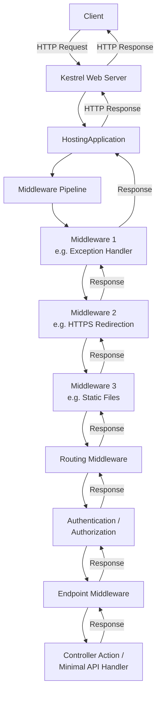

## Chapter 1: Hosting Model — How the Application Starts

### Generic Host Structure

ASP.NET Core applications are built on top of the Generic Host (`Microsoft.Extensions.Hosting`). When you call `WebApplication.CreateBuilder()`, the following happens internally.

```csharp
var builder = WebApplication.CreateBuilder(args);
// What happens internally:
// 1. Initialize HostApplicationBuilder
// 2. Configure Kestrel as the default web server
// 3. Load configuration sources (appsettings.json, env vars, etc.)
// 4. Set up logging providers
// 5. Initialize the DI container (ServiceCollection)
```

[`WebApplication.CreateBuilder()`](https://github.com/dotnet/aspnetcore/blob/main/src/DefaultBuilder/src/WebApplication.cs) itself only wraps the arguments in `WebApplicationOptions` and creates a `WebApplicationBuilder`.

```csharp
// Simplified implementation from dotnet/aspnetcore
public static WebApplicationBuilder CreateBuilder(string[] args)
{
    var builder = new WebApplicationBuilder(
        new WebApplicationOptions { Args = args });
    return builder;
}
```

The `WebApplicationBuilder` constructor registers the configuration sources and creates the `ServiceCollection`, and `Build()` creates the DI container and the `WebApplication`. Middleware registered with `app.UseXxx()` is assembled into the pipeline when `app.Run()` starts the host.

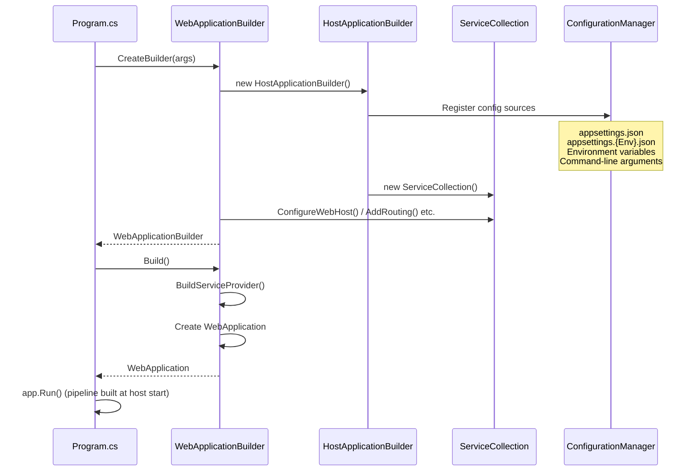

### Kestrel — The Default HTTP Server

Kestrel is ASP.NET Core's default in-process HTTP server. It started out on [libuv](https://libuv.org/), moved to its own I/O implementation, and now does asynchronous I/O with `System.IO.Pipelines` and `System.Net.Sockets`.

#### Kestrel Internals

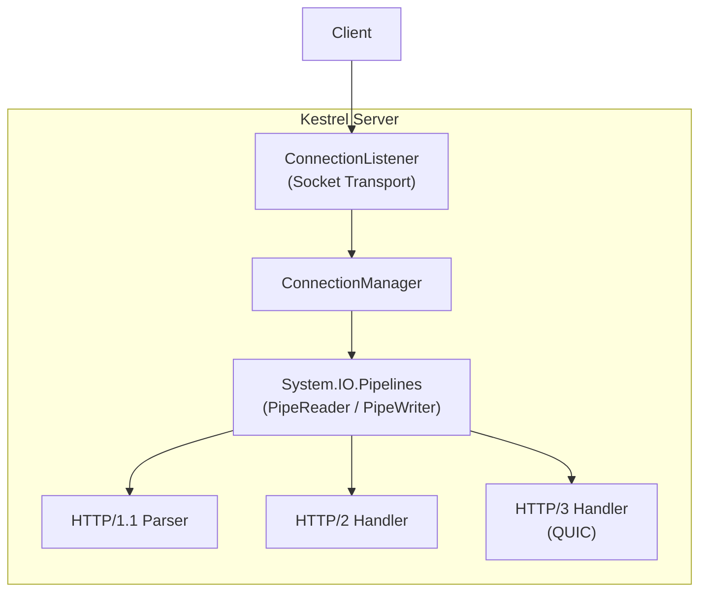

Kestrel reads incoming data through `System.IO.Pipelines`. With traditional `Stream`-based APIs, reading data often meant copying buffers. `Pipelines` exposes the receive buffers as a `ReadOnlySequence<byte>`, so Kestrel can parse the data with almost no copying.

```csharp
// Simplified image of Kestrel's HTTP/1.1 parser
while (true)
{
    // Read data from PipeReader (no copy needed)
    ReadResult result = await reader.ReadAsync();
    ReadOnlySequence<byte> buffer = result.Buffer;

    // Parse HTTP request line and headers
    if (TryParseRequest(buffer, out var consumed, out var examined))
    {
        reader.AdvanceTo(consumed, examined);
        break;
    }

    // Not enough data yet, wait for more
    reader.AdvanceTo(buffer.Start, buffer.End);
}
```

#### Connection Management and Concurrency

Kestrel manages each connection as an individual `Task`. With .NET's thread pool and `async/await`, threads are released while a connection waits on I/O, so a small number of OS threads can handle many concurrent connections.

Limits on connections, request size, and timeouts are set through `KestrelServerLimits`. Its [API reference](https://learn.microsoft.com/dotnet/api/microsoft.aspnetcore.server.kestrel.core.kestrelserverlimits) lists these defaults:

| Parameter | Default | Description |
|-----------|---------|-------------|
| `MaxConcurrentConnections` | `null` (unlimited) | Maximum concurrent connections |
| `MaxConcurrentUpgradedConnections` | `null` (unlimited) | Max upgraded connections (e.g. WebSocket) |
| `MaxRequestBodySize` | ~30 MB (30,000,000 bytes) | Maximum request body size |
| `RequestHeadersTimeout` | 30 seconds | Timeout for receiving request headers |
| `KeepAliveTimeout` | 130 seconds | Keep-alive connection timeout |

### Reverse Proxy Configuration

In production, Kestrel is typically placed behind a reverse proxy (Nginx, IIS, YARP, etc.).

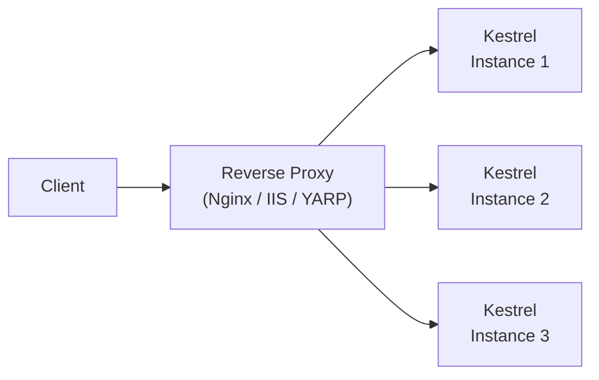

The reverse proxy can take over these jobs:

- TLS termination: encrypting and decrypting SSL/TLS traffic
- Load balancing: spreading load across multiple Kestrel instances
- Request buffering: receiving uploads from slow clients at the proxy
- Static file serving: responding without the request reaching Kestrel
- Rate limiting: mitigating DDoS attacks and excessive requests

## Chapter 2: Middleware Pipeline — The Request's Journey

### How Middleware Works

In ASP.NET Core, requests are processed by the middleware pipeline. Each stage receives a `RequestDelegate` for the next stage and returns a new `RequestDelegate` that adds its own work, so the middleware ends up nested. Each middleware can handle the request before calling `_next` and the response after it returns.

```csharp
// RequestDelegate definition
public delegate Task RequestDelegate(HttpContext context);

// Basic middleware structure
public class MyMiddleware
{
    private readonly RequestDelegate _next;

    public MyMiddleware(RequestDelegate next)
    {
        _next = next;
    }

    public async Task InvokeAsync(HttpContext context)
    {
        // Request processing (before going downstream)
        Console.WriteLine("Before next middleware");

        await _next(context); // Call the next middleware

        // Response processing (after returning from downstream)
        Console.WriteLine("After next middleware");
    }
}
```

### Pipeline Construction Process

When `app.Run()` starts the host, the middleware registered with `app.UseXxx()` is chained in **reverse order**. Wrapping starts from the last registration, so the first-registered middleware ends up outermost and receives the request first. This nesting is called the Russian Doll (Matryoshka) model.

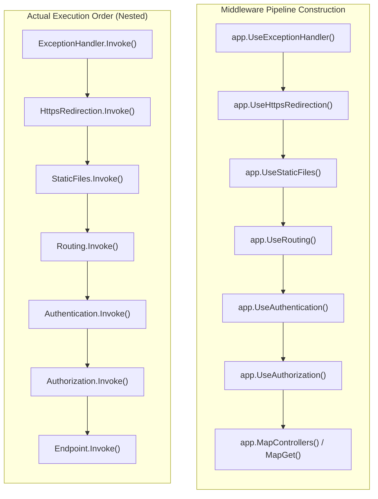

`ApplicationBuilder.Build()` starts from a terminal delegate that returns 404 and wraps the registered middleware around it, last to first.

```csharp
// Simplified implementation of ApplicationBuilder.Build()
public RequestDelegate Build()
{
    // Terminal: return 404 if no middleware handled the request
    RequestDelegate app = context =>
    {
        context.Response.StatusCode = 404;
        return Task.CompletedTask;
    };

    // Apply registered middleware in reverse order
    for (int i = _components.Count - 1; i >= 0; i--)
    {
        app = _components[i](app);
    }

    return app;
}
```

### Short-Circuiting

A middleware can **short-circuit** the pipeline by not calling `next()`. For example, when the `StaticFiles` middleware finds a matching file, it returns the response without running the downstream middleware.

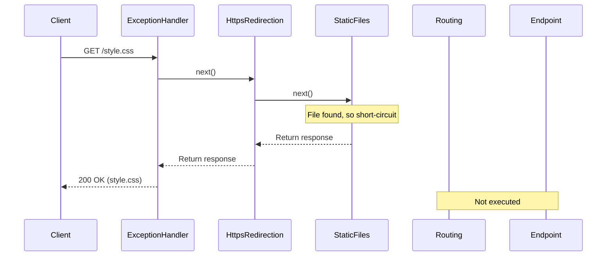

### Built-in Middleware Order

Middleware runs in registration order, so the order changes behavior. For example, if `Authorization` comes before `Authentication`, the user hasn't been authenticated yet when authorization runs. The [recommended order](https://learn.microsoft.com/aspnet/core/fundamentals/middleware/#middleware-order) is:

| Order | Middleware | Responsibility |
|-------|-----------|----------------|
| 1 | `ExceptionHandler` / `DeveloperExceptionPage` | Catch exceptions and convert to error responses |
| 2 | `HSTS` | Add HTTP Strict Transport Security header |
| 3 | `HttpsRedirection` | Redirect HTTP to HTTPS |
| 4 | `StaticFiles` / `MapStaticAssets` | Serve static files (can short-circuit). `MapStaticAssets` (.NET 9+) is recommended (build-time compression with fingerprinting) |
| 5 | `Routing` | Select endpoint based on URL |
| 6 | `RateLimiter` | Apply rate limiting policies |
| 7 | `Cors` | Apply Cross-Origin Resource Sharing policies |
| 8 | `Authentication` | User authentication (establish identity) |
| 9 | `Authorization` | User authorization (access control) |
| 10 | `OutputCache` | Server-side response caching |
| 11 | Endpoint middleware | `MapGet()` / `MapControllers()` etc. |

## Chapter 3: Dependency Injection Container Internals

### ASP.NET Core's DI Container

ASP.NET Core uses a built-in DI container shipped as the `Microsoft.Extensions.DependencyInjection` package. The framework registers its own services in this container alongside the application's.

#### Service Lifetimes

The DI container supports three lifetimes.

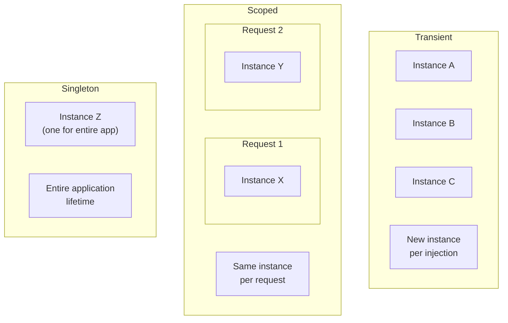

| Lifetime | Creation | Disposal |
|----------|----------|----------|
| Transient | New instance per injection | When scope ends |
| Scoped | On first request within scope | When scope ends (request ends) |
| Singleton | On first request | When application shuts down |

#### Captive Dependency Problem

When a Singleton service depends on a Scoped service, the Singleton keeps its reference, so the same Scoped instance is reused across requests. The Scoped service effectively behaves as a Singleton, a problem known as a **captive dependency**.

```csharp
// Dangerous: Singleton depending on Scoped
services.AddSingleton<MySingleton>();
services.AddScoped<MyScopedService>();

public class MySingleton
{
    private readonly MyScopedService _scoped; // This reference leaks

    public MySingleton(MyScopedService scoped)
    {
        _scoped = scoped; // Held across requests!
    }
}
```

ASP.NET Core has validation that detects this dependency and throws an exception. With `WebApplication.CreateBuilder()`, `ValidateScopes` and `ValidateOnBuild` are enabled by default in the development environment (since .NET 6). To enable them in production, or when you build the host some other way, set them like this:

```csharp
builder.Host.UseDefaultServiceProvider(options =>
{
    options.ValidateScopes = true;  // Enabled by default in development
    options.ValidateOnBuild = true; // Validate dependencies at build time
});
```

### ServiceProvider Internals

`ServiceProvider` gathers the dependencies needed to build the requested type into a graph of CallSites and returns instances using a cache for each lifetime.

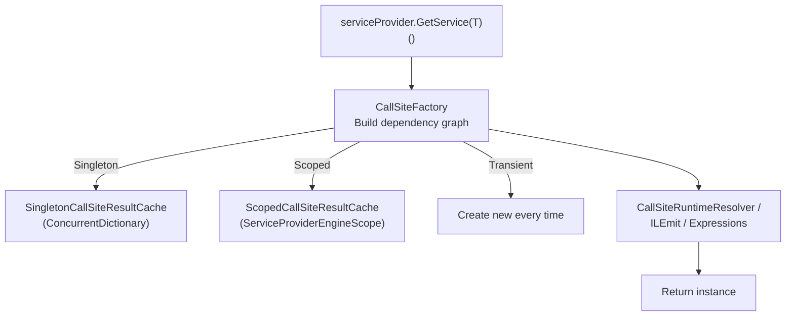

The first time a service is resolved, the `CallSiteFactory` builds its CallSite graph. At first, instances are created by walking this graph. Once the same service has been resolved repeatedly, the provider switches to a factory delegate compiled from the graph, which resolves faster.

```csharp
// Overview of ServiceProvider resolution process:
// 1. CallSiteFactory builds a CallSite tree from ServiceDescriptors
// 2. RuntimeResolver / CompiledResolver traverses CallSites to create instances
// 3. Results are stored in lifetime-appropriate caches

// Optimizations applied (continuously improved since .NET Core 3.0):
// - Dynamic compilation of factories via IL Emit
// - Expression tree to delegate conversion
// - Direct return of cached Singletons
```

### How Scopes Work

For each HTTP request, `IServiceScopeFactory` creates a new scope, which is disposed after the response completes. Disposing the scope also disposes the `IDisposable` Scoped and Transient services created in it.

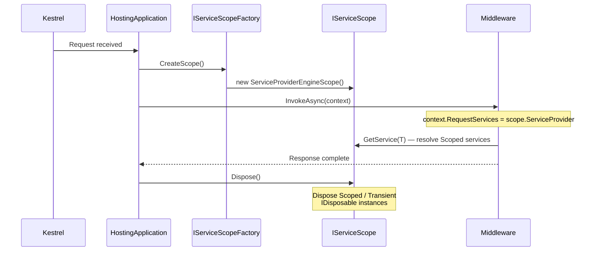

## Chapter 4: Routing System

### Endpoint Routing

Since .NET Core 3.0, ASP.NET Core uses endpoint routing, which splits routing across two middleware:

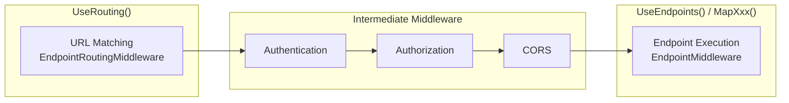

Authentication and authorization middleware run after `UseRouting()` has selected an endpoint and before `UseEndpoints()` / `MapXxx()` executes it. That lets them read the selected endpoint's metadata, such as an `[Authorize]` attribute.

### Route Matching Internals

The routing engine uses a matcher based on a deterministic finite automaton (DFA). The DFA matcher reads URL segments one at a time and moves between states.

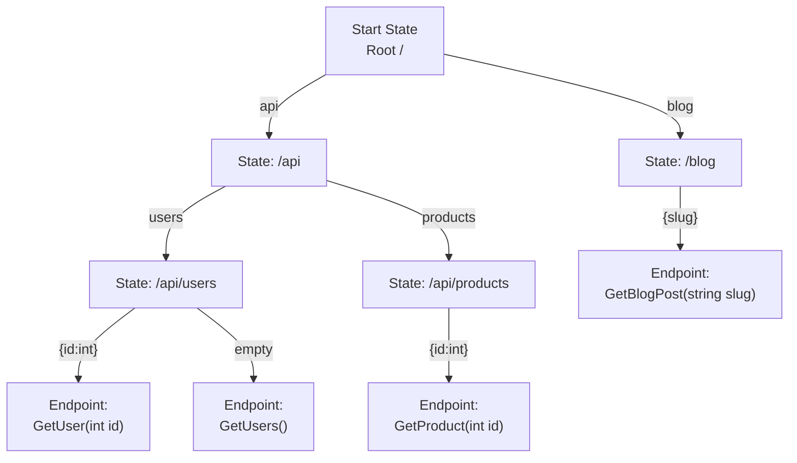

The DFA matcher has these properties:

- Matching takes O(number of path segments) time, with no linear scan of all routes
- The automaton is built from the route table ahead of matching, not per request
- Route parameter constraints (`{id:int}`) are evaluated during matching

```csharp
// Route pattern examples and internal matching
app.MapGet("/api/users/{id:int}", (int id) => ...);
// Pattern: Literal("api") -> Literal("users") -> Parameter("id", IntConstraint)

app.MapGet("/api/users/{id:guid}", (Guid id) => ...);
// Pattern: Literal("api") -> Literal("users") -> Parameter("id", GuidConstraint)

// Same path with different constraints matches different endpoints:
// /api/users/42       → int version
// /api/users/3f2504e0-4f89-11d3-9a0c-0305e82c3301  → guid version
// /api/users/abc-def  → no match (404)
```

### Minimal API vs Controllers

ASP.NET Core has two programming models: Minimal API and Controllers (MVC). For Minimal API, `RequestDelegateFactory` generates a delegate for each handler. For Controllers, the framework analyzes the controllers at startup and runs actions through the filter pipeline.

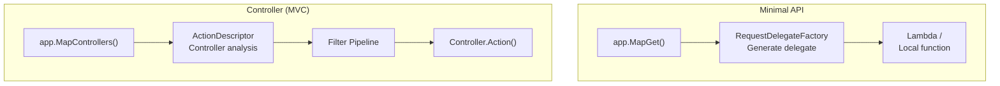

| Feature | Minimal API | Controller (MVC) |
|---------|------------|------------------|
| Routing | `app.MapGet/Post/Put/Delete()` | Attribute routing `[Route]` / Convention-based |
| Model binding | `RequestDelegateFactory` auto-infers | `ModelBinder` + `ValueProvider` chain |
| Filters | Endpoint Filters (ASP.NET Core 7+) | Action / Result / Exception / Resource |
| Best for | Simple APIs, microservices | Complex apps, MVC with Views |
| Startup speed | Fast (minimal reflection) | Slightly slower (controller scan, descriptor building) |

## Chapter 5: Model Binding and Validation

### Model Binding Flow

Model binding converts raw HTTP request data (query strings, route parameters, forms, JSON body, etc.) into C# objects. In MVC, validating the bound values is part of the same flow.

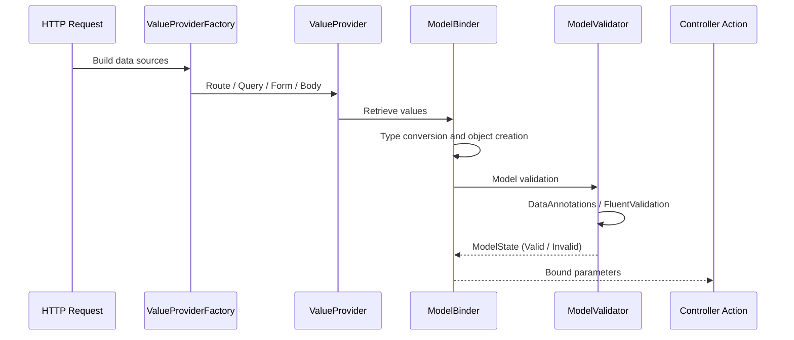

### Binding Source Types

Without attributes, values are looked up in this order: form fields → request body (for controllers with `[ApiController]`) → route data → query string → uploaded files. Route data and query string values are mainly used for simple types, and uploaded files bind only to `IFormFile` / `IEnumerable<IFormFile>`. With explicit attributes, you can pick any of these sources:

- Form data (`[FromForm]`)
- Request body (`[FromBody]`): processed via input formatters
- Route parameters (`[FromRoute]`)
- Query string (`[FromQuery]`)
- Headers (`[FromHeader]`)
- Services from the DI container (`[FromServices]`)

```csharp
// Explicitly specifying binding sources
[HttpPost("api/orders/{id}")]
public IActionResult UpdateOrder(
    [FromRoute] int id,           // URL: /api/orders/42
    [FromQuery] bool notify,      // Query: ?notify=true
    [FromBody] OrderDto order,    // Body: JSON
    [FromHeader(Name = "X-Correlation-Id")] string correlationId,
    [FromServices] IOrderService service)  // DI container
{
    // ...
}
```

### JSON Serialization: System.Text.Json

ASP.NET Core uses System.Text.Json by default. When you migrate from Newtonsoft.Json, the stricter default parsing and the different way of declaring polymorphism affect how existing code behaves. The main differences are:

| Feature | System.Text.Json | Newtonsoft.Json |
|---------|-----------------|-----------------|
| Performance | Fast via `Utf8JsonReader/Writer` | Reflection-heavy |
| Memory efficiency | `Span<byte>`-based, minimal allocations | `string`-based |
| Source Generator | `JsonSerializerContext` for AOT | None |
| Default behavior | Strict (no comments, no trailing commas) | Lenient |
| Polymorphism | `[JsonDerivedType]` (.NET 7+) | `TypeNameHandling` (security risk) |

```csharp
// High-performance JSON serialization with Source Generator
[JsonSerializable(typeof(WeatherForecast))]
[JsonSerializable(typeof(List<WeatherForecast>))]
public partial class AppJsonContext : JsonSerializerContext { }

// Register in Program.cs
builder.Services.ConfigureHttpJsonOptions(options =>
{
    options.SerializerOptions.TypeInfoResolverChain
        .Insert(0, AppJsonContext.Default);
});
```

## Chapter 6: Filter Pipeline (MVC)

### Filter Execution Order

MVC filters run code before and after an action executes. There are five kinds (authorization, resource, action, exception, and result), and they run in this order:

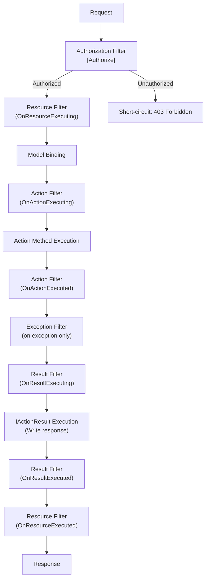

### Endpoint Filters (for Minimal API)

Minimal APIs use Endpoint Filters instead of MVC filters (ASP.NET Core 7+). In this example, the filter checks the `id` argument before the handler runs and returns 400 Bad Request unless it's a positive integer.

```csharp
app.MapGet("/api/users/{id}", (int id) => ...)
    .AddEndpointFilter(async (context, next) =>
    {
        var id = context.GetArgument<int>(0);
        if (id <= 0)
        {
            return Results.BadRequest("ID must be a positive integer");
        }

        // Execute the next filter or handler
        return await next(context);
    });
```

## Chapter 7: Configuration System

### Configuration Provider Chain

ASP.NET Core's configuration system reads settings from multiple sources. When the same key appears in more than one, the value from the source added later overrides the earlier one.

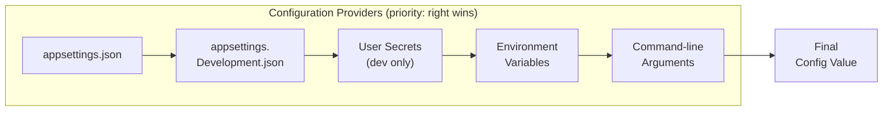

```csharp
// Accessing configuration values
// 1. Directly from IConfiguration
var connectionString = builder.Configuration
    .GetConnectionString("DefaultConnection");

// 2. Options pattern (recommended)
builder.Services.Configure<SmtpSettings>(
    builder.Configuration.GetSection("Smtp"));

// 3. Type-safe Options with validation
builder.Services.AddOptions<SmtpSettings>()
    .BindConfiguration("Smtp")
    .ValidateDataAnnotations()
    .ValidateOnStart(); // Validate at startup
```

### Three Options Interfaces

The Options pattern has three interfaces. Which one to use depends on whether you need configuration reloads and on the lifetime of the service you inject it into.

| Interface | Use Case | Reload Support |
|-----------|----------|---------------|
| `IOptions<T>` | Singleton. Value is created on first access and cached | No |
| `IOptionsSnapshot<T>` | Scoped. Recomputes values per scope (usually per request in web apps) | Yes. Don't inject it into singletons |
| `IOptionsMonitor<T>` | Singleton. Manages current value and change notifications | Yes (`OnChange` callback) |

```csharp
// Real-time config monitoring with IOptionsMonitor
public class MyService
{
    private readonly IOptionsMonitor<MyConfig> _config;

    public MyService(IOptionsMonitor<MyConfig> config)
    {
        _config = config;
        _config.OnChange(newConfig =>
        {
            Console.WriteLine($"Config changed: {newConfig.SomeKey}");
        });
    }

    public string GetValue() => _config.CurrentValue.SomeKey;
}
```

## Chapter 8: Authentication and Authorization

### Authentication Schemes and Handlers

In ASP.NET Core, authentication is done by handlers registered per scheme (JWT Bearer, Cookie, and so on). A successful handler produces a `ClaimsPrincipal`, and the authorization middleware evaluates policies against it.

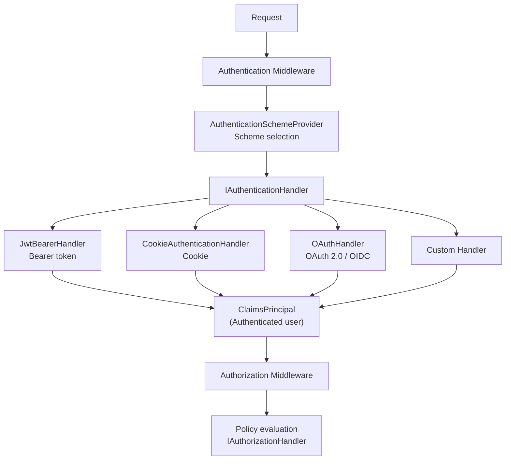

#### Authentication Processing Flow

```csharp
// Simplified AuthenticationMiddleware implementation
public async Task InvokeAsync(HttpContext context)
{
    // 1. Attempt authentication with the default scheme
    var result = await context.AuthenticateAsync();

    if (result.Succeeded)
    {
        // 2. Set ClaimsPrincipal on HttpContext
        context.User = result.Principal;
    }

    // 3. Pass to next middleware (typically Authorization)
    await _next(context);
}
```

### Policy-Based Authorization

Authorization rules are registered as named policies. Besides built-in checks such as roles, you can express your own rule by implementing a requirement and a handler that evaluates it. In the example below, `MinimumAgeHandler` computes the age from the `birth_date` claim and marks the requirement as met at 18 or older.

```csharp
// Define custom authorization policies
builder.Services.AddAuthorization(options =>
{
    options.AddPolicy("AdminOnly", policy =>
        policy.RequireRole("Admin"));

    options.AddPolicy("MinimumAge", policy =>
        policy.Requirements.Add(new MinimumAgeRequirement(18)));
});

// Custom AuthorizationHandler
public class MinimumAgeHandler
    : AuthorizationHandler<MinimumAgeRequirement>
{
    protected override Task HandleRequirementAsync(
        AuthorizationHandlerContext context,
        MinimumAgeRequirement requirement)
    {
        var birthDateClaim = context.User.FindFirst("birth_date");
        if (birthDateClaim is null)
        {
            return Task.CompletedTask; // Fail (don't explicitly Succeed)
        }

        var birthDate = DateOnly.Parse(birthDateClaim.Value);
        var age = DateOnly.FromDateTime(DateTime.Today)
            .DayNumber - birthDate.DayNumber;

        if (age / 365 >= requirement.MinimumAge)
        {
            context.Succeed(requirement);
        }

        return Task.CompletedTask;
    }
}
```

## Chapter 9: HttpContext — Everything About a Request

### HttpContext Structure

`HttpContext` holds all information related to a single HTTP request/response cycle.

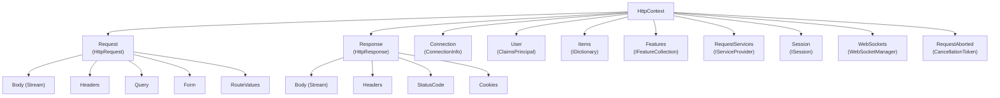

### Feature Collection

`HttpContext.Features` is a collection of features keyed by interface type. Servers and middleware add features to it, and application code retrieves them by type. The server (Kestrel) sets the connection information, and the RequestTimeouts middleware adds the request timeout feature.

```csharp
// Examples of features provided by Kestrel
var connectionFeature = context.Features
    .Get<IHttpConnectionFeature>();
var localIp = connectionFeature?.LocalIpAddress;

// HTTP response trailers (trailing headers sent after the response body)
var trailersFeature = context.Features
    .Get<IHttpResponseTrailersFeature>();

// Request timeout (.NET 8+)
var timeoutFeature = context.Features
    .Get<IHttpRequestTimeoutFeature>();
timeoutFeature?.DisableTimeout();
```

## Chapter 10: Performance Optimization Architecture

### Object Pool

ASP.NET Core pools and reuses frequently used objects to reduce GC load. Application code can do the same with `ObjectPool<T>`.

```csharp
// StringBuilder pooling example
var pool = serviceProvider
    .GetRequiredService<ObjectPool<StringBuilder>>();

var sb = pool.Get();
try
{
    sb.Append("Hello ");
    sb.Append("World");
    return sb.ToString();
}
finally
{
    pool.Return(sb); // Return to pool (auto-cleared)
}
```

### ArrayPool and MemoryPool

`System.Buffers.ArrayPool<T>` manages array rental and return, reducing heap allocations from large numbers of short-lived arrays. Kestrel itself does not rent from `ArrayPool`: it takes its socket I/O buffers from a `MemoryPool<byte>` of pinned blocks and hands them to System.IO.Pipelines. Application code can use the same rent-and-return pattern through `ArrayPool`:

```csharp
// Rent-and-return pattern in application code
byte[] buffer = ArrayPool<byte>.Shared.Rent(4096);
try
{
    int bytesRead = await stream.ReadAsync(
        buffer.AsMemory(0, 4096));
    ProcessData(buffer.AsSpan(0, bytesRead));
}
finally
{
    ArrayPool<byte>.Shared.Return(buffer);
}
```

### Response Compression

The response compression middleware automatically compresses responses based on the `Accept-Encoding` header. Compression over HTTPS is disabled by default because of the risk of CRIME and BREACH attacks ([Microsoft Learn](https://learn.microsoft.com/aspnet/core/performance/response-compression)). The example below enables it with `EnableForHttps`.

```csharp
builder.Services.AddResponseCompression(options =>
{
    options.EnableForHttps = true; // Compress over HTTPS too
    options.Providers.Add<BrotliCompressionProvider>();
    options.Providers.Add<GzipCompressionProvider>();
});

builder.Services.Configure<BrotliCompressionProviderOptions>(
    options => options.Level = CompressionLevel.Fastest);
```

### Performance Improvements and New Features (.NET 8 and Later)

The ASP.NET Core features in these tables are listed on Microsoft Learn's "What's new in ASP.NET Core" pages for [.NET 8](https://learn.microsoft.com/aspnet/core/release-notes/aspnetcore-8.0), [.NET 9](https://learn.microsoft.com/aspnet/core/release-notes/aspnetcore-9.0), and [.NET 10](https://learn.microsoft.com/aspnet/core/release-notes/aspnetcore-10.0). Frozen Collections, SearchValues, and CompositeFormat in the .NET 8 table are .NET 8 library additions, listed in [What's new in .NET 8 runtime](https://learn.microsoft.com/dotnet/core/whats-new/dotnet-8/runtime).

#### .NET 8

| Feature | Description |
|---------|-------------|
| Native AOT | ASP.NET Core support (gRPC, Minimal APIs, worker services; console apps were supported from .NET 7). No JIT needed. Reduces startup time and memory |
| Request Delegate Generator | Compile-time generation of Minimal API delegates |
| Frozen Collections | Optimized read-only collections via `FrozenDictionary` / `FrozenSet` |
| SearchValues | Optimized searches for a set of characters or bytes within spans (substring search was added in .NET 9) |
| Interceptors | Compile-time method call interception (a preview feature in C# 12) |
| CompositeFormat | Pre-parsed `string.Format` format strings |

#### .NET 9

| Feature | Description |
|---------|-------------|
| MapStaticAssets | Build-time compressed static file serving with fingerprinting (recommended replacement for `UseStaticFiles`) |
| HybridCache | Unified caching library combining `IDistributedCache` and `IMemoryCache` with stampede protection (in preview when .NET 9 shipped; first stable release [9.3.0](https://www.nuget.org/packages/Microsoft.Extensions.Caching.Hybrid/9.3.0) in March 2025) |
| Keyed DI in Middleware | Support for `[FromKeyedServices]` in middleware constructors and `Invoke` methods |
| SignalR Native AOT | SignalR client and server support for trimming and Native AOT |

#### .NET 10

| Feature | Description |
|---------|-------------|
| Minimal API Validation | Built-in DataAnnotations validation via `AddValidation()` |
| Server-Sent Events | Return SSE streams with `TypedResults.ServerSentEvents` |
| OpenAPI 3.1 | OpenAPI document generation with JSON Schema draft 2020-12 |
| Memory Pool Eviction | Automatic memory release in Kestrel / IIS / HTTP.sys pools when idle |
| JSON Patch (System.Text.Json) | JSON Patch implementation without Newtonsoft.Json |

## Chapter 11: Error Handling Architecture

### Exception Handling Hierarchy

An exception thrown inside an MVC action goes to exception filters first. If no filter handles it, it reaches the ExceptionHandler middleware (DeveloperExceptionPage in development) early in the pipeline. If that doesn't handle it either, the result is a 500.

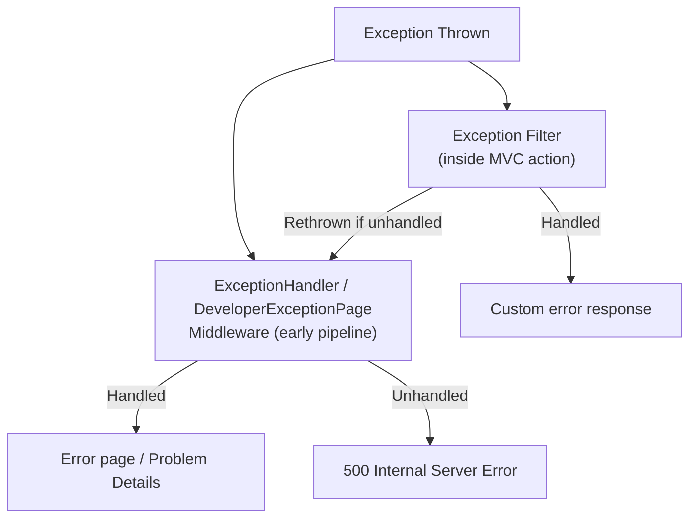

### Problem Details (RFC 9457)

ASP.NET Core 7 added the problem details service, `IProblemDetailsService` ([release notes](https://learn.microsoft.com/aspnet/core/release-notes/aspnetcore-7.0#new-problem-details-service)). After you register it with `AddProblemDetails()`, the middleware added by `UseExceptionHandler()` and `UseStatusCodePages()` returns error responses in the Problem Details format ([Microsoft Learn](https://learn.microsoft.com/aspnet/core/fundamentals/error-handling-api#problem-details)). The format was defined in RFC 7807, which [RFC 9457](https://www.rfc-editor.org/rfc/rfc9457) replaced in 2023.

```csharp
// Enable Problem Details globally
builder.Services.AddProblemDetails(options =>
{
    options.CustomizeProblemDetails = context =>
    {
        context.ProblemDetails.Extensions["traceId"] =
            context.HttpContext.TraceIdentifier;
    };
});

// With exception handler
app.UseExceptionHandler();
app.UseStatusCodePages();

// Example response:
// {
//   "type": "https://tools.ietf.org/html/rfc9110#section-15.5.5",
//   "title": "Not Found",
//   "status": 404,
//   "traceId": "00-abc123-def456-01"
// }
```

## Chapter 12: Testing Architecture

### WebApplicationFactory

`WebApplicationFactory` starts the whole application on an in-memory `TestServer`. Requests from the test's `HttpClient` don't go over the network, and they run through the same middleware pipeline as in production. Services registered in DI can be swapped for test implementations.

```csharp
public class ApiTests : IClassFixture<WebApplicationFactory<Program>>
{
    private readonly HttpClient _client;

    public ApiTests(WebApplicationFactory<Program> factory)
    {
        _client = factory.WithWebHostBuilder(builder =>
        {
            builder.ConfigureServices(services =>
            {
                // Replace services for testing
                services.AddScoped<IEmailService, FakeEmailService>();
            });
        }).CreateClient();
    }

    [Fact]
    public async Task GetUsers_ReturnsOk()
    {
        var response = await _client.GetAsync("/api/users");
        response.EnsureSuccessStatusCode();

        var users = await response.Content
            .ReadFromJsonAsync<List<UserDto>>();
        Assert.NotEmpty(users);
    }
}
```

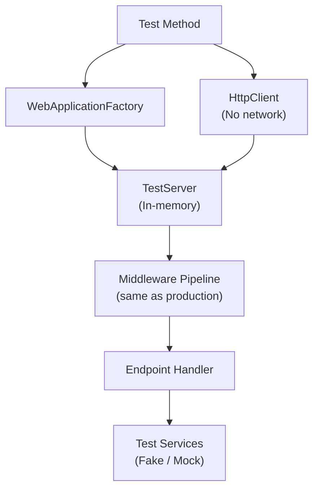

## Summary: The Lifetime of a Request

A single HTTP request is parsed by Kestrel, gets a scope, passes through middleware, routing, authentication and authorization, model binding, and filters to reach the action, and then returns along the same path as the response.

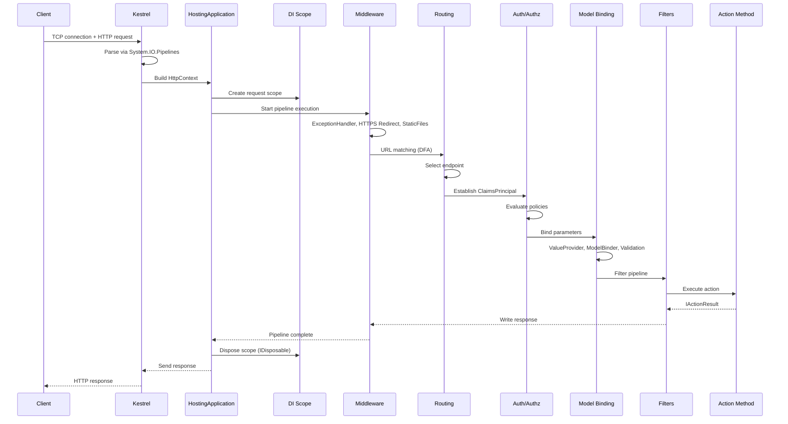

## References

- [ASP.NET Core Official Documentation](https://learn.microsoft.com/aspnet/core/)
- [ASP.NET Core Source Code (GitHub)](https://github.com/dotnet/aspnetcore)
- [.NET Runtime Source Code (GitHub)](https://github.com/dotnet/runtime)
- [Kestrel Internals — Steve Gordon](https://www.stevejgordon.co.uk/building-asp-net-core-kestrel)
- [ASP.NET Core Performance Best Practices](https://learn.microsoft.com/aspnet/core/performance/performance-best-practices)
- [RFC 9457 — Problem Details for HTTP APIs](https://www.rfc-editor.org/rfc/rfc9457)
