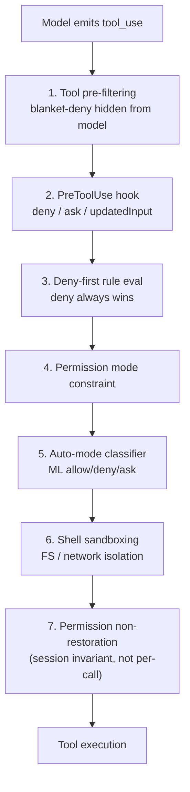

> <strong>Source paper</strong>: Liu, Zhao, Shang, Shen (MBZUAI / UCL).
> [_Dive into Claude Code: The Design Space of Today's and Future AI Agent Systems_](https://arxiv.org/abs/2604.14228) — arXiv:2604.14228, 2026-04-14.
> [GitHub: VILA-Lab/Dive-into-Claude-Code](https://github.com/VILA-Lab/Dive-into-Claude-Code)

## Introduction — Why the same model performs differently across tools

AI coding tools started with GitHub Copilot suggesting code fragments at the cursor. Cursor and Windsurf then let you edit several files through a chat in the IDE. The current generation is the agentic CLI: Claude Code, Codex CLI, and Aider run shell commands, rewrite files, execute tests, and decide their next step from the results. Fully autonomous systems such as Devin, SWE-Agent, and OpenHands go further and work in sandboxes with almost no human supervision.

Most discussion of these tools has been about model intelligence: what share of SWE-bench a model solves, or its HumanEval score. Engineers who use them every day have noticed something else. The same model can produce very different results depending on the tool around it. A good model is necessary but not sufficient. So what accounts for the difference?

In April 2026, a research group at MBZUAI and UCL published a technical report on that question. They analyzed the TypeScript source of Anthropic's Claude Code (v2.1.88), about 1,884 files and 512,000 lines, and reconstructed its architecture.

Their central finding is a ratio:

> An estimated 1.6% of Claude Code's codebase is AI decision logic. The remaining 98.4% is deterministic operational harness. (Tier C estimate from community analysis)

The ratio counts lines, not value. Swap in a weaker model and the same harness performs much worse. Still, the number shows that <strong>most of the design space of a production AI agent lies outside the model</strong>.

This post is for engineers building AI agent systems. Instead of following the paper section by section, it reorganizes the material around two questions: why was it built this way, and what does that mean for our own products?

The paper follows one task throughout, "Fix the failing test in `auth.test.ts`", and so does this post. The demo below steps through one pass of `queryLoop()`, the loop at the center of the agent.

<ClaudeCodeLoopVisualizer />

---

## I. Five Values and the Principle of Not Constraining the Model

The paper starts by extracting five human values that motivate the architecture, drawing on Anthropic's public documentation, blog posts, and internal surveys.

<strong>Human Decision Authority</strong> means humans keep the final say. Authority follows the principal hierarchy defined in Claude's Constitution (Anthropic → operator → user). When Anthropic found that users approve 93% of permission prompts, it did not add more warnings. It changed the structure of the problem: sandboxes and ML classifiers define a boundary, and inside it the agent can work without asking a person to approve each step. The design protects human authority by not depending on human attention.

<strong>Safety, Security, and Privacy</strong> means the system protects the user even when the user is not paying attention. If authority is the power to choose, safety is the protection that applies when that power goes unused. The auto-mode threat model explicitly covers four risk categories: overeager behavior, honest mistakes, prompt injection, and model misalignment.

<strong>Reliable Execution</strong> means doing what the user actually meant and staying consistent over a long task. The product documentation describes this as a three-phase loop of gathering context, acting, and verifying. Anthropic's harness design guidance notes that agents "tend to respond by confidently praising the work" even when its quality is mediocre, which is why generation and evaluation are kept separate.

<strong>Capability Amplification</strong> means expanding what people can do, not just how fast. In an Anthropic internal survey, about 27% of tasks done with Claude Code were work the engineers would not have attempted without the tool. The point is that new kinds of work become possible. Its developers describe Claude Code as "a Unix utility rather than a traditional product," built from small composable parts.

<strong>Contextual Adaptability</strong> means fitting the user's project and improving as the relationship goes on. In long-term tracking data, the auto-approve rate rises from about 20% for users with fewer than 50 sessions to over 40% after 750 sessions. The paper describes this autonomy as "co-constructed by the model, the user, and the product," and Claude Code is designed around trust that changes over time rather than a fixed level of trust.

These five values become 13 design principles. The one that best explains the overall architecture is <strong>"minimal scaffolding, maximal operational harness."</strong> Instead of shaping the model's decisions from outside with planners or state graphs, as LangGraph does, Claude Code leaves decisions to the model and surrounds it with deterministic infrastructure. The 1.6% / 98.4% split reflects that choice.

Separately from the five values, the paper adds an evaluative lens: long-term preservation of human capability. It is not one of Claude Code's design values. The paper uses it later to ask whether coding agents weaken developers' understanding and skills. Production agent discussions rarely raise this question explicitly, and together with the empirical data in §X, it sets the paper apart.

> <strong>Industry implication #1</strong>: Check what your own agent product prioritizes against these five values. Many startups concentrate on Capability Amplification. If safety and human authority are out of balance, you end up with approval fatigue, where 93% of permission prompts get approved.

---

## II. Inside the Loop — Tracing One Task Through queryLoop()

### All interfaces converge on queryLoop()

Claude Code has several interfaces: the interactive CLI, the headless CLI (`claude -p`), the Agent SDK, and IDE integrations. <strong>All of them converge on the same `queryLoop()` function.</strong> Only the rendering layer differs. `QueryEngine` (`QueryEngine.ts`, 47KB) is a conversation wrapper for the SDK and headless modes, not the engine itself. The interactive CLI skips `QueryEngine` and calls `query()` directly. The shared code path is a loop function, not a class, and that distinction matters for understanding the architecture.

### One turn in 9 steps

`queryLoop()` in `query.ts` (68KB) is a while-true loop written as an async generator. Here is one turn of the running example, "Fix the failing test in `auth.test.ts`":

1. <strong>Settings resolution</strong> — unpack the system prompt, permission callback, and model configuration
2. <strong>State initialization</strong> — gather message history, tool context, and compaction tracking into a single State object. The loop's 7 continue points replace this object as a whole rather than mutating individual fields
3. <strong>Context assembly</strong> — take the messages after the last compaction boundary
4. <strong>Apply the five pre-model compaction stages in order</strong> (described below)
5. <strong>Stream `callModel()` with `for await`</strong> — here the model emits `Bash { command: "npm test auth.test.ts" }`
6. <strong>Dispatch any tool_use blocks</strong> to StreamingToolExecutor
7. <strong>Pass the permission gate</strong> — a 7-layer deny-first evaluation (see §III)
8. <strong>Execute and append the tool_result</strong> — the test failure log enters the conversation
9. <strong>If the response is text only, the turn ends; if it contains tool_use, the loop continues</strong>

This is a plain implementation of the ReAct pattern (reason, act, observe, repeat; Yao et al., 2022). It uses neither explicit graph routing like LangGraph nor tree search like LATS (Language Agent Tree Search; Zhou et al., 2024). The while-true loop commits to one action at a time and never backtracks. The choice favors low latency and simple code over search completeness.

### Five stop conditions

A while-true loop does not run forever. It stops in five cases: (1) the model replies with text only and no tool_use, which is the normal exit; (2) `maxTurns` is reached; (3) the API returns `prompt_too_long` and recovery fails; (4) a PostToolUse hook sets `hook_stopped_continuation`; (5) the `abortController` signal fires.

These stop conditions relate directly to the compound error problem described by Huyen (2025). At 95% accuracy per step, a 100-step task succeeds only about 0.6% of the time. Claude Code tries to contain this decay by combining stop conditions with a permission check at every step.

### Concurrent tool execution

`StreamingToolExecutor` runs read-only tools in parallel and state-modifying tools such as Bash serially. Even when tools run in parallel, results are returned in the original tool_use order, which is what the model expects. Two mechanisms keep this safe: a sibling abort controller, which stops other in-flight processes as soon as any Bash tool errors, and a progress-available signal, which wakes the consumer when new output arrives.

This sits between speculative execution like PASTE (Sui et al., 2026), which starts tools the model is likely to call while it is still generating, and purely serial execution. The whole loop is an `AsyncGenerator` that yields `StreamEvent`, `RequestStartEvent`, `Message`, and other types, so it can stream output to the UI while keeping a single synchronous control flow.

### The 5-stage compaction pipeline

Claude Code compacts context in <strong>multiple stages</strong>. Claude Code treats the context window as a scarce computational resource, not a container for data, and manages it with a five-stage pipeline. It tries cheap compression first and moves to the next stage only when that is not enough, so context quality degrades gradually rather than all at once.

| Stage | Name | What it trims | Note |
|---|---|---|---|
| 1 | <strong>Budget reduction</strong> | Oversized tool results | Always on; replaced with content references |
| 2 | <strong>Snip</strong> | Older history segments | Feature-flagged; lightweight trim |
| 3 | <strong>Microcompact</strong> | Fine-grained, cache-aware | Defers the boundary until after the API response. Anthropic's API caches repeated prompt prefixes, so breaking the prefix boundary triggers a charge to rebuild the cache |
| 4 | <strong>Context collapse</strong> | Read-time projection over history | Leaves the original transcript untouched |
| 5 | <strong>Auto-compact</strong> | Model-generated summary | Last resort when stages 1–4 are not enough |

Compaction is tied directly to API billing. According to a January 2026 experiment comment in the source, a path that disabled prompt-cache reuse showed a 98% cache miss rate and accounted for about 0.76% of total cache-creation cost. Details of the compaction algorithm show up on the bill, which is a concern specific to agents running in production.

Separately from the five stages, the paper identifies four other context-saving mechanisms: lazy loading of CLAUDE.md, deferred loading of tool schemas through ToolSearch, subagents that return only a summary, and a size cap on each tool result.

> <strong>Industry implication #2</strong>: If you build your own agent, provide at least a per-tool-result size cap, session-wide token monitoring, a fallback model, and a small fixed retry budget for output-limit errors. Claude Code's retry count of 3 (`MAX_OUTPUT_TOKENS_RECOVERY_LIMIT = 3`) is tuned for Anthropic's workload and is not a universal constant. The principle of trying cheap compression first and escalating step by step, however, carries over to other agents.

### Recovery mechanisms

- Up to 3 retries when output tokens exceed the limit
- `prompt_too_long` errors are handled by context collapse first, then reactive compact
- A streaming fallback path and a fallback model are also available

---

## III. Safety as Architecture — The 7-Layer Permission Gate

### What "93% approve" really means

Anthropic's auto-mode analysis (2026) found that users approve 93% of permission prompts. At first glance this suggests that most actions are safe. In practice it shows that <strong>interactive confirmation no longer works as a safety mechanism</strong>. Once confirming becomes a habit, people approve without reading. This is approval fatigue.

Long-term tracking data supports this. The auto-approve rate rises from about 20% for users with fewer than 50 sessions to over 40% after 750 sessions, and sessions grow longer as well. Users do not deliberately switch modes; their trust shifts through gradual habituation. Introducing the sandbox cut the frequency of permission prompts by an estimated 84%. Anthropic redefined the problem from getting more approvals to reducing the number of decisions a person has to make.

That view sets the direction of Claude Code's safety design. SWE-Agent and OpenHands isolate the whole environment in a Docker sandbox, and Aider makes changes reversible after the fact with automatic git commits and `/undo`. Claude Code does neither. It stacks layers that apply policy to each individual action.

### Seven permission modes

Claude Code has seven permission modes:

- `plan`: the agent proposes a plan first and executes only after the user approves it
- `default`: the standard interactive mode
- `acceptEdits`: automatically approves edits inside the working directory
- `auto`: an ML classifier decides (requires a feature flag)
- `dontAsk`: does not ask, but deny rules still apply
- `bypassPermissions`: skips most checks, but safety-critical ones remain
- `bubble`: internal; escalates a subagent's permission prompt to the parent process

That is five externally selectable modes, plus the feature-gated `auto` and the internal `bubble`, for seven in total.

### Seven independent safety layers



The layers are independent, and <strong>if any one of them blocks, the tool does not run</strong>.

### Four permission-handler paths

The permission-evaluation code (`useCanUseTool.tsx`) branches into four paths depending on the runtime situation. (1) <strong>Coordinator</strong> is for multi-agent coordination mode; it tries to resolve the request automatically and falls back to the user if that fails. (2) <strong>Swarm worker</strong> is for workers inside an agent swarm. (3) <strong>Speculative classifier</strong> applies when `BASH_CLASSIFIER` is enabled and the tool is BashTool; a classification started in advance races a timeout, and a high-confidence result is approved without asking the user. (4) <strong>Interactive</strong> is the final fallback, which shows the standard approval dialog in the terminal UI.

Denials are handled deliberately too: <strong>a permission denial is not a hard stop but a signal to choose a different action</strong>. The model receives the reason for the denial and tries a safer approach in the next iteration. The permission system changes the direction of the agent's behavior instead of halting it.

### Trade-offs of the auto-mode classifier

`yoloClassifier.ts` evaluates a proposed tool_use against the conversation history and a permission template and returns allow, deny, or a request for manual approval. It is a separate LLM call, which creates a structural trade-off: the safety layer itself calls an LLM, so it shares token and latency costs with the main loop. An independent security audit (Adversa AI, 2026) reported that for commands containing more than 50 subcommands, the classifier skips per-subcommand deny checks to avoid parsing overhead and falls back to a single generic prompt. <strong>Defense in depth works only when each layer fails for different reasons.</strong>

### The initialization-order vulnerability

The paper also finds a safety problem in <strong>the order in which things run</strong>. Project initialization (hooks, MCP servers, settings resolution) runs before the trust dialog appears. That pre-trust window is outside the deny-first pipeline, and several independently reported CVEs all trace back to it.

A diagram that lays the layers out in space does not show this kind of timing property. When you review an architecture diagram for security, also check in what order, and when, each layer becomes active.

### A shell sandbox independent of permissions

The shell sandbox, controlled by `shouldUseSandbox.ts`, works on a separate axis from the permission system. A command approved by the permission system still runs inside the sandbox if it is in scope. A denied command never reaches the sandbox at all. Defense in depth is meaningful because these two axes, <strong>authorization and isolation</strong>, are independent.

> <strong>Industry implication #3</strong>: Adopting deny-first on its own adds friction without making anything safer. It works in Claude Code because the classifier and sandbox catch what it misses downstream. A production agent needs at least three things: deny-first rules, a classifier or sandbox, and attention to initialization order. If you integrate MCP servers or plugins, require each extension's manifest to declare the phase in which it becomes active (`pre-trust-init`, `post-trust-init`, or `per-turn`).

---

## IV. Extending — Four Mechanisms Separated by Context Cost

### Why four, not one

When you build an agent platform, it is natural to want a single extension mechanism. Claude Code still splits extension into four: hooks, skills, plugins, and MCP. The paper explains that <strong>treating mechanisms with different context-window costs under one abstraction would force unfavorable trade-offs on extension authors</strong>.

| Mechanism | Context cost | Injection point | What it provides |
|---|---|---|---|
| <strong>Hooks</strong> | Zero | `execute()` | Lifecycle interception, event-driven |
| <strong>Skills</strong> | Low | `assemble()` | Domain instructions and a meta-tool |
| <strong>Plugins</strong> | Medium | All 3 points | Packaging of multiple components |
| <strong>MCP servers</strong> | High | `model()` | External service integration (MCP = Model Context Protocol) |

### Three injection points

The agent loop has three extension points. (a) `assemble()` decides what the model sees; CLAUDE.md, skill descriptions, and MCP resources are injected here. (b) `model()` decides what the model can use; built-in tools, MCP tools, SkillTool, and AgentTool are passed as a single flat list. (c) `execute()` decides whether and how an action runs; permission rules and PreToolUse / PostToolUse hooks intervene here. Each of the four extension mechanisms connects at a different place among these three points.

### 27 hook events

`coreTypes.ts` defines 27 hook events: 5 for tool authorization (PreToolUse / PostToolUse / PostToolUseFailure / PermissionRequest / PermissionDenied), 5 for the session lifecycle, 3 for user interaction, 5 for subagent coordination, 4 for context management, 4 for workspace events, plus notification. Fifteen of them have detailed output schemas. Hooks can be implemented in five ways: shell command, LLM prompt, HTTP, agent-based verifier, or callback.

A smaller detail: hooks run at different times for MCP and non-MCP tools. For non-MCP tools, the PostToolUse hook runs after the `tool_result` is emitted. For MCP tools, emitting the result is delayed until the hooks finish, so `updatedMCPToolOutput` can rewrite the output.

> <strong>Industry implication #4</strong>: Now that MCP has been donated to the Linux Foundation's Agentic AI Foundation, the question of whether to separate mechanisms by cost or offer one unified API with cost annotations is one for the whole ecosystem. Claude Code chose separate mechanisms so that extension authors have to think about cost.

---

## V. Remembering — CLAUDE.md and Context Assembly

### Separating guidance from enforcement

In Claude Code's memory design, <strong>CLAUDE.md content is injected as a user message, not as part of the system prompt</strong>. Whether the model follows those instructions is therefore probabilistic. Anything that must be enforced is handled by permission rules (deny-first), which are deterministic. Probabilistic guidance and deterministic enforcement are separated at the architectural level.

### Four-level CLAUDE.md hierarchy

```text
/etc/claude-code/CLAUDE.md    ← OS-level managed memory (policy)
~/.claude/CLAUDE.md           ← user memory (global)
<project>/CLAUDE.md           ← project memory (committed)
<project>/CLAUDE.local.md     ← local memory (gitignored)
```

Files load in "reverse priority order," so files loaded later get more of the model's attention. CLAUDE.md files in nested directories below the working directory load lazily, only when the agent reads a file in that directory. As a result, the set of instructions grows during the conversation as the agent explores.

Memory retrieval uses no embeddings or vector index. An LLM scans the headers of memory files and picks up to five files (selection is per file). The design gives up the precision of embedding-based selection in exchange for being able to inspect what was chosen.

### Context-window assembly order

The context window is assembled from nine sources in a fixed order: (1) system prompt, (2) environment info (git status and so on, memoized), (3) the CLAUDE.md hierarchy, (4) path-scoped rules (lazy), (5) auto memory (prefetched asynchronously), (6) tool metadata, (7) conversation history, (8) tool results, and (9) compaction summaries. Relevant-memory prefetch, MCP instruction deltas, and agent-listing deltas are added even after the main window is built. The context window is not fixed at assembly time and can grow during a turn.

> <strong>Industry implication #5</strong>: Put the context window at the center of your design as a scarce computational resource, not a container for data. Try cheap compression that leaves the original record intact first, and make the conditions for moving to the next stage explicit, so context quality degrades only gradually. Users should be able to inspect what was lost. Claude Code itself still has open issues here in balancing transparency and efficiency.

---

## VI. Delegating — Subagents and Multi-Agent Design

### AgentTool is a meta-tool

`AgentTool` is a meta-tool like `SkillTool`, but it works very differently. `SkillTool` injects instructions into the current context window, while `AgentTool` <strong>creates a new, independent context</strong>.

The current official documentation lists three built-in subagents, Explore, Plan, and General-purpose, plus the helper agents claude, claude-code-guide, and statusline-setup. You can also define your own agents in `.claude/agents/*.md` or `~/.claude/agents/*.md`. YAML frontmatter lets you set tools, model, permission mode, hooks, max turns, skills, isolation mode, and more, so a custom agent can be a self-contained subsystem with its own tools, model, permissions, and hooks.

### Public isolation setting

The documented value for the `isolation` frontmatter of a subagent is `worktree`, which uses git worktree to separate the working tree without Docker. If it is not set, the subagent shares the parent session's working tree and only the conversation context is separate. Remote and background agents are separate Claude Code features, not documented `isolation` values.

### Permission-mode override rules

Subagent permission-mode overrides follow specific rules. If the parent is in `bypassPermissions`, `acceptEdits`, or `auto`, the subagent's `permissionMode` override is not applied. Those modes are explicit safety choices made by the user, so they always take precedence. When `allowedTools` is passed, scope is decided in two tiers: SDK-level permissions are kept, and session-level rules are replaced by the subagent's declaration.

### Sidechain records and token consumption

Each subagent writes its own `.jsonl` and `.meta.json` files and returns only a summary to the parent. Data shows that agent teams in plan mode consume about 7 times as many tokens as a normal session, which makes summary-only return all the more important.

Multiple instances coordinate through file locking. No message broker or distributed coordination service is needed, so deployment has no external dependencies, and debugging is easy because you can read the state in plain JSON. File locking is fragile on NFS, however, and the approach works because Claude Code is a CLI tool used by a single user.

> <strong>Industry implication #6</strong>: It is easy to assume that multi-agent systems need a message broker, but Claude Code works well with file locks and JSONL. In a production agent system, ease of debugging has a large effect on operations. If you need distributed deployment, though, you will need different infrastructure.

---

## VII. Persisting — Sessions, and Trust That Is Not Carried Forward

The paper states two design principles for persistence:

> <strong>Conversations Outlive Context</strong> — a session's useful life should not be capped by the context window. The transcript on disk records everything, so compaction can recycle the live view without ending the conversation.
>
> <strong>Conversations Outgrow a Single Path</strong> — a session should not be locked into a single linear path. Because the transcript is append-only, it can be rewound, resumed, and forked.

Persistence uses three channels that operate independently: session transcripts (one file per session, scoped to the project), a global prompt history that stores only user prompts (`history.jsonl`), and subagent sidechains.

The central commitment is <strong>append-only</strong> storage. Claude Code keeps appending to JSONL, and compaction boundary markers carry `headUuid / anchorUuid / tailUuid` so the chain can be repaired when it is read back. Past lines are never modified or deleted. The design favors auditability and simplicity over query performance.

On the safety side, the key decision here is that <strong>`--resume` does not restore session-scoped permissions</strong>. Trust has to be established again in each session. Claude Code accepts the extra friction for users to avoid the risk of carrying stale trust forward.

---

## VIII. Comparison with OpenClaw — A Layered Design Space

The paper compares Claude Code with OpenClaw, a personal-assistant gateway that serves multiple channels, along six dimensions. It shows that <strong>the same design question can have different answers in different deployment contexts</strong>.

Claude Code runs as a short-lived CLI process and applies deny-first checks to each action. OpenClaw runs as a long-lived WebSocket daemon and controls access at the perimeter. In Claude Code, `queryLoop()` is the center of the system, while OpenClaw embeds its agent runtime inside the gateway's dispatch layer. For extensions, Claude Code separates four mechanisms by context cost, and OpenClaw uses manifest-first plugins with 12 capability types.

The two can also be combined. Through ACP (Agent Client Protocol), OpenClaw can host Claude Code as its coding harness. They are not alternatives to choose between; they stack as layers. The design space of AI agents is better understood as a <strong>layered taxonomy</strong> than as a flat one.

---

## IX. Tensions Between Values and Cross-Cutting Patterns

### Five structural tensions

Pursuing all five values at once creates structural tensions:

- Authority and Safety: approval fatigue versus reliable protection
- Safety and Capability: performance versus depth of defense (the example of checks skipped for commands with more than 50 subcommands)
- Adaptability and Safety: extensibility versus attack surface (the CVEs in pre-trust initialization)
- Capability and Adaptability: proactive help versus disruption (task completion rises by 12–18%, but user preference drops sharply when suggestions are frequent; see KAIROS below)
- Capability and Reliability: development speed versus codebase-wide coherence (the context limit prevents the agent from seeing the whole codebase)

### Three recurring patterns

Reading across the six subsystems, three design commitments stand out. The first is <strong>graduated layering</strong>: safety, context, and extensions are each built from a stack of independent mechanisms applied in stages. The second is <strong>append-only</strong> storage, which puts auditability ahead of query performance. The third is <strong>model judgment inside a deterministic harness</strong>: as the 1.6% share of decision logic suggests, the harness is built to support the model's judgment rather than constrain it.

The third pattern has a concrete cost. Because of the context limit, the agent cannot see the whole codebase. An agent fixing a test file may rewrite logic that already exists as a utility function in a distant module it has never seen. Each change is correct locally, but technical debt builds up across the codebase.

### KAIROS — toward proactive agents

The feature-gated KAIROS system points beyond agents that only use tools when asked. A persistent background agent runs on a periodic heartbeat and injects a `<tick>` prompt at intervals when there are no user messages. It checks whether the terminal has focus and takes more autonomous action while the user is away. `SleepTool` makes the cost of waking up explicit, and because the prompt cache expires after 5 minutes, sleeping and waking become a way to keep costs down.

KAIROS targets the tension between Capability and Adaptability described above. Proactive AI raises task completion by 12–18%, but in the high-frequency Persistent Suggest variant, user preference falls to 47% (Chi et al., 2025). KAIROS tries to address this by tying its behavior both to whether the user is present and to token cost. Whether it runs in production builds has not been confirmed.

---

## X. Early Signals from Empirical Studies

The paper makes empirical predictions that source-code analysis alone cannot verify, and cites studies from adjacent fields:

- <strong>A causal analysis of 807 repositories that adopted Cursor</strong> (He et al., 2026): code complexity rose by 40.7%, and the initial speed gains returned to pre-adoption levels within 3 months. The gains were cancelled out by the added complexity.
- <strong>An audit of 304,000 AI-authored commits</strong> (Liu et al., 2026): security-related issues persisted especially long
- <strong>A randomized controlled trial with 16 developers</strong> (METR / Becker et al., 2025): using AI made developers 19% slower, although they believed they were 20% faster. With N=16 the study is small, but it shows that output counts and end-to-end productivity can diverge
- <strong>An EEG study of 54 participants</strong> (Kosmyna et al., 2025): LLM users showed weaker connectivity between brain regions, and the effect persisted after they stopped using AI
- <strong>Developers working with AI assistance scored 17% lower on comprehension tests</strong> (Shen et al., 2026)
- <strong>Entry-level tech hiring fell by 25%</strong> from 2023 to 2024 (Rak et al., 2025)

None of these is direct evidence against Claude Code's architecture, but they point to structural problems <strong>shared by any agent system built on a bounded context and a tool-use loop</strong>. Each is a single study with non-trivial confounders. Rather than treating any one result as settled fact, read the overall pattern as a reason to measure your own organization.

> <strong>Industry implication #7</strong>: If "productivity goes up" is your only KPI, your organization can lose capability over several years. Output counts such as commits, PRs, and lines are not the same as overall productivity. Track the share of agent-created PRs that ship without human edits versus those that needed substantive review. Measure the long-term buildup of code complexity and technical debt in CI as well.

---

## XI. Six Open Questions

In its final chapter the paper lists six open questions. Rather than predictions, they form a list of design problems that do not yet have answers.

<strong>1. Silent failures and the gap between observability and evaluation.</strong> 89% of organizations have adopted observability, but only 52.4% run offline evaluation (LangChain 2026 survey). Another report finds that 78% of failures go unnoticed (Bessemer 2026). Whether the separation of generation and evaluation belongs inside or outside the harness is still undecided.

<strong>2. Persistence and long-term collaboration.</strong> What should sit between CLAUDE.md, which holds static instructions, and the record of a single session? Candidates include paged memory as in MemGPT, production memory stores as in Mem0, AgentWorkflowMemory, Reflexion, and AMem. Hu et al. (2025) treat agent memory as an independent cognitive substrate and identify automated, reinforcement-learning-driven, and trustworthy memory as largely unexplored areas.

<strong>3. How the harness boundary is expanding.</strong> The boundary is moving in four directions. On where agents run, Managed Agents virtualize the session, harness, and sandbox as independent interfaces. On when they run, there is KAIROS with its periodic heartbeat. On what they act on, vision-language-action (VLA) models extend agents to physical manipulation. On with whom they work, there is research such as MetaGPT, CAMEL, and multi-agent debate.

<strong>4. Longer task horizons.</strong> METR measures a "50% time horizon": the length of task, measured by how long it takes a human expert, that an AI completes with 50% probability. AI Scientist (Lu et al., 2024) writes a paper draft on its own, CoScientist (Gottweis et al., 2025) generates hypotheses over several days, and AlphaEvolve (Novikov et al., 2025) discovers algorithms over several weeks.

<strong>5. Governance at scale.</strong> The EU AI Act becomes fully applicable in August 2026. Of the systems listed in the MIT AI Agent Index, only 13.3% publish an agent-specific safety card.

<strong>6. Revisiting long-term human capability.</strong> Should the harness expose signals that track changes in comprehension at the session level? Here again, higher productivity and human growth are different things.

---

## XII. Seven Practical Guidelines for Industry Adopters

This section turns the analysis into concrete guidelines for people building products with AI, LLMs, or agents.

### 1. After picking a frontier model, invest in the harness

The 1.6% / 98.4% split is a ratio of lines, not of value. The following claim still holds: <strong>once you have chosen a frontier model, additional investment pays off most in the deterministic harness</strong> (permissions, context management, recovery, observability), not in further fine-tuning your model choice. Keep in mind, though, that a 512K-line harness is itself a source of attack surface, onboarding cost, and behavior changes that are hard to notice.

### 2. Don't design permissions around human attention

You need deny-first rules, defense in depth, and attention to initialization order. Production agents that use MCP or plugins should require each extension's manifest to declare the phase in which it becomes active.

### 3. Center your design on context as a computational resource

Graduated compaction that starts with the cheapest option, a size cap on each tool result, and token monitoring are essential.

### 4. Stratify extensions by context cost

Organize extensions in tiers by context cost: zero for hooks, low for skills, medium for plugins, and high for MCP.

### 5. Design multi-agent systems by isolation granularity

Choose among worktrees (filesystem isolation), in-process agents (context isolation), and containers (resource isolation) according to the use case. Have subagents return only summaries to keep the context from growing out of control.

### 6. Start persistence with append-only

Combine appending to JSONL, repairing the chain at read time, and not restoring permissions. Do not carry trust over when a session is resumed.

### 7. Measure short-term productivity and long-term capability separately

Output metrics are not enough. Track the share of agent-created PRs that ship without edits and the share that need substantive review. Measure the long-term buildup of code complexity in CI, and include ways to measure developer comprehension in the scope of your design.

---

## Closing

*Dive into Claude Code* examines a production AI agent through its actual source code. Several of its ideas are likely to become shared vocabulary for designing agent platforms: separating reasoning (the model) from execution (the harness), a safety model built on deny-first rules and defense in depth, compaction that manages context as a scarce resource in stages, and extension mechanisms tiered by context cost.

At the same time, the six open questions show that the design space for AI agents is far from settled. Around the harness, the range of possible combinations is getting wider, not narrower.

The most important question is not how much more autonomy to add but <strong>how to preserve human capability over the long term</strong>. The paper raises that question explicitly within an architectural analysis.

If you review your own product's harness, start with four areas: safety checks before tool execution, multi-stage compaction, hook lifecycles, and subagent isolation.

---

## Appendix: Three Evidence Tiers and Methodology

The paper sorts the evidence behind its claims into three tiers. <strong>Tier A</strong> (product-documented) is Anthropic's official documentation and blog posts; it shows what the product intends but does not guarantee how it is implemented. <strong>Tier B</strong> (code-verified) cites specific files and functions in the TypeScript source of v2.1.88 and is the strongest evidence. <strong>Tier C</strong> (reconstructed) covers community analysis, the OpenClaw comparison, and inferences from code patterns, and is stated with hedged language.

The analyzed source is about 1,884 files and 512,000 lines. The analysis is based on a static snapshot of v2.1.88, and feature flags mean the contents can vary from build to build. Because the work is reverse engineering, it cannot confirm design intent, which flags are enabled in production, how often each path runs in practice, or features that have not shipped.

## References

- Paper: [arXiv:2604.14228](https://arxiv.org/abs/2604.14228) — Liu, Zhao, Shang, Shen (2026)
- Repo: [VILA-Lab/Dive-into-Claude-Code](https://github.com/VILA-Lab/Dive-into-Claude-Code)
- Anthropic docs: [How Claude Code Works](https://docs.anthropic.com/en/docs/claude-code) and anthropic2025/2026 references in the paper
- Comparison: [OpenClaw](https://github.com/openclaw) — multi-channel personal assistant gateway
- MCP donation: [Agentic AI Foundation](https://www.linuxfoundation.org/) (2025)
- Agent Architecture: ReAct (Yao et al., 2022), Toolformer (Schick et al., 2023), LangGraph, AutoGen, SWE-Agent, OpenHands, Aider
- Agent Patterns: Martin (2026) "Seven Patterns", Chase (2025) "Deep Agents", Swyx (2025) "Agent Engineering", Huyen (2025) "Building Agents"
- Memory: MemGPT (Packer et al., 2024), Mem0 (Chhikara et al., 2025), AMem (Xu et al., 2025), AgentWorkflowMemory (Wang et al., 2024), Reflexion (Shinn et al., 2023)
- Context Engineering: ACE (Zhang et al., 2026), Hu et al. (2025) Agent Memory Survey
- Proactive AI: Chi et al. (2025), KAIROS (feature-gated in Claude Code)
- Horizon: AI Scientist (Lu et al., 2024), CoScientist (Gottweis et al., 2025), AlphaEvolve (Novikov et al., 2025), METR (Kwa et al., 2025)
- Empirical: He et al. (2026, Cursor 807 repos), Liu et al. (2026, 304K commits), Becker et al. (2025, METR RCT), Kosmyna et al. (2025, EEG), Shen et al. (2026, comprehension), Rak et al. (2025, hiring)
- Governance: EU AI Act, GPAI Code of Practice, MIT AI Agent Index (Staufer et al., 2026), Nannini et al. (2026)
