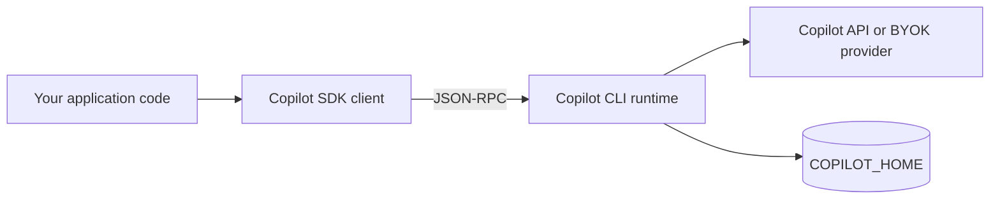
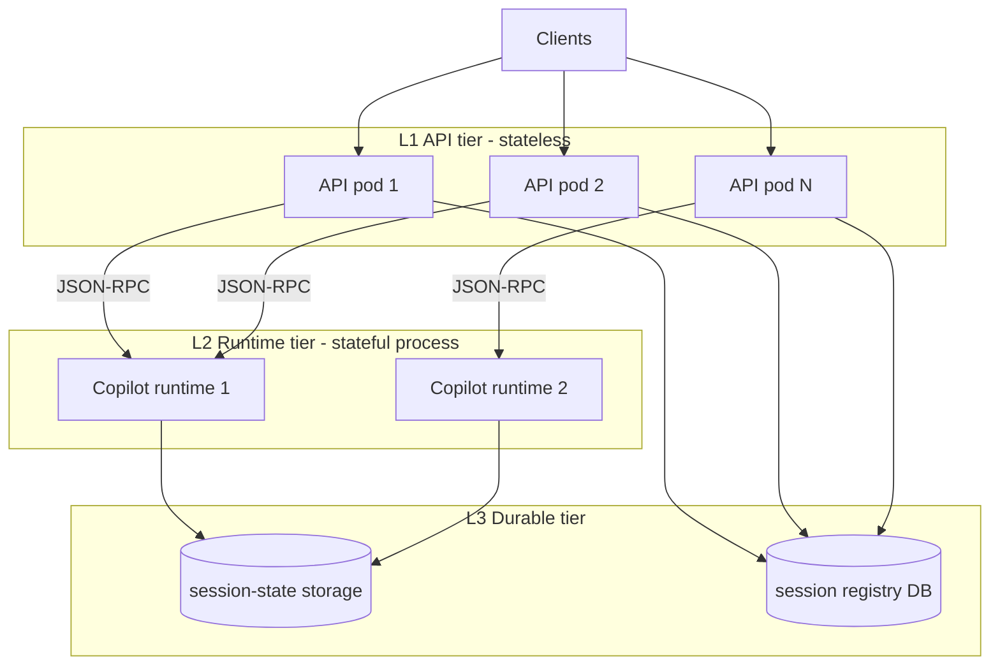
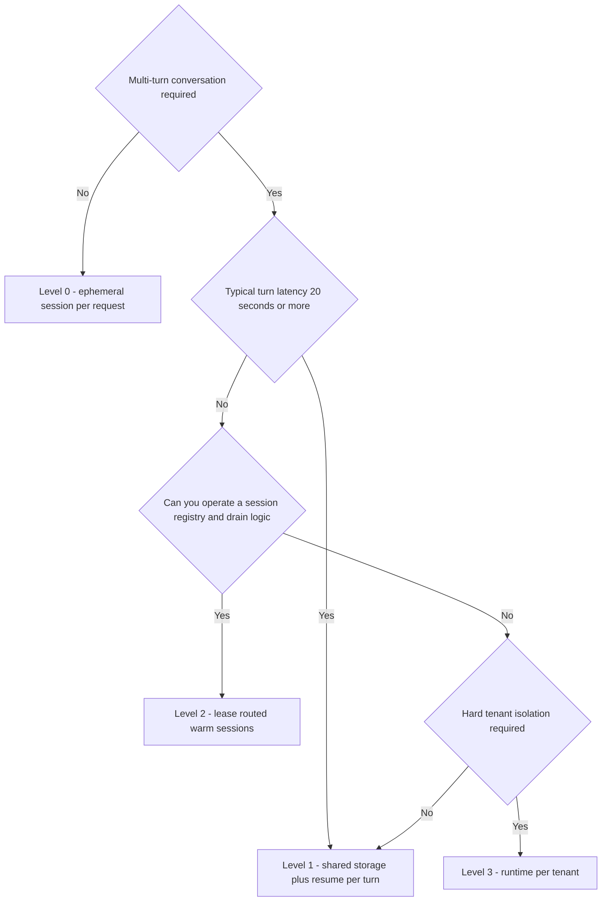
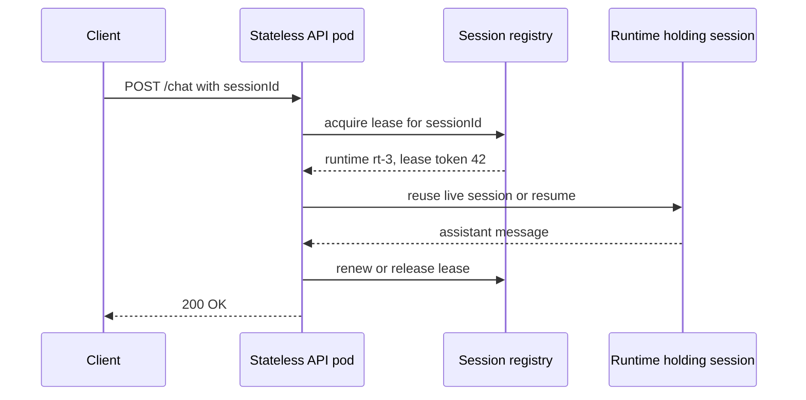
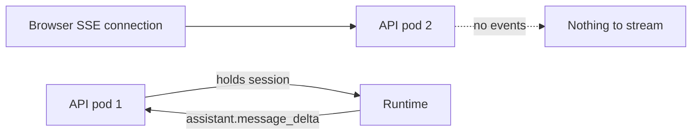

## Introduction

The GitHub Copilot SDK is a library for programmatically driving the agent runtime that sits behind Copilot CLI. It ships for Node.js/TypeScript, Python, Go, .NET, Java, and Rust, so you can embed that agent in your own product.

Running it server-side raises a question:

> Can a backend built on this SDK be designed stateless and scaled horizontally?

The short answer: <strong>your app tier can be stateless; the runtime tier cannot.</strong> A design decision needs more than that answer, though. It depends on three questions:

- Where does state live, and at what granularity?
- What does it cost to cross that state boundary?
- When you put the boundary in the wrong place, how exactly does it break?

This article is based on the public documentation and the `@github/copilot-sdk` v1.0.13 README as of August 2026. The SDK changes quickly, so re-verify everything against the type definitions of the version you install.

## The short version

| Question | Answer |
|---|---|
| Can HTTP/API handlers be stateless? | Yes, if you make sessions addressable by ID |
| Can the Copilot runtime be stateless? | No. It holds in-process memory and on-disk state |
| Can any pod serve any session? | Yes, with shared storage or `sessionFs` — but a single-writer constraint applies |
| Is resuming on every turn practical? | Yes for long turns. For short turns it can multiply your capacity needs |
| Does streaming break statelessness? | Yes. Event delivery has to be designed as a separate concern |
| What is the most dangerous default? | Leaving `mode: "copilot-cli"` in a multi-tenant deployment |

## Background: what the Copilot SDK actually holds

### The SDK is a client, not the engine

The SDK does not call an LLM itself. It is a JSON-RPC client connected to the Copilot CLI runtime.



So a second stateful process runs outside your own, and every stateless design decision has to account for it.

You choose the transport with the `RuntimeConnection` factories.

| Transport | Factory | Runtime lifetime |
|---|---|---|
| stdio (default) | `RuntimeConnection.forStdio({ path, args, env })` | SDK spawns and stops it as a child process |
| TCP | `RuntimeConnection.forTcp({ port, connectionToken, ... })` | SDK spawns it, talks over TCP |
| External URI | `RuntimeConnection.forUri(url, { connectionToken })` | Connects to an already-running runtime; lifetime managed separately |
| In-process | `RuntimeConnection.forInProcess()` | Same process via the native C ABI (FFI), experimental |

For server-side work, use `forUri`: run the runtime as a resident server with `copilot --headless --port 4321` and connect to it from your API processes. The runtime then has its own lifecycle, separate from your request handlers, so you can restart and deploy each independently.

By default, the headless server accepts connections only from loopback (`127.0.0.1`). To reach it from another container you must bind with `--host 0.0.0.0`, and then the documented limitation "there is no built-in auth between the SDK and the CLI" becomes a real exposure. `forUri` and `forTcp` accept a `connectionToken`, but the docs still list missing auth as a limitation, because one shared secret is not a substitute for authentication. Protect the connection at the network boundary (same pod, sidecar, mTLS inside a VPC).

### Taking inventory of state

Before deciding what can be stateless, classify the state. A system built on the Copilot SDK holds at least five kinds.

| Kind of state | What it is | Persisted? | Externalizable? |
|---|---|---|---|
| Conversation | Message thread, tool call results | Yes (checkpoints) | Yes (shared FS / `sessionFs`) |
| Plan and artifacts | `plan.md`, contents of `files/` | Yes | Yes |
| Runtime memory | Live session objects, subscribed event handlers | No | No |
| Credentials | BYOK API keys, per-session GitHub tokens | No (deliberately) | Keep in your own secret manager |
| Tool implementation state | In-memory state held by `defineTool` handlers | No | Your design problem |

Based on the docs, a session directory under `COPILOT_HOME/session-state/{sessionId}/` looks like this.

```text
~/.copilot/session-state/
└── user-123-task-456/
    ├── checkpoints/
    │   ├── 001.json
    │   ├── 002.json
    │   └── ...
    ├── plan.md
    └── files/
```

Two asymmetries in this state shape the design.

1. <strong>Conversations persist; connections do not.</strong> The on-disk session survives, but the live object holding it and its event subscriptions vanish when the process dies.
2. <strong>Keys do not persist.</strong> With BYOK, you must re-supply the `provider` config on every `resumeSession`. That is a sound security decision, and it is also easy to miss the first time you write a stateless resume path.

## Redefining "stateless" per tier

Statelessness is a property of a tier, not of the whole system. Splitting a Copilot SDK system into three tiers shows which parts can be stateless.



- <strong>L1 (API tier)</strong> can be fully stateless in the twelve-factor sense. A request carries nothing but a session ID.
- <strong>L2 (runtime tier)</strong> is inherently stateful because the process holds live sessions. Trying to make it stateless is the same category error as trying to make PostgreSQL stateless.
- <strong>L3 (durable tier)</strong> consists of shared storage (or object storage via `sessionFs`) plus a session registry you own.

The registry is the piece designs most easily overlook. The SDK offers `listSessions()`, but it only enumerates sessions visible on the runtime's storage. It will not tell you who owns a session, which runtime currently holds it, or whether it is still valid. <strong>Ownership and routing are your database's responsibility.</strong>

## Four levels of statelessness

Statelessness comes in degrees. The flowchart picks a level from your requirements.



### Level 0: ephemeral sessions

When each request is independent (classification, summarization, one-shot code generation), do not keep a session at all. This level is fully stateless.

```typescript
import { CopilotClient, RuntimeConnection } from "@github/copilot-sdk";

// Once, at process startup
const client = new CopilotClient({
  mode: "empty",
  connection: RuntimeConnection.forUri(process.env.COPILOT_RUNTIME_URL!),
});
await client.start();

app.post("/api/analyze", async (req, res) => {
  const session = await client.createSession({
    model: "gpt-5.4",
    availableTools: ["custom:lookupOrder"],
    gitHubToken: req.user.githubToken,
    onPermissionRequest: () => ({ kind: "approve-once" }),
  });

  try {
    const result = await session.sendAndWait({ prompt: req.body.prompt }, 120_000);
    res.json({ content: result?.data.content });
  } finally {
    await session.disconnect();
  }
});
```

Three details matter in this handler.

- Do not construct `client` per request. `createSession` is cheap, but `new CopilotClient()` + `start()` establishes a runtime connection.
- Always pass a timeout to `sendAndWait`. An agent turn is not guaranteed to finish, so the caller has to bound it.
- Call `disconnect()` in `finally`. It releases in-memory resources and keeps the on-disk data. If the session is disposable, follow up with `deleteSession()`.

The cost of Level 0 is that no context carries over. To make it multi-turn you must put the history back into the prompt yourself, which increases token billing and latency.

### Level 1: shared storage plus resume per turn

This is the standard way to support multi-turn conversations while keeping the API tier fully stateless. Put session state on shared storage (NFS, a CSI PVC, or object storage via `sessionFs`) so any runtime can resume any session.

```typescript
app.post("/api/chat", async (req, res) => {
  const { sessionId, message } = req.body;

  // 1. Ownership check — the SDK will not do this for you
  const record = await db.sessions.findById(sessionId);
  if (!record || record.ownerId !== req.user.id) {
    return res.status(404).json({ error: "not found" });
  }

  // 2. Guarantee a single writer, then resume
  const result = await withSessionLease(sessionId, async () => {
    const session = await client.resumeSession(sessionId, {
      onPermissionRequest: policyFor(req.user),
      // BYOK requires re-supplying provider config every time
      provider: byokProviderFor(record.tenantId),
    });
    try {
      return await session.sendAndWait({ prompt: message }, 180_000);
    } finally {
      await session.disconnect();
    }
  });

  res.json({ content: result?.data.content });
});
```

The handler stays simple, but each turn now takes longer in wall-clock time:

$$
W_{\text{L1}} = W_{\text{lease}} + W_{\text{resume}} + W_{\text{turn}} + W_{\text{disconnect}}
$$

The extra terms raise the capacity you need, as the section on resume cost quantifies.

### Level 2: lease-routed warm sessions

To avoid the resume cost, keep sessions alive inside a runtime for a while. Before forwarding a request, the API tier asks a registry which runtime holds the session. The API tier stays stateless, yet each session's requests consistently reach the same runtime.



Do <strong>not rely on load balancer sticky sessions</strong> for this. LB affinity follows the client connection, not the actual owner of the session. When a pod dies, the LB silently routes to another pod, and you get two writers. Record ownership as a lease in a registry, and have the API tier look it up.

### Level 3: runtime per tenant

If compliance requirements are strict, or each tenant's runtime needs distinct credentials, run a separate runtime per tenant. This gives the strongest isolation and the worst density, because you pay for the processes and memory of idle tenants.

| | Level 0 | Level 1 | Level 2 | Level 3 |
|---|---|---|---|---|
| API tier statelessness | Full | Full | Full (registry-backed) | Full |
| Conversation continuity | None | Yes | Yes | Yes |
| Per-turn overhead | None | resume + lease | lease only | None |
| Shared storage needed | No | Required | Preferred (for failover) | Optional |
| Single-writer control | Not needed | Required | Required | Effectively unneeded |
| Isolation level | Session | Session | Session | Process |
| Operational complexity | Low | Medium | High | Medium (density cost) |

## What externalizing storage does and does not solve

A common assumption is that moving session data to external storage makes the system stateless. That is only half true.

### What you get is not "stateless" but "relocatable"

Externalizing gives you exactly one property: the session can be opened from any node. The other two kinds of state in the table below cannot be externalized even in principle.

| State | Externalizable | Why |
|---|---|---|
| Conversation, checkpoints, `plan.md`, `files/` | Yes | Plain data. This is what `sessionFs` is for |
| The in-flight turn's outstanding call | No | It is not data — it is an RPC into your process |
| Events during streaming | No | They are never written to disk at all (see below) |

The in-flight turn's outstanding call matters most. Tool execution, `onPermissionRequest`, and hooks all work by the runtime sending a JSON-RPC request into your process and blocking until you reply. If an API pod dies mid-turn, the runtime is left with a pending request that nobody will answer. A shared disk cannot move that open call to another pod.

So externalizing protects state <strong>between turns</strong>, not <strong>within a turn</strong>. When a Level 1 handler retries, the only safe assumption is that the session is back at the last checkpoint, so tool side effects must be idempotent.

The SDK states this requirement itself, in a comment in the implementation of durable steps for Agent Factories.

```typescript
// nodejs/src/session.ts
// Producers are best-effort at-least-once across crashes or
// concurrent callers, so authors must make side effects idempotent.
```

Even the SDK mechanism most concerned with durability guarantees only at-least-once execution.

### Externalizing removes an accidental single-writer guarantee

With local disk, session state lived only on one pod's filesystem, so only that pod could touch it. Mutual exclusion held by accident. Shared storage removes that protection, and the SDK has no locking to replace it.

Searching all of `nodejs/src` turns up exactly two things called a lock, and neither has anything to do with sessions.

| Location | What it is | What it protects |
|---|---|---|
| `modelsCacheLock` in `client.ts` | A promise-based mutex | The `listModels()` cache. In-process only |
| `"busyOrLocked"` in `sessionFsProvider.ts` | A SQLite BUSY/LOCKED classification | Whether a storage-layer retry is safe |

Neither `createSession` nor `resumeSession` checks whether another client already holds the session. Two pods resuming the same `sessionId` both succeed.

The SDK does model "already active", but only for factory runs, not for sessions.

```typescript
// nodejs/src/factory.ts
export type FactoryResumeErrorCode =
    | "not_found"
    | "non_resumable"
    | "already_active"          // rejects double execution
    | "factory_already_running"
    | "factory_limits_invalid"
    | "factory_session_disposed"
    | "factory_storage_unavailable"
    | "factory_storage_corrupt";
```

So leaving <strong>session exclusion to the application</strong> looks like a deliberate decision rather than an oversight. A library cannot know the layer above it (how many pods exist, how the LB routes), so it cannot provide exclusion itself. Doing so would require the SDK to depend on Redis or etcd, which is a bad dependency for a library to impose.

Layers that leave exclusion to their callers usually still provide conflict detection: HTTP's `If-Match`, conditional writes on object storage, and `git push` rejecting non-fast-forward updates. The Copilot SDK gives you `modifiedTime` from `listSessions()`, but <strong>no compare-and-swap that validates a version at write time</strong>. As a result:

- You cannot prevent double writes (reasonable for this layer)
- You have little means to detect that a double write happened (this part is weak)

The responsibilities divide like this:

| What the SDK provides | What you must provide |
|---|---|
| Identity — you can address a session by `sessionId` | Exclusion — the guarantee of one writer at a time |
| Durability — checkpoint persistence and restore | Ownership — whose session this is |
| Placement freedom — `sessionFs` lets you choose where state lives | Routing — which runtime currently holds it |

Externalizing storage gives you the third item in the left column. The right column is your job whether or not you externalize.

## The session ID is a primary key, not an ACL

`createSession({ sessionId })` lets you choose the ID. If you omit it, a random ID is generated, and you cannot resume the session later unless you recorded that ID.

The official docs recommend structured IDs like `user-{userId}-{taskId}` and show a sample that verifies ownership by `sessionId.split("-")`. <strong>Do not ship that sample.</strong>

The problem is that it turns a string representation into a trust boundary:

- A hyphen inside a user ID shifts the boundary. How would you split `user-alice-smith-42`?
- An attacker controls the `sessionId` they send. Passing a client-supplied ID straight into `createSession` lets them claim someone else's namespace.
- It cannot follow tenant deletion or user ID reuse.

Instead, <strong>treat the session ID as an opaque identifier and keep ownership in your own database</strong>.

```typescript
// Generation: an opaque, collision-free ID with only a tenant prefix
function newSessionId(tenantId: string): string {
  return `t${tenantId}-${crypto.randomUUID()}`;
}

// Authorization: record lookup, not string parsing
async function authorize(sessionId: string, user: User) {
  const rec = await db.sessions.findById(sessionId);
  if (!rec) throw new NotFound();
  if (rec.tenantId !== user.tenantId) throw new NotFound(); // 404, not 403
  if (!user.can("session:write", rec)) throw new Forbidden();
  return rec;
}
```

A tenant prefix is still useful for routing storage paths in `sessionFs` and for reading an ID during an incident. Just never base authorization on it. Return 404 rather than 403 for other tenants' sessions so you do not reveal that they exist.

## The single-writer constraint — solve it with partitioning, not locks

The SDK docs are explicit: there is no built-in session locking. If two clients `resumeSession` the same ID and write concurrently, the behavior is undefined. Checkpoints are written as numbered JSON files, so lost updates are possible.

The official sample shows a Redis `SET NX EX` lock. That is the right direction, but copying it as-is leaves two problems.

### Problem 1: lock release races

Some doc samples do a `GET` followed by a `DEL`. If the TTL expires between those two steps and another client acquires the lock, you delete someone else's lock. Release must be atomic via Lua.

```typescript
const RELEASE = `
if redis.call("get", KEYS[1]) == ARGV[1] then
  return redis.call("del", KEYS[1])
else
  return 0
end`;

// Renewal needs the same ownership check. A bare EXPIRE extends someone else's lock.
const RENEW = `
if redis.call("get", KEYS[1]) == ARGV[1] then
  return redis.call("expire", KEYS[1], ARGV[2])
else
  return 0
end`;

async function withSessionLease<T>(
  sessionId: string,
  fn: () => Promise<T>,
  ttlSec = 300,
): Promise<T> {
  const key = `copilot:lease:${sessionId}`;
  const token = crypto.randomUUID();

  const ok = await redis.set(key, token, "NX", "EX", ttlSec);
  if (!ok) throw new SessionBusyError(sessionId);

  const renew = setInterval(() => {
    void redis.eval(RENEW, 1, key, token, String(ttlSec));
  }, (ttlSec / 3) * 1000);

  try {
    return await fn();
  } finally {
    clearInterval(renew);
    await redis.eval(RELEASE, 1, key, token);
  }
}
```

Renewal has the same race. A bare `EXPIRE` never checks whether the key is still yours. If the TTL lapses, another client acquires the lock, and then your renewal timer fires, you extend someone else's lease. That is why the code above renews through a token-checked Lua script, just like release.

### Problem 2: a lock does not actually guarantee mutual exclusion

A Redis lock is advisory, so it does not prove mutual exclusion. A long GC pause, a network partition, or a frozen container can leave a process writing while it still believes it holds an expired lock. The standard remedy for distributed locks is a fencing token that the resource validates, but <strong>the Copilot runtime does not accept fencing tokens</strong>, so locks alone cannot close this gap.

There are two practical answers.

<strong>(a) Make single-writer structural.</strong> Use a queue partitioned by session ID (a Kafka partition, an SQS FIFO `MessageGroupId`, a Redis Streams consumer group) so the same worker always processes a session's turns in order. Mutual exclusion then follows from how messages are delivered rather than from whether a lock was acquired, which is far more robust.

<strong>(b) Make corruption detectable.</strong> Assume double writes can still happen. Track the `modifiedTime` returned by `listSessions()` or your own turn counter, and treat any unexpected advance as an anomaly. Agent sessions are not financial transactions, so detecting the problem, quarantining the session, and asking the user to start over is usually enough.

The cheapest mitigation is to reject concurrent requests to the same session immediately with 409 Conflict. With a UI message such as "still generating the previous response", this resolves most cases.

## Resume cost and capacity planning

Level 1 pays for a resume on every turn. Little's law shows what that costs in capacity.

The number of concurrently active turns is

$$
L = \lambda \cdot W
$$

where $\lambda$ is the turn arrival rate [turns/sec], $W$ is time in system per turn [sec], and $L$ is the number of turns in flight.

For a chat backend with $\lambda = 3\ \text{turns/sec}$ and $W = 25\ \text{s}$, $L = 75$. Divide by the measured per-runtime concurrency $C$ to get the runtime count.

$$
N = \left\lceil \frac{L}{C} \right\rceil \times (1 + \text{headroom})
$$

Level 1 and Level 2 differ here. A resume lengthens $W$, and $L$ grows in proportion.

$$
\frac{L_{\text{L1}}}{L_{\text{L2}}} = \frac{W_{\text{resume}} + W_{\text{turn}}}{W_{\text{turn}}}
$$

$W_{\text{lease}}$ applies to both Level 1 and Level 2, but it does not cancel out of the ratio; it is omitted because it is small next to $W_{\text{turn}}$. $W_{\text{disconnect}}$ is likewise dropped as small next to $W_{\text{resume}}$.

| $W_{\text{turn}}$ | $W_{\text{resume}} = 1\text{s}$ | $W_{\text{resume}} = 5\text{s}$ |
|---|---|---|
| 60 s (long-running agent) | +1.7% | +8.3% |
| 25 s (typical chat) | +4.0% | +20% |
| 5 s (short lookup) | +20% | +100% |
| 1 s (completion-like) | +100% | +500% |

For a fixed $W_{\text{resume}}$, <strong>the overhead of statelessness is inversely proportional to turn length</strong>. For long agentic workflows, Level 1 costs almost nothing extra. For an API handling short turns at high frequency, every resume adds directly to infrastructure spend. Turn length is therefore what decides between Level 1 and Level 2.

Do not reason about $W$ from the mean. Agent turn duration is heavy-tailed: tool execution dominates, and retries and compaction add to it. Size capacity on p95/p99, and cap concurrency so excess work waits. Without a cap, slow turns pile up, exhaust memory, and take down the whole tier.

The public docs give no number for $C$. They only state that the runtime is single-process and that you scale by adding instances rather than threads. Measure it on your own workload. As you increase concurrent sessions against one runtime, record:

- Turn latency p50 / p95 / p99
- RSS (slope against live session count)
- `session-state` disk I/O and growth rate
- Error and timeout rates

Look for the concurrency at which latency rises sharply, rather than for the maximum number of sessions that fit.

## Streaming breaks statelessness

Implementations most often get stuck on streaming. With `createSession({ streaming: true })` the runtime emits `assistant.message_delta` events carrying `deltaContent`. Those events are delivered to the process holding that SDK client, but the browser's SSE or WebSocket connection may terminate on a different API pod.



A naive design ends up like this: pod 1 receives the deltas, while the browser is attached to pod 2 and sees nothing.

### Ephemeral events — some things cannot be replayed

Delivery is not the only problem. <strong>Streaming events are never written to disk.</strong>

In the generated type definitions, every session event carries an `ephemeral` flag.

```typescript
// nodejs/src/generated/session-events.ts
/**
 * When true, the event is transient and not persisted to the session event log on disk
 */
ephemeral?: boolean;
```

For some events, that field has the literal type `true`, so the types guarantee they are never persisted. There are 63 such events, including:

| Event | What is lost |
|---|---|
| `assistant.message_delta` / `assistant.message_start` | A partially generated response |
| `assistant.reasoning_delta` / `assistant.tool_call_delta` | Reasoning and tool-call streams |
| `assistant.usage` | Per-model-call token counts and cost |
| `tool.execution_progress` / `tool.execution_partial_result` | Tool execution progress |
| `session.usage_info` | Context window utilization |
| `session_limits_exhausted.requested` / `.completed` | Budget exhaustion notifications |
| `user_input.requested` / `elicitation.requested` | User input and form requests |
| `session.idle` / `model.call_failure` | Idle transitions and model call failures |

For a stateless design, this means `getEvents()` cannot reconstruct a partially streamed turn. Only what reached a checkpoint survives on disk.

So streaming also requires designing for durability, not only delivery. Once you publish events through a broker, your pipeline holds the only record of them, and the append-only buffer described below becomes the store for events that cannot be recovered if lost.

Events also carry a `parentId` that forms "a linked chain to the chronologically preceding event". This chain records order and causality, so keeping `parentId` in your own buffer makes reconstruction much easier.

There are three ways to deliver events across pods.

| Approach | Mechanism | Fits | Cost |
|---|---|---|---|
| Event broker | The pod holding the session publishes deltas to Redis Pub/Sub or NATS; the pod terminating SSE subscribes | General-purpose; keeps the API tier genuinely stateless | One extra hop; needs ordering and loss handling |
| Route to the owning pod | Look up the registry and proxy or redirect the SSE connection to the owning pod | Fewer hops, lower latency | Requires inter-pod routing; drain handling gets awkward |
| Drop streaming | Skip `streaming` and return only the final `assistant.message` | Batch work, non-interactive UIs | Poor perceived latency; long turns look frozen |

If you use a broker, add an append-only turn buffer. Publish each delta and append it to a Redis List or Stream at the same time. A new SSE connection replays the buffer before switching to the subscription, which prevents the bug where a client reconnects and loses the middle of a response. With SSE `Last-Event-ID`, the client's resume point is also well defined.

The final `assistant.message` is always sent regardless of the `streaming` setting, so you can reconcile the buffer against the complete content that arrives at the end.

Cloud sessions (`cloud: { repository: ... }`) add another trap. `createSession` resolves as soon as Mission Control reserves a task, but the remote worker connects a second or two later. If you `send` before that, the runtime throws `"Remote session is still starting"`. <strong>The schema wrapper swallows that error and returns a fresh messageId</strong>, so the call appears to succeed while the prompt is dropped on the server. Wait for a `session.start` event whose `producer === "copilot-agent"` before sending. In a stateless handler, either split "create session" and "send first prompt" into two requests, or wait for readiness before responding to the create call.

## `sessionFs` — peeling state off the local disk

`baseDirectory` sets `COPILOT_HOME`, which defaults to `~/.copilot`. When you connect to an external runtime with `RuntimeConnection.forUri`, the SDK client's `baseDirectory` is <strong>ignored</strong>; set `COPILOT_HOME` as an environment variable on the runtime process instead.

The same applies to `sessionIdleTimeoutSeconds` and `enableRemoteSessions`. With an external runtime, the client ignores these options without an exception or warning, and the runtime process's own configuration applies. The resident headless topology recommended in this article is exactly the case where they are ignored.

The usual way to get shared storage is to mount `COPILOT_HOME/session-state` on a PVC or Azure File; the docs show Kubernetes and ACI examples. But mounting a network filesystem into several runtimes at once brings locking, consistency, and latency problems.

With `sessionFs`, session-scoped file I/O goes through your application's storage instead of the runtime's local disk.

```typescript
const client = new CopilotClient({
  mode: "empty",
  sessionFs: {
    initialCwd: "/workspace",
    sessionStatePath: "/session-state",
    conventions: "posix",
  },
});
```

Configuration has two parts: set `sessionFs` at the client level, and supply a per-session filesystem handler when creating or resuming a session. The public APIs for each language are:

| Language | Client-level config | Per-session provider |
|---|---|---|
| TypeScript | `sessionFs` | `createSessionFsAdapter` / provider callbacks |
| Python | `session_fs` | `create_session_fs_handler` |
| Go | `SessionFS` | `CreateSessionFSProvider` |
| .NET | `SessionFs` | `CreateSessionFsProvider` |
| Rust | `with_session_fs(...)` | `with_session_fs_provider(...)` |
| Java | (no public option) | — |

Java currently has no verified public `sessionFs` option. If you are on a JVM stack, plan for a shared-filesystem design up front.

`sessionFs` has three practical benefits.

1. <strong>Local disk can be ephemeral.</strong> State survives pod deletion. This is mandatory on Cloud Run or Container Apps, where disks are volatile.
2. <strong>Tenant boundaries can be enforced by path.</strong> If the provider implementation forces a tenant prefix, the storage layer stops a mixed-up session ID from reaching another tenant's data. This adds a second layer of defense behind authorization.
3. <strong>Lifecycle management moves to your tooling.</strong> Object storage lifecycle policies give you TTL deletion, versioning, and audit logs without extra code.

The cost is latency, because checkpoint reads and writes go over the network. With Level 1's per-turn resume, that latency adds directly to $W_{\text{resume}}$. Level 2 warm sessions, which resume less often, feel it less.

## `mode: "empty"` — the precondition for multi-tenancy

Whether a shared runtime can serve multiple tenants safely depends on this one setting.

`CopilotClient`'s `mode` is either `"copilot-cli"` (default) or `"empty"`, and the docs are explicit: do not use the default `"copilot-cli"` on a shared server. That mode targets CLI-style coding agents and <strong>can expose ambient tools with host filesystem access</strong>.

The runtime runs as a process on your server, so anything that process can read is potentially exposed to every tenant: `.env` files, service account tokens, other tenants' session directories, `/proc`, cloud instance metadata endpoints. Leaving tools that let an agent read files on the server implicitly enabled leads straight to OWASP A01 (broken access control) and A05 (security misconfiguration).

```typescript
const client = new CopilotClient({
  mode: "empty", // required for a shared runtime
  connection: RuntimeConnection.forUri(process.env.COPILOT_RUNTIME_URL!),
});

const session = await client.createSession({
  sessionId,
  model: "gpt-5.4",
  // Explicit allowlist. Never use wildcards like builtin:*
  availableTools: ["custom:lookupOrder", "custom:createTicket"],
  gitHubToken: user.githubToken,
  sessionLimits: { maxAiCredits: 30 },
  onPermissionRequest: (request) => {
    if (request.kind === "shell") {
      return { kind: "reject", feedback: "Shell execution is disabled." };
    }
    if (request.kind === "read" || request.kind === "write") {
      return { kind: "reject", feedback: "Direct file access is disabled." };
    }
    return { kind: "approve-once" };
  },
});
```

The docs summarize session-level isolation as follows.

| Surface | Isolation behavior |
|---|---|
| Model list cache | Per session |
| Session state | Per `COPILOT_HOME/session-state/{sessionId}` |
| GitHub identity | Per session when `gitHubToken` is set on the session |
| Tools | Explicit under `mode: "empty"`, ambient under `"copilot-cli"` |
| Host filesystem | Shared by the runtime process if host tools are available |

The last row explains why the shared-runtime pattern depends on `mode: "empty"`: with host tools available, every session shares the runtime process's filesystem.

### `mode: "empty"` is validation, not just a defaults switch

The guides present `mode: "empty"` as a switch for defaults. The type definitions show that it also validates your configuration.

```typescript
// nodejs/src/types.ts
/**
 * When set to `"empty"`, the SDK validates that the app has supplied the
 * required configuration (baseDirectory or sessionFs, plus availableTools
 * on each session) and translates session creation requests into runtime
 * options that flip tool filter precedence to deny-wins so exclusions are
 * expressible.
 */
```

`mode: "empty"` enforces two requirements, and missing either causes a runtime error.

1. Either `baseDirectory` or `sessionFs` must be set (validated when `CopilotClient` is constructed)
2. Every session must specify `availableTools` (validated on `createSession`)

The first requirement has a catch. As noted earlier, `baseDirectory` is ignored under `RuntimeConnection.forUri`. So in the topology this article recommends (an external runtime with `mode: "empty"`), <strong>you should supply `sessionFs`</strong>. Passing `baseDirectory` satisfies the validation but configures nothing.

The second requirement errs on the safe side: instead of recommending an allowlist, the SDK refuses to create a session without one.

### A deny-by-default configuration reference

`mode: "empty"` switches many defaults to the safe side, but it does not close everything. The table below, compiled from the type definitions, lists the fields whose defaults change with mode and the ones you should set explicitly in a multi-tenant deployment.

| Field | How the default changes with mode | Multi-tenant recommendation |
|---|---|---|
| `availableTools` | Required under `empty` (omitting it errors) | Explicit allowlist |
| `skipCustomInstructions` | `false` → `true` under `empty` | `true` (keep the default) |
| `customAgentsLocalOnly` | `false` → `true` under `empty` | `true` (keep the default) |
| `coauthorEnabled` | `true` → `false` under `empty` | `false` (keep the default) |
| `manageScheduleEnabled` | Runtime-dependent → `false` under `empty` | `false` (keep the default) |
| `enableExperimentalMode` | Runtime-dependent → `false` under `empty` | `false` (keep the default) |
| `enableSessionStore` | Enabled under `copilot-cli` → disabled under `empty` | Explicitly `false` |
| `memory` | Runtime default under `copilot-cli` → disabled under `empty` | Explicitly `{ enabled: false }` |
| `skipEmbeddingRetrieval` | No mode-specific default documented | `true` |
| `embeddingCacheStorage` | No mode-specific default documented | `"in-memory"` |
| `enableFileHooks` | No mode-specific default documented | `false` |
| `enableOnDemandInstructionDiscovery` | Same | `false` |
| `enableHostGitOperations` | Same | `false` |
| `enableSkills` | Same | `false` unless needed |

Under the default `copilot-cli` mode (`skipCustomInstructions: false`), the runtime reads `.github/copilot-instructions.md`, `AGENTS.md`, and `CLAUDE.md` from the working directory and adds them to the system prompt. If tenants can upload files or otherwise influence the working directory, that is a <strong>direct prompt injection path</strong>. `enableOnDemandInstructionDiscovery` carries the same risk: it discovers additional instruction files after the agent views files.

### The embedding cache is an easily missed leakage path

The type definitions contain a warning that the public guides barely mention.

```typescript
// nodejs/src/types.ts
/**
 * When true, skips embedding-based retrieval for this session.
 * Use in multitenant deployments to prevent cross-session information
 * leakage through the shared embedding cache.
 */
skipEmbeddingRetrieval?: boolean;
```

The SDK itself names multi-tenant deployments as the use case for this field: it prevents cross-session information leakage through the shared embedding cache. The related `embeddingCacheStorage` chooses between `"persistent"` (cached on disk, shared across sessions and restarts) and `"in-memory"` (discarded when the session ends).

`mode: "empty"` closes the tool exposure surface, but <strong>the type definitions document no mode-specific default for either field</strong>. For a multi-tenant SaaS, set `skipEmbeddingRetrieval: true` explicitly, or at minimum `embeddingCacheStorage: "in-memory"`.

`onPermissionRequest` has a subtle trap too. If you omit the handler, permission requests are emitted as events and left pending, and the session does not advance until something resolves them. In a backend service without the handler, sessions hang silently until the idle timeout, so always set it explicitly.

The scopes `approve-for-session`, `approve-for-location`, and `approve-permanently` keep an approval beyond a single request. In a multi-tenant deployment, an `approve-for-location` `locationKey` or an `approve-permanently` domain approval can be shared unintentionally. On a shared runtime, use only `approve-once` and `reject`.

## Authentication and token lifecycles

Server-side, authentication has two layers.

- <strong>Client/runtime level</strong>: environment variables such as `COPILOT_GITHUB_TOKEN`, or the `gitHubToken` client option. This is the runtime process's own identity.
- <strong>Session level</strong>: `createSession({ gitHubToken })`. This is the requesting user's identity.

The docs state that multi-user servers should pass a per-session token, because content exclusion, model routing, quota checks, and per-user Copilot entitlement all depend on it. Reusing one service token for every user bypasses all of those organizational policies.

Credentials are resolved in this order: explicit SDK token → direct Copilot API environment auth → environment variable GitHub tokens → stored Copilot CLI credentials → GitHub CLI credentials. The last two are dangerous: <strong>code that forgets to pass an explicit token silently picks up whatever credentials are on disk</strong>. If you ship an image that still contains a developer's `copilot` login in `COPILOT_HOME` (default `~/.copilot`), you get the classic "works locally, fails in production", or worse, a production service running under an unintended identity.

The client option `useLoggedInUser` cannot be combined with `RuntimeConnection.forUri`, and neither can a client-level `gitHubToken`. So in an external-runtime deployment this accident happens on the runtime process, not on the SDK client, and the fix belongs there. Keep `~/.copilot` out of your container image and pin the runtime process's `COPILOT_HOME` to a dedicated directory. (The SDK client's `baseDirectory` has no effect under `forUri`.)

The hardest issue for stateless handlers is that <strong>token lifetime and session lifetime do not match</strong>. A user's OAuth token may expire in hours, while a session can live for days. So:

- Do not store the token itself in the session record.
- On every resume, fetch a fresh token from your auth system and pass it as `gitHubToken`.
- If no token can be obtained (the user left or revoked access), treat the session as non-resumable.

BYOK has the same shape. API keys are deliberately not persisted to disk, so you must re-supply `provider` on every `resumeSession`. If you forget, you get a bug that is hard to reproduce: the session works right after creation and fails with an auth error after resume.

```typescript
async function resumeWithFreshCredentials(sessionId: string, rec: SessionRecord) {
  return client.resumeSession(sessionId, {
    // Re-fetch from the secret manager each time
    gitHubToken: await tokenBroker.forUser(rec.ownerId),
    provider: rec.byok ? await secrets.providerConfig(rec.tenantId) : undefined,
    onPermissionRequest: policyFor(rec),
  });
}
```

BYOK is not limited to static API keys. Besides `apiKey`, `provider` accepts `bearerToken` (a static string) and `bearerTokenProvider` (a callback that returns a token on demand). The docs include a dedicated Azure Managed Identity guide: acquire a token for the `https://ai.azure.com/.default` scope with `DefaultAzureCredential` and pass it through `bearerTokenProvider`.

The difference matters for stateless design. You must re-fetch `apiKey` and `bearerToken` values from a secret manager and re-supply them on every resume. With `bearerTokenProvider`, you pass the callback itself, and the Identity SDK handles token acquisition and refresh, so no long-lived key ends up in your session record or your environment. You still have to pass the `provider` object again on every resume, because a callback reference is not persisted to disk either. A static `bearerToken` is documented as never being refreshed automatically, so always use `bearerTokenProvider` for long-running sessions.

Credentials are not the only thing you must re-supply on resume. The type definitions describe one more, and forgetting it is more dangerous.

```typescript
// nodejs/src/types.ts — SessionConfigBase.managedSettings
// This is startup-only. It is **not** persisted: it must be re-supplied on
// resume, where it replaces the prior injected layer (omitting it clears
// the layer, so warm and cold resume behave identically).
```

`managedSettings` is enterprise managed policy injected by the host. Its `deny`/`ask` rules are unioned, and `disableBypassPermissionsMode: "disable"` is deny-wins, so this setting tightens permissions. Forgetting it on resume clears the layer and <strong>loosens your policy</strong>.

A forgotten BYOK key shows up immediately as an auth error. A forgotten `managedSettings` leaves a session that works normally. Because the failure is silent, only review and tests can catch it: collect everything that must be re-supplied on resume into a single function and write a test for it.

One related setting does fail safe: `enableManagedSettings` (where the runtime fetches org policy itself) requires the session's `gitHubToken`, and the type definitions state that the runtime is expected to reject session creation if the token is missing (fail-closed).

## A catalog of failure modes

Look up a symptom in the first column during a design review.

| Symptom | Root cause | Fix |
|---|---|---|
| Conversation rewinds or responses interleave | Double writers on one session | Session-keyed partitioned queue, or lease plus 409 |
| Sessions vanish on pod restart | `session-state` on ephemeral disk | PVC, or `sessionFs` to external storage |
| Auth error right after resume | BYOK `provider` not re-supplied | Re-fetch from the secret manager on resume |
| 401 when resuming hours later | User OAuth token expired | Do not store tokens in the session record; mint per resume |
| Stream stops mid-answer | The SSE-terminating pod is not the session owner | Event broker, or route to the owning pod |
| Cloud session's first prompt disappears | `send` before `session.start` with `producer` `copilot-agent` | Await readiness before sending, with roughly a 60 s timeout |
| Disk slowly fills up | Unbounded `session-state` accumulation | TTL-based `deleteSession`; `sessionFs` plus lifecycle policies |
| Idle sessions accumulate | No idle timeout configured | Set one explicitly (15–30 minutes is a good start for chat). With an external runtime the client-side `sessionIdleTimeoutSeconds` is ignored — configure it on the runtime process |
| One tenant consumes the budget | No per-session budget | `sessionLimits.maxAiCredits` plus `session_limits_exhausted.requested` handling |
| Another tenant's files get read | Shared runtime left on `mode: "copilot-cli"` | `mode: "empty"` plus an `availableTools` allowlist |
| Another tenant's content shows up in retrieval | Shared embedding cache, or the cross-session store | `skipEmbeddingRetrieval: true`, `embeddingCacheStorage: "in-memory"`, `enableSessionStore: false` |
| Permission policy loosens after resume | `managedSettings` not re-supplied on resume (omitting it clears the layer) | Always re-supply it in the resume path; cover it with a test |
| Tenant files leak into the prompt | Automatic loading of `AGENTS.md` and friends | `skipCustomInstructions: true`, `enableOnDemandInstructionDiscovery: false` |
| Sessions hang silently | Permission requests pending with no `onPermissionRequest` | Always set a handler; monitor for pending requests |
| Turns lost on every deploy | No drain design | On SIGTERM: stop accepting, await in-flight turns, `disconnect()`, release leases |

On deploy, drain in-flight turns before stopping a pod. In Kubernetes, `terminationGracePeriodSeconds` must exceed p99 turn duration. Agent turns can run for minutes, so the 30-second default will almost always cut them off. An unbounded grace period, however, means rolling updates never finish. In practice, shut down in stages:

1. Stop accepting new turns in a preStop hook
2. Wait for in-flight turns, with a cap
3. For anything past the cap, `session.abort()` then `disconnect()`
4. Release leases and tell clients to retry

Because `disconnect()` preserves on-disk state, sessions cut off this way can be resumed later.

At process exit, call `client.stop()`. It closes all sessions and returns the errors collected during cleanup as an `Error[]` instead of throwing, so log the return value instead of discarding it. `forceStop()` is an escape hatch when shutdown drags on, but it skips graceful cleanup, so use it only as the last step of your drain sequence.

## Observability and budget control

Agent backends are harder to observe than ordinary web services, because a single request contains many model calls and tool executions.

The SDK supports OpenTelemetry out of the box. Pass `telemetry`, and the runtime emits spans for sessions, messages, and tool calls to your collector.

```typescript
const client = new CopilotClient({
  mode: "empty",
  telemetry: {
    otlpEndpoint: process.env.OTLP_ENDPOINT,
    otlpProtocol: "http/protobuf",
    captureContent: false, // default to off in multi-tenant deployments
  },
});
```

`captureContent` controls whether message bodies are recorded in spans. In a multi-tenant SaaS, turning it on sends tenant data to your tracing backend, which then has to meet your data residency, retention, and access control requirements too. Keep it off by default and turn it on only with consent.

Use `onGetTraceContext` to put your own application spans in the same trace as the runtime's. Tool handlers receive the context as `traceparent` / `tracestate` on `ToolInvocation`, so database access inside a tool implementation joins the same trace.

At minimum, collect these metrics:

- Live session count (per runtime)
- Turn latency (p50 / p95 / p99)
- Resume latency (the single most important number at Level 1)
- Lease acquisition failure rate (the frequency of 409 responses measures concurrent-operation pressure)
- Rate of `session.compaction_start` / `session.compaction_complete`
- Cumulative usage from `session.usage_checkpoint`
- Tool call success rate and duration, broken down by tool

### There are two usage events, and one of them disappears

Tenant chargeback depends on the difference between two usage events.

| Event | Granularity | Persisted | Key fields |
|---|---|---|---|
| `assistant.usage` | Per model call | No (`ephemeral: true` in the type) | `model`, `inputTokens`, `outputTokens`, `cacheReadTokens`, `cacheWriteTokens`, `reasoningTokens`, `cost`, `duration`, `timeToFirstTokenMs`, `interTokenLatencyMs`, `finishReason`, `isByok`, `serviceRequestId`, `providerCallId` |
| `session.usage_checkpoint` | Session cumulative | Yes | `totalNanoAiu`, `totalPremiumRequests?` |

The detailed per-call event is the one that is not persisted. If you are not subscribed to `assistant.usage`, or the subscribed pod dies, those token counts and that cost are gone for good. GitHub still bills you, but your ledger has a gap.

The chargeback design follows from this:

1. Push `assistant.usage` to an external append target (a queue, a time-series DB, an event store) as soon as you receive it. Do not make this an async best-effort path.
2. Use the cumulative `session.usage_checkpoint` as the book of record. It is persisted, so it stays consistent across resume.
3. Reconcile the two to detect loss. Any gap is exactly the usage whose events you lost to pod failures.

`serviceRequestId` (`x-copilot-service-request-id`) and `providerCallId` (`x-github-request-id`) let you correlate a call with GitHub's own logs. You need them when you ask support about a specific slow or failed request, so store them alongside cost.

`quotaSnapshots` and `toolCounts` are marked `@internal` in the type definitions. You can access them, but they are outside the backward-compatibility contract.

On cost, `sessionLimits.maxAiCredits` sets a soft cap for the session's current accounting window. Usage is checked after model calls return, so <strong>one response can exceed the configured value</strong>. Treat it as a brake against runaway spend, not a hard ceiling.

Budget exhaustion arrives as a `session_limits_exhausted.requested` event, and continuing requires a user decision. In a stateless HTTP handler, the clean option is to `disconnect()` the session, return "budget limit reached", and handle the top-up decision in a separate request. Waiting for human input inside a handler leaves the request hanging.

Set `maxAiCredits` on both `createSession` and `resumeSession`. The official samples always set it in both places, and the behavior when it is omitted on resume is not documented, so assume the cap disappears and pass it every time.

## Context compaction as hidden state

Long sessions rely on infinite sessions, a feature enabled by default that manages the context window limit through background compaction.

```typescript
const session = await client.createSession({
  sessionId,
  infiniteSessions: {
    enabled: true,
    backgroundCompactionThreshold: 0.8,  // start compacting at 80% context usage
    bufferExhaustionThreshold: 0.95,     // block at 95% until compaction completes
  },
});
```

The thresholds are <strong>context utilization ratios (0.0–1.0)</strong>, not absolute token counts, so passing something like `8000` is an easy mistake.

Compaction affects stateless design because it runs asynchronously in the background. As a result:

- Wall-clock $W$ spikes on turns that overlap with compaction, which makes compaction a primary source of the heavy latency tail.
- Hitting `bufferExhaustionThreshold` blocks the session until compaction completes. Your concurrency cap needs to account for that.
- If the process dies mid-compaction, you cannot control which checkpoint the next resume starts from.

To mitigate this, subscribe to `session.compaction_start` / `session.compaction_complete` and turn them into metrics. When compaction becomes frequent, have the application close the long-running session and start a fresh one. An infinite session also has an ever-growing resume cost.

## Watch for documentation drift

The SDK changes quickly, and the official docs contradict themselves in places. These were the main inconsistencies as of August 2026:

| Item | Statement A | Statement B | How to treat it |
|---|---|---|---|
| Default idle timeout | Session Persistence: "sessions have no idle timeout by default" | Scaling / Backend Services limits tables: "30-minute idle timeout" | Do not rely on the default. Note that under `RuntimeConnection.forUri` the client-side `sessionIdleTimeoutSeconds` is ignored and the runtime process's own setting applies |
| External runtime connection | npm README (v1.0.13): no top-level `cliUrl`; use `RuntimeConnection.forUri` | Scaling guide sample: `new CopilotClient({ cliUrl })` | Node uses `RuntimeConnection.forUri`; Java's `setCliUrl` is correct |
| Session metadata | npm README: `startTime` / `modifiedTime` | Backend Services / Session Persistence cleanup samples: `session.createdAt` | Check the type definitions; the README is newer |
| Health check | npm README: `ping()` | Backend Services: `client.getStatus()` | Use `ping()` |
| Azure provider config | npm README: `baseUrl` + `azure.apiVersion` | Session Persistence sample: `endpoint` + `deploymentId` | Prefer the README shipped with the package |
| What you can pass on resume | Session Persistence's "Resume options" table omits `gitHubToken` and `sessionLimits` | Type definitions: `ResumeSessionConfig` extends `SessionConfigBase`, which carries `gitHubToken`; the Session limits guide sets `sessionLimits` on resume too | The table is not exhaustive. Trust the type definitions |
| Event persistence | The guides describe some events as ephemeral | Generated types: 63 events pin `ephemeral` to the literal `true` | Check `session-events.ts` for the exact set before depending on any of them |

Drift like this is normal for an SDK that recently reached GA and is still evolving. <strong>Base your production design on the `.d.ts` files in `node_modules/@github/copilot-sdk`, not on sample code from a blog post or a guide.</strong>

## Design decision checklist

Use these questions during a design review.

<strong>Architecture</strong>

- Is the runtime a resident `--headless` server, separated from API processes?
- Does each API process construct `CopilotClient` exactly once at startup?
- Does a session registry (ownership, status, lease) exist in your own database?
- Is the Level 0–3 choice justified by measured turn duration?

<strong>Isolation and security</strong>

- Is `mode: "empty"` set (and does it pass the `sessionFs` or `baseDirectory` validation)?
- Is `availableTools` an explicit allowlist (no `builtin:*`)?
- Are `skipEmbeddingRetrieval` / `embeddingCacheStorage` / `enableSessionStore` / `memory` pinned explicitly?
- Is `onPermissionRequest` always supplied, rejecting `shell` / `read` / `write`?
- Are approval scopes limited to `approve-once` / `reject`?
- Is session ID string parsing kept out of authorization?
- Is a per-session `gitHubToken` passed (rather than a shared service token)?
- Does `telemetry.captureContent` align with your tenant data policy?

<strong>Resilience</strong>

- Are concurrent writes to one session prevented by partitioning or a lease?
- Is lease release atomic (Lua)?
- Are tool side effects idempotent (safe if re-sent after a mid-turn crash)?
- Is `assistant.usage` pushed to external storage the moment it is received?
- Are BYOK `provider`, `gitHubToken`, and `managedSettings` re-supplied on every resume?
- Is there a SIGTERM drain procedure, with `terminationGracePeriodSeconds` above p99?
- Is the return value of `client.stop()` (`Error[]`) logged?
- Is `session-state` independent of pod lifecycle?

<strong>Cost and capacity</strong>

- Is an idle timeout set explicitly — on the runtime process, not the client, when connecting to an external runtime?
- Is `sessionLimits.maxAiCredits` set on both `createSession` and `resumeSession`?
- Is `deleteSession` run periodically for old sessions?
- Is concurrency capped, with excess queued (or 429'd)?
- Is the Little's law capacity estimate based on p95 turn duration?

## Closing

The answer to "can you write a stateless backend on the Copilot SDK" is: yes, but what is stateless is your code, not your system.

Agents are inherently stateful. Conversation history, plans, tool side effects, and compacted context cannot be designed away, and they should not be. The architect's job is to <strong>choose deliberately where state lives, measure the cost of crossing that boundary, and design how the system fails when the boundary is violated</strong>.

The Copilot SDK exposes each of these choices as configuration. `sessionFs` lets you choose where state physically lives. `mode: "empty"` lets you choose the tool exposure surface. Per-session tokens let you choose the identity boundary. `sessionLimits` lets you choose the cost ceiling. In exchange, session locking, ownership, routing, and event delivery are explicitly left to you. If you design with that division of responsibility in mind, the Copilot SDK works as a production multi-tenant backend.

If you ship without understanding it, double writers corrupt conversations, `mode: "copilot-cli"` breaks tenant boundaries, and resume-time auth errors linger as bugs you cannot reproduce.

## References

- [github/copilot-sdk](https://github.com/github/copilot-sdk) — the SDK repository
- [Multi-tenancy and server deployments](https://github.com/github/copilot-sdk/blob/main/docs/setup/multi-tenancy.md) — `mode: "empty"`, `sessionFs`, per-session tokens
- [Scaling and multi-tenancy](https://github.com/github/copilot-sdk/blob/main/docs/setup/scaling.md) — topologies, isolation patterns, container deployments
- [Backend services setup](https://github.com/github/copilot-sdk/blob/main/docs/setup/backend-services.md) — running and connecting to the headless server
- [Session resume and persistence](https://github.com/github/copilot-sdk/blob/main/docs/features/session-persistence.md) — what is and is not persisted
- [Session limits](https://github.com/github/copilot-sdk/blob/main/docs/features/session-limits.md) — `maxAiCredits` and budget events
- [Cloud sessions](https://github.com/github/copilot-sdk/blob/main/docs/features/cloud-sessions.md) — GitHub-hosted execution and the first-send race
- [Streaming session events](https://github.com/github/copilot-sdk/blob/main/docs/features/streaming-events.md) — every event type, and which ones are ephemeral vs persisted
- [BYOK (bring your own key)](https://github.com/github/copilot-sdk/blob/main/docs/auth/byok.md) — full `ProviderConfig` fields, including `bearerTokenProvider`
- [Azure Managed Identity with BYOK](https://github.com/github/copilot-sdk/blob/main/docs/setup/azure-managed-identity.md) — managed-identity authentication for BYOK
- [@github/copilot-sdk (npm)](https://www.npmjs.com/package/@github/copilot-sdk) — published package API reference
