## Introduction

### The Challenges of Distributed Application Development

Before writing any business logic for a set of microservices, developers have to start Redis and PostgreSQL locally, pass connection strings between services, and wire in health checks, telemetry, and retry policies. This **accidental complexity** takes up much of the development effort.

The usual approach is to define infrastructure in `docker-compose.yml`, hardcode port numbers, set up a telemetry SDK in each service, and write retry logic by hand. As a project grows, these separate configurations drift apart, and the familiar problems follow: "it works on my machine but not in the cloud," or "Service A's configuration is out of date."

### .NET Aspire's Approach

.NET Aspire is Microsoft's **opinionated framework** for distributed application development: it ships with design decisions already made, so developers don't configure everything from scratch. Telemetry (OpenTelemetry), health checks (`/health`, `/alive`), and resilience (retry, circuit breaker) are on by default.

You keep using ASP.NET Core, Entity Framework Core, and HttpClient as before. Aspire supplies the glue between them: it applies service connections, telemetry collection, and resilience policies consistently across services.

Simple calls such as `builder.AddProject<Projects.Api>()` and `builder.AddRedis("cache")` trigger orchestration, dependency resolution, and service discovery behind the scenes. This article follows those mechanisms from the AppHost code down to the running processes.

> **A note on the name and versions (added later)**
>
> This article was written while Aspire was still called ".NET Aspire." The project has since been renamed to simply "Aspire" and is no longer .NET-only. The AppHost can now be written in C# or TypeScript, and a single application model orchestrates workloads written in C#, JavaScript, Python, Go, Java, Rust, PowerShell, and more.
>
> - Documentation: [aspire.dev](https://aspire.dev/) (previously learn.microsoft.com/dotnet/aspire)
> - Repository: [microsoft/aspire](https://github.com/microsoft/aspire) (previously dotnet/aspire)
> - Version: the 9.x line described here has moved on — [`Aspire.Hosting.AppHost`](https://www.nuget.org/packages/Aspire.Hosting.AppHost) is at 13.5.3 as of September 10, 2026
> - CLI: a dedicated `aspire` CLI (`aspire run`, `aspire agent init`, …) is now central, and Aspire also ships an MCP server and skill files for AI coding agents
>
> The ideas described below (the App Model, orchestration, service discovery, health checks, and telemetry integration) still apply. Read them with the current names, package versions, and documentation URLs in mind.

## Architecture Overview

.NET Aspire has three pillars:

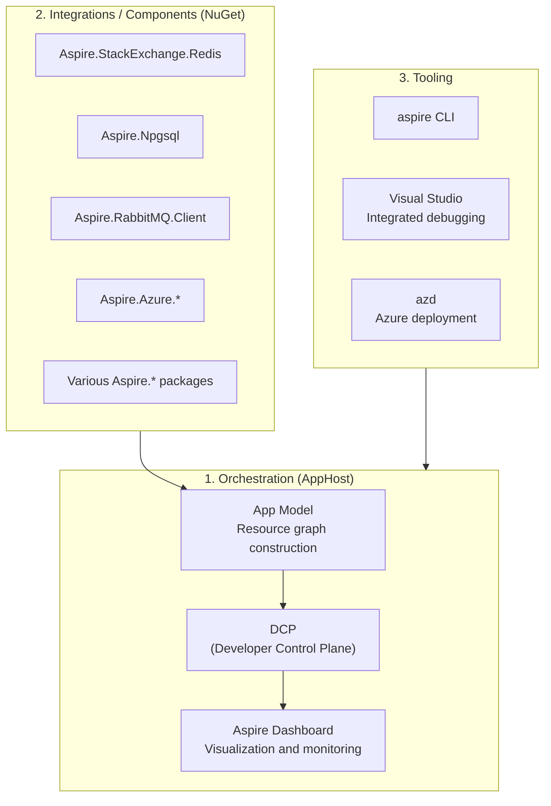

| Pillar | Role |
|--------|------|
| **Orchestration** | Define application composition and manage local execution |
| **Components** | Standardize client connections to external services (Redis, PostgreSQL, etc.) |
| **Tooling** | Support development, debugging, and deployment workflows |

Orchestration, the main topic of this article, centers on the AppHost project: a dedicated console application whose C# code is the blueprint of the whole application. It declares which services exist, which infrastructure they depend on, and how they connect. The AppHost contains no business logic.

Components are NuGet packages installed in each service project (APIs, workers, and so on). Packages such as `Aspire.StackExchange.Redis` and `Aspire.Npgsql` set up connection string resolution, health checks, and telemetry instrumentation. A single call to `builder.AddRedisClient("cache")` gives a service a Redis client with connection management, monitoring, and failure detection.

Tooling covers project creation, local debugging, and cloud deployment through Visual Studio, the `aspire` CLI (C# AppHosts can still use `dotnet run --project AppHost`), and the Azure Developer CLI (`azd`).

## Chapter 1: App Model — Building the Resource Graph

### What Is the AppHost?

.NET Aspire's orchestration starts from the **AppHost project**, a console application in your solution created by `dotnet new aspire` or a Visual Studio template.

In a typical .NET solution, each project (Web API, worker, Blazor frontend, and so on) starts and runs on its own. A microservices setup also needs startup order and connections: start Redis and PostgreSQL, run migrations, bring up the API and worker, then start the frontend. That used to be handled with `docker-compose.yml` or shell scripts; the AppHost expresses it declaratively in C#.

The AppHost's `Program.cs` defines the topology of the whole application rather than business logic. Relationships such as "this solution has Redis, PostgreSQL, and three .NET projects; the API depends on PostgreSQL and Redis; the worker depends on RabbitMQ; the frontend depends on the API" are written as method chains of `AddProject()`, `AddRedis()`, and `WithReference()`.

The AppHost's `.csproj` has a `ProjectReference` for every orchestrated project. At build time, a source generator reads these references and generates the type-safe project metadata classes described below. The AppHost is therefore the one place that sees the whole solution; the other projects do not know it exists.

### What Is the App Model?

At the core of .NET Aspire is the **App Model**, a **directed acyclic graph (DAG)** of all resources (projects, containers, executables, external services) and their dependencies. The `Add*()` and `WithReference()` calls in the AppHost's `Program.cs` build this graph.

A DAG has directed edges and no cycles. In Aspire, each resource (Redis, PostgreSQL, an API service, and so on) is a node, and each `WithReference()` dependency is an edge. `WithReference()` passes connection information but does not set startup order; adding `WaitFor()` to the same dependencies makes Aspire start resources in an order such as "PostgreSQL → database migration → API service."

Below is a typical AppHost `Program.cs` and the resource graph it builds.

```csharp
// AppHost Program.cs
var builder = DistributedApplication.CreateBuilder(args);

// Add resources
var cache = builder.AddRedis("cache");
var postgres = builder.AddPostgres("pg")
    .AddDatabase("catalogdb");
var rabbit = builder.AddRabbitMQ("messaging");

// Project resources with their dependencies
var catalogApi = builder.AddProject<Projects.CatalogApi>("catalog-api")
    .WithReference(postgres)
    .WithReference(cache);

var orderProcessor = builder.AddProject<Projects.OrderProcessor>("order-processor")
    .WithReference(rabbit)
    .WithReference(postgres);

var webFrontend = builder.AddProject<Projects.WebFrontend>("web-frontend")
    .WithReference(catalogApi)
    .WithReference(cache)
    .WithExternalHttpEndpoints();

builder.Build().Run();
```

The resource graph built from this code:

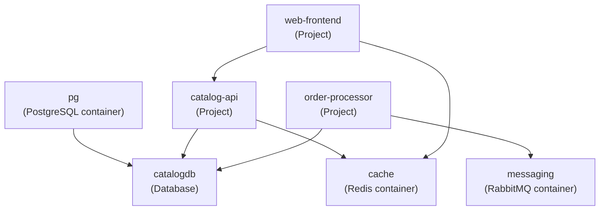

### How the `AddProject<T>()` Type Parameter Works

The code above passes `<Projects.CatalogApi>` to `builder.AddProject`. This is a C# generic type parameter: the project is represented as a type.

When you add a project reference to the AppHost's `.csproj`:

```xml
<ProjectReference Include="..\CatalogApi\CatalogApi.csproj" />
```

Aspire's build tooling ([Source Generator](https://github.com/dotnet/aspire/blob/main/src/Aspire.Hosting/ProjectResourceBuilderExtensions.cs)) generates a class in the `Projects` namespace that looks roughly like this:

```csharp
namespace Projects;

// Auto-generated at build time (not hand-written)
public class CatalogApi : IProjectMetadata
{
    public string ProjectPath => @"C:\src\CatalogApi\CatalogApi.csproj";
}
```

The `AddProject<T>()` method signature is:

```csharp
public static IResourceBuilder<ProjectResource> AddProject<TProject>(
    this IDistributedApplicationBuilder builder,
    string name)
    where TProject : IProjectMetadata, new()
```

The constraint `where TProject : IProjectMetadata, new()` requires `TProject` to implement `IProjectMetadata` and have a parameterless constructor. The method reads `new TProject().ProjectPath` to get the `.csproj` path, which tells the orchestrator which project to launch.

The main reason to use a type instead of a string path is **compile-time safety**. With a string path such as `AddProject("../CatalogApi")`, a typo surfaces only at run time. With `AddProject<Projects.CatalogApi>()`, removing or renaming the project reference removes `Projects.CatalogApi`, and the build fails immediately. IDE autocompletion and refactoring also work on the type, which helps when a solution has many services.

### IResource Interface Hierarchy

Every resource registered in the App Model implements the `IResource` interface. To Aspire, a Redis container, a .NET project, and RabbitMQ are all resources, represented by concrete classes such as `ContainerResource`, `ProjectResource`, and `ExecutableResource`.

New kinds of resources (Kafka, Elasticsearch, a custom sidecar) are added by extending this hierarchy, which starts at the [`IResource`](https://github.com/dotnet/aspire/blob/main/src/Aspire.Hosting/ApplicationModel/IResource.cs) interface:

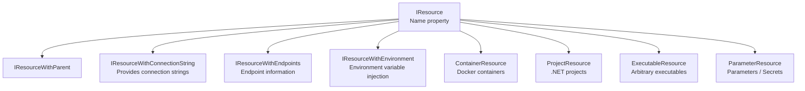

```csharp
// IResource definition
public interface IResource
{
    string Name { get; }
    ResourceAnnotationCollection Annotations { get; }
}

// ContainerResource example
public class RedisResource : ContainerResource, IResourceWithConnectionString
{
    public RedisResource(string name) : base(name) { }

    public ReferenceExpression ConnectionStringExpression =>
        ReferenceExpression.Create(
            $"{PrimaryEndpoint.Property(EndpointProperty.Host)}:{PrimaryEndpoint.Property(EndpointProperty.Port)}");
}
```

### Annotation-Based Extension Model

The type hierarchy does not say where Redis keeps its port number or how environment variable injection is attached to a resource. Aspire records both as **annotations**.

Instead of adding capabilities through inheritance, Aspire attaches metadata objects to a resource, like sticky notes (composition over inheritance). Methods such as `WithEndpoint()` and `WithEnvironment()` add annotation objects to the resource's `Annotations` collection, so capabilities can be added to a resource without changing its type.

```csharp
// Annotation examples
public record EndpointAnnotation(
    string Name,
    string? Transport = null,
    string? Scheme = null,
    int? Port = null,
    int? TargetPort = null,
    bool IsExternal = false,
    bool IsProxied = true) : IResourceAnnotation;

public record EnvironmentCallbackAnnotation(
    Func<EnvironmentCallbackContext, Task> Callback)
    : IResourceAnnotation;

// What WithReference() does internally
public static IResourceBuilder<T> WithReference<T>(
    this IResourceBuilder<T> builder,
    IResourceBuilder<IResourceWithConnectionString> source)
    where T : IResourceWithEnvironment
{
    // Add an environment variable callback annotation
    return builder.WithEnvironment(context =>
    {
        var connectionString = source.Resource
            .ConnectionStringExpression;
        context.EnvironmentVariables[$"ConnectionStrings__{source.Resource.Name}"]
            = connectionString;
    });
}
```

| Annotation | Purpose |
|------------|---------|
| `EndpointAnnotation` | Define network endpoints |
| `EnvironmentCallbackAnnotation` | Dynamic environment variable injection |
| `ContainerImageAnnotation` | Docker image specification |
| `ContainerMountAnnotation` | Volume mount information |
| `HealthCheckAnnotation` | Health check method specification |
| `CommandLineArgsCallbackAnnotation` | Dynamic command-line argument construction |
| `ManifestPublishingCallbackAnnotation` | Deployment manifest generation method |

## Chapter 2: DCP (Developer Control Plane) — Local Orchestration

### What DCP Does

The App Model from Chapter 1 is only a blueprint. Something has to start the containers and processes and wire up the network; in local development, that engine is **DCP (Developer Control Plane)**.

When you run the AppHost project with `dotnet run`, the AppHost first builds the App Model in memory and then sends the resource definitions to the DCP process through DCP's Kubernetes-compatible API. DCP starts the Docker containers and .NET project processes, allocates ports, and injects connection strings. To the developer, one `dotnet run` brings up the whole application; behind it, the AppHost describes the application, DCP runs it, and Docker and the operating system host the containers and processes.

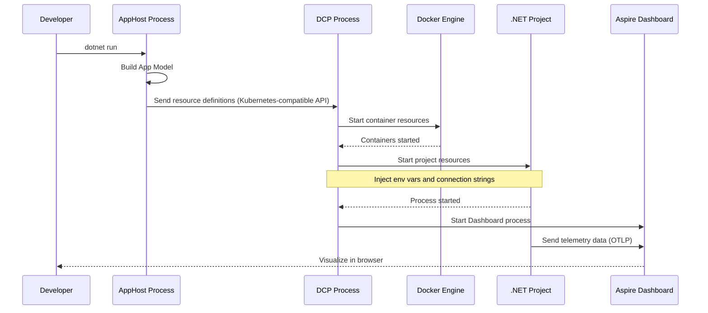

### DCP Internal Architecture

DCP is a lightweight control plane written in Go. It uses the same declarative resource model as Kubernetes custom resource definitions (CRDs). Instead of an imperative command such as "start a Redis container on port 6379," DCP receives a **desired state** ("a Redis container should exist") and runs a **reconciliation loop** that moves the current state toward it.

Because DCP works from the desired state, it restarts a container that crashes and updates the proxy configuration when an endpoint changes. DCP does not need a Kubernetes cluster: it runs as a local process and needs only Docker Desktop.

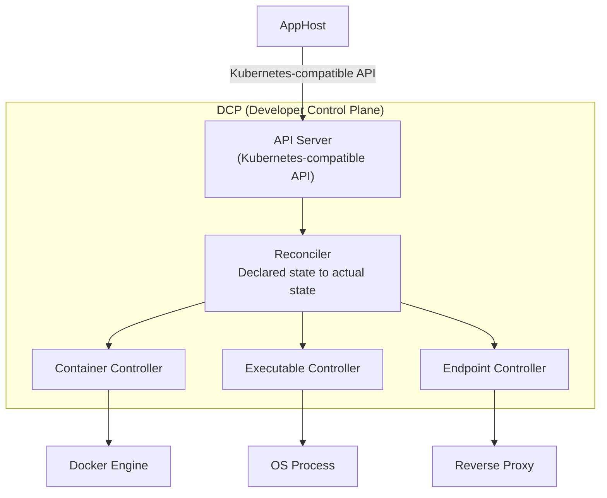

DCP resource model:

| DCP Resource | Concept | Description |
|-------------|---------|-------------|
| `Container` | Docker container | Image pull and startup |
| `Executable` | Process | .NET projects or arbitrary executables |
| `Endpoint` | Network | Port mapping and proxying |
| `ExecutableReplicaSet` | Replicas | Multiple instances of the same process |

### Startup Order and Dependency Resolution

By default, resources start in parallel: `WithReference()` passes connection information but does not make one resource wait for another. `WaitFor()` sets the order: a resource that waits for another starts only after that resource is ready. If every dependency in the App Model also has `WaitFor()`, startup follows a **topological order** of the DAG, an order in which u comes before v for every edge u → v.

With `WaitFor()` on every dependency in the example, resources with no dependencies (Redis, PostgreSQL, RabbitMQ) start first, then the resources that depend on them (the API and worker), and finally the frontend. Resources in the same phase still start in parallel, which shortens total startup time.

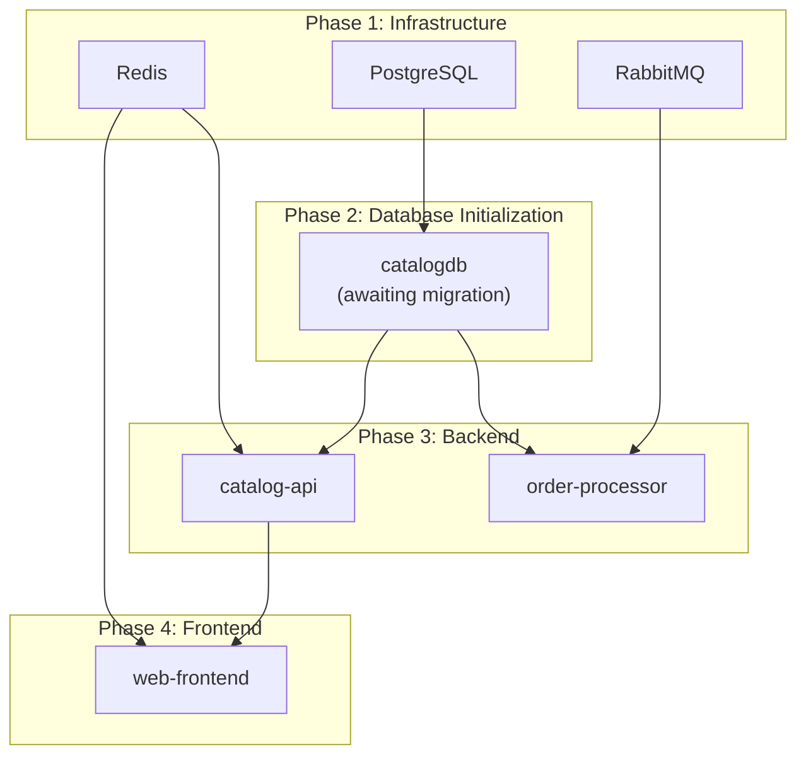

```csharp
// Explicit startup order control with WaitFor()
var postgres = builder.AddPostgres("pg")
    .AddDatabase("catalogdb");

var migration = builder.AddProject<Projects.DbMigration>("migration")
    .WithReference(postgres)
    .WaitFor(postgres); // Wait for PostgreSQL to be ready

var api = builder.AddProject<Projects.Api>("api")
    .WithReference(postgres)
    .WaitForCompletion(migration); // Wait for the migration process to exit successfully
```

`WaitFor()` uses the AppHost's health checks to confirm that the resource it waits for is ready. `WaitForCompletion()` waits until a resource such as the migration project has run to completion.

## Chapter 3: Service Discovery — Dynamic Endpoint Resolution

### Connection Strings and Environment Variables

Every microservice architecture has to answer how Service A finds Service B. Hardcoded IP addresses and ports break as soon as the environment changes, and connection settings in configuration files are tedious to maintain because they differ between local development and the cloud.

Aspire passes connection settings to each service **as environment variables**. When you declare a dependency with `WithReference()`, DCP starts the downstream process with the upstream resource's connection string and endpoint URLs in its environment. The service code does not name its connection targets; `IConfiguration.GetConnectionString("cache")` returns the value Aspire injected.

```csharp
// From this declaration...
var cache = builder.AddRedis("cache");
var api = builder.AddProject<Projects.Api>("api")
    .WithReference(cache);

// The following environment variable is injected into the api process:
// ConnectionStrings__cache = "localhost:63241"
```

Environment variable naming conventions:

| Reference Type | Environment Variable Pattern | Example |
|---------------|------------------------------|---------|
| Connection string | `ConnectionStrings__{name}` | `ConnectionStrings__cache` |
| HTTP endpoint | `services__{name}__http__0` | `services__catalog-api__http__0` |
| HTTPS endpoint | `services__{name}__https__0` | `services__catalog-api__https__0` |

### How Service Discovery Works

Environment variable injection resolves endpoints once, at startup. Services with replicas or endpoints that change need Aspire's service discovery.

The `Microsoft.Extensions.ServiceDiscovery` package adds a handler to the HttpClient pipeline. When code requests a URL with a logical service name, such as `http://catalog-api/api/products`, the handler resolves it to the actual endpoint (`https://localhost:7234/api/products`) from environment variables or DNS SRV records. Because the code contains no physical addresses, it runs unchanged locally and in the cloud.

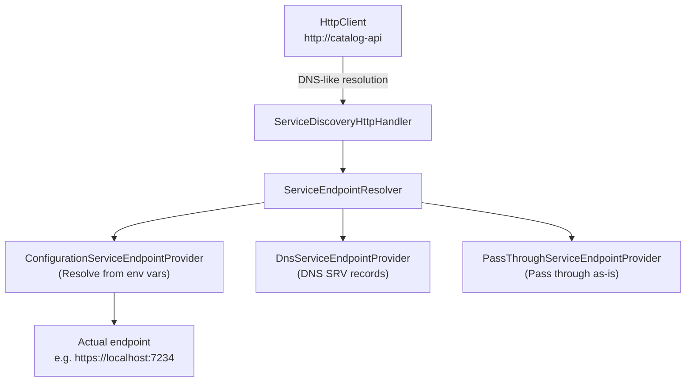

```csharp
// Service discovery usage (ServiceDefaults project)
builder.Services.AddServiceDiscovery();
builder.Services.ConfigureHttpClientDefaults(http =>
{
    http.AddServiceDiscovery(); // Apply service discovery to all HttpClients
});

// Consumer: request using logical names
app.MapGet("/products", async (HttpClient client) =>
{
    // "https://catalog-api" resolves to the actual endpoint
    var products = await client.GetFromJsonAsync<Product[]>(
        "https://catalog-api/api/products");
    return products;
});
```

### Endpoint Resolution Priority

Providers are tried in this order:

1. **Configuration** — Resolve from environment variables `services__{name}__{scheme}__{index}`
2. **DNS SRV** — Resolve from DNS SRV records (useful in Kubernetes)
3. **Pass-through** — Pass the hostname through to ordinary DNS resolution

```csharp
// Actual environment variable values injected by Aspire
// services__catalog-api__https__0 = "https://localhost:7234"
// services__catalog-api__http__0 = "http://localhost:5234"

// ServiceDiscovery resolves:
// "https://catalog-api" -> "https://localhost:7234"
```

### Load Balancing

Service discovery also supports client-side load balancing:

```csharp
// Configure replicas
var api = builder.AddProject<Projects.Api>("api")
    .WithReplicas(3); // Start 3 instances

// ServiceDiscovery distributes via round-robin
// services__api__https__0 = "https://localhost:7234"
// services__api__https__1 = "https://localhost:7235"
// services__api__https__2 = "https://localhost:7236"
```

## Chapter 4: Component System — Standardized Client Configuration

### Component Philosophy

Connecting to Redis normally means installing a NuGet package, reading the connection string, registering `IConnectionMultiplexer` with DI, adding a health check, configuring OpenTelemetry instrumentation, and setting up a retry policy. Every project repeats this boilerplate, and forgetting one step leaves part of the system unmonitored.

A .NET Aspire component is a NuGet package that reduces this work to a single method call: `builder.AddRedisClient("cache")` configures all of it in a standard way. This is where the opinionated design is most concrete. The recommended settings are the defaults, so following them takes no extra effort. A component gives a client connection these features:

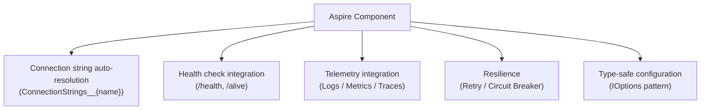

### Component Internals

`Aspire.StackExchange.Redis` shows how one line sets all of this up. `AddRedisClient()` runs five steps in order: bind settings, retrieve the connection string, register the client with the DI container, add health checks, and configure telemetry instrumentation. Because one method performs every step, a service cannot end up with only part of the configuration.

```csharp
// AddRedisClient() internal implementation (simplified)
public static void AddRedisClient(
    this IHostApplicationBuilder builder,
    string connectionName,
    Action<AspireRedisSettings>? configureSettings = null)
{
    // 1. Bind settings
    var settings = new AspireRedisSettings();
    builder.Configuration
        .GetSection($"Aspire:StackExchange:Redis:{connectionName}")
        .Bind(settings);
    configureSettings?.Invoke(settings);

    // 2. Retrieve connection string
    var connectionString = settings.ConnectionString
        ?? builder.Configuration.GetConnectionString(connectionName);

    // 3. Register IConnectionMultiplexer
    builder.Services.AddSingleton<IConnectionMultiplexer>(sp =>
    {
        var options = ConfigurationOptions.Parse(connectionString!);
        return ConnectionMultiplexer.Connect(options);
    });

    // 4. Register health checks
    if (!settings.DisableHealthChecks)
    {
        builder.Services.AddHealthChecks()
            .AddRedis(connectionString!,
                name: $"Redis_{connectionName}",
                tags: ["ready"]);
    }

    // 5. Configure telemetry
    if (!settings.DisableTracing)
    {
        builder.Services.AddOpenTelemetry()
            .WithTracing(tracing =>
                tracing.AddRedisInstrumentation());
    }
}
```

### Hosting vs Client Packages

Aspire components come in two kinds of packages: **hosting packages** and **client packages**. Redis, for example, has one of each, installed in different projects.

The hosting package (`Aspire.Hosting.Redis`) goes in the AppHost project and defines how to start the Redis container. The client package (`Aspire.StackExchange.Redis`) goes in each service project and configures how to connect to Redis. The environment variable that DCP injects (`ConnectionStrings__cache`) connects the two.

| Package | Purpose | Install In |
|---------|---------|-----------|
| `Aspire.Hosting.Redis` | Define Redis container | AppHost project |
| `Aspire.StackExchange.Redis` | Configure Redis client | Service project |

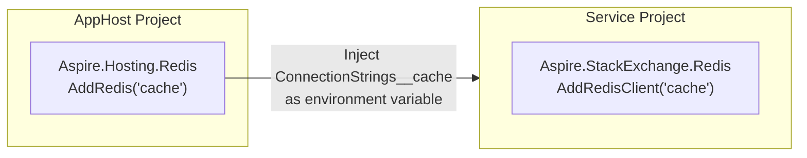

## Chapter 5: ServiceDefaults — Standardizing Cross-Cutting Concerns

### The Role of ServiceDefaults

Each component applies defaults for one external service. **ServiceDefaults** is a project that applies the defaults every service needs regardless of what it connects to.

These cross-cutting concerns, such as telemetry collection, health check endpoints, service discovery, and HTTP retry policies, are unrelated to business logic but needed in every service, and configuring them separately in each one leads to inconsistencies. ServiceDefaults is a shared class library: every service project calls `builder.AddServiceDefaults()` and gets the same configuration.

The `AddServiceDefaults()` method sets up OpenTelemetry, health checks, service discovery, and retries in a few lines:

```csharp
// ServiceDefaults/Extensions.cs overall structure
public static IHostApplicationBuilder AddServiceDefaults(
    this IHostApplicationBuilder builder)
{
    // 1. Configure OpenTelemetry
    builder.ConfigureOpenTelemetry();

    // 2. Add health check endpoints
    builder.AddDefaultHealthChecks();

    // 3. Register service discovery
    builder.Services.AddServiceDiscovery();

    // 4. Configure HttpClient defaults
    builder.Services.ConfigureHttpClientDefaults(http =>
    {
        http.AddStandardResilienceHandler(); // Retry + Circuit Breaker
        http.AddServiceDiscovery();          // Service discovery
    });

    return builder;
}
```

### OpenTelemetry Integration Details

Aspire uses OpenTelemetry, an open CNCF (Cloud Native Computing Foundation) standard that handles logs, metrics, and traces together without tying an application to one vendor. Aspire configures each service's OpenTelemetry SDK, and the `OTEL_EXPORTER_OTLP_ENDPOINT` environment variable points the SDK at the Aspire Dashboard's OTLP receiver.

The destination is read from that environment variable at run time rather than set in the AppHost or ServiceDefaults code. Data goes to the Dashboard during local development; in production, the same code can send it to Jaeger, Azure Monitor, or another backend.

```csharp
public static IHostApplicationBuilder ConfigureOpenTelemetry(
    this IHostApplicationBuilder builder)
{
    // Logging
    builder.Logging.AddOpenTelemetry(logging =>
    {
        logging.IncludeFormattedMessage = true;
        logging.IncludeScopes = true;
    });

    // Metrics and Traces
    builder.Services.AddOpenTelemetry()
        .WithMetrics(metrics =>
        {
            metrics.AddAspNetCoreInstrumentation()  // HTTP metrics
                   .AddHttpClientInstrumentation()   // HttpClient metrics
                   .AddRuntimeInstrumentation();     // .NET runtime metrics
        })
        .WithTracing(tracing =>
        {
            tracing.AddAspNetCoreInstrumentation()   // HTTP traces
                   .AddGrpcClientInstrumentation()    // gRPC traces
                   .AddHttpClientInstrumentation();   // HttpClient traces
        });

    // OTLP exporter configuration
    builder.AddOpenTelemetryExporters();

    return builder;
}

private static IHostApplicationBuilder AddOpenTelemetryExporters(
    this IHostApplicationBuilder builder)
{
    // Use OTLP exporter if OTEL_EXPORTER_OTLP_ENDPOINT is set
    // Aspire Dashboard automatically sets this environment variable
    var otlpEndpoint = builder.Configuration["OTEL_EXPORTER_OTLP_ENDPOINT"];
    if (!string.IsNullOrWhiteSpace(otlpEndpoint))
    {
        builder.Services.AddOpenTelemetry()
            .UseOtlpExporter(); // Send to Dashboard via gRPC over HTTP/2
    }

    return builder;
}
```

Telemetry data flow:

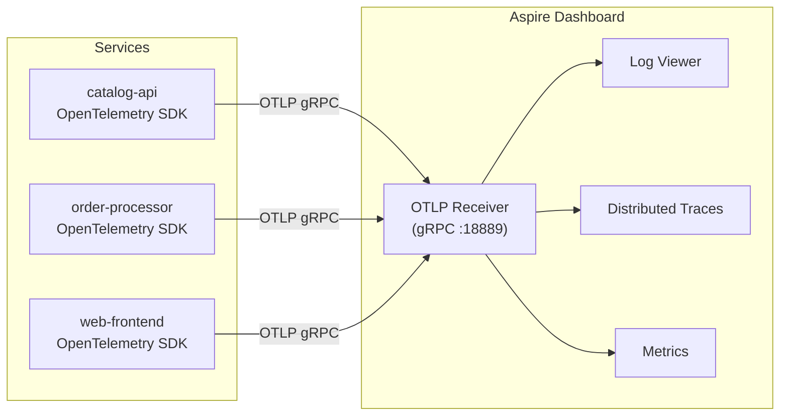

## Chapter 6: Aspire Dashboard — Integrated Observability

### Dashboard Architecture

ServiceDefaults makes every service emit telemetry, but the data is useful only if something receives and displays it. The Aspire Dashboard, a Blazor Server application, does that.

When you start the AppHost, DCP launches the Dashboard as a separate process. Its URL comes from `applicationUrl` in the AppHost's `launchSettings.json`, and the AppHost prints a login URL to the console. The Dashboard is an OTLP (OpenTelemetry Protocol) receiver that ingests logs, metrics, and distributed traces from every service in real time, keeps them in an in-memory circular buffer, and lets you explore them in the browser.

When an error occurs during development, the Dashboard's distributed tracing view shows which operation in which service took how many milliseconds and where the error occurred. Finding that out used to mean correlating log files from several services; the Dashboard shows it on one screen.

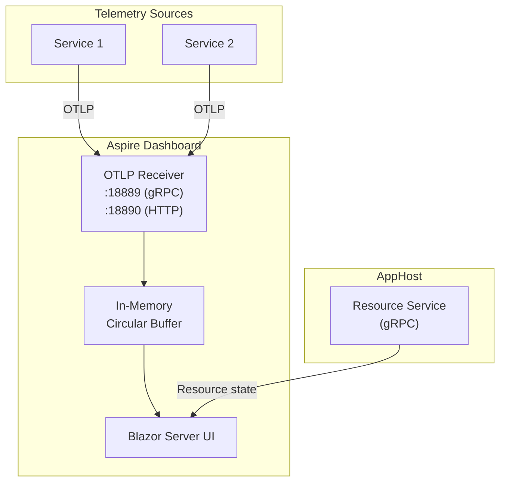

| Feature | Description |
|---------|-------------|
| **Resource list** | View status, startup logs, and environment variables for all resources |
| **Structured logs** | Filter and search logs collected via OpenTelemetry |
| **Distributed traces** | Visualize request flow across services |
| **Metrics** | Real-time HTTP request rate, latency, and error rate display |

### Standalone Dashboard Usage

The Dashboard is also available as a standalone Docker container (MCR publishes a `13.5` tag as of September 2026):

```bash
docker run --rm -it -d \
  -p 18888:18888 \
  -p 4317:18889 \
  -p 4318:18890 \
  --name aspire-dashboard \
  mcr.microsoft.com/dotnet/aspire-dashboard:13.5
```

In this mode, the Dashboard receives telemetry from any OTLP-compatible application (Java, Go, Python, and so on).

## Chapter 7: Health Checks and Readiness

### Health Check Hierarchy

In a distributed system, a running process is not necessarily one that can handle requests: the process can be alive while its database connection is down.

.NET Aspire separates the two with **liveness** and **readiness** checks. Liveness (`/alive`) checks only whether the process responds, which detects deadlocks and memory exhaustion. Readiness (`/health`) also checks the database, Redis, and other dependencies to decide whether the service can safely accept traffic.

The two checks map directly to Kubernetes's `livenessProbe` and `readinessProbe`, so the same health check definitions work in local development and in a Kubernetes deployment. In the AppHost, `WaitFor()` holds back a downstream resource until the health checks that the AppHost runs for the resource it waits for report healthy; DCP does not poll the service's `/health` endpoint.

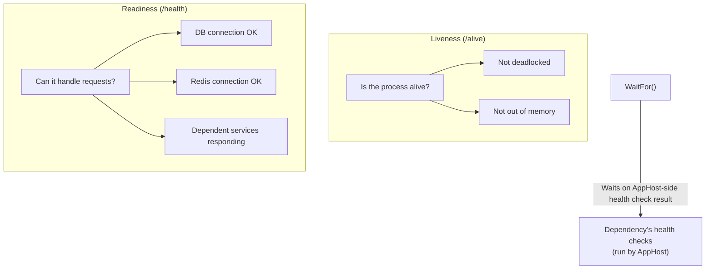

```csharp
// Health checks configured in ServiceDefaults
public static IHostApplicationBuilder AddDefaultHealthChecks(
    this IHostApplicationBuilder builder)
{
    builder.Services.AddHealthChecks()
        // Liveness: is the application process responding?
        .AddCheck("self", () => HealthCheckResult.Healthy(),
            tags: ["live"]);

    return builder;
}

public static WebApplication MapDefaultEndpoints(
    this WebApplication app)
{
    // Readiness endpoint: evaluate all health checks
    app.MapHealthChecks("/health");

    // Liveness endpoint: only checks tagged "live"
    app.MapHealthChecks("/alive", new()
    {
        Predicate = r => r.Tags.Contains("live")
    });

    return app;
}
```

### WaitFor Internals

With `WaitFor()`, the AppHost runs the health checks of the resource being waited for and has the dependent resource started only after they report `Healthy`. With `WaitForCompletion()`, it waits for the resource to exit successfully, as the migration does below.

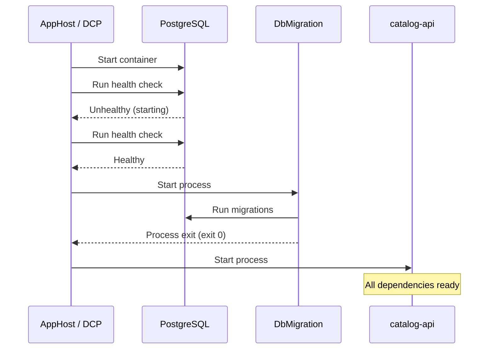

## Chapter 8: Resilience and Retry

### Standard Resilience Handler

In a distributed system, network latency, transient failures, and service restarts happen all the time. If client code does nothing about them, a brief slowdown in one service sets off a wave of retries and cascading timeouts that can take down the whole system.

`AddStandardResilienceHandler()` in ServiceDefaults uses `Microsoft.Extensions.Http.Resilience` (built on [Polly v8](https://github.com/App-vNext/Polly)) to apply a five-layer resilience pipeline to every `HttpClient`. The layers wrap each request from the outside in, and each handles a different kind of failure.

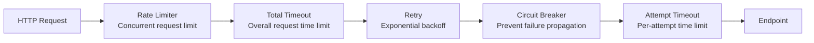

| Layer | Default | Description |
|-------|---------|-------------|
| **Rate Limiter** | 1,000 concurrent requests | Limit concurrent requests to downstream services |
| **Total Request Timeout** | 30 seconds | Timeout for entire request including retries |
| **Retry** | Max 3 attempts, exponential backoff | Recovery from transient failures |
| **Circuit Breaker** | 10% failure ratio, 30s sampling | Prevent failure cascading |
| **Attempt Timeout** | 10 seconds | Timeout for individual request attempts |

```csharp
// Customization example
builder.Services.ConfigureHttpClientDefaults(http =>
{
    http.AddStandardResilienceHandler(options =>
    {
        options.Retry.MaxRetryAttempts = 5;
        options.Retry.BackoffType = DelayBackoffType.Exponential;
        options.Retry.Delay = TimeSpan.FromMilliseconds(500);

        options.CircuitBreaker.SamplingDuration = TimeSpan.FromSeconds(60);
        options.CircuitBreaker.FailureRatio = 0.2;

        options.TotalRequestTimeout.Timeout = TimeSpan.FromSeconds(60);
    });
});
```

## Chapter 9: Deployment Manifests — From Local to Cloud

### Manifest Generation

The earlier chapters covered the AppHost in local development. The App Model it builds can also be exported as a JSON **deployment manifest**, which turns the local composition into a blueprint for cloud deployment.

What runs locally can then be deployed from the same definition: there is no hand translation from `docker-compose.yml` into Kubernetes manifests or Terraform, because the AppHost's C# code is the single source of truth.

```bash
# Generate manifest (C# AppHosts can still be started with dotnet run, but the current workflow centers on the aspire CLI)
aspire publish --publisher manifest --output-path manifest.json
```

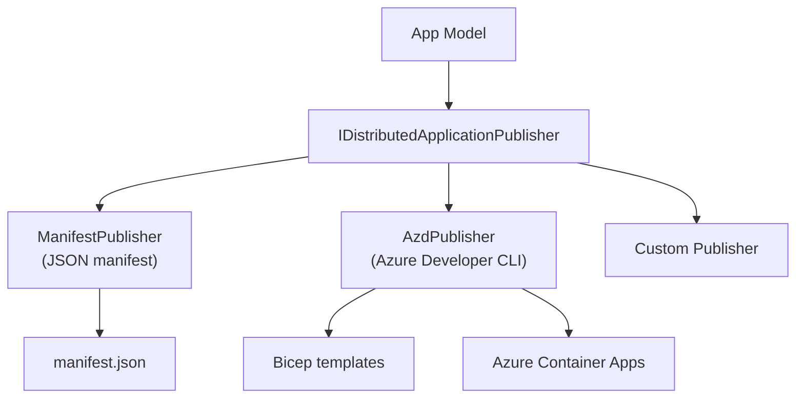

### Manifest Structure

The generated manifest contains the connection information and deployment settings for every resource:

```json
{
  "resources": {
    "cache": {
      "type": "container.v0",
      "connectionString": "{cache.bindings.tcp.host}:{cache.bindings.tcp.port}",
      "image": "docker.io/library/redis:7.4",
      "bindings": {
        "tcp": {
          "scheme": "tcp",
          "protocol": "tcp",
          "transport": "tcp",
          "targetPort": 6379
        }
      }
    },
    "catalog-api": {
      "type": "project.v0",
      "path": "../CatalogApi/CatalogApi.csproj",
      "env": {
        "ConnectionStrings__cache": "{cache.connectionString}"
      },
      "bindings": {
        "http": { "scheme": "http", "protocol": "tcp", "transport": "http" },
        "https": { "scheme": "https", "protocol": "tcp", "transport": "http" }
      }
    }
  }
}
```

### Deploying to Azure Container Apps

`azd` (Azure Developer CLI) reads the Aspire manifest and provisions the corresponding Azure resources:

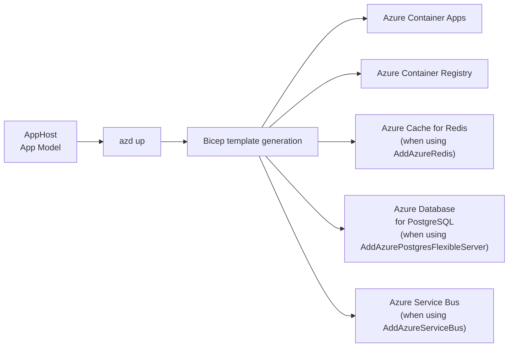

| Aspire Resource | Azure Mapping |
|----------------|--------------|
| `AddRedis()` | Redis container on Azure Container Apps (use `AddAzureRedis()` or similar for Azure Cache for Redis) |
| `AddPostgres()` | PostgreSQL container on Azure Container Apps (use `AddAzurePostgresFlexibleServer()` for Azure Database for PostgreSQL) |
| `AddRabbitMQ()` | RabbitMQ container or explicit publisher target (use `AddAzureServiceBus()` or similar when the Azure target is Service Bus) |
| `AddProject()` | Azure Container Apps |
| Container resources | Azure Container Apps (custom container) |

## Chapter 10: Creating Custom Resources

### Custom Resource Implementation Pattern

Aspire's built-in resources (Redis, PostgreSQL, RabbitMQ, and others) do not cover everything a real project uses. A project may also need a local mail server for development (MailDev), an in-house queue system, or a custom sidecar process managed as a resource.

**Custom resources** handle this in three steps: (1) define a resource class that inherits from `ContainerResource` or a similar class, (2) write a builder extension method such as `AddMailDev()`, and (3) call it in the AppHost's `Program.cs` like any other resource. Custom resources get the same health checks, telemetry, and `WithReference()` dependencies as built-in ones.

```csharp
// 1. Define the resource class
public class MailDevResource : ContainerResource, IResourceWithConnectionString
{
    public MailDevResource(string name) : base(name) { }

    // SMTP endpoint
    private EndpointReference? _smtpEndpoint;
    public EndpointReference SmtpEndpoint =>
        _smtpEndpoint ??= new(this, "smtp");

    // Web UI endpoint
    private EndpointReference? _httpEndpoint;
    public EndpointReference HttpEndpoint =>
        _httpEndpoint ??= new(this, "http");

    // Connection string expression
    public ReferenceExpression ConnectionStringExpression =>
        ReferenceExpression.Create(
            $"smtp://{SmtpEndpoint.Property(EndpointProperty.Host)}:{SmtpEndpoint.Property(EndpointProperty.Port)}");
}

// 2. Define builder extension method
public static class MailDevResourceExtensions
{
    public static IResourceBuilder<MailDevResource> AddMailDev(
        this IDistributedApplicationBuilder builder,
        string name,
        int? smtpPort = null,
        int? httpPort = null)
    {
        return builder.AddResource(new MailDevResource(name))
            .WithImage("maildev/maildev", "2.1.0")
            .WithHttpEndpoint(
                port: httpPort,
                targetPort: 1080,
                name: "http")
            .WithEndpoint(
                port: smtpPort,
                targetPort: 1025,
                name: "smtp",
                scheme: "tcp")
            .WithHealthCheck("smtp"); // Add health check
    }
}

// 3. Usage in AppHost
var maildev = builder.AddMailDev("mail");
var api = builder.AddProject<Projects.Api>("api")
    .WithReference(maildev); // ConnectionStrings__mail is injected
```

### Custom Resource Lifecycle Hooks

```csharp
// Intercept resource lifecycle with IDistributedApplicationLifecycleHook
public class DatabaseSeederHook : IDistributedApplicationLifecycleHook
{
    public async Task AfterResourcesCreatedAsync(
        DistributedApplicationModel appModel,
        CancellationToken cancellationToken)
    {
        // Runs after all resources are started
        var dbResource = appModel.Resources
            .OfType<PostgresDatabaseResource>()
            .FirstOrDefault();

        if (dbResource != null)
        {
            // Seed data, etc.
        }
    }
}

// Registration
builder.Services
    .AddLifecycleHook<DatabaseSeederHook>();
```

## Chapter 11: Testing and Integration

### DistributedApplicationTestingBuilder

Integration testing for microservices has traditionally been hard. Starting each service by hand, provisioning test infrastructure, and cleaning up afterward take enough effort that tests are often skipped or left incomplete.

Aspire provides `DistributedApplicationTestingBuilder`, which starts the entire AppHost from test code so that tests can send HTTP requests to real containers and processes. These are integration tests against real infrastructure (PostgreSQL and Redis running in Docker), with no mocks or stubs. When the test finishes, the `await using` pattern cleans up the resources.

```csharp
public class AppHostTests
{
    [Fact]
    public async Task CatalogApiReturnsProducts()
    {
        // Start the entire AppHost
        var appHost = await DistributedApplicationTestingBuilder
            .CreateAsync<Projects.AppHost>();

        await using var app = await appHost.BuildAsync();
        await app.StartAsync();

        // Get HttpClient for catalog-api
        var httpClient = app.CreateHttpClient("catalog-api");

        // Make a request to the API
        var response = await httpClient.GetAsync("/api/products");
        response.EnsureSuccessStatusCode();

        var products = await response.Content
            .ReadFromJsonAsync<List<Product>>();
        Assert.NotEmpty(products);
    }

    [Fact]
    public async Task WebFrontendIsHealthy()
    {
        var appHost = await DistributedApplicationTestingBuilder
            .CreateAsync<Projects.AppHost>();

        await using var app = await appHost.BuildAsync();
        await app.StartAsync();

        // Check health endpoint
        var httpClient = app.CreateHttpClient("web-frontend");
        var response = await httpClient.GetAsync("/health");
        Assert.Equal(HttpStatusCode.OK, response.StatusCode);
    }
}
```

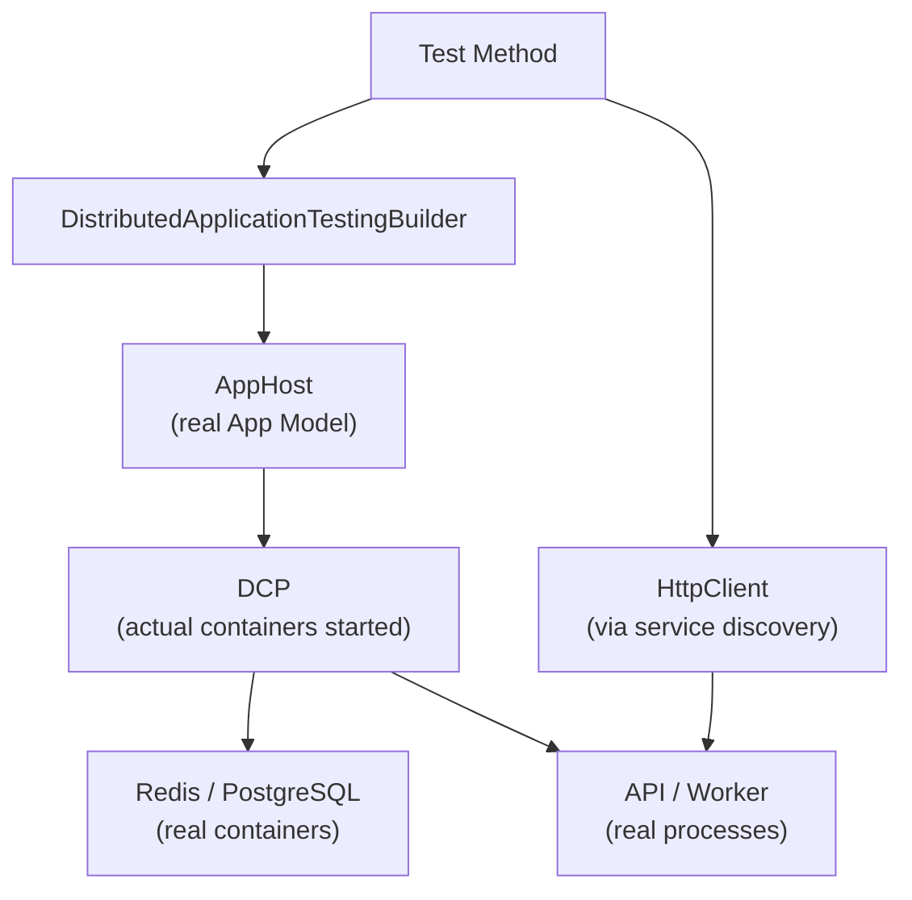

### Customizing Test Configuration

Tests can override settings and configure the service collection:

```csharp
var appHost = await DistributedApplicationTestingBuilder
    .CreateAsync<Projects.AppHost>(args =>
    {
        // Override test-specific settings
        args.Configuration["Parameters:pgPassword"] = "test-password";
    });

// Configure HttpClient defaults for testing
appHost.Services.ConfigureHttpClientDefaults(http =>
{
    http.AddStandardResilienceHandler();
});
```

## Chapter 12: .NET Aspire 9.x Evolution

### Major New Features

Aspire 9, released alongside .NET 9, brought many improvements based on community feedback, mostly aimed at the development workflow. (Releases have come faster since then and the version is now in the 13.x range, so treat this section as a snapshot of the 9 generation.)

`WaitFor` and `WaitForCompletion`, the declarative startup-order APIs used in Chapter 2, were added in Aspire 9. `Persistent Containers` removes the wait for containers to be recreated every time `dotnet run` restarts the AppHost. `Resource Commands` and `Custom Resource States` extend the Dashboard so that custom resources can be operated from it. The `Eventing Model` hooks into resource lifecycles, so you can declare handlers such as "run this when Redis has started."

| Feature | Description |
|---------|-------------|
| **WaitFor / WaitForCompletion** | Declaratively control startup order between resources |
| **Persistent Containers** | Keep containers alive across `dotnet run` restarts |
| **Resource Commands** | Execute custom commands from the Dashboard |
| **Custom Resource States** | Report custom resource states |
| **Eventing Model** | Subscribe to resource lifecycle events |

### Eventing Model

```csharp
// Subscribe to resource events
var cache = builder.AddRedis("cache");

builder.Eventing.Subscribe<ResourceReadyEvent>(
    cache.Resource,
    async (evt, ct) =>
    {
        // Runs when Redis is ready
        Console.WriteLine($"{evt.Resource.Name} is ready!");
    });

builder.Eventing.Subscribe<BeforeResourceStartedEvent>(
    cache.Resource,
    async (evt, ct) =>
    {
        // Runs before Redis starts
        Console.WriteLine($"{evt.Resource.Name} is about to start");
    });
```

### Persistent Containers

```csharp
// Container persistence (survives restarts)
var postgres = builder.AddPostgres("pg")
    .WithLifetime(Lifetime.Persistent) // Default is Lifetime.Session
    .AddDatabase("catalogdb");

// Lifetime.Session: container stops when AppHost stops
// Lifetime.Persistent: container survives AppHost shutdown (faster restarts)
```

## Complete Aspire Architecture

The following diagram puts the whole .NET Aspire architecture together:

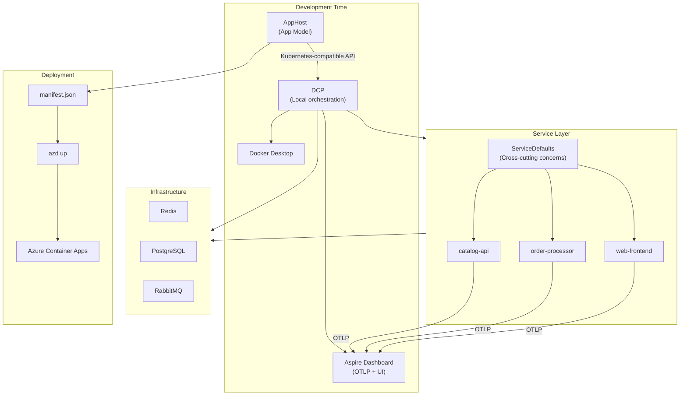

## Summary

.NET Aspire covers the whole lifecycle of a distributed application: declarative composition in the AppHost, local orchestration by DCP, default configuration through components, and cloud deployment through manifests.

Aspire takes on the accidental complexity of connecting infrastructure, monitoring it, and handling failures, so that developers can concentrate on business logic. These design principles make that possible:

1. **Declarative App Model** — Express resources and their dependencies in code
2. **Local-first Orchestration** — DCP starts and manages containers and processes locally
3. **Built-in Observability** — OpenTelemetry instrumentation configured by default
4. **Standardized Resilience** — Retry and circuit breaker applied by default
5. **Cloud Deployment** — Manifests generate the configuration for the deployment target
6. **Extensibility** — Custom resources, lifecycle hooks, eventing model

## References

- [Aspire Official Documentation](https://aspire.dev/)
- [Aspire Source Code (GitHub)](https://github.com/microsoft/aspire)
- [Aspire Samples (GitHub)](https://github.com/dotnet/aspire-samples)
- [Microsoft.Extensions.ServiceDiscovery Source Code](https://github.com/microsoft/aspire/tree/main/src/Microsoft.Extensions.ServiceDiscovery)
- [Aspire Dashboard](https://aspire.dev/dashboard/)
- [Aspire Integrations Overview](https://aspire.dev/integrations/overview/)
- [Aspire.Hosting.AppHost (NuGet)](https://www.nuget.org/packages/Aspire.Hosting.AppHost) — to check the current version
