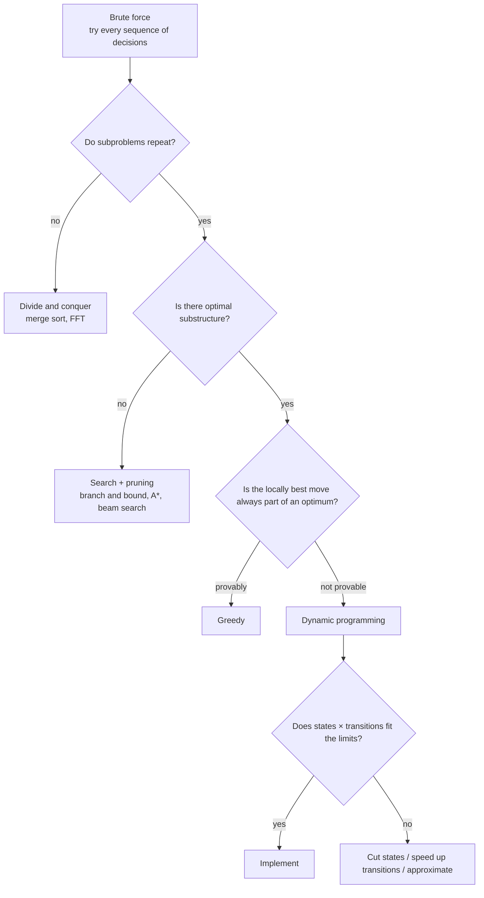
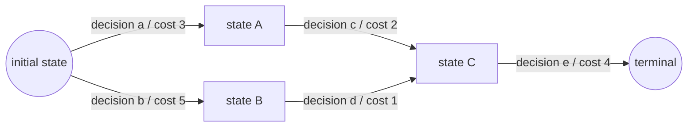

Among the tools of competitive programming, dynamic programming (DP) is the one where people differ most in whether they can think of a solution at all. It is also the one people most often try to get through by memorisation, and most often fail with. Knowing the knapsack recurrence does not help if you cannot reduce an unfamiliar problem to that shape.

<strong>DP is not an algorithm but a procedure for rewriting brute force</strong>. What you need to learn is the path from brute force to a recurrence, not the individual recurrences. This article breaks that path into steps and checks each one with a running demo, then moves on to the standard patterns, ways to speed up transitions, and uses in production systems.

<ArticleVideo slug="dynamic-programming" />

## 1. DP is a rewrite of exhaustive search

### 1.1 Two conditions

When a problem can be solved with DP, two properties almost always hold.

- <strong>Optimal substructure</strong>: an optimal solution is assembled from optimal solutions to subproblems.
- <strong>Overlapping subproblems</strong>: a naive recursion solves the very same subproblem many times.

With only the first, divide and conquer (merge sort, for example) is enough; with only the second, a cache is enough. When both hold, naming the subproblems and storing their answers in a table turns exponential time into polynomial time.

Richard Bellman's principle of optimality, formulated in the 1950s, is a restatement of optimal substructure:

> An optimal policy has the property that, whatever the initial state and initial decision are, the remaining decisions must constitute an optimal policy with regard to the state resulting from the first decision.

The name “dynamic programming” was, by Bellman's own account in his autobiography *Eye of the Hurricane* (1984), chosen partly to be palatable to a Secretary of Defense who was hostile to mathematical research. “Programming” here means planning, not writing code.

### 1.2 The fork with greedy algorithms

DP and greedy both decide one step at a time. The difference is whether <strong>a locally best move is guaranteed to belong to a global optimum</strong>.

<GreedyFailureDiagram />

Using a greedy algorithm requires a proof that it is correct, and there are two standard tools. The exchange argument shows that swapping two choices never makes the solution worse, either by replacing one move of an optimal solution with the greedy move or by interchanging two adjacent elements; §3.5 works through the second form in full. The other tool is to exhibit a matroid structure: a family of “independent” sets satisfying certain axioms, for which greedy is guaranteed to be optimal. Kruskal's minimum spanning tree algorithm is the classic instance. If you cannot prove greedy correct, try every first move and leave the rest to recursion. That is DP, and it is the safe default. Conversely, using DP on a problem where greedy is provably optimal wastes both running time and code.

Whether a coin system is canonical (greedy always optimal) is itself decidable: Pearson (2005) gave an $O(n^3)$ test for a system of $n$ coins. So whether greedy is correct can depend on the input as well as on the problem statement.

### 1.3 The decision tree from brute force



In this diagram, DP is not a weaker substitute for brute force but <strong>a compressed form of it</strong>. Coming up with a DP means finding the right axis along which to compress.

## 2. Always start from brute force

### 2.1 The running example: Frog 1

We will use problem A, “Frog 1”, from AtCoder's [Educational DP Contest](https://atcoder.jp/contests/dp).

> Stones with heights $h_0, h_1, \dots, h_{N-1}$ stand in a row. A frog starts on stone 0 and can jump from stone $i$ to stone $i+1$ or $i+2$. Jumping from $i$ to $j$ costs $|h_i - h_j|$. What is the minimum cost to reach stone $N-1$?

Write brute force first, with no cleverness. At each stone, the decision is whether to jump one stone or two.

```python
def solve(h):
    n = len(h)

    def f(i):  # minimum cost to arrive at stone i
        if i == 0:
            return 0
        if i == 1:
            return abs(h[1] - h[0])
        return min(
            f(i - 1) + abs(h[i] - h[i - 1]),
            f(i - 2) + abs(h[i] - h[i - 2]),
        )

    return f(n - 1)
```

This is correct but slow. The recursion tree shows how slow.

### 2.2 Look at the recursion tree

<DPRecursionTreeVisualizer />

With memoization off, `f(3)`, `f(2)` and `f(1)` reappear again and again. The number of calls satisfies $T(i) = 1 + T(i-1) + T(i-2)$, that is $2F(i+1) - 1$, so it grows like the Fibonacci numbers (from $T(0) = T(1) = 1$ you get $T(2) = 3$, $T(3) = 5$, $T(4) = 9$ — check those against the node count in the demo). At $N = 45$ that is roughly 2.27 billion calls.

Yet there are only $N$ distinct arguments, and `f` returns the same value whenever it gets the same argument. Storing each result the first time it is computed removes the recomputation; that is memoization.

```python
from functools import cache

def solve(h):
    n = len(h)

    @cache
    def f(i):
        if i == 0:
            return 0
        if i == 1:
            return abs(h[1] - h[0])
        return min(
            f(i - 1) + abs(h[i] - h[i - 1]),
            f(i - 2) + abs(h[i] - h[i - 2]),
        )

    return f(n - 1)
```

Adding one line, `functools.cache` (Python 3.9+; earlier, `lru_cache(maxsize=None)`), turns exponential time into linear time. Turn memoization on in the demo, and the branches whose values have already been computed are pruned from the tree.

### 2.3 When is memoization actually valid?

Memoization is correct only when <strong>`f` is a pure function of its arguments</strong>. If it reads mutable state outside the function — a visited flag, a global counter, a random number — the same argument can produce different answers in different call contexts, and the cache silently returns wrong results.

Before adding a cache, ask two questions:

- Of the variables the function reads, is every one that changes during execution present in the argument list?
- Have you dropped something from the arguments because “it probably does not matter”?

The second question is the state-design problem of the next chapter.

### 2.4 Cost is states × transitions

The rest of the article relies on two terms, which can be defined on the code above:

- A <strong>state</strong> is the tuple of arguments to the memoised function `f`. The number of states is how many distinct argument values exist. Frog 1 takes only `i`, so there are $N$ states.
- A <strong>transition</strong> is one move from one state to another. The number of transitions is how many recursive calls one execution of `f` makes. In Frog 1 that is the two arms of the `min`: $i-1$ and $i-2$.

A memoised function runs its body exactly once for each argument it is actually called with. So the total work is “how many times the body runs × the work of one run”, and the running time of a DP is almost always this product:

$$
\text{cost} = (\text{states}) \times (\text{transitions})
$$

For Frog 1 that is $N \times 2 = O(N)$. Do this multiplication before writing code. If the constraint is $N \le 10^5$ and your idea has $N^2$ states, discard the idea at that point. As a rule of thumb, C++ handles roughly $10^8$ simple operations within a one- or two-second limit; Python is closer to $10^6$–$10^7$.

### 2.5 A map of what follows

The basic procedure is now complete: write brute force, notice the repetition, turn the arguments into a state, and estimate the cost as a product. The remaining chapters do not all need to be read the same way.

| Chapter | Content | How to read it |
|---|---|---|
| 3 | How to design a state | The hardest part of DP. Read in order |
| 4 | The design procedure, and what a DP really is (a shortest path on a DAG) | Same |
| 5 | Filling the table, and implementation | Same |
| 6 | The pattern catalogue (knapsack, grid, interval, tree, bitmask, digit, expectation) | A reference. Take only the patterns you need |
| 7 | Speeding up transitions | Read when you are stuck |
| 8–11 | Implementation craft, production uses, a practice order | As needed |

Chapters 1–5 are meant to be read straight through. Each section of chapter 6 follows the layout “problem statement → state → transition → implementation → pitfalls” and stands on its own, so you can come back to it when you meet a pattern you do not recognise.

## 3. A state is the smallest summary the future needs

### 3.1 Definition

For practical purposes, define the state of a DP as:

> The summary of the decisions made so far, keeping <strong>only what still affects how the rest should optimally be decided</strong>.

This corresponds to the Markov property of stochastic processes, or to a sufficient statistic in statistics. You do not need the whole path, only enough to continue optimally. The smaller the summary, the fewer the states and the faster the DP.

### 3.2 The classic way state design fails

Take the longest increasing subsequence (LIS). First, the problem:

> Given a sequence $a_0, a_1, \dots, a_{n-1}$, find the length of the longest subsequence — chosen in increasing order of index — whose values are strictly increasing.

A subsequence here need not be contiguous (the contiguous version is a *subarray*, which §3.3 covers). For $a = [3, 1, 4, 1, 5, 9, 2, 6, 5]$, indices 1, 2, 4, 5 give $1 < 4 < 5 < 9$ and indices 1, 2, 4, 7 give $1 < 4 < 5 < 6$; both have length 4, which is optimal.

A first attempt at a state:

```text
dp[i] = length of the LIS within a[0..i]
```

You cannot write a transition from `dp[i]` to `dp[i+1]`: whether `a[i+1]` can extend that subsequence depends on the value at its tail, and this state does not remember it. Knowing `dp[5] = 4` in the example above does not tell you whether that length-4 run ends in 9 or in something else, so you cannot decide whether $a_6 = 2$ extends it.

The correct definition is:

```text
dp[i] = length of the longest increasing subsequence ending exactly at a[i]
```

Changing “among the first $i$” to “ending at $i$” pins the tail value to `a[i]` and makes the transition expressible.

```text
dp[i] = 1 + max{ dp[j] | j < i and a[j] < a[i] }   (1 if no such j exists)
answer = max(dp[0], ..., dp[n-1])
```

The answer is the maximum over the whole table, not `dp[n-1]`: with an “ending at $i$” definition the optimum need not use the last element, so a final aggregation is required. Whenever you change the definition of the state, check again how the answer is read from the table.

<strong>If you cannot write the transition, your state is missing something.</strong> This is the most common way to get stuck, but also the easiest to recognise. The $O(n \log n)$ version of this problem appears in §6.2.

### 3.3 The smallest DP — maximum subarray sum

The “ending at $i$” definition also makes short work of another problem: find the largest sum of a contiguous subarray of $a$.

Brute force tries all $O(n^2)$ intervals. If the state is “the largest sum of a contiguous subarray ending at $a[i]$”, the transition becomes one line:

```text
dp[i] = max(a[i], dp[i-1] + a[i])
answer = max(dp[0], dp[1], ..., dp[n-1])
```

The only decision is whether to extend the subarray ending at $a[i-1]$ or to start a new one at $a[i]$. Because each step reads only `dp[i-1]`, two variables replace the table.

```python
def max_subarray(a):
    if not a:
        raise ValueError("an empty array has no non-empty subarray")
    best = cur = a[0]
    for x in a[1:]:
        cur = max(x, cur + x)   # dp[i]
        best = max(best, cur)   # running answer
    return best
```

This is Kadane's algorithm (Jay Kadane, 1977; popularised by Bentley's *Programming Pearls*): $O(n)$ time, $O(1)$ space. It shows that a DP does not always need a table. The size of the array you need is set not by the number of states but by how many states must be kept at once.

This version <strong>does not allow the empty subarray</strong>. When every element is negative, the answer is 0 if the empty subarray is allowed and the largest element otherwise. Initialising `best = cur = 0` silently implements the first definition, which is wrong under the second. Check the problem statement for which definition it uses.

### 3.4 Problems that need *more* state

The opposite move, deliberately adding a dimension, is just as common.

| Added dimension | Meaning | Typical problem |
|---|---|---|
| Previous choice | “cannot pick the same thing twice in a row” | EDPC C (Vacation: pick one of three activities each day, never the same one two days running) |
| Count used | “pick exactly $k$ items” | cardinality-constrained optimisation |
| Tight flag | pinned to the upper bound in digit DP (§6.7) | counting within a range |
| Residue | “total ≡ 0 mod $m$” | subset sums with modular conditions |
| Visited set | the set matters, the order does not | TSP (§6.6), set partitioning |

Here is the first row worked through. EDPC C (Vacation) reads: “over $N$ days, each day pick one of three activities A, B or C. Picking A on day $i$ yields happiness $a_i$ (and $b_i$, $c_i$ for B and C). You may not pick the same activity two days in a row. Maximise total happiness.”

`dp[day]` alone admits no transition. Knowing “the best total through day $day$” does not tell you what was chosen last, so you cannot tell which activities are legal tomorrow. This is the same failure as the first LIS state in §3.2, and the fix is to add the last choice to the state.

```text
dp[day][last] = best total happiness through day `day`, having chosen `last` on that day
dp[day][last] = happiness[day][last] + max{ dp[day-1][prev] | prev ≠ last }
answer = max(dp[N-1][A], dp[N-1][B], dp[N-1][C])
base   = dp[0][last] = happiness[0][last]   (day 0 has no "previous" constraint)
```

That is $N \times 3$ states with 2 transitions each, so $O(N)$. The extra dimension costs only a constant factor and makes the transition writable, which is the usual payoff of adding state.

State design therefore works in both directions: <strong>add information when the transition cannot be written, and fold it when the state count explodes</strong>.

### 3.5 Four standard ways to *shrink* the state

When the state space is too large, one of these four moves usually helps.

<strong>(a) Fix an order.</strong> If the processing order does not change the answer, sort first to obtain monotonicity — here meaning that the constraint tightens or loosens consistently along the processing order — and the order need not live in the state. Even when order does matter, an exchange argument (compare the outcome of swapping two adjacent elements) often determines the optimal processing order up front, after which the rest is an ordinary knapsack (§6.1).

EDPC X (Tower) is an example. The problem: “blocks have weight $w_i$, solidness $s_i$ and value $v_i$. For every block, the total weight of the blocks stacked above it must not exceed $s_i$. Maximise total value.”

Take two adjacent blocks $i, j$ and let $W$ be the total weight resting on the pair. Putting $i$ above $j$ is legal when $i$ can bear it ($W \le s_i$) and $j$ can bear it too ($W + w_i \le s_j$):

```text
i on top: W <= min(s_i, s_j - w_i)
j on top: W <= min(s_j, s_i - w_j)
```

Compare the two bounds. The bound for $j$ on top is a $\min$, so it is at most $s_i - w_j$. Both terms of the bound for $i$ on top, meanwhile, are at least $s_i - w_j$: $s_i \ge s_i - w_j$ because weights are positive, and

$$
s_j - w_i \ge s_i - w_j \iff w_i + s_i \le w_j + s_j
$$

So as long as $w_i + s_i \le w_j + s_j$, whichever term of the $\min$ binds, the tolerance with $i$ on top never falls below the tolerance with $j$ on top: putting the block with the smaller $w + s$ on top tolerates at least as large a $W$, so it never loses. The comparison does not depend on which blocks you end up choosing, so after sorting once by ascending $w_i + s_i$, what remains is a plain 0-1 knapsack over that order.

<strong>(b) Fold symmetry.</strong> If swapping $i$ and $j$, or complementing a set, leaves the problem unchanged, keeping one side halves the state count. For “split $N$ people into two teams” where the teams are interchangeable, $(S, \bar{S})$ and $(\bar{S}, S)$ are the same split, so pinning person 0 to team 1 turns $2^N$ into $2^{N-1}$. If the teams are labelled and therefore distinguishable, the same pinning silently discards half the solutions. Fold only when the problem is genuinely symmetric.

<strong>(c) Track a difference instead of absolute quantities.</strong> You often do not need both group totals $(A, B)$; $A - B$ alone can be enough. “Split the items into two piles minimising the weight difference” needs a single difference, or just the set of achievable weights for one pile, instead of the 2-D pair $(A, B)$. That removes one dimension.

<strong>(d) Reduce optimisation to feasibility.</strong> If “can it be made?” is enough and you do not need “what is the best?”, the table becomes boolean and bit-parallelism applies (the $O(nW/64)$ trick of §6.9).

Each move comes back to the question from §3.1: does this information affect how the rest should be decided?

## 4. Turning the procedure into a template

The steps so far form a template for problems you have not seen before.

<DPDesignSteps />

Of these six steps, only 2 and 5 are genuinely hard. Step 2 (deciding what is enough to remember) is where the insight lies; step 5 (estimating the cost) is the check before implementation. Steps 3, 4 and 6 follow mechanically once step 2 is settled.

### 4.1 On “is the dependency graph a DAG?” (step 6)

A DP is, at bottom, a <strong>shortest path on a directed acyclic graph</strong>. Take states as vertices, transitions as edges, and transition costs as weights; the answer is the shortest (or longest, or total, or most probable) path from source to sink.

A directed graph connects points with edges that have a direction, “from A to B”; acyclic means you cannot follow edges back to where you started; a topological order is a linear arrangement of the points in which every edge points forwards. Translated into DP: points are states, edges are transitions, and “`dp[y]` must be settled before `dp[x]` can be computed” is what an edge direction means. In Frog 1 the points are the stones and the edges are $i \to i+1$ and $i \to i+2$; sorting by index makes every edge point forwards, so index order *is* a topological order.



This view explains several things at once.

- <strong>Evaluation order is topological order</strong>. Getting the loop direction wrong means violating the topological order.
- <strong>If the dependencies contain a cycle, it is not a DP as written</strong>. To handle cycles you must either (a) add a dimension such as the number of edges used, unrolling the graph into layers (Bellman–Ford), (b) fix the order greedily (Dijkstra, when weights are non-negative), or (c) sweep the whole table repeatedly until nothing changes (value iteration, covered in §9.6).
- <strong>The longest path is NP-hard in general graphs but linear on a DAG</strong>. EDPC G asks for exactly this.

[Graph Traversal Algorithms](/en/blog/graph-traversal) covers the order in which the traversal algorithms themselves were invented. The DPs in this article can be read as generalising those shortest paths from a physical graph to a state space.

### 4.2 Solving a different problem with the same table — the semiring view

Suppose that instead of the minimum cost, Frog 1 asked “how many ways are there to get from stone 0 to stone $N-1$?”. In effect, one line changes:

```text
minimum cost:    dp[i] = min( dp[i-1] + cost1 , dp[i-2] + cost2 )
number of ways:  dp[i] =      dp[i-1] * 1      +  dp[i-2] * 1
initial value:   0 for the cost version, 1 for the counting version
```

Where `min` stood, there is now `+`; where the cost `+` stood, there is now `×` (each edge is worth “one way”, so multiplying by 1 makes it vanish). The loops, the states and the scan order are untouched.

This swap is a change of the underlying <strong>semiring</strong>: a pair of an addition-like operation $\oplus$ and a multiplication-like operation $\otimes$. $\oplus$ combines several incoming paths into one value; $\otimes$ chains costs along a path.

The same correspondence explains why the initial value changes from 0 to 1. What belongs in `dp[0]` is the value that leaves its partner unchanged under $\otimes$ — the identity for $\otimes$ — which is 0 when $\otimes$ is addition (the cost version) and 1 when it is multiplication (the counting version). Its counterpart is the identity for $\oplus$, the value that changes nothing when combined, and that is what “this state does not exist” has to be: $\infty$ when minimising, 0 when counting. The out-of-range `dp[-1]` means “no such route”, so in the counting version it is 0 — which is why `dp[1] = dp[0] = 1`.

| Semiring $(\oplus, \otimes)$ | Meaning | What you get |
|---|---|---|
| $(\min, +)$ | minimum cost | shortest paths, min-cost DP |
| $(\max, +)$ | maximum value | knapsack, longest path |
| $(+, \times)$ | sums and products | counting DP, probability DP |
| $(\max, \times)$ | maximum probability | Viterbi decoding |
| $(\lor, \land)$ | disjunction and conjunction | reachability, subset-sum feasibility |

In practice, once you have written the DP for the minimum cost, you can answer “how many ways are there in total?” by keeping the same loops and replacing `min` with `+` and `+` with `×`. This substitution counts all the ways, not <strong>the ways that achieve the minimum</strong>; for the latter, make each semiring element a pair $(\text{minimum},\ \text{number of ways attaining it})$, with $\oplus$ taking the minimum and summing the counts on ties.

Unlike a minimum cost, a count grows exponentially and will overflow a 64-bit integer. That is why counting problems are normally posed modulo a number such as $10^9+7$, with the remainder taken after every addition and multiplication (§8.1). The skeleton itself is unchanged.

## 5. Filling the table — pull DP and push DP

Once the recurrence is fixed, there are two ways to write the loop that fills the table.

<DPTableFillVisualizer />

- <strong>Pull DP</strong>: finalise `dp[i]` by examining every transition that enters it. It reads as an assignment, which makes missing initialisation less likely.
- <strong>Push DP</strong>: from a finalised `dp[i]`, relax the targets of its outgoing transitions.

Both give the same answer and differ only in how easy they are to write. As a rule of thumb, pull when incoming edges are easier to enumerate, push when outgoing edges are. Transitions that spread a value uniformly over a range pair especially well with push DP plus a difference array.

### 5.1 Implementation

```cpp
// Pull DP (C++)
#include <bits/stdc++.h>
using namespace std;

int main() {
    int n; cin >> n;
    vector<long long> h(n);
    for (auto &x : h) cin >> x;

    const long long INF = 1e18;
    vector<long long> dp(n, INF);
    dp[0] = 0;
    for (int i = 1; i < n; i++) {
        dp[i] = dp[i - 1] + llabs(h[i] - h[i - 1]);
        if (i >= 2) dp[i] = min(dp[i], dp[i - 2] + llabs(h[i] - h[i - 2]));
    }
    cout << dp[n - 1] << '\n';
}
```

```cpp
// Push DP (C++)
vector<long long> dp(n, INF);
dp[0] = 0;
for (int i = 0; i < n; i++) {
    if (dp[i] == INF) continue;              // never relax out of an unreachable state
    for (int d = 1; d <= 2 && i + d < n; d++) {
        long long cand = dp[i] + llabs(h[i + d] - h[i]);
        dp[i + d] = min(dp[i + d], cand);
    }
}
```

Without `if (dp[i] == INF) continue;`, a push DP evaluates `INF + cost`. If `INF` breaks under addition — `LLONG_MAX`, say — the sum overflows to a negative number and then wins the minimum. The standard defence is to <strong>choose an `INF` that survives addition</strong>: `1e18` for `long long`, and something like `1'000'000'000 / 2` rather than `1'000'000'000` for `int`. Even when the arithmetic survives, the update still creates a path out of an unreachable state, so write the guard anyway.

### 5.2 Top-down or bottom-up?

<MemoVsTabulation />

A short decision guide:

- <strong>Sparse state space</strong> (many unreachable states, or states that are strings/sets and awkward to index): memoised recursion.
- <strong>Dense state space</strong>, or you want to bolt on a speedup: tabulation.
- <strong>Recursion depth could exceed $10^5$</strong>: tabulation, or an explicit stack. Python's default recursion limit is 1000, and raising `sys.setrecursionlimit` sometimes also requires enlarging the thread stack size.

In practice, get it right with memoised recursion first and rewrite it as a loop when you need to. Once the recurrence is verified, the conversion is mechanical.

## 6. A catalogue of patterns

Each section below stands on its own and follows the layout “problem statement → why that state → transition and cost → implementation → pitfalls”.

Knowing the patterns lets you guess quickly on an unseen problem: “this merges intervals, so an interval state is probably right.” When the guess turns out wrong, go back to the procedure in chapters 3–5.

<DPPatternTable />

### 6.1 Knapsack DP — what “pseudo-polynomial” means

First, the problem:

> There are $N$ items; item $i$ has weight $w_i$ and value $v_i$. Choose items so that the total weight does not exceed a capacity $W$, and maximise the total value. Each item is either taken or not (the 0-1 knapsack).

For each item, the decision is whether to take it, so brute force enumerates $2^N$ subsets. Of the choices made for the first $i$ items, only the total weight used so far affects the future: which particular combination reached weight $w$ does not change how the remaining items should be picked. That gives a two-dimensional state.

```text
dp[i][w] = best total value using the first i items with total weight at most w
dp[i][w] = max( dp[i-1][w] ,  dp[i-1][w - w_i] + v_i )
             ↑ skip item i     ↑ take item i (only when w >= w_i)
```

“The weight used so far” suggests indexing by weight exactly $w$, but the definition above says at most $w$. Since weights are non-negative, leaving capacity unused never hurts, so the at-most table is the exact-weight table accumulated as a running maximum over $w$. That is why it is monotone non-decreasing in $w$.

The two tables do not agree cell by cell, though: a weight that no subset hits exactly still carries the best value from a lighter combination in the at-most table. The problem asks for the best value at weight at most $W$, so `dp[N][W]` is the answer, with no special case for “no subset hits exactly $W$”.

When a problem genuinely needs *exactly* (as in §6.2, or subset sum), you instead mark unreachable cells explicitly — $\infty$ when minimising, $-\infty$ when maximising, `false` for feasibility.

With $N \times W$ states and 2 transitions each, that is $O(NW)$.

The 0-1 knapsack problem is NP-hard. The $O(NW)$ DP still works because $W$ is the numeric value of an input, not the size of the input. Writing $W$ in binary takes $\log W$ bits, so $O(NW)$ is exponential in the input size. That is what <strong>pseudo-polynomial</strong> means.

This is why a DP that passes for $W \le 10^5$ fails for $W \le 10^9$: its running time grows with the value of $W$.

<KnapsackDPVisualizer />

The demo's three modes correspond to the implementations below.

<strong>The 2-D table</strong> transcribes the definition directly:

```cpp
// dp[i][w] = best value using the first i items with total weight at most w
vector<vector<long long>> dp(n + 1, vector<long long>(W + 1, 0));
for (int i = 1; i <= n; i++)
    for (int w = 0; w <= W; w++) {
        dp[i][w] = dp[i - 1][w];
        if (w >= wt[i - 1])
            dp[i][w] = max(dp[i][w], dp[i - 1][w - wt[i - 1]] + val[i - 1]);
    }
```

<strong>One dimension, descending</strong> exploits the fact that computing row $i$ only needs row $i-1$:

```cpp
vector<long long> dp(W + 1, 0);
for (int i = 0; i < n; i++)
    for (int w = W; w >= wt[i]; w--)          // ← descending is mandatory
        dp[w] = max(dp[w], dp[w - wt[i]] + val[i]);
```

<strong>One dimension, ascending</strong> makes `dp[w - wt[i]]` a value that the *current* item already updated, so the item can be used any number of times. For the 0-1 knapsack this is a bug, but it is also the correct implementation of the unbounded knapsack. In the demo the answer changes from 90 to 100: the loop direction alone decides which problem you are solving.

```cpp
// Unbounded knapsack: ascending is the "correct" direction
for (int i = 0; i < n; i++)
    for (int w = wt[i]; w <= W; w++)
        dp[w] = max(dp[w], dp[w - wt[i]] + val[i]);
```

<strong>Bounded knapsack</strong> (item $i$ available up to $c_i$ times — the 0-1 case is $c_i = 1$ and the unbounded case is $c_i = \infty$) is $O(NWc)$ naively. Splitting $c_i$ into $1, 2, 4, \dots$ and reducing to 0-1 gives $O(NW \log c)$; a sliding-window minimum per residue class gives $O(NW)$.

### 6.2 Swap the roles of index and value

The same knapsack becomes a different problem when the constraints change shape. EDPC E (Knapsack 2) has $N \le 100$, $W \le 10^9$ and $v_i \le 10^3$: few items, but a capacity that is orders of magnitude larger. $O(NW) = 10^{11}$ is hopeless.

The total value, however, is at most $N \times \max v_i = 100 \times 10^3 = 10^5$. So <strong>index by the small “value” instead of the oversized “weight”</strong>, swapping what is optimised with what is constrained.

```text
before: dp[i][w] = the best VALUE at weight at most w        ← indexed by weight
after:  dp[i][v] = the least WEIGHT reaching value exactly v  ← indexed by value
```

That makes the state count $N \times \sum v_i \le 100 \times 10^5 = 10^7$, which is workable. The answer is the largest `v` with `dp[N][v] <= W`.

> If one dimension is too large, ask whether the objective and the constraint can trade places. This is the most broadly useful reframing in all of DP.

The same idea drives the $O(n \log n)$ LIS, the problem defined in §3.2.

<LISVisualizer />

The naive $O(n^2)$ solution of §3.2 stores a length in `dp[i]`. The fast version does the opposite: it indexes by length and stores the value.

```text
naive: dp[i]    = the LENGTH of the increasing run ending at a[i]  ← index = position
fast:  tails[k] = the smallest VALUE that can end a run of length k+1  ← index = length
```

This works because `tails` is always strictly increasing (a longer run cannot end in a smaller value than a shorter one), so each element finds its slot by binary search: $O(\log n)$ per element, $O(n \log n)$ overall.

```python
from bisect import bisect_left

def lis_length(a):
    tails = []
    for x in a:
        i = bisect_left(tails, x)     # strictly increasing; use bisect_right for non-decreasing
        if i == len(tails):
            tails.append(x)
        else:
            tails[i] = x
    return len(tails)
```

There is a trap here. The length of `tails` is the answer, but <strong>its contents need not form a subsequence of the input</strong>. At the end of the demo, `tails = [1, 2, 5, 6]` does not respect the input order. To recover an actual subsequence, record at insertion time the slot used and the index that owned the slot immediately to its left.

```python
def lis_sequence(a):
    tails, tails_idx, parent = [], [], [-1] * len(a)
    for i, x in enumerate(a):
        k = bisect_left(tails, x)
        parent[i] = tails_idx[k - 1] if k > 0 else -1
        if k == len(tails):
            tails.append(x); tails_idx.append(i)
        else:
            tails[k] = x; tails_idx[k] = i
    res, cur = [], tails_idx[-1]
    while cur != -1:
        res.append(a[cur]); cur = parent[cur]
    return res[::-1]
```

### 6.3 Grid DP — the skeleton of diff and edit distance

A grid whose two axes are the prefixes of two sequences is the DP shape you will meet most often outside contests. Two representative problems:

> <strong>Longest common subsequence (LCS)</strong>: given strings $s$ and $t$, find the longest string that is a subsequence of both (not necessarily contiguous, but order-preserving). For $s = $ `axyb` and $t = $ `abyxb`, both `axb` and `ayb` have length 3 and are optimal.

> <strong>Edit distance (Levenshtein)</strong>: find the minimum number of single-character insertions, deletions and substitutions that turn $s$ into $t$. For example `axyb` → `abyb` (substitute x with b) → `abyxb` (insert x) is 2 operations.

In both cases the state is the pair of prefixes “first $i$ characters of $s$, first $j$ characters of $t$”: once you decide how the $i$-th and $j$-th characters correspond, what remains is a smaller instance of the same problem. With $nm$ states and 2–3 transitions each, both are $O(nm)$.

<LCSGridVisualizer />

Same table, same scan order — only the transition changes:

```python
# Longest common subsequence
if s[i-1] == t[j-1]: dp[i][j] = dp[i-1][j-1] + 1
else:                dp[i][j] = max(dp[i-1][j], dp[i][j-1])

# Edit distance (Levenshtein)
if s[i-1] == t[j-1]: dp[i][j] = dp[i-1][j-1]
else:                dp[i][j] = 1 + min(dp[i-1][j-1], dp[i-1][j], dp[i][j-1])
```

The same grid underlies several applications.

- <strong>diff</strong>: the characters that did not make it into the LCS become deletions and insertions. GNU diff and git default to Myers' algorithm (1986), which finds a shortest path in the edit graph in $O(ND)$ where $D$ is the size of the difference — much faster than $O(nm)$ when the diff is small.
- <strong>Spell correction and fuzzy search</strong>: edit distance itself. With a threshold you can compute only a diagonal band, giving $O(nk)$.
- <strong>Bioinformatics</strong>: Needleman–Wunsch (1970, global alignment) and Smith–Waterman (1981, local alignment) are this grid plus gap penalties and a substitution matrix.
- <strong>Dynamic time warping</strong>: aligning time series. The same grid with a different transition set.

As for memory, if you only need the length, two rolling rows give $O(\min(n,m))$ space. If you need the sequence, Hirschberg's algorithm (1975) combines the DP with divide and conquer to reconstruct it in $O(nm)$ time and $O(\min(n,m))$ space.

There is also a lower bound. Backurs and Indyk (2015) showed that, assuming the Strong Exponential Time Hypothesis, edit distance cannot be computed in $O(n^{2-\delta})$ time for any $\delta > 0$; analogous results exist for LCS. So apart from tricks that shave a word-size or logarithmic factor (bit-parallelism, Four Russians), no substantial improvement over $O(nm)$ is to be expected.

### 6.4 Interval DP

Problems with a “merge adjacent things” structure take the interval as the state. Two representatives:

> <strong>Slime merging</strong> (EDPC N): $N$ slimes stand in a row, the $i$-th of size $a_i$. Merging two adjacent slimes produces one of the summed size, at a cost equal to that sum. Minimise the total cost of merging everything into one.

> <strong>Matrix chain multiplication</strong>: multiplying $A_1 A_2 \cdots A_n$ costs a different number of scalar multiplications depending on the parenthesisation. Find the cheapest one.

In both, there is a final moment where the whole interval $[l, r)$ becomes one thing, and just before it the interval must have been split at some point $k$. Trying every $k$ is the transition.

```text
dp[l][r] = best value for combining the interval [l, r) into one
dp[l][r] = min over k in (l, r) of  dp[l][k] + dp[k][r] + cost(l, r)
```

With $O(n^2)$ states and $O(n)$ transitions this is $O(n^3)$. Unlike a linear DP, which settles states from left to right, this one loops over increasing interval length: long intervals depend on short ones, so that is the topological order. The skeleton above puts `cost(l, r)` outside the `min` (the form that fits EDPC N and optimal BSTs); when the cost depends on the split point, as in matrix chain multiplication, it moves inside: `dp[l][k] + dp[k][r] + p_l p_k p_r`.

If the cost function satisfies the quadrangle inequality

$$
w(a, c) + w(b, d) \le w(a, d) + w(b, c) \quad (a \le b \le c \le d)
$$

together with monotonicity on the interval lattice, $w(b, c) \le w(a, d)$ for the same ordering, then <strong>the optimal split points are monotone</strong>. Intuitively: widening an interval to the right can only move its best split point right, and widening it to the left can only move it left — the two directions supply the lower and upper end of the search range respectively.

So the search for $dp[l][r]$'s split point can be confined to $[\,\text{argmin}(l, r-1),\ \text{argmin}(l+1, r)\,]$, and those ranges telescope within each interval length to give $O(n^2)$ overall (the Knuth–Yao speedup). Knuth showed this in 1971 for optimal binary search trees — building, from known key access frequencies, the BST that minimises the average search cost — and Yao generalised it in 1980.

```cpp
// Interval DP skeleton (pull form)
for (int len = 2; len <= n; len++)
    for (int l = 0; l + len <= n; l++) {
        int r = l + len;
        for (int k = l + 1; k < r; k++)
            dp[l][r] = min(dp[l][r], dp[l][k] + dp[k][r]);
        dp[l][r] += cost(l, r);
    }
```

### 6.5 Tree DP and rerooting

On a tree, the natural subproblem is a subtree. A representative problem:

> <strong>Maximum-weight independent set on a tree</strong>: given a tree whose vertices carry weights $w_v$, choose a set of vertices with no two joined by an edge, maximising the total weight.

On a path this is the linear “take it or skip it” DP; on a tree a vertex has several children, but the structure is the same: the answer for the subtree of $v$ is determined by the answers for the subtrees of its children. Since the children's freedom depends on whether $v$ itself was taken, that one bit joins the state.

```python
# Maximum-weight independent set on a tree
# returns (take, skip) = best for the subtree with v taken / not taken
def dfs(v, parent):
    take, skip = w[v], 0
    for c in graph[v]:
        if c == parent: continue
        t, s = dfs(c, v)
        take += s          # if we take v, children cannot be taken
        skip += max(t, s)  # if we skip v, children are free
    return take, skip

answer = max(dfs(root, -1))
```

The state is “vertex $v$” × “was $v$ itself taken?”. Each edge is visited once, so it is $O(n)$. EDPC P (Independent Set) is the counting version of the same state: replace $(\max, +)$ with $(+, \times)$ — `max` becomes addition and addition becomes multiplication — and you count independent sets instead. This is the semiring swap of §4.2.

<strong>Rerooting</strong> computes the answer for every choice of root at once, in $O(n)$. The DFS above only answers for one fixed root; repeating it $n$ times is $O(n^2)$. Instead you combine a downward accumulation (answers from the children) with a value descending from the parent, in two traversals. The key trick is computing “the aggregate of all children except one” with prefix and suffix accumulations, keeping it $O(\deg v)$ per vertex. EDPC V is the canonical exercise.

### 6.6 Bitmask DP — folding permutations into sets

Even when order matters, if “what has been done so far” can be summarised as a set, the state space collapses to $2^n$. The example here is the travelling salesman problem.

> <strong>Travelling salesman problem (TSP)</strong>: given $n$ cities and the distance $D[u][v]$ from city $u$ to city $v$, find the shortest tour that starts at city 0, visits every city exactly once, and returns to city 0.

<BitmaskTSPVisualizer />

Brute force tries the $(n-1)!$ orderings of the cities other than 0. But <strong>if two partial tours have visited the same set of cities and end at the same city, the best way to finish is identical</strong>. Compare “$0 \to 1 \to 2 \to 3$” with “$0 \to 2 \to 1 \to 3$”: both have visited $\lbrace 0,1,2,3 \rbrace$ and both stand on city 3, so exactly the same work lies ahead. That remains true when the distances are asymmetric ($D[u][v] \neq D[v][u]$) — only the cost already paid differs, not the work that remains. So the visiting order itself can be thrown away.

The visited set is stored as an $n$-bit integer $S$ (bit $i$ set means city $i$ has been visited) — hence the names state compression and bitmask DP.

$$
dp[S][v] = \min_{u \in S \setminus \lbrace v \rbrace} \bigl( dp[S \setminus \lbrace v \rbrace][u] + D[u][v] \bigr)
$$

With $2^n \cdot n$ states and $n$ transitions each, this is $O(2^n n^2)$ — the result Held and Karp (1962) and, independently, Bellman (1962) obtained. The exponential does not disappear, but the factorial does. At $n = 20$, $(n-1)! \approx 1.2 \times 10^{17}$ against $2^n n^2 \approx 4.2 \times 10^8$; only the latter is feasible.

```cpp
// Held–Karp
vector<vector<long long>> dp(1 << n, vector<long long>(n, INF));
dp[1][0] = 0;
for (int S = 1; S < (1 << n); S++) {
    if (!(S & 1)) continue;
    for (int v = 0; v < n; v++) {
        if (!((S >> v) & 1) || dp[S][v] == INF) continue;
        for (int u = 0; u < n; u++) {
            if ((S >> u) & 1) continue;
            int T = S | (1 << u);
            dp[T][u] = min(dp[T][u], dp[S][v] + D[v][u]);
        }
    }
}
```

Common bit-manipulation idioms:

```cpp
__builtin_popcount(S)          // number of set bits
S & (S - 1)                    // clear the lowest set bit
S & -S                         // isolate the lowest set bit
for (int T = S; T; T = (T - 1) & S)   // enumerate all non-empty subsets of S
```

Running that last idiom over all $S$ costs $O(3^n)$ — each element is either in $T$, in $S \setminus T$, or outside $S$. If you only need sums over subsets, <strong>SOS DP (the fast zeta transform)</strong> does it in $O(2^n n)$.

```cpp
// Rewrite f[S] as the sum over every subset of S
for (int i = 0; i < n; i++)
    for (int S = 0; S < (1 << n); S++)
        if ((S >> i) & 1) f[S] += f[S ^ (1 << i)];
```

### 6.7 Digit DP

> “How many integers in $[A, B]$ satisfy some property — the digit sum is a multiple of $D$, say?”

Even when $B$ is around $10^{18}$, you can count them by <strong>deciding one digit at a time from the most significant end</strong> rather than enumerating values: the decisions are digits, not whole numbers.

The difficulty is respecting the upper bound $B$, and it is captured by a single bit: is the number being built still exactly equal to a prefix of $B$ (tight)? While tight, the next digit cannot exceed the corresponding digit of $B$; once not tight — that is, once the number is already provably smaller — every digit 0–9 is available.

```python
from functools import cache

def count_upto(n_str, ...):
    L = len(n_str)

    @cache
    def rec(pos, tight, started, state):
        if pos == L:
            return 1 if is_ok(state) else 0
        limit = int(n_str[pos]) if tight else 9
        total = 0
        for d in range(0, limit + 1):
            total += rec(
                pos + 1,
                tight and d == limit,     # still pinned to the bound?
                started or d > 0,         # have we passed the leading zeros?
                next_state(state, d, started or d > 0),
            )
        return total

    return rec(0, True, False, initial_state)

# Ranges come from a difference
answer = count_upto(str(B)) - count_upto(str(A - 1))
```

Forget `started` (the leading-zero handling) and any condition like “how many zeros are in the number” will be off. Nearly every digit DP needs <strong>the pair of flags tight and started</strong>.

### 6.8 Probability and expectation DP

These DPs compute an average rather than an optimum. A representative problem:

> There are $N$ plates; plate $i$ holds $a_i$ pieces of sushi, with $1 \le a_i \le 3$. Repeatedly pick one of the $N$ plates uniformly at random and, if it still has sushi, eat one piece (if it is empty nothing happens, but the operation still counts). What is the expected number of operations until no sushi remains? (EDPC J: Sushi)

Probability DP is just the $(+, \times)$ semiring of §4.2. Expectation DP has two peculiarities.

<strong>First: run it backwards.</strong> Let `dp[s]` be “the expected number of operations from state $s$ until the end”, and fill from the terminal side. “Expected value from the start up to $s$” does not compose under linearity of expectation.

<strong>Second: self-loops become an equation.</strong> If with probability $p$ nothing happens and you stay in the same state,

$$
E = 1 + pE + \sum_i q_i E_i
\quad\Longrightarrow\quad
E = \frac{1 + \sum_i q_i E_i}{1 - p}
$$

Solving for $E$ gives a closed form instead of an infinite series over repeated self-loops. If $p = 1$ the expectation diverges, so check that the problem excludes it.

In Sushi, because $a_i \le 3$, the state can be the triple “number of plates with 1, 2 and 3 pieces of sushi”, and the self-loop (picking an empty plate) needs exactly this treatment.

### 6.9 Subset sum and bitsets — a constant-factor speedup when feasibility is enough

This is move (d) from §3.5 in concrete form. If the question is only “can some subset of the weights sum to exactly $j$?”, then `dp[j]` is a boolean.

```text
dp[j] = is the sum j achievable? (bool)
adding an item of weight w:  dp_new = dp OR (dp << w)
```

Viewing `dp` as a bit string turns the whole transition into one shift and one OR. In C++, `std::bitset` gives $O(nW/64)$ — one sixty-fourth of the naive $O(nW)$.

```cpp
bitset<100001> dp;
dp[0] = 1;
for (int w : weights) dp |= dp << w;   // bit j set ⇔ sum j is achievable
```

In Python, arbitrary-precision integers work directly as bit sets, and the reduced loop count often makes this one or two orders of magnitude faster than a list-based DP.

```python
dp = 1                       # only bit 0 is set: the sum 0 is achievable
for w in weights:
    dp |= dp << w
can_make = lambda j: (dp >> j) & 1
```

<strong>But this form supports neither reconstruction nor multiplicity limits.</strong> If you need to know which items were chosen, you must go back to a table that stores parents. Constant-factor speedups are almost always paid for by discarding information.

## 7. Making transitions faster

Often the number of states cannot be reduced, but each transition is expensive. Which tool helps depends on the shape of the transition.

<DPOptimizationTable />

### 7.1 Prefix sums: the best return on effort

If the transition is `dp[i] = sum(dp[j] for j in [i-k, i-1])` — that is, <strong>a sum over a range</strong> — a running prefix sum turns $O(k)$ into $O(1)$.

```python
# dp[i] = dp[i-1] + dp[i-2] + ... + dp[i-k]
S = [0] * (n + 2)          # prefix sums of dp
dp[0] = 1; S[1] = 1
for i in range(1, n + 1):
    lo = max(0, i - k)
    dp[i] = (S[i] - S[lo]) % MOD
    S[i + 1] = (S[i] + dp[i]) % MOD
```

On the push side, adding a constant over a range is a difference array. EDPC M (Candies) and T (Permutation) are the standard exercises.

### 7.2 Sliding-window minimum

If the transition is `dp[i] = min(dp[j] for j in [i-k, i-1]) + c[i]` — <strong>a minimum over a window</strong> — a monotonic deque makes it amortised $O(1)$.

```python
from collections import deque

dq = deque()               # (index, value) kept in increasing order of value
for i in range(n):
    while dq and dq[0][0] < i - k:      # drop entries that left the window
        dq.popleft()
    dp[i] = c[i] + (dq[0][1] if dq else 0)
    while dq and dq[-1][1] >= dp[i]:    # a larger, older entry can never win again
        dq.pop()
    dq.append((i, dp[i]))
```

The deque is correct because an element that is both larger and older than the new one can never be the minimum again. The $O(NW)$ bounded-knapsack solution uses the same structure, one residue class at a time.

### 7.3 Convex hull trick

If the transition has the form $dp[i] = \min_j (dp[j] + a_j \cdot x_i)$ — the lower envelope of a family of lines — then monotone slopes and queries give $O(n)$, and a Li Chao tree gives $O(n \log n)$ in general.

The simplest exercise is EDPC Z (Frog 3): the same setting as Frog 1, except the frog may jump to any later stone rather than one or two ahead, and jumping from stone $j$ to stone $i$ costs $(h_i - h_j)^2 + C$. Written naively the transition is $O(n)$ and the whole thing $O(n^2)$. Expanding $dp[i] = \min_j (dp[j] + (h_i - h_j)^2 + C)$ gives

$$
dp[i] = h_i^2 + C + \min_j \bigl( \underbrace{-2h_j}_{\text{slope}} \cdot h_i + \underbrace{dp[j] + h_j^2}_{\text{intercept}} \bigr)
$$

so each $j$ contributes one line, of slope $-2h_j$ and intercept $dp[j] + h_j^2$. What you want is the minimum of that family at $x = h_i$ — the value of the lower envelope. The test for applicability is <strong>“can the expression be separated into an $i$-part and a $j$-part?”</strong>

EDPC Z additionally guarantees $h_1 < h_2 < \dots < h_N$, and that matters: the slopes $-2h_j$ arrive in decreasing order and the query points $h_i$ increase. For a minimum, the optimal slope decreases as $x$ grows, so these two monotonicities are exactly what is needed to keep the envelope in a deque monotone in slope, at amortised $O(n)$. The name resembles §7.2's sliding-window minimum, but the invariant differs: pop from the back when an inserted line makes the last one unnecessary, and pop from the front when the leading line stops being optimal. Without the monotonicity you need something like a Li Chao tree (a segment tree over the domain of $x$, each node storing the single line that dominates its range), at $O(n \log n)$. Here the problem's constraints decide whether the faster technique applies.

### 7.4 Matrix exponentiation

For a linear recurrence with $n$ around $10^9$, put the transition in a matrix and exponentiate.

$$
\begin{pmatrix} F_{n} \\ F_{n-1} \end{pmatrix}
=
\begin{pmatrix} 1 & 1 \\ 1 & 0 \end{pmatrix}^{\,n-1}
\begin{pmatrix} F_1 \\ F_0 \end{pmatrix}
$$

That is $O(k^3 \log n)$ for $k$ states. It is the same principle by which the $n$-th power of an adjacency matrix counts walks of length $n$ (the $(+, \times)$ semiring), and EDPC R (Walk) is exactly that path-counting exercise. Do the same in the $(\min, +)$ semiring and you get “shortest walk using exactly $n$ edges”.

### 7.5 Choosing among them

Knowing these techniques is not enough; each one applies when you <strong>recognise a particular shape in the transition</strong>. Check in this order:

1. First ask whether <strong>the state can shrink</strong>. Removing a dimension beats any constant-factor work.
2. Range aggregation → prefix sums, difference arrays, segment trees.
3. Window min/max → monotonic deque.
4. Family of lines → CHT / Li Chao tree.
5. Split-point search with a convex cost → Knuth–Yao / divide-and-conquer optimisation.

## 8. Implementation craft

### 8.1 Initial values, unreachability, overflow

- Initialise to `INF` when minimising and `-INF` when maximising, so that <strong>“unreachable” and “value 0” are distinguishable</strong>. Counting DPs initialise to 0.
- Choose an `INF` that survives addition (`1e18` for `long long`; `1e9` for `int` is unsafe).
- Always write `if (dp[i] == INF) continue;` in a push DP.
- Take the modulus at every step in counting DPs. $10^9+7$ and $998244353$ are the usual choices; the latter is NTT-friendly ($998244353 = 119 \cdot 2^{23} + 1$) and is preferred when convolutions are involved.

### 8.2 Reconstruction

Contests usually ask only for the optimal value; production usually wants the solution. Two approaches:

<strong>Store the parent</strong>: keep `from[state]` and walk back from the terminal. Simple, but costs as much memory as the state space.

<strong>Recompute</strong>: as long as the table survives, you can re-derive which transition produced each value. That is what the knapsack demo does. No extra memory, but the condition is written twice — once in the recurrence, once in the reconstruction — so they can drift apart.

```cpp
// Reconstruction with no extra memory (0-1 knapsack)
vector<int> chosen;
int w = W;
for (int i = n; i >= 1; i--) {
    if (dp[i][w] != dp[i - 1][w]) {   // the value changed = item i was used
        chosen.push_back(i - 1);
        w -= wt[i - 1];
    }
}
```

Collapsing to a rolling array destroys this “compare with the row above” reconstruction. <strong>If you need the solution, either keep the dimension or use a Hirschberg-style divide and conquer</strong> — decide this at design time, not after.

### 8.3 Memory and cache

An $O(NW)$ table with $N = 10^2$, $W = 10^5$ and `long long` entries is 80 MB. Rolling it down to one row makes it 800 KB. Under a typical 256 MB limit the 2-D table genuinely does not fit in some problems.

<strong>Access order</strong> matters too. Sweeping `dp[i][w]` in row-major order (with `w` in the inner loop) is cache-friendly; column-major order is several times slower with identical asymptotics. Arrange loops so that the innermost one varies the rightmost index.

### 8.4 Debugging: stress tests

DP bugs typically show up as “samples pass, submission fails”. The most efficient way to find them is to <strong>compare against brute force on small random inputs</strong>.

```python
import random

def brute(items, W):
    best = 0
    for mask in range(1 << len(items)):
        w = v = 0
        for i, (wi, vi) in enumerate(items):
            if mask >> i & 1:
                w += wi; v += vi
        if w <= W:
            best = max(best, v)
    return best

for trial in range(10_000):
    n = random.randint(1, 8)
    W = random.randint(1, 15)
    items = [(random.randint(1, 8), random.randint(1, 20)) for _ in range(n)]
    if (expected := brute(items, W)) != (got := knapsack_dp(items, W)):
        print("MISMATCH", items, W, expected, got)
        break
```

This loop finds boundary bugs — $w = 0$, zero items, weight exactly equal to capacity — within seconds. Keep the brute-force implementation: since brute force was the starting point of the DP, you already have it.

Another effective technique is to <strong>print the table itself</strong>. On a tiny input, comparing the printed table with a hand computation quickly tells you whether the initialisation or the transition is wrong.

### 8.5 A symptom-to-cause table

DP failures map onto causes fairly predictably. When a submission comes back wrong, start with this table.

| Symptom | Look here first |
|---|---|
| Samples pass, submission fails | Initial values (`INF` versus 0), boundaries ($i = 0$, $w = 0$, the empty set), handling of unreachable states |
| Only large cases fail | Overflow, a missing modulus, negative remainders (sign conventions differ by language) |
| The answer is always too large | Initialising to `INF` (instead of `-INF`) while maximising; wrong loop direction in the 1-D knapsack, turning 0-1 into unbounded |
| The answer is always too small | Missing `INF` guard in a push DP (overflow turns into a negative minimum), a missing case in the transition, confusing “exactly” with “at most” |
| Only the counting version is wrong | The same solution is counted more than once (order is being distinguished); you need a rule that fixes a canonical order |
| Time limit exceeded | A wrong states × transitions estimate; memo keys that are tuples or strings; recursion overhead |
| Memory limit exceeded | A 2-D table that was never rolled; a parent array kept when no reconstruction is needed |
| Runtime error | Recursion depth, a negative index (`w - w_i < 0` unchecked), an off-by-one array size |

Double counting deserves special attention: it never happens in optimisation DPs but often happens in counting DPs. Always ask “am I counting the same set twice by choosing it in a different order?”. It is the same root cause that makes the item-outer, capacity-inner loop order matter for the 0-1 knapsack.

### 8.6 Reality check for scripting languages

A straightforward Python DP can take tens of seconds at $10^7$ transitions. These remedies work in both contests and production:

- <strong>Collapse memo keys to integers.</strong> `i * (W + 1) + w` hashes faster than the tuple `(i, w)` — and if a list will do, use a list.
- <strong>Go bottom-up to remove the calls.</strong> One recursive call costs several to several dozen times a loop iteration.
- <strong>Vectorise.</strong> A single knapsack row update is one slice operation. Replacing the descending loop with slices still preserves 0-1 semantics, because the right-hand side is fully evaluated into a temporary array first.

```python
import numpy as np

def knapsack(items, W):
    dp = np.zeros(W + 1, dtype=np.int64)
    for w, v in items:
        # same as dp[w:] = max(dp[w:], dp[:-w] + v); the RHS becomes a temporary first
        np.maximum(dp[w:], dp[:-w] + v, out=dp[w:])
    return int(dp[W])
```

- <strong>Turn boolean DPs into integer bit operations</strong>, as in §6.9.
- <strong>Use PyPy when it is available.</strong> On loop-heavy DPs it is routinely more than ten times faster than CPython.

## 9. DP in production systems

Outside contests, DP is used more widely than people notice, often without being called DP.

### 9.1 Textual diff

The default algorithm behind `git diff` is Myers (1986): find the path in the edit graph minimising the total number of deletions and insertions, in $O(ND)$ time. Because it is fast when the diff is small, it became the standard for version control. `git diff --histogram` and `--patience` are alternative heuristics tuned for readability rather than minimality.

### 9.2 Japanese morphological analysis

Japanese tokenisers such as MeCab and Kuromoji build a lattice of candidate words from the input and find the minimum-cost path through it with the Viterbi algorithm. The cost is the sum of word-emission costs and part-of-speech connection costs. That is a shortest path on a DAG in the $(\min, +)$ semiring — structurally the same as Frog 1 above.

### 9.3 Join order optimisation in databases

Joining $n$ tables admits $n!$ orders even restricting to left-deep trees. System R (Selinger et al., 1979) introduced a DP that <strong>keeps only the best plan per subset of tables</strong>. The state is “the set of tables joined so far”, which makes this a bitmask DP with the same structure as TSP. That is why optimisers degrade abruptly as the table count grows, and why many engines switch to genetic or heuristic search somewhere around 8–12 tables. See [How SQL Reaches Bytes on Disk](/en/blog/sql-query-execution-internals) for the full picture.

### 9.4 Typesetting

TeX's paragraph breaking (Knuth–Plass, 1981) is a DP whose states are the candidate line-break positions. Rather than greedily filling each line, it minimises the total “badness” of the whole paragraph, with penalties for stretched and compressed inter-word space — again, a shortest path.

### 9.5 Image processing

Seam carving (Avidan and Shamir, 2007) resizes images by removing connected one-pixel-wide paths so that the subject is not distorted. Each seam is the minimum-energy path found by a grid DP.

### 9.6 Reinforcement learning and optimal control

Value iteration solves the Bellman equation

$$
V(s) = \max_a \Bigl( r(s,a) + \gamma \sum_{s'} P(s' \mid s,a) V(s') \Bigr)
$$

by iterating to a fixed point. Unlike a plain DP, <strong>its dependency graph has cycles</strong>, so a single topological sweep does not suffice; convergence comes from the contraction property induced by the discount factor $\gamma < 1$. Ordinary DP covers the acyclic case, and value iteration the cyclic one.

### 9.7 Practical caveats when applying DP at work

- <strong>State count is everything.</strong> Real problems tend to explode. Coarsening the state (discretisation, projection onto features), beam pruning, or keeping only the top $k$ candidates are all decisions to trade exactness for feasibility.
- <strong>The pseudo-polynomial trap.</strong> Deciding to measure weight in hundredths multiplies $W$ by 100. Unit choice determines running time.
- <strong>DP is bad at incremental change.</strong> Rebuilding the entire table whenever the input shifts slightly breaks down under online workloads. Look for structures that support incremental updates (DP over a segment tree, reusable transition matrices).

## 10. When DP is the wrong tool

- <strong>The state cannot be defined.</strong> If the entire history matters to the future, there is no summary. Go to search with pruning, or heuristics.
- <strong>The state count explodes.</strong> $2^n$ tops out around $n = 20$. Consider branch and bound, A*, beam search, or approximation. The 0-1 knapsack, for instance, admits an FPTAS — a scheme that, for any $\varepsilon > 0$, returns a solution within a factor $1 - \varepsilon$ of the optimum in time polynomial in both the input size and $1/\varepsilon$.
- <strong>Continuous states.</strong> Real-valued states do not fit in a table. Discretise, or approximate the value function (approximate dynamic programming, reinforcement learning).
- <strong>Global constraints.</strong> Conditions like “the variance of the chosen set is below a threshold” do not decompose into partial sums. Lagrangian relaxation (of which Alien's trick is a special case) sometimes helps.

Before you start writing a DP, check that the problem does not fall into one of these cases.

## 11. A practice order

The fastest way to internalise the patterns is a curated, classified problem set. AtCoder's [Educational DP Contest](https://atcoder.jp/contests/dp) has 26 problems, A through Z, arranged by pattern, and maps almost one-to-one onto this article.

| Problem | Pattern | Section here |
|---|---|---|
| A, B (Frog 1 / 2) | linear DP | 2, 5 |
| C (Vacation) | previous choice in the state | 3.4 |
| D, E (Knapsack 1 / 2) | knapsack; swapping index and value | 6.1, 6.2 |
| F (LCS) | grid DP and reconstruction | 6.3 |
| G (Longest Path) | DP on a DAG | 4.1 |
| H (Grid 1) | counting on a grid | 4.2 |
| I (Coins) | probability DP | 6.8 |
| J (Sushi) | expectation DP with self-loops | 6.8 |
| K, L (Stones / Deque) | game DP | — |
| M (Candies) | prefix-sum speedup | 7.1 |
| N (Slimes) | interval DP | 6.4 |
| O (Matching) | counting with bitmask DP | 6.6 |
| P (Independent Set) | tree DP | 6.5 |
| R (Walk) | matrix exponentiation | 7.4 |
| S (Digit Sum) | digit DP | 6.7 |
| V (Subtree) | rerooting | 6.5 |
| Z (Frog 3) | convex hull trick | 7.3 |

When you solve them, <strong>do not jump straight to a recurrence</strong>. Go through “write brute force → look at the arguments → fix the state → multiply out the cost” every single time. That loop is the only real training for problems you have never seen.

## Summary

- DP is not a set of recurrences to memorise; it is a <strong>procedure for compressing brute force into states</strong>.
- A state is <strong>the summary of the past that still affects how the future should be decided</strong>. If you cannot write the transition, the state is missing something.
- The cost is states × transitions. Do the multiplication before writing code.
- A DP is a shortest path on a DAG, and the evaluation order is a topological order. Cycles require an extra dimension, a greedy ordering, or fixed-point iteration.
- Swap the semiring and the same skeleton minimises, maximises, counts, or computes probabilities.
- Speedups come from recognising the shape of the transition, and the first question is always whether the state itself can shrink.
- diff, morphological analysis, query optimisation, typesetting, reinforcement learning: production DP has exactly the same structure as the tables you fill in contests.
