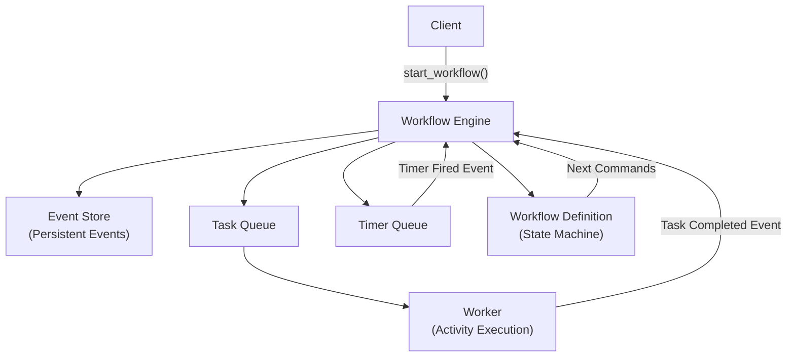
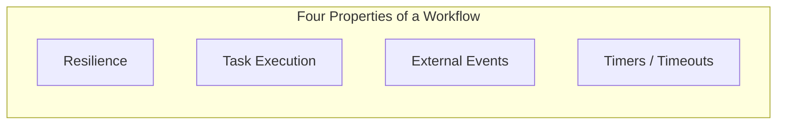
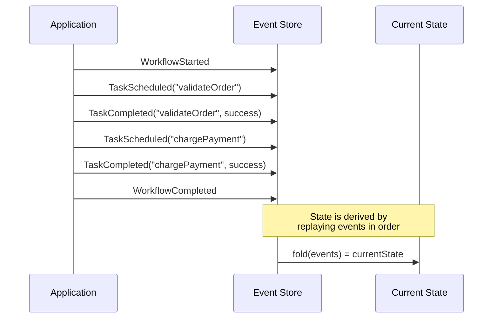
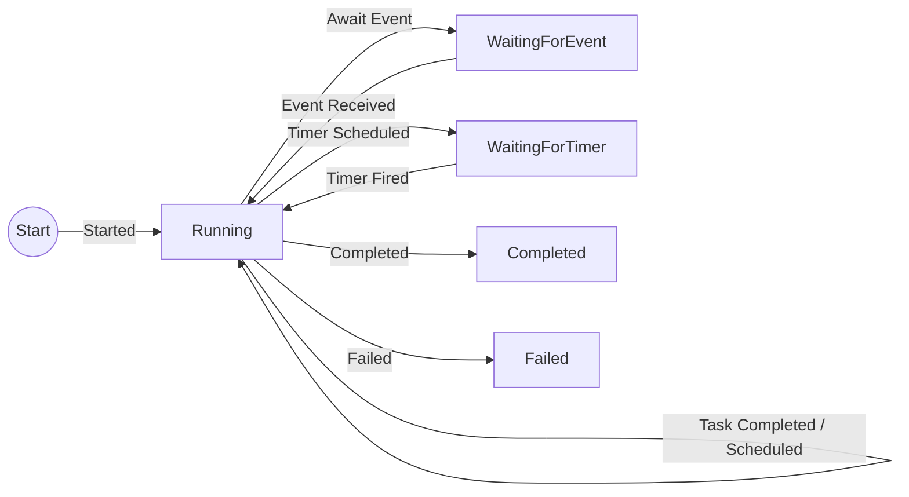
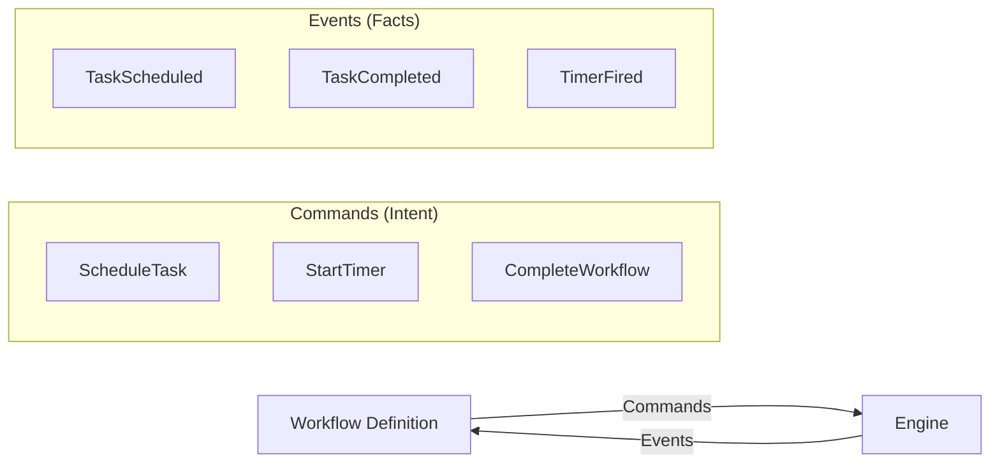
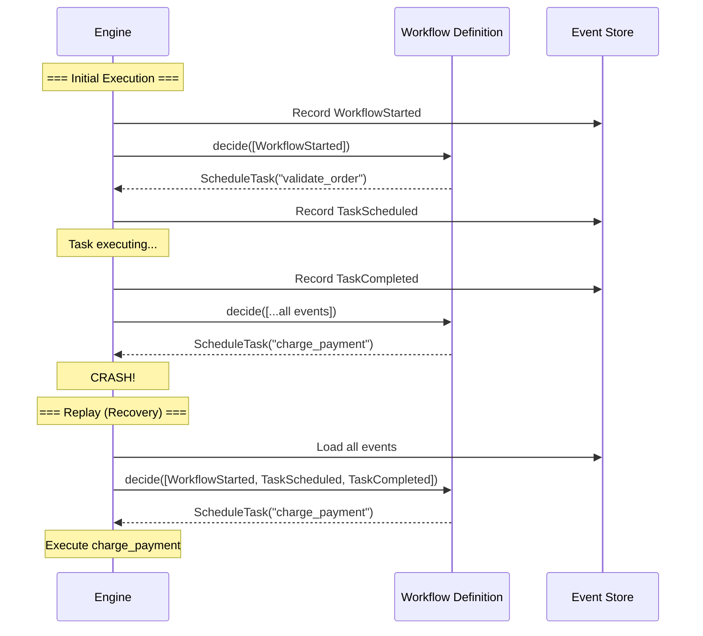
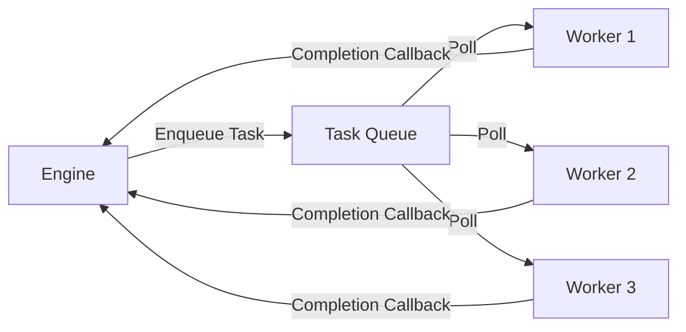
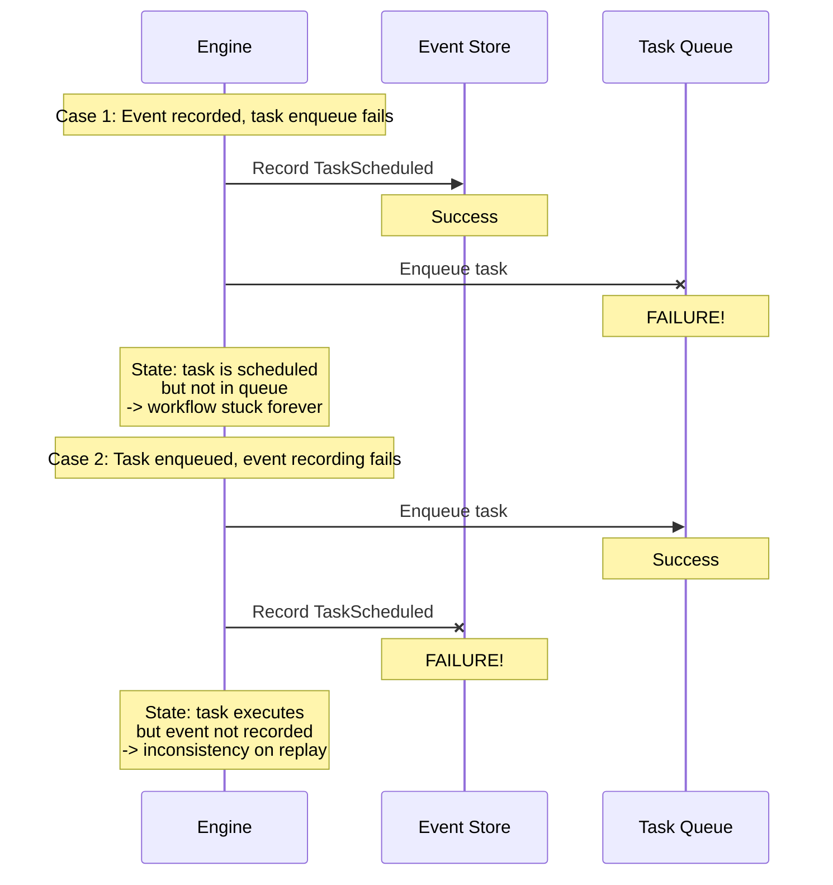
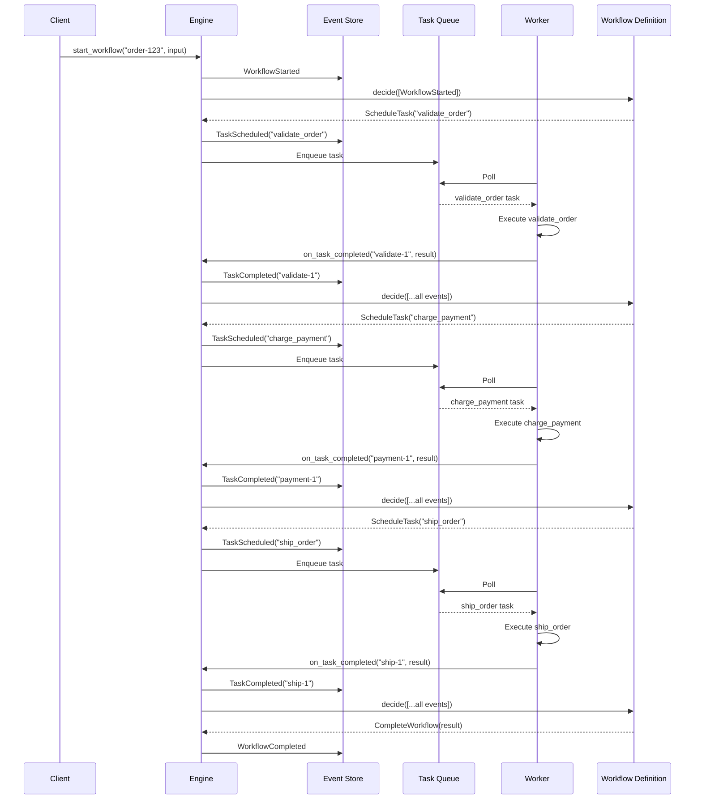
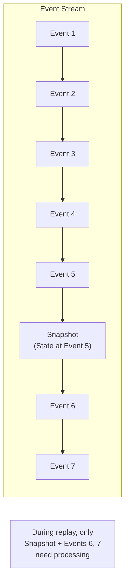

## Introduction

Workflow engines such as Temporal, Azure Durable Functions, and AWS Step Functions run e-commerce order processing, SaaS user onboarding, payment flows, and any other process that must carry several steps through to completion reliably.

Building a small workflow engine yourself shows why these products are designed as they are. This article builds an event-driven workflow engine from scratch in Python. It uses only the standard library, including `dataclass`, `ABC` (Abstract Base Class), and `collections.deque`, so no external packages are required.

### Topics Covered

1. What is a workflow — the four essential properties
2. Event sourcing — storing state as a sequence of events
3. Workflow definitions — deterministic state machines
4. Deterministic replay — the heart of fault tolerance
5. Task queues and workers
6. Timers and timeouts
7. Transactional consistency — the Outbox pattern
8. Putting it all together — an order processing workflow
9. Snapshot optimization
10. Mapping to commercial engines

### Target Audience

- Readers who understand basic Python (classes, functions, dicts, lists)
- Anyone curious about distributed systems or workflow engines but unfamiliar with their internals
- Developers who use Temporal or Azure Durable Functions and want to understand their design principles

## Overall Architecture

The diagram shows the components of the engine and how commands, tasks, and events flow between them. The following chapters implement the components one at a time.



The components have these roles:

- <strong>Workflow Engine</strong> — The orchestrator. It reads history from the event store, consults the workflow definition, and decides the next action.
- <strong>Event Store</strong> — A ledger of everything that happened. It is append-only, so existing records are never modified.
- <strong>Workflow Definition</strong> — The business logic, written as a state machine that defines a procedure such as "validate the order, then charge, then ship."
- <strong>Task Queue</strong> — Hands side-effectful work (API calls, database operations, and so on) to workers.
- <strong>Worker</strong> — A process that pulls tasks from the queue and executes them.
- <strong>Timer Queue</strong> — Handles time-based control such as "send a reminder in 30 days."

This structure is a heavily simplified version of Temporal's architecture, but it uses the same core concepts. Temporal is the successor to Cadence, which was developed at Uber, and is now used in production by companies worldwide.

## Chapter 1: What Is a Workflow — The Four Essential Properties

### Why a "Normal Program" Falls Short

Consider order processing written as a plain program, without a workflow engine:

```python
def process_order(order):
    validate_order(order)        # Step 1: Validate the order
    charge_payment(order)        # Step 2: Charge payment
    ship_order(order)            # Step 3: Ship the order
    send_confirmation(order)     # Step 4: Send confirmation email
```

The code is simple, but it breaks down when something fails or has to wait:

- If the process crashes right after `charge_payment()` succeeds, the payment has been taken but the order never ships, and running the function again may charge the customer twice.
- If `ship_order()` fails because the shipping API times out, the code has to decide how long to wait before retrying and what happens if the process crashes again during the retry.
- "Wait 3 days for customer approval, then cancel on timeout" cannot be built on `time.sleep(3 * 86400)`, because the wait is lost when the process restarts.

A workflow engine solves this problem: it carries multi-step, long-running processes through to completion even when failures occur.

### The Four Properties of a Workflow

Temporal co-founder Maxim Fateev defines a workflow by these four properties:

1. <strong>Resilient Program</strong> — Execution survives process crashes and resumes from where it left off
2. <strong>Executes Tasks</strong> — Invokes side-effectful operations (API calls, database writes, and so on)
3. <strong>Reacts to External Events</strong> — Receives notifications from the outside world, such as a human clicking an approval button or a webhook
4. <strong>Timers and Timeouts</strong> — Time-based control such as "sleep for 30 days" or "cancel if not approved within 3 days"



Workflow engines provide these four properties with two core mechanisms: event sourcing and deterministic replay. The next chapter starts with event sourcing.

## Chapter 2: Event Sourcing — Everything Is a Sequence of Events

### Why Storing "Current State" Alone Is Not Enough

A traditional CRUD (Create/Read/Update/Delete) approach stores only the current state in the database, for example `status = "paid"` in an orders table.

For a workflow engine, this approach has three problems:

- <strong>No audit trail</strong> — You cannot tell how `status` came to be `"paid"`, or who changed what and when.
- <strong>No failure recovery</strong> — When a process crashes, its in-memory intermediate state is lost, and the `status` in the database may or may not have been updated. A half-finished operation cannot be restored correctly.
- <strong>Difficult debugging</strong> — When something goes wrong in production, you cannot reconstruct what happened in what order.

### Event Sourcing as the Solution

Event sourcing records every occurrence (event) in chronological order instead of writing state changes directly to the database. The current state is derived by replaying the recorded events from the beginning.

A bank passbook works the same way. It records "deposit 10,000 yen," "withdrawal 3,000 yen," and "deposit 5,000 yen," and the balance (the current state) is the result of applying these transactions from top to bottom: 10,000 - 3,000 + 5,000 = 12,000 yen. A balance written down on its own cannot be checked for calculation errors, but the full transaction history lets you recompute the correct balance at any time.



### Representing Events in Python — Using `dataclass`

We start by defining the event types that occur in a workflow, using Python's `dataclass`.

`dataclass`, added in Python 3.7, generates `__init__`, `__repr__`, and other boilerplate. With `frozen=True`, an instance's fields cannot be changed after creation. Events record facts that have already happened, so their contents must never change, and `frozen=True` enforces this in code.

The `from __future__ import annotations` import at the top stores type hints such as `str` and `list[WorkflowEvent]` as strings instead of evaluating them immediately, so a hint can name a class that has not been defined yet. The `WorkflowEvent` alias at the end of the block, however, is an ordinary expression evaluated at runtime, and combining classes with `|` requires Python 3.10 or later.

```python
from __future__ import annotations

import time
from dataclasses import dataclass
from typing import Any


# ──────────────────────────────────────────────
# Events: immutable records of "what happened"
# frozen=True prevents field modification after creation
# ──────────────────────────────────────────────

@dataclass(frozen=True)
class WorkflowStarted:
    workflow_id: str
    input_data: Any
    timestamp: float

@dataclass(frozen=True)
class TaskScheduled:
    task_id: str
    task_name: str
    input_data: Any
    timestamp: float

@dataclass(frozen=True)
class TaskCompleted:
    task_id: str
    result: Any
    timestamp: float

@dataclass(frozen=True)
class TaskFailed:
    task_id: str
    error: str
    timestamp: float

@dataclass(frozen=True)
class TimerScheduled:
    timer_id: str
    fire_at: float          # Unix timestamp (seconds)
    timestamp: float

@dataclass(frozen=True)
class TimerFired:
    timer_id: str
    timestamp: float

@dataclass(frozen=True)
class ExternalEventReceived:
    event_name: str
    payload: Any
    timestamp: float

@dataclass(frozen=True)
class WorkflowCompleted:
    result: Any
    timestamp: float

@dataclass(frozen=True)
class WorkflowFailed:
    error: str
    timestamp: float


# Type alias combining all event types (Union type)
WorkflowEvent = (
    WorkflowStarted | TaskScheduled | TaskCompleted | TaskFailed
    | TimerScheduled | TimerFired | ExternalEventReceived
    | WorkflowCompleted | WorkflowFailed
)
```

Every event class has a `timestamp` field that records when the event occurred. Deterministic replay, covered in Chapter 4, depends on this field: if `decide` needs the time, it must read it from events instead of calling `time.time()`.

### Implementing the Event Store

The event store saves and retrieves events. This version keeps them in memory in a Python dict; a production system would use persistent storage such as PostgreSQL or DynamoDB.

```python
from collections import defaultdict


class EventStore:
    """Append-only event store.

    Holds a list of events per workflow ID.
    Once recorded, events are never modified or deleted —
    this is the fundamental rule of event sourcing.
    """

    def __init__(self) -> None:
        # Key: workflow_id, Value: list of events
        self._streams: dict[str, list[WorkflowEvent]] = defaultdict(list)

    def append(self, workflow_id: str, events: list[WorkflowEvent]) -> None:
        """Append events to the end. Never touches existing events."""
        self._streams[workflow_id].extend(events)

    def get_events(self, workflow_id: str) -> list[WorkflowEvent]:
        """Return all events for the given workflow in chronological order."""
        return list(self._streams[workflow_id])

    def get_events_since(
        self, workflow_id: str, after_index: int
    ) -> list[WorkflowEvent]:
        """Return only events after the given index (for snapshot optimization)."""
        return list(self._streams[workflow_id][after_index:])
```

Because `_streams` is a `defaultdict(list)`, appending to a workflow ID that does not exist yet creates an empty list for it automatically.

The event store is append-only: `append` adds events to the end and never modifies or deletes existing ones. This is the fundamental rule of event sourcing. If a past event were modified, the state derived from the events would change, and replay after a failure would restore a different state, breaking consistency. Past transactions must not be erased from a bank passbook for the same reason.

## Chapter 3: Workflow Definition — A Deterministic State Machine

### Every Workflow Is a State Machine

Next, the engine needs a way to express a workflow's business logic.

Every workflow engine, from AWS Step Functions (declared in the JSON-based Amazon States Language) to code-based Temporal, has a state machine at its core. A state machine defines which state the workflow is in and which state an event moves it to.

For order processing, the states would be "order received" → "validated" → "payment charged" → "shipped" → "completed", with each step's completion event triggering the transition to the next state.



The engine's core loop repeats the following cycle:

1. Read the entire event history from the event store
2. Pass the history to the workflow definition (state machine)
3. The workflow definition returns the next commands to execute (for example, "execute task A")
4. The engine executes the commands and records the results as events
5. Go back to step 1

In this loop, the workflow definition returns commands and the engine records events. Keeping the two clearly separate is a key design principle.

### Separating Commands from Events

- <strong>Commands</strong> are intentions issued by the workflow definition: requests such as "execute this task" or "set a timer."
- <strong>Events</strong> are facts recorded by the engine: outcomes such as "this task has completed" or "the timer has fired."



The separation lets the workflow definition contain only pure logic. It decides what should happen, and the engine and workers carry out side effects such as calling the payment API. As a result, the workflow definition can be tested and replayed.

### Implementing Commands and Workflow Definition in Python

Commands are defined with `dataclass`, like events, and the workflow definition interface is defined with `ABC` (Abstract Base Class).

A class derived from `ABC` cannot be instantiated directly; a subclass must implement the specified methods. It plays the same role as `interface` in Java or C#.

```python
from abc import ABC, abstractmethod


# ──────────────────────────────────────────────
# Commands: intentions issued by the workflow definition
# ──────────────────────────────────────────────

@dataclass(frozen=True)
class ScheduleTask:
    task_id: str
    task_name: str
    input_data: Any

@dataclass(frozen=True)
class StartTimer:
    timer_id: str
    delay_seconds: float

@dataclass(frozen=True)
class WaitForEvent:
    event_name: str

@dataclass(frozen=True)
class CompleteWorkflow:
    result: Any

@dataclass(frozen=True)
class FailWorkflow:
    error: str


WorkflowCommand = (
    ScheduleTask | StartTimer | WaitForEvent
    | CompleteWorkflow | FailWorkflow
)


# ──────────────────────────────────────────────
# Abstract interface for workflow definitions
# ──────────────────────────────────────────────

class WorkflowDefinition(ABC):
    """Abstract base class representing workflow business logic.

    Subclasses implement the decide() method.
    decide() is a "pure function" that takes an event history
    and returns a list of commands.
    """

    @abstractmethod
    def decide(self, events: list[WorkflowEvent]) -> list[WorkflowCommand]:
        """Determine the next commands based on event history.

        IMPORTANT: This method MUST be a **pure function**.
        Given the same event sequence, it must always return the same commands.
        """
        ...
```

The requirement that `decide` be a pure function is the most important point in this article: for the same input (event sequence), it must always return the same output (command list), and it must have no side effects. This requirement is what makes deterministic replay possible, as Chapter 4 shows.

### Concrete Example: Order Processing Workflow

The order processing workflow validates the order, charges payment, ships, and then completes.

```python
class OrderWorkflow(WorkflowDefinition):
    """Order processing workflow.

    Progresses through: validate -> charge -> ship -> complete.
    If any task fails, the entire workflow fails.
    """

    def decide(self, events: list[WorkflowEvent]) -> list[WorkflowCommand]:
        # First, compute "what phase are we in" from the event history
        state = self._build_state(events)

        # Return the next command based on the current phase
        if state["phase"] == "started":
            return [ScheduleTask(
                task_id="validate-1",
                task_name="validate_order",
                input_data=state["order_data"],
            )]

        if state["phase"] == "validated":
            return [ScheduleTask(
                task_id="payment-1",
                task_name="charge_payment",
                input_data=state["order_data"],
            )]

        if state["phase"] == "charged":
            return [ScheduleTask(
                task_id="ship-1",
                task_name="ship_order",
                input_data=state["order_data"],
            )]

        if state["phase"] == "shipped":
            return [CompleteWorkflow(result={
                "order_id": state["order_id"],
                "status": "delivered",
            })]

        if state["phase"] == "failed":
            return [FailWorkflow(error=state["error_message"])]

        # No commands if a task is in progress or waiting for an event
        return []

    def _build_state(self, events: list[WorkflowEvent]) -> dict:
        """Process events from the start to reconstruct the current state.

        This operation is called 'rehydration' in event sourcing.
        In functional programming, it corresponds to a fold (reduce).
        """
        phase = "initial"
        order_data: Any = None
        order_id = ""
        error_message = ""

        for event in events:
            if isinstance(event, WorkflowStarted):
                phase = "started"
                order_data = event.input_data
                if isinstance(event.input_data, dict):
                    order_id = event.input_data.get("order_id", "")

            elif isinstance(event, TaskCompleted):
                if event.task_id == "validate-1":
                    phase = "validated"
                elif event.task_id == "payment-1":
                    phase = "charged"
                elif event.task_id == "ship-1":
                    phase = "shipped"

            elif isinstance(event, TaskFailed):
                phase = "failed"
                error_message = event.error

        return {
            "phase": phase,
            "order_data": order_data,
            "order_id": order_id,
            "error_message": error_message,
        }
```

`_build_state` processes the event list from beginning to end to compute the current phase. Event sourcing calls this operation rehydration; in functional programming, it is a fold, the same pattern as `functools.reduce`.

`_build_state` uses `isinstance` to identify each event type and update the state accordingly, much as TypeScript uses `switch (event.type)` and Rust uses `match`. Python 3.10 also added the `match` statement, but this article uses `isinstance`.

## Chapter 4: Deterministic Replay — The Heart of Fault Tolerance

### Why Replay Can Recover State

The most important property of a workflow engine is fault tolerance: even after the process crashes, replaying the event sequence recorded in the event store recovers exactly the same state.

Replay works because `decide`, implemented in the previous chapter, is a pure function that returns the same commands for the same event sequence. Passing the stored history to `decide` therefore determines how far the workflow has progressed and what it should do next.



In the "Replay (Recovery)" part of the diagram, a new process first loads the full history from the event store and passes it to `decide`. For the same event sequence, `decide` returns the same commands as before the crash, so the engine sees that the earlier steps are done, schedules `charge_payment` next, and resumes correctly.

### Determinism Constraints — What You Must NOT Do Inside `decide`

Replay works only if `decide` is deterministic, always producing the same output for the same input. The following operations are therefore forbidden inside `decide`:

| Forbidden | Reason | Alternative |
|-----------|--------|-------------|
| `random.random()` | Returns different values on replay | Execute as a task, record result as event |
| `time.time()` | Returns different timestamp on replay | Use the `timestamp` field from events |
| Network calls | Side effects re-execute on replay | Execute as an activity (task) |
| Global variable access | Values may differ across processes | Pass as input via events |

Temporal explicitly states in its official documentation that "workflow code must be deterministic." Temporal moves every side-effectful operation into an activity (task) and records its result as an event. During replay, it uses the recorded results instead of running the activities again, which keeps replay deterministic.

### Implementing the Replay Engine

The workflow engine is the orchestrator that ties together the event store, workflow definitions, task queue, and timer queue.

```python
class WorkflowEngine:
    """The workflow engine.

    Responsibilities:
    1. Start workflows (start_workflow)
    2. Restore state from event history and determine next commands (process_workflow)
    3. Execute commands and record events (_execute_command)
    4. Callbacks for task completion/failure/timer firing
    """

    def __init__(
        self,
        event_store: EventStore,
        task_queue: "TaskQueue",
        timer_queue: "TimerQueue",
        registry: dict[str, WorkflowDefinition],
    ) -> None:
        self.event_store = event_store
        self._task_queue = task_queue
        self._timer_queue = timer_queue
        self._registry = registry

    # ─── Starting a Workflow ───

    def start_workflow(
        self, workflow_id: str, workflow_type: str, input_data: Any
    ) -> None:
        """Start a new workflow."""
        start_event = WorkflowStarted(
            workflow_id=workflow_id,
            input_data=input_data,
            timestamp=time.time(),
        )
        self.event_store.append(workflow_id, [start_event])
        self.process_workflow(workflow_id, workflow_type)

    # ─── Core Loop ───

    def process_workflow(self, workflow_id: str, workflow_type: str) -> None:
        """Determine the next commands from the event sequence and execute them.

        This method IS deterministic replay.
        Because decide() returns the same commands for the same events,
        the workflow can correctly resume even after a crash.
        """
        definition = self._registry.get(workflow_type)
        if definition is None:
            raise ValueError(f"Unknown workflow type: {workflow_type}")

        events = self.event_store.get_events(workflow_id)

        # Step 1: Deterministic replay — same events -> same commands
        commands = definition.decide(events)

        # Step 2: Skip already-scheduled commands (idempotency guard)
        new_commands = self._filter_already_processed(events, commands)

        # Step 3: Execute only new commands
        for command in new_commands:
            self._execute_command(workflow_id, workflow_type, command)

    # ─── Command Execution ───

    def _execute_command(
        self, workflow_id: str, workflow_type: str, command: WorkflowCommand
    ) -> None:
        """Execute a command and record the corresponding event."""
        now = time.time()

        if isinstance(command, ScheduleTask):
            event = TaskScheduled(
                task_id=command.task_id,
                task_name=command.task_name,
                input_data=command.input_data,
                timestamp=now,
            )
            self.event_store.append(workflow_id, [event])
            self._task_queue.enqueue(TaskEntry(
                workflow_id=workflow_id,
                workflow_type=workflow_type,
                task_id=command.task_id,
                task_name=command.task_name,
                input_data=command.input_data,
            ))

        elif isinstance(command, StartTimer):
            fire_at = now + command.delay_seconds
            event = TimerScheduled(
                timer_id=command.timer_id,
                fire_at=fire_at,
                timestamp=now,
            )
            self.event_store.append(workflow_id, [event])
            self._timer_queue.schedule(TimerEntry(
                workflow_id=workflow_id,
                workflow_type=workflow_type,
                timer_id=command.timer_id,
                fire_at=fire_at,
            ))

        elif isinstance(command, CompleteWorkflow):
            event = WorkflowCompleted(result=command.result, timestamp=now)
            self.event_store.append(workflow_id, [event])

        elif isinstance(command, FailWorkflow):
            event = WorkflowFailed(error=command.error, timestamp=now)
            self.event_store.append(workflow_id, [event])

        # WaitForEvent is a no-op on the engine side —
        # we simply wait for the external event to arrive

    # ─── Callbacks ───

    def on_task_completed(
        self, workflow_id: str, workflow_type: str,
        task_id: str, result: Any,
    ) -> None:
        """Receive task completion notification from a worker."""
        event = TaskCompleted(
            task_id=task_id, result=result, timestamp=time.time()
        )
        self.event_store.append(workflow_id, [event])
        # Re-drive the workflow to determine the next commands
        self.process_workflow(workflow_id, workflow_type)

    def on_task_failed(
        self, workflow_id: str, workflow_type: str,
        task_id: str, error: str,
    ) -> None:
        """Receive task failure notification from a worker."""
        event = TaskFailed(
            task_id=task_id, error=error, timestamp=time.time()
        )
        self.event_store.append(workflow_id, [event])
        self.process_workflow(workflow_id, workflow_type)

    def on_timer_fired(
        self, workflow_id: str, workflow_type: str,
        timer_id: str, now: float,
    ) -> None:
        """Receive timer fired notification from the timer queue."""
        event = TimerFired(timer_id=timer_id, timestamp=now)
        self.event_store.append(workflow_id, [event])
        self.process_workflow(workflow_id, workflow_type)

    # ─── Idempotency Filter ───

    def _filter_already_processed(
        self,
        events: list[WorkflowEvent],
        commands: list[WorkflowCommand],
    ) -> list[WorkflowCommand]:
        """Skip commands that have already been scheduled.

        An idempotency guard to prevent double-execution during replay.
        """
        scheduled_task_ids: set[str] = set()
        scheduled_timer_ids: set[str] = set()
        is_completed = False

        for e in events:
            if isinstance(e, TaskScheduled):
                scheduled_task_ids.add(e.task_id)
            elif isinstance(e, TimerScheduled):
                scheduled_timer_ids.add(e.timer_id)
            elif isinstance(e, (WorkflowCompleted, WorkflowFailed)):
                is_completed = True

        if is_completed:
            return []

        result: list[WorkflowCommand] = []
        for cmd in commands:
            if isinstance(cmd, ScheduleTask) and cmd.task_id in scheduled_task_ids:
                continue    # Already scheduled -> skip
            if isinstance(cmd, StartTimer) and cmd.timer_id in scheduled_timer_ids:
                continue
            result.append(cmd)

        return result
```

The code is long, but each method has one responsibility:

1. <strong>`process_workflow`</strong> — The core loop. Reads all events from the event store, passes them to `decide()` to compute the next commands, and executes only the commands that have not been executed yet.
2. <strong>`_execute_command`</strong> — Records an event for each command type and enqueues work onto the task queue or timer queue.
3. <strong>`on_task_completed` / `on_task_failed` / `on_timer_fired`</strong> — Receive notifications from outside, record an event, and call `process_workflow` again, which moves the workflow to its next step.
4. <strong>`_filter_already_processed`</strong> — The idempotency guard. If `decide()` returns "schedule task A" during replay and the events already record that task A was scheduled, the filter skips the command, so the same command is not executed twice.

## Chapter 5: Task Queues and Workers

### Why Use a Queue?

When the workflow decides to call the payment API, the engine does not call the API itself. It puts a task on a queue, and a worker executes it. There are three reasons for this indirection:

1. <strong>Flow control</strong> — External APIs have rate limits (maximum requests per second). A queue hands out tasks according to worker capacity.
2. <strong>Availability</strong> — If a worker is temporarily down, its tasks wait in the queue. When the worker recovers, it picks them up and resumes processing.
3. <strong>Scalability</strong> — Workers scale horizontally by adding instances. If one worker cannot handle the volume, run ten.



### Implementing the Task Queue and Workers

`deque` (double-ended queue) from the `collections` module appends and pops at both ends in O(1). With a regular `list`, `list.pop(0)` is O(n), whereas `deque.popleft()` is O(1), so `deque` suits a FIFO queue.

`Callable[[Any], Awaitable[Any]]`, built from the `Callable` and `Awaitable` types in `collections.abc`, is the type hint for an activity function: a function that takes one argument of any type and returns an awaitable (asynchronous) result.

```python
from collections import deque
from collections.abc import Awaitable, Callable


@dataclass
class TaskEntry:
    """An entry placed onto the task queue."""
    workflow_id: str
    workflow_type: str
    task_id: str
    task_name: str
    input_data: Any


class TaskQueue:
    """Simple in-memory FIFO task queue.

    In production, replace with RabbitMQ, Amazon SQS, Redis Streams, etc.
    """

    def __init__(self) -> None:
        self._queue: deque[TaskEntry] = deque()

    def enqueue(self, task: TaskEntry) -> None:
        """Add a task to the end of the queue."""
        self._queue.append(task)

    def dequeue(self) -> TaskEntry | None:
        """Retrieve a task from the front of the queue (FIFO).

        Returns None if the queue is empty.
        """
        if self._queue:
            return self._queue.popleft()
        return None

    def __len__(self) -> int:
        return len(self._queue)


# Activity function type: an async function that takes input and returns a result
ActivityFn = Callable[[Any], Awaitable[Any]]


class Worker:
    """Worker: retrieves tasks from the queue and executes them.

    Executes activities (side-effectful operations) and
    notifies the engine of completion or failure.
    """

    def __init__(
        self,
        task_queue: TaskQueue,
        engine: WorkflowEngine,
        activities: dict[str, ActivityFn],
    ) -> None:
        self._task_queue = task_queue
        self._engine = engine
        self._activities = activities

    async def poll(self) -> None:
        """Retrieve one task from the queue and execute it.

        In production, this would run in a continuous loop (long-polling).
        """
        task = self._task_queue.dequeue()
        if task is None:
            return

        activity = self._activities.get(task.task_name)
        if activity is None:
            self._engine.on_task_failed(
                task.workflow_id, task.workflow_type,
                task.task_id, f"Unknown activity: {task.task_name}",
            )
            return

        try:
            result = await activity(task.input_data)
            self._engine.on_task_completed(
                task.workflow_id, task.workflow_type,
                task.task_id, result,
            )
        except Exception as exc:
            self._engine.on_task_failed(
                task.workflow_id, task.workflow_type,
                task.task_id, str(exc),
            )
```

Workers execute activities: side-effectful operations such as external API calls, database queries, or sending email. Workflow definitions and activities follow different rules:

- <strong>Workflow definitions</strong> — Pure functions with no side effects; deterministic and replayable.
- <strong>Activities</strong> — May have side effects and may be non-deterministic; their results are recorded as events.

Activities can be non-deterministic because their results are recorded. During replay, the engine uses the recorded result (`TaskCompleted` or `TaskFailed`) from the event store instead of running the activity again. An external API call that returns a different result every time therefore does not affect the determinism of replay.

## Chapter 6: Timers and Timeouts

### How to Implement "Sleep for 30 Days"

Workflows often require long waits such as "time out after 3 days awaiting approval" or "send a reminder after 30 days."

A naive `time.sleep(30 * 86400)` loses the wait when the process restarts, and keeping a process running for 30 days straight is impractical and wastes memory.

Durable timers solve this. The engine records the scheduled fire time as an event, and a separate process (the timer service) periodically checks for timers that are due and fires them. Because the record that the timer was scheduled remains in the event store, the timer service can recover the timer automatically after a restart.

```python
@dataclass
class TimerEntry:
    """An entry registered in the timer queue."""
    workflow_id: str
    workflow_type: str
    timer_id: str
    fire_at: float   # Unix timestamp (seconds)


class TimerQueue:
    """Durable timer queue.

    Holds a list sorted by fire time.
    Periodically calling check_and_fire() fires
    timers whose time has come.

    In production, replace with Redis Sorted Sets
    or a database scheduler.
    """

    def __init__(self) -> None:
        self._timers: list[TimerEntry] = []

    def schedule(self, timer: TimerEntry) -> None:
        """Register a timer, sorted by fire time."""
        self._timers.append(timer)
        self._timers.sort(key=lambda t: t.fire_at)

    def check_and_fire(
        self, engine: WorkflowEngine, now: float | None = None
    ) -> None:
        """Fire all timers whose time has passed."""
        if now is None:
            now = time.time()

        while self._timers and self._timers[0].fire_at <= now:
            timer = self._timers.pop(0)
            engine.on_timer_fired(
                timer.workflow_id, timer.workflow_type,
                timer.timer_id, now,
            )
```

`check_and_fire` calls the engine's `on_timer_fired`, just as a worker calls `on_task_completed` in the previous chapter. The engine handles timer firing and task completion the same way: it records an event and runs `process_workflow` again.

## Chapter 7: Transactional Consistency — The Outbox Pattern

### The Consistency Trap in Distributed Systems

Each operation in the workflow engine must persist its state change and its delivery intent atomically (all writes succeed or all fail):

1. Append events to the event store
2. Record task-enqueue messages in an Outbox table
3. Record timer-registration messages in the same Outbox table

Without atomicity, the event store and the task queue can disagree in two ways:



In Case 1, the event store records the task as scheduled, but the task never reaches the queue, so no worker processes it and the workflow is stuck forever.

In Case 2, the task is in the queue and gets executed, but the event store has no record of it. During replay, `decide` returns the command again, and because no `TaskScheduled` event exists, the engine schedules the same task a second time.

### The Outbox Pattern Solution

Temporal's architecture solves this with a Transfer Queue. In microservices architecture, the same technique is widely known as the Transactional Outbox pattern, formalized by Chris Richardson.

The pattern works in two parts:

1. Write events and messages (notifications of task enqueue or timer registration) to the database in the <strong>same transaction</strong>
2. A separate process (Outbox relay) asynchronously reads messages and delivers them to the actual queues

This eliminates Case 1, in which the event is recorded but the message is never delivered. If the Outbox relay process crashes, undelivered messages remain in the database and can be retried after it restarts.

```python
import json


@dataclass
class OutboxEntry:
    """An entry in the Outbox table.

    Written in the same transaction as the event store.
    The Outbox relay asynchronously delivers to task/timer queues.
    """
    id: int
    workflow_id: str
    workflow_type: str
    message_type: str      # "task" or "timer"
    payload: str           # JSON string
    processed: bool = False


class TransactionalEventStore:
    """Event store with the Outbox pattern.

    append_with_outbox() atomically appends events
    and adds Outbox messages. In a real system,
    use a database transaction.
    """

    def __init__(self) -> None:
        self._streams: dict[str, list[WorkflowEvent]] = defaultdict(list)
        self._outbox: list[OutboxEntry] = []
        self._next_outbox_id = 1

    def append_with_outbox(
        self,
        workflow_id: str,
        events: list[WorkflowEvent],
        messages: list[OutboxEntry],
    ) -> None:
        """Atomically append events and add Outbox messages.

        ──── Transaction boundary ────
        In a real system, wrap with BEGIN / COMMIT:
          BEGIN;
            INSERT INTO event_store ...;
            INSERT INTO outbox ...;
          COMMIT;
        """
        self._streams[workflow_id].extend(events)
        for msg in messages:
            msg.id = self._next_outbox_id
            self._next_outbox_id += 1
            self._outbox.append(msg)

    def process_outbox(
        self,
        task_queue: TaskQueue,
        timer_queue: TimerQueue,
    ) -> None:
        """Outbox relay: deliver unprocessed messages to queues."""
        for entry in self._outbox:
            if entry.processed:
                continue

            payload = json.loads(entry.payload)
            if entry.message_type == "task":
                task_queue.enqueue(TaskEntry(**payload))
            elif entry.message_type == "timer":
                timer_queue.schedule(TimerEntry(**payload))

            entry.processed = True

    def get_events(self, workflow_id: str) -> list[WorkflowEvent]:
        """Return all events for the given workflow."""
        return list(self._streams[workflow_id])
```

This in-memory implementation marks the transaction boundary only with a comment, but the pattern is the same. A production system makes `append_with_outbox` truly atomic by wrapping its writes in SQL `BEGIN` / `COMMIT`.

> <strong>Outbox pattern guarantees and caveats</strong>: Messages are delivered at least once. If the Outbox relay crashes right after delivering a message, the `processed = True` update is lost, and the same message may be delivered again on the next startup. Consumers (workers and timer handlers) must therefore be idempotent: performing an operation several times must give the same result as performing it once. For example, "set the balance to 1,000" is idempotent (repeating it still gives 1,000), but "add 1,000 to the balance" is not (each repetition adds another 1,000). A common approach is to record the IDs of processed tasks and skip duplicates.

## Chapter 8: Putting It All Together — Order Processing Workflow

### The Complete Execution Flow

The diagram traces the order processing workflow with all components assembled and shows which component acts at each step.



The flow proceeds as follows:

1. The client calls `start_workflow`. The engine records a `WorkflowStarted` event and calls `decide`.
2. `decide` determines "not yet validated" and returns `ScheduleTask("validate_order")`.
3. The engine records a `TaskScheduled` event and enqueues the task.
4. A worker picks up the task from the queue and executes the `validate_order` activity.
5. On success, the worker calls `on_task_completed` on the engine.
6. The engine records a `TaskCompleted` event and calls `decide` again.
7. `decide` determines "validation is done; next is payment" and returns `ScheduleTask("charge_payment")`.
8. The same pattern repeats through charge → ship → complete.

If the process crashes right after recording `TaskCompleted` in step 6, a new process loads all events from the event store and passes them to `decide`. From the events, `decide` deterministically concludes that validation is done and payment comes next, so the workflow resumes correctly at step 7.

### The Entry Point — Wiring Everything Together

The sequence diagram does not show where execution starts. The `main` function below wires all the components together and starts one workflow.

```python
import asyncio


# ─── Activity functions (side-effectful business logic) ───

async def validate_order(input_data: Any) -> dict:
    """Validate the order contents."""
    order_id = input_data["order_id"]
    # In production: check inventory, validate inputs, etc.
    return {"valid": True, "order_id": order_id}


async def charge_payment(input_data: Any) -> dict:
    """Process payment."""
    order_id = input_data["order_id"]
    # In production: call the payment gateway API
    return {"charged": True, "order_id": order_id}


async def ship_order(input_data: Any) -> dict:
    """Process shipping."""
    order_id = input_data["order_id"]
    # In production: call the shipping carrier API
    return {"tracking_id": "TRK-456", "order_id": order_id}


# ─── Main function ───

async def main() -> None:
    # 1. Initialize the infrastructure layer
    event_store = EventStore()
    task_queue = TaskQueue()
    timer_queue = TimerQueue()

    # 2. Register workflow definitions
    #    The key "order" corresponds to workflow_type in start_workflow
    registry: dict[str, WorkflowDefinition] = {
        "order": OrderWorkflow(),
    }

    # 3. Assemble the engine
    engine = WorkflowEngine(event_store, task_queue, timer_queue, registry)

    # 4. Register activity functions and create the worker
    #    Keys correspond to the task_name values returned by decide()
    activities: dict[str, ActivityFn] = {
        "validate_order": validate_order,
        "charge_payment": charge_payment,
        "ship_order": ship_order,
    }
    worker = Worker(task_queue, engine, activities)

    # 5. Start a workflow
    engine.start_workflow(
        workflow_id="order-123",
        workflow_type="order",
        input_data={"order_id": "ORD-123", "items": ["item-A", "item-B"]},
    )

    # 6. Process tasks until the queue is drained
    while len(task_queue) > 0:
        await worker.poll()

    # 7. Inspect the results
    events = event_store.get_events("order-123")
    for i, event in enumerate(events):
        print(f"[{i}] {type(event).__name__}")


asyncio.run(main())
```

`main` connects four layers:

- `EventStore`, `TaskQueue`, and `TimerQueue` are the infrastructure layer, responsible for data persistence and task routing.
- `OrderWorkflow` is the business logic layer, responsible for deciding what to do next.
- `WorkflowEngine` is the orchestration layer. It records events, calls `decide`, and executes commands.
- `Worker` is the execution layer. It runs side-effectful activities and reports the results back to the engine.

Because each concern lives in its own layer, `main` only assembles and starts the layers; it contains no business logic and no infrastructure details.

In production, the `while len(task_queue) > 0` loop would be replaced by a long-polling process, and `asyncio.run(main())` would be integrated into a web framework's entry point (for example, FastAPI with `uvicorn`). The wiring stays the same.

### The Event Store Contents

After execution completes, the event store contains these events:

```text
[0] WorkflowStarted      input={"order_id": "ORD-123", "items": [...]}
[1] TaskScheduled         task_id="validate-1"  task_name="validate_order"
[2] TaskCompleted         task_id="validate-1"  result={"valid": True, ...}
[3] TaskScheduled         task_id="payment-1"   task_name="charge_payment"
[4] TaskCompleted         task_id="payment-1"   result={"charged": True, ...}
[5] TaskScheduled         task_id="ship-1"      task_name="ship_order"
[6] TaskCompleted         task_id="ship-1"      result={"tracking_id": "TRK-456", ...}
[7] WorkflowCompleted     result={"order_id": "ORD-123", "status": "delivered"}
```

This history lets you reconstruct the state at any point in time and use it for auditing and debugging. To find out why an order failed, read its events from top to bottom; every step is recorded.

## Chapter 9: Snapshot Optimization

### The Replay Cost Problem

In the current implementation, every call to `process_workflow` reads all events from the event store and passes them to `decide`. This is fine for short workflows, but for workflows with thousands or tens of thousands of steps (such as large batch processes or long-running approval flows), replaying all events every time becomes prohibitively expensive.

### Snapshots as the Solution

Every N events, a snapshot saves the state at that point. The next replay starts from the latest snapshot and processes only the events that came after it.



For example, in a workflow with 1,000 events where a snapshot was taken at event 500, replay only needs to process events 501 through 1,000 — cutting the work in half.

Snapshots are only an optimization; the event stream remains the source of truth. A corrupted or lost snapshot can always be regenerated from the event stream, so no data is lost.

## Chapter 10: Mapping to Commercial Workflow Engines

The table maps each part of the minimal engine to its counterpart in Temporal and Azure Durable Functions. The names differ, but the underlying mechanisms correspond; the exception is replay optimization, where neither engine keeps a persistent snapshot.

| Concept | Our Implementation | Temporal | Azure Durable Functions |
|---------|-------------------|----------|------------------------|
| Event Store | `EventStore` class | History Service (Event History per workflow) | Azure Storage Table/Blob (History Table) |
| Workflow Definition | `WorkflowDefinition.decide()` | Workflow function (deterministic code) | Orchestrator function (`yield`/`await` for replay) |
| Task Execution | `Worker` + `TaskQueue` | Activity + Task Queue | Activity function + Durable Task Framework |
| Timers | `TimerQueue` | Durable Timer (within History Service) | Durable Timer (`create_timer()`) |
| Outbox Pattern | `TransactionalEventStore` | Transfer Queue (local queue per shard) | Control Queue + Work Item Queue |
| Deterministic Replay | `process_workflow()` | Workflow Task Processing | Orchestrator Replay |
| Snapshots / replay optimization | `get_events_since()` | Sticky Execution (in-memory cache on a worker; not a persistent snapshot — full replay on worker failure) | Extended Sessions / instance cache (in-memory replay cache, not a persistent snapshot; support depends on the storage provider) |

Temporal's Sticky Execution caches workflow state in a worker process's memory. When the same worker receives consecutive processing assignments, it can skip replay. If the worker crashes, however, the cache is lost and a full replay is required, unlike with the persistent snapshots described in Chapter 9.

## Conclusion

The engine built in this article rests on six design principles:

1. <strong>Event Sourcing</strong> — Record state as an immutable sequence of events instead of storing it directly, and derive the current state by replaying the events, as with a bank passbook.
2. <strong>Deterministic Workflow Definitions</strong> — Write workflow logic as pure functions. Because they always return the same commands for the same event sequence, replay can recover from failures.
3. <strong>Command-Event Separation</strong> — Separate what the workflow wants to do (commands) from what happened (events) to isolate workflow definitions from side effects.
4. <strong>Indirect Execution via Task Queues</strong> — Delegate side-effectful operations to workers and use queues for flow control, availability, and scalability.
5. <strong>Durable Timers</strong> — Record timers as events instead of using `time.sleep()`, so they do not depend on the process staying alive.
6. <strong>Outbox Pattern</strong> — Persist state updates and message-send intents atomically for consistency in distributed systems. The relay delivers at least once, so consumers must be idempotent.

These principles explain the design decisions behind Temporal, Azure Durable Functions, and other workflow engines: why workflow code must be deterministic, and why consumers such as workers must be idempotent.

## References

- [Designing a Workflow Engine from First Principles — Temporal Blog](https://temporal.io/blog/workflow-engine-principles)
- [Event Sourcing pattern — Microsoft Azure Architecture Center](https://learn.microsoft.com/en-us/azure/architecture/patterns/event-sourcing)
- [Transactional Outbox pattern — microservices.io (Chris Richardson)](https://microservices.io/patterns/data/transactional-outbox.html)
- [Event Sourcing — Martin Fowler](https://martinfowler.com/eaaDev/EventSourcing.html)
- [CQRS Documents (PDF) — Greg Young](https://cqrs.files.wordpress.com/2010/11/cqrs_documents.pdf)
- [Temporal Documentation — Concepts](https://docs.temporal.io/concepts)
- [Azure Durable Functions Documentation](https://learn.microsoft.com/en-us/azure/azure-functions/durable/durable-functions-overview)
