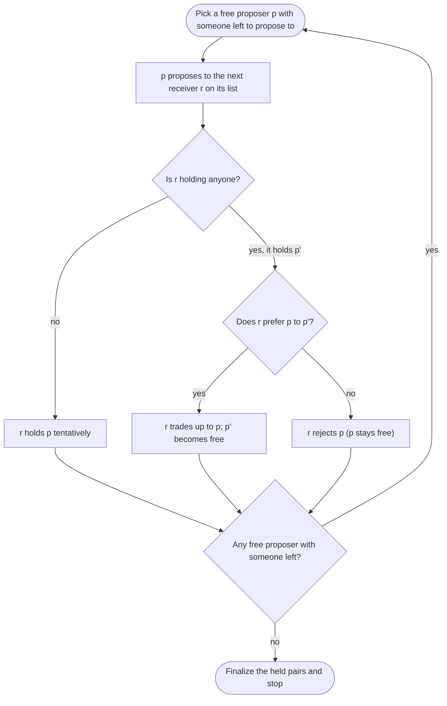

Every autumn, final-year medical students in Japan submit a list of the hospital training programs they want, in order of preference, and the hospitals submit lists of the students they want to hire. A computer decides who goes where, and everyone learns the result on the same day. This is the Japan Residency Matching Program (JRMP). At the heart of the procedure is <strong>deferred acceptance</strong> — the Gale–Shapley algorithm that David Gale and Lloyd Shapley described in a seven-page paper in 1962.

The algorithm fits in about twenty lines. Behind it, though, sits a surprisingly deep set of facts.

- <strong>A stable matching always exists</strong>, and one can be found in $O(n^2)$ time.
- The result does not depend on the order of proposals, and it is <strong>the best stable outcome for the side that proposes and the worst for the side that receives</strong>.
- Proposers <strong>cannot gain by misreporting their preferences</strong>. Receivers sometimes can.
- With random preferences, proposers end up with an average rank of about $\ln n$ and receivers with about $n / \ln n$ — a big gap. Yet <strong>adding a single agent to one side makes it almost irrelevant who proposes</strong>: the short side gets about $\ln n$ either way.

This article starts from the definition of the problem and works through why the naive approach fails, why the algorithm is correct, what the set of all stable matchings looks like, how participants' strategies come into play, and how the idea is used in real institutions — checking each step with interactive demos.

<strong>A note on terminology.</strong> The original paper and many textbooks describe the algorithm with the metaphor of men proposing marriage to women. This article uses the gender-neutral terms <em>proposers</em> and <em>receivers</em>. The agents on the left are A, B, C, D and those on the right are W, X, Y, Z. It may help to read the left side as residents, students or applicants, and the right side as hospitals, schools or employers.

<strong>How to read this.</strong> For just the algorithm and its implementation, read 1.1–1.2, section 3, 4.5 and section 10. Sections 4–5 explain why it works and which stable matching it returns, section 6 covers misreporting, section 7 random markets, section 8 real market design, and section 9 variants and hardness. Collapsed proofs and deep dives can be skipped without losing the thread. Key terms and the sections that define them: blocking pair (1.2), deferred acceptance (section 3), valid partner (5.2), rotation (5.4–5.5), truncation (6.2), individual rationality (8.1) and cutoff (8.4).

<ArticleVideo slug="gale-shapley" />

## 1. The problem: matching when both sides have preferences

### 1.1 Setting

There is a set $L$ on the left and a set $R$ on the right; for now both have $n$ members. Every agent ranks everyone on the other side <strong>strictly, with no ties</strong>. We write $a \succ_x b$ when $x$ prefers $a$ to $b$.

A <strong>matching</strong> $\mu$ is a set of left–right pairs in which each agent appears in at most one pair. We write $\mu(x)$ for $x$'s partner.

Throughout the article we use the following 4-by-4 «running example».

| Agent | Preferences (best first) |
|---|---|
| A | W > X > Z > Y |
| B | Z > W > Y > X |
| C | Z > Y > W > X |
| D | Z > X > Y > W |
| W | C > B > D > A |
| X | D > B > A > C |
| Y | B > C > D > A |
| Z | A > D > C > B |

B, C and D all list Z first. The scramble for the popular Z is what makes this example interesting.

### 1.2 Blocking pairs and stability

Given a matching $\mu$, two agents $(a, w)$ from opposite sides who are not matched to each other form a <strong>blocking pair</strong> if

$$
w \succ_a \mu(a) \quad \text{and} \quad a \succ_w \mu(w).
$$

Both of them prefer each other to their current partners. An agent without a partner is assumed to prefer any partner to none (we drop this assumption for truncated reports in section 6 and in general in section 8).

A matching with no blocking pair is called <strong>stable</strong>.

Take, for example, the matching A–W, B–X, C–Y, D–Z (written «AW BX CY DZ» from now on). B prefers W (its 2nd choice) to its partner X (4th), and W prefers B (2nd) to its partner A (4th). So $(B, W)$ is a blocking pair, and this matching is not stable.

### 1.3 Why ask for stability?

The two agents of a blocking pair have a reason to ignore the assignment and make a deal on their own. Once one such side deal happens, the rest of the assignment can unravel. Stability is the condition under which <strong>nobody has an incentive to trade outside the system</strong> — the condition under which an assignment is actually honored.

This is not a theoretical worry. In the 1940s, US hospitals competing for good students kept moving their offers earlier, until appointments were being made nearly two years before graduation. When the medical schools agreed in 1945 to hold back transcripts and letters until a fixed date, the competition simply moved to deadlines: the time allowed for a reply shrank from 10 days in 1945 to about 12 hours within a few years. These were «exploding offers» that had to be answered before hanging up the phone. A centralized match (today's NRMP) was introduced in 1952, the chaos subsided, and participants voluntarily stayed with it.

Why did they stay? Alvin Roth (1984) pointed out that the procedure in use since 1952 <strong>produced stable matchings</strong>, and argued that this was why it succeeded. Roth (1991) then compared the regional residency matches of the United Kingdom and found that the schemes producing stable matchings survived, while most of those that did not were abandoned.

### 1.4 Why not maximize total satisfaction?

One could convert preferences into scores and maximize «total satisfaction» — solve an assignment problem with the Hungarian method, say. That solution need not be stable. In the running example, minimizing just the left side's total rank gives AW BZ CY DX (total 6), but $(C, Z)$ and $(D, Z)$ are blocking pairs. Minimizing the total rank of both sides happens to pick two of the stable matchings in the running example (AZ BW CY DX and AZ BY CW DX, the «egalitarian» ones of section 5.5), but that is not guaranteed either: on randomly generated 4-by-4 instances, roughly one time in four every matching with the minimum two-sided total rank is unstable. Stability is a condition about <strong>each participant's incentives</strong> — nobody wants to defect — rather than about a sum, and it is defined from rankings alone, without assuming numeric utilities. Both properties make it practical.

## 2. The naive approach: fix unhappy pairs one at a time

The most naive way to build a stable matching is to start from any matching and, while a blocking pair exists, let those two pair up. If we also pair up the two partners they abandoned, everybody keeps a partner.

Does this work? Try it in the demo below. It starts with a 3-by-3 example. Click a preference chip to rearrange the matching by hand; blocking pairs show up as red dashed lines.

<BlockingPairExplorer />

Press «Cycle scenario» four times. It resolves $(C, X) \to (C, Y) \to (A, Y) \to (A, X)$, each a genuine blocking pair at that moment, and yet <strong>it arrives back at the starting matching AX BY CZ</strong>. As long as pairs are chosen this way, the procedure never ends. Knuth (1976) pointed out that resolving blocking pairs can cycle.

If instead $(C, Y)$ is chosen at the start, a single step reaches the stable matching AX BZ CY. Roth and Vande Vate (1990) showed that from any matching, a well-chosen finite sequence of resolutions reaches a stable matching, and that choosing blocking pairs at random reaches one with probability 1 (in their model, abandoned partners become single). The random approach can, however, need exponential expected time on some instances (Ackermann et al., 2011).

Switch the demo to «Running example (4×4)» and it starts from AW BX CY DZ, the matching of section 1.2, with two blocking pairs, $(B, W)$ and $(B, Y)$. Resolving $(B, W)$ pairs up the abandoned A and X and reaches AX BW CY DZ in one step — exactly the stable matching Gale–Shapley returns in the next section.

The lesson: <strong>repeated local repair is not enough; we need a procedure that sees the whole picture</strong>. That is the Gale–Shapley algorithm.

## 3. The Gale–Shapley algorithm (deferred acceptance)

### 3.1 The procedure

Call one side (here the left) the <strong>proposers</strong> and the other side the <strong>receivers</strong>.

```text
start with everyone free (unmatched)
while some proposer p is free and still has someone left to propose to:
    r ← the receiver p likes best among those p has not proposed to yet
    p proposes to r
    if r holds nobody:
        r holds p «tentatively»
    else if r prefers p to the proposer p' it currently holds:
        r holds p and lets go of p' (p' becomes free)
    else:
        r rejects p
finalize the pairs currently held and stop
```

There are two key points. Proposers propose <strong>one at a time, in order of preference</strong>, moving on when rejected. Receivers <strong>hold only the best proposal received so far</strong> and reject the rest. Holding is not a commitment: if a better proposal arrives later, the receiver trades up.



### 3.2 Running it

Step through the running example in the demo below. The tables on both sides show each agent's preferences; a chip's look tells you whether it is part of the current proposal (amber), next to be proposed to (dashed amber), tentatively held (gray), rejected or turned away (struck through) or in the final result (green). The «#k» at the end of each row is the position of that agent's current partner in its own list (a proposer without a partner shows «→#k», the position of its next proposal). Before pressing play, try to predict whom B ends up with.

<GaleShapleyVisualizer />

In the running example (A–D propose, one at a time) the algorithm stops after these seven proposals.

1. A → W (1st choice). W is free and holds A tentatively.
2. B → Z. Z is free and holds B tentatively.
3. C → Z. Z ranks A > D > C > B, so it <strong>lets B go and trades up to C</strong>. B is free again.
4. D → Z. Z prefers D to C, so it <strong>lets C go and trades up to D</strong>. C is free again.
5. B → W (2nd choice). W ranks C > B > D > A, so it <strong>lets A go and trades up to B</strong>. A is free again.
6. C → Y (2nd choice). Y is free and holds C.
7. A → X (2nd choice). X is free and holds A. Everyone has a partner, so the algorithm stops.

The result is <strong>AX BW CY DZ</strong>, with no blocking pair. Look at the chain in steps 3–5: B, pushed out of the contest for Z, proposes to W and in turn pushes out A, whom W had been holding. <strong>A receiver trading up sets off a chain reaction among the proposers</strong> — that is how deferred acceptance moves.

### 3.3 What if acceptance is not deferred?

Switch the demo's «Acceptance» setting to «Immediate (Boston)». Under immediate acceptance, in round $k$ every unassigned proposer applies to their $k$-th choice, and receivers make their acceptance <strong>final on the spot</strong>. A better proposal arriving later cannot change it.

The running example now ends in AW BX CY DZ, leaving $(B, W)$ and $(B, Y)$ as blocking pairs. In round 1, B applied to the popular Z and was rejected — and meanwhile W permanently accepted A, whom W ranks last. W prefers B to A but no longer has a seat.

Because Boston's public schools once used this rule, it is called the «Boston mechanism». The «deferred» in deferred acceptance refers exactly to this: postponing commitment until the very end. As section 6.4 shows, the difference also has decisive consequences for participants' strategies.

### 3.4 The order of proposals does not matter

Now switch the demo's «Proposal order». «All at once (rounds)» is how Gale and Shapley wrote it: in each round every free proposer proposes simultaneously and each receiver keeps only its best offer. The running example finishes in three rounds. «Queue», «Stack» and «Random» all pick one free proposer at a time, the version common in algorithms textbooks; the stack version, in which a proposer who becomes free proposes again immediately, corresponds to the chain-reaction formulation of McVitie and Wilson (1971).

Whatever the order, the final result stays AX BW CY DZ and the number of proposals stays 7. This is not a coincidence but a theorem (section 5).

## 4. Why it works

### 4.1 Two monotonicity properties

The proofs need only two facts that are visible directly in how the algorithm behaves.

- <strong>Receivers only get better</strong>: once a receiver has received a proposal, it holds someone for the rest of the run, and every trade-up gives it someone it likes more.
- <strong>Proposers only get worse</strong>: each proposer works down its own list. It never proposes to the same receiver twice, and each proposal goes to someone it likes less than the last.

The «#k» at the end of each row in the demo of section 3.2 shows this directly: proposers' numbers only grow and receivers' numbers only shrink.

### 4.2 Termination: at most $n^2 - n + 1$ proposals

Each proposer proposes to each receiver at most once, so there are at most $n^2$ proposals and the algorithm always stops. We can count more precisely.

Everyone is matched exactly <strong>when the last receiver receives its first proposal</strong> (by monotonicity, a receiver that has been proposed to keeps holding someone, so once every receiver has been proposed to, everyone has a partner). Until just before that moment, at least one receiver $r^*$ has not been proposed to by anyone. So each proposer has made at most $n - 1$ proposals so far, for at most $n(n-1)$ in total. Adding the final proposal,

$$
\begin{aligned}
\text{number of proposals} &\le n(n-1) + 1 \\
&= n^2 - n + 1.
\end{aligned}
$$

This bound is attained exactly. The «Worst case» preset of the demo in section 3.2 is a 4-by-4 instance that needs 13 proposals. Perhaps surprisingly, «Identical lists» (every proposer ranks W > X > Y > Z) — maximal competition — needs only $4 + 3 + 2 + 1 = 10$ proposals whatever the receivers' preferences: everybody proposes to W, one of them stays, the rest propose to X, and so on. That falls short of the worst case. The minimum is $n = 4$, reached whenever all first choices differ (for example when W–Z propose in section 5.1). Since the demo lets you edit any list by clicking its chips, try starting from the running example and see how high you can push the number of proposals.

### 4.3 Everyone gets a partner

Suppose some proposer $p$ is still free at the end. A proposer stops free only after proposing to everyone on its list. Then every receiver has been proposed to at least once, so every receiver holds someone. If the $n$ receivers each hold a different proposer, all $n$ proposers are held — contradicting the fact that $p$ is free.

### 4.4 Stability

Suppose the output $\mu$ had a blocking pair $(p, r)$. Since $r \succ_p \mu(p)$ and $p$ proposes in order of preference, $p$ proposed to $r$ before $\mu(p)$. They did not end up together, so at some point $r$ rejected $p$ (immediately, or later by trading up). At that point $r$ held someone it liked more than $p$, and since receivers only get better, its final partner $\mu(r)$ is also someone it likes more than $p$. That contradicts $p \succ_r \mu(r)$.

### 4.5 Running time and implementation essentials

If each proposal is processed in $O(1)$ time, the whole run takes $O(n^2)$. The key is to convert the receivers' preferences into a <strong>rank table</strong> first.

- `rank[r][p]`: the position of $p$ in receiver $r$'s list. «Does $r$ prefer $p$ or $p'$?» takes two array lookups.
- `next[p]`: the position in $p$'s list of the next receiver to propose to.
- Keep the free proposers in a queue or a stack.

Without a rank table, finding «where is $p$ in this list?» by linear search makes each comparison $O(n)$ and the whole algorithm $O(n^3)$.

The input itself ($2n$ lists of length $n$) has size $\Theta(n^2)$, so $O(n^2)$ is <strong>linear in the size of the input</strong>. And in the worst case it cannot be done faster: measured by the number of queries to the preference lists, finding a stable matching needs $\Omega(n^2)$ queries in the worst case (Ng and Hirschberg, 1990). Similar lower bounds hold for randomized algorithms and for communication (Gonczarowski et al., 2019). A Python implementation and tests are in section 10.

## 5. Which stable matching, and good for whom?

### 5.1 There can be more than one stable matching

Let the receivers (W–Z) propose in the running example. The run ends after four proposals — W→C, X→D, Y→B, Z→A — and the result is <strong>AZ BY CW DX</strong>. Every receiver gets its first choice, while A, B and C get their 3rd choice and D its 2nd. This matching is stable too. So <strong>the result depends on which side proposes</strong>. Which of the stable matchings, then, does Gale–Shapley return?

### 5.2 Proposer-optimality

If a proposer $p$ and a receiver $r$ are paired in <strong>some</strong> stable matching, call $r$ a <strong>valid partner</strong> of $p$. Write $\mathrm{best}(p)$ for $p$'s favorite valid partner.

The running example has four stable matchings (section 5.4), and the proposers' valid partners are as follows ($\mathrm{best}(p)$ in bold).

| Proposer | Valid partners (best first) |
|---|---|
| A | <strong>X</strong> (2nd choice), Z (3rd choice) |
| B | <strong>W</strong> (2nd choice), Y (3rd choice) |
| C | <strong>Y</strong> (2nd choice), W (3rd choice) |
| D | <strong>Z</strong> (1st choice), X (2nd choice) |

Collecting everyone's $\mathrm{best}$ gives AX BW CY DZ — exactly the output of section 3.2. Each proposer takes its own favorite, and yet no two of them want the same partner. That is what the next theorem says.

<strong>Theorem (Gale–Shapley, 1962).</strong> In the output of proposer-proposing Gale–Shapley, every proposer $p$ is matched to $\mathrm{best}(p)$.

<strong>Proof.</strong> Suppose that during the run some proposer is <strong>rejected by a valid partner</strong>, and consider the first time this happens. Receiver $r$ rejects $p$, of whom it is a valid partner, in favor of $p'$ (so $p' \succ_r p$). Since $r$ is a valid partner of $p$, there is a stable matching $S$ that pairs $p$ with $r$. Let $r'$ be $p'$'s partner in $S$.

Because $p'$ is now proposing to $r$ (or being held by it), every receiver above $r$ on $p'$'s list has already rejected $p'$. Since we are looking at the first rejection by a valid partner, none of those rejections came from a valid partner of $p'$. But $r'$ is a valid partner of $p'$ (they are paired in $S$), so $r'$ is not above $r$: we have $r \succ_{p'} r'$.

Now in $S$, $p'$ prefers $r$ to its partner $r'$, and $r$ prefers $p'$ to its partner $p$. So $(p', r)$ blocks $S$, contradicting the stability of $S$. Hence no proposer is ever rejected by a valid partner. In particular $p$ is never rejected by $\mathrm{best}(p)$, so it ends with someone at least as good as $\mathrm{best}(p)$. On the other hand, the output is stable (section 4.4), so that final partner is a valid partner and cannot be better than $\mathrm{best}(p)$. Hence $p$ is matched with $\mathrm{best}(p)$. $\blacksquare$

This theorem explains every observation in section 3.4.

- The output is exactly «everyone matched with $\mathrm{best}(p)$», so <strong>it does not depend on the order of proposals</strong>.
- Each $p$ proposes exactly once to each receiver it ranks at or above $\mathrm{best}(p)$, so <strong>the set of proposals does not depend on the order either</strong>, and their number equals the sum of the proposers' final ranks: $2 + 2 + 2 + 1 = 7$ in the running example.

Roth (1982) also showed that no matching at all — stable or not — makes <strong>every proposer strictly better off</strong> than the proposer-optimal stable matching.

### 5.3 Receiver-pessimality

<strong>Theorem.</strong> In the same output, every receiver is matched to the valid partner it likes <strong>least</strong>.

<strong>Proof.</strong> Suppose that in the output $\mu_0$ receiver $r$ is matched with $p$, while in some stable matching $S$ it is matched with $p''$, whom it likes less ($p \succ_r p''$). In $S$, $p$'s partner is a valid partner other than $r$, so proposer-optimality gives $r = \mathrm{best}(p) \succ_p S(p)$. Then $(p, r)$ blocks $S$, a contradiction. $\blacksquare$

In other words, <strong>being on the proposing side is an advantage in itself</strong>.

<strong>Intuition.</strong> Proposers start at the top and give up on a receiver only once it is out of reach in every stable matching — exactly what the proof in section 5.2 shows. Receivers can only choose among the offers that arrive; they have no way to court someone who never proposes. It is the logic of an ascending auction: bidders raise their bids only when outbid, so the auction stops at the lowest market-clearing prices — the outcome best for the buyers (Demange, Gale and Sotomayor, 1986).

In the US residency match it later came to light that the procedure used since 1952 produced the same result as a hospital-proposing algorithm; together with students' dissatisfaction, this led to the 1998 switch to an applicant-proposing design (the Roth–Peranson algorithm).

### 5.4 The lattice of stable matchings

The set of all stable matchings has a beautiful structure.

<strong>Opposition of interests.</strong> For two stable matchings $\mu$ and $\mu'$, if every proposer likes $\mu$ at least as much as $\mu'$, then every receiver likes $\mu'$ at least as much as $\mu$. An improvement for the proposers is precisely a deterioration for the receivers.

<strong>A lattice.</strong> Given two stable matchings $\mu$ and $\mu'$, give each proposer the better of its two partners: the result is again a matching, and a stable one. Giving each proposer the worse of the two also yields a stable matching. With these two operations as join and meet, the stable matchings form a <strong>distributive lattice</strong>. Knuth (1976) credits this result to John Conway. The top of the lattice is proposer-optimal (the output of Gale–Shapley with the left proposing) and the bottom is receiver-optimal (the output with the right proposing).

The demo below checks all $4! = 24$ perfect matchings by brute force, keeps the stable ones and draws them ordered by «every left agent weakly prefers» (a Hasse diagram).

<StableLatticeExplorer />

The running example has four stable matchings forming a diamond.

- Top: AX BW CY DZ (left rank sum 7, right 9)
- Middle: AX BY CW DZ (9 / 7) and AZ BW CY DX (9 / 6)
- Bottom: AZ BY CW DX (11 / 4)

The edge labels $\rho_1, \rho_2$ are operations called <strong>rotations</strong>. $\rho_1$ has B and C swap partners (B: W→Y, C: Y→W) and $\rho_2$ has A and D swap partners (A: X→Z, D: Z→X). The two are independent, so applying them in either order reaches the bottom, which is why the diagram is a diamond.

Set the demo's «Click to» control to «Pick two for join / meet» and click the two middle matchings one after the other. From AX BY CW DZ and AZ BW CY DX, giving each left agent the better of its two partners produces the top AX BW CY DZ, and giving it the worse produces the bottom AZ BY CW DX. Both are genuine one-to-one matchings, and both are stable.

Switch to «4×4 maximum (10)» to see a more complex lattice with 10 stable matchings and 12 edges. Look closely and it is <strong>three diamonds stacked on top of each other</strong>. There are six rotations in three layers of two. The two rotations in a layer are independent, and both must be applied before the next layer becomes available. Exactly 10 sets of «already applied» rotations are allowed, and they correspond to the 10 stable matchings.

Ten is known to be the maximum for 4-by-4 instances (see the table in Thurber, 2002). In general the number of stable matchings can grow exponentially in $n$ (Irving and Leather (1986) construct instances with about $2.28^n$ stable matchings when $n$ is a power of 2), while it is also bounded above by $c^n$ (Karlin, Oveis Gharan and Weber, 2018). With uniformly random preferences, on the other hand, the expected number of stable matchings is only about $e^{-1} n \ln n$ (Pittel, 1989) — plugging $n = 100$ into the asymptotic formula gives only about 170.

### 5.5 Rotations and «fair» stable matchings

A rotation, applied to a stable matching $\mu$, shifts a few proposers around a cycle, each moving to the partner of the next one. Every proposer that moves loses a little, and every receiver involved gains a little.

<details className="my-4 rounded-lg border border-border bg-muted/30 px-4 py-2">
<summary className="cursor-pointer font-semibold">Finding rotations by hand (click to open)</summary>

Walk down proposer $p$'s list below $\mu(p)$ and let $s(p)$ be the first receiver that <strong>prefers $p$ to its current partner</strong>; let $\mathrm{next}(p)$ be that receiver's current partner. Following $p \to \mathrm{next}(p) \to \cdots$ eventually closes a cycle; that cycle is a rotation, and «applying» it moves each $p$ in the cycle to $s(p)$ (a walk that reaches someone with no $s(p)$ is a dead end; if no walk closes a cycle, $\mu$ is the bottom). Checking this at the top of the running example, AX BW CY DZ:

- Below X on A's list, Z prefers A to its partner D, so $s(A) = Z$ and $\mathrm{next}(A) = D$. Below Z on D's list, X prefers D to its partner A, so $s(D) = X$ and $\mathrm{next}(D) = A$. The cycle A → D → A is $\rho_2$ (A: X→Z, D: Z→X).
- Likewise $s(B) = Y$, $\mathrm{next}(B) = C$, $s(C) = W$, $\mathrm{next}(C) = B$, and the cycle B → C → B is $\rho_1$.

</details>

Irving and Leather (1986) showed that

- there are only $O(n^2)$ rotations in total, and every path from the top to the bottom applies each rotation exactly once (which is why opposite edges of the diamond carry the same $\rho$), and
- stable matchings correspond one-to-one with the sets of rotations applied (the closed subsets of a partial order on rotations).

This represents a possibly exponential number of stable matchings with a polynomial-size «graph of rotations». All rotations can be listed in $O(n^2)$ time (Gusfield, 1987), and the correspondence is a concrete instance of Birkhoff's representation theorem: every finite distributive lattice is the lattice of closed subsets of some partially ordered set.

With this representation one can also look for stable matchings other than the two extremes — though how hard that is depends heavily on the goal.

- <strong>Egalitarian</strong>: minimize the total rank over everyone. Polynomial time (Irving, Leather, Gusfield, 1987).
- <strong>Minimum regret</strong>: minimize the worst rank anybody gets. $O(n^2)$ (Gusfield, 1987).
- <strong>Sex-equal</strong>: minimize the difference between the two sides' rank sums. NP-hard (Kato, 1993).

The demo's panel shows which criteria the selected stable matching is best for. In the running example, the minimum total rank (15) is attained by AZ BW CY DX and the bottom AZ BY CW DX, while the smallest difference between the sides' rank sums (2) is attained by the top AX BW CY DZ and by AX BY CW DZ. All four tie on minimum regret (the worst rank anybody gets is 3), so that badge appears whichever node you select. Which matching to choose depends on «good for whom».

Section 1.4 said that minimizing total rank does not guarantee stability — but things change <strong>once stability is added as a constraint</strong>. The convex hull of the stable matchings (the stable marriage polytope) is described exactly by polynomially many linear inequalities — the assignment constraints plus one stability inequality per pair (Vande Vate, 1989). Every vertex of this polytope is a stable matching, so «minimize total rank among stable matchings» can also be solved by linear programming.

## 6. Can lying pay?

### 6.1 For proposers, honesty is best

Gale–Shapley runs on reported preferences, so the question is whether reporting false preferences can pay. A «report» here may reorder the list, and it may also be truncated: everyone below the cut is declared unacceptable — «I would rather stay unmatched than be matched with them». Stability then also requires that nobody be matched with someone they declared unacceptable (individual rationality, section 8.1).

<strong>Theorem (Dubins and Freedman, 1981; Roth, 1982).</strong> In proposer-proposing Gale–Shapley, <strong>reporting one's true preferences is optimal for every proposer</strong> no matter what the others report (a dominant strategy).

Dubins and Freedman also showed that no coalition of proposers, however large, can misreport so that <strong>every</strong> member strictly gains (their paper is titled «Machiavelli and the Gale–Shapley Algorithm»).

<details className="my-4 rounded-lg border border-border bg-muted/30 px-4 py-2">
<summary className="cursor-pointer font-semibold">Proof sketch (click to open)</summary>

The key is the following «blocking lemma» (credited to J. S. Hwang by Gale and Sotomayor in their 1985 paper «Some remarks on the stable matching problem»).

> Let $\mu$ be a matching in which nobody is matched with someone they find unacceptable, and let $M'$ be the set of proposers who strictly prefer $\mu$ to the proposer-optimal stable matching $\mu_0$. If $M'$ is non-empty, there is a blocking pair $(m, w)$ of $\mu$ in which $m$ is <strong>not</strong> in $M'$ and $w$ is the partner in $\mu$ of someone in $M'$.

Suppose a coalition $C$ of proposers lies and every member gains by its true preferences. Let $\mu$ be the output under the reported preferences. Agents outside the coalition report truthfully, so none of them is matched with someone unacceptable, and every coalition member does better than at $\mu_0$, so $\mu$ satisfies the lemma's hypothesis under the true preferences. Since $C \subseteq M'$, the lemma gives a blocking pair $(m, w)$ of $\mu$. Since $m$ is outside $M'$, it is outside the coalition and reports truthfully; $w$ is a receiver, so it is truthful too. Then $(m, w)$ also blocks $\mu$ <strong>under the reported preferences</strong>. But $\mu$ is the Gale–Shapley output for those reports, so it must be stable — a contradiction. With a one-member coalition, this is exactly the proof that a single proposer cannot gain by lying.

</details>

The next demo also lets you verify by brute force that a proposer gains nothing from any report.

### 6.2 Receivers can gain by truncating

Receivers have no such guarantee. Try the next demo. It starts with a 3-by-3 example with receiver X selected.

<MatchingStrategyLab />

In this example, when A–C propose, the result is AX BY CZ and X is matched with A, its 2nd choice. But if X <strong>shortens its list</strong> and reports «only B is acceptable», this happens:

1. A is rejected by X and proposes to Y; Y lets go of B and trades up to A.
2. B, now free, proposes to X, and X holds B.

The result is AY BX CZ, and X gets its true first choice, B (in the demo, set the length to 1). The exhaustive table shows that 3 of the 16 reports X could make produce this outcome. Cutting off the bottom of one's list without reordering it is called a <strong>truncation strategy</strong>. In «Ms. Machiavelli and the Stable Matching Problem» (1985), Gale and Sotomayor showed that if all receivers truncate just below their receiver-optimal partners, even proposer-proposing Gale–Shapley returns the receiver-optimal stable matching.

Note that AY BX CZ, reached through X's lie, is <strong>the receiver-optimal stable matching under the true preferences</strong>. A receiver's truncation pushes the outcome toward the receivers' end of the lattice — at the expense of proposers A and B.

In fact, whether a receiver can gain by lying depends only on how many valid partners it has. Combining this truncation argument with the result of Demange, Gale and Sotomayor (1987) — no lie gets you a partner better than your best valid partner under the true preferences — gives: <strong>with everyone else truthful, a receiver can gain by lying if and only if it has two or more valid partners</strong>. Truncating just below the best valid partner is enough, and nothing does better. The demo's «Outcome» panel lists the selected agent's valid partners and where to cut.

Switch «Who lies» to a proposer (A–C) in the demo: an exhaustive search finds no report that beats the truth.

Truncation is a gamble, though. Switch the demo to «Truncation backfires (3×3)». The only difference from the previous example is Y's preferences (B > A > C), and this market has a single stable matching, AX BY CZ. If X again reports «only B», A is rejected by Y as well and moves to Z, the result is AZ BY (C is unmatched too), and X ends up «unmatched» (set the length to 1 to see it). Truncation pays only if you know everyone else's preferences correctly.

### 6.3 No stable mechanism makes honesty best for everyone

The receivers' room to manipulate is less a flaw of Gale–Shapley than a property of stability itself.

<strong>Theorem (Roth, 1982).</strong> There is no mechanism that always returns a stable matching and makes truthful reporting a dominant strategy for <strong>all</strong> participants.

A 2-by-2 example is enough for the proof. Let A: Y > Z, B: Z > Y, Y: B > A, Z: A > B. There are two stable matchings, AY BZ (best for the left) and AZ BY (best for the right).

- If the mechanism picks AY BZ, let Y report «only B». Then AY becomes unacceptable to Y, AZ BY is the only stable matching, the mechanism has to pick it, and Y gets its true first choice B.
- If the mechanism picks AZ BY, let A report «only Y». By the same reasoning AY BZ becomes the only stable matching, and A gains.

Either way, somebody gains by lying. Check it with the demo's «Impossibility (2×2)» preset: it starts with A–B proposing and Y as the liar. After switching to «Y–Z propose», set «Who lies» to A (reporting «only Y» pays). The intuition: when there are several stable matchings, whichever one is chosen, the side that wanted the other end retains an incentive to lie. In real markets, though, this room to lie is usually small (section 7.4).

### 6.4 The decisive difference from the Boston mechanism

Under the immediate acceptance of section 3.3 (the Boston mechanism), the story is completely different. In the running example, B lost its 2nd choice W to A while being rejected by its 1st choice Z. Had B <strong>reported W as its first choice</strong>, W would have picked B over A in round 1. So under the Boston mechanism, <strong>truthfully listing a popular first choice can hurt you</strong>, and participants have to think about strategies such as «put a safe option first». Choose «Running example (4×4)» in the demo of section 6.2: it selects B under immediate acceptance, and a report with W first improves B from its true 4th choice to its 2nd. Switch the acceptance rule to DA and no report beats the truth for the same B.

Abdulkadiroğlu and Sönmez (2003) pointed out this problem and proposed deferred acceptance for school choice. Boston decided in 2005 to switch to deferred acceptance.

Japan's JRMP likewise tells participants to «enter the programs in the order you truly prefer them» and that «changing your first choice because a program is popular does not raise your chances of being matched». The same notes describe the matching as «checking first whether you can match with your first-choice program» — that is, applicants are the proposing side. The advice is the theorem of section 6.1 translated into operating instructions.

## 7. What happens in a random market

With uniformly random preferences, Gale–Shapley obeys strikingly clean laws. Check them in the next demo (for «100 trials» or «n ≤ 200», press «Run simulation»).

<RandomMarketLab />

### 7.1 About $n \ln n$ proposals

With random preferences, the expected number of proposals is at most $n H_n$, where $H_n = 1 + 1/2 + \cdots + 1/n \approx \ln n$ (Wilson, 1972). That is far fewer than the worst case $n^2 - n + 1$: about 500 for $n = 100$. Since the number of proposals equals the sum of the proposers' final ranks, this also means the proposers' average rank is at most about $H_n \approx \ln n$.

Why $n H_n$? As section 4.2 showed, the run ends the moment the last receiver gets its first proposal. If proposers «forgot» who had rejected them and each time proposed to a uniformly random receiver, this would be exactly the coupon collector's problem — keep collecting random coupons until you have all $n$ kinds — whose expected number of draws is exactly $n H_n$. Real proposers never propose to the same receiver twice, so they need no more proposals than that.

### 7.2 $\ln n$ versus $n / \ln n$

Pittel (1989) showed that in the proposer-optimal stable matching, the proposers' average rank is about $\ln n$ and the receivers' about $n / \ln n$. In the demo's «balanced (n vs n)» setting with $n = 100$, the left side's average rank is about 5 when the left proposes and about 21 when the right proposes (for reference, $\ln 100 \approx 4.6$ and $100 / \ln 100 \approx 21.7$). The wide gap between the two lines quantifies section 5.3's «proposing is an advantage». The line below the table shows that nearly 80% of the left side have different partners in the two extreme stable matchings: depending on which stable matching is chosen, most people's partners change. By section 6.2, this is also «the share of left agents who could gain by lying when the right side proposes».

### 7.3 One agent changes everything

Now switch to «right side +1». The two lines nearly coincide: <strong>even when the right side proposes, the left side's average rank stays around 5</strong>. The share of left agents with different partners drops to about 10%.

Ashlagi, Kanoria and Leshno (2017) showed that in a market that is even slightly unbalanced, <strong>in every stable matching</strong> the short side (here the left) gets an average rank of about $\ln n$ and the long side about $n / \ln n$, and the set of stable matchings effectively collapses to one. Which side is larger matters far more than which side proposes. Switch to «right side −1» and the left side does poorly whichever side proposes. Notice also how the number of proposals jumps when the (now longer) left side proposes.

This agrees with what was observed in practice. When the NRMP switched from hospital-proposing to applicant-proposing, the analysis of Roth and Peranson (1999) found that the effect on actual outcomes was very small. In a market filling about 20,000 positions a year, both the set of stable matchings and the room for strategic manipulation turned out to be «surprisingly small», and they point to a key reason: each applicant interviews for only a small fraction of the available positions (so rank-order lists are short). Real markets are not balanced, rank-order lists are short, and preferences are correlated, so the «width» of the set of stable matchings is narrow to begin with.

### 7.4 Short lists and unbalanced markets leave little room to manipulate

Receivers do have room to lie, as section 6 showed, but one reason Gale–Shapley remains in use regardless is that <strong>in many real markets there is almost no room to manipulate</strong>. Immorlica and Mahdian (2005) showed that when the <strong>proposers' lists are short</strong> (a constant number of randomly chosen entries), even with arbitrary preferences on the receiving side, the fraction of receivers who can gain by lying tends to 0 as $n \to \infty$. Kojima and Pathak (2009) extended this to many-to-one markets such as hospitals and residents.

The underlying reason is the fact from section 6.2 for one-to-one markets: only agents with two or more valid partners can gain by lying. In markets with short lists — or, as section 7.3 showed, in markets that are even slightly unbalanced — most agents have at most one valid partner. In the balanced market of section 7.2, where everyone ranks everyone, most agents have several valid partners, so size alone does not remove the room to manipulate.

## 8. The many-to-one extension and real institutions

### 8.1 Capacities

The title of Gale and Shapley's paper is «College Admissions and the Stability of Marriage»: its main subject was really <strong>college admissions</strong>. College $h$ has a quota $q_h$; each student attends one college, and a college admits at most $q_h$ students. More generally,

- lists may be <strong>incomplete</strong>: leaving someone off one's list means «I would rather stay unmatched than be matched with them» (unacceptable);
- the numbers of agents and seats need not match.

Stability is then defined by two conditions.

1. Nobody is matched with someone they find unacceptable (individual rationality).
2. There is no student $s$ and college $h$ such that $s$ prefers $h$ to its current assignment and $h$ either «has an empty seat and finds $s$ acceptable» or «prefers $s$ to one of its current students».

The algorithm hardly changes. Each college keeps the best applications it has received on a «waiting list», up to its quota, and rejects the rest. One can also reduce the problem to the one-to-one case by splitting college $h$ into $q_h$ single «seats».

### 8.2 Running a residency match

The next demo has residents A–F and hospitals X, Y, Z with two positions each. Lists are incomplete on both sides. Z plays the rural hospital: of the residents who list it (A, C, E), only C is on Z's own rank list.

<ResidencyMatchVisualizer />

Following the four rounds shows deferred acceptance at work.

- In round 1, A applies to Z and D applies to Y, but neither <strong>appears on that hospital's rank list</strong>, so both are turned away at once.
- In round 2, A applies to Y, and Y <strong>bumps</strong> E, whom it had been holding, to take A.
- In round 3, the bumped E applies to its second choice Z and is turned away at once: E is not on Z's rank list.
- In round 4, E applies to X, and X bumps D. D has exhausted its list and ends up unmatched.

The result is AY BX CZ EX FY, with D unmatched.

### 8.3 The rural hospitals theorem

The demo's final panel also shows, in the «Hospitals propose (hospital-optimal)» row, the result when hospitals propose: AY BY CZ EX FX, in which B and F trade places. Yet <strong>D is unmatched in both</strong>, and <strong>the under-filled Z gets only C in both</strong>. This is no coincidence.

<strong>Rural Hospitals Theorem (Roth, 1986).</strong> Across all stable matchings,

- the set of residents who are matched is the same,
- each hospital fills the same number of positions, and
- a hospital that does not fill its quota receives <strong>exactly the same set of residents</strong>.

The name comes from a US policy question: can residents be steered toward rural hospitals that struggle to fill positions, while keeping the match stable? The answer is no. Whichever stable matching is chosen, an under-filled hospital receives the same residents.

<details className="my-4 rounded-lg border border-border bg-muted/30 px-4 py-2">
<summary className="cursor-pointer font-semibold">Proof: «the same agents are matched» and under-filled hospitals (click to open)</summary>

Compare the proposer-optimal $\mu_0$ with any stable matching $\mu$ (reading «unmatched» as worse than any acceptable partner, the proofs of sections 5.2 and 5.3 go through unchanged for incomplete lists). A proposer matched in $\mu$ has a partner at least as good in $\mu_0$ (section 5.2). A receiver matched in $\mu_0$ has a partner at least as good in $\mu$ (section 5.3). Writing $P(\cdot)$ and $R(\cdot)$ for the sets of matched proposers and receivers, and using that both sides always have the same number of matched agents,

$$
\begin{aligned}
|P(\mu)| &\le |P(\mu_0)| = |R(\mu_0)| \\
&\le |R(\mu)| = |P(\mu)|,
\end{aligned}
$$

so both inclusions, $P(\mu) \subseteq P(\mu_0)$ and $R(\mu_0) \subseteq R(\mu)$, are equalities. $\blacksquare$

The first two claims extend to many-to-one markets by splitting each hospital into seats. The third claim — that an under-filled hospital receives the same set of residents — is the heart of Roth (1986), and it too has a short proof. Take an under-filled hospital $h$ and any stable matching $\mu$, and suppose a resident $s$ assigned to $h$ in the resident-optimal $\mu_0$ (after splitting into seats, section 5.2 applies as is) is not at $h$ in $\mu$. Since $\mu_0$ is the best stable matching for residents, $s$ prefers $h$ to $\mu(s)$. By the second claim $h$ also has a free seat in $\mu$, so $(s, h)$ blocks $\mu$ — a contradiction. Hence $\mu_0(h) \subseteq \mu(h)$, and since both sets have the same size, they are equal. $\blacksquare$

</details>

### 8.4 Hospitals' manipulation, and explaining outcomes with cutoffs

Many-to-one also introduces an asymmetry in strategy-proofness. When residents propose, honesty is still optimal for residents; but Roth (1985) showed that in many-to-one problems <strong>no stable mechanism makes honesty optimal for hospitals</strong>. Even when hospitals propose, a hospital may gain by manipulating its rank list.

Another view is useful in practice: a stable many-to-one matching can be explained by «cutoffs». For each hospital that is full, take as its cutoff the lowest-ranked resident it admitted (a hospital with a free seat has none). Then every resident is assigned to their favorite among the hospitals where they rank at or above the cutoff (or that have a free seat and find them acceptable) — otherwise there would be a blocking pair. «You did not get into X because X's last admitted resident ranks above you on X's list» — being able to explain outcomes this way matters for the transparency of an institution. Azevedo and Leshno (2016) developed this view into a supply-and-demand framework. The demo also shows each hospital's cutoff at every round. While a seat is free there is no cutoff; once a hospital is full, its cutoff rises only when more acceptable applications arrive than it has seats — excess demand — much as a price rises under excess demand.

The demo's final panel lists each hospital's cutoff and «why each resident missed the hospitals they prefer». D, for instance, is not on the list of its first choice Y, and at its second choice X it ranks 6th, below the cutoff B (5th), so it gets nothing. E ranks 5th at its first choice Y, below the cutoff F (4th), is not on the list of its second choice Z, and so lands at its third choice X.

### 8.5 Real institutions

<MatchingTimeline />

- <strong>NRMP (the US residency match)</strong>: started in 1952. In 1998 it switched to the applicant-proposing Roth–Peranson algorithm, which was designed to handle real-world complications such as «couples» — pairs of applicants (often spouses) who want positions in the same area. With couples a stable matching may not exist and deciding whether one does is NP-complete (Ronn, 1990), but in large markets with a small fraction of couples a stable matching exists with high probability (Kojima, Pathak and Roth, 2013).
- <strong>JRMP (Japan's residency match)</strong>: introduced together with the new postgraduate clinical training system that began in 2004. The council lists among its features that «the matching algorithm is theoretically established and is made public» and that «no pairing arises that is not on the rank lists». Today the number of positions in each prefecture is also capped, to keep residents from concentrating in big cities. Yuichiro Kamada and Fuhito Kojima (2015) showed that running deferred acceptance after cutting each hospital's capacity in advance to respect such «regional caps» can produce inefficient and unstable outcomes, and proposed «flexible deferred acceptance», which shifts capacity flexibly within each cap.
- <strong>School choice</strong>: New York City high schools (from 2003) and Boston public schools (decided in 2005 to move away from the Boston mechanism). Schools have «priorities» (catchment area, siblings and so on) rather than preferences, and students with equal priority have to be ordered by lottery.
- <strong>Parcoursup (French university admissions)</strong>: since 2018 it has run a form of deferred acceptance «executed by people». Students keep one of the offers they have received and trade up when a better one arrives.
- <strong>Systems design</strong>: Maggs and Sitaraman (2015) of Akamai describe formulating global load balancing — assigning groups of clients to server clusters — as a stable matching with capacities.

The 2012 Nobel Memorial Prize in Economic Sciences went to Shapley and Roth «for the theory of stable allocations and the practice of market design». Gale had died in 2008 and so was not among the laureates.

### 8.6 What stability costs: efficiency

In the marriage model with strict preferences, where both sides' preferences count, every stable matching is Pareto efficient: if some reassignment gave someone a partner they like better while hurting nobody, those two would form a blocking pair of the original matching. The problem arises when one side's «preferences» do not count as welfare.

In school choice, a school's «priorities» are not the school's own preferences but rules such as catchment areas or siblings. That raises a question: if some reassignment makes some students better off and no student worse off, shouldn't it take precedence? Consider the following example. Schools a, b and c each have one seat.

| | Order (best first) |
|---|---|
| Student 1's preferences | b > a > c |
| Student 2's preferences | a > b > c |
| Student 3's preferences | a > c > b |
| School a's priorities | 1 > 3 > 2 |
| School b's priorities | 2 > 1 > 3 |
| School c's priorities | 1 > 2 > 3 |

Student-proposing deferred acceptance gives «1a 2b 3c», so students 1 and 2 both get their second choice. If 1 and 2 swapped schools (1b 2a 3c), both would get their first choice and 3 would lose nothing. After the swap, however, 3 wants a more than c, and a ranks 3 above 2, so $(3, a)$ is a blocking pair (in school-choice language, «justified envy»). <strong>As long as stability is required, this improvement that hurts nobody cannot be made.</strong>

This does not contradict Roth (1982) in section 5.2: student 3 does not strictly gain. The proposer-optimal stable matching rules out improvements that make <strong>every</strong> proposer strictly better off, not improvements that help some and hurt nobody.

<SchoolChoiceTradeoff />

Switch to «DA, then 1 and 2 swap» and $(3, a)$ appears as a red dashed line (justified envy).

Abdulkadiroğlu and Sönmez (2003) also proposed another mechanism for school choice, «top trading cycles» (TTC) — David Gale's procedure, as reported by Shapley and Scarf (1974), carried over to school choice. Each student points to her favorite school with a free seat, each school points to its highest-priority remaining student, and seats are traded around the resulting cycles. It keeps strategy-proofness for students but trades stability for (student-side) Pareto efficiency; in this example it picks 1b 2a 3c. Step through the rounds in the demo's «TTC» view to watch seats trade around the cycle 1 → b → 2 → a → 1.

Kesten (2010) proposed efficiency-adjusted deferred acceptance (EADA). Starting from the DA outcome, it asks each student whose priority at some school does not help her own assignment — it only pushes others out — to consent to waiving it, and uses those waivers to improve other students' assignments. Consenting does not change the consenter's own assignment, and with full consent the outcome is Pareto efficient (at the cost of strategy-proofness for students). Which of stability, efficiency and strategy-proofness to put first is a value judgment each institution has to make.

## 9. Generalizations and hardness

Changing the basic problem only slightly can change the picture dramatically.

| Variant | Existence and complexity |
|---|---|
| One-to-one, complete lists | Always exists. $O(n^2)$ (Gale–Shapley) |
| Incomplete lists, unequal sides | Always exists (some agents stay unmatched). Linear in input size; the set of matched agents is the same in every stable matching |
| Many-to-one (with quotas) | Always exists. Linear in input size; the rural hospitals theorem holds |
| Ties (weak stability) | Always exists (break ties arbitrarily). With complete lists everyone is matched; but with <strong>both ties and incomplete lists</strong>, finding a <strong>maximum-size</strong> weakly stable matching is NP-hard (Iwama, Manlove, Miyazaki, Morita, 1999; Manlove et al., 2002) |
| Ties (strong stability, super-stability) | Need not exist. Existence and construction in polynomial time (Irving, 1994) |
| Stable roommates (pairs within a single group) | Need not exist. Existence and construction in $O(n^2)$ (Irving, 1985) |
| Residency match with couples | Need not exist. Existence is NP-complete (Ronn, 1990) |
| Three-sided (3D) matching (each agent ranks pairs from the other two sets) | Need not exist. Existence is NP-complete (Ng and Hirschberg, 1991) |
| Counting stable matchings | #P-complete (Irving and Leather, 1986) |

With ties, the three notions of stability differ in which pairs count as blocking. A matching is <strong>weakly stable</strong> if no pair strictly prefers each other, <strong>strongly stable</strong> if there is not even a pair where one strictly prefers and the other weakly prefers, and <strong>super-stable</strong> if there is not even a pair who both weakly prefer each other. The stricter the notion, the less existence is guaranteed.

An instance of the roommates problem with no stable matching appears in the original paper. Four people $\{a, b, c, d\}$: $a$ ranks $b > c > d$, $b$ ranks $c > a > d$, $c$ ranks $a > b > d$, so all three rank $d$ last. Whoever is paired with $d$ is the first choice of someone who is not paired with their own first choice, and those two block (for example, with $a$–$d$ and $b$–$c$, $c$ prefers $a$ to $b$ and $a$ prefers $c$ to $d$). <strong>Having two sides</strong> is the structure that guarantees a stable matching exists.

Existence can still be decided — and a stable matching found — quickly. Irving's (1985) algorithm has two phases. In phase 1 everyone both proposes and receives, deferred-acceptance style; whoever holds a proposal deletes everyone it likes less from its list (and itself from theirs). If someone's list becomes empty, there is no stable matching. In phase 2 it repeatedly finds a rotation in the shortened lists — a cycle in which each person shifts one place, much as in section 5.5 — and eliminates it, until every list has a single entry (a stable matching) or some list becomes empty (none exists). The whole run takes $O(n^2)$ time.

The same language of «structure» explains why couples break existence. The key to the many-to-one theory is that hospitals' preferences are «substitutable»: a hospital that wants a resident still wants her when some of the other candidates become unavailable. Under this condition deferred acceptance generalizes all the way to «matching with contracts», which can include terms such as wages, and existence and the lattice structure survive (Kelso and Crawford, 1982; Hatfield and Milgrom, 2005). A couple, however, brings a «complementary» preference onto the applicant side — two positions are worth something only together. The theory assumes that every agent who takes more than one position has substitutable preferences, so couples break that assumption, and with it the guarantee of existence.

Ties matter in practice. School priorities contain huge numbers of ties, and how ties are broken (one lottery for all schools or a separate lottery per school) affects efficiency and fairness. Simulations with New York City data, and the theory, favor a single common lottery (single tie-breaking) (Abdulkadiroğlu, Pathak and Roth, 2009). «Stable improvement cycles» have been proposed to win back, without giving up stability, the efficiency lost by breaking ties with a lottery (Erdil and Ergin, 2008) — but, as Abdulkadiroğlu and colleagues showed in 2009, that improvement cannot be made without harming students' incentives to report truthfully. Japanese researchers have contributed a great deal here — notably the work of Kazuo Iwama, Shuichi Miyazaki and colleagues on the complexity and approximability of stable marriage with ties and incomplete lists (SMTI), and Kato's (1993) proof that sex-equal stable matching is NP-hard.

## 10. Implementing it

### 10.1 A Python implementation

Here is proposer-proposing Gale–Shapley, including support for incomplete lists.

```python
from collections import deque


def gale_shapley(proposer_prefs, receiver_prefs):
    """Deferred acceptance with the proposers proposing.

    proposer_prefs[p]: receivers acceptable to p, best first
    receiver_prefs[r]: proposers acceptable to r, best first
    Returns match[p] = p's partner (or None).
    """
    n_p, n_r = len(proposer_prefs), len(receiver_prefs)
    # rank[r][p]: position of p in r's list (smaller is better); None if unacceptable
    rank = [[None] * n_p for _ in range(n_r)]
    for r, prefs in enumerate(receiver_prefs):
        for k, p in enumerate(prefs):
            rank[r][p] = k

    next_choice = [0] * n_p   # index of the next receiver p will propose to
    holding = [None] * n_r    # proposer that r is holding «tentatively»
    free = deque(range(n_p))  # proposers without a partner

    while free:
        p = free.popleft()
        if next_choice[p] == len(proposer_prefs[p]):
            continue  # list exhausted: p stays unmatched
        r = proposer_prefs[p][next_choice[p]]
        next_choice[p] += 1
        if rank[r][p] is None:
            free.append(p)  # r does not accept p
        elif holding[r] is None:
            holding[r] = p  # r is free: hold p tentatively
        elif rank[r][p] < rank[r][holding[r]]:
            free.append(holding[r])  # trade up: the old partner becomes free
            holding[r] = p
        else:
            free.append(p)  # r prefers its current partner: reject

    match = [None] * n_p
    for r, p in enumerate(holding):
        if p is not None:
            match[p] = r
    return match


# A..D = 0..3, W..Z = 0..3 (the running example)
P = [[0, 1, 3, 2], [3, 0, 2, 1], [3, 2, 0, 1], [3, 1, 2, 0]]
R = [[2, 1, 3, 0], [3, 1, 0, 2], [1, 2, 3, 0], [0, 3, 2, 1]]
print(gale_shapley(P, R))  # [1, 0, 2, 3] → AX BW CY DZ
print(gale_shapley(R, P))  # [2, 3, 1, 0] → WC XD YB ZA
```

Each iteration is $O(1)$ and the number of proposals never exceeds the total length of the lists. Because the `rank` table is a full $n_p \times n_r$ grid, though, the running time is linear in the input size only for complete lists. For short lists, keep each receiver's ranks in a dictionary, as `blocking_pairs` does in section 10.2, and the time is proportional to the total length of the lists.

### 10.2 How to test it

Matching algorithms are a natural fit for <strong>tests against a brute-force oracle</strong>. For $n \le 6$ or so, all $n!$ matchings can be examined, so with random inputs we can check, many times over, that

1. the output has no blocking pair (stability), and
2. the output is proposer-optimal among all stable matchings found by brute force.

```python
import itertools
import random


def blocking_pairs(proposer_prefs, receiver_prefs, match):
    """Blocking pairs of match[p] = r (or None)."""
    partner_of = {r: p for p, r in enumerate(match) if r is not None}
    rank_r = [{p: k for k, p in enumerate(prefs)} for prefs in receiver_prefs]
    pairs = []
    for p, prefs in enumerate(proposer_prefs):
        for r in prefs:  # from p's favorite downwards
            if match[p] == r:
                break  # anything below the current partner cannot block
            if p not in rank_r[r]:
                continue  # r does not accept p
            q = partner_of.get(r)
            if q is None or rank_r[r][p] < rank_r[r][q]:
                pairs.append((p, r))
    return pairs


def stable_matchings(proposer_prefs, receiver_prefs):
    n = len(proposer_prefs)
    for perm in itertools.permutations(range(n)):
        if not blocking_pairs(proposer_prefs, receiver_prefs, list(perm)):
            yield list(perm)


def check(trials=300, n=5, seed=0):
    rng = random.Random(seed)
    for _ in range(trials):
        P = [rng.sample(range(n), n) for _ in range(n)]
        R = [rng.sample(range(n), n) for _ in range(n)]
        gs = gale_shapley(P, R)
        assert not blocking_pairs(P, R, gs)  # stable
        for m in stable_matchings(P, R):  # proposer-optimal
            assert all(P[p].index(gs[p]) <= P[p].index(m[p]) for p in range(n))


check()  # silence means every check passed
```

The demos on this page are built the same way. The TypeScript implementation they use ([`src/lib/stable-matching.ts`](https://github.com/yoichiozaki/yoichiozaki.github.io/blob/main/src/lib/stable-matching.ts)) is tested — against brute force or against the two extreme stable matchings — for properties such as «the result and the set of proposals do not depend on the order», «proposer-optimal and receiver-pessimal», «at most $n^2 - n + 1$ proposals», «no proposer gains from any report», «joins and meets are stable matchings» and «the rural hospitals theorem».

### 10.3 Practical notes

- <strong>How to break ties</strong> is a major design decision. The tie-breaking rule changes both the outcome and its efficiency, and the rule itself becomes a subject of fairness debates.
- <strong>Handle unacceptability explicitly.</strong> Never matching someone with a partner absent from their list (individual rationality) is part of stability.
- <strong>The result does not depend on the order of proposals</strong>, so implementation details (queue or stack, parallel or not) do not change the output. That is a big advantage for reproducibility, and for processing each round in parallel per receiver.
- <strong>Explainability.</strong> The cutoffs of section 8.4 explain to each individual «why this was the result».
- <strong>Choose deliberately which side proposes.</strong> The proposing side is favored. Moreover, only the proposing side gets the «honesty is best» guarantee — and in many-to-one markets only when the single-seat side (residents, students) proposes (section 8.4). Decide, in light of the institution's goals, whom it should protect.
- <strong>Do not cap the length of rank lists.</strong> With a cap, even deferred acceptance stops being strategy-proof: applicants must decide which options to include (Haeringer and Klijn, 2009). For years New York City's high-school match let students rank at most 12 programs (a school's programs are ranked separately); the cap has since been lifted.
- <strong>Run it once from each side.</strong> If the results coincide, the stable matching is unique, and in a one-to-one market nobody can gain by lying while everyone else is truthful. If they differ, the agents whose partners change are exactly those with two or more valid partners, and those among them on the receiving side have room to truncate (section 6.2).
- <strong>Check the output and make it reproducible.</strong> `blocking_pairs` from section 10.2 runs in time proportional to the total length of the lists, so after first checking that nobody is matched to someone unacceptable (`blocking_pairs` assumes this), it can serve as a production assertion for one-to-one output (for many-to-one output, test whether the institution «has a free seat» or the applicant «ranks above the lowest admitted» instead). If ties are broken by lottery, record the random seed so that a third party can reproduce and verify the result.

<strong>Common misconceptions.</strong>

- «It maximizes total happiness» — no; a total-maximizing matching can be unstable (section 1.4).
- «Processing order or parallelism changes the result» — no (sections 3.4 and 5.2).
- «The receiving side, which gets to choose, is better off» — the reverse: proposing is the advantage (section 5.3).
- «Under deferred acceptance nobody has a reason to lie» — only proposers are guaranteed that (sections 6.1–6.2).
- «Stable means efficient» — with strict preferences and both sides' welfare counted, a stable matching is Pareto efficient; but when only one side's welfare counts, as with students in school choice, an improvement that hurts no student can remain (section 8.6).
- «Stable means as many pairs as possible» — not with incomplete lists. Two mutually acceptable agents who are both unmatched would form a blocking pair, so a stable matching is maximal (no pair can be added) and therefore has at least half the maximum number of pairs. Moreover, every stable matching has the same number (section 8.3).

## Summary

- A stable matching is one with <strong>no blocking pair (two agents who prefer each other to their current partners)</strong>: the condition under which nobody has an incentive to trade outside the system.
- The naive approach of fixing blocking pairs one at a time <strong>can cycle</strong>.
- Gale–Shapley (deferred acceptance) has proposers propose in order of preference while receivers <strong>hold the best proposal so far</strong>; it always returns a stable matching after at most $n^2 - n + 1$ proposals.
- The output does not depend on the order of proposals and is <strong>the best stable matching for proposers and the worst for receivers</strong>. The stable matchings form a distributive lattice that rotations represent compactly.
- Truthful reporting is a dominant strategy for proposers (and a coalition cannot make all its members gain). Receivers can gain by truncation, but <strong>only when they have two or more valid partners</strong>, and no stable mechanism makes honesty best for everyone. In markets with short lists or unequal sides, though, the room to manipulate almost disappears.
- In random markets proposers get an average rank of about $\ln n$ and receivers about $n / \ln n$ — but <strong>with just one extra agent on one side</strong>, the result is nearly the same whichever side proposes.
- The many-to-one extension is used in residency matches and school choice, and an under-filled hospital receives the same residents in every stable matching (the rural hospitals theorem). Outcomes can be explained to each individual with «cutoffs».
- When only one side's welfare counts (students in school choice), stability can conflict with efficiency, and alternatives such as TTC and EADA are also on the table.
- Generalizations such as ties, couples, roommates and three-sided matching can lose existence or become NP-hard.

## References

<strong>Further reading.</strong> For a general audience, Roth's own <em>Who Gets What — and Why: The New Economics of Matchmaking and Market Design</em> (Houghton Mifflin Harcourt, 2015) is the natural entry point. The standard texts are Roth and Sotomayor (1990) for the theory, Gusfield and Irving (1989) for the structure of stable matchings and its algorithms, and D. F. Manlove's <em>Algorithmics of Matching Under Preferences</em> (World Scientific, 2013) for the variants and their complexity. Among algorithms textbooks, J. Kleinberg and É. Tardos's <em>Algorithm Design</em> (Addison-Wesley, 2005) opens its first chapter with this very problem.

- D. Gale, L. S. Shapley. [College Admissions and the Stability of Marriage](https://doi.org/10.2307/2312726). <em>The American Mathematical Monthly</em>, 69(1):9–15, 1962.
- D. G. McVitie, L. B. Wilson. [The stable marriage problem](https://doi.org/10.1145/362619.362631). <em>Communications of the ACM</em>, 14(7):486–490, 1971.
- L. B. Wilson. [An analysis of the stable marriage assignment algorithm](https://doi.org/10.1007/BF01932966). <em>BIT</em>, 12(4):569–575, 1972.
- L. Shapley, H. Scarf. [On cores and indivisibility](https://doi.org/10.1016/0304-4068(74)90033-0). <em>Journal of Mathematical Economics</em>, 1(1):23–37, 1974.
- D. E. Knuth. <em>Mariages stables et leurs relations avec d'autres problèmes combinatoires</em>. Les Presses de l'Université de Montréal, 1976. (English translation: <em>Stable Marriage and Its Relation to Other Combinatorial Problems</em>, AMS, 1997.)
- L. E. Dubins, D. A. Freedman. [Machiavelli and the Gale-Shapley Algorithm](https://doi.org/10.1080/00029890.1981.11995301). <em>The American Mathematical Monthly</em>, 88(7):485–494, 1981.
- A. E. Roth. [The Economics of Matching: Stability and Incentives](https://doi.org/10.1287/moor.7.4.617). <em>Mathematics of Operations Research</em>, 7(4):617–628, 1982.
- A. S. Kelso, V. P. Crawford. [Job Matching, Coalition Formation, and Gross Substitutes](https://doi.org/10.2307/1913392). <em>Econometrica</em>, 50(6):1483–1504, 1982.
- A. E. Roth. [The Evolution of the Labor Market for Medical Interns and Residents: A Case Study in Game Theory](https://doi.org/10.1086/261272). <em>Journal of Political Economy</em>, 92(6):991–1016, 1984.
- A. E. Roth. [The college admissions problem is not equivalent to the marriage problem](https://doi.org/10.1016/0022-0531(85)90106-1). <em>Journal of Economic Theory</em>, 36(2):277–288, 1985.
- D. Gale, M. Sotomayor. [Ms. Machiavelli and the Stable Matching Problem](https://doi.org/10.1080/00029890.1985.11971592). <em>The American Mathematical Monthly</em>, 92(4):261–268, 1985.
- D. Gale, M. Sotomayor. [Some remarks on the stable matching problem](https://doi.org/10.1016/0166-218X(85)90074-5). <em>Discrete Applied Mathematics</em>, 11(3):223–232, 1985.
- R. W. Irving. [An efficient algorithm for the "stable roommates" problem](https://doi.org/10.1016/0196-6774(85)90033-1). <em>Journal of Algorithms</em>, 6(4):577–595, 1985.
- A. E. Roth. [On the Allocation of Residents to Rural Hospitals: A General Property of Two-Sided Matching Markets](https://doi.org/10.2307/1913160). <em>Econometrica</em>, 54(2):425–427, 1986.
- R. W. Irving, P. Leather. [The Complexity of Counting Stable Marriages](https://doi.org/10.1137/0215048). <em>SIAM Journal on Computing</em>, 15(3):655–667, 1986.
- G. Demange, D. Gale, M. Sotomayor. [Multi-Item Auctions](https://doi.org/10.1086/261411). <em>Journal of Political Economy</em>, 94(4):863–872, 1986.
- R. W. Irving, P. Leather, D. Gusfield. [An efficient algorithm for the "optimal" stable marriage](https://doi.org/10.1145/28869.28871). <em>Journal of the ACM</em>, 34(3):532–543, 1987.
- D. Gusfield. [Three Fast Algorithms for Four Problems in Stable Marriage](https://doi.org/10.1137/0216010). <em>SIAM Journal on Computing</em>, 16(1):111–128, 1987.
- G. Demange, D. Gale, M. Sotomayor. [A further note on the stable matching problem](https://doi.org/10.1016/0166-218X(87)90059-X). <em>Discrete Applied Mathematics</em>, 16(3):217–222, 1987.
- B. Pittel. [The Average Number of Stable Matchings](https://doi.org/10.1137/0402048). <em>SIAM Journal on Discrete Mathematics</em>, 2(4):530–549, 1989.
- J. H. Vande Vate. [Linear programming brings marital bliss](https://doi.org/10.1016/0167-6377(89)90041-2). <em>Operations Research Letters</em>, 8(3):147–153, 1989.
- D. Gusfield, R. W. Irving. <em>The Stable Marriage Problem: Structure and Algorithms</em>. MIT Press, 1989.
- A. E. Roth, J. H. Vande Vate. [Random Paths to Stability in Two-Sided Matching](https://doi.org/10.2307/2938326). <em>Econometrica</em>, 58(6):1475–1480, 1990.
- A. E. Roth, M. Sotomayor. <em>Two-Sided Matching: A Study in Game-Theoretic Modeling and Analysis</em>. Cambridge University Press, 1990.
- C. Ng, D. S. Hirschberg. [Lower Bounds for the Stable Marriage Problem and Its Variants](https://doi.org/10.1137/0219004). <em>SIAM Journal on Computing</em>, 19(1):71–77, 1990.
- E. Ronn. [NP-complete stable matching problems](https://doi.org/10.1016/0196-6774(90)90007-2). <em>Journal of Algorithms</em>, 11(2):285–304, 1990.
- A. E. Roth. A Natural Experiment in the Organization of Entry-Level Labor Markets: Regional Markets for New Physicians and Surgeons in the United Kingdom. <em>American Economic Review</em>, 81(3):415–440, 1991.
- C. Ng, D. S. Hirschberg. [Three-Dimensional Stable Matching Problems](https://doi.org/10.1137/0404023). <em>SIAM Journal on Discrete Mathematics</em>, 4(2):245–252, 1991.
- A. Kato. [Complexity of the sex-equal stable marriage problem](https://doi.org/10.1007/BF03167200). <em>Japan Journal of Industrial and Applied Mathematics</em>, 10(1):1–19, 1993.
- R. W. Irving. [Stable marriage and indifference](https://doi.org/10.1016/0166-218X(92)00179-P). <em>Discrete Applied Mathematics</em>, 48(3):261–272, 1994.
- A. E. Roth, E. Peranson. [The Redesign of the Matching Market for American Physicians: Some Engineering Aspects of Economic Design](https://doi.org/10.1257/aer.89.4.748). <em>American Economic Review</em>, 89(4):748–780, 1999.
- K. Iwama, D. F. Manlove, S. Miyazaki, Y. Morita. [Stable Marriage with Incomplete Lists and Ties](https://doi.org/10.1007/3-540-48523-6_41). <em>ICALP 1999</em>, LNCS 1644, 443–452, 1999.
- D. F. Manlove, R. W. Irving, K. Iwama, S. Miyazaki, Y. Morita. [Hard variants of stable marriage](https://doi.org/10.1016/S0304-3975(01)00206-7). <em>Theoretical Computer Science</em>, 276(1–2):261–279, 2002.
- E. G. Thurber. [Concerning the maximum number of stable matchings in the stable marriage problem](https://doi.org/10.1016/S0012-365X(01)00194-7). <em>Discrete Mathematics</em>, 248(1–3):195–219, 2002.
- A. Abdulkadiroğlu, T. Sönmez. [School Choice: A Mechanism Design Approach](https://doi.org/10.1257/000282803322157061). <em>American Economic Review</em>, 93(3):729–747, 2003.
- A. Abdulkadiroğlu, P. A. Pathak, A. E. Roth. [The New York City High School Match](https://doi.org/10.1257/000282805774670167). <em>American Economic Review</em>, 95(2):364–367, 2005.
- A. Abdulkadiroğlu, P. A. Pathak, A. E. Roth, T. Sönmez. [The Boston Public School Match](https://doi.org/10.1257/000282805774669637). <em>American Economic Review</em>, 95(2):368–371, 2005.
- N. Immorlica, M. Mahdian. Marriage, Honesty, and Stability. <em>Proceedings of the 16th Annual ACM-SIAM Symposium on Discrete Algorithms (SODA)</em>, 53–62, 2005.
- J. W. Hatfield, P. R. Milgrom. [Matching with Contracts](https://doi.org/10.1257/0002828054825466). <em>American Economic Review</em>, 95(4):913–935, 2005.
- A. Erdil, H. Ergin. [What's the Matter with Tie-Breaking? Improving Efficiency in School Choice](https://doi.org/10.1257/aer.98.3.669). <em>American Economic Review</em>, 98(3):669–689, 2008.
- F. Kojima, P. A. Pathak. [Incentives and Stability in Large Two-Sided Matching Markets](https://doi.org/10.1257/aer.99.3.608). <em>American Economic Review</em>, 99(3):608–627, 2009.
- A. Abdulkadiroğlu, P. A. Pathak, A. E. Roth. [Strategy-Proofness versus Efficiency in Matching with Indifferences: Redesigning the NYC High School Match](https://doi.org/10.1257/aer.99.5.1954). <em>American Economic Review</em>, 99(5):1954–1978, 2009.
- G. Haeringer, F. Klijn. [Constrained school choice](https://doi.org/10.1016/j.jet.2009.05.002). <em>Journal of Economic Theory</em>, 144(5):1921–1947, 2009.
- O. Kesten. [School Choice with Consent](https://doi.org/10.1162/qjec.2010.125.3.1297). <em>The Quarterly Journal of Economics</em>, 125(3):1297–1348, 2010.
- H. Ackermann, P. W. Goldberg, V. S. Mirrokni, H. Röglin, B. Vöcking. [Uncoordinated Two-Sided Matching Markets](https://doi.org/10.1137/090753498). <em>SIAM Journal on Computing</em>, 40(1):92–106, 2011.
- F. Kojima, P. A. Pathak, A. E. Roth. [Matching with Couples: Stability and Incentives in Large Markets](https://doi.org/10.1093/qje/qjt019). <em>The Quarterly Journal of Economics</em>, 128(4):1585–1632, 2013.
- B. M. Maggs, R. K. Sitaraman. [Algorithmic Nuggets in Content Delivery](https://doi.org/10.1145/2805789.2805800). <em>ACM SIGCOMM Computer Communication Review</em>, 45(3):52–66, 2015.
- Y. Kamada, F. Kojima. [Efficient Matching under Distributional Constraints: Theory and Applications](https://doi.org/10.1257/aer.20101552). <em>American Economic Review</em>, 105(1):67–99, 2015.
- E. M. Azevedo, J. D. Leshno. [A Supply and Demand Framework for Two-Sided Matching Markets](https://doi.org/10.1086/687476). <em>Journal of Political Economy</em>, 124(5):1235–1268, 2016.
- I. Ashlagi, Y. Kanoria, J. D. Leshno. [Unbalanced Random Matching Markets: The Stark Effect of Competition](https://doi.org/10.1086/689869). <em>Journal of Political Economy</em>, 125(1):69–98, 2017.
- A. R. Karlin, S. Oveis Gharan, R. Weber. [A simply exponential upper bound on the maximum number of stable matchings](https://doi.org/10.1145/3188745.3188848). <em>Proceedings of the 50th Annual ACM SIGACT Symposium on Theory of Computing (STOC)</em>, 920–925, 2018.
- Y. A. Gonczarowski, N. Nisan, R. Ostrovsky, W. Rosenbaum. [A stable marriage requires communication](https://doi.org/10.1016/j.geb.2018.10.013). <em>Games and Economic Behavior</em>, 118:626–647, 2019.
- Japan Residency Matching Program. [Features of the match](https://www.jrmp2.jp/features.html) and [notes for participants](https://www.jrmp2.jp/attention.html) (in Japanese).
- Wikipedia. [Gale–Shapley algorithm](https://en.wikipedia.org/wiki/Gale%E2%80%93Shapley_algorithm) (on Parcoursup).
