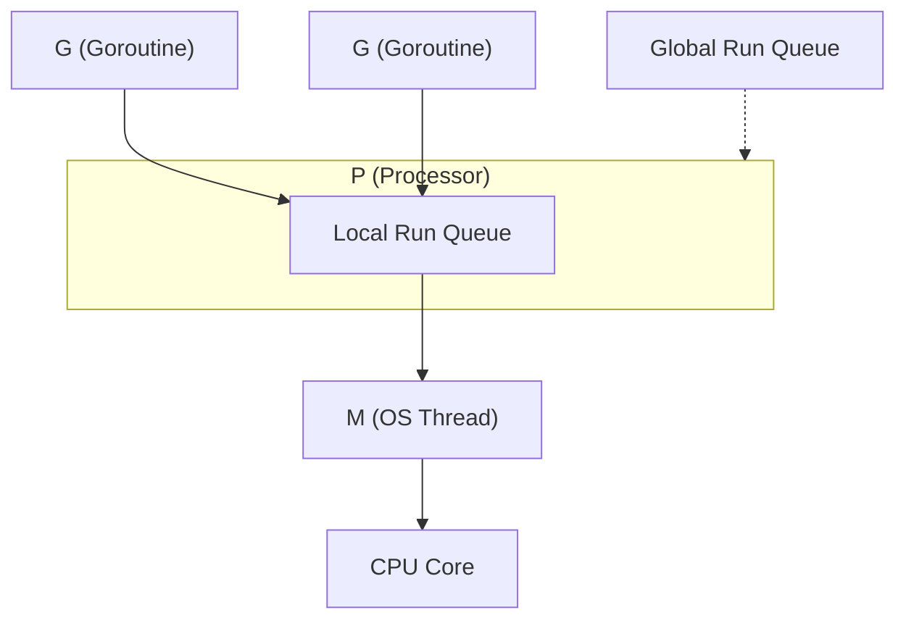

The Go runtime scheduler maps goroutines onto OS threads using the <strong>G-M-P model</strong>. A G (goroutine) waits in a queue owned by a P (the right to run Go code), and an M (OS thread) holding that P takes G's from the queue and runs them. I trace this flow through the structs and functions in the `runtime` package, and an animation shows the same steps.

<ArticleVideo slug="go-scheduler-gmp" />

## G-M-P Model Overview



## Internal Structure of G, M, P

### G (Goroutine) — `runtime.g` struct

A goroutine is represented by the `runtime.g` struct defined in [`runtime/runtime2.go`](https://github.com/golang/go/blob/master/src/runtime/runtime2.go):

```go
type g struct {
    stack       stack   // lo, hi — current stack bounds
    stackguard0 uintptr // used for preemption checks
    m           *m      // M currently running this G
    sched       gobuf   // saved context for context switch
    atomicstatus atomic.Uint32 // G's state flag
    goid         uint64 // goroutine ID
    // ... many more fields
}
```

Key fields:

- <strong>`stack`</strong> — Each G starts with a 2 KB stack (OS threads get 1–8 MB); since Go 1.19, the runtime may allocate a larger initial stack based on average stack usage. When it runs out, `runtime.morestack()` grows it.
- <strong>`sched` (`gobuf`)</strong> — Stores PC (Program Counter), SP (Stack Pointer), and BP (Base Pointer) for context switches. It is read and written every time a G is suspended or resumed.
- <strong>`stackguard0`</strong> — Normally set near the stack lower bound. Set to `stackPreempt` (`0xfffffade`) when preemption is requested.
- <strong>`atomicstatus`</strong> — The G lifecycle: `_Gidle` → `_Grunnable` → `_Grunning` → `_Gsyscall` / `_Gwaiting` → `_Gdead`

### M (Machine) — `runtime.m` struct

An M is a 1:1 wrapper around an OS thread ([`runtime/runtime2.go`](https://github.com/golang/go/blob/master/src/runtime/runtime2.go)):

```go
type m struct {
    g0      *g     // scheduling goroutine (large stack)
    curg    *g     // currently running user G
    p       *p     // attached P
    nextp   *p     // P to attach on wakeup
    spinning bool  // looking for work to steal
    // ...
}
```

- <strong>`g0`</strong> — A special goroutine that exists on every M. Runtime functions like `schedule()`, `findRunnable()`, and GC code run on g0's stack. `mcall()` switches from a user G to g0.
- <strong>`curg`</strong> — The user goroutine currently running on this M. Set by `execute()`, cleared on `goexit()` or preemption.
- <strong>`spinning`</strong> — Indicates the M is actively searching for runnable work to steal. The runtime caps the number of spinning M's so idle threads don't burn CPU.

### P (Processor) — `runtime.p` struct

A P represents "the right to execute user Go code" — a logical resource ([`runtime/runtime2.go`](https://github.com/golang/go/blob/master/src/runtime/runtime2.go)):

```go
type p struct {
    status    uint32 // _Pidle, _Prunning, _Pgcstop, _Pdead (_Psyscall was retired in Go 1.26)
    runqhead  uint32 // local queue head index
    runqtail  uint32 // local queue tail index
    runq      [256]guintptr // local run queue (ring buffer)
    runnext   guintptr      // next G to run (higher priority than queue)
    gFree     struct { ... } // free list of reusable G's
    // ...
}
```

- <strong>`runq`</strong> — A 256-entry fixed-size ring buffer that is used without locks. Only the owning P appends at the tail; both the owner and stealers take from the head by advancing it with an atomic CAS.
- <strong>`runnext`</strong> — A one-slot holder for the G that the current G just made runnable (for example, one it just created). It runs before anything in the queue, so it can use data that is still in cache.
- The number of P's follows the current `GOMAXPROCS` value. It can change during execution through `runtime.GOMAXPROCS`, and on Go 1.25+ the default can also be re-evaluated automatically unless you set it manually.

## The `schedule()` Loop in Detail

All scheduling decisions happen in `runtime.schedule()` in [`runtime/proc.go`](https://github.com/golang/go/blob/master/src/runtime/proc.go). Each M runs this loop on its g0 stack:

```go
func schedule() {
    // Fairness: check global queue every 61st tick
    if schedtick%61 == 0 {
        G = globrunqget(P)    // fetch from global queue
    }
    if G == nil {
        G = runqget(P)        // ① runnext → ② local queue
    }
    if G == nil {
        G = findRunnable(P)   // ③ blocking search
        // → globrunqget → netpoll → steal from random P
    }
    execute(G)  // restore gobuf → run user code
}
```

If neither the periodic global-queue check in `schedule()` nor the local `runqget()` finds a G, `findRunnable()` searches more widely: trace-reader and GC-worker work, another periodic global-queue check, finalizer/cleanup goroutines, the local run queue, a batch from the global queue (`min(len/GOMAXPROCS+1, len, 128)` G's, where 128 is half the local queue's 256 slots), non-blocking netpoll, work stealing, and idle GC/trace work, in that order, before finally blocking on timers or netpoll. The exact order changes across releases, so treat this as a sketch of Go 1.27.

## Stepping Through the Scheduler

The visualization below steps through these mechanics one at a time. Each step names the runtime functions called at that point.

<GoRoutineVisualizer />

## Preemption Internals

### Cooperative Preemption (Go 1.2+)

The Go compiler inserts a <strong>stack check prologue</strong> at the beginning of most functions:

```asm
// Function prologue (pseudocode)
MOV  AX, [G.stackguard0]
CMP  AX, SP
JBE  morestack          // stack growth or preemption
```

When sysmon's `retake()` detects a G running for more than 10 ms, it sets `stackguard0` to `stackPreempt` (`0xfffffade`). At the next function call, the prologue detects this value and calls `morestack()` → `gopreempt_m()`, which sets the G back to `_Grunnable`.

Tight loops such as `for {}` contain no function calls, so they never reach the prologue and cannot be preempted this way.

### Asynchronous Preemption (Go 1.14+)

Go 1.14 introduced <strong>signal-based asynchronous preemption</strong>:

1. sysmon calls `preemptone()`
2. On Unix-like platforms, sends `SIGURG` to the target M (other OSes use platform-specific preemption mechanisms)
3. Signal handler `doSigPreempt()` saves the current PC/SP
4. An `asyncPreempt` frame is injected onto the G's stack
5. G is suspended and control returns to `schedule()`

```go
// runtime/signal_unix.go — https://github.com/golang/go/blob/master/src/runtime/signal_unix.go
func doSigPreempt(gp *g, ctxt *sigctxt) {
    if wantAsyncPreempt(gp) && isAsyncSafePoint(gp, ctxt.sigpc(), ctxt.sigsp(), ctxt.siglr()) {
        ctxt.pushCall(abi.FuncPCABI0(asyncPreempt), ctxt.rip())
    }
}
```

`isAsyncSafePoint()` only allows preemption at points where GC can accurately enumerate the root set.

## sysmon — The Watchdog Daemon

`sysmon` is the runtime's system-monitor function running on its own M/OS thread without a P ([`runtime/proc.go`](https://github.com/golang/go/blob/master/src/runtime/proc.go)):

```go
func sysmon() {
    for {
        usleep(delay) // 20μs to 10ms (adaptive)
        // 1. Harvest netpoller results
        netpoll(0)
        // 2. Hand off P's stuck in long syscalls
        retake(now)
        // 3. Preempt long-running G's
        // 4. Signal for GC STW if needed
        // 5. Force GC if none in 2+ minutes
    }
}
```

### [`retake()`](https://github.com/golang/go/blob/master/src/runtime/proc.go) Decision Logic

```go
func retake(now int64) uint32 {
    for _, pp := range allp {
        if pp.status != _Prunning {
            continue // since Go 1.26, a P in a syscall stays _Prunning
        }
        // Running >10ms → preemptone()
        if pd.schedwhen + 10ms <= now {
            preemptone(pp)
        }
        if inSyscall(pp) { // the P's G is _Gsyscall
            // In syscall >20μs & there's other work → handoffp()
            if runqempty(pp) && sched.nmspinning + sched.npidle > 0 {
                continue // don't hand off yet
            }
            handoffp(pp) // detach P from M
        }
    }
}
```

## Netpoller — Async I/O Integration

All network I/O in Go (`net.Conn.Read()`, etc.) is made asynchronous through the netpoller:

1. A connection's fd is registered with epoll/kqueue/IOCP when it is created
2. G starts network I/O; if the fd is not ready, `runtime.pollWait()` calls `gopark()` and G becomes `_Gwaiting`
3. `findRunnable()` and `sysmon` periodically call `netpoll()`
4. I/O-completed G's are injected back into run queues via `injectglist()`

```go
// Internal flow of network I/O
conn.Read(buf)
  → internal/poll.FD.Read()
    → runtime.pollWait()
      → gopark(netpollblockcommit) // G → _Gwaiting
// ... I/O completion detected via epoll_wait ...
runtime.netpoll()
  → G → _Grunnable
  → injectglist() into run queues
```

Unlike syscalls (`read(2)` etc.), the netpoller <strong>does not block the M</strong>, so `net/http` servers can handle thousands of connections with very few OS threads.

## G Lifecycle — State Transitions

```text
_Gidle → _Gdead → _Grunnable → _Grunning → _Gdead
                       ↑            ↓
                       ← ←  preempt ← ←
                       ↑            ↓
                       ← _Gwaiting ←  (chan/mutex/IO)
                       ↑            ↓
                       ← _Gsyscall ←  (syscall)
```

- <strong>`_Grunnable`</strong> — Ready to run but not yet assigned to an M
- <strong>`_Grunning`</strong> — Currently executing on an M
- <strong>`_Gwaiting`</strong> — Blocked on channel receive, mutex, I/O, etc.
- <strong>`_Gsyscall`</strong> — In a syscall (M is also blocked)
- <strong>`_Gdead`</strong> — Completed. The struct is pooled in `gFree` for reuse.

## Context Switch Cost

Switching goroutines costs roughly an order of magnitude less than switching OS threads. The times in the table are published measurements and vary with the CPU and OS.

| | Go goroutine | OS thread |
|---|---|---|
| What's switched | PC, SP, BP, a few registers (`gobuf`) | More register/kernel scheduler state; possible cache/TLB disruption (page-table switches are mainly process switches) |
| Switch cost | ~170 ns ([Bendersky's measurement](https://eli.thegreenplace.net/2018/measuring-context-switching-and-memory-overheads-for-linux-threads/)) | ~1–2 μs (same measurement; direct cost, excluding cache effects) |
| Stack size | Initial 2 KB or more (grows dynamically) | Fixed 1–8 MB |
| Creation cost | ~200 ns ([Go runtime benchmark result](https://github.com/golang/go/commit/52bd1c4d6cc691aa60c71513695dba03062deb59)) | ~5 μs ([`pthread_create` measurement](https://eli.thegreenplace.net/2018/launching-linux-threads-and-processes-with-clone/)) |

The [`gobuf`](https://github.com/golang/go/blob/master/src/runtime/runtime2.go) structure:

```go
type gobuf struct {
    sp   uintptr // stack pointer
    pc   uintptr // program counter
    g    guintptr
    ctxt unsafe.Pointer
    ret  uintptr
    lr   uintptr // link register (ARM)
    bp   uintptr // base pointer (frame pointer)
}
```

## GOMAXPROCS vs Actual Thread Count

The current number of P's is set by `GOMAXPROCS`, but the actual number of M's (OS threads) can be higher.

- M's blocked in syscalls release their P, and new M's are created to run that P
- The default maximum number of M's is 10,000 (`runtime/debug.SetMaxThreads`)
- Idle M's are not destroyed immediately — they're pooled in `midle`

```go
runtime.GOMAXPROCS(4)  // P = 4
// But M count can be > 4
// e.g., 4 P's + 10 M's blocked in syscalls = 14 total M's
```

### Container-Aware Defaults (Go 1.25+)

For a long time `GOMAXPROCS` defaulted to the number of logical CPUs at startup (`runtime.NumCPU()`). In containers this was a common cause of performance problems: run a Pod with a 2-core CPU limit on a 64-core node and the Go runtime would set `GOMAXPROCS=64` and create 64 P's. The cgroup CPU limit would then throttle the process, and the extra context switches would make latency worse. The usual workaround was an external library such as `automaxprocs`.

[Go 1.25](https://go.dev/doc/go1.25#container-aware-gomaxprocs) moved this adjustment into the runtime itself:

- <strong>On Linux the runtime accounts for the cgroup CPU bandwidth limit</strong> — if the limit is lower than the number of logical CPUs, that lower value becomes the `GOMAXPROCS` default. This corresponds to the Kubernetes CPU limit; <strong>CPU requests are not considered</strong>.
- <strong>On all OSes the value is re-evaluated periodically</strong> — `GOMAXPROCS` follows changes in available logical CPUs or in the cgroup limit.

Both behaviors switch off automatically as soon as you set `GOMAXPROCS` manually, via the environment variable or `runtime.GOMAXPROCS()` (they can also be disabled individually with the GODEBUG settings `containermaxprocs=0` and `updatemaxprocs=0`). If you have set it manually and want to return to the default behavior, use the new `runtime.SetDefaultGOMAXPROCS()`.

## Summary

Go's G-M-P scheduler is built from these seven mechanisms:

1. <strong>M:N scheduling</strong> — Multiplexes many G's onto a few M's
2. <strong>Lock-free local queues</strong> — A 256-entry ring buffer per P, so G's go in and out without taking a lock
3. <strong>Work Stealing</strong> — A P with nothing to run takes G's from another P's queue to spread the load
4. <strong>Hand-off</strong> — When an M blocks in a syscall, its P moves to another M and keeps running
5. <strong>Netpoller</strong> — Network I/O handled asynchronously via epoll/kqueue without blocking M's
6. <strong>Cooperative + async preemption</strong> — Function-prologue checks plus platform-specific async preemption keep one G from holding the CPU indefinitely
7. <strong>sysmon</strong> — A dedicated thread without a P that detects long syscalls and long-running G's and acts on them
