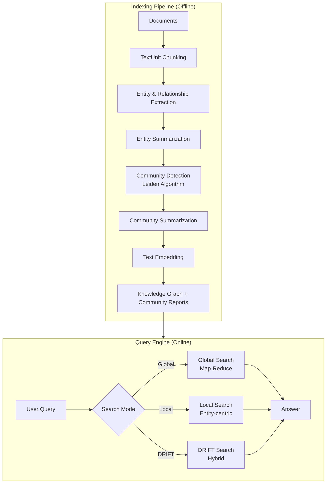
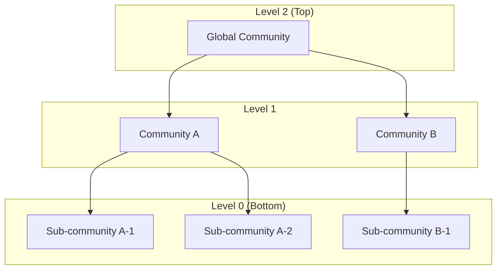
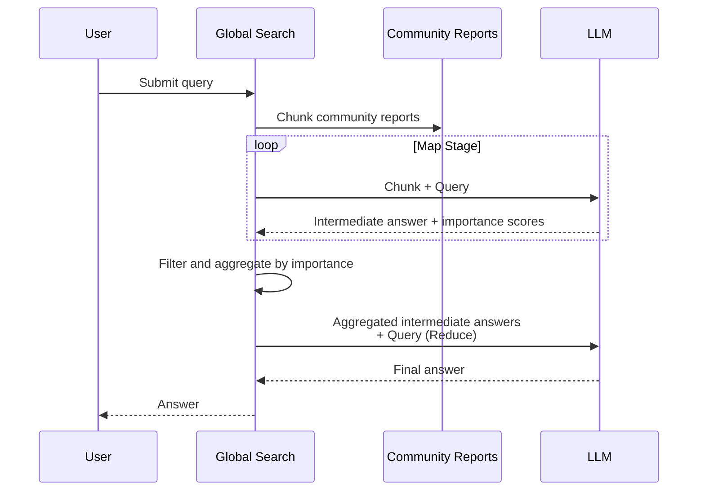
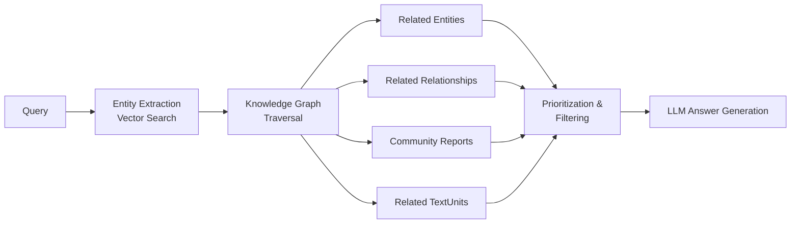
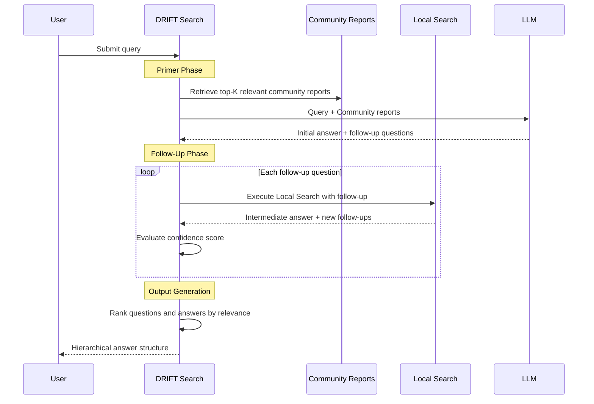

## Introduction — Why GraphRAG?

Retrieval-Augmented Generation (RAG) is widely used to improve LLM answers, but its conventional form, called **Baseline RAG** here, has fundamental limitations.

### Limitations of Baseline RAG

Baseline RAG embeds the user query as a vector and retrieves the top-k text chunks from the corpus by cosine similarity. This retrieval fails on two kinds of questions.

#### Limitation 1: Cannot connect the dots

When answering a question requires linking separate pieces of information through what they have in common, vector search fails to retrieve the right chunks.

Consider asking "Which projects that Tanaka worked on eventually became shipping products?" against a company's internal documents. Answering this requires at least:

- **Document A** (HR record): "Tanaka Taro was assigned to Project Alpha in 2023"
- **Document B** (meeting minutes): "Project Alpha's deliverable passed to the QA phase"
- **Document C** (press release): "Product X, which cleared QA, launched in March 2024"

Baseline RAG searches for chunks semantically close to "Tanaka" and "shipping product," but Document B mentions neither Tanaka's name nor the word "product," so it is not retrieved. Without it, Baseline RAG cannot trace the chain Alpha → QA → Product X and cannot answer correctly.

GraphRAG instead follows the entity relationships "Tanaka Taro" → "Project Alpha" → "QA phase" → "Product X" in its knowledge graph and answers the question correctly.

#### Limitation 2: Cannot grasp the big picture

For aggregate questions such as "What are the top themes in this data?", vector search returns chunks close to the wording of the query; it cannot capture the structure of the whole dataset.

Suppose you ask "What are the top 5 topics during this period?" about 1,000 news articles. Baseline RAG retrieves chunks close to "topics" and "top," but chunks containing the phrase "top topics" may have nothing to do with the actual major topics. A theme that runs through many articles is not summarized in any single chunk, so the LLM ends up fabricating themes from the few chunks that happened to be retrieved.

GraphRAG addresses this with **community reports**. During indexing, it groups the dataset into communities and summarizes each one in advance, so it can answer questions about dataset-wide themes from summaries that cover the whole dataset.

### The GraphRAG Approach

[GraphRAG](https://github.com/microsoft/graphrag) is a RAG methodology developed by Microsoft Research. It uses LLMs to build a knowledge graph from unstructured text and draws on the graph's structure to assemble context at query time. As of September 10, 2026, the `microsoft/graphrag` repository describes itself as largely in maintenance mode rather than an actively expanding product SDK. The method and documentation are still useful, but check package APIs and configuration against the current docs before production use.

GraphRAG rests on three ideas:

- **Entity and relationship extraction**: The LLM extracts entities (people, organizations, locations, concepts) and their relationships to form a knowledge graph
- **Hierarchical community detection**: The Leiden algorithm clusters the graph into a hierarchy of semantic communities
- **Pre-generated community reports**: The LLM summarizes each community into a "community report" that is used at query time

Together, these let GraphRAG handle both kinds of questions that Baseline RAG struggles with: connecting facts across documents and understanding the dataset as a whole.

> 📄 Paper: [From Local to Global: A Graph RAG Approach to Query-Focused Summarization](https://arxiv.org/pdf/2404.16130) (arXiv, 2024)

### From Flat Chunks to a Semantic Graph

Baseline RAG treats documents as a flat collection of chunks and searches by distance between points in vector space. Its knowledge base is a pile of disconnected fragments: nothing records how one chunk relates to another.

GraphRAG adds structure. It builds a graph with entities (people, organizations, concepts, and so on) as nodes and their relationships as edges, which records who is involved in what, what influences what, and which concepts are related. The Leiden algorithm then groups the graph into a hierarchy of communities (semantic clusters), so the system can reason at different levels of abstraction, from local facts to global themes.

In short, GraphRAG **structures the semantic space of a target corpus as a graph and uses that graph as the knowledge base for RAG**. This semantic space is not world knowledge; it consists only of the entities and relationships the LLM extracted from the input documents. Like Baseline RAG, GraphRAG cannot use knowledge the documents do not contain. The difference lies in how it organizes the information they do contain into a structure.

```text
Baseline RAG:  Documents → Flat chunk collection → Search by vector distance
GraphRAG:     Documents → Structured semantic graph → Graph traversal + community summaries
```

---

## Architecture Overview

GraphRAG consists of two major phases: an indexing pipeline (offline) and a query engine (online).



---

## Indexing Pipeline — 6 Phases of Knowledge Graph Construction

Use the interactive visualizer below to step through each phase of the GraphRAG indexing pipeline.

<GraphRAGPipelineVisualizer />

### Phase 1: Composing TextUnits

This phase splits input documents into token-based **chunks (TextUnits)**. TextUnits are the basic unit of analysis, and all extracted knowledge keeps a reference to the TextUnits it came from (provenance).

The default chunk size is 1200 tokens. Larger chunks are faster to process but yield coarser output. Each TextUnit keeps its link to the source document.

```text
Document 1 → [TextUnit 1] [TextUnit 2]
Document 2 → [TextUnit 3] [TextUnit 4]
```

### Phase 2: Document Processing

This phase creates the Documents table and records which TextUnits belong to each document, so answers can be traced back to the original documents.

### Phase 3: Graph Extraction

This phase builds the knowledge graph that the later phases work on. It has three sub-steps.

#### 3a. Entity & Relationship Extraction

Each TextUnit is fed to the LLM, which extracts:

- **Entities**: title, type (person, organization, location, event, etc.), description
- **Relationships**: source entity, target entity, description

When an entity with the same title and type appears in multiple TextUnits, its descriptions are merged into an array. Relationships are merged the same way.

```text
TextUnit → LLM → Subgraph (entities + relationships)
                    ↓
          Merge into global graph (descriptions aggregated as arrays)
```

#### 3b. Entity & Relationship Summarization

The LLM condenses each merged description array into a single concise description, so every entity and relationship has one consistent description in the knowledge model.

#### 3c. Claim Extraction (Optional)

This step runs separately from entity extraction and pulls **covariates (claims)** from TextUnits: factual statements about entities, each with a time range and an evaluated status.

> ⚠️ Claim extraction is disabled by default and typically requires prompt tuning to be useful.

### Phase 4: Graph Augmentation — Community Detection

GraphRAG then runs the Leiden algorithm on the entity-relationship graph to detect a hierarchy of communities.

#### What Is the Leiden Algorithm?

The Leiden algorithm ([Traag et al., 2019](https://arxiv.org/pdf/1810.08473.pdf)) improves on the Louvain algorithm for detecting communities (clusters) in a graph. Three properties matter here:

1. **Modularity optimization**: Groups nodes so that connections are dense within communities and sparse between them
2. **Hierarchical detection**: Recursively detects communities until a community size threshold is reached
3. **Guaranteed connectivity**: Unlike Louvain, Leiden guarantees that each community is internally connected



With this hierarchy, GraphRAG can view the dataset at different granularities: higher levels capture broad themes, and lower levels capture local details.

### Phase 5: Community Summarization

The LLM summarizes each community into a community report with these parts:

- **Executive summary**: Overview of the entire community
- **Key entities**: Important entities and their roles within the community
- **Relationships**: Major relationships between entities
- **Claims**: Related claims (when enabled)

Reports are generated for every level of the hierarchy: higher-level reports cover broader themes, and lower-level reports contain more detail. The query engine uses them as context.

### Phase 6: Text Embedding

The last phase generates text embeddings for vector search at query time:

- Entity description embeddings
- TextUnit text embeddings
- Community report embeddings

These embeddings are written to the configured vector store.

---

## GraphRAG Knowledge Model

The indexing pipeline outputs these data types:

| Data Type | Description |
|---|---|
| Document | Input document — a CSV row or `.txt` file |
| TextUnit | Text chunk for analysis |
| Entity | Entity extracted from TextUnits (person, place, org, etc.) |
| Relationship | Relationship between two entities |
| Covariate | Extracted claim information (time-bounded) |
| Community | Entity clustering result |
| Community Report | LLM-generated community summary |

Outputs are stored as Parquet tables by default.

---

## Query Engine — 4 Search Modes

### Global Search — Dataset-Wide Reasoning

Global Search answers questions about the dataset as a whole, such as "What are the top themes in this dataset?"

#### Map-Reduce Processing Flow



1. **Map stage**: The community reports are split into chunks of a preset size, and the LLM produces an intermediate answer for each chunk: a list of points with importance scores
2. **Reduce stage**: The most important points are aggregated and used as context for the final answer

> ⚠️ The hierarchy level from which reports are taken strongly affects both answer quality and processing cost. Lower levels yield more detailed answers but cost more.

### Local Search — Entity-Focused Deep Dive

Local Search answers questions about specific entities, such as "What are the healing properties of chamomile?"

#### Processing Flow

1. Find entities related to the query (vector search against entity description embeddings)
2. Use these entities as access points into the knowledge graph
3. Collect related entities, relationships, covariates, community reports, and source TextUnits
4. Prioritize and filter within the token budget
5. Have the LLM generate an answer from the assembled context



### DRIFT Search — Global + Local Hybrid

DRIFT Search (Dynamic Reasoning and Inference with Flexible Traversal) is a hybrid approach that incorporates community information into local search. It has three phases:

1. **Primer phase**: Compares the user query with the top-K semantically relevant community reports, generating an initial answer and follow-up questions
2. **Follow-Up phase**: Uses local search to refine follow-up questions, producing additional intermediate answers and new follow-up questions
3. **Output Hierarchy**: Outputs a hierarchy of questions and answers ranked by relevance

DRIFT Search starts from the broad context of community reports, as Global Search does, and answers the narrower follow-up questions with the precision of Local Search.



### Basic Search — Traditional Vector RAG

GraphRAG also includes traditional vector RAG (Basic Search) for comparison, using top-k TextUnit chunks as context.

---

## Baseline RAG vs GraphRAG on News Articles

The Microsoft Research blog compares the two on the VIINA dataset of news articles about the Ukraine-Russia conflict.

### Example 1: Cross-Referential Reasoning

**Query**: "What has Novorossiya done?"

| Baseline RAG | GraphRAG |
|---|---|
| Cannot answer — no relevant information in retrieved chunks | Provides detailed account of Novorossiya's activities by traversing entity relationships, with source provenance |

Baseline RAG retrieves chunks semantically close to the query, but none of them mention "Novorossiya" directly. GraphRAG starts from the Novorossiya entity in the knowledge graph and traverses its relationships to gather information from multiple sources.

### Example 2: Whole-Dataset Theme Understanding

**Query**: "What are the top 5 themes in the data?"

| Baseline RAG | GraphRAG |
|---|---|
| Lists irrelevant themes (urban development, economy, etc.) | Identifies conflict, military activity, political dynamics, humanitarian impact — themes true to the dataset |

Baseline RAG retrieves chunks that match the word "themes" rather than the dataset's content, while GraphRAG answers from community reports that cover the whole dataset.

---

## Implementation with Microsoft Agent Framework (C#)

The following steps sketch GraphRAG-style indexing and search in C# with [Microsoft Agent Framework](https://github.com/microsoft/agent-framework), a library for building, orchestrating, and deploying AI agents.

### Prerequisites

```text
- .NET 10 SDK or later
- Azure OpenAI or OpenAI API key
- Azure CLI (for Azure OpenAI: authenticate with az login)
```

### Step 1: Project Setup

Create a console project and add the Agent Framework and OpenAI packages. In the Agent Framework quickstart as of September 10, 2026, C# examples use `Microsoft.Agents.AI` with the OpenAI .NET SDK, and Azure OpenAI authentication uses `Azure.Identity` plus `System.ClientModel`. The code in this article also uses `AzureOpenAIClient`, so add `Azure.AI.OpenAI` as well. The code in the later steps illustrates GraphRAG-style processing; verify the exact Agent Framework APIs before copying it into production.

```bash
mkdir GraphRAGDemo
cd GraphRAGDemo
dotnet new console
dotnet add package Microsoft.Agents.AI
dotnet add package OpenAI
dotnet add package Azure.AI.OpenAI
dotnet add package Azure.Identity
dotnet add package System.ClientModel
```

If you use Azure OpenAI, sign in with `az login` before running the code.

### Step 2: Knowledge Graph Data Model

The knowledge model is represented with C# `record` types that correspond to tables in the official GraphRAG implementation (Python). Records are immutable, and a `with` expression creates an updated copy; Step 9 uses one to attach a report to a community.

```csharp
// Models/KnowledgeGraph.cs
// https://github.com/microsoft/graphrag — C# representation of the Knowledge Model

/// <summary>Text chunk — the basic analysis unit in GraphRAG</summary>
public record TextUnit(string Id, string Text, string DocumentId);

/// <summary>Entity — a node in the knowledge graph</summary>
public record Entity(
    string Id,
    string Title,
    string Type,        // "person", "organization", "location", "event", ...
    string Description,
    int CommunityId,
    float[] Embedding);

/// <summary>Relationship — an edge in the knowledge graph</summary>
public record Relationship(
    string SourceId,
    string TargetId,
    string Description,
    double Weight);

/// <summary>Community — a cluster detected by the Leiden algorithm</summary>
public record Community(
    int Id,
    string Title,
    int Level,
    string Report);    // LLM-generated community report
```

The `Embedding` field on `Entity` is filled in Phase 6 (text embedding) and used for vector search in Local Search.

### Step 3: Entity & Relationship Extraction Agent

Agent Framework lets the LLM call C# methods as function tools. `AIFunctionFactory.Create` (used in Step 4) generates a JSON Schema from the method signature, and the `[Description]` attributes supply the descriptions in that schema. The LLM receives the schema through its Function Calling mechanism. The function tool below extracts entities and relationships from a TextUnit.

```csharp
// Agents/EntityExtractor.cs
// https://github.com/microsoft/agent-framework — Leveraging function tool capabilities

using System.ComponentModel;
using Microsoft.Agents.AI;
using Microsoft.Extensions.AI;

public static class EntityExtractor
{
    /// <summary>
    /// Function tool for extracting entities and relationships from a TextUnit.
    /// Agent Framework auto-generates JSON Schema for LLM Function Calling.
    /// </summary>
    [Description("Extract entities (people, organizations, places, concepts) and relationships from text")]
    public static string ExtractEntitiesAndRelationships(
        [Description("The text chunk to analyze")] string textUnit,
        [Description("Entity types to extract (comma-separated)")] string entityTypes = "person,organization,location,event,concept")
    {
        // This function is invoked via LLM Function Calling.
        // In practice, you would parse structured output from the LLM
        // and return entity/relationship lists.
        return $$"""
        {
            "entities": [
                {"title": "...", "type": "...", "description": "..."}
            ],
            "relationships": [
                {"source": "...", "target": "...", "description": "..."}
            ]
        }
        """;
    }
}
```

The LLM invokes `ExtractEntitiesAndRelationships` when it decides to extract entities from text. Here the method returns a placeholder; a production implementation would parse the LLM's Structured Output in this method and convert it to typed entity and relationship objects.

### Step 4: Configuring the Extraction Agent

The extraction agent uses the function tool defined above. The `AsAIAgent` extension method wraps a `ChatClient` as an agent: `instructions` sets the system prompt, and `tools` registers the function tools.

```csharp
// Program.cs — Configuring the entity extraction agent
// https://github.com/microsoft/agent-framework/blob/main/dotnet/samples/02-agents/Agents/

using Azure.AI.OpenAI;
using Azure.Identity;
using Microsoft.Agents.AI;
using Microsoft.Extensions.AI;

var endpoint = Environment.GetEnvironmentVariable("AZURE_OPENAI_ENDPOINT")
    ?? throw new InvalidOperationException("AZURE_OPENAI_ENDPOINT is not set.");
var deploymentName =
    Environment.GetEnvironmentVariable("AZURE_OPENAI_DEPLOYMENT_NAME") ?? "gpt-4o";

// Configure the entity extraction agent
AIAgent extractionAgent = new AzureOpenAIClient(
        new Uri(endpoint),
        new DefaultAzureCredential())
    .GetChatClient(deploymentName)
    .AsAIAgent(
        instructions: """
            You are an expert in knowledge graph construction.
            Extract the following from the given text in JSON format:
            1. Entities: title, type (person/organization/location/event/concept), description
            2. Relationships: source entity, target entity, relationship description
            Unify duplicate entities under the same title.
            """,
        tools: [AIFunctionFactory.Create(EntityExtractor.ExtractEntitiesAndRelationships)]);
```

The call chain `AzureOpenAIClient` → `GetChatClient` → `AsAIAgent` sets Azure OpenAI authentication (`DefaultAzureCredential`), the model deployment name, and the agent's instructions and tools in one expression. `DefaultAzureCredential` uses your `az login` credentials in development and a managed identity in production.

### Step 5: Community Detection Implementation

This step corresponds to community detection in Phase 4. The official GraphRAG runs Leiden with Python's `graspologic` library. The C# code below is only a toy local-move detector that illustrates graph clustering; it is not a faithful Leiden implementation.

The code works as follows:

1. Build an adjacency list from entity relationships
2. Initialize each entity in its own community
3. Move each entity to the neighboring community that contains the most of its neighbors (a toy score)
4. Repeat until no entity's community assignment changes

```csharp
// Services/CommunityDetector.cs
// Toy community detector for exposition; not a complete Leiden implementation

/// <summary>
/// Toy hierarchical community detection for exposition.
/// GraphRAG uses graspologic (Python); this C# example
/// only demonstrates a toy local-move clustering heuristic.
/// </summary>
public class CommunityDetector
{
    /// <summary>
    /// Detect communities from a graph.
    /// </summary>
    public List<Community> DetectCommunities(
        List<Entity> entities,
        List<Relationship> relationships,
        int maxCommunitySize = 10)
    {
        // 1. Build adjacency list
        var adjacency = BuildAdjacencyList(entities, relationships);

        // 2. Initialize: place each node in its own community
        var assignments = entities.ToDictionary(e => e.Id, e => e.Id);

        // 3. Toy local-move loop (real Leiden optimizes modularity/CPM more carefully)
        bool improved;
        do
        {
            improved = false;
            foreach (var entity in entities)
            {
                var bestCommunity = FindBestCommunity(
                    entity, adjacency, assignments);
                if (bestCommunity != assignments[entity.Id])
                {
                    assignments[entity.Id] = bestCommunity;
                    improved = true;
                }
            }
        } while (improved);

        // 4. Group into communities and return
        return assignments
            .GroupBy(a => a.Value)
            .Select((g, i) => new Community(
                Id: i,
                Title: $"Community {i}",
                Level: 0,
                Report: "")) // Report generated in later phase
            .ToList();
    }

    private Dictionary<string, List<string>> BuildAdjacencyList(
        List<Entity> entities,
        List<Relationship> relationships)
    {
        var adj = entities.ToDictionary(e => e.Id, _ => new List<string>());
        foreach (var rel in relationships)
        {
            if (adj.ContainsKey(rel.SourceId))
                adj[rel.SourceId].Add(rel.TargetId);
            if (adj.ContainsKey(rel.TargetId))
                adj[rel.TargetId].Add(rel.SourceId);
        }
        return adj;
    }

    private string FindBestCommunity(
        Entity entity,
        Dictionary<string, List<string>> adjacency,
        Dictionary<string, string> assignments)
    {
        // Toy score: count neighbors in each neighboring community
        var neighbors = adjacency.GetValueOrDefault(entity.Id) ?? [];
        var communityScores = neighbors
            .GroupBy(n => assignments.GetValueOrDefault(n, n))
            .ToDictionary(g => g.Key, g => (double)g.Count());

        return communityScores.Count > 0
            ? communityScores.MaxBy(kv => kv.Value).Key
            : assignments[entity.Id];
    }
}
```

A full Leiden implementation adds the following:

- **Refinement phase**: After local moves, run a refinement step that guarantees intra-community connectivity (Leiden's key improvement over Louvain)
- **Aggregation phase**: Contract communities into super-nodes and recursively apply the algorithm to build the hierarchy
- **Resolution parameter**: Controls community granularity. GraphRAG does not expose it as a setting; instead it exposes `max_cluster_size`, the maximum community size, and the hierarchical Leiden recursion splits any community larger than that again

For production use, prefer the official Python GraphRAG/graspologic pipeline for indexing and consume its Parquet outputs from .NET, or use a graph library/runtime that provides a maintained Leiden implementation.

### Step 6: Community Report Generation

This step corresponds to Phase 5. `CommunityReporter` passes a community's entities and relationships to the LLM and gets back a structured report. In Agent Framework, `CreateSessionAsync` creates a conversation session with the agent, and `RunAsync` sends a message within that session.

```csharp
// Services/CommunityReporter.cs
// https://github.com/microsoft/agent-framework — Agent-powered community summarization

public class CommunityReporter
{
    private readonly AIAgent _agent;

    public CommunityReporter(AIAgent agent)
    {
        _agent = agent;
    }

    /// <summary>
    /// Generate a summary report from community entities and relationships.
    /// </summary>
    public async Task<string> GenerateReportAsync(
        Community community,
        List<Entity> entities,
        List<Relationship> relationships)
    {
        var context = BuildCommunityContext(entities, relationships);

        var session = await _agent.CreateSessionAsync();
        var response = await _agent.RunAsync(
            $"""
            Generate a community report based on the following entities and relationships.

            Include:
            1. Executive summary (2-3 sentences)
            2. Key entities and their roles
            3. Important relationships
            4. Main themes and trends

            Community data:
            {context}
            """,
            session);

        return response.Text;
    }

    private string BuildCommunityContext(
        List<Entity> entities,
        List<Relationship> relationships)
    {
        var sb = new System.Text.StringBuilder();
        sb.AppendLine("=== Entities ===");
        foreach (var e in entities)
            sb.AppendLine($"- {e.Title} ({e.Type}): {e.Description}");

        sb.AppendLine("\n=== Relationships ===");
        foreach (var r in relationships)
            sb.AppendLine($"- {r.SourceId} -> {r.TargetId}: {r.Description}");

        return sb.ToString();
    }
}
```

`BuildCommunityContext` formats the entity and relationship lists as text for the prompt. The prompt asks for an executive summary, key entities, important relationships, and main themes. At query time, Global Search answers from these reports, and Local Search and DRIFT Search also include them in their context.

### Step 7: Global Search Implementation

Global Search is the most resource-intensive of GraphRAG's query modes, and it is the mode for questions about the dataset as a whole. The implementation follows the Map-Reduce pattern: the Map stage processes community report chunks in parallel, and the Reduce stage combines the intermediate results into the final answer.

```csharp
// Search/GlobalSearch.cs
// https://github.com/microsoft/graphrag — C# implementation of Global Search

public class GlobalSearch
{
    private readonly AIAgent _mapAgent;
    private readonly AIAgent _reduceAgent;
    private readonly int _maxTokensPerChunk;

    public GlobalSearch(
        AIAgent mapAgent,
        AIAgent reduceAgent,
        int maxTokensPerChunk = 2000)
    {
        _mapAgent = mapAgent;
        _reduceAgent = reduceAgent;
        _maxTokensPerChunk = maxTokensPerChunk;
    }

    /// <summary>
    /// Process community reports via Map-Reduce to answer
    /// dataset-wide questions.
    /// </summary>
    public async Task<string> SearchAsync(
        string query,
        List<Community> communities)
    {
        // === Map Stage ===
        // Split community reports into chunks and process in parallel
        var reportChunks = ChunkReports(communities);
        var intermediateTasks = reportChunks.Select(chunk =>
            MapAsync(query, chunk));
        var intermediateResults = await Task.WhenAll(intermediateTasks);

        // === Reduce Stage ===
        // Aggregate intermediate results into final answer
        var aggregated = intermediateResults
            .SelectMany(r => r.Points)
            .OrderByDescending(p => p.Score)
            .Take(20) // Keep top 20 points
            .ToList();

        return await ReduceAsync(query, aggregated);
    }

    private async Task<MapResult> MapAsync(
        string query, string reportChunk)
    {
        var session = await _mapAgent.CreateSessionAsync();
        var response = await _mapAgent.RunAsync(
            $"""
            Extract relevant points from the following community reports
            and assign each an importance score from 0-100.

            Question: {query}

            Reports:
            {reportChunk}
            """,
            session);

        return ParseMapResult(response.Text);
    }

    private async Task<string> ReduceAsync(
        string query, List<ScoredPoint> points)
    {
        var context = string.Join("\n",
            points.Select(p => $"[Score: {p.Score}] {p.Text}"));

        var session = await _reduceAgent.CreateSessionAsync();
        var response = await _reduceAgent.RunAsync(
            $"""
            Provide a comprehensive answer to the question based on
            the following information points extracted from the dataset.

            Question: {query}

            Information points:
            {context}
            """,
            session);

        return response.Text;
    }

    private List<string> ChunkReports(List<Community> communities)
    {
        var chunks = new List<string>();
        var current = new System.Text.StringBuilder();

        foreach (var community in communities)
        {
            if (current.Length > _maxTokensPerChunk * 4)
            {
                chunks.Add(current.ToString());
                current.Clear();
            }
            current.AppendLine(community.Report);
        }
        if (current.Length > 0)
            chunks.Add(current.ToString());

        return chunks;
    }

    private MapResult ParseMapResult(string response)
        => new(new List<ScoredPoint>
        {
            new(response, 80) // Simplified: real implementation needs structured parsing
        });
}

public record MapResult(List<ScoredPoint> Points);
public record ScoredPoint(string Text, int Score);
```

In the Map stage, `Task.WhenAll` runs the requests for all chunks concurrently instead of one after another, which keeps processing efficient even with many community reports. In the Reduce stage, `OrderByDescending(p => p.Score).Take(20)` keeps only the 20 highest-scoring points, which bounds the size of the final prompt and keeps the most relevant information.

### Step 8: Local Search Implementation

Local Search finds seed entities for the query by vector search, then collects their relationships, community reports, and source TextUnits from the knowledge graph.

```csharp
// Search/LocalSearch.cs
// https://github.com/microsoft/graphrag — C# implementation of Local Search

public class LocalSearch
{
    private readonly AIAgent _agent;
    private readonly IVectorStore _vectorStore;

    public LocalSearch(AIAgent agent, IVectorStore vectorStore)
    {
        _agent = agent;
        _vectorStore = vectorStore;
    }

    /// <summary>
    /// Answer entity-specific questions by locally traversing
    /// the knowledge graph.
    /// </summary>
    public async Task<string> SearchAsync(
        string query,
        List<Entity> entities,
        List<Relationship> relationships,
        List<Community> communities,
        List<TextUnit> textUnits)
    {
        // 1. Identify relevant entities via vector search
        var seedEntities = await _vectorStore.SearchAsync(
            query, topK: 5, collection: "entities");

        // 2. Explore the knowledge graph from seed entities
        var context = new SearchContext();
        foreach (var seed in seedEntities)
        {
            var relatedRels = relationships
                .Where(r => r.SourceId == seed.Id || r.TargetId == seed.Id)
                .ToList();
            context.Relationships.AddRange(relatedRels);

            var entity = entities.First(e => e.Id == seed.Id);
            var community = communities
                .FirstOrDefault(c => c.Id == entity.CommunityId);
            if (community != null)
                context.CommunityReports.Add(community.Report);

            context.TextUnits.AddRange(
                textUnits.Where(tu => tu.Text.Contains(entity.Title)));
        }

        // 3. Prioritize context within token budget
        var contextText = context.BuildContextString(maxTokens: 4000);

        // 4. Generate answer with LLM
        var session = await _agent.CreateSessionAsync();
        var response = await _agent.RunAsync(
            $"""
            Answer the question based on the following context.
            Cite specific sources where possible.

            Question: {query}

            Context:
            {contextText}
            """,
            session);

        return response.Text;
    }
}

public interface IVectorStore
{
    Task<List<Entity>> SearchAsync(
        string query, int topK, string collection);
}

public class SearchContext
{
    public List<Relationship> Relationships { get; } = [];
    public List<string> CommunityReports { get; } = [];
    public List<TextUnit> TextUnits { get; } = [];

    public string BuildContextString(int maxTokens)
    {
        var sb = new System.Text.StringBuilder();

        sb.AppendLine("=== Community Reports ===");
        foreach (var report in CommunityReports.Take(3))
            sb.AppendLine(report);

        sb.AppendLine("\n=== Relationships ===");
        foreach (var rel in Relationships.Take(10))
            sb.AppendLine($"- {rel.SourceId} -> {rel.TargetId}: {rel.Description}");

        sb.AppendLine("\n=== Source Text ===");
        foreach (var tu in TextUnits.Take(5))
            sb.AppendLine($"[{tu.Id}] {tu.Text[..Math.Min(200, tu.Text.Length)]}...");

        return sb.ToString();
    }
}
```

`SearchContext` collects three kinds of context (community reports, relationships, and source TextUnits), and `BuildContextString` limits the number of items of each kind. Changing the `Take(3)`, `Take(10)`, and `Take(5)` values changes the mix. This simplified version never uses its `maxTokens` parameter, so it does not truncate the context to a token budget; the actual GraphRAG implementation allocates a token budget across data sources.

### Step 9: Full Pipeline Orchestration

`GraphRAGPipeline` combines the extraction agent, community detection, and community report generation into one class that builds the knowledge graph index.

```csharp
// Pipeline/GraphRAGPipeline.cs
// https://github.com/microsoft/agent-framework — Workflow orchestration

using Azure.AI.OpenAI;
using Azure.Identity;
using Microsoft.Agents.AI;
using Microsoft.Extensions.AI;

public class GraphRAGPipeline
{
    private readonly AIAgent _extractionAgent;
    private readonly AIAgent _summarizationAgent;
    private readonly CommunityDetector _communityDetector;
    private readonly CommunityReporter _communityReporter;

    public GraphRAGPipeline(string endpoint, string deploymentName)
    {
        var client = new AzureOpenAIClient(
            new Uri(endpoint),
            new DefaultAzureCredential());

        _extractionAgent = client
            .GetChatClient(deploymentName)
            .AsAIAgent(instructions: "Expert agent for extracting entities and relationships");

        _summarizationAgent = client
            .GetChatClient(deploymentName)
            .AsAIAgent(instructions: "Summarization agent for generating community reports");

        _communityDetector = new CommunityDetector();
        _communityReporter = new CommunityReporter(_summarizationAgent);
    }

    /// <summary>
    /// Execute the GraphRAG indexing pipeline.
    /// Runs Phases 1-5 sequentially to build a knowledge graph index.
    /// </summary>
    public async Task<KnowledgeGraphIndex> BuildIndexAsync(
        List<string> documents)
    {
        // Phase 1: TextUnit chunking
        var textUnits = ChunkDocuments(documents, chunkSize: 1200);

        // Phase 3: Entity & relationship extraction
        var (entities, relationships) =
            await ExtractGraphAsync(textUnits);

        // Phase 4: Community detection
        var communities = _communityDetector.DetectCommunities(
            entities, relationships);

        // Phase 5: Community report generation
        foreach (var community in communities)
        {
            var communityEntities = entities
                .Where(e => e.CommunityId == community.Id)
                .ToList();
            var communityRels = relationships
                .Where(r => communityEntities.Any(e => e.Id == r.SourceId))
                .ToList();

            var report = await _communityReporter.GenerateReportAsync(
                community, communityEntities, communityRels);

            communities[communities.IndexOf(community)] =
                community with { Report = report };
        }

        return new KnowledgeGraphIndex(
            textUnits, entities, relationships, communities);
    }

    private List<TextUnit> ChunkDocuments(
        List<string> documents, int chunkSize)
    {
        var units = new List<TextUnit>();
        int unitId = 0;
        for (int docIdx = 0; docIdx < documents.Count; docIdx++)
        {
            var doc = documents[docIdx];
            for (int i = 0; i < doc.Length; i += chunkSize)
            {
                var chunk = doc[i..Math.Min(i + chunkSize, doc.Length)];
                units.Add(new TextUnit(
                    $"tu-{unitId++}", chunk, $"doc-{docIdx}"));
            }
        }
        return units;
    }

    private async Task<(List<Entity>, List<Relationship>)>
        ExtractGraphAsync(List<TextUnit> textUnits)
    {
        var allEntities = new List<Entity>();
        var allRelationships = new List<Relationship>();

        foreach (var tu in textUnits)
        {
            var session = await _extractionAgent.CreateSessionAsync();
            var response = await _extractionAgent.RunAsync(
                $"""
                Extract entities and relationships from the following text.
                Output in JSON format.

                Text:
                {tu.Text}
                """,
                session);

            // Parse response into entities and relationships
            // (simplified for brevity)
        }

        return (allEntities, allRelationships);
    }
}

public record KnowledgeGraphIndex(
    List<TextUnit> TextUnits,
    List<Entity> Entities,
    List<Relationship> Relationships,
    List<Community> Communities);
```

`BuildIndexAsync` is the entry point for the pipeline. It takes a list of documents and runs TextUnit chunking, entity extraction, community detection, and community report generation in order. `ChunkDocuments` splits text by characters, so `chunkSize: 1200` means 1,200 characters rather than tokens; a production implementation should use a tokenizer such as `tiktoken` for accurate token-based chunking.

### Usage: Pipeline Execution to Query

The example below runs the indexing pipeline and then executes a Global Search against the resulting knowledge graph index.

```csharp
// Program.cs — Complete usage example

var endpoint = Environment.GetEnvironmentVariable("AZURE_OPENAI_ENDPOINT")!;
var model = Environment.GetEnvironmentVariable("AZURE_OPENAI_DEPLOYMENT_NAME")
    ?? "gpt-4o";

// 1. Run the indexing pipeline
var pipeline = new GraphRAGPipeline(endpoint, model);
var documents = new List<string>
{
    File.ReadAllText("data/document1.txt"),
    File.ReadAllText("data/document2.txt"),
};

var index = await pipeline.BuildIndexAsync(documents);
Console.WriteLine(
    $"Index built: {index.Entities.Count} entities, " +
    $"{index.Relationships.Count} relationships, " +
    $"{index.Communities.Count} communities");

// 2. Global Search — ask about dataset-wide themes
var client = new AzureOpenAIClient(
    new Uri(endpoint), new DefaultAzureCredential());
var mapAgent = client.GetChatClient(model)
    .AsAIAgent(instructions: "Extract information points and assign importance scores");
var reduceAgent = client.GetChatClient(model)
    .AsAIAgent(instructions: "Synthesize information points into a comprehensive answer");

var globalSearch = new GlobalSearch(mapAgent, reduceAgent);
var globalAnswer = await globalSearch.SearchAsync(
    "What are the main themes in this dataset?",
    index.Communities);
Console.WriteLine($"\n[Global Search]\n{globalAnswer}");

// 3. Local Search — ask about a specific entity
// (requires IVectorStore implementation)
```

---

## Prompt Tuning

GraphRAG's default prompts may not give the best results on your own data, so prompt tuning is recommended. GraphRAG can tune prompts automatically:

```bash
# Run automatic prompt tuning
graphrag prompt-tune --root ./my-project
```

Auto-tuning (`graphrag prompt-tune`) generates three prompts:

| Prompt | Purpose |
|---|---|
| `extract_graph` | Improve entity and relationship extraction accuracy |
| `summarize_descriptions` | Improve entity description quality |
| `community_reports` | Adjust community report format and content |

Query-stage prompts (the Global Search map and reduce prompts, the Local Search system prompt, and others) are customized manually: create custom prompt files and set their paths in the corresponding config fields (e.g., `local_search.prompt`, `global_search.map_prompt`).

---

## Evaluation Metrics

Microsoft Research evaluated GraphRAG by having an LLM compare pairs of answers (LLM-as-a-judge) on four criteria:

1. **Comprehensiveness**: How much detail the answer provides to cover all aspects of the question
2. **Diversity**: How many different perspectives and insights the answer provides
3. **Empowerment**: How well the answer helps the reader understand and make informed judgments about the topic without being misled
4. **Directness**: How specifically and clearly the answer addresses the question (control criterion)

GraphRAG consistently and significantly outperformed Baseline RAG on comprehensiveness and diversity. Results on empowerment were mixed, with room for improvement in providing specific citations and source references. Baseline RAG won on directness, as expected, because directness trades off against comprehensiveness and diversity.

> 📄 The paper's Section 6.1 mentions faithfulness evaluation using SelfCheckGPT as future work.

---

## Cost and Performance Considerations

GraphRAG indexing requires many LLM calls and substantial compute, and these factors affect its cost and processing time:

| Consideration | Details |
|---|---|
| LLM cost | Entity extraction, summarization, and community report generation involve many LLM calls |
| Chunk size | 1200 tokens (default); larger chunks are faster but yield coarser results |
| Community level | Lower levels in Global Search yield more detail but higher cost |
| NLP extraction mode | `extract_graph_nlp` config for fast extraction, significantly reducing LLM costs |

> 💡 Start with a small dataset to understand the cost-quality trade-off before scaling to production data.

---

## GraphRAG Variations

Two variations reduce the indexing cost of standard GraphRAG, with different effects on quality and query time.

### NLP Extraction Mode (`extract_graph_nlp`)

The `extract_graph_nlp` configuration option uses **NLP (Natural Language Processing) instead of LLMs** for entity and relationship extraction.

- **Pros**: Far fewer LLM calls, which significantly lowers indexing cost
- **Cons**: NLP-based extraction may produce lower-quality entity granularity and relationship descriptions compared to LLM-based extraction
- **Use case**: Large datasets with budget constraints, or quick prototyping

In NLP extraction mode, claim extraction is always skipped.

### LazyGraphRAG

LazyGraphRAG, published by Microsoft Research in November 2024, **defers all LLM processing to query time**.

- **At indexing time**: Uses NLP (noun phrase extraction) to extract concepts and co-occurrences, then uses graph statistics for community structure detection (no LLM calls at all)
- **At query time**: Uses the LLM for relevance assessment of text chunks, claim extraction, and answer generation

```text
Standard GraphRAG: LLM-based indexing + all reports pre-generated (high cost)
LazyGraphRAG:      NLP-based indexing, all LLM processing deferred to query time (reported by Microsoft Research as vector-RAG-level indexing cost, roughly 0.1% of standard GraphRAG in their experiments)
```

LazyGraphRAG aims to keep indexing cost at the level of vector RAG while answering queries better than GraphRAG. It is particularly suited to one-off queries, exploratory analysis, and streaming data.

### Variation Comparison Table

| Feature | Standard GraphRAG | NLP Extraction Mode | LazyGraphRAG |
|---|---|---|---|
| Entity extraction | LLM-based | NLP-based | NLP-based |
| Indexing cost | High | Low | Very low (same as vector RAG) |
| Query latency | Low | Low | Slightly higher |
| Answer quality | Highest | Good | High |
| Community reports | Pre-generated | Pre-generated | Deferred to query time |
| LLM usage timing | Indexing + query time | Summarization + query time | Query time only |
| Best for | Quality-focused enterprise | Large data / budget constraints | One-off queries / exploratory analysis |

---

## Configuration Example

GraphRAG is configured in a YAML file (`settings.yaml`), and the `graphrag init` command generates a template.

```yaml
# settings.yaml — Key configuration parameters (generated by graphrag init)
completion_models:
  default_completion_model:
    model_provider: openai
    model: gpt-4o
    api_key: ${GRAPHRAG_API_KEY}
    # For Azure OpenAI
    # model_provider: azure
    # azure_deployment_name: your-deployment
    # api_base: https://your-resource.openai.azure.com

embedding_models:
  default_embedding_model:
    model_provider: openai
    model: text-embedding-3-small
    api_key: ${GRAPHRAG_API_KEY}

chunking:
  size: 1200          # TextUnit chunk size (in tokens)
  overlap: 100        # Overlap between chunks (in tokens)

extract_graph:
  max_gleanings: 1    # Number of extra extraction passes (higher = more accurate, more expensive)
  entity_types:       # Entity types to extract
    - person
    - organization
    - geo
    - event

community_reports:
  max_length: 2000    # Maximum report length

cluster_graph:
  max_cluster_size: 10  # Maximum community size
```

---

## Limitations and Caveats

Whether GraphRAG is worth using depends on indexing cost, the nature of the data, and the kinds of questions asked.

### Cost Limitations

- Indexing requires many LLM API calls, potentially costing hundreds of dollars for large datasets
- Community report generation is particularly expensive, and its cost grows in proportion to the number of communities

### Data Characteristic Limitations

- **Small datasets**: With little data, the knowledge graph becomes sparse, reducing community detection effectiveness. For fewer than a few dozen documents, Baseline RAG may be more efficient
- **Frequently updated data**: Because indexing is heavy, GraphRAG is unsuitable when updated data must become searchable in near real time (LazyGraphRAG mitigates this)
- **Highly specialized domains**: In niche technical domains, the LLM may not extract entities accurately, making prompt tuning essential

### Architectural Limitations

- **Query type dependency**: Not every type of question benefits. For simple factual lookups, GraphRAG may perform about the same as Baseline RAG
- **Hallucination risk**: Community reports are LLM-generated, so they may contain information not present in the source text. Evaluating their faithfulness (e.g., with SelfCheckGPT) is critical

---

## Summary

GraphRAG builds a knowledge graph and community structure from the corpus to handle the two kinds of questions Baseline RAG struggles with: connecting facts across documents and understanding the dataset as a whole.

- **Indexing**: A 6-phase pipeline turns text into TextUnits, entities and relationships, communities, community reports, and embeddings
- **Community detection**: Hierarchical clustering with the Leiden algorithm lets GraphRAG work with a dataset at multiple levels of granularity
- **Query modes**: Global (dataset-wide), Local (entity-centric), and DRIFT (hybrid) serve different types of questions
- **Implementation**: With Microsoft Agent Framework (C#), the pipeline can be built from function tools and agents

When you query private enterprise data with an LLM, GraphRAG helps most with questions that require connecting facts across documents ("connecting the dots") or understanding the whole dataset ("seeing the big picture").

## References

- [GraphRAG GitHub Repository](https://github.com/microsoft/graphrag)
- [GraphRAG Paper (arXiv)](https://arxiv.org/pdf/2404.16130)
- [Microsoft Research Blog: GraphRAG](https://www.microsoft.com/en-us/research/blog/graphrag-unlocking-llm-discovery-on-narrative-private-data/)
- [Microsoft Agent Framework](https://github.com/microsoft/agent-framework)
- [Leiden Algorithm Paper](https://arxiv.org/pdf/1810.08473.pdf)
- [GraphRAG Documentation](https://microsoft.github.io/graphrag/)
