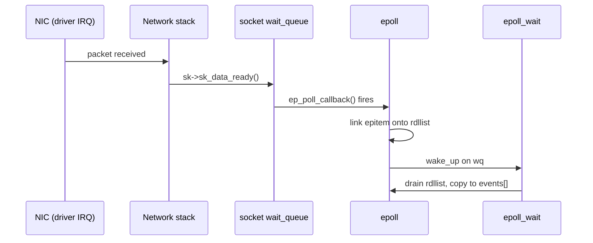
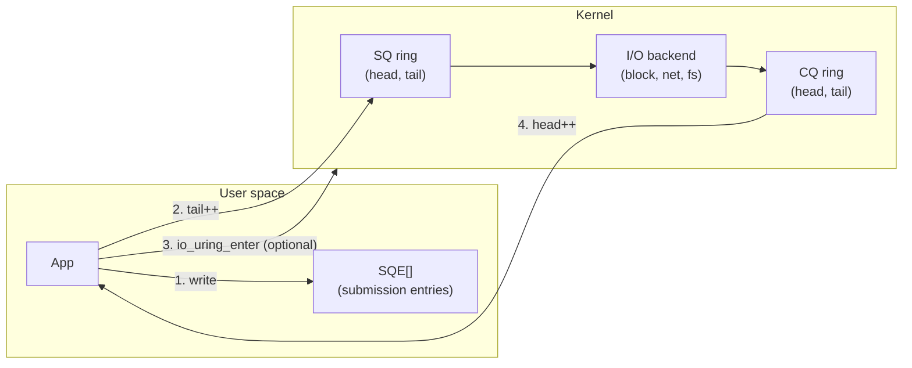
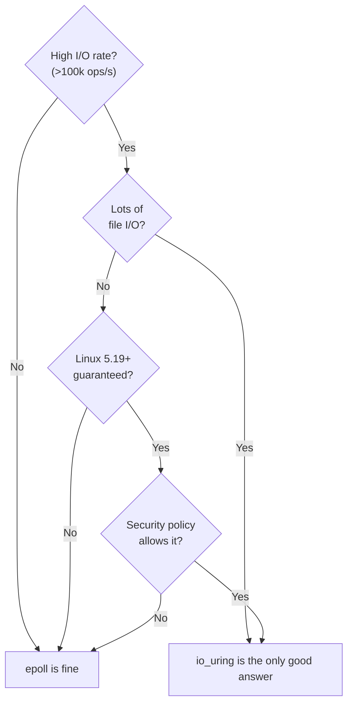

When you try to make a network server or database faster, you soon reach the question of <strong>I/O multiplexing</strong>: how to handle many I/Os with few threads. When one thread serves 100k TCP connections, or you want to use all the IOPS of a single SSD (I/O operations per second, the number of I/O requests a device can complete per second), Linux kernel interfaces such as `epoll` and `io_uring` decide the performance.

This article goes through `select → poll → epoll → io_uring` in order and explains how the kernel made event notification cheaper and cut the number of syscalls, using the kernel's struct definitions and source files. It also covers how Node.js, nginx, PostgreSQL, ScyllaDB, and tokio adopted these APIs.

> <strong>Think of it as a call center</strong>
>
> Picture a call center that handles 100,000 phone lines.
>
> - With <strong>select / poll</strong>, an operator checks all 100,000 phones one by one on every round to see which are ringing. Time spent on silent phones is wasted.
> - With <strong>epoll</strong>, a ringing phone lights a lamp on a dashboard, and the operator looks only at lit lamps. The list of phones to watch is handed once to the telephone exchange (the kernel) and doesn't have to be carried around each round.
> - With <strong>io_uring</strong>, nobody uses the phones. Request slips and completion slips pass across a counter. In the normal mode, the operator rings a bell once when slips have piled up (one call to `io_uring_enter`). In SQPOLL mode, a dedicated clerk stays at the counter and picks up each slip as soon as it is placed, so the requester doesn't ring the bell (make a syscall) at all.
>
> Each step in this history reduces the back-and-forth between user space and the kernel.

<ArticleVideo slug="io-uring-and-epoll" />

## 1. Why async I/O matters

### 1.1 The cost structure of synchronous I/O

With plain blocking I/O, `read(fd, buf, n)` puts the calling thread to sleep until data arrives. `fd` stands for file descriptor, an integer handle that refers to a resource the kernel has opened, such as a socket, file, or pipe. If each connection gets its own thread, these costs grow with the number of connections:

- <strong>Thread stacks</strong>: the Linux default is 8 MB (`ulimit -s`), so 10k connections use 80 GB of virtual address space.
- <strong>Context switches</strong>: a typical switch takes 1–3 µs. A main-memory access takes tens of nanoseconds and a syscall less than a microsecond, so a switch is one of the most expensive things a thread does. At hundreds of thousands of switches per second, much of the CPU time goes to switching.
- <strong>Kernel thread structures</strong>: each thread keeps a `task_struct` of several KB in the kernel.

To avoid these costs, one thread has to multiplex many I/Os. There are three ways to do it:

1. <strong>Readiness notification</strong>: ask the kernel which fds can be read or written. This is how `select`, `poll`, and `epoll` work.
2. <strong>Completion notification</strong>: ask the kernel to perform the I/O and tell you when it is done. This is how `aio` and `io_uring` work.
3. <strong>User-space polling</strong>: bypass the kernel, as DPDK and SPDK do.

For a long time Linux was optimized around (1). Since `io_uring` arrived in 2019, (2) has also been a standard option.

### 1.2 The readiness model and the completion model

| Model | Representative APIs | How it works | Syscalls per I/O |
| --- | --- | --- | --- |
| Readiness | `select`, `poll`, `epoll`, `kqueue` (BSD) | The kernel reports that an fd is ready, then the user performs the I/O | 2 (notify + read/write) |
| Completion | Windows IOCP, POSIX `aio`, `io_uring` | The user submits the I/O to the kernel and receives only the completion | 0–1 |

A syscall (system call) is how a user-space program calls into the kernel, switching the CPU into privileged mode. Because it involves a trap instruction and a CPU mode transition, it costs orders of magnitude more than a normal function call. Figures such as 200–500 ns for a simple syscall and under 10 ns for a normal call are only rough orders of magnitude; the real cost varies a lot with the CPU, kernel, vulnerability mitigations, and cache and TLB state. KPTI, covered later, can make it more expensive still.

Linux treats regular files as always readable, so the readiness model doesn't work for file I/O (`epoll` refuses to register regular files). Async file I/O needs a completion-based API, and that was a major reason `io_uring` was created.

## 2. The lineage: select → poll → epoll

### 2.1 `select(2)` — 1983, BSD 4.2

The earliest I/O multiplexing API.

```c
int select(int nfds, fd_set *readfds, fd_set *writefds,
           fd_set *exceptfds, struct timeval *timeout);
```

`fd_set` is a bitmap whose size glibc fixes at `FD_SETSIZE = 1024`, so fds of 1024 and above can't be used. Every call does the following:

1. User builds the fd_set — $O(N)$
2. Kernel copies the full bitmap — $O(N)$
3. Kernel walks every fd to check state — $O(N)$
4. Kernel copies result bitmap back — $O(N)$

Every call processes the whole watch set in $O(N)$, which doesn't hold up at 10k connections.

### 2.2 `poll(2)` — from System V (Linux 2.1.23, 1997)

```c
int poll(struct pollfd *fds, nfds_t nfds, int timeout);

struct pollfd {
    int   fd;
    short events;   // monitored
    short revents;  // returned
};
```

The 1024-fd limit is gone, but every call still copies the array and scans all of it, just like `select`.

### 2.3 C10K and `epoll` — 2002, Linux 2.5.44

In 1999 Dan Kegel's essay "The C10K problem" posed the challenge of handling 10k connections in one process. Davide Libenzi's `epoll` answered it with two changes:

- It keeps the watch set in the kernel instead of copying it on every call.
- It returns only the fds that are ready instead of scanning all of them.

## 3. Inside `epoll`

### 3.1 The interface

```c
int epoll_create1(int flags);
int epoll_ctl(int epfd, int op, int fd, struct epoll_event *event);
int epoll_wait(int epfd, struct epoll_event *events, int maxevents, int timeout);

struct epoll_event {
    uint32_t     events;
    epoll_data_t data;
};
```

- `epoll_create1()` creates an epoll instance and returns its fd.
- `epoll_ctl()` adds, modifies, or removes watched fds with `EPOLL_CTL_ADD / MOD / DEL`.
- `epoll_wait()` returns an array of ready fds. It can block, return immediately, or wait up to a timeout.

### 3.2 Kernel data structures

In the kernel's `fs/eventpoll.c`, epoll is built around three structs. `eventpoll` represents one whole epoll instance, `epitem` holds the information for one watched fd, and `eppoll_entry` is the hook placed on that fd's wait queue. When the hook fires, the `epitem` is linked onto `rdllist` (key fields only; the same applies to every `struct` excerpt below):

```c
struct eventpoll {
    struct mutex       mtx;
    wait_queue_head_t  wq;          /* tasks sleeping in epoll_wait */
    wait_queue_head_t  poll_wait;
    struct list_head   rdllist;     /* ready items */
    struct rb_root_cached rbr;      /* all monitored items (red-black tree) */
    struct epitem      *ovflist;    /* overflow during delivery */
    /* ... */
};

struct epitem {
    struct rb_node       rbn;       /* node in eventpoll->rbr */
    struct list_head     rdllink;   /* link in rdllist */
    struct epoll_filefd  ffd;       /* the watched fd */
    struct eventpoll     *ep;
    struct list_head     pwqlist;   /* callback registration */
    struct epoll_event   event;
    /* ... */
};

struct eppoll_entry {
    struct list_head    llink;      /* in epitem->pwqlist */
    struct epitem       *base;
    wait_queue_entry_t  wait;       /* registered in file's wait queue */
    wait_queue_head_t   *whead;
};
```

Each field does the following:

- <strong>Red-black tree `rbr`</strong>: a self-balancing binary search tree that holds every watched fd, with $O(\log N)$ insert, delete, and lookup.
- <strong>Ready list `rdllist`</strong>: a doubly linked list holding only the `epitem`s that have pending events. `epoll_wait` just takes items off it, so each ready fd costs $O(1)$ to return.
- <strong>`eppoll_entry`</strong>: a callback registered on each watched file's wait queue. A wait queue (`wait_queue_head_t`) is the kernel's mechanism for putting tasks to sleep and waking them later, roughly a condition variable. Every kernel object that can block, such as a socket or a pipe, has its own wait queue.

### 3.3 How events land in `rdllist`

When a new packet arrives on a TCP socket, the flow is:



- The callbacks run in this order: `sock_def_readable` → `wake_up_interruptible_sync_poll` → `ep_poll_callback` (`fs/eventpoll.c`).
- The callback only appends an item to `rdllist`, so it is safe to call from interrupt context. It is protected by a spinlock: interrupt handlers can't call the scheduler, so a sleeping mutex can't be used, and a spinlock, which waits without giving up the CPU, is needed instead.
- Finally, it wakes the tasks waiting in `epoll_wait`.

### 3.4 Level vs Edge trigger

epoll has two trigger modes. Mixing them up leads to bugs where events are missed and the event loop stalls.

| Mode | Meaning | Expected read/write behavior |
| --- | --- | --- |
| LT (level-triggered, default) | Keeps notifying while the fd stays readable or writable | You may read once and return; the next `epoll_wait` reports it again |
| ET (edge-triggered) | Notifies only when the state changes | You must read until `EAGAIN`. If you leave data unread, no notification comes until new data arrives |

ET behavior is decided when `epoll_wait` takes items off `rdllist`. Simplified:

```c
/* ep_send_events_proc */
list_for_each_entry_safe(epi, tmp, &txlist, rdllink) {
    revents = ep_item_poll(epi, ...);
    if (revents) {
        copy_to_user(events, ...);
        if (epi->event.events & EPOLLET) {
            /* ET: drop from ready list; back only on next callback */
        } else if (!(epi->event.events & EPOLLONESHOT)) {
            /* LT: put back on ready list */
            list_add_tail(&epi->rdllink, &ep->rdllist);
        }
    }
}
```

ET is more efficient because it doesn't send duplicate notifications for the same state, but the application is responsible for writing a correct non-blocking read loop. nginx and HAProxy use ET, and the standard pattern is to read until done on each event, as in `while ((n = read(fd, ...)) > 0) { ... }`.

### 3.5 Thundering herd and `EPOLLEXCLUSIVE`

When several processes or threads wait on the same listening socket with `epoll`, a single incoming connection wakes them all. Only one `accept()` succeeds; the rest return `EAGAIN`. This waste is called <strong>thundering herd</strong>, after a startled herd of animals all breaking into a gallop at once.

There are two fixes:

- <strong>`SO_REUSEPORT`</strong> (Linux 3.9+): create several listening sockets on the same port, and the kernel spreads new connections across them. nginx uses this often.
- <strong>`EPOLLEXCLUSIVE`</strong> (Linux 4.5+): sets `WQ_FLAG_EXCLUSIVE` on the entry epoll registers in the target file's wait queue, so the kernel wakes one or a few waiters instead of all of them.

### 3.6 Limits of epoll

Some problems epoll can't solve:

1. <strong>It doesn't work for file I/O</strong>: regular files always report as readable, so epoll can't stop a thread from blocking on a disk read.
2. <strong>Each I/O needs two syscalls</strong>: `epoll_wait` and `read/write`. Neither can be replaced by the vDSO.
3. <strong>Higher syscall cost after Spectre/Meltdown</strong>: KPTI (Kernel Page-Table Isolation, the Meltdown mitigation that gives user space and the kernel separate page tables) adds TLB flushes that bring each syscall to 0.1–1 µs. At 1M IOPS, syscalls alone would use 10–100% of one CPU core, and that sets the performance ceiling.
4. <strong>A chain of I/Os can't be submitted at once</strong>: a sequence like `accept → read → parse → write` can't be handed to the kernel in one go.

These are the reasons `io_uring` was created.

## 4. Before `io_uring`: `aio(7)` and other attempts

### 4.1 POSIX AIO and `libaio`

Linux had POSIX AIO (`aio_read`, `aio_write`) and a separate Kernel AIO (`io_setup`, `io_submit`, `io_getevents`). glibc emulates POSIX AIO with user-space threads.

Kernel AIO (commonly called `libaio` after its library) had these limits:

- <strong>It is only asynchronous with direct I/O (`O_DIRECT`)</strong>. `O_DIRECT` bypasses the page cache and DMAs directly between the device and the application buffer; it is meant for databases that do their own caching and I/O scheduling. Buffered I/O effectively runs synchronously.
- <strong>The interface is awkward</strong>: requests go in as arrays of `struct iocb`, and completions are collected with `io_getevents`.
- Metadata operations such as `open`, `stat`, and `close` aren't supported.

MySQL (InnoDB) and some others used `libaio`, but it never caught on as a general-purpose API. PostgreSQL never used `libaio`; in v18 (2025) it added its own async I/O layer, where `io_method` can be set to `worker`, `io_uring`, or `sync`.

### 4.2 `eventfd`, `timerfd`, and `signalfd`

On Linux, a common approach has been to represent various subsystems as fds and wait on them with `epoll`. `timerfd` delivers timers and `signalfd` delivers signals as fds. `eventfd` is an fd holding a single counter, used for `libaio` completion notifications and for notifications between processes. This habit of turning everything into an fd and waiting on it with epoll has shaped how event loops are designed on Linux.

## 5. `io_uring` — 2019, Linux 5.1+

### 5.1 Design goals

Jens Axboe's document "Efficient IO with io_uring"<sup>[1]</sup> describes design aims that are roughly these four:

1. <strong>Truly asynchronous</strong>: any I/O operation can be submitted without blocking.
2. <strong>No copy, no allocation</strong>: no syscall and no memory allocation on the hot path.
3. <strong>Unified</strong>: one API for network, file, and block-device I/O.
4. <strong>Extensible</strong>: new operations (opcodes) are easy to add.

This is achieved with <strong>ring buffers</strong> shared with the kernel.

### 5.2 Architecture: SQ and CQ

`io_uring` shares two ring buffers between kernel and userspace.



- <strong>SQ (submission queue)</strong>: the ring where the user writes request entries (SQEs, Submission Queue Entries).
- <strong>CQ (completion queue)</strong>: the ring where the kernel writes completion entries (CQEs, Completion Queue Entries).
- Both rings live in an mmap region shared by the user and the kernel. `mmap` is the syscall that maps a file, device memory, or anonymous memory into a process's virtual address space; here it provides shared memory that both the kernel and the user can read and write.

Writing and reading entries needs no syscall. A syscall is needed only to call `io_uring_enter()`, and even then many entries can be passed at once. With epoll you call into the kernel for every I/O; with io_uring, request and completion slips are exchanged in shared memory, and the kernel is called only to hand them over in bulk.

<IoUringRingVisualizer />


### 5.3 SQE and CQE

```c
/* <linux/io_uring.h> */
struct io_uring_sqe {
    __u8    opcode;     /* IORING_OP_READ, WRITE, ACCEPT, ... */
    __u8    flags;
    __u16   ioprio;
    __s32   fd;
    union {
        __u64 off;      /* offset */
        __u64 addr2;
    };
    union {
        __u64 addr;     /* buffer */
    };
    __u32   len;
    union {
        __kernel_rwf_t rw_flags;
        __u32 fsync_flags;
        __u16 poll_events;
        /* ... */
    };
    __u64   user_data;  /* echoed back in CQE */
    /* ... */
};

struct io_uring_cqe {
    __u64 user_data;    /* from SQE */
    __s32 res;          /* syscall-style return: >=0 or -errno */
    __u32 flags;
};
```

`user_data` is an arbitrary 64-bit value the application uses to tell which request a completion belongs to. The kernel copies the SQE's `user_data` into the CQE unchanged, so the application can store a pointer or ID there and use the returned CQE to look up the original request's context.

### 5.4 Ring setup

User space goes through these steps (usually hidden by `liburing`):

1. Calling `io_uring_setup(entries, params)` makes the kernel allocate memory for the SQ and CQ and return an mmap offset for each ring.
2. `mmap` maps the SQ ring, the CQ ring, and the SQE array into the process. Since Linux 5.4, `IORING_FEAT_SINGLE_MMAP` lets the SQ and CQ share one mapping, so two mmap calls are enough in total (three on older kernels).
3. The positions of `sq_head`/`sq_tail`/`cq_head`/`cq_tail` are read from the ring headers.

Typical sizes are 128–4096 entries for the SQ and twice that for the CQ.

### 5.5 Submission and completion in C

```c
/* Simple non-SQPOLL example using liburing */
struct io_uring ring;
io_uring_queue_init(32, &ring, 0);

struct io_uring_sqe *sqe = io_uring_get_sqe(&ring);
io_uring_prep_read(sqe, fd, buf, len, offset);
io_uring_sqe_set_data(sqe, user_ptr);

io_uring_submit(&ring);            /* issues io_uring_enter(SUBMIT) */

struct io_uring_cqe *cqe;
io_uring_wait_cqe(&ring, &cqe);    /* wait for completion */
process_completion(cqe);
io_uring_cqe_seen(&ring, cqe);     /* head++ */
```

Many SQEs can be submitted with a single `io_uring_enter`, so 1000 reads can go out in one syscall and the syscall cost is divided across them. An epoll-style loop pays two syscalls per I/O, while io_uring can fold 1000 requests into one submit.

### 5.6 Memory ordering

Because `head` and `tail` are managed in shared memory, memory barriers are needed. The kernel documentation (`io_uring.txt`) and header (`<linux/io_uring.h>`) require this ordering:

- Put an `smp_wmb` (`io_uring_smp_wmb`; only a compiler barrier on x86, `dmb ish` on ARM) between writing an SQE and updating `sq->tail`.
- Put an `smp_rmb` between reading `cq->tail` and reading the CQE contents.

`smp_wmb` guarantees that earlier writes become visible to other cores before later writes; `smp_rmb` guarantees the same for reads. Without them, the kernel could see the updated `tail` while the SQE contents are still stale.

`liburing` (`io_uring_submit` / `io_uring_peek_cqe`) implements this correctly, so you rarely need to handle it directly.

## 6. Advanced modes

SQPOLL, IOPOLL, linked SQEs, registered files/buffers, and multishot, covered below, are options that cut syscall and setup costs further. They are for cases where the basic API isn't enough, and you don't need to use them all.

### 6.1 `IORING_SETUP_SQPOLL` — kernel-side polling thread

With `IORING_SETUP_SQPOLL` set in `io_uring_setup`, the kernel creates a dedicated thread that keeps watching the SQ. While this thread is awake and the ring is busy, user space only has to place SQEs in shared memory, and can submit and collect I/O without calling `io_uring_enter`. If the SQ thread goes idle, sleeps, and sets `IORING_SQ_NEED_WAKEUP`, user space has to call `io_uring_enter` to wake it. In the call-center analogy, this is a clerk who stays at the counter and takes a nap when things stay quiet.

```c
struct io_uring_params params = {
    .flags = IORING_SETUP_SQPOLL,
    .sq_thread_idle = 2000,  /* sleep after 2 s idle */
};
io_uring_queue_init_params(entries, &ring, &params);
```

There are two things to watch for:

- The kernel thread uses a CPU core (it sleeps after `sq_thread_idle` milliseconds without requests).
- Linux 5.11 dropped the root (`CAP_SYS_ADMIN`) requirement, so unprivileged users can use SQPOLL. Pinning the SQ thread to a specific CPU with `IORING_SETUP_SQ_AFF` still requires `CAP_SYS_NICE`.

SQPOLL helps when one process needs to get all the performance out of an NVMe drive: databases, high-frequency trading, and ScyllaDB, which assigns a shard to each core.

### 6.2 `IORING_SETUP_IOPOLL` — busy-poll completions

For `O_DIRECT` block I/O on filesystems and devices that support polling, block-layer completions can be collected by busy-polling instead of interrupts. On devices with µs-range latency such as NVMe, this can be faster. Polled completions are still collected with `io_uring_enter`.

### 6.3 Linked SQEs (`IOSQE_IO_LINK`)

Several operations can be submitted as an ordered chain:

```c
/* Example: read → write on a known fd in a single enter */
sqe1 = io_uring_get_sqe(); io_uring_prep_read(sqe1, fd, buf, len, 0);
sqe1->flags |= IOSQE_IO_LINK;

sqe2 = io_uring_get_sqe(); io_uring_prep_write(sqe2, fd, buf, len, 0);
io_uring_submit(&ring);
```

If an earlier operation fails (`res < 0`), the later ones are canceled automatically. `IOSQE_IO_LINK` only guarantees execution order; there is no mechanism that passes the result fd of one SQE to the next. To run something like `accept → read`, which uses the fd returned by accept, in one submit, use <strong>direct descriptors</strong> (`IORING_FILE_INDEX_ALLOC` and `IOSQE_FIXED_FILE`, plus deferred fd resolution via `IORING_FEAT_LINKED_FILE` on 5.17+).

### 6.4 Registered files / buffers

- <strong>`io_uring_register_files()`</strong>: preregisters an array of fds with the kernel. If an SQE specifies an index instead of an fd, the `fget()/fput()` reference counting is skipped.
- <strong>`io_uring_register_buffers()`</strong>: pins user buffers in advance and registers them, skipping `get_user_pages` on every I/O. `get_user_pages` is the kernel function that pins the physical pages behind a user-space virtual address so the kernel or a device can safely DMA to or from them.

This is the standard optimization when you need high IOPS. ScyllaDB has reported 20–40% speedups from it.

### 6.5 Multishot (`IORING_ACCEPT_MULTISHOT`, Linux 5.19+)

A single SQE can produce multiple completions: with `accept` or `recv`, it keeps generating completions until canceled. Multishot accept is enabled by setting the `IORING_ACCEPT_MULTISHOT` flag on `IORING_OP_ACCEPT`. The loop that resubmits an SQE after every completion goes away, and fewer SQEs are consumed.

### 6.6 Provided buffers (`IORING_OP_PROVIDE_BUFFERS`)

This lets the kernel choose the receive buffer. The kernel picks a free buffer from a pool when data arrives, so you don't have to allocate a buffer ahead of time for each of thousands of connections. It helps HTTP servers with many connections.

### 6.7 Opcode catalogue (selection)

| Category | Example opcodes |
| --- | --- |
| Network | `ACCEPT`, `CONNECT`, `SEND`, `RECV`, `SENDMSG`, `RECVMSG`, `SHUTDOWN`, `CLOSE` |
| File | `READ`, `WRITE`, `READV`, `WRITEV`, `FSYNC`, `FALLOCATE`, `OPENAT`, `STATX`, `RENAMEAT` |
| Poll | `POLL_ADD` (multishot via a flag), `POLL_REMOVE` |
| Sync | `LINK_TIMEOUT`, `TIMEOUT`, `NOP`, `ASYNC_CANCEL` |
| Memory | `MADVISE`, `FADVISE`, `SPLICE`, `TEE` |
| Process | `WAITID` (6.7+) |

The kernel has an implementation file for each kind of opcode (`io_uring/net.c`, `io_uring/rw.c`, `io_uring/fs.c`, and so on), which calls into the existing VFS and socket internals. The VFS (Virtual File System) is the Linux abstraction layer that hides the differences between filesystem types.

## 7. Inside the kernel: walking `io_uring/`

Inside the kernel, each SQE becomes a request struct called `io_kiocb`. If it can run right away, it runs inline; if it might block, it is handed to a dedicated thread pool, `io-wq`. When it completes, the result is written to the shared CQ ring and the waiting task is woken.

In Linux 5.19 the implementation, previously the single file `fs/io_uring.c`, was split into a top-level `io_uring/` directory. The main files are:

```text
io_uring/
├── io_uring.c      # ring management, enter syscall
├── sqpoll.c        # SQPOLL kernel thread
├── rw.c            # read/write opcodes
├── net.c           # network opcodes
├── fs.c            # openat/statx family
├── poll.c          # IORING_OP_POLL_ADD
├── timeout.c       # TIMEOUT, LINK_TIMEOUT
├── cancel.c        # ASYNC_CANCEL
└── ... 30+ files
```

### 7.1 Request struct `io_kiocb`

One struct per SQE, allocated inside the kernel.

```c
struct io_kiocb {
    union {
        struct file     *file;
        struct io_cmd_data cmd;
    };
    u8                      opcode;
    io_req_flags_t          flags;
    struct io_cqe           cqe;           /* user_data, res, cflags */
    struct io_ring_ctx      *ctx;
    struct io_uring_task    *tctx;
    /* opcode-specific data, task work node, etc. */
    /* ... */
};
```

It is allocated from a slab cache (`req_cachep`) and reused after completion. To avoid allocating memory on the hot path, each `io_ring_ctx` keeps a small pre-allocated cache (around 128 entries, depending on the kernel version).

### 7.2 `io-wq`: the offload thread pool

Operations that can actually block, such as a disk `read` that misses the page cache, are handed to a kernel thread pool called `io-wq`. Since Linux 5.12, `io-wq` is created per submitting task rather than per ring, and it has two kinds of workers: `bounded` for disk and `unbounded` for network. Idle workers exit, so if `ps` shows many `iou-wrk` threads under heavy load, the number drops again once the load goes down.

io_uring has its own pool instead of using the generic kernel `workqueue` because `io-wq` workers must inherit the submitting task's credentials (uid/gid, cgroup, nsproxy, and so on), and io_uring also wants control over NUMA locality and priority. Generic workqueues don't meet these requirements.

None of this is visible to the user. Operations that can't complete asynchronously wait in a worker thread, so the submitter never blocks, whatever the opcode. epoll avoids blocking by only notifying about operations that won't block. io_uring takes on blocking operations too, in background threads, and that is a different approach from epoll's.

### 7.3 The completion path

```c
/* io_uring.c (conceptual) */
void io_req_task_complete(struct io_kiocb *req, io_tw_token_t tw)
{
    struct io_ring_ctx *ctx = req->ctx;
    io_cq_lock(ctx);
    io_fill_cqe_req(ctx, req);   /* write CQE into ring */
    io_cq_unlock_post(ctx);      /* wake waiter */
}
```

CQE writes are protected by a spinlock and go directly into the mmap region shared with user space, so no extra copy is made.

## 8. Pitfalls and operations

### 8.1 CVEs and security

`io_uring` is complex and reaches into a large part of the kernel, so many LPE (local privilege escalation) vulnerabilities have been reported in it.

- Examples include CVE-2022-29582, CVE-2023-2598, CVE-2023-21400, and CVE-2024-0582.
- As a result, some security-hardened platforms such as Android and ChromeOS disable or restrict `io_uring` by default. General-purpose server distributions differ, so check the policy of the environment you actually run on.
- Since RHEL 9.5, `sysctl kernel.io_uring_disabled=1/2` lets you allow it for root only or disable it entirely.

If you use `io_uring` in production, keep the kernel on a current LTS release. Where needed, block or restrict the `io_uring_*` syscalls themselves with seccomp, and use `IORING_REGISTER_RESTRICTIONS` or LSM-based controls if you need per-opcode restrictions.

### 8.2 Observability

- `strace` only shows calls to `io_uring_enter`; it can't show what is in the SQEs.
- Instead, capture tracepoints (`io_uring:io_uring_submit_req` and others) with `bpftrace` or `perf trace`, or use `iouring-tools` dumps.
- On kernels that support it, `/proc/<pid>/fdinfo/<ring-fd>` shows per-ring information. When investigating a running process, tracepoints are often more useful.

### 8.3 Buffer ownership

The kernel keeps using a submitted buffer until the operation completes. This makes safe Rust wrappers hard to write, and it is why `tokio-uring` introduced its own buffer trait, `IoBuf`: Rust's borrow model has trouble expressing the period during which ownership has been handed to the kernel.

### 8.4 Ecosystem status (as of 2026)

- <strong>Kernel</strong>: introduced in 5.1 (2019), with the main features in place by 5.19 (2022) and continued improvements through 6.x.
- <strong>glibc</strong>: provides no `io_uring` wrappers; `liburing` is what people normally use.
- <strong>Node.js</strong>: libuv v1.45 (2023) introduced io_uring for async file I/O. In v1.49 (September 2024), SQPOLL mode was disabled by default after bugs on some kernels (the normal io_uring path remains). Behavior differs between environments, so check against the version you actually use.
- <strong>PostgreSQL</strong>: the AIO subsystem added in 18 (2025) lets you choose `io_method=io_uring` (requires a build with `--with-liburing`). The default is `worker`.
- <strong>Rust</strong>: `tokio-uring` is a separate crate; `tokio` itself stays on epoll for compatibility.
- <strong>nginx</strong>: experimental modules exist, but nginx hasn't officially adopted io_uring.
- <strong>ScyllaDB</strong>: designed from the start around async I/O on the Seastar framework (originally on Linux AIO), and one of the early adopters to move to io_uring. SPDK also uses io_uring on its direct NVMe path.
- <strong>Netty / JVM</strong>: Netty 4.2 provides an `IOUring` transport.

### 8.5 Operational caveats

- <strong>cgroup v1 and SQPOLL CPU accounting</strong>: the SQPOLL kernel thread runs as a separate task from the submitter. Under cgroup v1, its CPU usage may therefore not be charged correctly to the submitter's cgroup. cgroup v2 improves this, but on older hosts the CPU used by an SQPOLL workload can show up as kernel CPU time with no clear owner.
- <strong>seccomp can't filter by opcode</strong>: seccomp-bpf only decides per syscall, so it can't filter the individual opcodes carried by `io_uring_enter`. To restrict opcodes in detail, combine BPF-LSM, the newer seccomp notify mechanism, or io_uring's own per-ring allowlist (`IORING_REGISTER_RESTRICTIONS`).

## 9. Performance: what is actually faster

Under light load there is little difference between epoll and io_uring. io_uring helps when you are saturating an NVMe drive, aiming for 1M IOPS, or doing a lot of file I/O that includes fsync.

<SyscallCostVisualizer />


### 9.1 Benchmark shapes

Published reports show roughly the following trends. Measurement conditions differ between reports.

| Workload | epoll | io_uring (no polling) | io_uring (SQPOLL + registered) |
| --- | --- | --- | --- |
| Network echo, 1M conn | baseline | ~1.2× | ~2–3× |
| NVMe random read, 4 KB | ~800k IOPS | ~1.5–2M IOPS | ~3–5M IOPS |
| DB commit (fsync-heavy) | baseline | ~1.1× | ~1.3–1.5× |

The gap is largest where IOPS are high and latency is low. Under light load the difference from epoll is very small and often not worth the effort of switching.

### 9.2 When to actually choose `io_uring`



## 10. Conclusion

Over about 40 years, the async I/O APIs changed like this:

1. <strong>select</strong> (1983): fixed-size fd_set, $O(N)$ on every call.
2. <strong>poll</strong> (1997): removed the fd_set limit, but the complexity stayed the same.
3. <strong>epoll</strong> (2002): keeps the watch set in the kernel and returns only ready fds from the ready list. It solved the C10K problem in practice.
4. <strong>io_uring</strong> (2019): cuts syscalls with shared rings and makes I/O, including file I/O, asynchronous. It suits the C10M problem (10 million connections on one machine) and saturating NVMe from a single machine.

Each step advances one of three things: (a) keep state in the kernel so the same data isn't copied again and again, (b) do more work per syscall, and (c) let operations that can block be handled asynchronously too.

epoll remains a stable choice. `io_uring` is worth considering when you need to use all of an NVMe drive from one node, handle 10 million connections, or build async processing that includes file I/O and fsync.

If you know which cost each interface was built to reduce (data copies, full scans, the number of syscalls, or blocking), it becomes easier to judge which one will help your own workload.

## References

1. J. Axboe, "Efficient IO with io_uring", [io_uring.pdf](https://kernel.dk/io_uring.pdf), 2019.
2. D. Libenzi, "Improving (network) I/O performance" (epoll), 2002.
3. D. Kegel, "The C10K problem", 1999.
4. [Linux kernel source: `fs/eventpoll.c`](https://git.kernel.org/pub/scm/linux/kernel/git/torvalds/linux.git/tree/fs/eventpoll.c)
5. [Linux kernel source: `io_uring/`](https://git.kernel.org/pub/scm/linux/kernel/git/torvalds/linux.git/tree/io_uring)
6. [`liburing`](https://github.com/axboe/liburing) — userspace helpers and official docs.
7. LWN: "The rapid growth of io_uring" (2020), "Security considerations for io_uring" (2023).
