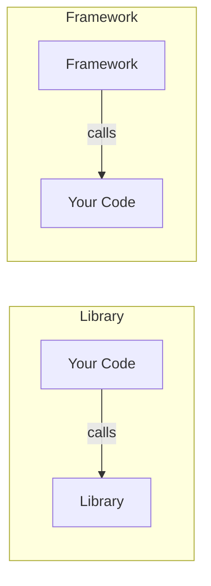

"Library" and "framework" are both everyday terms in software development, but the difference between them is surprisingly hard to pin down when someone asks. What separates them is who calls whom: your code calls a library, while a framework calls your code. This article explains that difference through the idea of Inversion of Control (IoC), with code examples.

## What Is a Library?

A library is a collection of code that provides specific functionality. Developers call library functions and classes from their own code.

<strong>The developer's code keeps control of the program flow</strong>. When, how, and in what order to use the library's features is up to the developer.

```python
# Library example: requests
import requests

# The developer is in control
response = requests.get("https://api.example.com/users")
data = response.json()

for user in data:
    print(user["name"])
```

In this example, the developer's code decides when to call the `requests` library and how to process the result.

Popular libraries:

| Language | Library | Purpose |
|---|---|---|
| Python | Requests | HTTP client |
| JavaScript | Lodash | Utility functions |
| Java | Guava | Collections & caching |
| Go | zap | Structured logging |
| C | libcurl | HTTP/network communication |

## What Is a Framework?

A framework is a software foundation that provides the skeleton of an application. The framework sets the application's structure and execution flow, and the developer plugs code into extension points the framework provides.

<strong>The framework has control of the program flow</strong>.

```python
# Framework example: Flask
from flask import Flask

app = Flask(__name__)

# The framework decides "when" to call this function
@app.route("/users")
def get_users():
    return [{"name": "Alice"}, {"name": "Bob"}]

# Hand over execution to the framework
if __name__ == "__main__":
    app.run()
```

In this example, the framework (Flask) decides when to call `get_users`. When an HTTP request reaches `/users`, Flask calls the developer's code.

Popular frameworks:

| Language | Framework | Purpose |
|---|---|---|
| Python | Django, Flask | Web applications |
| JavaScript | Next.js | Full-stack Web |
| Java | Spring | Enterprise applications |
| Ruby | Ruby on Rails | Web applications |
| Go | Gin | Web APIs |

## Inversion of Control (IoC)

The difference between libraries and frameworks can be explained by a software design principle called <strong>Inversion of Control (IoC)</strong>.



- <strong>Library</strong>: Your code → calls the library (you call it)
- <strong>Framework</strong>: The framework → calls your code (it calls you back)

This reversal of who calls whom is "Inversion of Control," also known as the "Hollywood Principle: Don't call us, we'll call you." In his [article on IoC](https://martinfowler.com/bliki/InversionOfControl.html), Martin Fowler describes it as a key part of what makes a framework different from a library.

### Comparing in Code

The same HTTP server ends up with a quite different structure depending on whether you write it library-style or framework-style.

Library-style approach (using Go's `net/http` directly; it still calls handlers, but imposes little application structure):

```go
package main

import (
    "encoding/json"
    "log"
    "net/http"
)

func main() {
    // The developer controls server construction, startup, and most application structure
    mux := http.NewServeMux()

    mux.HandleFunc("/users", func(w http.ResponseWriter, r *http.Request) {
        users := []map[string]string{
            {"name": "Alice"},
            {"name": "Bob"},
        }
        w.Header().Set("Content-Type", "application/json")
        json.NewEncoder(w).Encode(users)
    })

    log.Fatal(http.ListenAndServe(":8080", mux))
}
```

Framework-style approach (Next.js App Router):

```typescript
// app/users/page.tsx
// The framework controls routing, rendering, and serving

export default async function UsersPage() {
  const users = [
    { name: "Alice" },
    { name: "Bob" },
  ];

  return (
    <ul>
      {users.map((user) => (
        <li key={user.name}>{user.name}</li>
      ))}
    </ul>
  );
}
```

In the Next.js example, the file's location becomes the route, and the framework decides when the component is rendered. The part the developer writes is *what* to display.

## Common Misconceptions

### "Is React a Library or a Framework?"

React's [official site](https://react.dev/) describes it as "The library for web and native user interfaces." React on its own handles component rendering and leaves things like routing to other libraries.

However, React does control component lifecycles and when re-rendering happens, so it has framework-like aspects. Next.js adds routing, data fetching, and a build system on top of React, which makes it a framework.

When you actually use these tools, it helps more to see which parts React controls and which parts you decide than to settle the label.

### "If It's Big, It's a Framework?"

Code size doesn't decide it. Small frameworks and large libraries both exist. For example:

- <strong>Express.js</strong> — Lightweight, but a framework (Express manages the request-handling control flow)
- <strong>TensorFlow</strong> — Massive, but often used as a library (the developer can control model construction and training loops; higher-level APIs such as Keras add framework-like conventions)

## Choosing Between Libraries and Frameworks

The table below summarizes, as general tendencies, the differences that usually follow from where control lies.

| Aspect | Library | Framework |
|---|---|---|
| Control | Developer controls | Framework controls |
| Flexibility | High (mix and match freely) | Lower (follow conventions) |
| Learning curve | Lower (learn only needed APIs) | Higher (understand overall conventions) |
| Consistency | Depends on team | Enforced by framework |
| Dev speed | Fast initially, may slow at scale | Slower initially, more stable at scale |
| Best for | Adding specific functionality | Building entire applications |

In practice, libraries are often used inside frameworks. For example, a Next.js (framework) app might use date-fns (library) to format dates.

## Summary

A library is a tool your code calls, and you keep control. A framework is a foundation that calls your code, and it holds control. The difference comes down to Inversion of Control (IoC): who calls whom.

Real tools don't split cleanly into two groups; they sit somewhere between the two. When choosing one, checking which side holds the control flow makes the decision easier.