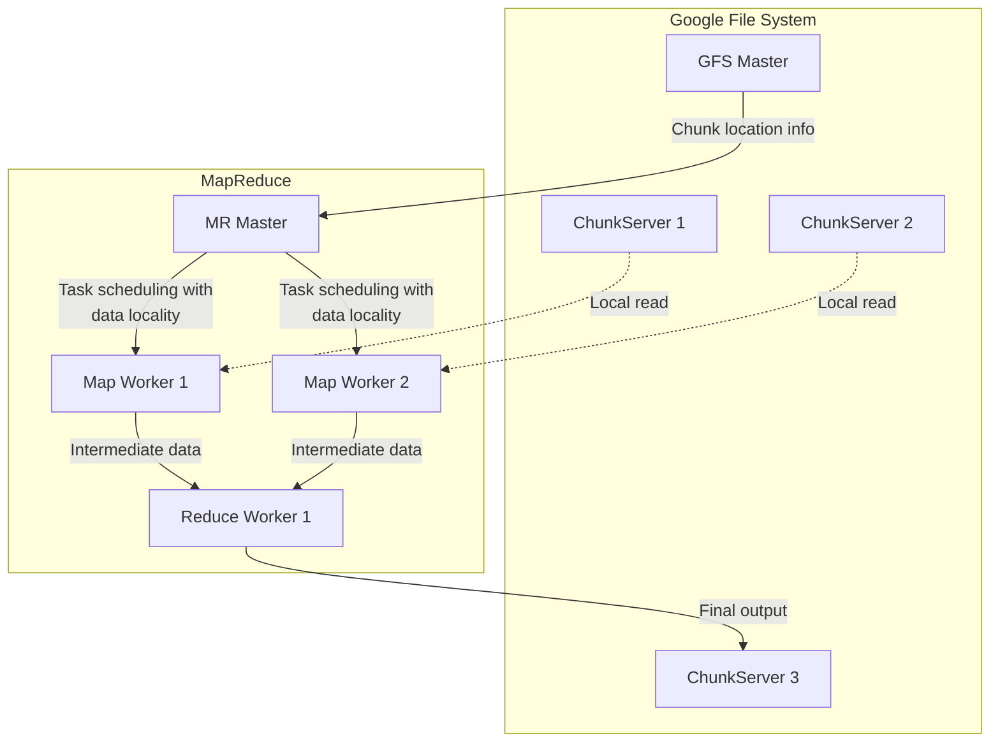

## Introduction — What MapReduce Changed

In 2004, Jeff Dean and Sanjay Ghemawat from Google presented "[MapReduce: Simplified Data Processing on Large Clusters](https://research.google/pubs/mapreduce-simplified-data-processing-on-large-clusters/)" at OSDI'04. With MapReduce, a programmer writes two functions, map and reduce, and the framework spreads the work across a cluster of thousands of machines. The paper's main achievement was letting programmers without experience in parallel and distributed systems write large-scale computations.

At the time, Google was routinely processing tens of petabytes of data collected by web crawlers. Index building, PageRank computation, and access log analysis all had to be distributed across thousands of machines, and each time engineers had to solve the same problems:

- Data partitioning and distribution: How to spread data evenly across machines
- Parallel execution control: How to coordinate thousands of processes
- Fault recovery: What to do when a machine dies (and machines die almost daily)
- Network bandwidth:  How to move terabytes of data efficiently

The code for these problems was unrelated to the computation itself, yet it made up most of each program. MapReduce moves this plumbing into a framework so that programmers write only the computation.

<ArticleVideo slug="mapreduce" />

<MapReduceTimeline />

## The World Before MapReduce

### The MPI (Message Passing Interface) Era

In the early 2000s, MPI was the tool for large-scale computation. MPI is powerful, but the programmer must write everything, from partitioning and communication to aggregation and failure handling:

```c
// Word Count with MPI (pseudocode) — hellish complexity
MPI_Init(&argc, &argv);
MPI_Comm_rank(MPI_COMM_WORLD, &rank);
MPI_Comm_size(MPI_COMM_WORLD, &size);

// Manually partition data
if (rank == 0) {
    // Master reads file and sends chunks to each worker
    for (int i = 1; i < size; i++) {
        MPI_Send(chunk[i], chunk_size, MPI_CHAR, i, 0, MPI_COMM_WORLD);
    }
}

// Each worker processes locally
MPI_Recv(my_chunk, chunk_size, MPI_CHAR, 0, 0, MPI_COMM_WORLD, &status);
local_count = count_words(my_chunk);

// Aggregate results to master — how many ways can this fail?
MPI_Reduce(&local_count, &global_count, 1, MPI_INT, MPI_SUM, 0, MPI_COMM_WORLD);

// Worker dies? → programmer handles it
// Network delay? → programmer handles it
// Data skew? → programmer handles it
MPI_Finalize();
```

This code has no fault handling at all. In a 1,000-machine cluster, if a single machine fails, the job starts over. At Google's scale, a design cannot assume that machines don't fail.

### The Problem the Paper Describes

The MapReduce paper's Introduction describes the situation at Google:

> The computations were conceptually straightforward, but the input data was large and had to be distributed across hundreds or thousands of machines in order to finish in a reasonable amount of time. The issues of how to parallelize, distribute data, and handle failures conspired to obscure the original simple computation with large amounts of complex code.
>
> — MapReduce paper, Section 1

MapReduce solved this problem by moving parallelization, data distribution, and failure handling into the framework, separating infrastructure code from the computation.

<MapReduceComparison />

## The Programming Model — Two Functions

MapReduce's programming model is inspired by `map` and `fold` (reduce) from functional programming. Every computation is expressed as two functions:

```text
map    (k1, v1)       → list(k2, v2)
reduce (k2, list(v2)) → list(k3, v3)
```

### The map Function

**Input**: A key-value pair `(k1, v1)` (e.g., filename and contents)

**Output**: A list of intermediate key-value pairs `list(k2, v2)`

**Responsibility**: Extract the needed information from the input and label it with intermediate keys

### The reduce Function

**Input**: An intermediate key and all values associated with that key `(k2, list(v2))`

**Output**: The final result `list(k3, v3)`

**Responsibility**: Aggregate the values for the same key into the final result

### Word Count — The "Hello, World!" of MapReduce

The standard MapReduce example is Word Count, which counts how often each word appears. It is also the first example in Google's paper:

```python
# map function
def map(filename: str, contents: str):
    for word in contents.split():
        emit(word, 1)

# reduce function
def reduce(word: str, counts: list[int]):
    emit(word, sum(counts))
```

The user writes only these 6 lines, and they can process petabytes of data across thousands of machines in parallel. The framework handles distribution, fault recovery, and data transfer.

<MapReduceVisualizer />

### Other Applications

The paper gives several other computations that fit the same two-function form:

#### Distributed Grep

```python
def map(filename, contents):
    for line in contents.split('\n'):
        if pattern.match(line):
            emit(filename, line)

def reduce(filename, lines):
    for line in lines:
        emit(filename, line)
```

#### URL Access Frequency

```python
def map(logfile, log_entry):
    url = parse_url(log_entry)
    emit(url, 1)

def reduce(url, counts):
    emit(url, sum(counts))
```

#### Reverse Link Graph (Foundation of Web Search)

```python
def map(url, page_content):
    for target_url in extract_links(page_content):
        emit(target_url, url)  # target ← source relationship

def reduce(target_url, source_urls):
    emit(target_url, list(source_urls))
```

#### Inverted Index (Heart of Search Engines)

```python
def map(doc_id, contents):
    for word in tokenize(contents):
        emit(word, doc_id)

def reduce(word, doc_ids):
    emit(word, sorted(set(doc_ids)))
```

Changing only the bodies of map and reduce produces entirely different computations. The framework code stays the same.

## Internal Implementation of the Execution Model

This section follows the execution flow shown in Figure 1 of the paper, one stage at a time.

### Overall Flow

```mermaid
flowchart LR
    subgraph Input["Input (GFS)"]
        I1[Split 0]
        I2[Split 1]
        I3[Split 2]
        I4[Split ...]
    end

    subgraph MapPhase["Map Phase"]
        M1[Worker 1<br/>map&#40;&#41;]
        M2[Worker 2<br/>map&#40;&#41;]
        M3[Worker 3<br/>map&#40;&#41;]
    end

    subgraph Shuffle["Shuffle"]
        S1[Partition &<br/>Sort by Key]
    end

    subgraph ReducePhase["Reduce Phase"]
        R1[Worker A<br/>reduce&#40;&#41;]
        R2[Worker B<br/>reduce&#40;&#41;]
    end

    subgraph Output["Output (GFS)"]
        O1[Output 0]
        O2[Output 1]
    end

    I1 --> M1
    I2 --> M2
    I3 --> M3
    I4 --> M3

    M1 --> S1
    M2 --> S1
    M3 --> S1

    S1 --> R1
    S1 --> R2

    R1 --> O1
    R2 --> O2
```



### Step 1: Input Splitting

The user program splits the input data into M **splits** (typically 16–64 MB).

The 64 MB upper bound matches the size of the chunks in which GFS (Google File System) stores data. When splits line up with chunks, it is easier to run the computation on the machine that already stores the data. This is called **data locality**. Reading from local disk is much faster than transferring data over the network.

### Step 2: Master Startup

The framework starts multiple copies of the program on cluster machines. One becomes the **Master**, and the rest are **Workers**. The Master assigns M Map tasks and R Reduce tasks to idle Workers.

```go
// Master task management (conceptual code)
type Master struct {
    mapTasks    []Task    // M Map tasks
    reduceTasks []Task    // R Reduce tasks
    workers     []Worker  // Available workers
}

type Task struct {
    State    TaskState  // idle | in-progress | completed
    WorkerID int        // Assigned worker
    Input    string     // Input file location
}

func (m *Master) schedule() {
    for _, task := range m.mapTasks {
        if task.State == Idle {
            worker := m.findIdleWorker()
            // Consider data locality: prefer workers with local data
            task.assign(worker)
        }
    }
}
```

### Step 3: Map Phase

A Map Worker reads its input split, applies the user-defined map function to each record, and buffers the intermediate key/value pairs in memory.

The buffered pairs are periodically written to local disk, partitioned into R regions by a **partitioning function** (default: `hash(key) mod R`). The Worker reports the locations of these intermediate files to the Master.

```text
Files on Map Worker's disk:
  /tmp/mr-0-0  (Intermediate data for Partition 0)
  /tmp/mr-0-1  (Intermediate data for Partition 1)
  ...
  /tmp/mr-0-(R-1)  (Intermediate data for Partition R-1)
```

Map output is written to local disk, not GFS. Intermediate data is temporary and is no longer needed once the Shuffle has delivered it to the Reducers. The cost is that if a Worker fails, even the Map tasks it already completed must be re-executed.

### Step 4: Shuffle and Sort

The Shuffle moves data from every Map Worker to every Reduce Worker, which makes it the most expensive stage of MapReduce.

Reduce Workers use the locations sent by the Master to read their partition from the local disks of all Map Workers via RPC.

Once all the data is read, the Reduce Worker sorts it by intermediate key so that records with the same key are grouped together. Sorting is needed because many different keys usually go to the same Reduce task.

```text
Shuffle network transfer volume:
  M Maps * R Reduce partitions = up to M×R network transfers

  Example: M=10,000, R=5,000
      → up to 50,000,000 network calls
      → this is MapReduce's bottleneck
```

<strong>Combiner optimization</strong>: To reduce network traffic, a Combiner function can run on the Map side. A Combiner is often the same code as Reduce, but it is safe to use only when two conditions hold: the final result must not change when the framework applies it zero, one, or several times to parts of a mapper's output, and its output type must match the intermediate key/value type. For Word Count, instead of sending `(hello, 1), (hello, 1), (hello, 1)` over the network, the Combiner merges them into `(hello, 3)` before sending.

### Step 5: Reduce Phase

A Reduce Worker reads the sorted intermediate data in order and, for each intermediate key, passes the key and its set of values to the user's reduce function. The output of reduce is appended to the final output file for that Reduce task.

### Step 6: Completion

When all Map and Reduce tasks have completed, the Master wakes up the user program, and the MapReduce call returns to user code. The output is in R files (one per Reduce task).

## Architecture

<MapReduceArchitecture />

## "Pushing Complexity into the Framework" in Practice — Hadoop's Source Code

Google's original implementation is not public, but Apache Hadoop is open source, framework internals included. Reading Hadoop's code shows what the framework handles behind the map and reduce functions the user writes.

### The User-Facing API: Mapper.java — ~150 Lines

The body of [`Mapper.java`](https://github.com/apache/hadoop/blob/trunk/hadoop-mapreduce-project/hadoop-mapreduce-client/hadoop-mapreduce-client-core/src/main/java/org/apache/hadoop/mapreduce/Mapper.java), the class users extend, is short:

```java
// Mapper.java (Apache Hadoop) — ~150 lines total (including license header and Javadoc)
// https://github.com/apache/hadoop/blob/trunk/.../mapreduce/Mapper.java
public class Mapper<KEYIN, VALUEIN, KEYOUT, VALUEOUT> {

  protected void setup(Context context) throws IOException, InterruptedException {
    // NOTHING
  }

  protected void map(KEYIN key, VALUEIN value, Context context)
      throws IOException, InterruptedException {
    context.write((KEYOUT) key, (VALUEOUT) value);  // default: identity function
  }

  protected void cleanup(Context context) throws IOException, InterruptedException {
    // NOTHING
  }

  public void run(Context context) throws IOException, InterruptedException {
    setup(context);
    try {
      while (context.nextKeyValue()) {
        map(context.getCurrentKey(), context.getCurrentValue(), context);
      }
    } finally {
      cleanup(context);
    }
  }
}
```

For Word Count, the user overrides just one method: `map()`.

### What the Framework Hides: MapTask.java — 2,100+ Lines

The code that actually runs this `map()` is [`MapTask.java`](https://github.com/apache/hadoop/blob/trunk/hadoop-mapreduce-project/hadoop-mapreduce-client/hadoop-mapreduce-client-core/src/main/java/org/apache/hadoop/mapred/MapTask.java). The file is over 2,100 lines long and includes:

**`MapOutputBuffer` — Circular buffer with sort and spill mechanics** (~800 lines)

```java
// MapOutputBuffer inside MapTask.java (excerpt)
// https://github.com/apache/hadoop/blob/trunk/.../mapred/MapTask.java
public static class MapOutputBuffer<K, V> implements MapOutputCollector<K, V>, IndexedSortable {
    private IntBuffer kvmeta;    // metadata circular buffer overlay
    byte[] kvbuffer;             // main serialization buffer
    int kvstart, kvend, kvindex; // metadata boundary management
    int equator;                 // boundary between meta and data regions
    int bufstart, bufend, bufmark, bufindex, bufvoid; // buffer pointers

    final ReentrantLock spillLock = new ReentrantLock();
    final Condition spillDone = spillLock.newCondition();
    final Condition spillReady = spillLock.newCondition();
    // ...

    // Receives KV pairs emitted from user's map()
    public synchronized void collect(K key, V value, final int partition)
        throws IOException {
      // Check buffer remaining → start spill if needed
      bufferRemaining -= METASIZE;
      if (bufferRemaining <= 0) {
        spillLock.lock();
        try {
          // Coordination logic with spill thread (dozens of lines of buffer mgmt)
          // ...
        } finally {
          spillLock.unlock();
        }
      }
      // Serialize key and value into the buffer
      keySerializer.serialize(key);
      valSerializer.serialize(value);
      // Record metadata (partition, offsets)
      kvmeta.put(kvindex + PARTITION, partition);
      kvmeta.put(kvindex + KEYSTART, keystart);
      // ...
    }

    // Sort and spill to disk
    private void sortAndSpill() throws IOException {
      // QuickSort by partition, then by key
      sorter.sort(MapOutputBuffer.this, mstart, mend, reporter);
      // Write intermediate data per partition in IFile format
      for (int i = 0; i < partitions; ++i) {
        Writer<K, V> writer = new Writer<>(job, partitionOut, keyClass, valClass, codec, ...);
        if (combinerRunner == null) {
          // No combiner: write directly
        } else {
          // With combiner: local aggregation before writing
          combinerRunner.combine(kvIter, combineCollector);
        }
      }
    }

    // Merge multiple spill files
    private void mergeParts() throws IOException {
      // k-way merge of N spill files
      for (int parts = 0; parts < partitions; parts++) {
        RawKeyValueIterator kvIter = Merger.merge(job, rfs, keyClass, valClass, ...);
        // Write merged result to final output file
      }
    }
}
```

`MapTask.java` also contains these classes:

- `SpillThread` — Background thread that spills the buffer to disk (synchronized with ReentrantLock + Condition)
- `TrackedRecordReader` — Counter management for input bytes and records
- `SkippingRecordReader` — Skipping and recording bad records
- `NewOutputCollector` — Applying the partition function and routing to the buffer
- `BlockingBuffer` — Write blocking control during spills

When the user writes the single line `context.write(word, 1)`, the framework runs the following in order: serialization into a circular buffer, detection of a full buffer, sorting in a background thread, a per-partition write to disk, the combiner, and a final k-way merge. "Pushing complexity into the framework" means keeping all of this out of the user's code.

### Line Count Comparison

```text
User code:
  Mapper.java     ~150 lines   (map() itself is 3 lines; rest is Javadoc)
  Reducer.java    ~180 lines   (reduce() itself is 3 lines)

Framework side (core task execution):
  MapTask.java    ~2,100 lines  (buffer mgmt, sort, spill, merge)
  ReduceTask.java ~650 lines   (shuffle, sort, merge)
  Merger.java     ~870 lines   (k-way merge sort)
  IFile.java      ~500 lines   (intermediate file format)
  Total           ~4,100+ lines
```

The core framework files that run tasks are more than 12x the size of the API classes users extend. Job scheduling and the Shuffle's network transport layer are not included, so for the framework as a whole the gap is even larger.

## Fault Tolerance — Why It Works at Thousands of Machines

MapReduce has a mechanism inside the framework that lets a job run to completion on thousands of commodity machines even when some of them fail.

### The Cluster Used in the Paper

The cluster used for the paper's performance measurements had this configuration:

- About 1,800 machines
- Each machine: two 2 GHz Intel Xeon processors (Hyper-Threading enabled), 4 GB memory, two 160 GB IDE disks
- Network: gigabit Ethernet (1 Gbps)

At this scale, disk, memory, and network failures happen routinely. If a job restarted from the beginning every time a machine broke, large jobs would never finish.

<FaultToleranceDiagram />

### Worker Failure in Detail

The Master periodically pings every Worker and marks a Worker as failed if it does not respond within a certain time.

**When a Map Worker fails:**

1. Its in-progress Map tasks are reset to `idle` and rescheduled
2. Its completed Map tasks are also reset to `idle` and re-executed, because their output is on that Worker's local disk, which can no longer be read
3. When a Map task moves from Worker A to Worker B, all Workers running Reduce tasks are notified. Reduce tasks that have not yet read the data from A read it from B

**When a Reduce Worker fails:**

1. Only its in-progress Reduce tasks are reset to `idle` and rescheduled
2. Completed Reduce tasks are not re-executed, because their output is stored on GFS (the global file system)

### Determinism and Atomic Commits

MapReduce commits the output of completed Map and Reduce tasks atomically.

- Map tasks: The Worker writes output to temporary files and reports the file names to the Master on completion. If the Master receives another completion report for a task that has already completed, it ignores it (idempotency)
- Reduce tasks: The Worker writes output to a temporary file and, on completion, renames it to the final output file name. This relies on GFS renames being atomic

If the map and reduce functions are **deterministic** (always produce the same output for the same input), distributed execution produces the same result as sequential execution. Even for non-deterministic functions, each Reduce task's output matches the output of some sequential execution.

### Straggler Mitigation: Speculative Execution

One major cause of long MapReduce jobs is **stragglers**: the last few tasks running abnormally slowly. Causes include:

- Degraded disk: Read/write speed drops to 1/10 of normal or less
- CPU overload: Other tasks running on the same machine
- Network congestion:  Bandwidth saturated between specific racks

In none of these cases has the machine stopped, so they are not detected as failures.

Google addressed this with **backup tasks** (speculative execution). Near the end of a job, when few tasks remain, the Master launches backup copies of all remaining in-progress tasks on other machines and uses the result of whichever copy finishes first.

According to the paper, disabling backup tasks increased job completion time by 44%.

## Performance Characteristics

### Data Locality

Network bandwidth is scarce, so MapReduce tries to run each Map task on a machine that stores its input data (or on a machine in the same rack). GFS replicates each chunk (typically to 3 locations), and the Master uses these replica locations when assigning tasks.

According to the paper, in large MapReduce jobs that use a significant fraction of the workers in a cluster, most input data is read locally and consumes no network bandwidth.

### Combiner and Bandwidth Optimization

The Combiner described in Step 4 greatly reduces network traffic during the Shuffle. For Word Count:

```text
Without Combiner: Each mapper sends (the, 1) thousands of times
With Combiner: Each mapper pre-aggregates to (the, 4832) before sending

Transfer data volume: Can be reduced by orders of magnitude
```

A Combiner is safe only when partial aggregation leaves the final result unchanged no matter whether the framework runs it zero, one, or several times. Associative and commutative operations such as sum, max, and min work. Average does not work directly; to compute an average, combine the numerator and denominator (sum and count) separately.

### Custom Partition Functions

The default partition function is `hash(key) mod R`, but some uses require a different one. For example, when output keys are URLs and you want all URLs from the same host in the same output file:

```python
def partition(key: str, num_reducers: int) -> int:
    hostname = urlparse(key).hostname
    return hash(hostname) % num_reducers
```

## Experimental Results from the Paper

The paper reports two benchmarks, both run on the cluster of about 1,800 machines described above.

### Grep

Searching for a specific 3-character pattern across $10^{10}$ 100-byte records (approximately 1 TB):

- 1,764 Worker machines
- Input split into 15,000 splits of 64 MB ($M = 15000$)
- Startup overhead (distributing the program, opening files on GFS, getting locality information) took about 60 seconds
- Total completion in approximately 150 seconds

### Sort

Sorting $10^{10}$ 100-byte records (approximately 1 TB):

- 1,764 Worker machines
- $M = 15000$, $R = 4000$
- Total completion in approximately 891 seconds (about 15 minutes)
- This time is with backup tasks enabled; with them disabled, the job took 44% longer, as noted above

## The Symbiosis with GFS

Google's MapReduce reads its input from and writes its final output to GFS, and it uses GFS chunk locations when assigning tasks. The performance and fault tolerance described so far depend on running together with GFS.



### What GFS Provides

1. Large-capacity storage: Petabyte scale from commodity servers
2. Replication: Each chunk replicated to 3 locations for availability
3. Chunk location information: Data locality information for Map task scheduling
4. Atomic rename: Used for atomic commits of Reduce output

### What MapReduce Requires from GFS

- High-throughput sequential reads and writes (random access not needed)
- Atomic rename / commit semantics for final Reduce output; intermediate Map output stays on local worker disks, not in GFS
- Optimized for large files (small files are a weak point)

The GFS design was later implemented in the Hadoop ecosystem as HDFS (Hadoop Distributed File System), an open-source file system inspired by GFS.

## The Ecosystem MapReduce Created

MapReduce's influence did not stay inside Google; a series of open-source big data systems followed.

### Direct Descendant: Hadoop

In 2006, Doug Cutting and Mike Cafarella developed Apache Hadoop as an open-source implementation inspired by Google's MapReduce and GFS papers. Yahoo! supported the development heavily. The combination of HDFS and Hadoop MapReduce let companies other than Google process petabytes of data.

Projects built on Hadoop multiplied quickly:

- Hive: SQL interface on MapReduce (developed by Facebook)
- Pig: Dataflow language on MapReduce (developed by Yahoo!)
- HBase: Open-source Bigtable implementation (runs on HDFS)
- ZooKeeper: Distributed coordination service

### MapReduce's Limitations

As adoption spread, MapReduce's limitations also became clear.

**1. Inefficiency for Iterative Processing**

Algorithms such as k-means, PageRank, and gradient descent repeat the same computation many times. In MapReduce, each iteration runs as a separate job and writes its intermediate results to disk:

```text
Iteration 1: Read → Map → Shuffle → Reduce → Write to disk
Iteration 2: Read from disk → Map → Shuffle → Reduce → Write to disk
Iteration 3: Read from disk → Map → Shuffle → Reduce → Write to disk
...
```

Disk I/O on every iteration makes this very slow.

**2. Unsuitability for Interactive Queries**

MapReduce jobs take tens of seconds just to start, so they are a poor fit for ad-hoc queries where you want to see results right away.

**3. Expressiveness Constraints**

All computation must be fit into a map → shuffle → reduce pipeline. Complex DAGs (Directed Acyclic Graphs) can only be expressed by chaining several MapReduce jobs, which is inefficient.

**4. Fixed Shuffle Pattern**

All Map output must go through the Shuffle, so its overhead applies even to processing that does not need it.

### Successor Technologies

#### Apache Spark (2010–)

Developed at UC Berkeley's AMPLab, Spark introduced the **RDD (Resilient Distributed Dataset)**, which lets intermediate data stay in memory:

```python
# Word Count with Spark — data stays in memory
text = sc.textFile("hdfs://input")
counts = text.flatMap(lambda line: line.split()) \
             .map(lambda word: (word, 1)) \
             .reduceByKey(lambda a, b: a + b)
counts.saveAsTextFile("hdfs://output")
```

- 10–100x speedup for iterative processing
- DAG-based execution engine (not a fixed map → reduce pipeline)
- Interactive shell (Spark Shell) for running ad-hoc queries

#### Apache Flink (2014–)

Flink supports stream processing natively and treats batch processing as a special case of stream processing.

#### Google Cloud Dataflow / Apache Beam (2014–2016)

Google developed these itself as the successor to MapReduce (Dataflow SDK in 2014, Apache Beam's initial release in 2016). Batch and stream processing are written with the same model:

```python
# Apache Beam — same code for batch and stream
import apache_beam as beam

with beam.Pipeline() as p:
    (p
     | beam.io.ReadFromText('input.txt')
     | beam.FlatMap(lambda line: line.split())
     | beam.combiners.Count.PerElement()
     | beam.io.WriteToText('output'))
```

## MapReduce's Intellectual Legacy

MapReduce's implementation is no longer mainstream, but its ideas carry on in today's data processing infrastructure.

### 1. Democratization Through Abstraction

"Push distributed processing complexity into the framework and show users only a simple interface."

Spark, Flink, and Beam carry this idea forward, and the same approach appears in general-purpose orchestrators like Kubernetes.

### 2. The Data Locality Principle

"Bring computation to data, not data to computation."

In the cloud, compute and storage tend to be separated, but this principle is still basic to performance tuning.

### 3. Failure Is the Norm, Not the Exception

"In large-scale systems, failures will happen. Design for failure from the start."

The same idea appears in Google's SRE (Site Reliability Engineering) and in Netflix's Chaos Monkey, which deliberately causes failures in production.

### 4. Scalability of Simple Models

"A constrained simple model scales better than a complex model that can do everything."

MapReduce does not allow arbitrary communication patterns as MPI does. Because the data flow is fixed, the framework can optimize task placement and re-execution.

## Conclusion

Published by Google in 2004, MapReduce made large-scale data processing on commodity hardware a matter of writing two functions, map and reduce. The framework handles splitting, scheduling, re-execution after Worker failures, and speculative execution for stragglers, and through Hadoop the design spread into the foundation of big data processing.

While it has been superseded by Spark and Flink today, the principles MapReduce established — separation of computation from infrastructure, design for failure, and scaling through simple abstractions — remain the foundation of distributed systems design.

## References

- Dean, J., & Ghemawat, S. (2004). [MapReduce: Simplified Data Processing on Large Clusters](https://research.google/pubs/mapreduce-simplified-data-processing-on-large-clusters/). OSDI'04.
- Ghemawat, S., Gobioff, H., & Leung, S.-T. (2003). [The Google File System](https://research.google/pubs/the-google-file-system/). SOSP'03.
- Zaharia, M., et al. (2010). [Spark: Cluster Computing with Working Sets](https://www.usenix.org/legacy/event/hotcloud10/tech/full_papers/Zaharia.pdf). HotCloud'10.
- White, T. (2015). *Hadoop: The Definitive Guide*. O'Reilly Media.
