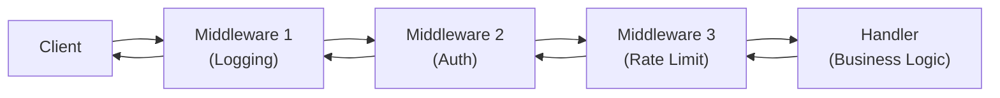
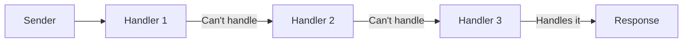
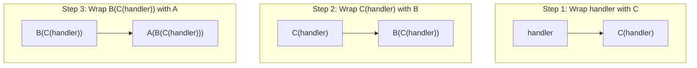
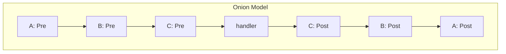
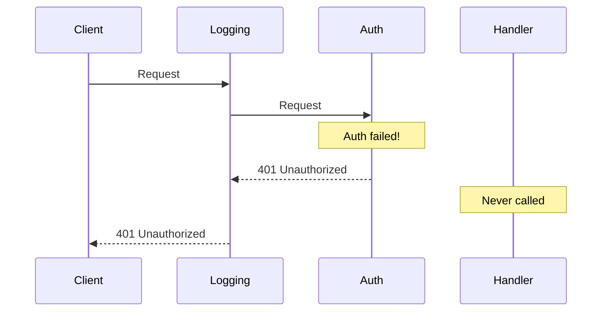
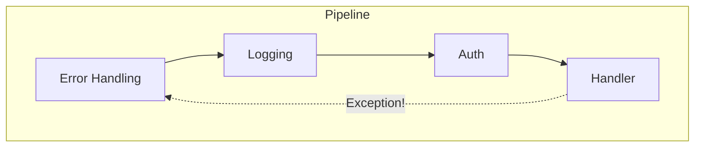

## Introduction

Express.js's `next()`, Django's `get_response`, ASP.NET Core's `Use()` / `Run()`, and Go's `http.Handler` wrappers are all forms of one architectural pattern: the middleware chain.

A middleware chain lets you add and remove processing steps such as authentication, logging, and error handling in the HTTP request/response pipeline. Using a framework only requires knowing its API. To understand why you must call `next()` and why middleware registration order matters, the best approach is to build a chain yourself.

The sections below build a middleware chain from scratch in Python and then compare it with the middleware APIs of Express.js, Django, ASP.NET Core, and Go. The comparison shows where each framework's `next()` fits in the mechanism you built.

### Topics Covered

1. What middleware is and why it forms a chain
2. Roots in GoF design patterns (Chain of Responsibility, Decorator)
3. What `next` is: function composition and closures
4. Assembling the chain with `compose`, and the onion model
5. Short-circuiting: ending the pipeline early
6. Error-handling middleware
7. Registration order and execution order
8. Comparison with Express.js, Django, ASP.NET Core, and Go
9. Testing middleware
10. Class-based middleware

### Target Audience

This article is for developers who have used middleware in a web framework and want to understand how it works internally, including those who want to learn design patterns by implementing them. It assumes basic Python: functions, classes, and decorators.

### A World Without Middleware — The Motivating Problem

Without middleware, every handler has to repeat the same logging, authentication, and error-handling code:

```python
def handle_users(request):
    # Logging (copy-paste 1/3)
    print(f"{request.method} {request.path}")
    # Auth check (copy-paste 1/3)
    if "Authorization" not in request.headers:
        return Response(status=401, body="Unauthorized")
    # Error handling (copy-paste 1/3)
    try:
        return Response(status=200, body="User list")
    except Exception:
        return Response(status=500, body="Internal Server Error")


def handle_orders(request):
    # Logging (copy-paste 2/3)
    print(f"{request.method} {request.path}")
    # Auth check (copy-paste 2/3)
    if "Authorization" not in request.headers:
        return Response(status=401, body="Unauthorized")
    # Error handling (copy-paste 2/3)
    try:
        return Response(status=200, body="Order list")
    except Exception:
        return Response(status=500, body="Internal Server Error")


def handle_products(request):
    # Logging (copy-paste 3/3)
    print(f"{request.method} {request.path}")
    # Auth check (copy-paste 3/3)
    if "Authorization" not in request.headers:
        return Response(status=401, body="Unauthorized")
    # Error handling (copy-paste 3/3)
    try:
        return Response(status=200, body="Product list")
    except Exception:
        return Response(status=500, body="Internal Server Error")
```

Here, the <strong>cross-cutting concerns</strong> of logging, authentication, and error handling are copied into every handler. With three handlers the duplication is manageable, but with 50 or 100:

- Changing the log format means finding and editing every handler.
- A bug in the authentication logic has to be fixed identically in every handler.
- Every new handler needs the same boilerplate, and it is easy to forget part of it.

A middleware chain removes the duplication by separating cross-cutting concerns from handlers and defining them once in a pipeline. Each handler then contains only its business logic:

```python
# With a middleware chain, handlers contain only business logic
def handle_users(request):
    return Response(status=200, body="User list")

def handle_orders(request):
    return Response(status=200, body="Order list")

def handle_products(request):
    return Response(status=200, body="Product list")

# Cross-cutting concerns are defined once as middleware
app = compose(router, [error_handling, logging, auth])
```

The following chapters build `compose` and these middlewares from scratch.

## Chapter 1: What Is Middleware?

### Basic Definition

Middleware is a processing layer between the request and the response. It receives a request, performs some processing such as logging, authentication, or adding headers, and then either passes the request to the next middleware or returns a response itself.

The Express.js documentation lists four things middleware can do:

1. Execute any code
2. Make changes to the request and response objects
3. End the request-response cycle
4. Call the next middleware function in the stack

### Why "Chain"?

Multiple middlewares are linked in sequence, and a request passes through them from first to last. Each middleware either calls the next middleware (`next()`) or returns a response itself (short-circuiting).



The arrows go both ways: the request travels from left to right, and the response returns from right to left through the same middlewares. Because each middleware wraps the ones inside it like the layers of an onion, this structure is called the <strong>onion model</strong>.

## Chapter 2: Design Pattern Roots

### GoF's Chain of Responsibility Pattern

The middleware chain derives from the GoF (Gang of Four) Chain of Responsibility pattern, which the book describes as follows:

> "Avoid coupling the sender of a request to its receiver by giving more than one object a chance to handle the request. Chain the receiving objects and pass the request along the chain until an object handles it." — Gang of Four, Design Patterns (1994)



Web middleware differs from the GoF definition in three ways:

| Property | GoF Chain of Responsibility | Web Middleware Chain |
|----------|---------------------------|---------------------|
| Number of handlers that process | Exactly one in the chain | All can participate |
| Processing direction | Unidirectional (request only) | Bidirectional (request + response) |
| Meaning of delegation | "I cannot handle this" | "Proceed to next step" |

### Similarity to the Decorator Pattern

As Wikipedia notes, Chain of Responsibility is structurally nearly identical to the Decorator pattern, in which each decorator adds behavior to the object it wraps and delegates to it. Web middleware behaves like a decorator: it runs pre-processing, delegates, and then runs post-processing. Like a handler in a Chain of Responsibility, it can also stop the chain by returning a response itself. Web middleware chains therefore combine <strong>Chain of Responsibility and Decorator</strong>.

## Chapter 3: The Core Abstraction — What `next` Really Is

### `next` Is Function Composition

At its core, a middleware chain is <strong>function composition</strong>.

Each middleware receives a function representing the next processing step and decides whether to call it. That function combines all subsequent middlewares and the final handler into one.

The following Python code defines the types:

```python
from __future__ import annotations

from dataclasses import dataclass, field
from collections.abc import Callable


# ──────────────────────────────────────────────
# Request and Response type definitions
# ──────────────────────────────────────────────

@dataclass
class Request:
    """A simple data class mimicking an HTTP request."""
    method: str = "GET"
    path: str = "/"
    headers: dict[str, str] = field(default_factory=dict)
    body: str = ""


@dataclass
class Response:
    """A simple data class mimicking an HTTP response."""
    status: int = 200
    headers: dict[str, str] = field(default_factory=dict)
    body: str = ""


# ──────────────────────────────────────────────
# Type aliases
# ──────────────────────────────────────────────

# Handler: a function that takes a request and returns a response
Handler = Callable[[Request], Response]

# Middleware: a function that takes a handler and returns a new handler
Middleware = Callable[[Handler], Handler]
```

The two type aliases carry the whole design: `Handler` maps a request to a response, and `Middleware` is a higher-order function that takes a handler and returns a new handler.

### Writing the First Middleware

A logging middleware looks like this:

```python
def logging_middleware(next_handler: Handler) -> Handler:
    """Middleware that logs requests and responses."""
    def handler(request: Request) -> Response:
        # ── Pre-processing (before the request reaches the handler) ──
        print(f"--> {request.method} {request.path}")

        # ── Call next ──
        response = next_handler(request)

        # ── Post-processing (before the response reaches the client) ──
        print(f"<-- {response.status}")

        return response

    return handler
```

Every middleware that follows has the same structure:

1. It receives `next_handler` as an argument (a reference to the next step).
2. It defines and returns a new `handler` function.
3. Inside that `handler`, it:
   - performs pre-processing before calling `next_handler`
   - delegates by calling `next_handler(request)`
   - performs post-processing after `next_handler` returns

`next_handler` combines the next middleware, every middleware after it, and the final handler into one function. That is what `next` is.

### Why `next_handler` Stays Alive — The Closure Mechanism

Calling `logging_middleware(some_handler)` returns the inner `handler` function. `handler` takes only `request` as its argument, yet it can still call `next_handler` when it runs later. This works because of closures: in Python, when an inner function references a variable of an enclosing function, the inner function "captures" that variable.

```python
def logging_middleware(next_handler: Handler) -> Handler:
    #           ^ next_handler enters the local scope here

    def handler(request: Request) -> Response:
        #     ^ handler "captures" next_handler
        print(f"--> {request.method} {request.path}")
        response = next_handler(request)  # <- accessed via closure
        print(f"<-- {response.status}")
        return response

    return handler
    # <- even after logging_middleware's stack frame is gone,
    #    handler retains a reference to next_handler
```

When `compose` nests the middlewares, each layer's closure holds a reference to the next layer, and these references link the whole chain together.

> Closures exist in JavaScript, Go, Ruby, Rust, and almost every other major language. They are also how Express.js's `next()` knows which middleware comes next and how Go's `func(http.Handler) http.Handler` functions form chains.

## Chapter 4: Assembling the Middleware Chain

### The `compose` Function — Building the Chain

The first middleware in the list should run first, so it must be the outermost layer. `compose` therefore wraps the handler starting from the last middleware, which makes the last registered middleware the innermost layer. This is a <strong>reverse fold</strong> (reduce).

```python
def compose(handler: Handler, middlewares: list[Middleware]) -> Handler:
    """Compose a list of middlewares into a single handler.

    For middlewares = [A, B, C], execution order is A -> B -> C -> handler.
    Internally, handler is wrapped by C, then by B, then by A.
    """
    composed = handler
    for middleware in reversed(middlewares):
        composed = middleware(composed)
    return composed
```

The diagram shows the three wrapping steps for `[A, B, C]`:



When the resulting `A(B(C(handler)))` receives a request, the steps run in this order:

1. A pre → B pre → C pre → handler (request direction)
2. handler → C post → B post → A post (response direction)

This order is the onion model.

### Visualizing the Onion Model



### Tracing the Call Stack

The following trace shows the call stack when one request passes through a pipeline built with `compose(handler, [logging, timing, auth])`.

```text
compose execution (wiring phase, before any request):
  composed = handler
  composed = auth(handler)           -> auth_handler   (captures handler via closure)
  composed = timing(auth_handler)    -> timing_handler  (captures auth_handler via closure)
  composed = logging(timing_handler) -> logging_handler (captures timing_handler via closure)

app = logging_handler  <- this is the final entry point
```

```text
app(Request("GET /")) invocation (execution phase):

  logging_handler(request)
  |  print("--> GET /")                      # logging pre-processing
  |
  +-->  timing_handler(request)              # next_handler call
  |    |  start = time.perf_counter()        # timing pre-processing
  |    |
  |    +-->  auth_handler(request)           # next_handler call
  |    |    |  check Authorization header    # auth pre-processing
  |    |    |
  |    |    +-->  handler(request)           # next_handler call
  |    |    |    |  return Response(200)     # business logic executes
  |    |    |    v
  |    |    |  response = Response(200)
  |    |    |  return response               # auth has no post-processing
  |    |    v
  |    |  elapsed_ms = ...                   # timing post-processing
  |    |  response.headers["X-Response-Time"] = "1.23ms"
  |    |  return response
  |    v
  |  print("<-- 200")                        # logging post-processing
  |  return response
  v
```

The trace shows three properties of the chain:

- The wiring phase (`compose` execution) and the execution phase (`app(request)` calls) are separate. Wiring runs once, and every later request passes through the same pipeline.
- The calls are nested. Each middleware's pre-processing runs on the way in and its post-processing runs on the way out, which produces the round trip of the onion model.
- The handler (business logic) sits at the bottom of the stack. Adding middlewares does not require changing it.

Django's official documentation uses the onion analogy:

> "You can think of it like an onion: each middleware class is a 'layer' that wraps the view, which is in the core of the onion. If the request passes through all the layers of the onion (each one calls `get_response` to pass the request in to the next layer), all the way to the view at the core, the response will then pass through every layer (in reverse order) on the way back out." — Django documentation

### Running the Chain

The following code adds authentication and timing middlewares, then sends one request with an `Authorization` header and one without:

```python
def auth_middleware(next_handler: Handler) -> Handler:
    """Middleware that checks authentication.

    Returns 401 if no Authorization header (short-circuit).
    """
    def handler(request: Request) -> Response:
        if "Authorization" not in request.headers:
            # Return response without calling next_handler -> short-circuit
            return Response(status=401, body="Unauthorized")

        return next_handler(request)

    return handler


def timing_middleware(next_handler: Handler) -> Handler:
    """Middleware that measures processing time."""
    import time

    def handler(request: Request) -> Response:
        start = time.perf_counter()
        response = next_handler(request)
        elapsed_ms = (time.perf_counter() - start) * 1000
        response.headers["X-Response-Time"] = f"{elapsed_ms:.2f}ms"
        return response

    return handler


# ── Final handler ──
def my_handler(request: Request) -> Response:
    return Response(status=200, body="Hello, World!")


# ── Assemble and run the chain ──
app = compose(my_handler, [logging_middleware, timing_middleware, auth_middleware])

# Request with auth header
print("=== With Auth ===")
resp = app(Request(method="GET", path="/", headers={"Authorization": "Bearer token123"}))
print(f"Body: {resp.body}\n")

# Request without auth header (will be short-circuited)
print("=== Without Auth ===")
resp = app(Request(method="GET", path="/"))
print(f"Status: {resp.status}, Body: {resp.body}")
```

Output:

```text
=== With Auth ===
--> GET /
<-- 200
Body: Hello, World!

=== Without Auth ===
--> GET /
<-- 401
Status: 401, Body: Unauthorized
```

Without the header, `auth_middleware` returns 401 without calling `next_handler`. The post-processing of `logging_middleware` and `timing_middleware` still runs, so the log shows `<-- 401`. Middlewares outside the one that short-circuits always see both the request and the response.

## Chapter 5: Short-Circuiting — Early Pipeline Termination

### What Is Short-Circuiting?

Short-circuiting means a middleware returns a response without calling `next`, skipping the rest of the pipeline.

`auth_middleware` from the previous chapter short-circuits: when authentication fails, running the handler would serve no purpose, so the middleware ends the pipeline there.



Short-circuiting lets a middleware avoid unnecessary work, as the ASP.NET Core documentation explains:

> "Short-circuiting the request pipeline is often desirable because it avoids unnecessary work. For example, Static File Middleware can act as a terminal middleware by processing a request for a static file and short-circuiting the rest of the pipeline." — ASP.NET Core documentation

### Design Considerations for Short-Circuiting

Three points affect how short-circuiting middleware is designed:

- The post-processing of middlewares outside the one that short-circuits still runs. This is why `logging_middleware` logged the 401 response in the previous example.
- Registration order matters. If you place the authentication middleware before the logging middleware, failed authentication attempts are not logged. Logging is usually placed at the outermost position.
- The ASP.NET Core documentation warns against calling `next` after the response has been sent to the client, because changing a response that has already started throws an exception.

### Practical Example: Cache Middleware

A cache middleware also short-circuits: on a cache hit, it returns the stored response without calling the rest of the pipeline.

```python
class CacheMiddleware:
    """Cache responses and serve subsequent identical requests from cache.

    On cache hit, the rest of the pipeline is completely skipped.
    This avoids DB access and external API calls,
    dramatically reducing response time.
    """

    def __init__(self) -> None:
        self._cache: dict[str, Response] = {}

    def __call__(self, next_handler: Handler) -> Handler:
        def handler(request: Request) -> Response:
            cache_key = f"{request.method}:{request.path}"

            # Cache hit -> short-circuit
            if cache_key in self._cache:
                cached = self._cache[cache_key]
                cached.headers["X-Cache"] = "HIT"
                return cached  # do NOT call next_handler!

            # Cache miss -> continue the pipeline
            response = next_handler(request)

            # Cache only successful responses
            if response.status == 200:
                response.headers["X-Cache"] = "MISS"
                self._cache[cache_key] = response

            return response

        return handler
```

ASP.NET Core's Static File Middleware works the same way: a public static file or a precomputed public response can be returned without running authentication, authorization, or business logic. Only public content should be served before authentication; protected files must stay behind the appropriate authentication and authorization middleware.

## Chapter 6: Error-Handling Middleware

### Catching Exceptions with Middleware

An error-handling middleware placed at the outermost layer catches exceptions raised anywhere inside the pipeline.

```python
def error_handling_middleware(next_handler: Handler) -> Handler:
    """Middleware that catches exceptions and converts them to 500 responses."""

    def handler(request: Request) -> Response:
        try:
            return next_handler(request)
        except Exception as exc:
            print(f"[ERROR] {type(exc).__name__}: {exc}")
            return Response(status=500, body="Internal Server Error")

    return handler
```

Because it wraps the `next_handler(request)` call in `try/except`, this short function catches exceptions from every middleware and handler inside it.

### Why Place It at the Outermost Layer?



Placing the error-handling middleware at the outermost layer has three effects:

1. It catches exceptions from all inner middlewares and the handler.
2. An uncaught exception may reach the client as a framework-specific error page or stack trace; the middleware returns the same 500 response instead.
3. `error_handling_middleware` prints each exception before returning 500. A logging middleware inside it does not log a status for these requests, because the exception skips its post-processing.

ASP.NET Core's middleware ordering guidelines also place exception-handling middleware at the earliest position in the pipeline.

### Express.js Error-Handling Middleware

Express.js distinguishes error-handling middleware from regular middleware by the number of parameters: it treats a function with four arguments (`err, req, res, next`) as error-handling middleware:

```javascript
// Express.js error-handling middleware
// Identified by having 4 arguments (including err)
app.use((err, req, res, next) => {
  console.error(err.stack)
  res.status(500).send('Something broke!')
})
```

## Chapter 7: Middleware Composition and Execution Order

### The Typical Registration Order

Middleware registration order affects the application's security, performance, and correctness.

A typical order based on the ASP.NET Core documentation (simplified):

1. Exception handling
2. HTTPS redirection
3. Static file serving
4. Routing
5. CORS
6. Authentication
7. Authorization
8. Custom middleware
9. Endpoints

Three of these positions have specific reasons:

- Exception handling goes first so that it catches exceptions from all later middlewares.
- Public CSS and images need no authentication or authorization, so serving public static files early short-circuits the pipeline and saves work. Protected assets should stay behind authentication.
- Authorization decides what the user can do, so it needs the identity that authentication establishes first. Authorization therefore comes after authentication.

### What Happens When You Get the Order Wrong

Two common mistakes show what a wrong order breaks.

<strong>Failure Pattern 1: Error handling is inside auth</strong>

```python
# Dangerous order: auth is outside error handling
bad_pipeline = compose(my_handler, [
    auth_middleware,              # <- outermost
    error_handling_middleware,    # <- inside
    timing_middleware,
])
```

With this order, if `auth_middleware` itself raises an exception (for example, on an unexpected header value during parsing), `error_handling_middleware` sits inside it and cannot catch the exception. Depending on the framework and environment settings, the unhandled exception may expose a framework error page or stack trace, which is a security risk.

```python
# Correct order: error handling at the outermost layer
good_pipeline = compose(my_handler, [
    error_handling_middleware,    # <- outermost: catches all exceptions
    auth_middleware,
    timing_middleware,
])
```

<strong>Failure Pattern 2: Logging is inside auth</strong>

```python
# Problematic order
bad_pipeline = compose(my_handler, [
    auth_middleware,
    logging_middleware,   # <- inside auth
])
```

Requests that fail authentication are short-circuited by `auth_middleware` and never reach `logging_middleware`, so unauthorized access attempts are never logged. For a security audit, which needs a record of those attempts, this is a critical gap.

```python
# Correct order
good_pipeline = compose(my_handler, [
    logging_middleware,   # <- outermost: logs all requests
    auth_middleware,
])
```

In both cases, the registration order decides which failures the error-handling and logging middlewares can observe. Registration order therefore <strong>defines the security boundaries</strong> of the application.

### Testing Composition — Verifying Execution Order

The following trace middleware prints when each layer runs:

```python
def make_trace_middleware(name: str) -> Middleware:
    """Generate a trace middleware for verifying execution order."""

    def middleware(next_handler: Handler) -> Handler:
        def handler(request: Request) -> Response:
            print(f"  [{name}] pre-processing")
            response = next_handler(request)
            print(f"  [{name}] post-processing")
            return response
        return handler

    return middleware


def trace_handler(request: Request) -> Response:
    print(f"  [handler] executing")
    return Response(status=200, body="OK")


# ── Compose in A -> B -> C -> handler order ──
pipeline = compose(trace_handler, [
    make_trace_middleware("A"),
    make_trace_middleware("B"),
    make_trace_middleware("C"),
])

print("Execution order:")
pipeline(Request())
```

Output:

```text
Execution order:
  [A] pre-processing
  [B] pre-processing
  [C] pre-processing
  [handler] executing
  [C] post-processing
  [B] post-processing
  [A] post-processing
```

Pre-processing runs A → B → C (registration order), and post-processing runs C → B → A (reverse order), exactly as the onion model predicts.

## Chapter 8: Real-World Framework Comparison

The following sections map the mechanism we built to four frameworks.

### Express.js (Node.js)

In Express.js, middleware is a function receiving `(req, res, next)`. Calling `next()` advances to the next middleware.

```javascript
const express = require('express')
const app = express()

// Middleware 1: Logging
app.use((req, res, next) => {
  console.log(`${req.method} ${req.url}`)
  next()  // Advance to next middleware
})

// Middleware 2: Auth
app.use((req, res, next) => {
  if (!req.headers.authorization) {
    return res.status(401).send('Unauthorized') // Short-circuit
  }
  next()
})

// Handler
app.get('/', (req, res) => {
  res.send('Hello!')
})
```

Mapping to our implementation:
- `next()` = our `next_handler(request)`
- `res.send()` without calling `next()` = short-circuit
- `app.use()` call order = middleware execution order

### Django (Python)

Django middleware is a factory that takes `get_response` and returns a callable, which matches our `Middleware = Callable[[Handler], Handler]` almost exactly.

```python
# Django middleware (function style)
def simple_middleware(get_response):
    # One-time initialization

    def middleware(request):
        # Pre-processing
        response = get_response(request)
        # Post-processing
        return response

    return middleware


# Django middleware (class style)
class SimpleMiddleware:
    def __init__(self, get_response):
        self.get_response = get_response

    def __call__(self, request):
        # Pre-processing
        response = self.get_response(request)
        # Post-processing
        return response
```

From Django's documentation:

> "The `get_response` callable provided by Django might be the actual view (if this is the last listed middleware) or it might be the next middleware in the chain. The current middleware doesn't need to know or care what exactly it is, just that it represents whatever comes next."

`get_response` plays the same role as our `next_handler`: it is everything ahead, combined into one function.

### ASP.NET Core (C#)

ASP.NET Core explicitly builds the pipeline with `Use()` and `Run()`.

```csharp
var app = builder.Build();

// Use(): can call the next middleware
app.Use(async (context, next) =>
{
    Console.WriteLine("Middleware 1: before");
    await next.Invoke(context);
    Console.WriteLine("Middleware 1: after");
});

app.Use(async (context, next) =>
{
    Console.WriteLine("Middleware 2: before");
    await next.Invoke(context);
    Console.WriteLine("Middleware 2: after");
});

// Run(): terminal middleware (does not receive next)
app.Run(async context =>
{
    await context.Response.WriteAsync("Hello!");
});
```

The output of this code is:

```text
Middleware 1: before
Middleware 2: before
Middleware 2: after
Middleware 1: after
```

Pre-processing runs 1 → 2, and post-processing runs 2 → 1, the same order as in our onion model.

### Go (net/http)

In Go, middleware is a function that takes an `http.Handler` and returns an `http.Handler`.

```go
func loggingMiddleware(next http.Handler) http.Handler {
    return http.HandlerFunc(func(w http.ResponseWriter, r *http.Request) {
        log.Printf("%s %s", r.Method, r.URL.Path)
        next.ServeHTTP(w, r)  // Advance to next handler
    })
}

func authMiddleware(next http.Handler) http.Handler {
    return http.HandlerFunc(func(w http.ResponseWriter, r *http.Request) {
        if r.Header.Get("Authorization") == "" {
            http.Error(w, "Unauthorized", http.StatusUnauthorized)
            return // Short-circuit
        }
        next.ServeHTTP(w, r)
    })
}

// Assembling the chain
handler := loggingMiddleware(authMiddleware(myHandler))
```

Go's `func(http.Handler) http.Handler` is structurally analogous to our `Callable[[Handler], Handler]`: it wraps one handler and returns another, although Go's concrete handler signature uses `ResponseWriter` and `*Request`.

### Framework Comparison Table

| Property | Our Implementation | Express.js | Django | ASP.NET Core | Go net/http |
|----------|-------------------|------------|--------|-------------|-------------|
| Middleware type | `Handler -> Handler` | `(req, res, next) -> void` | `get_response -> callable` | `RequestDelegate -> RequestDelegate` | `Handler -> Handler` |
| Delegation | `next_handler(request)` | `next()` | `get_response(request)` | `next.Invoke(context)` | `next.ServeHTTP(w, r)` |
| Short-circuit | Don't call `next` | `res.send()` without `next()` | Return response without `get_response` | Don't call `next`, or use `Run()` | `return` without calling `next` |
| Composition | `compose()` (reverse fold) | `app.use()` (register order) | `MIDDLEWARE` list (config order) | `app.Use()` / `app.Run()` (register order) | Function nesting |
| Error handling | `try/except` wrapper | 4-arg `(err,req,res,next)` | Exceptions auto-converted to HTTP responses | `UseExceptionHandler()` | `recover()` to catch `panic` |

## Chapter 9: Testing Strategies

### Why Middleware Is Easy to Test

Because a middleware takes a handler and returns a handler, you can unit-test it by passing it a mock handler.

```python
def test_auth_middleware_rejects_unauthenticated() -> None:
    """Test that requests without auth header get 401."""
    # ── Mock handler (should not be called) ──
    called = False

    def mock_handler(request: Request) -> Response:
        nonlocal called
        called = True
        return Response(status=200, body="OK")

    # ── Apply middleware under test ──
    protected = auth_middleware(mock_handler)

    # ── Test with unauthenticated request ──
    response = protected(Request(method="GET", path="/secret"))

    assert response.status == 401
    assert response.body == "Unauthorized"
    assert not called, "Handler should not be called"


def test_auth_middleware_passes_authenticated() -> None:
    """Test that requests with auth header reach the handler."""
    def mock_handler(request: Request) -> Response:
        return Response(status=200, body="Secret Content")

    protected = auth_middleware(mock_handler)

    response = protected(Request(
        method="GET",
        path="/secret",
        headers={"Authorization": "Bearer token123"},
    ))

    assert response.status == 200
    assert response.body == "Secret Content"


def test_compose_order() -> None:
    """Test that compose runs pre-processing in order, post-processing in reverse."""
    order: list[str] = []

    def make_tracker(name: str) -> Middleware:
        def middleware(next_handler: Handler) -> Handler:
            def handler(request: Request) -> Response:
                order.append(f"{name}:pre")
                response = next_handler(request)
                order.append(f"{name}:post")
                return response
            return handler
        return middleware

    def final_handler(request: Request) -> Response:
        order.append("handler")
        return Response(status=200)

    pipeline = compose(final_handler, [make_tracker("A"), make_tracker("B")])
    pipeline(Request())

    assert order == ["A:pre", "B:pre", "handler", "B:post", "A:post"]
```

These tests call functions directly and never start an HTTP server. Treating middleware as a higher-order function is what makes this possible.

## Chapter 10: Class-Based Middleware

### From Functions to Classes

The middlewares so far have been functions. When a middleware holds internal state such as configuration values or counters, a class-based implementation fits better. Django also supports class-based middleware.

```python
class RateLimitMiddleware:
    """Middleware that limits request count within a time window.

    By using a class, we can hold the request counter
    as an instance variable.
    """

    def __init__(self, max_requests: int = 100, window_seconds: float = 60.0) -> None:
        self.max_requests = max_requests
        self.window_seconds = window_seconds
        self._request_counts: dict[str, list[float]] = {}

    def __call__(self, next_handler: Handler) -> Handler:
        import time

        def handler(request: Request) -> Response:
            client_ip = request.headers.get("X-Forwarded-For", "unknown")
            now = time.time()

            # Remove old entries outside the window
            timestamps = self._request_counts.get(client_ip, [])
            timestamps = [t for t in timestamps if now - t < self.window_seconds]

            if len(timestamps) >= self.max_requests:
                return Response(status=429, body="Too Many Requests")

            timestamps.append(now)
            self._request_counts[client_ip] = timestamps

            return next_handler(request)

        return handler


# Using class-based middleware
rate_limiter = RateLimitMiddleware(max_requests=10, window_seconds=60.0)
app = compose(my_handler, [logging_middleware, rate_limiter, auth_middleware])
```

Implementing `__call__` makes each instance callable, so it fits the same `Callable[[Handler], Handler]` type as function-style middleware.

## Conclusion

Building a middleware chain in Python exposes the design principles behind it:

1. Middleware is a higher-order function: it takes a handler and returns a new handler. `next` is the rest of the chain combined into one function.
2. Onion model: pre-processing runs in registration order and post-processing in reverse, so requests and responses pass through the same layers in opposite directions.
3. Short-circuiting: returning a response without calling `next` skips unnecessary processing, while the post-processing of outer middlewares still runs.
4. Function composition: `compose` assembles multiple middlewares into one handler with a reverse fold.
5. Registration order: security (authentication before authorization), performance (serving public static files early), and correctness (exception handling at the outermost layer) all depend on it.
6. Testability: passing a mock handler is enough for a unit test; no HTTP server is needed.

Express.js's `next()`, Django's `get_response`, ASP.NET Core's `next.Invoke()`, and Go's `next.ServeHTTP()` differ in name and syntax, but they share the same design principle. With your own implementation in mind, you can read any framework's middleware documentation and map it onto the mechanism you built.

## References

- [Express.js — Using middleware](https://expressjs.com/en/guide/using-middleware.html)
- [Django — Middleware](https://docs.djangoproject.com/en/5.1/topics/http/middleware/)
- [ASP.NET Core — Middleware](https://learn.microsoft.com/en-us/aspnet/core/fundamentals/middleware/?view=aspnetcore-9.0)
- [Go — Writing Web Applications (net/http)](https://go.dev/doc/articles/wiki/)
- [Gang of Four — Design Patterns: Elements of Reusable Object-Oriented Software (1994)](https://en.wikipedia.org/wiki/Design_Patterns)
- [Chain-of-responsibility pattern — Wikipedia](https://en.wikipedia.org/wiki/Chain-of-responsibility_pattern)
