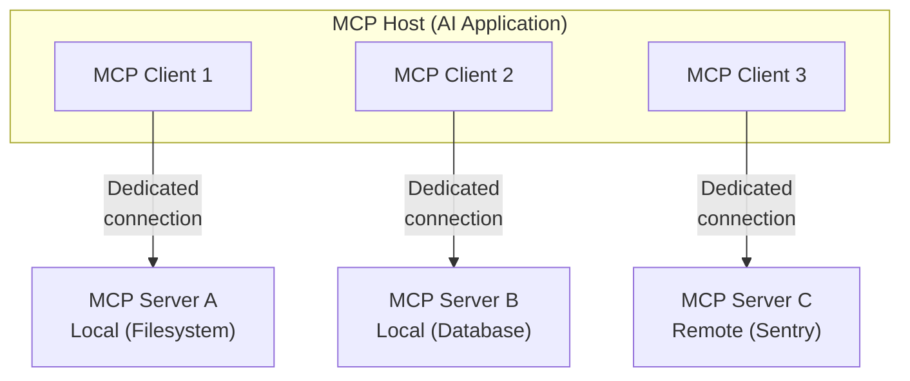
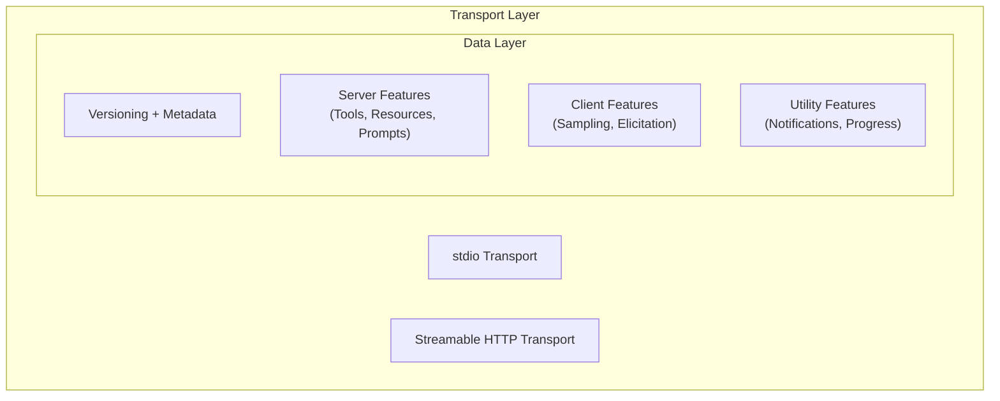
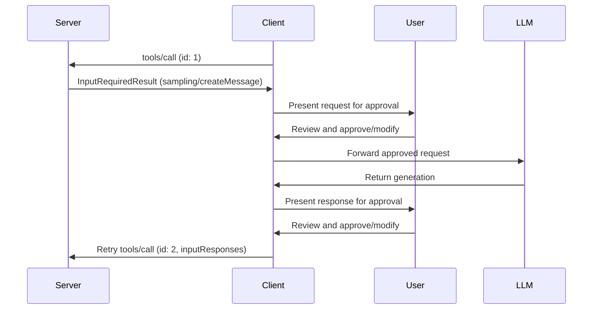
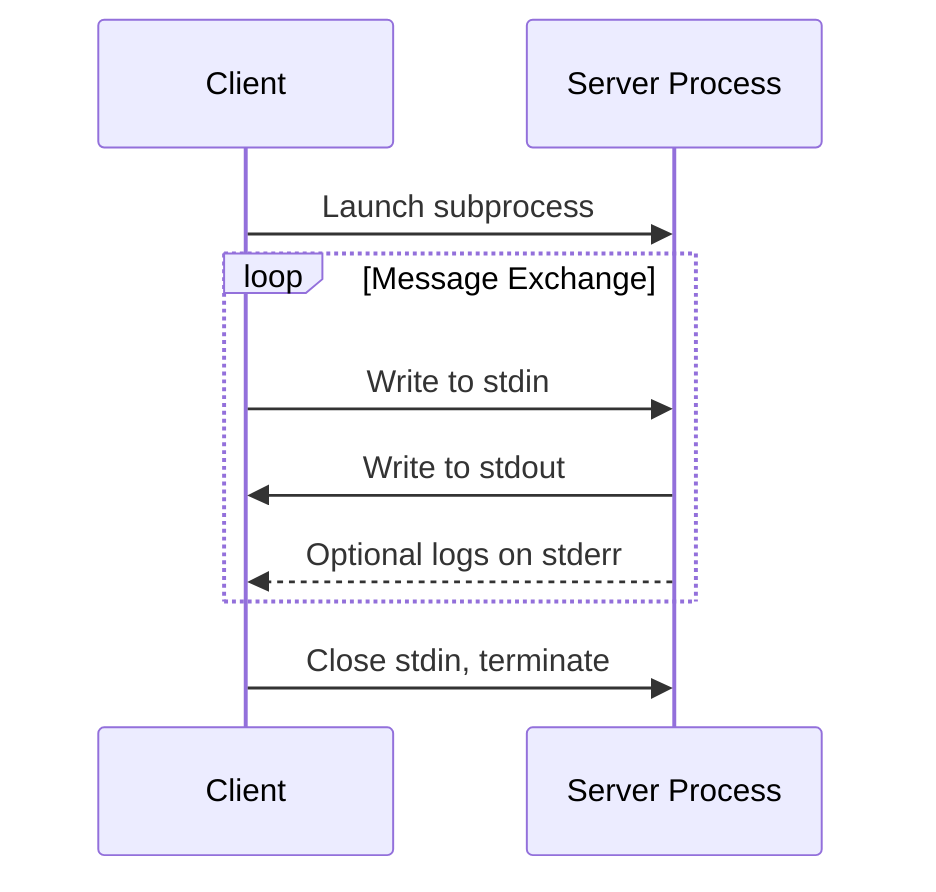
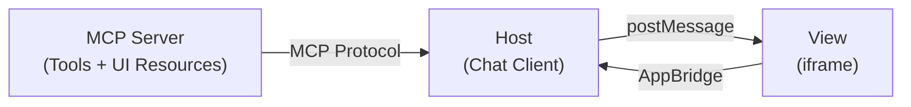
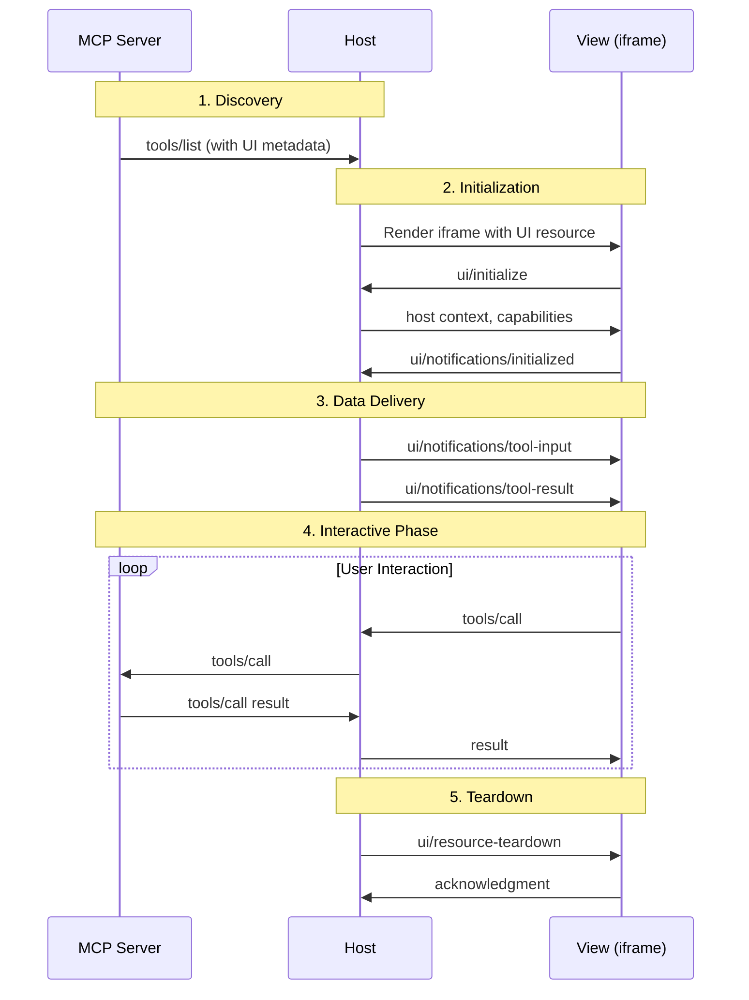

## Introduction — What is MCP?

<strong>Model Context Protocol (MCP)</strong> is an open-source standard for connecting AI applications to external systems. Through MCP, AI applications such as Claude or ChatGPT can connect to data sources (local files, databases), tools (search engines, calculators), and workflows (specialized prompts), so they can read the information they need and carry out tasks.

MCP is often called a "USB-C port for AI applications": USB-C gives electronic devices one standard way to connect, and MCP does the same for AI applications and external systems.

### The Same Request Without and With MCP

Suppose you are a developer and ask your AI assistant: "Errors are spiking in production. Check the latest Sentry errors, fix the relevant source code, and create a PR on GitHub."

<strong>Without MCP</strong>: The AI assistant can't access Sentry data and responds "Sorry, I can't access external systems." You'd need to manually open Sentry, copy error details, fix the code yourself, and create a PR through GitHub's UI.

<strong>With MCP</strong>: The AI assistant retrieves errors via the Sentry MCP Server, reads and writes source code via the Filesystem MCP Server, and creates a PR via the GitHub MCP Server. All three servers speak the same protocol, MCP, and the whole workflow takes a single prompt.

MCP comprises the following projects:

- [MCP Specification](https://modelcontextprotocol.io/specification/latest) — The protocol specification
- [MCP SDKs](https://modelcontextprotocol.io/docs/sdk) — SDKs for various programming languages
- [MCP Inspector](https://github.com/modelcontextprotocol/inspector) — Development tools
- [MCP Reference Servers](https://github.com/modelcontextprotocol/servers) — Reference implementations

Claude, ChatGPT, Visual Studio Code (GitHub Copilot), Cursor, and many other clients support MCP, so a server built once can be integrated with all of them.

This article follows the current MCP specification, `2026-07-28`, and covers the protocol architecture, the MCP Apps extension, and Microsoft's implementation samples.

> <strong>Specification version note</strong>
>
> MCP revisions are identified as `YYYY-MM-DD`, where the date marks the last time a backwards-incompatible change was made. The current revision is [`2026-07-28`](https://modelcontextprotocol.io/specification/2026-07-28/). This revision removed the legacy connection-scoped `initialize` lifecycle from the core protocol: version, client identity, and client capabilities now travel on every request in `_meta.io.modelcontextprotocol/*`, and servers expose supported versions/capabilities through the mandatory `server/discover` RPC. It also removed the Streamable HTTP GET stream endpoint, protocol-level sessions, and resumable SSE redelivery; SSE is now a response format for a POST or for `subscriptions/listen`, not a separate HTTP+SSE transport.

---

## Architecture Overview

### Participants

MCP follows a client-server architecture with three participants.

| Participant | Role | Examples |
|---|---|---|
| MCP Host | The AI application itself. Creates and manages one or more MCP Clients | Claude Desktop, VS Code, ChatGPT |
| MCP Client | A component that maintains a connection to an MCP Server and obtains context | Objects instantiated within the Host |
| MCP Server | A program that provides context and functionality to MCP Clients | Filesystem Server, Sentry MCP Server |

The Host creates one MCP Client instance for each MCP Server. For example, suppose VS Code (the Host) has three MCP Servers configured in `.vscode/mcp.json`:

```json
// .vscode/mcp.json configuration example
{
  "servers": {
    "filesystem": {
      "command": "npx",
      "args": ["-y", "@modelcontextprotocol/server-filesystem", "/workspace"]
    },
    "github": {
      "command": "npx",
      "args": ["-y", "@modelcontextprotocol/server-github"],
      "env": { "GITHUB_TOKEN": "${env:GITHUB_TOKEN}" }
    },
    "sentry": {
      "type": "http",
      "url": "https://mcp.sentry.dev/mcp"
    }
  }
}
```

VS Code reads this configuration and creates a separate MCP Client object for each of `filesystem`, `github`, and `sentry`. It launches the first two as local processes over the stdio transport and connects to `sentry` remotely over Streamable HTTP.



Despite being called "servers," MCP Servers don't necessarily run remotely. With the stdio transport, they run as subprocesses on the local machine. With the Streamable HTTP transport, they operate as remote servers.

### Two Layers

Conceptually, MCP has two layers.



The <strong>Data Layer (inner)</strong> defines the structure and meaning of messages exchanged over JSON-RPC 2.0. It covers per-request version and capability metadata, server features (Tools, Resources, Prompts), client features (Sampling, Elicitation), and utility features (notifications, progress tracking).

The <strong>Transport Layer (outer)</strong> manages the communication channel and authentication between clients and servers: it establishes connections, frames messages, and secures communication.

---

## Data Layer — JSON-RPC 2.0 Protocol

MCP uses [JSON-RPC 2.0](https://www.jsonrpc.org/) as its underlying RPC protocol. In the current MCP message patterns, the client sends JSON-RPC requests and notifications, and the server returns responses plus request-scoped or subscription-scoped notifications; servers do not initiate JSON-RPC requests. Notifications have no `id` field and therefore expect no response. MCP also tightens JSON-RPC by requiring request IDs to be strings or integers, never `null`.

### Per-Request Version and Capability Metadata

MCP `2026-07-28` is stateless at the protocol level. There is no `initialize` handshake. Instead, every request carries protocol metadata in `params._meta`, and the server accepts or rejects each request independently.

The interactive visualization below shows the legacy initialization flow from `2025-06-18`. New implementations should follow the per-request flow described in this section.

<MCPProtocolVisualizer />

#### Per-Request Metadata Details

Three mechanisms replace the old handshake. The first two are metadata fields in every request; the third is an RPC that servers implement.

<strong>1. Protocol Version Declaration</strong>

The `io.modelcontextprotocol/protocolVersion` field (for example, `"2026-07-28"`) declares the protocol version used by that request. If the server does not support it, it returns `UnsupportedProtocolVersionError` with a list of supported versions.

<strong>2. Client Capability Declaration</strong>

The `io.modelcontextprotocol/clientCapabilities` object declares the client features available for that request, such as elicitation, sampling, roots, and opted-in extensions. The client also identifies itself in `io.modelcontextprotocol/clientInfo`.

```json
{
  "jsonrpc": "2.0",
  "id": 1,
  "method": "tools/list",
  "params": {
    "_meta": {
      "io.modelcontextprotocol/protocolVersion": "2026-07-28",
      "io.modelcontextprotocol/clientInfo": {
        "name": "ExampleClient",
        "version": "1.0.0"
      },
      "io.modelcontextprotocol/clientCapabilities": {
        "elicitation": { "form": {}, "url": {} },
        "sampling": {}
      }
    }
  }
}
```

<strong>3. Server Discovery and Identity</strong>

Servers must implement `server/discover`, which returns supported protocol versions, server capabilities, and optional server identity in `_meta.io.modelcontextprotocol/serverInfo`. Clients may call it before other RPCs, or they can call any method directly and handle `UnsupportedProtocolVersionError`.

```json
// Example capabilities in a server/discover response
{
  "supportedVersions": ["2026-07-28"],
  "capabilities": {
    "tools": { "listChanged": true },
    "resources": { "subscribe": true },
    "prompts": { "listChanged": true }
  }
}
```

---

## Server Primitives — Tools, Resources, Prompts

MCP defines three core primitives that servers can expose. Together they determine what context a server can share with AI applications and what actions it can perform.

| Primitive | Controlled By | Description | Typical Use |
|---|---|---|---|
| Tools | Model (LLM) | Executable functions the LLM can invoke | API calls, DB queries, file operations |
| Resources | Application | Data sources providing contextual information | File contents, DB schemas, API responses |
| Prompts | User | Reusable templates for structuring LLM interactions | System prompts, few-shot examples |

Each primitive has associated methods for discovery (`*/list`), retrieval (`*/get` or `*/read`), and sometimes execution (`tools/call`).

For readability, some request/response examples below focus on method-specific fields and omit the required `params._meta` request metadata and/or the JSON-RPC `result.resultType` wrapper. In MCP `2026-07-28`, every request must include `io.modelcontextprotocol/protocolVersion`, `io.modelcontextprotocol/clientInfo`, and `io.modelcontextprotocol/clientCapabilities` under `_meta`, and every result response includes `resultType`.

### Tools — The LLM's Hands

Tools are functions the LLM can call to act on external systems, and they are the most important primitive in MCP. Each tool has a unique name and metadata that describes its schema.

For example, when a user types "What's the weather in Tokyo today?", the following happens:

1. The Host passes the "list of available Tools" and the user's message to the LLM
2. The LLM decides it should call the `get_weather` Tool and generates the arguments `{"location": "Tokyo"}`
3. The Host sends `tools/call` via the MCP Client
4. The MCP Server queries a weather API and returns the result
5. The Host passes the result to the LLM, which responds to the user in natural language

The LLM generates these arguments by reading the `inputSchema` of `get_weather`, which tells it that `location` is a required string parameter.

#### Tools Capability Declaration

```json
{
  "capabilities": {
    "tools": {
      "listChanged": true
    }
  }
}
```

`listChanged` indicates whether the server will emit notifications when the list of available tools changes.

#### Tool Definition

Each tool object includes the following fields:

- `name` — Unique identifier within the server's namespace
- `title` — Optional human-readable display name
- `description` — Detailed explanation of what the tool does
- `inputSchema` — JSON Schema defining expected input parameters
- `outputSchema` — Optional JSON Schema defining expected output structure
- `annotations` — Optional properties describing tool behavior

```json
{
  "name": "get_weather",
  "title": "Weather Information Provider",
  "description": "Get current weather information for a location",
  "inputSchema": {
    "type": "object",
    "properties": {
      "location": {
        "type": "string",
        "description": "City name or zip code"
      }
    },
    "required": ["location"]
  }
}
```

#### Tool Result Content Types

Tool execution results are returned in a `content` array, supporting multiple content types.

| Content Type | Description |
|---|---|
| `text` | Plain text |
| `image` | Base64-encoded image data |
| `audio` | Base64-encoded audio data |
| `resource_link` | URI link to a resource |
| `resource` | Embedded resource |

Tools can also return structured JSON in the `structuredContent` field. When a tool defines an `outputSchema`, the server MUST provide structured results that conform to it.

#### Error Handling

Tools use two error reporting mechanisms:

1. <strong>Protocol Errors</strong> — Standard JSON-RPC errors for unknown tools, invalid arguments, etc.
2. <strong>Tool Execution Errors</strong> — Business errors reported in tool results with `isError: true`

```json
{
  "content": [
    {
      "type": "text",
      "text": "Failed to fetch weather data: API rate limit exceeded"
    }
  ],
  "isError": true
}
```

#### Security Considerations

- Servers MUST validate all tool inputs
- Servers MUST implement proper access controls
- Servers MUST rate limit tool invocations
- Servers MUST sanitize tool outputs
- Clients SHOULD prompt for user confirmation on sensitive operations
- Clients SHOULD show tool inputs to the user before calling the server — to avoid malicious or accidental data exfiltration
- Clients SHOULD validate tool results before passing to LLM
- Clients SHOULD implement timeouts for tool calls
- Clients SHOULD log tool usage for audit purposes

### Resources — Providing Context Data

Resources let servers expose data to clients as context for language models, such as files, database schemas, and application-specific information. Each resource is uniquely identified by a URI.

A database MCP Server shows how Resources differ from Tools. Resources provide read-only context such as table listings and schema information, while Tools perform actions such as executing SQL queries.

- `db://schema/users` → Resource (returns column definitions for the users table)
- `run_query({"sql": "SELECT * FROM users LIMIT 10"})` → Tool (executes a query and returns results)

The LLM combines the two: it first learns the schema from a Resource and then runs queries through a Tool.

#### Resources Capability Declaration

```json
{
  "capabilities": {
    "resources": {
      "subscribe": true,
      "listChanged": true
    }
  }
}
```

- `subscribe` — Whether clients can subscribe to change notifications for individual resources
- `listChanged` — Whether the server will emit notifications when the available resources list changes

#### Listing and Reading Resources

```json
// resources/list response
{
  "resources": [
    {
      "uri": "file:///project/src/main.rs",
      "name": "main.rs",
      "title": "Rust Software Application Main File",
      "description": "Primary application entry point",
      "mimeType": "text/x-rust"
    }
  ]
}
```

```json
// resources/read response
{
  "contents": [
    {
      "uri": "file:///project/src/main.rs",
      "mimeType": "text/x-rust",
      "text": "fn main() {\n    println!(\"Hello world!\");\n}"
    }
  ]
}
```

#### Resource Templates

Resource templates allow servers to expose parameterized resources using [URI Templates (RFC 6570)](https://datatracker.ietf.org/doc/html/rfc6570).

```json
{
  "uriTemplate": "weather://forecast/{city}/{date}",
  "name": "weather-forecast",
  "title": "Weather Forecast",
  "description": "Get weather forecast for any city and date",
  "mimeType": "application/json"
}
```

#### Subscriptions

Clients subscribe to resource changes with `subscriptions/listen`, using the `resourceSubscriptions` filter. This replaces the older `resources/subscribe` RPC.

```json
// subscriptions/listen request
{
  "jsonrpc": "2.0",
  "id": 1,
  "method": "subscriptions/listen",
  "params": {
    "notifications": {
      "resourceSubscriptions": ["file:///project/src/main.rs"]
    }
  }
}
```

```json
// Change notification
{
  "jsonrpc": "2.0",
  "method": "notifications/resources/updated",
  "params": {
    "_meta": {
      "io.modelcontextprotocol/subscriptionId": 1
    },
    "uri": "file:///project/src/main.rs"
  }
}
```

#### Common URI Schemes

| Scheme | Use |
|---|---|
| `https://` | Web resources (when clients can fetch directly) |
| `file://` | Filesystem-like resources |
| `git://` | Git version control integration |
| Custom | Any scheme conforming to RFC 3986 |

#### Annotations

Resources and content blocks support optional annotations:

- `audience` — Array indicating intended recipients (`"user"` or `"assistant"`)
- `priority` — Number from 0.0 to 1.0 indicating importance
- `lastModified` — ISO 8601 timestamp of last modification

### Prompts — Templating Interactions

Prompts let servers offer prompt templates to clients: structured messages and instructions for interacting with language models.

Prompts are user-controlled: the user invokes them explicitly, and they are not triggered automatically. Clients typically expose them as slash commands or in command palettes.

For example, suppose a GitHub MCP Server provides a `/code-review` Prompt. When a user types `/code-review` in the chat, the client displays an argument input UI saying "Please enter your code," and the entered code is included in a structured message passed to the LLM. Unlike a Tool, which the LLM invokes on its own, this Prompt runs only when the user chooses it.

```json
{
  "name": "code_review",
  "title": "Request Code Review",
  "description": "Asks the LLM to analyze code quality and suggest improvements",
  "arguments": [
    {
      "name": "code",
      "description": "The code to review",
      "required": true
    }
  ]
}
```

The result of `prompts/get` includes a list of messages to pass to the LLM. Each message has a `role` (`"user"` or `"assistant"`) and `content` that can be text, image, audio, or embedded resources.

---

## Client Features — Sampling, Elicitation, Roots

Clients can also expose features to servers. With them, a server can request an LLM completion through the client, ask the user for information, or learn which directories it may work in.

### Sampling — LLM Calls from the Server

Sampling lets an MCP server access the LLM through the client. A server developer who wants to use an LLM without depending on a particular model can request a completion from the client's AI application with the `sampling/createMessage` input request. As of MCP `2026-07-28`, Sampling is deprecated: it remains in the specification for compatibility, but new implementations should prefer direct integration with an LLM provider's API.

For example, suppose a flight search MCP Server has a Tool called `findBestFlight`. When a user asks "Book me the best flight to Barcelona next month," the Tool queries airline APIs and retrieves 47 flight options. Deciding "which is better: a cheap red-eye or a convenient morning flight" still requires AI analysis.

The server therefore returns an `InputRequiredResult` containing a `sampling/createMessage` request and the 47 flight data points. The client gets user approval, invokes the LLM, and retries the original request with `inputResponses`. The server needs no LLM SDK or API key of its own; it uses the client-side model instead. That is the main benefit of Sampling, even though the feature is no longer recommended for new implementations.



The flow keeps a human in the loop at two checkpoints: the user can review and modify both the request before it reaches the LLM and the generated response before it goes back to the server.

#### Model Preferences (Abstracting Model Selection)

Because servers and clients may use different AI providers, a server cannot require a specific model by name. Instead, it states preferences as abstract capability priorities plus optional model hints.

```json
{
  "hints": [
    { "name": "claude-sonnet-4-20250514" },
    { "name": "claude" }
  ],
  "costPriority": 0.3,
  "speedPriority": 0.2,
  "intelligencePriority": 0.9
}
```

- `costPriority` — Importance of minimizing costs (0–1)
- `speedPriority` — Importance of low latency (0–1)
- `intelligencePriority` — Importance of advanced capabilities (0–1)

Hints are treated as substrings that can match model names flexibly, and clients MAY map hints to equivalent models from different providers.

### Elicitation — Requesting Information from Users

Elicitation lets servers request additional information from users during an interaction. Instead of requiring all information upfront or failing when data is missing, a server can pause and ask the user for specific inputs. In the current protocol, these requests are delivered through `InputRequiredResult`. Form mode collects structured data in-band; URL mode handles sensitive interactions that must not pass through the MCP client, such as entering passwords, API keys, access tokens, or payment credentials.

```json
// elicitation/create input request (carried in InputRequiredResult.inputRequests)
{
  "method": "elicitation/create",
  "params": {
    "message": "Please confirm your Barcelona vacation booking details:",
    "requestedSchema": {
      "type": "object",
      "properties": {
        "confirmBooking": {
          "type": "boolean",
          "description": "Confirm the booking (Flights + Hotel = $3,000)"
        },
        "seatPreference": {
          "type": "string",
          "enum": ["window", "aisle", "no preference"],
          "description": "Preferred seat type for flights"
        }
      },
      "required": ["confirmBooking"]
    }
  }
}
```

Elicitation responses use a three-action model:

| Action | Meaning |
|---|---|
| `accept` | User approved and submitted data |
| `decline` | User explicitly declined the request |
| `cancel` | User dismissed without making an explicit choice |

The form-mode `requestedSchema` is restricted to flat objects to simplify implementation. Supported property shapes include `string`, `number` / `integer`, `boolean`, single-select string enums, and limited multi-select enum arrays using `items`.

#### Security Constraints

- Servers MUST NOT request sensitive information through form-mode elicitation; they MUST use URL mode for sensitive interactions
- Clients SHOULD clearly indicate which server is requesting information
- Clients SHOULD implement rate limiting

### Roots — Communicating Filesystem Boundaries

Roots let clients tell servers where in the filesystem they may operate. Each root is a `file://` URI for a directory the server can work in. Like Sampling, Roots is deprecated as of MCP `2026-07-28`.

```json
{
  "uri": "file:///Users/agent/travel-planning",
  "name": "Travel Planning Workspace"
}
```

Roots are a coordination mechanism, not a security boundary. The specification states that servers "SHOULD respect root boundaries," not that they "MUST enforce" them. Access must therefore be enforced at the OS level, through file permissions, sandboxing, or both.

---

## Transport Layer

MCP uses JSON-RPC to encode messages. Messages MUST be UTF-8 encoded. Two standard transport mechanisms are currently defined.

### stdio Transport

With the stdio transport, the client launches the MCP server as a subprocess. For example, VS Code launches `npx @modelcontextprotocol/server-filesystem /workspace` as a child process and exchanges JSON-RPC messages through that process's stdin and stdout. Because this needs no network configuration or authentication and has no network overhead, it suits local development and communication between local processes.

- The server reads JSON-RPC messages from `stdin` and sends messages to `stdout`
- Messages are delimited by newlines and MUST NOT contain embedded newlines
- The server MAY write UTF-8 strings to `stderr` for logging purposes



### Streamable HTTP Transport

With the Streamable HTTP transport, the server runs as an independent process that can handle multiple clients. Remote MCP Servers that SaaS providers such as Sentry or Stripe run in the cloud are typical examples. The current specification requires a single MCP endpoint path (e.g., `https://example.com/mcp`) that accepts POST; the old HTTP+SSE transport and the Streamable HTTP GET stream endpoint have been removed.

#### Client → Server: HTTP POST

Every JSON-RPC message from the client is a new HTTP POST request to the MCP endpoint.

- The `Accept` header must include both `application/json` and `text/event-stream`
- The POST body is a single JSON-RPC request or notification; clients must not send JSON-RPC responses
- Requests must carry `MCP-Protocol-Version: 2026-07-28`, `Mcp-Method`, and, for `tools/call`, `resources/read`, and `prompts/get`, `Mcp-Name`; the version header must match `params._meta.io.modelcontextprotocol/protocolVersion`
- The server returns either `Content-Type: application/json` (a single JSON-RPC response) or `Content-Type: text/event-stream` (request-scoped SSE notifications followed by the final JSON-RPC response)

#### Server → Client: SSE Response Streams

SSE is a response format, not a separate transport. Servers may stream request-scoped notifications such as `notifications/progress` before the final response, but must not send independent JSON-RPC requests. Server-to-client interactions such as sampling, elicitation, and roots use `InputRequiredResult` plus a client retry with `inputResponses`.

Long-lived change notifications use a client-initiated `subscriptions/listen` request. The response stream begins with `notifications/subscriptions/acknowledged` and then carries only the requested notification types, such as `notifications/tools/list_changed` or `notifications/resources/updated`.

#### No Protocol-Level Sessions or Resumability

Current Streamable HTTP has no protocol-level `Mcp-Session-Id`, no HTTP DELETE session termination, and no resumable SSE redelivery via `Last-Event-ID`. If a request or subscription stream breaks, the client must retry it.

#### Security Warning

- Servers MUST validate the `Origin` header on all incoming connections to prevent DNS rebinding attacks
- When running locally, servers SHOULD bind only to `127.0.0.1`
- Servers SHOULD implement proper authentication for all connections

### Custom Transports

Clients and servers MAY implement additional custom transport mechanisms. The protocol is transport-agnostic and can be implemented over any communication channel supporting bidirectional message exchange.

---

## Notifications

MCP supports real-time notifications for request progress and subscribed dynamic updates. Notifications are sent as JSON-RPC 2.0 notification messages without an `id` field (no response expected).

Notifications let clients keep up with a server that changes. Tools may appear and disappear as server state, external dependencies, or user permissions change. Because the server notifies clients of such updates, clients don't need to poll, their information about the server's capabilities stays accurate, and AI applications can respond to the changed context in real time.

For list-change and resource-update events in `2026-07-28`, clients first open `subscriptions/listen`; the server must not push arbitrary change notifications outside a request or subscription stream.

---

## Tasks

Tasks give a request a durable handle, so the client can track its execution status and retrieve the result later. They are intended for expensive computations, workflow automation, batch processing, and multi-step operations.

Earlier specifications mentioned Tasks only as an experimental feature in the architecture overview. In the current `2026-07-28` specification, the official [MCP Tasks extension](https://modelcontextprotocol.io/extensions/tasks/overview) defines asynchronous task execution, including polling, mid-flight input, and durable handles. As an extension, it requires explicit opt-in from both client and server; if one side does not support it, the other must either fall back to core protocol behavior or return an explicit error.

---

## MCP Apps — The Interactive UI Extension

### What Are MCP Apps?

<strong>MCP Apps</strong> is an extension to the Model Context Protocol that enables MCP servers to deliver interactive user interfaces to hosts. It defines how servers declare UI resources, how hosts render them securely in iframes, and how the two communicate.

### Why MCP Apps?

Standard MCP limits server responses to text and structured data, but many use cases need more:

- <strong>Data visualization</strong> — Charts, graphs, dashboards
- <strong>Rich media</strong> — Video players, audio waveforms, 3D models
- <strong>Interactive forms</strong> — Multi-step wizards, configuration panels, approval workflows
- <strong>Real-time displays</strong> — Live logs, progress indicators, streaming content

Before MCP Apps, each host implemented UI support differently. With MCP Apps, a server declares its UI once, and any compliant host can render it.

### Progressive Enhancement

In MCP Apps, UI is a progressive enhancement, not a requirement. Hosts advertise their UI support when connecting to servers, and servers check these capabilities before registering UI-enabled tools. If a host doesn't support MCP Apps, the tools still work and return text instead of UI.

### MCP Apps Architecture

Three entities work together in MCP Apps:



- <strong>Server</strong> — A standard MCP server that declares tools and UI resources
- <strong>Host</strong> — The chat client (e.g., Claude Desktop, M365 Copilot). It connects to servers, embeds Views in iframes, and proxies communication between them
- <strong>View</strong> — The UI running inside a sandboxed iframe. It acts as an MCP client: it receives tool data from the Host and can call server tools or send messages to the chat

### MCP Apps Lifecycle



1. <strong>Discovery</strong> — The Host learns about tools and their UI resources when connecting to the server
2. <strong>Initialization</strong> — When a UI tool is called, the Host renders the iframe. The View sends `ui/initialize` and receives host context (theme, capabilities, container dimensions). This handshake ensures the View is ready before receiving data
3. <strong>Data Delivery</strong> — The Host sends tool arguments and results to the View. Results include `content` (text for the model's context) and optionally `structuredContent` (data optimized for UI rendering)
4. <strong>Interactive Phase</strong> — The user interacts with the View. The View can call tools, send messages, or update context
5. <strong>Teardown</strong> — Before unmounting, the Host notifies the View so it can save state or release resources

### UI Resources

UI resources are HTML templates declared by servers using the `ui://` URI scheme. The MIME type `text/html;profile=mcp-app` is required. Tools link to their UI template via the `_meta.ui.resourceUri` field.

```json
"_meta": {
  "ui": { "resourceUri": "ui://weather/forecast" }
}
```

When the host executes a tool, it uses this `ui://` URI to fetch the template via `resources/read` and renders it in an iframe.

```json
// resources/read response example
{
  "contents": [{
    "uri": "ui://weather/forecast",
    "mimeType": "text/html;profile=mcp-app",
    "text": "<!DOCTYPE html><html>...</html>"
  }]
}
```

Declaring UI templates as resources has three benefits:

- <strong>Prefetching</strong> — Hosts can cache templates before tool execution
- <strong>Separation of concerns</strong> — Templates (presentation) are separate from tool results (data)
- <strong>Review</strong> — Hosts can inspect UI templates during connection setup

### Tool Visibility

Tools can be visible to the model, the app, or both. By default, tools are visible to both (`visibility: ["model", "app"]`).

<strong>App-only tools</strong> (`visibility: ["app"]`) are useful for UI interactions that shouldn't clutter the agent's context — refresh buttons, pagination controls, form submissions. The model never sees these tools; they exist purely for the View to call.

### Bidirectional Communication

Views communicate with Hosts via JSON-RPC over `postMessage`. From a View, you can:

<strong>Interact with the server:</strong>
- Call server tools (`tools/call`)
- Read server resources (`resources/read`)

<strong>Interact with the chat:</strong>
- Send messages to the conversation (`ui/message`)
- Update model context (`ui/update-model-context`)

<strong>Request host actions:</strong>
- Open external links (`ui/open-link`)

### Display Modes

| Mode | Description | Use Cases |
|---|---|---|
| `inline` | Embedded in the chat flow | Charts, previews, forms |
| `fullscreen` | Takes over the window | Editors, games, complex dashboards |
| `pip` | Picture-in-picture overlay | Music players, timers, persistent widgets |

Views declare which modes they support, and Hosts declare which they can provide. Views can request a mode change, but the Host makes the final decision.

### Host Context

When a View initializes, the Host provides this context:

- <strong>Theme</strong> — Light / dark mode preference
- <strong>Locale / Timezone</strong> — For formatting dates, numbers, and text
- <strong>Display Mode</strong> — inline, fullscreen, pip
- <strong>Container Dimensions</strong> — Available space
- <strong>Platform</strong> — Web, Desktop, Mobile

The Host notifies Views when the context changes (for example, when the user switches to dark mode), so Views can update without reloading.

### Theme Support

Hosts provide CSS custom properties for colors, typography, and borders. Views use these variables with fallbacks to match the host's visual style:

```css
.container {
  background: var(--color-background-primary, #ffffff);
  color: var(--color-text-primary, #000000);
}
```

### Security Model

- All Views run in sandboxed iframes — no access to the Host's DOM, cookies, or storage
- Communication happens only through `postMessage`, making it auditable
- Servers declare which network domains their UI needs via CSP metadata
- Hosts enforce these declarations; if no domains are declared, no external connections are allowed
- Restrictive by default — prevents data exfiltration to undeclared servers

### Comparison with Adaptive Cards

In the M365 Copilot ecosystem, Adaptive Cards have traditionally been the standard for rich response UI. MCP Apps use a fundamentally different architecture.

| Aspect | Adaptive Cards | MCP Apps |
|---|---|---|
| UI description | JSON schema (declarative) | HTML / CSS / JS (imperative) |
| Rendering | Host interprets JSON and renders natively | Runs inside a sandboxed iframe |
| Expressiveness | Predefined elements only (TextBlock, Image, Input, etc.) | Unlimited (React, charts, maps, video, 3D models, etc.) |
| Custom code execution | Not possible (limited to schema-expressible range) | Possible (arbitrary JS runs inside iframe) |
| Bidirectional communication | Limited to `Action.Submit` returning data to the host | Rich JSON-RPC communication: `tools/call`, `ui/message`, `ui/update-model-context`, etc. |
| Protocol | Adaptive Card schema (proprietary) | MCP extension (JSON-RPC over `postMessage`) |
| Security model | No external code execution since host interprets and renders JSON | iframe sandbox + CSP restricts network and DOM access |

With Adaptive Cards, you declare a structured card and the host renders it natively. No external code runs, which makes them safe, but you can use only the predefined elements. With MCP Apps, a full-featured web app is embedded in the host through an iframe. There is no limit on what it can show, but security depends on sandboxing and CSP.

In M365 Copilot, Declarative Agents have traditionally returned responses as Adaptive Cards. With actions backed by MCP servers, MCP Apps now let them return much richer interactive UIs.

---

## microsoft/mcp-interactiveUI-samples — Implementation Examples

Microsoft has published the [mcp-interactiveUI-samples](https://github.com/microsoft/mcp-interactiveUI-samples) repository as implementation examples of MCP Apps. It contains sample MCP servers whose interactive UI widgets render inside Microsoft 365 Copilot.

### Repository Structure

```text
mcp-apps/                        # MCP Apps SDK samples
  employee-training/node/        # Learning course recommendations
  fieldops/node/                 # Field service dispatch
  trey-research/node/            # HR consultant management
  zava-insurance/node/           # Insurance claims management

oai-apps-sdk/                    # OpenAI Apps SDK samples
  fieldops/node/                 # Field service dispatch
  trey-research/node/            # HR consultant management
  zava-insurance/node/           # Insurance claims management
```

Three of the samples (Field Service Dispatch, Trey Research, and Zava Insurance) each come in two implementations, an MCP Apps version and an OpenAI Apps SDK version, which implement the same use case in different ways. Employee Training is available only as an MCP Apps version.

- <strong>MCP Apps</strong> — Uses the MCP standard `ui://` resource scheme, works with any MCP-compliant host
- <strong>OpenAI Apps SDK</strong> — Build tools for ChatGPT apps based on the MCP Apps standard with additional ChatGPT-specific functionality

### Sample 1: Trey Research — HR Consultant Management

An MCP server with Fluent UI React widgets for managing HR consultants, projects, and assignments.

#### Widget Tools

| Tool Name | Widget | Functionality |
|---|---|---|
| `show-hr-dashboard` | Dashboard | KPIs, consultant cards, project list |
| `show-consultant-profile` | Profile | Contact info, skills, certifications, roles, assignments |
| `show-project-details` | Dashboard | Project detail with assigned consultants and forecasted hours |
| `search-consultants` | Bulk Editor | Search consultants by skill or name |
| `show-bulk-editor` | Bulk Editor | View and edit consultant records |

#### Data Tools

| Tool Name | Functionality |
|---|---|
| `update-consultant` | Update name, email, phone, skills, or roles |
| `bulk-update-consultants` | Batch-update multiple consultant records |
| `assign-consultant-to-project` | Assign a consultant to a project with a role |
| `bulk-assign-consultants` | Assign multiple consultants to a project at once |
| `remove-assignment` | Remove a consultant's project assignment |

#### Architecture

1. The MCP server exposes a Streamable HTTP endpoint at `http://localhost:3001/mcp`
2. React + Fluent UI widgets are built as single-file HTML assets in the `assets/` folder
3. Azurite (a local Azure Table Storage emulator) serves as the data store
4. Dev Tunnels expose the local MCP server so that a Declarative Agent in M365 Copilot can connect to it

#### Setup Steps

```bash
# Install dependencies
npm run install:all

# Start Azurite (separate terminal)
npm run start:azurite

# Seed the database
npm run seed

# Create a dev tunnel
devtunnel host -p 3001 --allow-anonymous

# Build widgets
npm run build:widgets

# Start the MCP server
npm run start:server

# Test with MCP Inspector
npm run inspector
```

#### Usage Example

A single natural-language request can drive several operations:

> "I need a React developer for the Copilot project at Consolidated Messenger. Find someone with React skills, show me their profile, and assign them as a Developer."

This prompt chains three operations: a skill-based consultant search, a profile card display, and a project assignment.

### Sample 2: Field Service Dispatch

A server for field service dispatch, covering assignment intake, map visualization, dispatch planning, and confirmation. The map widgets require a Mapbox token.

| Prompt | Action |
|---|---|
| "Show me new assignments from the last 24 hours." | Lists intake items in a list widget |
| "Show these assignments on the map." | Renders assignments on an interactive map |
| "Create a dispatch plan for these assignments." | Shows dispatch planning UI with technician assignments |

### Sample 3: Zava Insurance — Claims Management

An insurance claims management server with claims dashboard, map-enabled claim detail, and contractor list widgets.

One prompt can also run a multi-step workflow:

> "Show the claim detail for claim 1. Then approve the pending purchase order and mark the inspection as completed with findings noting that all repairs are satisfactory."

This prompt shows the claim detail, approves the purchase order, and updates the inspection in one conversation, replacing several manual steps.

### Sample 4: Employee Training

A learning course recommendation server with embedded video previews, inline entity cards, and fullscreen course views.

| Prompt | Action |
|---|---|
| "Recommend a training course about AI agents." | Shows a course card with embedded video |
| "Show me a course on Semantic Kernel." | Renders the course widget with video player |

---

## Concrete MCP Server Implementation Patterns

The following patterns for MCP Apps-enabled servers come from the Trey Research sample in microsoft/mcp-interactiveUI-samples.

### UI Linkage in Tool Definitions

```typescript
// MCP Apps-enabled tool definition example
{
  name: "show-hr-dashboard",
  description: "Show HR consultant dashboard with KPIs and cards",
  inputSchema: {
    type: "object",
    properties: {
      consultantName: { type: "string", description: "Filter by name" },
      skill: { type: "string", description: "Filter by skill" },
      billable: { type: "boolean", description: "Filter billable only" }
    }
  },
  _meta: {
    ui: {
      resourceUri: "ui://trey-research/hr-dashboard"
    }
  }
}
```

The `_meta.ui.resourceUri` field points to the UI template for this tool. When the tool is called, the host fetches this UI resource and renders it in an iframe.

### Widget (View) Side Implementation

Widgets are built with React + Fluent UI and bundled as single-file HTML. Inside a widget, the `AppBridge` lets the View call server tools, send chat messages, and update the model context:

```typescript
// Calling an MCP server tool from a View
const result = await app.callTool("update-consultant", {
  consultantId: "123",
  skills: ["React", "TypeScript"]
});

// Sending a message to the chat
await app.sendMessage("Consultant profile updated successfully.");

// Updating model context
await app.updateModelContext({
  type: "text",
  text: "The consultant's skills have been updated."
});
```

---

## Other Specification Features

The `2026-07-28` specification also defines the following features, which this article does not cover in detail:

- <strong>Authorization</strong> — An OAuth 2.1-based authorization flow for HTTP-based transports. Combines Protected Resource Metadata ([RFC 9728](https://datatracker.ietf.org/doc/html/rfc9728)), Authorization Server Metadata ([RFC 8414](https://datatracker.ietf.org/doc/html/rfc8414)), and Dynamic Client Registration ([RFC 7591](https://datatracker.ietf.org/doc/html/rfc7591))
- <strong>Pagination</strong> — List operations such as `tools/list`, `resources/list`, and `prompts/list` support cursor-based pagination. When a response includes `nextCursor`, clients pass it as the `cursor` parameter in the next request
- <strong>Completion</strong> — `completion/complete` provides argument autocompletion suggestions, enabling IDE-like experiences
- <strong>Logging</strong> — Servers send structured log messages via `notifications/message` with syslog-based severity levels (debug through emergency)
- <strong>Progress</strong> — Long-running operations can report progress via `_meta.progressToken` in requests and `notifications/progress` notifications
- <strong>Cancellation</strong> — In-progress requests can be cancelled with `notifications/cancelled` on stdio, or by closing the request's SSE response stream on Streamable HTTP

See the [current MCP specification](https://modelcontextprotocol.io/specification/latest) and the [versioning policy](https://modelcontextprotocol.io/specification/2026-07-28/basic/versioning) for details.

---

## Summary

Model Context Protocol is an open protocol that standardizes how AI applications connect to external systems. The main points of each part are listed below.

### Architecture

- Three participants, <strong>Host / Client / Server</strong>; the Host creates one Client per Server
- Two-layer composition: <strong>Data Layer</strong> (JSON-RPC 2.0) and <strong>Transport Layer</strong> (stdio / Streamable HTTP)

### Server Primitives

- <strong>Tools</strong> — Executable functions called by the LLM. `tools/list` → `tools/call` flow
- <strong>Resources</strong> — Application-driven context data. Uniquely identified by URI
- <strong>Prompts</strong> — User-controlled interaction templates

### Client Features

- <strong>Sampling</strong> — Servers can request LLM completions via the client, but the feature is deprecated as of `2026-07-28`; new implementations should prefer direct LLM provider integration
- <strong>Elicitation</strong> — Servers dynamically collect structured information from users via `InputRequiredResult`; form mode must not request secrets, and URL mode is used for sensitive interactions
- <strong>Roots</strong> — Filesystem boundary communication (coordination mechanism), deprecated as of `2026-07-28`

### Transport

- <strong>stdio</strong> — Local subprocess communication. No network overhead
- <strong>Streamable HTTP</strong> — Remote communication over POST. SSE is an optional per-request or `subscriptions/listen` response format; protocol-level sessions and resumability were removed in `2026-07-28`

### MCP Apps Extension

- Extension specification adding interactive UI to MCP
- Views run in sandboxed iframes and exchange messages with the Host over `postMessage` in both directions
- Progressive Enhancement — On hosts without UI support, tools still work and return text

### microsoft/mcp-interactiveUI-samples

- Four samples: HR management, field service, insurance claims, training courses
- Three samples provide both MCP Apps and OpenAI Apps SDK versions (Employee Training is MCP Apps only)
- Fluent UI React widgets displayed within M365 Copilot

Because AI applications and external systems share one protocol for exchanging context and executing actions, a server built once can be integrated with any MCP-compatible application.

---

## References

- [MCP Specification](https://modelcontextprotocol.io/specification/latest)
- [MCP Architecture](https://modelcontextprotocol.io/docs/learn/architecture)
- [MCP Server Concepts](https://modelcontextprotocol.io/docs/learn/server-concepts)
- [MCP Client Concepts](https://modelcontextprotocol.io/docs/learn/client-concepts)
- [MCP Apps Overview](https://apps.extensions.modelcontextprotocol.io/api/documents/Overview.html)
- [MCP Apps Specification](https://github.com/modelcontextprotocol/ext-apps/blob/main/specification/2026-01-26/apps.mdx)
- [microsoft/mcp-interactiveUI-samples](https://github.com/microsoft/mcp-interactiveUI-samples)
