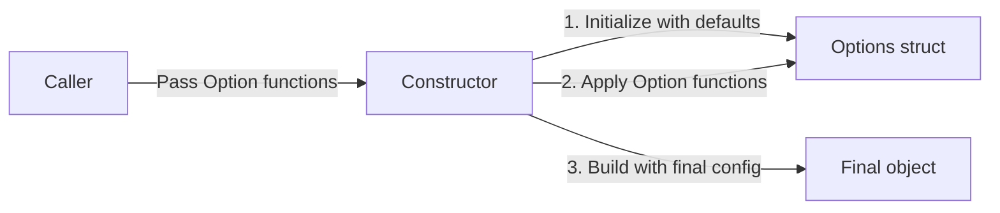
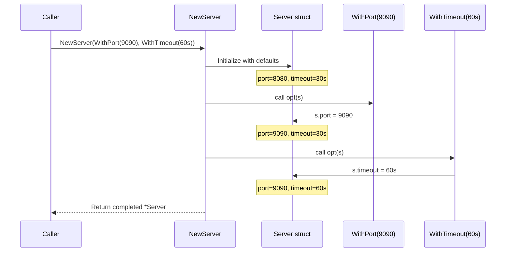
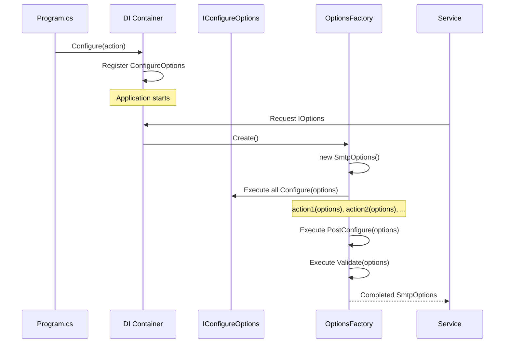
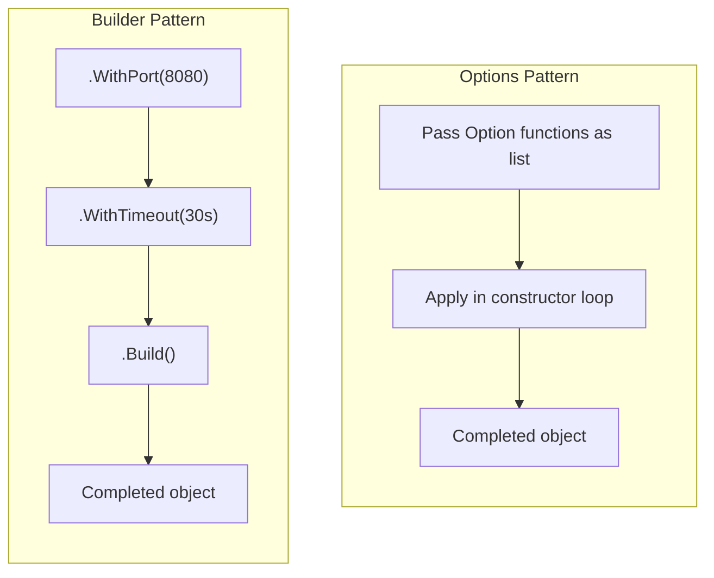
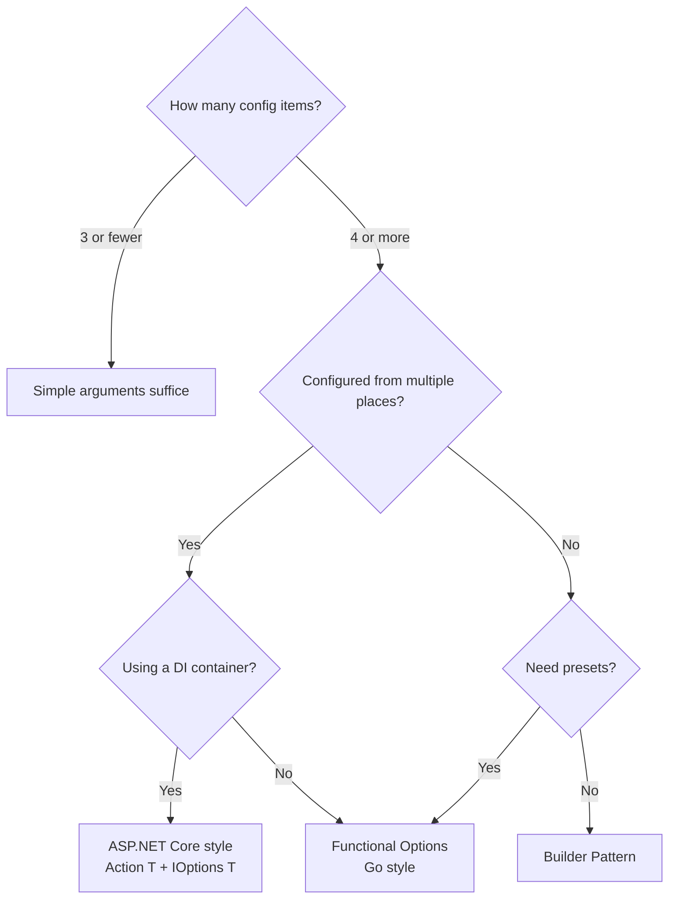

## Introduction

Library and framework APIs often take configuration as an anonymous function. In ASP.NET Core:

```csharp
builder.Services.AddAuthentication(options =>
{
    options.DefaultScheme = "Bearer";
    options.DefaultChallengeScheme = "Bearer";
});
```

In Go:

```go
server := NewServer(
    WithPort(8080),
    WithTimeout(30 * time.Second),
    WithLogger(myLogger),
)
```

Both implement the **Options Pattern**, a design pattern that uses anonymous functions (lambdas or closures) to assemble an object's configuration. Because configuration is passed as functions rather than values, callers can keep the defaults and override only the settings they need, and adding a setting leaves existing calls unchanged.

This article first explains the problem the pattern solves and its core idea. It then shows Go's Functional Options, ASP.NET Core's `IOptions<T>` and its DI internals, and implementations in TypeScript, Rust, and Python. Finally, it compares the pattern with Builder and configuration structs to show when to use it.

## The Problem: Telescoping Constructor

### Constructor Argument Explosion

Consider a function that creates an HTTP server. It starts with few arguments:

```go
func NewServer(port int) *Server {
    return &Server{port: port}
}
```

As features grow, so does the argument list:

```go
func NewServer(
    port int,
    host string,
    timeout time.Duration,
    maxConnections int,
    logger Logger,
    tlsConfig *tls.Config,
    middleware []Middleware,
    readTimeout time.Duration,
    writeTimeout time.Duration,
    idleTimeout time.Duration,
) *Server {
    // ...
}
```

In Java and similar languages, a common response is a series of constructor overloads, each adding one more parameter; this is known as the **Telescoping Constructor**. Go has no overloading, so a single function's parameter list grows as shown above. Either way, with this many arguments callers easily confuse their order. And although most arguments should use defaults, a Go function cannot omit them.

### The "Kitchen Sink Config Struct" Limitation

A common workaround is passing a single config struct:

```go
type ServerConfig struct {
    Port           int
    Host           string
    Timeout        time.Duration
    MaxConnections int
    Logger         Logger
    // ...
}

func NewServer(cfg ServerConfig) *Server { ... }
```

This shortens the call, but problems remain:

- **Default values are ambiguous**: Is `Port: 0` "use port 0" or "use the default"? (the zero-value problem)
- **Required vs. optional is unclear**: All fields appear at the same level
- **Breaking changes on extension**: Adding new fields can affect existing constructor calls
- **Hard to express constraints**: Rules like "if A is set, B is unnecessary" are hard to enforce

## Passing Configuration as Functions

The Options Pattern passes configuration as functions, not values. Instead of the value "Port is 8080," the caller passes the operation "set Port to 8080." The constructor initializes the defaults and then applies the operations in order.



Passing configuration as functions provides these properties:

| Benefit | Description |
|---------|-------------|
| Safe defaults | If an Option function isn't called, the default value is preserved |
| Flexible order | Options that set different fields can be passed in any order; for the same field, the later Option wins |
| Open for extension | Adding new Option functions doesn't affect existing code (Open-Closed Principle) |
| Type-safe | Each Option function operates on the correct field type |
| Composable | Option functions can be grouped into "presets" via slices/arrays |

## Go Implementation — Functional Options

We start with Go, whose community advocated this pattern most systematically and spread it widely. Proposed by [Rob Pike](https://commandcenter.blogspot.com/2014/01/self-referential-functions-and-design.html) and [Dave Cheney](https://dave.cheney.net/2014/10/17/functional-options-for-friendly-apis), it is known in Go as **Functional Options**. Go lacks constructor overloading and default arguments, so Functional Options became the de facto standard configuration pattern.

### Basic Implementation

Functional Options have three components: the `Server` struct that holds the configuration, the `Option` function type that modifies it, and the `NewServer` constructor that initializes defaults and then applies Options in order.

```go
package server

import (
    "log"
    "time"
)

// Server is the HTTP server
type Server struct {
    port         int
    host         string
    timeout      time.Duration
    maxConns     int
    logger       *log.Logger
}

// Option is a function type that modifies Server configuration
type Option func(*Server)

// WithPort sets the port number
func WithPort(port int) Option {
    return func(s *Server) {
        s.port = port
    }
}

// WithHost sets the hostname
func WithHost(host string) Option {
    return func(s *Server) {
        s.host = host
    }
}

// WithTimeout sets the timeout duration
func WithTimeout(d time.Duration) Option {
    return func(s *Server) {
        s.timeout = d
    }
}

// WithMaxConnections sets the max connection count
func WithMaxConnections(n int) Option {
    return func(s *Server) {
        s.maxConns = n
    }
}

// WithLogger sets the logger
func WithLogger(l *log.Logger) Option {
    return func(s *Server) {
        s.logger = l
    }
}

// NewServer creates a Server by applying Options
func NewServer(opts ...Option) *Server {
    // 1. Initialize with defaults
    s := &Server{
        port:     8080,
        host:     "localhost",
        timeout:  30 * time.Second,
        maxConns: 100,
        logger:   log.Default(),
    }

    // 2. Apply Option functions in order
    for _, opt := range opts {
        opt(s)
    }

    return s
}
```

### Usage

With no arguments, the server uses the defaults; arguments override only the fields they set. Bundling Options into a slice gives a reusable set of settings, such as production defaults.

```go
// Default configuration
s1 := server.NewServer()

// Custom configuration
s2 := server.NewServer(
    server.WithPort(9090),
    server.WithTimeout(60 * time.Second),
    server.WithLogger(customLogger),
)

// Preset: bundle production defaults
var ProductionDefaults = []server.Option{
    server.WithPort(443),
    server.WithTimeout(10 * time.Second),
    server.WithMaxConnections(10000),
}

s3 := server.NewServer(ProductionDefaults...)
```

### What Happens Internally

Calling `NewServer(WithPort(9090), WithTimeout(60s))` proceeds as follows:



Closures make this work. `WithPort(9090)` returns a function that has captured the argument 9090, and `NewServer` later applies that function to the `Server`.

### Implementation with Validation

Production code should catch invalid settings, such as an out-of-range port or a negative timeout, early. In Go, the idiomatic approach is for each `Option` to return an error. `NewServer` fails as soon as it receives one, so the server never starts with an invalid configuration.

```go
// Option that can return errors
type Option func(*Server) error

func WithPort(port int) Option {
    return func(s *Server) error {
        if port < 0 || port > 65535 {
            return fmt.Errorf("invalid port: %d", port)
        }
        s.port = port
        return nil
    }
}

func NewServer(opts ...Option) (*Server, error) {
    s := &Server{
        port:     8080,
        host:     "localhost",
        timeout:  30 * time.Second,
        maxConns: 100,
    }

    for _, opt := range opts {
        if err := opt(s); err != nil {
            return nil, fmt.Errorf("applying option: %w", err)
        }
    }

    return s, nil
}
```

### Real-World Usage

Functional Options are widely used in major Go libraries:

| Library | Usage |
|---------|-------|
| [gRPC-Go](https://github.com/grpc/grpc-go) | `grpc.NewServer(opts...)` |
| [Zap](https://github.com/uber-go/zap) | `zap.New(core, opts...)` |
| [Fx](https://github.com/uber-go/fx) | `fx.New(opts...)` |
| [client-go](https://github.com/kubernetes/client-go) | Uses options functions in some APIs |
| [kafka-go](https://github.com/segmentio/kafka-go) | Kafka client configuration |

## C# / ASP.NET Core Implementation

ASP.NET Core's Options Pattern applies the same principle as Go's Functional Options, built on a DI (Dependency Injection) container. In Go, Options are passed as constructor arguments; in ASP.NET Core, the container applies the configuration functions registered with it. Because application waits until dependency resolution, configuration functions registered in several places can be layered.

### Basic Pattern: `Action<TOptions>`

```csharp
// Options class definition
public class SmtpOptions
{
    public string Host { get; set; } = "localhost";
    public int Port { get; set; } = 25;
    public bool UseSsl { get; set; } = false;
    public string? Username { get; set; }
    public string? Password { get; set; }
}

// Configure with Action<T> at service registration
builder.Services.Configure<SmtpOptions>(options =>
{
    options.Host = "smtp.example.com";
    options.Port = 587;
    options.UseSsl = true;
});
```

Go's `func(*Server)` and C#'s `Action<SmtpOptions>` are different language constructs, but both are functions that receive an Options object and mutate its fields, so they serve the same design intent.

### `IOptions<T>` Interface Family

ASP.NET Core has three interfaces for consuming options, and they differ in when the value is rebuilt. Use them for settings that don't change after startup, settings that should be current for each request, and settings that should reflect `appsettings.json` changes while the app runs.

| Interface | Lifetime | Reload | Use Case |
|-----------|----------|--------|----------|
| `IOptions<T>` | Singleton | No (created on first access, then cached) | App-wide settings that don't change |
| `IOptionsSnapshot<T>` | Scoped | Per scope (usually per request in web apps) | Recomputed values for each request scope. Don't inject it into singletons |
| `IOptionsMonitor<T>` | Singleton | Change notifications and refreshed current value | Hot reload support, including from singleton services |

### Internal DI Mechanics

`Configure<T>()` only registers a configuration function with the DI container. `OptionsFactory` runs it when the options are requested:



`Configure()` can be called any number of times for the same type:

```csharp
// Base configuration
builder.Services.Configure<SmtpOptions>(options =>
{
    options.Host = "smtp.example.com";
    options.Port = 587;
});

// Additional configuration (can override)
builder.Services.Configure<SmtpOptions>(options =>
{
    options.UseSsl = true;
});

// Also bind from appsettings.json
builder.Services.Configure<SmtpOptions>(
    builder.Configuration.GetSection("Smtp"));
```

All registered configurations run in registration order, and for any given property the last one wins. This is the same mechanism as Go's `for _, opt := range opts { opt(s) }`.

### Extension Method Pattern

The `AddXxx(options => ...)` methods common in ASP.NET Core are the setup entry points that library authors provide. Consumers pass an `Action<SmtpOptions>` and get a correct configuration without knowing the internal details: options registration, validation, and service registration. An implementation looks like this:

```csharp
// AddSmtp extension method implementation
public static class SmtpServiceCollectionExtensions
{
    public static IServiceCollection AddSmtp(
        this IServiceCollection services,
        Action<SmtpOptions> configure)
    {
        // 1. Register Options infrastructure
        services.AddOptions<SmtpOptions>()
            .Configure(configure)        // Apply user configuration
            .ValidateDataAnnotations()   // Validation
            .ValidateOnStart();          // Validate at startup

        // 2. Register the service itself
        services.AddSingleton<ISmtpClient, SmtpClient>();

        return services;
    }
}

// Usage
builder.Services.AddSmtp(options =>
{
    options.Host = "smtp.example.com";
    options.Port = 587;
    options.UseSsl = true;
});
```

`AddSmtp` defines three concerns in separate places:

1. **Default values** → Property initializers in the `SmtpOptions` class
2. **User configuration** → The anonymous function received as `Action<SmtpOptions>`
3. **Validation** → Declaratively defined via `ValidateDataAnnotations()`

### PostConfigure and Validate

ASP.NET Core divides configuration processing into three stages, separating the responsibilities of setting, adjusting, and validating values. `Configure` sets the base values. `PostConfigure` runs after every `Configure` and adjusts values for consistency with one another (for example, switching the port to 465 when SSL is enabled but the port is still the default). Finally, `Validate` checks the resulting values.

```csharp
builder.Services.AddOptions<SmtpOptions>()
    // Stage 1: Configure — inject configuration values
    .Configure(o => o.Host = "smtp.example.com")

    // Stage 2: PostConfigure — runs after ALL Configure calls
    .PostConfigure(o =>
    {
        // If SSL is enabled but port is still default, switch to 465
        if (o.UseSsl && o.Port == 25)
            o.Port = 465;
    })

    // Stage 3: Validate — final validation
    .Validate(o => !string.IsNullOrEmpty(o.Host),
              "SMTP host must not be empty")
    .ValidateDataAnnotations()
    .ValidateOnStart();
```


### Named Options

Several configurations of the same type can coexist when each has a name:

```csharp
// Two SMTP configurations: "Primary" and "Backup"
builder.Services.Configure<SmtpOptions>("Primary", options =>
{
    options.Host = "smtp-primary.example.com";
    options.Port = 587;
});

builder.Services.Configure<SmtpOptions>("Backup", options =>
{
    options.Host = "smtp-backup.example.com";
    options.Port = 2525;
});

// Usage
public class EmailService
{
    private readonly SmtpOptions _primary;
    private readonly SmtpOptions _backup;

    public EmailService(IOptionsSnapshot<SmtpOptions> optionsSnapshot)
    {
        _primary = optionsSnapshot.Get("Primary");
        _backup = optionsSnapshot.Get("Backup");
    }
}
```

### `OptionsFactory<T>` Internals

ASP.NET Core's Options resolution is handled by [`OptionsFactory<TOptions>`](https://github.com/dotnet/runtime/blob/main/src/libraries/Microsoft.Extensions.Options/src/OptionsFactory.cs). `IOptions<T>` caches the created value, `IOptionsSnapshot<T>` caches within the current scope, and `IOptionsMonitor<T>` manages the current value through change notifications and `IOptionsMonitorCache<T>`. Simplified, it works like this:

```csharp
// OptionsFactory<TOptions>.Create() internals (simplified)
public TOptions Create(string name)
{
    // 1. Create new instance (defaults)
    TOptions options = new TOptions();

    // 2. Execute all IConfigureOptions<T>
    foreach (var setup in _setups)
    {
        if (setup is IConfigureNamedOptions<TOptions> namedSetup)
            namedSetup.Configure(name, options);
        else if (name == Options.DefaultName)
            setup.Configure(options);
    }

    // 3. Execute all IPostConfigureOptions<T>
    foreach (var post in _postConfigures)
        post.PostConfigure(name, options);

    // 4. Execute all IValidateOptions<T> (aggregate errors)
    var failures = new List<string>();
    foreach (var validate in _validations)
    {
        var result = validate.Validate(name, options);
        if (result.Failed)
            failures.AddRange(result.Failures);
    }
    if (failures.Count > 0)
        throw new OptionsValidationException(name, typeof(TOptions), failures);

    return options;
}
```

The core is the same as the `for _, opt := range opts { opt(s) }` loop in Go's `NewServer`. ASP.NET Core splits it into Configure → PostConfigure → Validate stages and adds support for named options.

## TypeScript Implementation

TypeScript can express both Go-style Functional Options and ASP.NET Core-style callbacks. With object spread and `Partial<T>`, it can also merge partial settings into defaults with type checking.

### Basic: `Partial<T>` Pattern

The simplest approach uses `Partial<T>`:

```typescript
interface ServerOptions {
  port: number;
  host: string;
  timeout: number;
  maxConnections: number;
}

const defaults: ServerOptions = {
  port: 8080,
  host: "localhost",
  timeout: 30_000,
  maxConnections: 100,
};

function createServer(overrides?: Partial<ServerOptions>): Server {
  const options = { ...defaults, ...overrides };
  return new Server(options);
}

// Usage
const server = createServer({ port: 9090, timeout: 60_000 });
```

However, this configuration is value merging, not function application, so it isn't really the Options Pattern. `Partial<T>` merging is simple and intuitive, but it makes validation and dependencies between values (for example, changing the port when SSL is enabled) hard to express. Functional Options, shown next, put that logic inside the Option functions.

### Functional Options

Go-style Functional Options in TypeScript look like this:

```typescript
interface ServerConfig {
  port: number;
  host: string;
  timeout: number;
  maxConnections: number;
  logger: Logger;
}

type ServerOption = (config: ServerConfig) => void;

function withPort(port: number): ServerOption {
  return (config) => {
    if (port < 0 || port > 65535) throw new RangeError(`Invalid port: ${port}`);
    config.port = port;
  };
}

function withHost(host: string): ServerOption {
  return (config) => { config.host = host; };
}

function withTimeout(ms: number): ServerOption {
  return (config) => { config.timeout = ms; };
}

function withMaxConnections(n: number): ServerOption {
  return (config) => { config.maxConnections = n; };
}

function createServer(...opts: ServerOption[]): Server {
  const config: ServerConfig = {
    port: 8080,
    host: "localhost",
    timeout: 30_000,
    maxConnections: 100,
    logger: console,
  };

  for (const opt of opts) {
    opt(config);
  }

  return new Server(config);
}

// Usage
const server = createServer(
  withPort(9090),
  withTimeout(60_000),
  withMaxConnections(5000),
);

// Presets
const productionDefaults: ServerOption[] = [
  withPort(443),
  withTimeout(10_000),
  withMaxConnections(10000),
];

const prodServer = createServer(...productionDefaults);
```

### Callback Pattern (ASP.NET Core Style)

Like ASP.NET Core, a single anonymous function can configure everything:

```typescript
function createServer(configure: (options: ServerConfig) => void): Server {
  const config: ServerConfig = {
    port: 8080,
    host: "localhost",
    timeout: 30_000,
    maxConnections: 100,
    logger: console,
  };

  configure(config);

  return new Server(config);
}

// Usage
const server = createServer((options) => {
  options.port = 9090;
  options.timeout = 60_000;
  options.maxConnections = 5000;
});
```

The two can also be combined: a callback configures everything, and Go-style Options then override individual settings.

```typescript
function createServer(
  configure?: (options: ServerConfig) => void,
  ...opts: ServerOption[]
): Server {
  const config: ServerConfig = {
    port: 3000, host: "localhost",
    timeout: 30_000, maxConnections: 100, logger: console.log,
  };
  configure?.(config);
  for (const opt of opts) opt(config);
  return new Server(config);
}
```

## Rust Implementation

Each Rust closure has its own unique type. To return different closures as the same `ServerOption` type, or to collect them in an array or `Vec`, they must be heap-allocated as `Box<dyn FnOnce>`. Unlike Go's `func(*Server)`, they can't go into a slice as is, and each Option costs a heap allocation. In exchange, configuration presets can be bundled into a `Vec<ServerOption>`.

### Representing Options with `Box<dyn FnOnce>`

The Rust community favors the Builder Pattern, but Functional Options can be written with the same idea. Some Options, such as `with_host`, move a captured `String` into the settings, so this example uses `FnOnce`, which can be called only once:

```rust
pub struct ServerOptions {
    pub port: u16,
    pub host: String,
    pub timeout: std::time::Duration,
    pub max_connections: usize,
}

impl Default for ServerOptions {
    fn default() -> Self {
        Self {
            port: 8080,
            host: "localhost".into(),
            timeout: std::time::Duration::from_secs(30),
            max_connections: 100,
        }
    }
}

// Option expressed as FnOnce
type ServerOption = Box<dyn FnOnce(&mut ServerOptions)>;

pub fn with_port(port: u16) -> ServerOption {
    Box::new(move |opts| { opts.port = port; })
}

pub fn with_host(host: impl Into<String>) -> ServerOption {
    let host = host.into();
    Box::new(move |opts| { opts.host = host; })
}

pub fn with_timeout(duration: std::time::Duration) -> ServerOption {
    Box::new(move |opts| { opts.timeout = duration; })
}

pub struct Server { /* ... */ }

impl Server {
    pub fn new(opts: impl IntoIterator<Item = ServerOption>) -> Self {
        let mut options = ServerOptions::default();
        for opt in opts {
            opt(&mut options);
        }
        Server::from_options(options)
    }

    fn from_options(_options: ServerOptions) -> Self {
        Server { /* ... */ }
    }
}

// Usage
let server = Server::new([
    with_port(9090),
    with_timeout(std::time::Duration::from_secs(60)),
]);
```

Because of the `Box<dyn FnOnce>` allocations, the traditional Builder Pattern is often preferred for heavy use in Rust. As a rule of thumb, use Builder when options are few and statically known, and Functional Options when option combinations change at runtime.

## Python Implementation

Python commonly takes settings as keyword arguments (`**kwargs`), but the Options Pattern can also be implemented explicitly. Python functions are first-class objects and closures can be returned directly, so there is no need to wrap them in a `Box` as in Rust. With `@dataclass`, the defaults go in the field declarations.

```python
from dataclasses import dataclass
from typing import Callable

@dataclass
class ServerOptions:
    port: int = 8080
    host: str = "localhost"
    timeout: float = 30.0
    max_connections: int = 100

# Option type
Option = Callable[[ServerOptions], None]

def with_port(port: int) -> Option:
    def apply(opts: ServerOptions) -> None:
        if not 0 <= port <= 65535:
            raise ValueError(f"Invalid port: {port}")
        opts.port = port
    return apply

def with_host(host: str) -> Option:
    def apply(opts: ServerOptions) -> None:
        opts.host = host
    return apply

def with_timeout(seconds: float) -> Option:
    def apply(opts: ServerOptions) -> None:
        opts.timeout = seconds
    return apply

class Server:
    def __init__(self, *opts: Option):
        self.options = ServerOptions()
        for opt in opts:
            opt(self.options)

# Usage
server = Server(
    with_port(9090),
    with_timeout(60.0),
)

# Presets
production_defaults: list[Option] = [
    with_port(443),
    with_timeout(10.0),
]

prod_server = Server(*production_defaults)
```

## Pattern Comparison

### Options Pattern vs Builder Pattern



| Aspect | Options Pattern | Builder Pattern |
|--------|----------------|-----------------|
| Syntax | Pass functions as a list | Method chaining |
| State management | Constructor manages centrally | Builder holds intermediate state |
| Composability | Easy preset creation via function slices/arrays | Reusing intermediate Builder state is difficult |
| Incremental config | Works well with DI containers (Configure from multiple places) | Usually completed in one place |
| Type safety | Guaranteed per Option function | Guaranteed by method return types |
| Learning curve | Requires understanding closures | Intuitive |

### Options Pattern vs Configuration Object

| Aspect | Options Pattern | Configuration Object |
|--------|----------------|---------------------|
| Default values | Safely set in constructor | Zero-value ambiguity |
| Validation | Executable within each Option function | Requires separate validation layer |
| Extensibility | Just add new Option functions | Add fields to struct |
| Composability | Options combine freely through function composition | Requires struct merging |

### Decision Guide



## Advanced Techniques

### Option Function Composition

Several Options can be combined into a single Option:

```go
// Compose multiple Options into one
func ComposeOptions(opts ...Option) Option {
    return func(s *Server) {
        for _, opt := range opts {
            opt(s)
        }
    }
}

// Define presets
var HighPerformance = ComposeOptions(
    WithMaxConnections(50000),
    WithTimeout(5 * time.Second),
)

var SecureDefaults = ComposeOptions(
    WithPort(443),
    WithTimeout(10 * time.Second),
)

// Compose presets
s := NewServer(
    HighPerformance,
    SecureDefaults,
    WithHost("api.example.com"), // Individual override
)
```

`ComposeOptions` is function composition: it returns one Option that applies the given Options in order. Because Options are functions, presets can be combined as functions too.

### Conditional Options

```go
// Conditionally apply an Option
func WithPortIf(port int, condition bool) Option {
    return func(s *Server) {
        if condition {
            s.port = port
        }
    }
}

// Environment-based configuration
func WithEnvConfig() Option {
    return func(s *Server) {
        if port := os.Getenv("PORT"); port != "" {
            s.port, _ = strconv.Atoi(port)
        }
        if host := os.Getenv("HOST"); host != "" {
            s.host = host
        }
    }
}
```

### Self-Referential Functions (Returning Previous Values)

Rob Pike's original post describes a technique in which an Option function returns another Option that restores the previous value, enabling rollback:

```go
type Option func(*Server) Option

func WithPort(port int) Option {
    return func(s *Server) Option {
        prev := s.port   // Save previous value
        s.port = port     // Set new value
        return WithPort(prev) // Return Option that restores previous
    }
}

// Rollback example
func temporarilyChangePort(s *Server, port int) {
    restore := WithPort(port)(s)  // Change port
    defer restore(s)               // Restore on function exit
    // ... process with temporarily changed port ...
}
```

This is rare in production code, but it shows that when a configuration change is a function, the operation that undoes it can be returned as a function of the same `Option` type.

## Summary

The Options Pattern passes configuration as functions rather than values. Its names and signatures by language:

| Language | Name | Signature |
|----------|------|-----------|
| Go | Functional Options | `func(*T)` / `func(*T) error` |
| C# | Options Pattern / `Action<T>` | `Action<TOptions>` |
| TypeScript | Callback Configuration | `(options: T) => void` |
| Rust | Functional Options | `Box<dyn FnOnce(&mut T)>` |
| Python | Option Callbacks | `Callable[[T], None]` |

In every language, the process has three steps:

1. Initialize with default values
2. Apply Option functions in order
3. Use the completed object

This structure avoids the Telescoping Constructor problem. New settings can be added without new parameters (the Open-Closed Principle), and the pattern fits well with DI containers. When configuration happens incrementally from multiple places, the Options Pattern is more suitable than the Builder Pattern.

ASP.NET Core's `AddXxx(options => ...)` takes an `Action<T>`, and Go libraries expose `WithXxx` functions, for the same reason: to keep the defaults and apply only the needed settings later, as functions.

## References

- [Rob Pike — Self-referential functions and the design of options (2014)](https://commandcenter.blogspot.com/2014/01/self-referential-functions-and-design.html)
- [Dave Cheney — Functional options for friendly APIs (2014)](https://dave.cheney.net/2014/10/17/functional-options-for-friendly-apis)
- [Microsoft — Options pattern in ASP.NET Core](https://learn.microsoft.com/en-us/aspnet/core/fundamentals/configuration/options)
- [.NET Runtime — OptionsFactory source code](https://github.com/dotnet/runtime/blob/main/src/libraries/Microsoft.Extensions.Options/src/OptionsFactory.cs)
