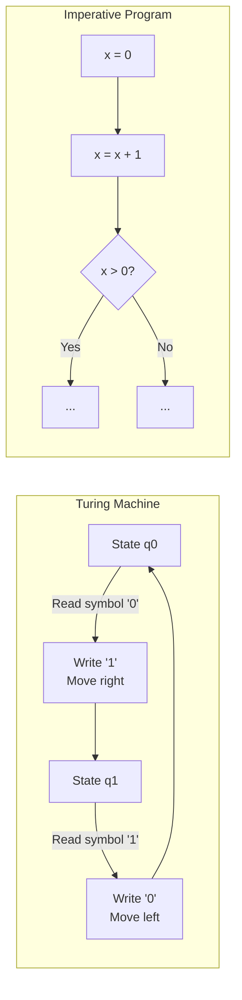
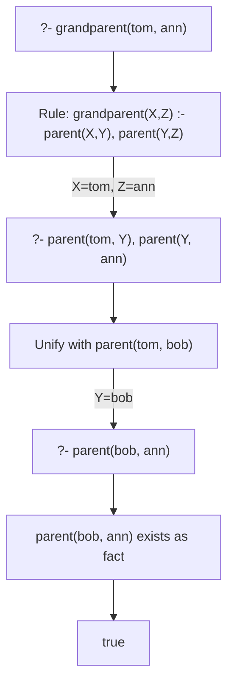
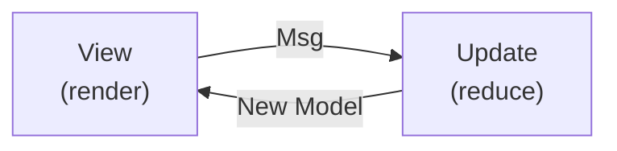

When learning a programming language, it's easy to focus on syntax and libraries. What carries over from one language to the next is the paradigm: how you frame a problem and how you build a solution.

When you move from Python to Haskell, the syntax is rarely what trips you up. The harder part is the shift in how you think: using recursion instead of loops, and never reassigning a variable. Once functional thinking clicks, though, you can use the same patterns in Scala, Rust, or Elixir. A paradigm is a shared vocabulary for software design that isn't tied to any one language.

This article traces the major programming paradigms back to lambda calculus and the Turing machine in 1936. For each of imperative, declarative, functional, object-oriented, logic, reactive, and concurrency-oriented programming, it covers the theoretical basis, shows code, and explains what kinds of problems the paradigm suits. The last part looks at how modern multi-paradigm languages combine them.

## What Is a Paradigm?

A <strong>programming paradigm</strong> is a basic approach to structuring programs and solving problems. Robert Floyd spoke about paradigms in his 1978 Turing Award lecture:

> If the advancement of the general art of programming requires the continuing invention and elaboration of paradigms, advancement of the art of the individual programmer requires that he expand his repertory of paradigms.

The same problem leads to quite different solutions depending on whether you think procedurally, functionally, or in objects.

Take the task "filter the even numbers from a list and sum them." In procedural style, you write a `for` loop with an `if` check and accumulate into a variable. In functional style, you compose `filter` and `reduce`. In SQL (declarative), you write `SELECT SUM(x) FROM t WHERE x % 2 = 0`. The result is the same, but the problem is framed differently each time. Learning paradigms widens what Floyd called your repertory of ways to frame a problem.

## Historical Lineage of Paradigms

Many patterns developers use every day come from theoretical work done decades ago. The timeline below shows when the major paradigms and languages appeared.

<ParadigmTimeline />

A few trends stand out:

1. <strong>Two theories in 1936</strong> — Church's lambda calculus and Turing's Turing machine independently laid the mathematical foundations for the functional and imperative paradigms, respectively
2. <strong>Birth of OOP in the 1960s</strong> — Simula introduced classes and objects, and Smalltalk refined the concept into a pure OOP language
3. <strong>Multi-paradigm era from the 1990s onward</strong> — Languages like Scala, Rust, and Kotlin that integrate multiple paradigms became mainstream

Paradigms have accumulated: new ones haven't made the old ones disappear. Imperative programming is still the workhorse for OS kernels and embedded systems, and functional programming, with over 80 years of history, is getting renewed attention in data processing and concurrent systems.

## Paradigm Classification

A common first split is imperative vs declarative, but concurrency-oriented paradigms cut across that axis. The diagram therefore puts them in a separate group instead of drawing every relationship as a strict subtype. Click a paradigm to see its description.

<ParadigmTaxonomy />

---

## The Imperative Paradigm — Describing "How"

The imperative paradigm is the one most developers meet first. Most of the code written in C, Python, JavaScript, or Go is imperative: assign a value to a variable, branch on a condition, repeat with a loop. The theory behind this style is older than the computer itself.

### Theoretical Foundation: The Turing Machine

The theoretical foundation of imperative programming is the Turing machine, proposed by Alan Turing in 1936. A Turing machine consists of:

- <strong>Tape</strong> — An infinite sequence of memory cells
- <strong>Head</strong> — Reads and writes at the current position on the tape
- <strong>State transition table</strong> — Determines the next action based on the current state and the symbol read

This model, holding state and changing it step by step according to instructions, is the core of imperative programming. Modern CPUs also work with memory, a program counter, and an instruction set; they aren't literal Turing machines, but they compute the same way, through state transitions.



### Procedural Programming

The most basic form of the imperative paradigm is procedural programming. A program is split into procedures (functions) that are called in sequence. FORTRAN (1957) and C (1972) are typical procedural languages, and C is still central to systems programming today.

```c
// C: The quintessential procedural language
#include <stdio.h>

// Procedure (function) definition
int factorial(int n) {
    int result = 1;            // mutable state
    for (int i = 2; i <= n; i++) {
        result = result * i;   // state modification
    }
    return result;
}

int main(void) {
    int n = 5;
    int result = factorial(n); // procedure call
    printf("%d! = %d\n", n, result);
    return 0;
}
```

A procedural program is built from three things:
- Mutable variables manage state
- Control structures (if/for/while) direct execution flow
- Functions (procedures) divide and reuse logic

Procedural code is easy to follow, but as a program grows it gets harder to track which function changes which state. Two responses emerged: structured programming, which tidies up the structure of the code, and object-oriented programming, which bundles state with the functions that operate on it. Object-oriented programming gets its own section later; this section covers structured programming.

### Structured Programming

In 1968, Edsger Dijkstra published his famous paper "Go To Statement Considered Harmful" and proposed structured programming.

```text
Structured Programming Theorem (Böhm–Jacopini theorem):
  Any flowchart can be equivalently expressed using only these three structures:

  1. Sequence    — execute instructions in order
  2. Selection   — branching via if-then-else
  3. Iteration   — repetition via while loops

  → goto statements are unnecessary
```

This theorem proved mathematically that structured programs can be written without relying on goto. Languages such as C, Pascal, and Ada were designed along these lines. Structured programming didn't change the paradigm itself; it set out guidelines for writing better code within the imperative model.

---

## The Declarative Paradigm — Describing "What"

The imperative paradigm describes <strong>how</strong> to compute; the declarative paradigm describes <strong>what</strong> result is wanted and leaves the steps to the runtime.

In restaurant terms, telling the kitchen "roast the chicken at 180°C for 20 minutes, season with salt and pepper, and plate it" is imperative, and ordering "grilled chicken, please" is declarative. That is why SQL is a classic declarative language: you state what you want with `SELECT`, and the database engine optimizes the index scan order and join strategy.

The demo below runs the same task in imperative and declarative style so you can compare them.

<ImperativeVsDeclarative />

In the declarative version, you write only what you want to do, filtering and transformation, and leave details such as loop variables and pushing onto an array to the runtime. As a result, the intent of the code is easier to read, and the runtime is free to choose how to execute it. Functional, logic, and reactive programming all descend from the declarative line.

---

## Functional Programming — Programming as Mathematics

Functional programming is the most influential branch of the declarative paradigm. The imperative paradigm treats a program as a sequence of instructions that change state; functional programming treats it as a composition of mathematical functions that turn inputs into outputs. Code written this way avoids side effects and is easier to predict. It is also easier to test, and safer to run concurrently.

### Theoretical Foundation: Lambda Calculus

The theoretical foundation of functional programming is the lambda calculus (λ-calculus), proposed by Alonzo Church in 1936. Its syntax has only three elements:

```text
Lambda calculus syntax:
  e ::= x          // variable
       | λx. e     // lambda abstraction (function definition)
       | e₁ e₂     // function application

This alone constitutes a Turing-complete model of computation.
```

The central operation in lambda calculus is β-reduction. The demo below performs the reduction one step at a time.

<LambdaCalculusVisualizer />

As Church encoding shows, numbers, booleans, and data structures can all be represented as functions. This expressive power is where the functional idea that functions are first-class citizens comes from.

Lambda calculus defines what computation is using nothing but function definition and application. Functional languages such as Haskell, ML, Erlang, and Lisp were built on it. The ideas it handed to practical programming (anonymous functions, closures, higher-order functions, currying) are now standard in languages that aren't primarily functional, such as Java, C#, Python, and JavaScript.

### Pure Functions and Referential Transparency

The pure function brings lambda calculus's idea, that a function just returns an output for a given input, into practical programming.

```haskell
-- Haskell: Pure functions
-- Always returns the same output for the same input (referential transparency)
-- No side effects
double :: Int -> Int
double x = x * 2

-- Function composition
doubleAndAdd3 :: Int -> Int
doubleAndAdd3 = (+3) . double
-- doubleAndAdd3 5 = (5 * 2) + 3 = 13
```

<strong>Referential transparency</strong> is the property that replacing an expression with its value does not change the program's meaning:

```text
Referential transparency example:
  When f(x) is a pure function,
  if f(3) always produces the same result,
  replacing every occurrence of f(3) in the program with that result
  does not change the program's meaning.

  This enables:
  - Equational reasoning
  - Easier compiler optimization
  - Simpler testing (just verify input → output)
  - Safe concurrency (no shared mutable state)
```

### Immutability and Data Transformation

To get the full benefit of pure functions, the data should stay unchanged too. The basic rule in functional programming is to <strong>create new data instead of modifying existing data</strong>. Where imperative code writes `array.push(item)`, functional code writes `[...array, item]`. Because the original data never changes, you don't have to track where a variable was mutated, and in concurrent code, data races from simultaneous writes to shared data cannot occur.

```erlang
%% Erlang: Immutability and recursion
%% Once a variable is bound, it cannot be changed (single assignment)

%% Double each element — recursion creates a new list
double_list([]) -> [];
double_list([H|T]) -> [H * 2 | double_list(T)].

%% Sorting also returns a new list (original is immutable)
merge_sort([]) -> [];
merge_sort([X]) -> [X];
merge_sort(List) ->
    {Left, Right} = lists:split(length(List) div 2, List),
    merge(merge_sort(Left), merge_sort(Right)).
```

### Higher-Order Functions and Closures

Pure functions and immutable data alone can make programs hard to compose flexibly. That is where the higher-order function comes in: a function that takes functions as arguments or returns one. Higher-order functions let you abstract a recurring processing pattern into a function and separate what to process from how to process it.

```javascript
// JavaScript: Higher-order functions
// map, filter, reduce — take functions as arguments
const numbers = [1, 2, 3, 4, 5];

const doubled = numbers.map(x => x * 2);        // [2, 4, 6, 8, 10]
const evens = numbers.filter(x => x % 2 === 0); // [2, 4]
const sum = numbers.reduce((acc, x) => acc + x, 0); // 15

// Function returning a function (currying)
const multiply = (a) => (b) => a * b;
const double = multiply(2);  // (b) => 2 * b
const triple = multiply(3);  // (b) => 3 * b
console.log(double(5));  // 10
console.log(triple(5));  // 15
```

### Algebraic Data Types and Pattern Matching

Another pillar of functional programming is the algebraic data type (ADT), popularized by the ML family of languages. ADTs describe the shape of data precisely through types. Imperative languages often guard against invalid states with runtime validation; with ADTs and pattern matching, <strong>many invalid states can't be represented at all, and mistakes are caught at compile time</strong>.

```rust
// Rust: Algebraic data types (enum) and pattern matching
enum Shape {
    Circle(f64),           // radius
    Rectangle(f64, f64),   // width, height
    Triangle(f64, f64),    // base, height
}

fn area(shape: &Shape) -> f64 {
    match shape {
        Shape::Circle(r) => std::f64::consts::PI * r * r,
        Shape::Rectangle(w, h) => w * h,
        Shape::Triangle(b, h) => 0.5 * b * h,
    }
}

// The compiler verifies exhaustiveness — missing cases are caught at compile time
```

The combination of sum types and product types enables precise domain modeling at the type level.

```text
Mathematical background of algebraic data types:
  Product type: A × B    — struct, tuple
    e.g.: (Int, String) has Int values × String values
  Sum type:    A + B     — enum, tagged union
    e.g.: Result<T, E> is Ok(T) | Err(E)

  Why "algebraic":
    The number of values of a type can be calculated algebraically
    Bool = True | False → 2 values
    Option<Bool> = None | Some(True) | Some(False) → 3 values = 1 + 2
```

### Monads — Handling Side Effects in a Pure World

Everything so far (pure functions, immutability, higher-order functions, ADTs) lives in a world without side effects. Real programs, however, have to read and write files, talk to the network, and accept user input. For the pure functional language Haskell, interacting with the outside world while staying pure was a major problem. Monads are the solution.

```haskell
-- Haskell: IO Monad
-- Treats side-effectful operations as "values" that can be composed
main :: IO ()
main = do
    putStrLn "What is your name?"  -- IO action
    name <- getLine                 -- extract value from IO action
    putStrLn ("Hello, " ++ name)

-- The essence of monads: chaining via bind (>>=)
-- m >>= f means "sequence m, then pass the value it produces to f"
-- Maybe monad example:
safeDivide :: Int -> Int -> Maybe Int
safeDivide _ 0 = Nothing
safeDivide x y = Just (x `div` y)

-- Chaining: if any step yields Nothing, the whole chain is Nothing
calculate :: Int -> Int -> Int -> Maybe Int
calculate x y z = do
    a <- safeDivide x y    -- Nothing if y=0
    b <- safeDivide a z    -- Nothing if z=0
    return (a + b)
```

```text
Monad laws:
  1. Left identity:  return a >>= f  ≡  f a
  2. Right identity: m >>= return    ≡  m
  3. Associativity:  (m >>= f) >>= g ≡  m >>= (λx → f x >>= g)

Monads are sometimes called "programmable semicolons."
Just as ; chains statements in imperative code,
>>= controls the chaining of monadic values.
```

---

## Object-Oriented Programming — A World of Messages and Objects

Object-oriented programming (OOP) is probably the most widely adopted paradigm. Many mainstream languages, including Java, C#, Python, Ruby, and Swift, are designed around it. Developers disagree, though, about what OOP fundamentally is. Some equate it with classes and inheritance; others say message passing is the real core. The two views match OOP's two historical lineages.

### Two Lineages: Simula and Smalltalk

1. <strong>Simula lineage</strong> — An "abstract data type" approach centered on classes and inheritance. Influenced C++, Java, and C#.
2. <strong>Smalltalk lineage</strong> — A "message passing" approach where everything is an object. Influenced Ruby and Objective-C.

Alan Kay, the designer of Smalltalk, described the essence of OOP like this:

> I thought of objects being like biological cells and/or individual computers on a network, only able to communicate with messages.

For Kay, the essence of OOP was message passing, not inheritance. The demo below compares class-based OOP in the Simula/C++ tradition with message-passing OOP in the Smalltalk/Ruby tradition.

<OOPVisualizer />

### SOLID Principles

Using OOP doesn't automatically produce good design. Poorly designed classes lead to code that breaks easily when changed and is hard to test. The SOLID principles, popularized by Robert C. Martin (the acronym itself was later coined by Michael Feathers), are five widely known guidelines for OOP designs that hold up under change:

| Principle | Name | Description |
|-----------|------|-------------|
| S | Single Responsibility Principle | A class should have only one reason to change |
| O | Open/Closed Principle | Open for extension, closed for modification |
| L | Liskov Substitution Principle | Subtypes must be substitutable for their supertypes |
| I | Interface Segregation Principle | Don't force clients to depend on methods they don't use |
| D | Dependency Inversion Principle | High-level modules should not depend on low-level modules; both should depend on abstractions |

### Composition over Inheritance

Early OOP leaned heavily on inheritance, but real projects kept running into the same problem: deep inheritance hierarchies make change difficult. The Gang of Four's *Design Patterns* (1994) says it outright: "Favor object composition over class inheritance." Current practice favors composition over inheritance.

```go
// Go: Composition via interfaces
// Go has no classes or inheritance — it uses interfaces and embedding

type Reader interface {
    Read(p []byte) (n int, err error)
}

type Writer interface {
    Write(p []byte) (n int, err error)
}

// Interface composition
type ReadWriter interface {
    Reader
    Writer
}

// Composition via fields that methods delegate to (not inheritance)
type BufferedReadWriter struct {
    reader Reader
    writer Writer
    buf    []byte
}

func (brw *BufferedReadWriter) Read(p []byte) (int, error) {
    return brw.reader.Read(p)
}

func (brw *BufferedReadWriter) Write(p []byte) (int, error) {
    return brw.writer.Write(p)
}
```

Go deliberately leaves out classes and inheritance. It composes behavior from interfaces, embedding (as `ReadWriter` does above), and struct fields that methods delegate to. It is an example of building "Composition over Inheritance" into the language specification.

---

## Logic Programming — A World of Declarations and Inference

In imperative, functional, and OOP code, the programmer usually defines which transformations or operations to perform. In logic programming, the programmer declares what is true and leaves the derivation of answers to an inference engine.

Just as you don't say how to scan an index when you write a `SELECT` in SQL, you don't specify a search algorithm when you write a query in Prolog. Logic programming is far more expressive than SQL, though: with recursive inference and pattern matching, it is strong in areas such as artificial intelligence, natural language processing, and theorem proving.

### Theoretical Foundation: Predicate Logic

The foundation of logic programming is first-order predicate logic. A program is a collection of facts and rules, and execution is the process of inference in response to queries.

```prolog
%% Prolog: Logic programming

%% Facts — declare what is true
parent(tom, bob).
parent(tom, liz).
parent(bob, ann).
parent(bob, pat).

%% Rules — derive new knowledge from facts
grandparent(X, Z) :- parent(X, Y), parent(Y, Z).
sibling(X, Y) :- parent(Z, X), parent(Z, Y), X \= Y.
ancestor(X, Y) :- parent(X, Y).
ancestor(X, Y) :- parent(X, Z), ancestor(Z, Y).

%% Queries — the inference engine searches for solutions
%% ?- grandparent(tom, ann).
%% true.
%% ?- ancestor(tom, Who).
%% Who = bob ; Who = liz ; Who = ann ; Who = pat.
```

Prolog's inference engine operates through three mechanisms:

1. <strong>Unification</strong> — Find variable bindings that make two terms equal. For example, matching `parent(X, bob)` with `parent(tom, bob)` yields the binding `X = tom`
2. <strong>Backtracking</strong> — When no solution is found, return to the last choice point and explore an alternative path. Uses depth-first search through the solution space
3. <strong>SLD Resolution</strong> — Select a clause, rewrite via unification, and recursively resolve remaining goals



### Constraint Logic Programming

A further development of logic programming is Constraint Logic Programming (CLP). Standard logic programming finds answers by inference from facts and rules; CLP searches for combinations of values that satisfy constraints. The programmer declares the constraints, and a constraint solver finds the solutions.

```prolog
%% CLP(FD): Finite domain constraints
%% Sudoku solver example (conceptual code; helper predicates such as length_/2 and blocks/3 are omitted)
sudoku(Rows) :-
    length(Rows, 9),
    maplist(length_(9), Rows),
    append(Rows, Vs), Vs ins 1..9,   %% all cells are 1-9
    maplist(all_distinct, Rows),       %% each row has no duplicates
    transpose(Rows, Columns),
    maplist(all_distinct, Columns),    %% each column has no duplicates
    Rows = [A,B,C,D,E,F,G,H,I],
    blocks(A,B,C), blocks(D,E,F), blocks(G,H,I), %% each block
    maplist(label, Rows).              %% search for solutions
```

The Sudoku example states only the constraints that rows, columns, and blocks must satisfy. It contains no solving procedure; finding the solution is left to the constraint solver.

---

## Reactive Programming — A World of Streams and Propagation

The paradigms so far mostly deal with one-shot computations: take input, process it, return output. Applications such as GUIs, web frontends, IoT data processing, and financial systems, however, have to keep reacting to events and data changes as they arrive. Reactive programming meets this need with a paradigm built around data streams and automatic propagation of changes.

| Step | Traditional approach | Reactive approach |
|------|---------------------|-------------------|
| `a = 3, b = 4` | a=3, b=4 | a=3, b=4 |
| `c = a + b` | c = 7 | c = 7 |
| `a = 10` | c = 7 (unchanged) | c = 14 (updated automatically) |

In the traditional approach, `c = a + b` just assigns the result computed at that moment to `c`. In the reactive approach, the <strong>relationship</strong> between `c` and `a + b` is kept, so changing `a` updates `c` automatically.

### Functional Reactive Programming (FRP)

The theoretical foundation for reactive programming was laid by Conal Elliott and Paul Hudak, who proposed Functional Reactive Programming (FRP) in 1997. FRP treats time-varying values (Behaviors) and discrete events (Events) as first-class citizens within a functional framework. Libraries in the ReactiveX family, such as RxJS, brought FRP ideas into practical use.

```typescript
// RxJS: Reactive programming
import { fromEvent, map, filter, debounceTime, switchMap } from 'rxjs';

// Treat DOM events as streams
const searchInput = document.getElementById('search');

const search$ = fromEvent(searchInput, 'input').pipe(
  map(event => (event.target as HTMLInputElement).value),
  filter(query => query.length >= 3),      // 3+ characters
  debounceTime(300),                        // wait 300ms
  switchMap(query => fetch(`/api/search?q=${encodeURIComponent(query)}`)),
);

// Subscribe to the stream
search$.subscribe(results => renderResults(results));
```

### The Elm Architecture

Elm was originally designed around FRP ideas (Evan Czaplicki's 2012 thesis was titled "Elm: Concurrent FRP for Functional GUIs"), but in version 0.17 it left the FRP model behind and settled on The Elm Architecture (TEA), which is based on message passing. TEA itself was in use before 0.17, and it had a major influence on React/Redux.

The Elm Architecture consists of three elements:

- <strong>Model</strong> — Application state (immutable data structure)
- <strong>Update</strong> — `(Msg, Model) -> Model` (pure function for state transitions)
- <strong>View</strong> — `Model -> Html Msg` (pure function to generate UI)



View renders the UI, and user interactions generate Msgs. Update computes a new Model from the Msg and the current Model, and View re-renders with that Model. This one-way flow of data (unidirectional data flow) is at the center of TEA.

---

## Concurrency-Oriented Paradigms

Now that multi-core CPUs are everywhere, safe concurrency is one of the major challenges in software development. Writing concurrent imperative code with threads and shared memory tends to produce hard-to-reproduce bugs: race conditions from a missed lock, deadlocks, livelocks. Concurrency-oriented paradigms make concurrency <strong>safe at the language or runtime level</strong>; the two best-known models are the actor model and CSP.

### The Actor Model

In the actor model, proposed by Carl Hewitt in 1973, the basic unit of concurrent computation is the "actor." Each actor keeps its own private state and talks to other actors only through message passing. With no shared memory, there's no need for locks or mutexes. Erlang/OTP adopts this model at the language level, and telecom systems built on Erlang/OTP have reported 99.9999999% (nine nines) availability.

```elixir
# Elixir: Actor model (on the Erlang VM)
defmodule Counter do
  def start(initial_count) do
    spawn(fn -> loop(initial_count) end)
  end

  defp loop(count) do
    receive do
      {:increment, caller} ->
        new_count = count + 1
        send(caller, {:count, new_count})
        loop(new_count)  # recurse to wait for next message

      {:get, caller} ->
        send(caller, {:count, count})
        loop(count)
    end
  end
end

# Usage
pid = Counter.start(0)
send(pid, {:increment, self()})
receive do
  {:count, n} -> IO.puts("Count: #{n}")  # Count: 1
end
```

```text
Actor model axioms:
  An actor can only perform three operations:
  1. Create new actors (create)
  2. Send messages to other actors (send)
  3. Determine its behavior for the next message (become)

  No shared state — everything is message passing
  → Shared-memory data races are avoided by design; protocol-level deadlocks are still possible
  → Natural extension to distributed systems
```

### CSP (Communicating Sequential Processes)

Often compared with the actor model, CSP was proposed by Tony Hoare in 1978. In CSP, the unit of communication isn't the actor (process) but the channel. Processes are anonymous and send/receive data through named channels. Go adopts this model: starting goroutines with the `go` keyword and communicating over channels created with `chan` is the basic pattern for concurrency in Go.

```go
// Go: CSP model — goroutine + channel
func producer(ch chan<- int) {
    for i := 0; i < 10; i++ {
        ch <- i  // send to channel
    }
    close(ch)
}

func consumer(ch <-chan int, done chan<- bool) {
    for v := range ch {  // receive from channel
        fmt.Printf("received: %d\n", v)
    }
    done <- true
}

func main() {
    ch := make(chan int)  // unbuffered channel (synchronous rendezvous)
    done := make(chan bool)

    go producer(ch)       // launch producer as goroutine
    go consumer(ch, done) // launch consumer as goroutine

    <-done // wait for completion
}
```

| | CSP | Actor Model |
|---|---|---|
| Named entity | Channels have names (processes are anonymous) | Actors have names/addresses (channels are implicit) |
| Communication | Synchronous rendezvous in classic CSP and unbuffered Go channels; buffered channels add queueing | Asynchronous (queued in mailbox) |
| Representative language | Go (goroutine + channel) | Erlang / Elixir (processes) |

---

## The Multi-Paradigm Era

In real-world software development, programs are rarely written in a single paradigm. Most major languages today are multi-paradigm and let you pick an approach to suit the problem.

Rust, for example, combines imperative, functional, and concurrent elements around its ownership system. Scala treats OOP and functional programming as equals, so you can use OOP for domain modeling and functional style for data transformation.

### Rust — Ownership System and Multi-Paradigm

```rust
// Rust: Functional + imperative + concurrent

// Functional style — iterators and closures
fn functional_sum(numbers: &[i32]) -> i32 {
    numbers.iter()
        .filter(|&&x| x > 0)
        .map(|&x| x * 2)
        .sum()
}

// Imperative style — mutable state
fn imperative_sum(numbers: &[i32]) -> i32 {
    let mut sum = 0;
    for &x in numbers {
        if x > 0 {
            sum += x * 2;
        }
    }
    sum
}

// Ownership + traits — Rust's unique paradigm
trait Drawable {
    fn draw(&self);
}

struct Circle { radius: f64 }
struct Square { side: f64 }

impl Drawable for Circle {
    fn draw(&self) { println!("○ r={}", self.radius); }
}

impl Drawable for Square {
    fn draw(&self) { println!("□ s={}", self.side); }
}

// Trait object polymorphism
fn draw_all(shapes: &[&dyn Drawable]) {
    for shape in shapes {
        shape.draw();
    }
}
```

### Scala — Unifying OOP and FP

```scala
// Scala: OOP + functional integration

// case class — algebraic data type + OOP
sealed trait Expr
case class Num(value: Double) extends Expr
case class Add(left: Expr, right: Expr) extends Expr
case class Mul(left: Expr, right: Expr) extends Expr

// Pattern matching — functional style
def eval(expr: Expr): Double = expr match {
  case Num(v) => v
  case Add(l, r) => eval(l) + eval(r)
  case Mul(l, r) => eval(l) * eval(r)
}

// Higher-order functions + collections — functional style
val numbers = List(1, 2, 3, 4, 5)
val result = numbers
  .filter(_ % 2 == 0)
  .map(_ * 3)
  .foldLeft(0)(_ + _)  // 18

// for comprehension — syntactic sugar for monads
val pairs = for {
  x <- List(1, 2, 3)
  y <- List('a', 'b')
} yield (x, y)
// List((1,a), (1,b), (2,a), (2,b), (3,a), (3,b))
```

---

## Paradigm Comparison

The comparison table below sets the strengths and typical uses of each paradigm side by side.

<ParadigmComparison />

---

## Guidelines for Choosing a Paradigm

No paradigm is best for every problem. The table below is only a rough guide. Most real projects combine several paradigms, and team experience, ecosystem maturity, and performance requirements also affect the choice.

| Problem Domain | Suitable Paradigm | Representative Languages | Reason |
|----------------|-------------------|--------------------------|--------|
| Systems programming (OS, drivers) | Procedural / imperative | C, Rust | Low-level hardware control required |
| Business logic (web apps) | OOP + functional | Java, Kotlin, TypeScript | Domain modeling + data transformation |
| Data processing / pipelines | Functional | Elixir, Scala, Haskell | Chains of immutable data transformations |
| Concurrent / distributed systems | Actor model / CSP | Erlang, Go | Safe concurrency via message passing |
| AI / knowledge representation | Logic | Prolog, Datalog | Declarative inference and search |
| UI / real-time processing | Reactive | Elm, RxJS, React | Declarative handling of event streams |

## Conclusion

The history of programming paradigms can also be read as a history of answers to one question: <strong>what is computation?</strong>

1. <strong>Imperative</strong> views computation as "state modification" (Turing machine)
2. <strong>Functional</strong> views computation as "value transformation" (lambda calculus)
3. <strong>OOP</strong> views computation as "message exchange between objects" (Smalltalk)
4. <strong>Logic</strong> views computation as "logical inference" (predicate logic)
5. <strong>Reactive</strong> views computation as "data flow propagation" (FRP)

These views are not mutually exclusive, and most current languages combine several of them. Being able to <strong>choose a way of thinking that fits the problem</strong> is more useful than sticking to one paradigm. What you gain from learning a paradigm is a way of framing problems, and it stays useful when the languages and frameworks change.

Peter Van Roy's ["Programming Paradigms for Dummies"](https://www.info.ucl.ac.be/~pvr/VanRoyChapter.pdf) classifies about 30 paradigms. This article has covered only some of them.