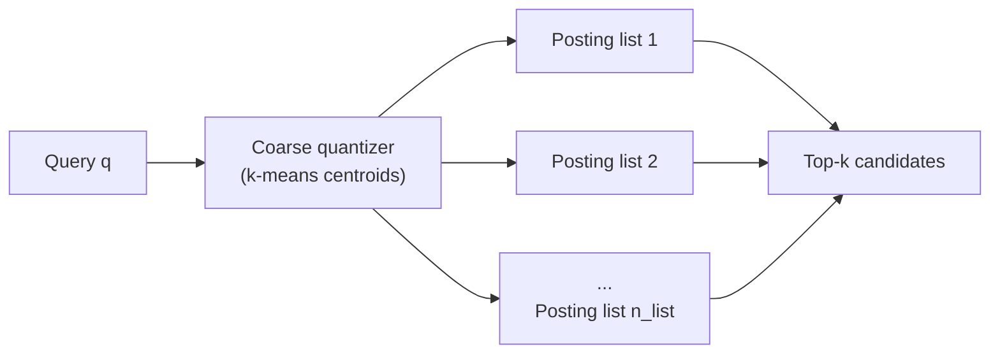
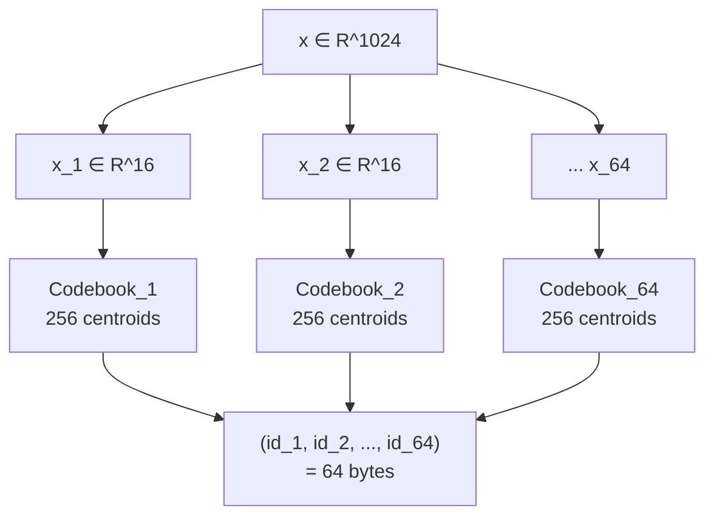
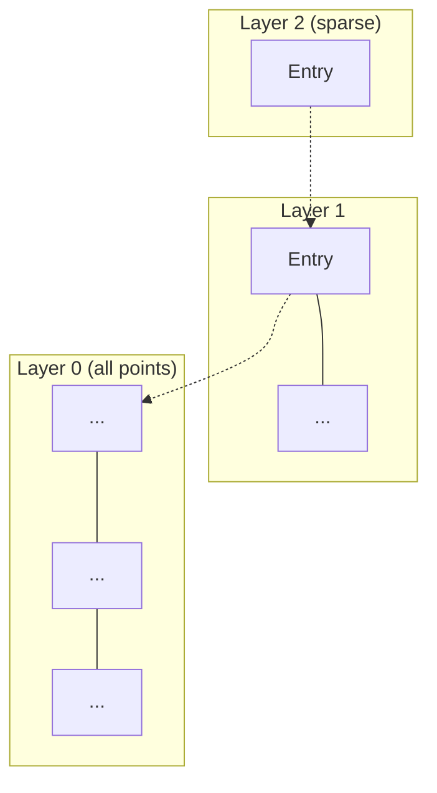
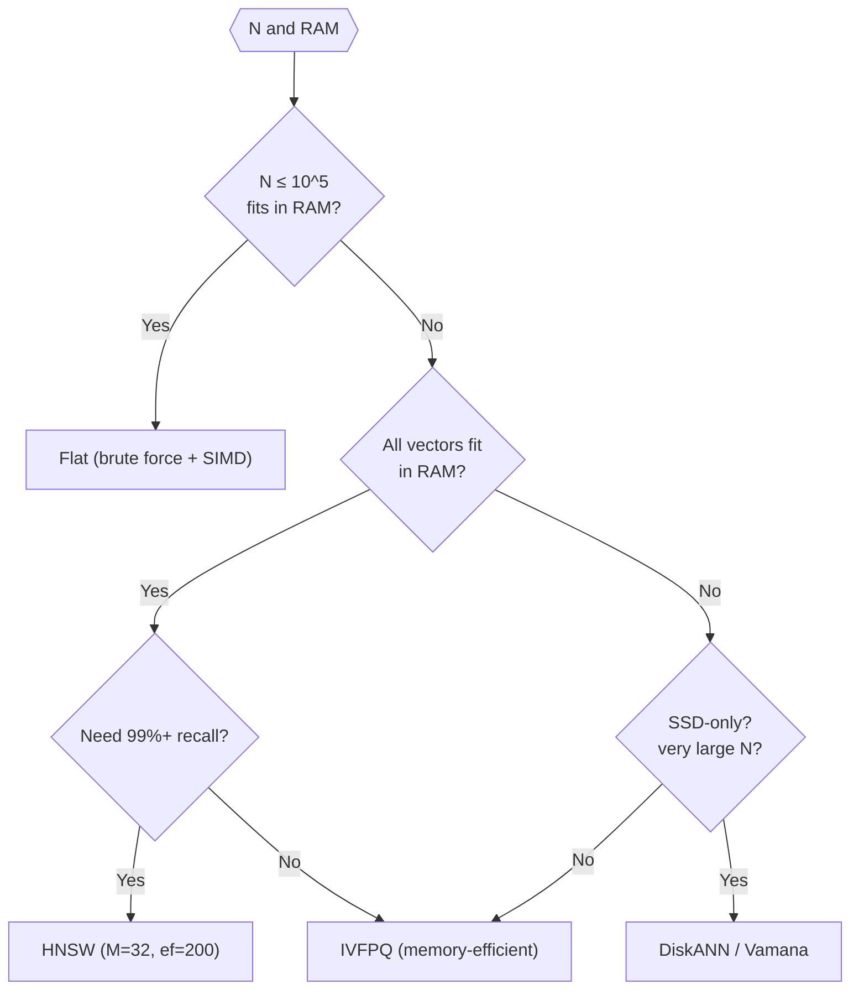
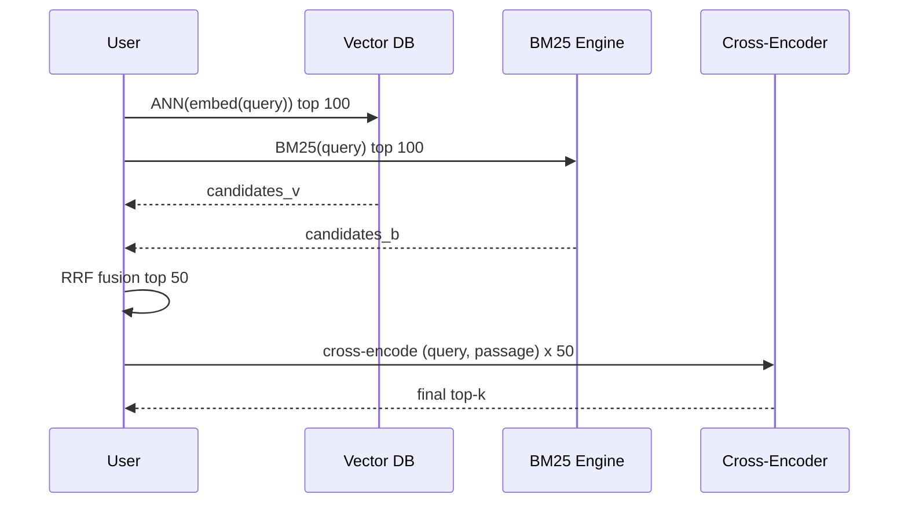

With the spread of large language models (LLMs), vector databases, which store and search embedding vectors, have become a common foundation for semantic search, recommendation, and Retrieval-Augmented Generation (RAG). The problem they solve internally has been studied for decades: <strong>Approximate Nearest Neighbor Search (ANN) in high-dimensional spaces</strong>.

This article explains the core algorithms in order, starting from brute force and moving through IVF (Inverted File), Product Quantization (PQ), HNSW (Hierarchical Navigable Small World), and DiskANN (Vamana). Design decisions are discussed with reference to the papers and to the code of open-source implementations (FAISS, Milvus, pgvector, Qdrant).

> <strong>The big picture, as a library</strong>
>
> Imagine looking for books similar to one you have, in a huge library. Brute force means picking up every book and checking how similar it is; with a billion books, you never finish.
>
> - <strong>IVF</strong>: each shelf has a label card. You pick the 10 shelves whose labels are closest to your book and search only those.
> - <strong>Product Quantization</strong>: each book's cover is summarized as 64 color codes chosen from a 256-color palette. Comparing codes instead of covers is much faster, at the cost of some accuracy.
> - <strong>HNSW</strong>: similar books are linked as "friends," and you follow the links toward your target, zooming from a sparse world map down to a dense street map.
> - <strong>DiskANN</strong>: the same network of links, stored on SSD. RAM holds only a compressed copy of every book (PQ-compressed vectors), and the originals are read from SSD only for promising candidates.

<ArticleVideo slug="vector-database-internals" />

## 1. Why vector search is hard

### 1.1 Embedding vectors

An embedding maps text, images, or audio to a <strong>fixed-dimensional real vector</strong> so that items with similar meaning end up close together. Typical dimensionalities:

| Model | Dimension | Preferred distance |
| --- | --- | --- |
| OpenAI `text-embedding-3-small` | 1536 | cosine |
| OpenAI `text-embedding-3-large` | 3072 | cosine |
| Cohere `embed-v3` | 1024 | cosine / dot |
| BGE-M3 | 1024 | cosine |
| CLIP ViT-L/14 | 768 | cosine |

Dimension $d$ is often above 1000, and at that scale brute-force search over many vectors is no longer practical.

### 1.2 Distances and similarities

For vectors $\mathbf{x}, \mathbf{y} \in \mathbb{R}^d$ the three common metrics are:

<strong>Euclidean (L2):</strong>

$$
d_{L2}(\mathbf{x}, \mathbf{y}) = \sqrt{\sum_{i=1}^{d} (x_i - y_i)^2}
$$

<strong>Inner product (IP; sum of element-wise products of the two vectors):</strong>

$$
\text{IP}(\mathbf{x}, \mathbf{y}) = \sum_{i=1}^{d} x_i y_i
$$

<strong>Cosine:</strong>

$$
\cos(\mathbf{x}, \mathbf{y}) = \frac{\mathbf{x} \cdot \mathbf{y}}{\|\mathbf{x}\|\,\|\mathbf{y}\|}
$$

When every vector is normalized to unit length,

$$
d_{L2}(\mathbf{x}, \mathbf{y})^2 = 2 - 2\,\mathbf{x}\cdot\mathbf{y}
$$

so <strong>L2, cosine, and inner product are related by monotonic transformations</strong> (transformations that preserve order), and all three give the same ranking. Most ANN libraries therefore use L2 or IP internally and switch between the three by whether vectors are normalized first.

### 1.3 The curse of dimensionality

In high dimensions, intuition from low dimensions stops working:

- <strong>Distance concentration</strong>: the ratio $\max/\min$ of pairwise distances approaches 1, so the gap between the nearest and a far point becomes relatively small.
- <strong>Volume concentration</strong>: almost all of the volume of a unit ball lies near its surface.
- <strong>Space partitioning breaks down</strong>: axis-aligned structures like kd-trees (a classical index that recursively splits space in two along coordinate axes) work well in low dimensions, but once $d \gtrsim 20$ they visit about as many nodes as brute force.

So practical vector search gives up on exact answers and <strong>solves the problem approximately</strong>, aiming for 95% recall or better (the fraction of the true top-k that the search actually returns). This is the premise of ANN.

## 2. Baseline: brute-force (Flat)

If brute force is fast enough for your data, use it. In FAISS this is `IndexFlatL2` / `IndexFlatIP`.

```python
# Naive brute-force search (pseudocode)
def search(query: np.ndarray, xb: np.ndarray, k: int):
    dists = np.linalg.norm(xb - query, axis=1)  # O(Nd)
    idx = np.argpartition(dists, k)[:k]         # O(N)
    return idx[np.argsort(dists[idx])]
```

Complexity is $O(Nd)$. With $N=10^6$, $d=1024$, and float32, every query scans 4 GB of memory. Even so, with SIMD (AVX-512 / NEON; CPU instructions that compute on many numbers at once) and BLAS-style GEMM (highly tuned matrix-multiply routines), brute force can be faster than HNSW up to about $N \approx 10^5$. That is why FAISS keeps `IndexFlat` as the reference for exact results.

ANN reduces that $O(Nd)$ in one of two ways: <strong>(a) visiting fewer vectors</strong> or <strong>(b) making each distance computation cheaper</strong>. IVF does (a) and PQ does (b). HNSW achieves (a) by a different method from IVF, and DiskANN combines (a) and (b).

## 3. IVF: partition the space

> Instead of checking everything, check only the nearby shelves. When building the index, the data is grouped into clusters of similar items; at query time only the few clusters closest to the query are opened and searched exhaustively. The weakness is that a true answer in a cluster you didn't open is missed.

### 3.1 Coarse quantization via k-means

The name IVF (inverted file index) comes from the inverted index used in text search.

1. Train: run k-means on the dataset, producing $n_{\text{list}}$ centroids (representative vectors for the center of each cluster) $\{\mathbf{c}_1, \dots, \mathbf{c}_{n_{\text{list}}}\}$ (typically $n_{\text{list}} \approx \sqrt{N}$).
2. Build: assign every vector to its nearest centroid and store its ID in that centroid's <strong>posting list</strong> (like the list of page numbers under one entry in a book's index).
3. Search: pick the top-$n_{\text{probe}}$ centroids closest to the query; scan only the corresponding posting lists.



### 3.2 Parameter design

- <strong>`nlist`</strong>: larger values mean shorter posting lists and faster search, but you also need a larger `nprobe` to keep the same recall. Rule of thumb: $4\sqrt{N} \le n_{\text{list}} \le 16\sqrt{N}$.
- <strong>`nprobe`</strong>: the number of posting lists visited. `nprobe=1` is very fast but has low recall, because the true nearest neighbor might sit in a cell you didn't open; 10-128 typically gives 90-99% recall.
- <strong>Training data</strong>: FAISS's clustering defaults are `min_points_per_centroid = 39` and `max_points_per_centroid = 256`. About 39-256 × `nlist` samples is the target; below that FAISS warns, and above it FAISS subsamples automatically.

### 3.3 Limits of IVF alone

IVF still uses brute force inside each cell, so search stays slow when a cell holds many points. That is why IVF is usually combined with Product Quantization, covered next (FAISS's `IndexIVFPQ`).

## 4. Product Quantization (PQ)

> Instead of comparing full vectors, compare short summary codes. Each vector is cut into short chunks, and each chunk is labeled with the nearest entry from a 256-entry palette, compressing a vector to a few dozen bytes of integers. Memory use drops and distance computation becomes orders of magnitude faster, at the cost of some accuracy lost to the coarser summary.

### 4.1 Break the vector into sub-codes

PQ<sup>[1]</sup> (Jégou et al., 2011) <strong>compresses high-dimensional vectors into short integer codes</strong> to make distance computation faster.

1. Split $\mathbf{x} \in \mathbb{R}^d$ into $m$ subvectors: $\mathbf{x} = [\mathbf{x}^{(1)}, \dots, \mathbf{x}^{(m)}]$, each $\in \mathbb{R}^{d/m}$.
2. In each subspace, run k-means independently to get $k^* = 256$ centroids $\{\mathbf{c}^{(i)}_1, \dots, \mathbf{c}^{(i)}_{256}\}$. These form the codebook (a 256-color palette per subspace).
3. Replace each $\mathbf{x}^{(i)}$ with the 8-bit ID of its nearest centroid.

A $d$-dim float32 vector ($4d$ bytes) shrinks to $m$ bytes. For $d=1024$ and $m=64$, that is 4096 bytes down to 64 bytes, 64× compression.



### 4.2 Asymmetric Distance Computation (ADC)

PQ is fast because of Asymmetric Distance Computation: the query stays uncompressed, and a lookup table (LUT) is computed per subspace at query time.

1. Split the query: $\mathbf{q} = [\mathbf{q}^{(1)}, \dots, \mathbf{q}^{(m)}]$.
2. For each subspace $i$, precompute distances to all 256 centroids:
   $$
   \text{LUT}_i[j] = \|\mathbf{q}^{(i)} - \mathbf{c}^{(i)}_j\|^2, \quad j \in \{0, \dots, 255\}
   $$
3. For a stored vector with code $(id_1, \dots, id_m)$, the approximate distance is just $m$ table lookups summed:
   $$
   d(\mathbf{q}, \mathbf{x})^2 \approx \sum_{i=1}^{m} \text{LUT}_i[id_i]
   $$

Once the lookup tables are built, <strong>a distance needs zero float multiplications</strong>. Summing table values replaces the $d$-dimensional subtract-and-square, which is why PQ is orders of magnitude faster. With $m=64$, each stored code needs 64 byte-indexed table lookups and additions of the table values. SIMD fast-scan kernels such as FAISS `pq4_fast_scan` can scan very large batches quickly, but the exact throughput depends on code size, CPU SIMD width, memory layout, and recall settings.

<ProductQuantizationVisualizer />


<strong>A tiny worked example.</strong> Take $d=4$, $m=2$ (subvector dimension 2), $k^*=4$ (2-bit IDs). Query $\mathbf{q} = [1, 0, 0, 1]$ splits into $\mathbf{q}^{(1)} = [1, 0]$ and $\mathbf{q}^{(2)} = [0, 1]$. If subspace 1's codebook is $\{[1,0], [0,1], [-1,0], [0,-1]\}$ (IDs 0-3), then

$$
\text{LUT}_1 = [\,0,\ 2,\ 4,\ 2\,]
$$

(each entry is $\|\mathbf{q}^{(1)} - \mathbf{c}^{(1)}_j\|^2$). If subspace 2 uses the same codebook, $\text{LUT}_2 = [2, 0, 2, 4]$. A stored vector with PQ code $(id_1, id_2) = (0, 1)$ (so $\hat{\mathbf{x}} \approx [1, 0, 0, 1]$) has approximate squared distance $\text{LUT}_1[0] + \text{LUT}_2[1] = 0 + 0 = 0$: two table lookups and one add, with no multiplication. A real index has 64 tables of 256 entries each and runs the same operation over 16-32 codes at a time with SIMD.

### 4.3 Error and tuning

PQ is lossy, so it introduces error. Rules of thumb for the parameters:

- <strong>`m`</strong>: the number of sub-quantizers. It must divide $d$; $d/m$ between 4 and 16 balances accuracy and speed.
- <strong>`nbits`</strong>: usually 8 (256 centroids). 16 bits (65,536 centroids) is possible, but codebook training becomes expensive.
- <strong>Optimized Product Quantization (OPQ)</strong><sup>[2]</sup>: rotate vectors with an orthogonal matrix $R$ before splitting, to even out the variance across subspaces. This improves recall by a few to 10 percentage points.

### 4.4 IVFPQ: two stages

One of the most widely used configurations in practical vector databases is IVF + PQ, available in FAISS as `IndexIVFPQ`:

- IVF narrows the search to a few cells.
- Vectors inside each cell are stored as PQ codes.
- PQ encodes not the vector itself but the residual $\mathbf{x} - \mathbf{c}$ from the cell centroid (<strong>residual PQ</strong>).

The reason for encoding the residual is geometric. A raw vector $\mathbf{x}$ can sit anywhere in the full space, but after subtracting its cell centroid $\mathbf{c}$, the residual $\mathbf{x} - \mathbf{c}$ only describes the offset inside that cell, which is a small vector. Because the distribution is tighter, the same 256 centroids can capture finer differences and quantization error goes down. The more cells ($n_{\text{list}}$), the stronger this effect.

`IndexIVFPQ` scales to $N=10^9$ (a billion vectors) on a single machine, with per-query latency from a few ms to a few tens of ms when `nprobe` is kept small (the exact numbers depend heavily on hardware, `nprobe`, and the recall target; see the FAISS wiki page [Indexing 1G vectors](https://github.com/facebookresearch/faiss/wiki/Indexing-1G-vectors)). Recall tends to be lower than HNSW, but because it uses little memory and runs on GPUs, it is the first choice for GPU search (FAISS GPU), for environments without much memory, and for setups that also use disk.

<strong>Production pitfalls.</strong> If the training data doesn't match the serving distribution, you can get <strong>codebook collapse</strong>: almost all vectors are assigned to a handful of centroids and the rest stay empty, and recall drops sharply. To prevent it, use at least as many training samples as FAISS's `min_points_per_centroid` warning requires, and train on samples drawn from the same distribution you serve (for example, with multilingual BGE, match the language mix in production). IVF has a related problem: if the data is skewed toward a few topics, cell sizes become uneven, and a few long posting lists push up p99 latency even as `nprobe` increases. Recording the maximum and minimum cluster sizes as a metric helps you catch this early.

## 5. HNSW: hierarchical navigable small world

> Build a graph in advance in which similar vectors are linked as "friends." At query time, start from one point and keep moving to a friend closer to the query, descending from a world map to a country map to a street map. It is the standard choice today for in-memory vector search, but it <strong>assumes all data fits in RAM</strong>.

### 5.1 Inspiration

HNSW<sup>[3]</sup> (Malkov & Yashunin, 2016) is the most widely used graph-based ANN method today. It combines two ideas:

1. <strong>Navigable Small World (NSW)</strong>: in a graph with long-range edges as well as edges to nearby points, greedy routing (at every step, move to whichever neighbor of the current node is closest to the query, a purely local rule) can reach any node in a small number of hops (Kleinberg's 2000 small-world model). Kleinberg's key result is that in a grid model, if and only if long-range edges are drawn with probability $\propto 1/r^d$ in the node distance $r$, a greedy algorithm using only local information reaches its target in $O(\log^2 N)$ hops. HNSW takes this idea through probabilistic layers and diversity-based neighbor selection; it does not explicitly sample long-range edges from Kleinberg's distribution.
2. <strong>Skip lists</strong>: building layers at random lets the search start on a coarse layer and move down to finer ones.

### 5.2 Structure

HNSW is a layered graph:



- Every point is in Layer 0.
- The highest layer each point belongs to is drawn at random from an exponential distribution, $\ell = \lfloor -\ln(U(0,1)) \cdot m_L \rfloor$ (default $m_L = 1/\ln(M)$).
- Each node has at most $M$ edges per layer ($M_{\max 0} = 2M$ at Layer 0).

### 5.3 Search algorithm

<HNSWSearchVisualizer />

In pseudocode:

```text
search(q, k):
    ep = entry_point
    for level L in [top_level ... 1]:
        ep = greedy_search_layer(q, ep, ef=1, level=L)
    W = greedy_search_layer(q, ep, ef=efSearch, level=0)
    return top-k of W

greedy_search_layer(q, ep, ef, level):
    visited = {ep}
    candidates = min-heap([(dist(q, ep), ep)])   # priority: closest first
    W         = max-heap([(dist(q, ep), ep)])    # keep top ef
    while candidates not empty:
        c = candidates.pop_min()
        f = W.peek_max()
        if dist(q, c) > dist(q, f): break         # pruning
        for each neighbor n of c at `level`:
            if n in visited: continue
            visited.add(n)
            if dist(q, n) < dist(q, f) or |W| < ef:
                candidates.push((dist(q, n), n))
                W.push((dist(q, n), n))
                if |W| > ef: W.pop_max()
    return W
```

The search has two stages: in the upper layers it heads roughly toward the query, and in the bottom layer it follows several candidates in parallel.

- <strong>`efSearch`</strong>: the size of the candidate set. Larger values give higher recall but slower search. Production settings are usually 50-200, and sometimes 300 or more when aiming for 99% recall.
- <strong>Upper layers use `ef=1`</strong>: a plain greedy move toward whatever is closest to the query.
- <strong>Layer 0 uses `ef=efSearch`</strong>: beam search (keeping several candidates at once and expanding them in parallel) widens the candidates.

### 5.4 Insertion and neighbor selection

```text
insert(x):
    ℓ = floor(-ln(rand()) * m_L)
    ep = entry_point
    for L in [top_level ... ℓ+1]:
        ep = greedy_search_layer(x, ep, ef=1, L)
    for L in [min(top_level, ℓ) ... 0]:
        W = search_layer(x, ep, ef=efConstruction, L)
        neighbors = select_neighbors_heuristic(x, W, M)
        add bidirectional edges between x and neighbors
        for each n in neighbors:
            if degree(n) > M_max:
                W' = neighbors(n)
                neighbors(n) = select_neighbors_heuristic(n, W', M_max)
        ep = W
    if ℓ > top_level: top_level = ℓ; entry_point = x
```

HNSW's quality depends on how neighbors are selected. Instead of simply taking the $M$ nearest, HNSW uses a <strong>heuristic that keeps neighbors diverse (select_neighbors_heuristic)</strong>:

```text
select_neighbors_heuristic(x, W, M):
    R = []
    sort W by dist(x, ·) ascending
    for e in W:
        if |R| == M: break
        if ∀ r ∈ R: dist(x, e) < dist(r, e):
            R.append(e)
    return R
```

This rule keeps a candidate $e$ only if $x$ is closer to $e$ than any already-selected neighbor is. Candidates lying in the same direction as an existing neighbor are dropped, so the neighbors spread out in different directions. As a result, the graph does not close in on local clusters, and search is less likely to get stuck in a local optimum. In FAISS, `shrink_neighbor_list` in `faiss/impl/HNSW.cpp` implements this.

The paper's full Algorithm 4 has two more options. `extendCandidates` grows the candidate set $W$ with each candidate's neighbors before selecting, which helps on sparse layers. `keepPrunedConnections` refills from the pruned candidates in distance order if $|R| < M$ at the end. Many implementations, including FAISS, set both to false by default; the paper recommends `extendCandidates=true` only on the upper layers.

### 5.5 Parameters and cost

- <strong>`M`</strong>: typically 12-48. Larger values improve recall but use more memory ($M \cdot 4$ bytes of links per point).
- <strong>`efConstruction`</strong>: 100-500. It affects build time only; larger values improve index quality, and build time grows roughly in proportion.
- <strong>Complexity</strong>: search is $O(\log N)$ in expectation, build is $O(N \log N)$.
- <strong>Memory</strong>: $N$ vectors plus roughly $N \cdot M_0 \cdot 4$ bytes of links (most nodes exist only in Layer 0, so upper-layer links are negligible). With $M=16$ ($M_0 = 2M = 32$), $d=1024$, and $N=10^6$, that is 4 GB of vectors and about 128 MB of links, around 3% of the vectors themselves.

HNSW's weaknesses are high memory use and difficult deletion. Actually removing a node from the graph and rewiring its edges can break connectivity, so most implementations mark deleted nodes with a <strong>tombstone</strong> (a "deleted" flag: the node stays in the graph but is excluded from results) and remove them during a periodic rebuild (compaction: physically removing all tombstoned nodes and rebuilding the index). As deletions accumulate, the graph becomes sparse and unreachable regions appear; in the worst case recall does not recover even with a larger `efSearch`. Many teams therefore have an operational rule to rebuild once the tombstone ratio exceeds 5-10%.

## 6. DiskANN / Vamana: a graph index for SSDs

> The same approach as HNSW of following links between neighbors, but the vectors themselves stay on SSD and only a compressed copy is kept in RAM. It can handle billions of vectors that don't fit in RAM, but as concurrent queries increase, SSD IOPS tends to become the bottleneck.

### 6.1 Motivation

HNSW assumes every vector fits in RAM. A billion 1024-dim float32 vectors take 4 TB as raw data. A high-end server has around 512 GB–1 TB of DRAM, so this is several times larger and does not fit in one machine's memory. DiskANN<sup>[4]</sup>, published by Microsoft in 2019, is a <strong>single-layer graph index designed for SSD</strong>.

### 6.2 The Vamana graph

Like HNSW, search is greedy, but there is no hierarchy: a single-layer graph mixes long and short edges. The search entry point is the <strong>medoid</strong> of the dataset, computed once at build time. A centroid is a computed point and is not necessarily a real data point. The medoid, by contrast, is the existing data point closest to the mean of the dataset. Because search starts from a real node near the center of the data, many queries can be expected to reach their target in fewer hops. Construction uses a rule called $\alpha$-pruning:

```text
build_vamana(X, R, α):
    G = random graph (R edges per node)
    for two passes (α=1.0, then α=1.2):
        for p in random permutation of X:
            V = greedy_search(G, p, ep, L)   # candidate set
            neighbors(p) = robust_prune(p, V, α, R)
            for n in neighbors(p):
                add edge n→p
                if degree(n) > R:
                    neighbors(n) = robust_prune(n, N(n)∪{p}, α, R)
```

<strong>robust_prune ($\alpha$-pruning):</strong>

```text
robust_prune(p, V, α, R):
    V = V sorted by dist(p, ·)
    P = []
    while V not empty and |P| < R:
        p* = V.pop_closest()
        P.append(p*)
        V = {v ∈ V : α · dist(p*, v) > dist(p, v)}   # drop v dominated by p*, keep diverse (long-range) edges
    return P
```

The paper uses $\alpha=1.0$ on the first pass and $\alpha > 1$ (typically 1.2) on the second. With $\alpha > 1$, Vamana <strong>keeps more long-range edges</strong> than HNSW's diversity heuristic. The larger $\alpha$ is, the more nearby neighbors in similar directions are dropped in favor of farther neighbors in other directions, so a single hop can travel further across the graph. On SSD, one hop is one random read, so fewer hops translate directly into lower latency.

### 6.3 SSD layout

- Each vector and its adjacency list are stored together in the same page on disk (Vamana page layout).
- Visiting a node on the search path costs one 4 KB random read that returns both the vector and its adjacency list.
- A PQ-compressed copy stays in memory, and these approximate distances are used for distance computation and pruning during traversal. The full-precision vectors read from disk are used to re-rank candidates, which limits the accuracy lost to compression.

### 6.4 IOPS and recall

On a single NVMe SSD, DiskANN typically needs 50-150 random 4 KB reads per query (the paper's SIFT1B benchmark reports roughly 100 reads at recall@1 = 95%), with p99 latency of 5-10 ms. It handles scales (over a billion vectors) that HNSW cannot hold in RAM on the same budget. FreshDiskANN (2021) proposes doing inserts, deletes, and rebuilds in the background.

<strong>Production pitfalls.</strong> Those numbers are for low concurrency. As concurrent queries increase, <strong>SSD IOPS (random I/O operations per second) saturates and tail latency worsens sharply</strong>. Typical consumer SSDs manage 50-200 k random 4 KB read IOPS, and server NVMe drives 500 k-1 M. As QPS × (reads per query) approaches that ceiling, queues form, and p99 (the slowest 1% of queries) can jump from about 10 ms to hundreds of ms while the median barely moves. Common mitigations are striping across multiple SSDs (RAID-0), raising PQ compression so more pruning happens in memory, and tuning `beam_width` to visit fewer nodes per query.

## 7. ScaNN: Google's anisotropic quantization

ScaNN<sup>[5]</sup> refines §4's PQ for inner-product search. Google published it in 2020, proposing a quantization (compressing each vector into a short sequence of bits) designed for maximum inner product search.

Regular PQ minimizes reconstruction error $\|\mathbf{x} - \hat{\mathbf{x}}\|^2$. But what matters for search is the error in the inner product $\mathbf{q} \cdot \mathbf{x}$. The queries for which a datapoint $\mathbf{x}$ should rank near the top are those with a large inner product, and such queries point in nearly the same direction as $\mathbf{x}$. So the error component parallel to $\mathbf{x}$ has the largest effect on inner-product error. ScaNN's <strong>anisotropic quantization loss</strong> is:

$$
L(\mathbf{x}, \hat{\mathbf{x}}) = h_\parallel(\mathbf{x}) \cdot \|(\mathbf{x} - \hat{\mathbf{x}})_\parallel\|^2 + h_\perp(\mathbf{x}) \cdot \|(\mathbf{x} - \hat{\mathbf{x}})_\perp\|^2
$$

Here $\parallel$ is the component parallel to $\mathbf{x}$ and $\perp$ the orthogonal component. Setting $h_\parallel \gg h_\perp$ learns a quantizer that keeps error parallel to $\mathbf{x}$ especially small. For inner-product search, recall tends to be 5-10% higher than PQ at the same bit budget.

## 8. Filtered search (pre / post / in-filter)

Real services need metadata-filtered ANN, such as "only published documents" or "only data owned by user X".

- <strong>Post-filter</strong>: retrieve $k'$ results ($k' \gg k$) with ANN, then apply the filter. When selectivity (the fraction of rows that pass the filter) is low, most of the $k'$ results are filtered out, fewer than $k$ remain, and you have to search again with a larger $k'$.
- <strong>Pre-filter</strong>: build the set of IDs matching the filter and brute-force within that set. Fast when the subset is small, but the ANN graph goes unused.
- <strong>In-filter (integrated)</strong>: keep only filter-matching nodes as candidates during graph traversal. Each database has its own technique to keep the graph reachable. Current Milvus docs describe two modes, standard filtering (a pre-filter that narrows with a scalar index first) and iterative filtering (turning vector search into an iterator and filtering each hit with scalar conditions), and the query planner picks one. Qdrant uses a filterable HNSW index that adds extra links to the HNSW graph based on payload categories so the graph stays connected after filtering (and switches from HNSW to scanning the payload index when cardinality is low).

Which strategy suits which selectivity:

| Strategy | Works well when | Fails when | Typical home |
| --- | --- | --- | --- |
| Post-filter | selectivity ≥ 50% (most rows pass) | selectivity ≤ 1%; top-$k$ ends up empty | pgvector, naive Elasticsearch |
| Pre-filter | selectivity ≤ 1% (subset is tiny) | mid-range selectivity — ANN is wasted and the linear scan dominates | Milvus standard filtering |
| In-filter | the middle range, selectivity 1–50% | harder to implement; graph connectivity must be engineered in | Qdrant filterable HNSW, Filtered-DiskANN |

Recent research (ACORN, 2024; Filtered-DiskANN, 2023) proposes taking filter labels into account when the graph is built.

## 9. Implementations compared

The table below shows how popular OSS and SaaS products combine the algorithms from §2–§8. FAISS is a library; Milvus, Qdrant, and Weaviate are database products that include distribution and persistence; pgvector is a PostgreSQL extension; and Pinecone is a fully managed SaaS.

| Library | Core algorithms | Notes |
| --- | --- | --- |
| FAISS | Flat, IVF, IVFPQ, HNSW, OPQ | Meta. GPU + SIMD. The research reference. |
| Milvus | Wraps FAISS / HNSW / DiskANN | Distributed, persistent, filtering, multi-tenant. Kubernetes-first. |
| Qdrant | HNSW (custom Rust) | Strong payload filtering, gRPC/REST. |
| Weaviate | HNSW | Module-based vectorizers, GraphQL API. |
| pgvector | IVFFlat, HNSW | PostgreSQL extension. Joins with existing SQL. |
| Pinecone | Proprietary hybrid | Fully managed SaaS. |
| LanceDB | IVFPQ, HNSW over Arrow/Parquet | Columnar persistence — think "DuckDB for embeddings". |
| Elasticsearch / OpenSearch | Lucene HNSW | BM25 + vector hybrid in one engine. |

### 9.1 A selection flowchart



## 10. Hybrid search: BM25 + vector

In practice, combining lexical matching (BM25; a classical relevance score from the TF-IDF family that weights how many of the query's words appear in each document) and semantic similarity (vector) gives better quality than ANN alone. Two common ways to combine them:

### 10.1 Reciprocal Rank Fusion (RRF)

$$
\text{score}(d) = \sum_{r \in R} \frac{1}{k + \text{rank}_r(d)}
$$

$R$ is the set of retrievers (BM25, vector, and so on), and $k \approx 60$ is the usual empirical value. Because it uses only ranks, <strong>scores don't need to be on the same scale</strong>, and Elasticsearch and Weaviate both offer RRF as a fusion method for hybrid search.

### 10.2 Cross-encoder re-rank

Retrieve 100 results with ANN, then re-score them with a BERT-style cross-encoder. This is a common setup in production RAG.

<strong>Bi-encoder vs cross-encoder.</strong> Vector search uses a bi-encoder: the query and document are embedded separately and compared by cosine similarity (fast, because document embeddings can be computed offline). A cross-encoder instead concatenates the query and document, passes them through one Transformer, and lets attention relate the two directly to produce a relevance score. <strong>It is more accurate, but slow, because it must run again for every document on every query</strong>. So a two-stage setup, using a cheap bi-encoder to narrow down to 100 candidates and an expensive cross-encoder to re-score only those 100, improves accuracy while keeping cost down.



## 11. Production metrics

| Metric | Meaning |
| --- | --- |
| Recall@k | overlap between returned top-k and true top-k |
| QPS | queries per second |
| p50 / p95 / p99 latency | median / top-5% / top-1% latency; the tail (especially p99) is where GC pauses and disk IO stalls show up |
| Build time | batch reindex time |
| Index size | shows compression efficiency |
| Insert/delete throughput | whether streaming updates are viable |

[ann-benchmarks](https://github.com/erikbern/ann-benchmarks) is the standard benchmark for comparing HNSW, IVFPQ, ScaNN, and others under the same conditions. Comparisons usually use a Pareto frontier plot with recall on the x-axis and QPS on the y-axis. The Pareto frontier is the curve through the points where you can no longer raise QPS without lowering recall, or the reverse. If one algorithm's whole curve lies outside another's, it is better at every operating point. When curves cross, the comparison becomes a trade-off such as <strong>A being faster at 95% recall while B is faster at 99%</strong>, which a single number like "A is faster than B" cannot capture.

## 12. State of the art (as of 2026)

The research and implementations drawing attention as of 2026 share three themes: larger scale, tighter compression, and easier updates.

- <strong>SPANN / SPFresh</strong> (Microsoft, 2021-2023): an IVF-style approach that keeps centroids in memory and posting lists on SSD. SPFresh adds in-place updates to the posting lists. Like DiskANN, it targets billion-scale search on SSD.
- <strong>Learned indexes</strong>: a research area that uses neural networks to learn centroid selection or hierarchical structure and adapt it to the data distribution (not yet in FAISS itself).
- <strong>RaBitQ</strong>: a randomized binary quantization with tighter error bounds than PQ (Gao & Long, 2024). FAISS implements it as `faiss::IndexRaBitQ` / `IndexIVFRaBitQ`; pgvector 0.8 is evaluating it.
- <strong>GPU graph index (CAGRA, 2023)</strong>: part of NVIDIA RAPIDS (cuVS). Not a port of HNSW, but a CUDA implementation of a non-hierarchical graph index designed for parallel processing on GPUs.
- <strong>Hybrid DRAM / CXL layouts</strong>: since Intel Optane was discontinued, NVMe plus large RAM has been the norm, and new configurations using CXL memory pools are being researched.

## 13. Putting it all together

The design choices in vector search can be organized along three axes:

| Axis | Technique |
| --- | --- |
| Reduce candidate set | IVF / Graph (HNSW, Vamana) |
| Compress distance | PQ / OPQ / ScaNN / RaBitQ |
| Exploit the memory hierarchy | DiskANN / SPANN (SSD), CAGRA (GPU) |

In practice, four factors narrow the choice: data size, memory budget, update frequency, and recall target.

- $N \le 10^5$ → Flat
- $10^5 \le N \le 10^7$ with plenty of RAM → HNSW
- $10^7 \le N$ with limited RAM → IVFPQ
- $N \ge 10^9$ → DiskANN / SPANN
- Already on PostgreSQL → pgvector (HNSW)
- Need distribution → Milvus / Qdrant / Weaviate

A vector database can be seen as <strong>the classical inverted-index idea extended to high-dimensional space</strong>. IVF uses per-cluster posting lists, PQ compresses distance computation, and HNSW and DiskANN are graphs for walking through candidates. Knowing these mechanisms tells you whether to suspect `efSearch` or `nprobe` when recall drops, whether to spend on memory or SSD, and what to look at when p99 gets worse.

## References

1. H. Jégou, M. Douze, C. Schmid, "Product quantization for nearest neighbor search", *IEEE TPAMI*, 2011.
2. T. Ge et al., "Optimized Product Quantization", *IEEE TPAMI*, 2014.
3. Y. Malkov, D. Yashunin, "Efficient and robust approximate nearest neighbor search using Hierarchical Navigable Small World graphs", 2016. [arXiv:1603.09320](https://arxiv.org/abs/1603.09320)
4. S. Jayaram Subramanya et al., "DiskANN: Fast Accurate Billion-point Nearest Neighbor Search on a Single Node", *NeurIPS*, 2019.
5. R. Guo et al., "Accelerating Large-Scale Inference with Anisotropic Vector Quantization", *ICML*, 2020.
6. [FAISS wiki](https://github.com/facebookresearch/faiss/wiki) — the de-facto reference.
7. [ann-benchmarks](https://github.com/erikbern/ann-benchmarks) — recall vs throughput comparisons.
