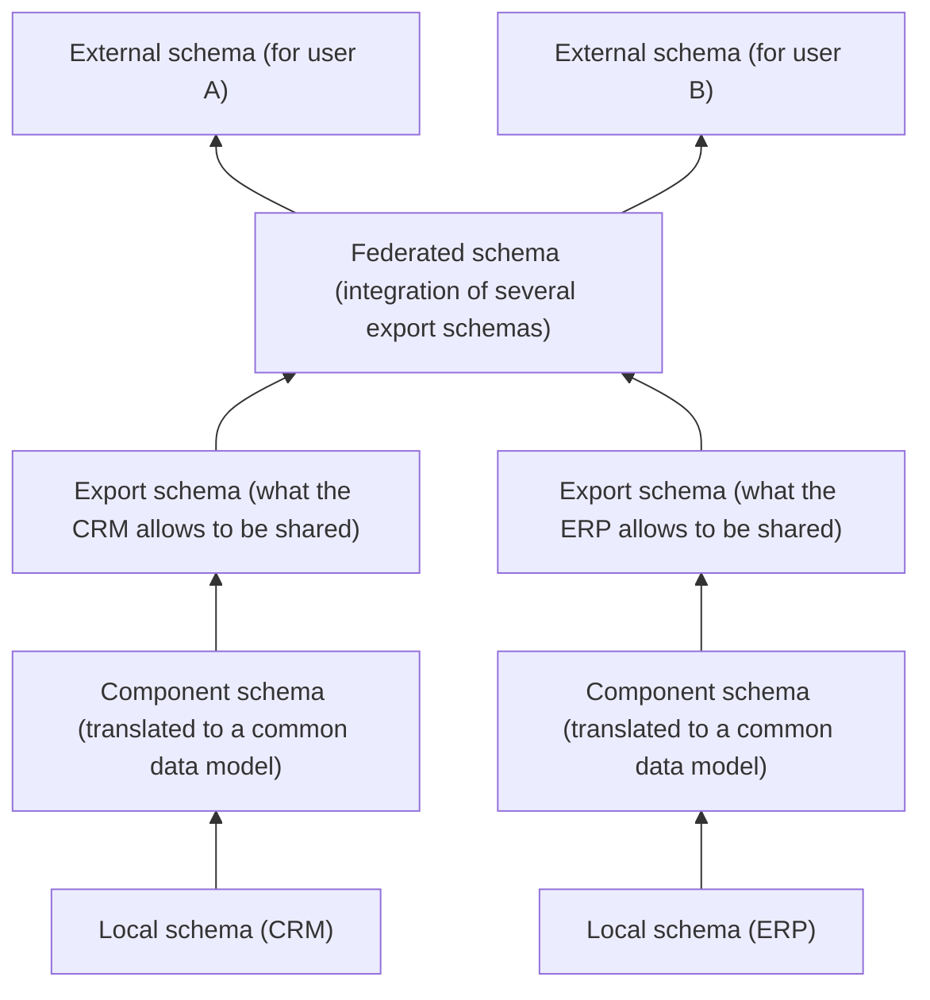
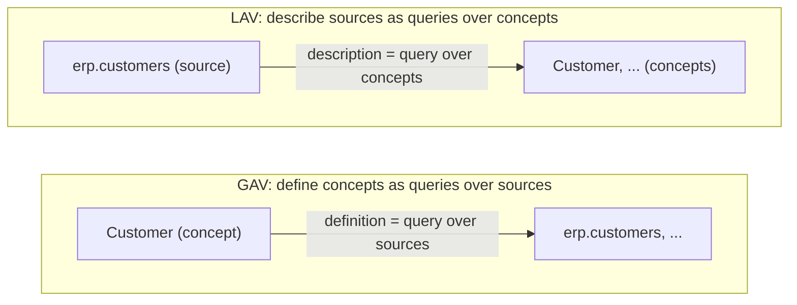
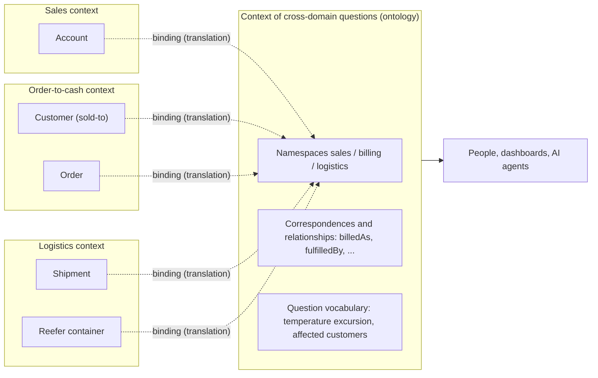
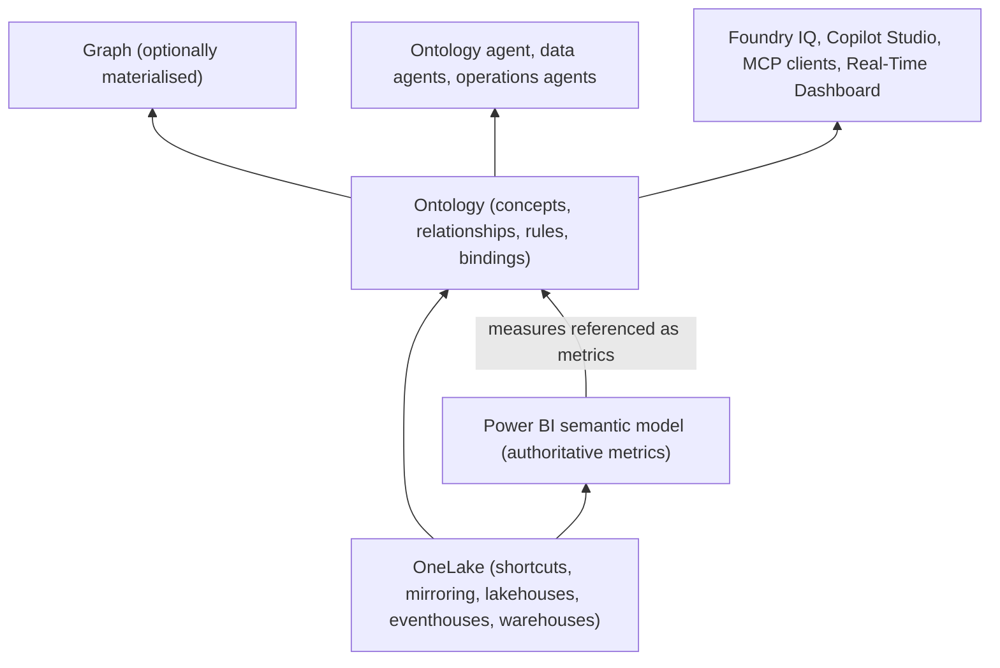

## Introduction

When I talk with people about the <strong>ontology</strong> that Microsoft Fabric promotes as the core of “Fabric IQ”, it quickly becomes clear that each of us is picturing something different.

- Business descriptions attached to tables and columns
- A semantic mapping between data sources, e.g. stating that the CRM’s “account” and the ERP’s “sold-to party” are the same thing
- A knowledge graph made of nodes and edges
- A rebranding, or an extension, of the Power BI semantic model
- A clever data dictionary to hand to AI agents

Each of these is half right, and none is the whole. In this essay I try to answer “so what is it, how do you use it, and what does it buy you?”, backing the answers with evidence wherever I can.

The starting point is two hypotheses I hold.

> <strong>Hypothesis 1 (semantic view)</strong>　If everything lived in a single database, you would just create a view. An ontology is perhaps a semantic view built where you cannot create a view. Different systems, different schemas, different owners, different vocabularies — the places where you want a JOIN but cannot write one are exactly where an ontology is needed.
>
> <strong>Hypothesis 2 (context mapping)</strong>　A domain model lives inside a bounded context and is owned by that context’s team or organisation. An ontology, by contrast, takes in the vocabularies of several domains and data sources and sits outside the contexts as a model of its own. If an ontology looks from the outside at concepts each context already owns and describes how they correspond and relate across boundaries, isn’t it essentially context mapping? And it is defined top-down from the business, not bottom-up from the physical data.

“Bounded context” and “context mapping” in hypothesis 2 are terms from DDD (Domain-Driven Design), explained in Section 4. I do not intend a rigorous correspondence with DDD. Still, the two hypotheses make a convenient yardstick for untangling the word. Below I hold them up, in turn, against the definitions of ontology in philosophy and knowledge engineering, against the theory of data integration that database research has developed over more than thirty years, against DDD’s strategic design, and against the actual specification of the Fabric IQ ontology — to see how far they hold and where they need fixing.

At the time of writing (October 2026) the Fabric IQ ontology is in preview, and the documentation describes a “new experience” that is now the default (the old experience is scheduled to retire on 31 January 2027). Product details here are based on the [Microsoft Learn documentation](https://learn.microsoft.com/fabric/iq/ontology/overview) as of October 2026 and may change.

## The conclusions up front

| Question | Answer in this essay | Section |
|---|---|---|
| What is an ontology? | An explicit — ideally formal — write-up of a conceptualisation (a way of carving up the world) that a community has agreed on for some purpose. In enterprise data it shows up as a bundle of four layers: vocabulary, structure, binding and operation | 1, 2 |
| Is it descriptions attached to tables? | No. That is part of the vocabulary layer pinned onto physical structures. In an ontology the description belongs to a <strong>concept</strong>, and a table is one of the places the concept is bound to. The direction of attachment is reversed | 1 |
| Is it a semantic mapping between data sources? | Half right. Binding (mapping) is one half of an ontology. But rather than a table that wires sources directly to each other, it sets up shared concepts and maps each source onto them | 1, 3 |
| Is it “a view where you cannot write the JOIN”? | The binding half is what data integration theory calls a GAV mapping — a view, literally. Hypothesis 1 agrees with the classical theory. But a view specifies “how to compute it”, while an ontology also carries a theory of “what it means and what must hold”. And its place is less where the JOIN is physically impossible than where nobody alone has the standing to write it | 3 |
| Why can’t you write the JOIN? | Four reasons: the data is physically out of reach, the keys do not line up, the meanings do not match, or nobody alone has the standing to write it. OneLake handles the first and MDM (master data management) the second. The ontology mainly handles the third; for the fourth it is the vessel that records what has been agreed. It does not create join keys | 3, 7 |
| Is it context mapping? | The translation part is exactly what a context map should contain. But the ontology does not float “outside” the contexts; it lives “inside” a context of its own — that of the people and agents who ask cross-domain questions. That is why it needs an owner. Call it “a context map that has acquired a language” | 4 |
| Is it defined top-down? | Starting from competency questions is the academically sound way. In practice, though, it is a kind of middle-out: you start from the core concepts and go back and forth between the business and the physical data. Treat generation from existing assets as a bottom-up first draft | 5 |
| What is the Fabric IQ ontology? | A virtual semantic layer that defines business concepts (entity types, relationships, metrics, rules) and binds them to sources in OneLake, without holding any data itself. Its expressiveness is at the level of “frames + single inheritance”, not formal-logic OWL, and its main consumers are AI agents | 6 |
| What does it make easier? | You pay the cost of translation once. You can give agents a shared map. Metrics and rules become reusable. You can follow relationships across many hops. Changes in sources are absorbed by bindings. You can exchange vocabularies with the outside world | 7 |
| What does it not make easier? | Identity resolution (record matching), normalising formats, executing rules, building agreement and ownership, formal reasoning. These remain the job of other mechanisms and of the organisation | 7 |

## 1. Why “ontology” means so many things

### 1.1 What goes by the same name

One reason the word drifts is that it has passed through at least four worlds: philosophy (the study of what exists), knowledge representation in AI (specifications for sharing knowledge between systems), the Semantic Web (Web standards such as RDF and OWL), and enterprise data platforms (the layer that ties business concepts to data). With each move, the same word came to mean something slightly different.

The other reason is that what enterprises call an “ontology” is, in practice, a bundle of quite different parts. Each of the interpretations listed above is looking at some part of that bundle.

### 1.2 Splitting it into four layers

In this essay I split what is called an ontology in enterprise data into the following four layers.

| Layer | Question it answers | Examples |
|---|---|---|
| Vocabulary | What does the term refer to? | Names, definitions, synonyms, spellings |
| Structure | How do concepts relate, and what counts as the same thing? | Types, is-a (broader/narrower), relations and their cardinality, keys, constraints |
| Binding | Where do instances of the concept live? | “Customer” is this ERP table; “temperature” is this IoT time series |
| Operation | What is the meaning used for? | Metrics (KPI formulas), business rules, actions |

Descriptions on tables are part of the vocabulary layer. Mapping tables between data sources are the binding layer. A knowledge graph keeps a thin structure layer and puts the bound instances themselves centre stage. And the Fabric IQ ontology reaches into all four layers, though not equally deeply.

Use the table below to compare artefacts that often get called “ontologies” across the four layers.

<OntologyInterpretationMap />

### 1.3 The description is attached to the other end

Of all the interpretations, “business descriptions on table definitions” is the hardest to tell apart from an ontology. The difference is not how many descriptions you write or how carefully, but <strong>where you attach them</strong>.

When you write “customer class (1: corporate, 2: individual)” on column `CUST_KBN` in a data catalogue, the column is the primary object and the description is merely an annotation on it. If the column disappears, so does the description. If another system has a similar column called `customer_type`, reading either description will not tell you whether the two refer to the same thing. Each description is sealed inside its own physical structure.

An ontology reverses the direction. You first establish the concept “customer class” and write its definition. Then you <strong>bind</strong> it: instances of this concept live in the ERP’s `CUST_KBN` and also in the e-commerce site’s `customer_type`. The concept is now the primary object; a column is just one of its bindings. If the column is renamed, you rebind it and the concept survives. And the fact that two columns are bound to the same concept is itself a claim: “these two refer to the same thing”.

As we will see, one of the design principles for ontologies proposed by Thomas R. Gruber asks for exactly this — that concept definitions not depend on a particular symbol-level encoding. Descriptions are necessary, but as long as they are pinned to the physical layer, they do not yet amount to an ontology.

## 2. Tracing the academic definitions

### 2.1 Ontology in philosophy: what exists?

“Ontology” started as a term of philosophy: the branch of metaphysics that asks what it means to exist and what kinds of things the world contains. The question goes back to Aristotle’s <em>Categories</em> (substance, quantity, quality, relation, …). The word “ontologia”, however, first appears in print only in the early seventeenth century: Jacob Lorhard’s <em>Ogdoas Scholastica</em> (1606) and Rudolf Goclenius’s <em>Lexicon philosophicum</em> (1613) are usually cited as the earliest uses. Christian Wolff systematised it in <em>Philosophia prima, sive Ontologia</em> (1730), and it became an established philosophical term.

What matters most for enterprise data is an idea that twentieth-century analytic philosophy introduced: <strong>ontological commitment</strong>. In his 1948 paper “[On What There Is](https://www.pdcnet.org/revmetaph/content/revmetaph_1948_0002_0021_0038)”, W. V. O. Quine wrote that “to be assumed as an entity is, purely and simply, to be reckoned as the value of a variable.” What a theory takes to exist is settled by what the variables bound by its quantifiers must range over. The moment you say “there is an x such that …”, the theory has bet on the existence of x.

Applied to business systems, this turns into questions like these:

- Can an order exist without a customer? (Does a one-off spot order need a “customer”?)
- Is “customer” a kind of thing, or a role that an organisation happens to play? (The same company can be both a customer and a supplier.)
- Are the CRM’s accounts and the ERP’s sold-to parties the same things counted twice, or different things counted once each?

Every data model answers these questions, whether it means to or not, because each table you create declares “things of this kind exist, and each is distinguished by this key”. Building an ontology means writing those implicit declarations out explicitly and getting the people involved to agree on them again.

### 2.2 Ontology in knowledge engineering: an explicit specification of a conceptualisation

In the 1980s and 1990s, the field of knowledge representation in artificial intelligence borrowed the word. Its purpose differed from philosophy’s: <strong>sharing and reusing knowledge between systems that were built separately</strong>. In the US research programme known as the Knowledge Sharing Effort, ontologies were positioned as a common vocabulary through which knowledge bases could exchange knowledge. The programme’s report by Neches and colleagues ([Neches et al. 1991](https://doi.org/10.1609/aimag.v12i3.902)) says that “an ontology defines the basic terms and relations comprising the vocabulary of a topic area as well as the rules for combining terms and relations to define extensions to the vocabulary.” Note that it covers not only the vocabulary but also the rules for combining it.

The most cited definition from that period is Gruber’s ([Gruber 1993](https://doi.org/10.1006/knac.1993.1008)):

> An ontology is an explicit specification of a conceptualization.

A <strong>conceptualisation</strong>, a term Gruber takes from Genesereth and Nilsson (1987), is described as an abstract, simplified view of the world that we wish to represent for some purpose. Every knowledge base is committed to some conceptualisation, explicitly or implicitly; an ontology writes it out explicitly.

Borst (1997) later rephrased it as “a formal specification of a shared conceptualization”, and Studer, Benjamins and Fensel ([Studer, Benjamins & Fensel 1998](https://doi.org/10.1016/S0169-023X(97)00056-6)) merged the two:

> An ontology is a formal, explicit specification of a shared conceptualisation.

Each of the four words in this definition asks for something:

| Word | Meaning | In enterprise data terms |
|---|---|---|
| Conceptualisation | An abstract model of some phenomenon in terms of its relevant concepts | Write at the level of business concepts, not physical schemas |
| Explicit | The types of concepts used and the constraints on their use are explicitly defined | Write down the definition of “customer” and what makes two customers the same |
| Formal | Machine-readable | Not a wiki page for humans, but something tools and agents can interpret |
| Shared | Consensual knowledge accepted by a group, not private to an individual | It is settled who has agreed to this definition and who maintains it |

Guarino ([Guarino 1998](https://www.loa.istc.cnr.it/old/Papers/FOIS98.pdf)) then recast an ontology as a logical theory accounting for the intended meaning of a formal vocabulary. The key point is that an ontology is not the conceptualisation itself but an <strong>approximation</strong> of it. The more axioms (constraints) you add to a vocabulary, the narrower its possible interpretations become, and the closer they get to the intended meaning. Write “every order has exactly one customer”, and interpretations that allow orders without customers are excluded. You could say an ontology’s job is not to pin down meaning exactly but to <strong>rule out impossible interpretations</strong>.

Two points from this section are worth carrying forward:

1. An ontology lives at the level of <strong>concepts</strong>. It is neither the data itself nor the schema of a particular database.
2. An ontology is <strong>shared</strong>, and it exists <strong>for some purpose</strong>. It is not a neutral God’s-eye view. Who agreed to it, and why, is part of the definition.

The second point will matter when we hold ontologies up against DDD.

### 2.3 Gruber’s design criteria

In a 1995 paper ([Gruber 1995](https://doi.org/10.1006/ijhc.1995.1081)), Gruber listed five criteria for designing ontologies for knowledge sharing.

| Criterion | Content | In enterprise data terms |
|---|---|---|
| Clarity | Definitions are objective and, where possible, stated as necessary and sufficient conditions | Define “active customer” by conditions, not by someone’s intuition |
| Coherence | What can be inferred from the definitions is not contradictory | Do not let “every order has one customer” coexist with “spot orders have no customer” |
| Extendibility | New terms can be added without revising existing definitions | A new business’s concepts can be added as specialisations of existing types |
| Minimal encoding bias | Concept definitions do not depend on a particular symbol-level encoding | Do not let column names or code conventions leak into concept definitions |
| Minimal ontological commitment | Claim only what is needed for knowledge sharing | Do not decide company-wide what each department can decide for itself |

The last two bear directly on our hypotheses. Minimal encoding bias demands that definitions be kept free of physical-layer conventions, which points the same way as hypothesis 2’s “from the business, not from the physical data”. It constrains the finished definitions, though, not the order in which you build them; as Section 5 shows, you can start from a bottom-up draft and still satisfy it. Minimal ontological commitment demands “write only what sharing requires”; as Section 4.4 shows, it is academia’s brake against ontologies that try to swallow each domain’s model.

In the same paper Gruber says that an agent commits to an ontology when its <strong>observable actions</strong> are consistent with the ontology’s definitions. Internally it may represent things however it likes; it simply must not say anything that contradicts those definitions when it speaks the shared vocabulary. That is why agents can communicate without operating on a single globally shared theory. This picture — free inside, agreement only at the boundary — has almost the same shape as DDD’s bounded contexts (Section 4).

### 2.4 The ontology spectrum

So where does “ontology” begin? Lassila and McGuinness ([Lassila & McGuinness 2001](https://www.ida.liu.se/ext/epa/cis/2001/005/tcover.html)) arranged the things that may be called ontologies on a spectrum from weak to strong expressiveness.

```text
weak ←───────────────────────────────────────────────────────→ strong
catalog/ID → terms/glossary → thesauri → informal is-a → formal is-a
  → formal instances → frames (properties) → value restrictions → general logical constraints
```

The left end is a plain list of terms; the right end is a formal ontology that can state constraints as arbitrary logical formulas. Authors draw that line in different places: some count only what has strict subclass hierarchies (formal is-a), while others include glossaries and thesauri. Here lies part of the explanation for the confusion we started with. Table descriptions, glossaries and systems of OWL axioms all sit somewhere on this spectrum. What drifts is not the definition but the <strong>position on the spectrum</strong>.

As we will see in detail, the Fabric IQ ontology has types, properties, relationships and single inheritance, but no logical constraints. On the spectrum it sits around “frames + formal is-a”.

### 2.5 The Semantic Web toolkit and the “open world”

From the 2000s on, the W3C produced Web standards for writing ontologies.

| Standard | Role |
|---|---|
| [RDF](https://www.w3.org/TR/rdf11-concepts/) | The foundation: data as subject–predicate–object triples |
| [RDFS](https://www.w3.org/TR/rdf-schema/) | A minimal vocabulary: classes, subclasses, property domains and ranges |
| [OWL 2](https://www.w3.org/TR/owl2-overview/) | A language for logically stating class equivalence and disjointness, cardinality restrictions, transitivity and more |
| [SKOS](https://www.w3.org/TR/skos-reference/) | A vocabulary for glossaries and thesauri (broader, narrower, alternative labels) |
| [SPARQL](https://www.w3.org/TR/sparql11-query/) | The query language for RDF |
| [SHACL](https://www.w3.org/TR/shacl/) | A language for validating that RDF data satisfies given shapes |
| [R2RML](https://www.w3.org/TR/r2rml/) | A mapping language for exposing relational databases as RDF |

In the terminology of description logics (the theoretical foundation of OWL), the part that defines concepts and relations is the <strong>TBox</strong>, and the part holding individual facts (“ACME is a customer”) is the <strong>ABox</strong>. There is no strict definition, but “ontology” usually refers mainly to the TBox, while a graph holding both TBox and ABox is often called a knowledge graph. To the question “how is an ontology different from a knowledge graph?”, a first answer is: “the type side versus the instance side”. This is only a matter of usage, though: in the OWL specification, an ontology is the whole set of axioms, including assertions about individuals.

One thing trips up people used to databases. OWL makes the <strong>open-world assumption</strong>: what is not stated is not “false” but “unknown”. If no phone number is recorded for a customer, OWL does not conclude that the customer has none. OWL also does not make the <strong>unique name assumption</strong>, so it does not rule out that two individuals with different names are the same (see the [OWL 2 Primer](https://www.w3.org/TR/owl2-primer/)). Databases, on the other hand, think in a closed world: a row that is not in the table does not exist.

Logically, this difference follows from description logics inheriting the semantics of first-order logic. It also fits what ontologies have been used for: integrating knowledge in an open environment where nobody knows the whole. When several sources each contribute partial facts, “not stated” cannot mean “false”. Conversely, when you want to validate data, you need closed-world thinking — which is why SHACL was standardised later.

## 3. Is an ontology a “view”? Reading it through data integration theory

Hypothesis 1 said that “an ontology is a semantic view built where you cannot create a view”. To give the conclusion first: this agrees remarkably well with the theory of <strong>data integration</strong> that database research has been building since the 1990s.

### 3.1 Inside one database, views are enough to carry meaning

The <strong>three-schema architecture</strong> proposed by the ANSI/X3/SPARC study group in 1975 looked at a database at three levels:

- <strong>External schemas</strong>: how each user group or business sees the data; what we would now call views
- <strong>Conceptual schema</strong>: the logical structure of the data as seen by the whole organisation — which entities exist and how they relate
- <strong>Internal schema</strong>: how the data is physically stored

Inside one database, the conceptual schema carries the organisation’s shared understanding, and views carry each user’s angle on it. Argue as you may about the scope of “customer” or how to join things, in the end you settle it by writing one view inside the same schema. The first half of hypothesis 1 — “if everything is in one database, just create a view” — is about this world.

Interestingly, the idea of a conceptual schema was itself an attempt to keep one conceptual model for the whole organisation. In a sense, an ontology is that conceptual schema revived in a <strong>world that spans many databases</strong>.

### 3.2 Where you cannot create a view: distribution, heterogeneity, autonomy

So when can’t you create a view? In their classic survey of <strong>federated databases</strong> — systems that bring several databases together — Sheth and Larson ([Sheth & Larson 1990](https://doi.org/10.1145/96602.96604)) divided the problem into three dimensions: <strong>distribution</strong>, <strong>heterogeneity</strong> and <strong>autonomy</strong>.

| Dimension | Content | In hypothesis 1’s words |
|---|---|---|
| Distribution | The data lives in physically different places | Different systems |
| Heterogeneity | Data models, schemas and semantics differ | Different schemas, different vocabularies |
| Autonomy | Each database decides its own design, operation and what it shares | Different owners |

Autonomy is further broken down: <strong>design autonomy</strong> (deciding what data to hold and with what meaning), <strong>communication autonomy</strong> (deciding whether to talk to others), <strong>execution autonomy</strong> (running its own operations without interference) and <strong>association autonomy</strong> (deciding whether to take part, and what and how much to share). The “different owners” of hypothesis 1 is less a technical constraint than a matter of this autonomy.

Sheth and Larson organised the schemas of a federated database into five levels.



Each source translates its own schema into a common data model (the component schema) and carves out the part it is willing to expose (the export schema). Integrating several export schemas yields the <strong>federated schema</strong>, on top of which users keep their own views (external schemas).

This federated schema is precisely “the view that cannot be created inside any one database”. And the very existence of an export-schema level expresses respect for autonomy: each source’s owner decides how much to show. Hypothesis 1’s intuition was formalised in this shape more than thirty years ago.

### 3.3 Global schemas and mappings: GAV and LAV

The theory was sharpened by Lenzerini’s formalisation of data integration ([Lenzerini 2002](https://doi.org/10.1145/543613.543644)). A data integration system is a triple:

$$
\mathcal{I} = \langle \mathcal{G}, \mathcal{S}, \mathcal{M} \rangle
$$

$\mathcal{G}$ is the <strong>global schema</strong> presented to users, $\mathcal{S}$ is the set of <strong>sources</strong>, and $\mathcal{M}$ is the <strong>mapping</strong> that connects them. There are two broad styles for writing the mapping:

- <strong>GAV (global-as-view)</strong>: each element of the global schema is defined as a query over the sources. “The global schema is a view over the sources.”
- <strong>LAV (local-as-view)</strong>: each source is described as a query over the global schema. “The sources are views over the global schema.”



GAV is exactly the “view” of hypothesis 1. You write the global “customer” as a query over the sources. If the CRM, the ERP and the crosswalk were all in one database, it would be this view:

```sql
-- GAV: define the global schema element Customer as a query over the sources
-- (in reality each table lives in a different system; there is nowhere to run this SQL as is)
CREATE VIEW global_customer AS
SELECT e.sold_to_code AS customer_id,
       e.legal_name,
       c.segment
FROM erp_customers e
LEFT JOIN mdm_customer_xref x ON x.sold_to_code = e.sold_to_code
LEFT JOIN crm_accounts c      ON c.account_id   = x.account_id;
```

In GAV, as long as the global schema carries no integrity constraints, a query over it becomes a query over the sources simply by unfolding the definitions. Like view expansion, the processing is straightforward (add constraints such as keys and it is no longer so simple; the ontology axioms we will meet shortly are constraints of this kind). The price is that whenever sources are added or change, the definitions on the global-schema side have to be rewritten.

In LAV the direction is reversed. You design the global schema (the business’s conceptual model) first, independently of the sources, and describe each source as “this source holds this part of the conceptual model”. Adding a source means adding one description. The price is that answering queries requires a hard process known as answering queries using views.

On the choice between them, Lenzerini himself is clear. He gives, as a notable case of LAV, a data integration system based on <strong>an enterprise model or an ontology</strong>, and says the approach is effective when the global schema is stable and well-established in the organisation; GAV, in contrast, is effective when the set of sources is stable. The “top-down from the business” of hypothesis 2 is, in spirit, close to LAV: you set up the conceptual model first and position the sources against it. As we will see, the Fabric IQ ontology combines the two: concepts can be designed top-down, while bindings are written in a GAV-like way.

### 3.4 OBDA: making the ontology the global schema

Put an ontology in the position of the global schema, and you get <strong>OBDA (ontology-based data access)</strong> ([Poggi et al. 2008](https://doi.org/10.1007/978-3-540-77688-8_5)). OBDA has three parts:

1. <strong>The ontology</strong>: business concepts, relations and their axioms (the TBox)
2. <strong>Mappings</strong>: correspondences between SQL queries over the sources and the ontology’s concepts and relations
3. <strong>Sources</strong>: existing relational databases

Users query in the ontology’s vocabulary. The system rewrites the query using the ontology’s axioms, unfolds it into SQL using the mappings, and runs it on the sources. The data stays in the sources, and data at the ontology level exists only virtually. Later literature also calls this setup a <strong>virtual knowledge graph</strong>.

The W3C’s R2RML is a standard language for writing such mappings. Look at this example:

```turtle
@prefix rr: <http://www.w3.org/ns/r2rml#> .
@prefix ex: <http://example.com/ns#> .

<#CustomerFromErp>
  rr:logicalTable [ rr:sqlQuery """
      SELECT sold_to_code, legal_name FROM erp_customers
  """ ] ;
  rr:subjectMap [
      rr:template "http://example.com/customer/{sold_to_code}" ;
      rr:class ex:Customer
  ] ;
  rr:predicateObjectMap [
      rr:predicate ex:legalName ;
      rr:objectMap [ rr:column "legal_name" ]
  ] .
```

The content of `rr:logicalTable` is literally an SQL query — that is, a view. Each row of its result is treated as an instance of the concept `ex:Customer`, and columns are mapped to the concept’s properties.

At this point hypothesis 1 is far more than “close enough”. <strong>Ontology + mappings = a semantic view where you cannot write the JOIN</strong> is the OBDA architecture itself.

### 3.5 Even so, an ontology is not a view

Still, saying flatly that “an ontology is a view” drops something important. What corresponds to a view is the mapping (binding) half, not the ontology itself. There are at least five differences.

<strong>(a) A view defines a computation; an ontology is a theory.</strong> A view specifies, albeit declaratively, how to compute something. An ontology says what exists and what must hold. In OBDA, the ontology’s axioms change the answers themselves. With the axiom “a reefer container is a kind of container”, asking for “all containers” also returns reefer containers bound to a different table. A view can produce the same answer if someone adds a UNION. But that is the result of the inference copied out by hand: the knowledge that “a reefer container is a kind of container” stays buried in that view instead of being recorded in a form other queries can reuse.

<strong>(b) A view presupposes identity; an ontology makes identity the question.</strong> A JOIN is written on the assumption that the join keys hold the same values. Across a boundary, that assumption is the first thing to fail: the CRM’s `account_id` and the ERP’s `sold_to_code` belong to different schemes. An ontology is the place to write the criterion for “what counts as the same customer”. But what it can write is the criterion, not the crosswalk itself. Matching the actual records against that criterion — record matching, also called entity resolution — remains the work of MDM (master data management) and similar tooling.

<strong>(c) Semantic correspondences are not only “equals”.</strong> Ontology matching ([Euzenat & Shvaiko](https://doi.org/10.1007/978-3-642-38721-0)) treats correspondences between concepts not only as equivalence but also as other relations such as subsumption (one is narrower than the other) and disjointness. In enterprise data, “partially overlapping” shows up constantly as well. CRM accounts include prospects; ERP sold-to parties include one-off customers. They are not “the same” but “overlapping”. Here, whether your view uses an inner or an outer join is not a question of SQL style but a <strong>semantic claim</strong>. An inner join claims “only those in both are customers”. An ontology keeps that claim as named knowledge.

<strong>(d) The consumers differ.</strong> A view’s consumers are people who write SQL and BI tools. The consumers today’s enterprise ontologies mainly have in mind are people who ask questions in natural language, and AI agents. That is why names, definitions, synonyms and rules — information that no machine executes — are first-class parts of an ontology.

<strong>(e) There is an operation layer.</strong> Views are basically for reading. Enterprise ontology products try to put metrics, business rules and even actions that write data back on top of the meaning. Palantir Foundry’s [Ontology](https://www.palantir.com/docs/foundry/ontology/overview/), for example, calls itself “an operational layer for the organization”. It presents itself as a digital twin of the organisation, with semantic elements (objects, properties, links) plus kinetic elements (actions, functions) that make change happen. Section 6 looks at how much of this the Fabric IQ ontology has.

### 3.6 Is “one database is enough” really true?

The first half of hypothesis 1 needs fixing too. “If everything is in one database, just create a view” implicitly assumes that physical integration brings semantic integration with it. It does not.

Microsoft itself wrote, in the [Fabric blog post](https://community.fabric.microsoft.com/blog/fbc_fabricupdatesblogs/fabric-iq-the-semantic-foundation-for-enterprise-ai/5172473) introducing Fabric IQ, that while platforms like Microsoft Fabric and OneLake unify where data lives, the meaning of that data is still fragmented. OneLake is the single logical data lake that a whole organisation shares in Fabric. With shortcuts and mirroring, physically scattered data comes together there, and the situations where you can technically write a JOIN multiply. Yet the question remains: who can say that JOIN is right?

Break down the reasons you cannot write the JOIN, and you get four:

| Why you cannot write the JOIN | Example | Main remedy |
|---|---|---|
| Out of reach (distribution) | Another cloud, another SaaS, on-premises | OneLake shortcuts, mirroring, data integration |
| Keys do not line up (identity) | CRM IDs and ERP codes come from different schemes | MDM, record matching, crosswalks |
| Meanings do not match (semantics) | The scope, granularity, units or timing of “customer” differ | The ontology’s vocabulary, structure and binding |
| No standing to write it (ownership) | Nobody alone can decide whose definition of “customer” to adopt | An agreement process, ownership per namespace, change management |

OneLake takes the first row, MDM the second. The ontology mainly takes the third. For the fourth, it is the vessel that records what has been agreed and marks ownership boundaries with namespaces; the agreement itself, as Section 7.2 shows, remains the work of people and the organisation.

Moreover, even inside a single database, views alone cannot carry meaning. Snowflake, for instance, offers the “[Semantic View](https://docs.snowflake.com/en/user-guide/views-semantic/overview)” as a schema-level object inside the database. It defines logical tables, relationships, metrics and dimensions, and AI agents (Cortex Agents) read those definitions to generate SQL. Even where you can physically write the JOIN, meaning does not reach humans or AI unless names, definitions and the authoritative calculations are kept separately.

With all this, I would revise hypothesis 1 as follows.

> <strong>Hypothesis 1 (revised)</strong>　An ontology is a semantic view placed less where the JOIN is physically impossible than <strong>where nobody alone has the standing to write the JOIN</strong>. Its binding half is a GAV mapping in the sense of data integration theory, but its substance lies in the theory of what that JOIN means and what counts as the same thing — and in the record of who agreed to it and who is accountable for it.

## 4. Is an ontology a “context map”? Reading it through DDD

### 4.1 Bounded contexts and context maps

Eric Evans’s <em>[Domain-Driven Design](https://www.domainlanguage.com/ddd/)</em> (2003) treats a model as an interpretation of reality that abstracts the aspects relevant to solving the problem at hand and ignores extraneous detail. A model is relative to a purpose; with a different purpose, the same words make a different model. Evans therefore asks that the scope within which one model applies consistently be made explicit as a <strong>bounded context</strong>, and that inside it developers and domain experts use the same language — the <strong>ubiquitous language</strong>.

Evans is openly sceptical about building a single model that holds across a large organisation. He states that total unification of the domain model for a large system will not be feasible or cost-effective. What he recommends instead is accepting several contexts and drawing their relationships as a <strong>context map</strong>. A context map records each context’s boundary and the points of contact between contexts — what gets translated where, and what is shared where.

Relationships between contexts follow some typical patterns.

| Pattern | Content |
|---|---|
| Shared Kernel | Two teams share part of the model and manage changes to it jointly |
| Customer/Supplier | The upstream team takes the downstream team’s requirements into its planning |
| Conformist | The downstream team adopts the upstream model as is |
| Anticorruption Layer | The downstream team builds a translation layer so that the upstream model does not corrupt its own |
| Open Host Service | The upstream team publishes a protocol for many consumers |
| Published Language | A well-documented shared language serves as the common medium of communication between contexts; each side translates into and out of it as needed |
| Separate Ways | Integration is abandoned and each side solves its problem independently |

The later <em>Domain-Driven Design Reference</em> (2015) adds Partnership and Big Ball of Mud.

### 4.2 Where they overlap: translation and the Published Language

As hypothesis 2 suggests, ontologies and context maps overlap a great deal.

First, an ontology’s <strong>bindings and correspondences</strong> are exactly the “explicit translation” a context map should record. “The sales context’s account corresponds to the billing context’s sold-to party via the MDM crosswalk; the two sets overlap rather than coincide” — this is a description of a point of contact that belongs in a context map, and at the same time an ontology’s relationship and binding.

Second, an ontology’s <strong>vocabulary</strong> plays the role of a Published Language. Each context keeps using its own model internally; its terms are translated into the shared vocabulary only when communication crosses a boundary (though, as Section 4.5 shows, it is the ontology’s bindings, not the sources, that hold this translation). Gruber’s ontological commitment from Section 2.3 — free internal representation, as long as observable actions are consistent with the ontology — has almost the same shape as a Published Language combined with an Anticorruption Layer. Knowledge engineering and DDD reached very similar conclusions from different origins.

Third, the Fabric IQ ontology provides product features that embrace this picture. About namespaces, its documentation says that a Customer concept in a sales domain and a Customer concept in a finance domain often mean different things, and that both can coexist in the same ontology with distinct, qualified identities ([Namespaces in ontology](https://learn.microsoft.com/fabric/iq/ontology/how-to-use-namespaces)). It also describes using namespaces to set governance and ownership boundaries in the model. This feature, at least, points not towards forcing a single company-wide “customer” but towards keeping each context’s vocabulary side by side and connecting them. Then again, the [Fabric IQ overview](https://learn.microsoft.com/fabric/iq/overview) also recommends defining concepts such as Customer only once and reusing them, so which way to lean is the user’s design decision (Section 4.4).

### 4.3 Where they diverge: an ontology has an “inside” too

On the other hand, the part of hypothesis 2 saying “an ontology sits outside the contexts as a model of its own” needs fixing.

As we saw in Section 2.2, an ontology is a conceptualisation that is “shared” and exists “for some purpose”. If it has a purpose and a community that shares it, then that ontology is also a model that lives <strong>inside some context</strong>. That context belongs to the people and agents who ask cross-domain questions such as “which customers were affected by the temperature excursion?” Corporate planning, operations monitoring, cross-cutting analysis and AI agents are its residents, and the language of their questions becomes the context’s ubiquitous language.

This difference in viewpoint matters a lot in practice. If you think of an ontology as a neutral, objective model outside every context, you lose sight of these points:

- <strong>It needs an owner.</strong> A model that belongs to no context becomes a model that belongs to nobody, and nobody maintains it. You need to decide explicitly which team (or federated body) is responsible for the context of cross-domain questions.
- <strong>It has a viewpoint.</strong> The “customer” of cross-domain questions can be a third concept, different from both sales’ “account” and billing’s “sold-to party”. An ontology is not only a table of correspondences between existing concepts; it also establishes new concepts for its own questions.
- <strong>There need not be just one ontology.</strong> Supply-chain questions and marketing questions need different concepts at different granularities. Different communities of questions may warrant different ontologies. The Fabric ontology’s ability to derive entity types from a base type defined in another ontology (cross-ontology inheritance) reads as a feature that presupposes such splitting.

A context map also depicts the <strong>power relations</strong> between teams: who is upstream and who is downstream, and whether the downstream conforms to the upstream or defends itself with an Anticorruption Layer. These dynamics do not appear in an ontology’s definitions. It can state correspondences, but it has no construct for “who fixes the bindings when the ERP’s code scheme changes”. You can note an owner in a description or in metadata, but deciding it and making it stick remain operational and organisational agreements outside the ontology.

### 4.4 The failure pattern: sliding back to a company-wide unified model

This also reveals a failure pattern that ontology initiatives tend to fall into. The moment you position the ontology as “the company’s correct model” and require every domain to think in its vocabulary, it slides back into the company-wide unified model that Evans called infeasible. In integration-pattern terms, it amounts to forcing Hohpe and Woolf’s <strong>Canonical Data Model</strong> ([Hohpe & Woolf 2003](https://www.enterpriseintegrationpatterns.com/patterns/messaging/CanonicalDataModel.html)) on everyone. A canonical data model is a pattern in which you design a common format independent of any specific application and require each application to produce and consume messages in that format. It does reduce the number of pairwise translations between applications. But extend it into each domain’s internal model, and it becomes a giant shared kernel that needs company-wide coordination for every change.

Academia’s brake was Gruber’s minimal ontological commitment: write only what sharing requires, and do not step into what each domain can decide for itself. Data mesh ([Dehghani 2022](https://www.oreilly.com/library/view/data-mesh/9781492092384/)) calls concepts shared across different domains — pointing to the same entity but with domain-specific attributes (the book’s examples are “artist”, “listener” and “song”) — <strong>polysemes</strong>. It treats standardising how polysemes are modelled, identified and mapped across domains as a global governance function. This polyseme layer is exactly what an ontology should be responsible for.

### 4.5 A proposed position: a context map that has acquired a language

Putting this together, I think the best way to position an ontology in DDD’s vocabulary is as follows.



- The ontology is <strong>a context of its own</strong>, for cross-domain questions, and stands <strong>downstream</strong> of each source context. If the source teams can be asked to normalise formats or supply crosswalks, the relationship becomes Customer/Supplier; if not, the ontology team has to absorb the differences in views and transformations of its own.
- Rather than making the sources rewrite their models, the ontology side holds the bindings (translations). This is close to writing the mapping part of the Anticorruption Layers declaratively, gathered in one place. Value conversion and record matching cannot be written in bindings (Sections 6.3 and 7.2), so the full Anticorruption Layer only comes together with the views, transformations and MDM upstream of the bindings.
- The vocabulary of cross-domain questions works as a <strong>Published Language</strong> for the ontology’s consumers — people, dashboards and agents. If source teams start publishing their data in line with this vocabulary, that part turns into an upstream Open Host Service and Published Language relationship.
- Each source’s vocabulary is kept, namespace by namespace. It is not merged into a single company-wide definition. Only the polyseme correspondences need integrating.

In a phrase: an ontology is <strong>a context map that has acquired a language</strong>. It writes out, in a form machines can execute, the “what gets translated where, and how” that a context map drew for humans, and then establishes a vocabulary for cross-domain questions as a context of its own. Hypothesis 2’s “it is essentially context mapping” is right about the translation part; what mainly needs fixing is the claim that the ontology floats “outside”. Even with a language, though, it is not the whole context map: the power relations between upstream and downstream and the agreements between teams still have to be drawn outside the ontology (Section 4.3).

> <strong>Hypothesis 2 (revised)</strong>　An ontology sits outside each source context, but that does not mean it belongs to no context. It lives inside the context of the community that asks cross-domain questions, and holds, declaratively, the translations (bindings and correspondences) into each source context. It is the translation part of a context map made machine-executable and given a vocabulary of its own — a context map that has acquired a language. That is why it needs an owner, and the discipline to keep what it shares to a minimum.

## 5. Top-down or bottom-up?

The other claim of hypothesis 2 was that an ontology is defined top-down from the business, not bottom-up from physical data.

### 5.1 Start from competency questions

Ontology engineering has an established method that backs this claim: the <strong>competency question</strong>, proposed by Grüninger and Fox ([Grüninger & Fox 1995](https://eil.mie.utoronto.ca/wp-content/uploads/enterprise-modelling/papers/gruninger-ijcai95.pdf)). Before building an ontology, you first list, in natural language, the questions it must be able to answer. The set of questions becomes the requirements specification that fixes the ontology’s scope, and also the acceptance test for evaluating the finished ontology. Noy and McGuinness’s introductory guide ([Noy & McGuinness 2001](https://protege.stanford.edu/publications/ontology_development/ontology101-noy-mcguinness.html)) likewise recommends writing competency questions as a way to determine scope.

Interestingly, Microsoft’s own ontology tutorial ([Lakeshore Retail](https://learn.microsoft.com/fabric/iq/ontology/tutorial-0-introduction)) starts exactly this way. The goal is given as one concrete question:

> Which high-priority stores in the West have frozen products below safety stock, a recent refrigeration-temperature exception, and on-shelf availability below target? For each store, show the next inbound shipment and its expected arrival.

The tutorial then lists what the ontology must help the agent understand in order to answer it: that a frozen product is a type of product (is-a); what below safety stock and a temperature exception mean (definitions and rules); how products are stocked at stores, which refrigeration units operate at each store, and how inbound shipments connect distribution centres to stores (relationships); and how the governed Power BI measure for on-shelf availability should be calculated (a metric). Working backwards from the question to the concepts is textbook top-down design.

### 5.2 In practice, you go back and forth from the middle

Academically, though, ontologies are not supposed to be built purely top-down either. Uschold and Gruninger (1996) list three ways to build a concept hierarchy: <strong>top-down</strong>, specialising from the most general concepts; <strong>bottom-up</strong>, generalising from specific ones; and <strong>middle-out</strong>, starting from the most important concepts and extending up and down. Their “top” and “bottom” refer to how general a concept is — a different axis from hypothesis 2’s “from the business” versus “from the physical data”. On neither axis, though, is building in one direction from one end considered sufficient. Noy and McGuinness also stress that there is no single correct way to model a domain, and that ontology development is necessarily an iterative process.

The Fabric IQ ontology provides entry points in both directions.

| Direction | Fabric feature | When to use it |
|---|---|---|
| Top-down | Create entity types without binding data, and place concepts first with untyped (“Unknown”) properties | Design from business meaning before sources are decided |
| Bottom-up | Generate from a Power BI semantic model (tables → entity types, columns → properties, relationships → relationship types, measures → metrics) | Draft from existing analytics assets |
| Bottom-up | The ontology agent explores workspace items, samples a few rows and proposes definitions and bindings | Get a first guess from unorganised data |
| From outside | Import RDF, OWL or Turtle files into an empty ontology | Start from an industry-standard vocabulary |

The documentation explicitly gives, as a use for untyped properties, separating conceptual modelling (what the business means) from physical modelling (how the data is structured). It is a product feature that supports Gruber’s minimal encoding bias, at least in the early stages of design (once bound, the property takes the source column’s data type).

The practical compromise is a round trip: fix the scope and core concepts top-down with competency questions, draft bottom-up with generation features or the agent, then reconcile the two. Treat generated results as hypotheses seen from the physical side.

### 5.3 Check that it is not a tracing of the physical schema

Left alone, a bottom-up draft becomes a tracing of the physical schema. These checks help:

- <strong>Are the names business words?</strong> Entity types named `Fact_Sales` or `DimCustomer` are a sign the physical names have survived.
- <strong>Can you state the identity criterion in business terms?</strong> Not “same sold-to code” but “same legal entity”. If you cannot, the type is still just a renamed table.
- <strong>Do you distinguish kinds from roles?</strong> Guarino and Welty’s OntoClean ([Guarino & Welty 2002](https://doi.org/10.1145/503124.503150)) showed how to check concepts with meta-properties such as <strong>rigidity</strong>. “Organisation” is a rigid kind — an instance cannot stop being one without ceasing to exist — while “customer” is an anti-rigid role that an organisation plays: stop trading, and the organisation still exists. A hierarchy that places “organisation” under “customer” is rejected here. It also decides whether you can represent, without contortions, the business reality that one company can be both a customer and a supplier.
- <strong>Can relationships be read as verbs?</strong> Does “Customer places Order” read naturally? Can you explain direction and cardinality in business terms?
- <strong>Are two meanings packed into one type?</strong> Have sales’ accounts and billing’s sold-to parties been mixed into one type? As we will see, Fabric’s constraint of “at most one static binding per entity type” actually works against this confusion.
- <strong>Are there elements no competency question uses?</strong> An unused concept may be one that does not need sharing. Keep the ontological commitment minimal.

## 6. Taking the Microsoft Fabric IQ ontology apart

From here on, let us take the Fabric IQ ontology apart with the yardsticks developed so far.

### 6.1 Where it sits in Fabric IQ

Fabric IQ is part of what Microsoft calls “Microsoft IQ”, the enterprise intelligence layer of its stack. According to the [documentation](https://learn.microsoft.com/fabric/iq/overview), Work IQ provides context on how employees work, Foundry IQ on an organisation’s policies and authoritative documents, Web IQ on the web, and Fabric IQ on business entities and data.

As a Fabric workload, Fabric IQ centres on the ontology (preview) and the Power BI semantic model, and bundles items such as Graph, data agents, operations agents and Planning. Its foundation is OneLake. The ontology was announced together with Fabric IQ at Microsoft Ignite in November 2025 and became available in public preview. In the documentation at the time of writing, a “new experience” with namespaces, inheritance, metrics, natural-language rules, the ontology agent and an optionally materialised graph is the default.



### 6.2 Its building blocks

The new-experience ontology is made of the following elements ([overview](https://learn.microsoft.com/fabric/iq/ontology/overview), [glossary](https://learn.microsoft.com/fabric/iq/ontology/resources-glossary)).

| Element | What it is | Key points |
|---|---|---|
| Entity type | A reusable definition of a business concept such as Customer or Shipment | Has a name, description, properties, identifiers, metrics, rules and relationships. Represents business meaning independent of any particular table |
| Entity instance | An occurrence resolved from bound data | Not held by the ontology; consumers resolve it from the bindings |
| Property | A characteristic of a type, with static or time-series values | Untyped (“Unknown”) properties let you place concepts before binding |
| Entity type key | What uniquely identifies instances | Built from string or integer properties. Keyless types are allowed, but graph materialisation requires keys |
| Relationship type | A directed connection between two types | Bound by matching columns on the origin and target, or through a mapping table |
| Metric | A DAX measure from a Power BI semantic model | The semantic model remains the owner of the DAX expression; the ontology keeps the reference and business context |
| Business rule | A rule written in natural language, linked to types, properties and relationships | The ontology itself does not execute rules |
| Namespace | A scope that groups concepts and gives them qualified identities | Follows the RDF namespace model. Lets same-named concepts coexist per domain |
| Inheritance | Single-inheritance is-a | Properties and the is-a link are inherited; bindings and other relationships are not. A query on a base type includes its direct derived types (though at the time of writing a known issue keeps this from working through the ontology agent and MCP) |
| Metadata | Descriptions, synonyms, key-value attributes | Improves the accuracy of agents’ answers |
| Data binding | What maps definitions to source data | At most one static binding per entity type; multiple time-series bindings are allowed |

Mapped onto the four-layer yardstick: descriptions, synonyms, metadata and namespaces carry the vocabulary layer; entity types, relationship types, keys and inheritance the structure layer; data bindings the binding layer; metrics and rules the operation layer. This also settles the first two interpretations from the introduction — descriptions on tables, or a mapping between sources. Metadata such as descriptions and synonyms is attached not to tables or columns but to entity types, properties and relationship types ([glossary](https://learn.microsoft.com/fabric/iq/ontology/resources-glossary)); tables and columns appear at the far end of bindings. Correspondences between sources are not wired source to source either: each source’s concept is bound as a separate type, and the correspondence is written as a relationship type between those types. In the words of the [overview](https://learn.microsoft.com/fabric/iq/ontology/overview), instead of requiring every consumer to interpret tables, columns, measures and joins independently, an ontology supplies reusable business concepts and source mappings across domains. So the answer is neither of the two: the concept comes first, and both the description and the mapping hang off it. This is how Fabric implements the reversal of attachment from Section 1.3.

### 6.3 A semantic layer that holds no data

The single most important design decision in the Fabric ontology is that it <strong>does not hold data itself</strong>. The documentation calls the ontology a virtual semantic and context layer over the sources. Source data remains in the system that owns it, and consumers query the live bound source rather than copying all the data. “Live”, though, describes the bound table: if that table is itself a copy loaded daily, answers are only as fresh as that load. The ontology stores and serves definitions and bindings; it is not itself a general-purpose query engine.

Queries are executed by consumers. The built-in ontology agent, for example, uses KQL for types bound to eventhouse tables, SQL for types bound to lakehouse tables, DAX for semantic-model tables and measures, and GQL for relationship traversals when a graph has been materialised. It shows the query it ran along with the results ([ontology agent](https://learn.microsoft.com/fabric/iq/ontology/how-to-use-ontology-agent)).

Bindable sources are eventhouses, KQL databases, lakehouses, mirrored databases, semantic models, SQL databases and warehouses. The overview page also lists OneLake constructs such as shortcuts, views and materialised views.

In the terms of Section 3, this is almost exactly the OBDA picture: the ontology is the global schema, data bindings are the mappings, and the sources in OneLake are the sources. The difference lies in how queries are expanded. In OBDA this is a formal rewriting procedure whose answers are backed by the semantics. In Fabric it is done by the consuming agent — usually generative AI — so correctness can only be checked by inspecting the generated queries.

Bindings are written as GAV-style correspondences: “instances of this type are rows of this table; this property is this column”. However, what a binding itself can express goes only as far as choosing tables and columns, plus matching columns or naming a mapping table for relationships. Transformations such as normalising formats, unioning several tables or removing duplicates are assumed to be done before binding — in views or ETL in OneLake (the documentation lists, as a prerequisite, that bound data has gone through whatever ETL the business requires).

So when you build a “semantic view” in Fabric, its substance splits in two: <strong>computation goes into views and transformations in OneLake; meaning goes into the ontology’s definitions and bindings</strong>.

The graph is optional. The schema graph derived from an ontology does not load instance data by default. Only when the path itself matters — dependency analysis, reachability, shortest paths, blast radius — do you select the types and relationships you need and materialise them ([graph materialisation](https://learn.microsoft.com/fabric/iq/ontology/how-to-use-ontology-graph)). Only types and relationships that have entity type keys and are bound to Delta tables in lakehouses or mirrored databases can be materialised. Types bound to semantic models or to multiple tables are excluded. A materialised graph is a copy of the source data, so it needs refreshing to reflect changes in the sources. Scheduled refreshes consume capacity accordingly.

### 6.4 Its position on the spectrum: not OWL

The Fabric ontology can import RDF, RDFS and OWL definitions and export to Turtle (TTL) or RDF. But it supports only a subset ([import and export](https://learn.microsoft.com/fabric/iq/ontology/how-to-import-export)):

- `owl:Class` maps to an entity type, `owl:DatatypeProperty` to a property, and `owl:ObjectProperty` to a relationship type
- A single `rdfs:subClassOf` maps to inheritance. For multiple inheritance, one parent becomes the base type and the remaining parents are represented as property set membership
- `rdfs:label`, `rdfs:comment` and `skos:altLabel` map to display name, description and synonyms
- Complex class expressions and restrictions, property characteristics such as transitivity or symmetry, RDF reification and the like cannot be represented directly. On import they are ignored, kept as metadata, or converted to the closest representation

Following the documented mapping table, exported definitions look roughly like this (a hand-written example, not actual output):

```turtle
@prefix owl:     <http://www.w3.org/2002/07/owl#> .
@prefix rdfs:    <http://www.w3.org/2000/01/rdf-schema#> .
@prefix skos:    <http://www.w3.org/2004/02/skos/core#> .
@prefix xsd:     <http://www.w3.org/2001/XMLSchema#> .
@prefix billing: <https://example.com/ontology/billing#> .

billing:Customer a owl:Class ;
    rdfs:label "Customer" ;
    rdfs:comment "The legal entity that orders are taken from, invoiced to and credit-checked. Excludes prospects." ;
    skos:altLabel "sold-to party", "ordering party" .

billing:Order a owl:Class ;
    rdfs:label "Order" .

billing:places a owl:ObjectProperty ;
    rdfs:domain billing:Customer ;
    rdfs:range  billing:Order .

billing:legalName a owl:DatatypeProperty ;
    rdfs:domain billing:Customer ;
    rdfs:range  xsd:string .
```

On the spectrum from Section 2.4, the Fabric ontology sits at “frames + formal is-a (single inheritance)”. Its “value restrictions” go no further than fixing property data types and the types at either end of a relationship; it cannot express conditions such as cardinalities that OWL writes as restrictions, let alone “general logical constraints”. It is not a tool for deriving class subsumption or detecting contradictions with a description-logic reasoner.

I read this as a design choice rather than a defect. The Fabric ontology’s main consumers are not reasoners but AI agents and dashboards that query bound data, and for them reliably receiving business vocabulary, bindings and context matters more than logical completeness. That said, closed-world databases and OWL are not incompatible: the OBDA approach of Section 3.4 shows that lightweight axioms such as those of OWL 2 QL can be used to rewrite queries over SQL sources. So this is a choice about cost and intended consumers rather than a technical necessity, and it has a price. Difference (a) from Section 3.5 — axioms changing the answers — shrinks in Fabric to roughly the polymorphic query of single inheritance. Even that resolves only one level, to direct derived types, so the transitivity of is-a does not show up in answers. The rest of the “theory” lives in natural-language descriptions and rules, left to the agents’ interpretation. If you need formal reasoning, that is a job for other tools.

### 6.5 How to use it: from competency questions to consumers

Rearranged in working order, all of this becomes:

1. <strong>Write competency questions.</strong> Decide whom the ontology is for and why. The community of questions becomes the ontology’s context.
2. <strong>Make the data reachable through OneLake.</strong> Only data in Fabric can be bound. Bring external data in with shortcuts or mirroring. If you use the ontology agent, gather the relevant items in the same workspace and remove unrelated ones (at the time of writing the agent works with lakehouses, eventhouses, semantic models and a materialised graph). The agent’s requests are processed in the US or the EU. On capacities in other regions (Japan included), the agent is disabled by default until an admin allows processing outside the region in the tenant settings.
3. <strong>Fix identity and formats upstream.</strong> Build, via MDM or record matching, the crosswalks needed by cross-boundary relationships, and prepare views that normalise inconsistent formats. The ontology will not do this for you. Lakehouse tables to be bound must be managed tables without Delta column mapping enabled (column mapping is switched on automatically when column names contain spaces or certain symbols).
4. <strong>Create the ontology.</strong> Start empty, generate it from a semantic model, have the ontology agent draft it, or import RDF/OWL.
5. <strong>Create namespaces, define entity types and properties, bind them, and set keys.</strong> Keep each source context’s vocabulary in its own namespace.
6. <strong>Define and bind relationship types.</strong> Bind relationships that cannot be joined by matching columns through a mapping table.
7. <strong>Add descriptions, synonyms, metrics and rules.</strong> These are the material agents use to resolve words into concepts, and the content of the operation layer. Metrics come in from semantic models, either when you generate the ontology from one or when the ontology agent brings one in.
8. <strong>Test with the competency questions.</strong> Ask the ontology agent and check that the generated queries use the intended bindings and joins. In the default Plan mode the agent can query and explain, but changes to the definition stop at proposals and validation; they are applied only after you switch to Act mode. Applying has no built-in rollback, so create a named version first. If answers come back empty, suspect identity and formats from step 3 first, and go back there if needed.
9. <strong>Materialise the graph if needed.</strong> Only when the path is at the heart of the question. Since a materialised graph is a copy, decide how often to refresh it and estimate how much capacity the refreshes will consume.
10. <strong>Connect consumers.</strong> Data agents, operations agents, Foundry IQ, Copilot Studio, exposure as an MCP server, Real-Time Dashboards and so on. Which consumers can use metrics and rules varies at the time of writing (Section 7.1 (3), Section 7.2 (3)).
11. <strong>Version it, and manage permissions and changes.</strong> Create named versions you can restore, and decide who can edit via workspace and item permissions. OneLake security and row-level security on the bound sources are respected at query time as well. Conversely, sharing the ontology does not grant permission to read the bound data; recipients get access only to the ontology item itself.

### 6.6 A walk-through: a question where you cannot write the JOIN

Let us check this with a concrete example. The demo below follows a question at a fictional food manufacturer as it is answered across five systems and a semantic model: a sales CRM (accounts), an order-to-cash ERP (sold-to parties and orders), a transport TMS (shipments and reefer containers), reefer IoT (in-box temperature), and MDM (the crosswalk between accounts and sold-to parties), each with a different owner. The order-amount calculation lives in a measure in a semantic model owned by corporate planning. In the current preview, a metric appears under the entity type that corresponds to the semantic-model table the measure is defined on. To keep things simple, the demo attaches it to Order, which is bound to the ERP.

The question is: “Which customers had shipments carried in reefer containers that had a temperature excursion last week? Rank them by the amount of the affected orders and include their account names from the sales CRM.” Flip the two switches to see what breaks.

<SemanticViewWalkthrough />

There are four things I would like you to take from this demo.

First, the person asking the question does not need to know which table in which system to look at. The ontology, and the agent that reads it, take on the work of expanding words into concepts, concepts into a path, the path into bindings, and bindings into join keys and queries. That is the benefit of a “semantic view”.

Second, the cross-boundary relationships (`billedAs` and `fulfilledBy`) have no instances if they do not hold in the data, however correct the ontology’s definitions. Without the crosswalk there are no account names; if order numbers are formatted differently, the answer has zero rows. An ontology is where the meaning of a JOIN is declared, not a device that invents the JOIN’s keys.

Third, under Fabric’s “at most one static binding per entity type” constraint, you cannot merge the CRM’s accounts and the ERP’s sold-to parties into one type. They become separate types in separate namespaces, connected by a relationship. This is a constraint, but also a nudge towards good modelling that keeps two contexts’ concepts from being confused. If you really want a single “customer” type, you build a golden record in MDM — a single, consolidated master record — and bind that.

Fourth, pressing “Compare with a single-database SQL view” shows the view you could have written if everything lived in one database owned by one team. FROM and JOIN correspond to bindings and relationships; the `excursions` CTE and its WHERE clause, to the translated rule. But which meaning “customer” has, how a temperature excursion is defined, who owns the order-amount calculation, and why the CRM and ERP customer sets are joined with an outer join — none of this appears anywhere in the view. This is exactly the difference between views and ontologies from Section 3.5.

### 6.7 Dividing the work with semantic models

Fabric IQ has one more core item that deals with meaning: the Power BI semantic model. The two differ as follows.

| Aspect | Power BI semantic model | Ontology |
|---|---|---|
| What sits at the centre | Tables and metrics (aggregation) | Concepts and relationships (entities) |
| Typical question | “What are sales by region and month?” | “Which customers were affected by this temperature excursion?” |
| Scope | One analytical subject area | Spans several domains and sources |
| Expressions | Tables, columns, relationships, DAX measures, hierarchies | Entity types, relationship types, inheritance, namespaces, rules, references to metrics |
| Data | Holds it itself in import mode, or references sources via DirectQuery or Direct Lake | Holds none; only bindings (a materialised graph is a copy in a separate item) |
| Main consumers | Reports, dashboards, data agents | Agents, graphs, Real-Time Dashboards |

The [Fabric IQ overview](https://learn.microsoft.com/fabric/iq/overview) puts the relationship as: semantic models deliver trusted KPIs; the ontology defines shared business language for those KPIs. The ontology references measures as metrics, but the semantic model remains the owner of the DAX expressions. This division, which avoids defining calculations twice, is a good example of minimal ontological commitment. That said, a metric’s formula and description can also be edited on the ontology side. Such edits never flow back to the semantic model; conversely, changes to a measure do not show up until the ontology is refreshed. Avoiding double definitions takes operational discipline too.

## 7. What gets easier, and what does not

### 7.1 What gets easier

<strong>(1) You pay the cost of translation once.</strong> For every cross-domain question, someone has had to find out “which table holds customers” and “how orders join to shipments”, and write it into SQL or a prompt. With $m$ kinds of consumers and $n$ sources, in the worst case $n \times m$ translations get written separately, each slightly different. Put an ontology in between, and translation collapses into bindings from sources to the ontology ($n$ of them) and mappings from consumers to the ontology’s vocabulary ($m$ of them). This is the same benefit canonical data models have always promised in the integration world, with the same side effect we saw in Section 4.4: force it on everyone and it becomes a giant shared kernel. So keep the shared scope minimal.

<strong>(2) You can give AI agents a shared map.</strong> When generating queries from natural language, what is hard for AI is not SQL syntax but the semantic side: which table “customer” refers to (schema linking), which path joins the tables, what “active” means, and how revenue is calculated. An ontology hands over, in one bundle, the material for linking words to concepts (via namespaces and synonyms), to paths (via relationships), to calculations (via metrics) and to business constraints (via rules). In the benchmark by Sequeda and colleagues ([Sequeda, Allemang & Jacob 2023](https://arxiv.org/abs/2311.07509)) — 43 questions over an enterprise data model from the insurance domain — GPT-4 writing SQL directly with zero-shot prompts reached an accuracy of 16.7%, while accuracy rose to 54.2% when the same database was represented as a knowledge graph and queried with SPARQL. It is a small benchmark, and the numbers depend on the model and the period. Its SPARQL-based setup also does not carry over directly to Fabric’s agents, which generate SQL, KQL, DAX and GQL. Still, the result points in a clear direction: the semantic layer matters for AI accuracy. And agents that share the same ontology can answer from the same definitions (though how much of that information each consumer actually uses still varies).

<strong>(3) Metrics and rules become reusable.</strong> Metrics reference DAX measures owned by semantic models, so agents do not each re-create the revenue formula. Business rules stay in natural language, linked to the relevant types, properties and relationships, and any authorised consumer can retrieve the same ones, for example through the MCP `list_ontology_rules` tool. You no longer copy business rules into every prompt. At the time of writing, though, both come with limits on the consumer side. According to the documentation, only the built-in ontology agent can use the semantic-model grounding an ontology carries, and data agents and operations agents have a known issue that keeps them from working with an ontology that uses semantic models for binding. The known issue on the rules side is covered in Section 7.2 (3).

<strong>(4) You can follow relationships across many hops.</strong> A causal chain like Microsoft’s example “Order → Shipment → Temperature Sensor → Cold Chain Breach” is a question that stacks JOINs several levels deep. When relationships are named, first-class parts of the model, you can ask about them as a path. For questions where the path itself is the point, you can also materialise a graph and traverse it with GQL.

<strong>(5) Changes in sources are absorbed by bindings.</strong> Even if a source table is renamed or a system replaced, consumers can keep asking in the same concept names once the bindings are rewired (the rewiring itself, the price of GAV we saw in Section 3.3, falls to the ontology’s owner). The ontology agent’s change proposals preserve stable identifiers, so downstream queries and integrations are less likely to break. You get, across system boundaries, the same benefit views have long given in absorbing schema changes.

<strong>(6) You can exchange vocabularies with the outside world.</strong> Namespaces are identified by URIs, RDF and OWL definitions can be imported, and definitions can be exported as Turtle and the like. This opens the way to starting from industry-standard ontologies (such as FIBO in finance) or handing your definitions to other tools. Import works only into an empty ontology, though, and covers only a subset (Section 6.4).

### 7.2 What does not get easier

<strong>(1) It does not create identity.</strong> A cross-boundary relationship needs column values that match, or a crosswalk. Working out which CRM account corresponds to which ERP sold-to party — record matching — remains the work of MDM and similar tooling. If you want customers from several sources merged into one “customer” type, you need to build a golden record upstream and bind that.

<strong>(2) It does not fix inconsistent formats.</strong> `SO-000123` and `123` do not match in an equality join. Normalise them before binding, in views or transformations in OneLake.

<strong>(3) Rules are not executed.</strong> Business rules in the new experience are natural-language statements; the ontology itself neither evaluates them against data nor triggers actions. Consuming agents are what use rules, and you have to check in the generated queries whether their interpretation is right. Moreover, at the time of writing a known issue means the built-in ontology agent does not consider rules when answering queries. To have rules applied, you need a consumer that retrieves them itself, for example through the MCP `list_ontology_rules` tool. If you want to detect conditions and trigger notifications or processes, you configure Activator or operations agents separately.

<strong>(4) It does not take on agreement and ownership for you.</strong> Namespaces help express ownership boundaries, but deciding whether “order amount” includes tax is up to people and the organisation. A change to the ontology is a change that needs agreement across several contexts. Build it without deciding who approves and who maintains the bindings, and you get the “model that belongs to nobody” from Section 4.3.

<strong>(5) It does not do formal reasoning.</strong> OWL restrictions are not imported with their logical meaning intact (Section 6.4), and the ontology itself performs no inference. If you need automatic classification or logical contradiction detection, you will use dedicated tools alongside it.

<strong>(6) It is still in preview.</strong> Features, limits and experiences keep changing. The documentation notes that moving from the old experience to the new one requires reconnecting agents and dashboards and re-creating rules. Cost needs estimating too: definition reads, AI processing by the ontology agent and MCP, and materialised graphs each consume Fabric capacity under separate meters, and the rates can change (the documentation gives about 20 capacity unit (CU) hours as an example for having the agent draft an ontology from a workspace). What this essay describes is likewise a snapshot based on the documentation as of October 2026.

## 8. Conclusion: how far did the hypotheses hold?

Let us look back at the two hypotheses from the beginning.

<strong>Hypothesis 1 (semantic view)</strong> was strongly supported by data integration theory. The binding half of an ontology is a GAV mapping — defining the global schema as queries over the sources — and OBDA, which puts an ontology in the global schema’s place, is an architecture that literally realises “a semantic view where you cannot create a view”. The Fabric IQ ontology, as a virtual semantic layer that holds no data, belongs to this lineage.

Two points needed fixing. First, only the binding half corresponds to a view; the substance of an ontology lies on the side of “theory”: vocabulary, identity, the meaning of relationships, and constraints. Second, the reason you cannot write the JOIN lies less in physical separation than in the separation of meaning and ownership. Even when OneLake lets you physically write the JOIN, you still need a place that gives that JOIN a name and a definition, and records who is accountable for it. That place is the ontology.

<strong>Hypothesis 2 (context mapping)</strong> was also right about the translation part. An ontology’s bindings and correspondences are the “explicit translation” a context map should record, in a form machines can execute. Knowledge engineering’s ontological commitment and DDD’s Published Language plus Anticorruption Layer turned out to have very similar shapes. But an ontology is not “outside, belonging to no context”; it lives inside the context of the community that asks cross-domain questions. That is why it needs an owner, and the discipline to keep the shared scope minimal. As for top-down: starting from competency questions is the sound way, but in practice you go back and forth with the physical layer.

Finally, short answers to the three questions from the introduction:

- <strong>So what is it?</strong> For concepts that appear across boundaries, an explicit write-up — agreed by the people who ask cross-domain questions — of their vocabulary, of what counts as the same thing, and of how the concepts relate, bound to the data in each context. It is a context map that has acquired a language, and a semantic view placed where nobody alone has the standing to write the JOIN.
- <strong>How do you use it?</strong> Start from competency questions, make the data reachable through OneLake, fix identity and formats upstream, establish and bind concepts namespace by namespace, add relationships, descriptions, metrics and rules, test with the competency questions, and only then connect agents and dashboards.
- <strong>What does it buy you?</strong> The translation cost that every cross-domain question used to incur is paid just once, and people and AI can point at the same data with the same words. Record matching, normalisation and agreement, however, remain outside the ontology.

Conversely, if your questions stay within one domain and one team owns both the data and the definitions, you may not need an ontology; semantic models and views are enough there. An ontology pays off in organisations where the same words mean different things in different domains, so that someone rewrites the translation for every cross-domain question — and that want to hand that translation to AI agents as well.

## References

<strong>Philosophy and knowledge engineering</strong>

- W. V. O. Quine, "[On What There Is](https://www.pdcnet.org/revmetaph/content/revmetaph_1948_0002_0021_0038)," <em>Review of Metaphysics</em>, 2(5):21–38, 1948.
- M. R. Genesereth, N. J. Nilsson, <em>Logical Foundations of Artificial Intelligence</em>, Morgan Kaufmann, 1987.
- R. Neches, R. Fikes, T. Finin, T. Gruber, R. Patil, T. Senator, W. Swartout, "[Enabling Technology for Knowledge Sharing](https://doi.org/10.1609/aimag.v12i3.902)," <em>AI Magazine</em>, 12(3):36–56, 1991.
- T. R. Gruber, "[A Translation Approach to Portable Ontology Specifications](https://doi.org/10.1006/knac.1993.1008)," <em>Knowledge Acquisition</em>, 5(2):199–220, 1993.
- T. R. Gruber, "[Toward Principles for the Design of Ontologies Used for Knowledge Sharing](https://doi.org/10.1006/ijhc.1995.1081)," <em>International Journal of Human-Computer Studies</em>, 43(5–6):907–928, 1995.
- M. Grüninger, M. S. Fox, "[Methodology for the Design and Evaluation of Ontologies](https://eil.mie.utoronto.ca/wp-content/uploads/enterprise-modelling/papers/gruninger-ijcai95.pdf)," <em>IJCAI-95 Workshop on Basic Ontological Issues in Knowledge Sharing</em>, 1995.
- M. Uschold, M. Gruninger, "[Ontologies: Principles, Methods and Applications](https://doi.org/10.1017/S0269888900007797)," <em>Knowledge Engineering Review</em>, 11(2):93–136, 1996.
- W. N. Borst, <em>[Construction of Engineering Ontologies for Knowledge Sharing and Reuse](https://doi.org/10.3990/1.9789036509886)</em>, PhD thesis, University of Twente, 1997.
- R. Studer, V. R. Benjamins, D. Fensel, "[Knowledge Engineering: Principles and Methods](https://doi.org/10.1016/S0169-023X(97)00056-6)," <em>Data & Knowledge Engineering</em>, 25(1–2):161–197, 1998.
- N. Guarino, "[Formal Ontology and Information Systems](https://www.loa.istc.cnr.it/old/Papers/FOIS98.pdf)," in <em>Formal Ontology in Information Systems: Proceedings of FOIS'98</em>, IOS Press, pp. 3–15, 1998.
- O. Lassila, D. McGuinness, "[The Role of Frame-Based Representation on the Semantic Web](https://www.ida.liu.se/ext/epa/cis/2001/005/tcover.html)," Stanford KSL Technical Report KSL-01-02, 2001 (also <em>Linköping Electronic Articles in Computer and Information Science</em>, 6(5), 2001).
- N. F. Noy, D. L. McGuinness, "[Ontology Development 101: A Guide to Creating Your First Ontology](https://protege.stanford.edu/publications/ontology_development/ontology101-noy-mcguinness.html)," Stanford KSL Technical Report KSL-01-05, 2001.
- N. Guarino, C. Welty, "[Evaluating Ontological Decisions with OntoClean](https://doi.org/10.1145/503124.503150)," <em>Communications of the ACM</em>, 45(2):61–65, 2002.
- N. Guarino, D. Oberle, S. Staab, "[What Is an Ontology?](https://doi.org/10.1007/978-3-540-92673-3_0)," in <em>Handbook on Ontologies</em> (2nd ed.), Springer, pp. 1–17, 2009.
- J. Euzenat, P. Shvaiko, <em>[Ontology Matching](https://doi.org/10.1007/978-3-642-38721-0)</em> (2nd ed.), Springer, 2013.

<strong>Databases and data integration</strong>

- ANSI/X3/SPARC Study Group on Data Base Management Systems, Interim Report, <em>FDT (Bulletin of ACM SIGMOD)</em>, 7(2), 1975.
- A. P. Sheth, J. A. Larson, "[Federated Database Systems for Managing Distributed, Heterogeneous, and Autonomous Databases](https://doi.org/10.1145/96602.96604)," <em>ACM Computing Surveys</em>, 22(3):183–236, 1990.
- G. Wiederhold, "[Mediators in the Architecture of Future Information Systems](https://doi.org/10.1109/2.121508)," <em>IEEE Computer</em>, 25(3):38–49, 1992.
- M. Lenzerini, "[Data Integration: A Theoretical Perspective](https://doi.org/10.1145/543613.543644)," <em>PODS 2002</em>, pp. 233–246, 2002.
- A. Poggi, D. Lembo, D. Calvanese, G. De Giacomo, M. Lenzerini, R. Rosati, "[Linking Data to Ontologies](https://doi.org/10.1007/978-3-540-77688-8_5)," <em>Journal on Data Semantics X</em>, LNCS 4900, pp. 133–173, 2008.
- J. Sequeda, D. Allemang, B. Jacob, "[A Benchmark to Understand the Role of Knowledge Graphs on Large Language Model's Accuracy for Question Answering on Enterprise SQL Databases](https://arxiv.org/abs/2311.07509)," arXiv:2311.07509, 2023.

<strong>Software design and data architecture</strong>

- E. Evans, <em>[Domain-Driven Design: Tackling Complexity in the Heart of Software](https://www.domainlanguage.com/ddd/)</em>, Addison-Wesley, 2003.
- E. Evans, <em>[Domain-Driven Design Reference](https://www.domainlanguage.com/wp-content/uploads/2016/05/DDD_Reference_2015-03.pdf)</em>, Domain Language, 2015.
- G. Hohpe, B. Woolf, <em>[Enterprise Integration Patterns](https://www.enterpriseintegrationpatterns.com/patterns/messaging/CanonicalDataModel.html)</em>, Addison-Wesley, 2003.
- Z. Dehghani, <em>[Data Mesh: Delivering Data-Driven Value at Scale](https://www.oreilly.com/library/view/data-mesh/9781492092384/)</em>, O'Reilly, 2022.

<strong>Standards</strong>

- W3C, [RDF 1.1 Concepts and Abstract Syntax](https://www.w3.org/TR/rdf11-concepts/), 2014.
- W3C, [OWL 2 Web Ontology Language Document Overview (Second Edition)](https://www.w3.org/TR/owl2-overview/), 2012 / [OWL 2 Primer](https://www.w3.org/TR/owl2-primer/).
- W3C, [SKOS Simple Knowledge Organization System Reference](https://www.w3.org/TR/skos-reference/), 2009.
- W3C, [R2RML: RDB to RDF Mapping Language](https://www.w3.org/TR/r2rml/), 2012.
- W3C, [Shapes Constraint Language (SHACL)](https://www.w3.org/TR/shacl/), 2017.

<strong>Product documentation</strong>

- Microsoft Learn, [What is Fabric IQ?](https://learn.microsoft.com/fabric/iq/overview)
- Microsoft Learn, [What is ontology (preview)?](https://learn.microsoft.com/fabric/iq/ontology/overview), plus [glossary](https://learn.microsoft.com/fabric/iq/ontology/resources-glossary), [data binding](https://learn.microsoft.com/fabric/iq/ontology/how-to-bind-data), [relationship types](https://learn.microsoft.com/fabric/iq/ontology/how-to-create-relationship-types), [business rules](https://learn.microsoft.com/fabric/iq/ontology/how-to-use-rules), [namespaces](https://learn.microsoft.com/fabric/iq/ontology/how-to-use-namespaces), [inheritance](https://learn.microsoft.com/fabric/iq/ontology/how-to-use-inheritance), [import and export](https://learn.microsoft.com/fabric/iq/ontology/how-to-import-export), [graph](https://learn.microsoft.com/fabric/iq/ontology/how-to-use-ontology-graph), [ontology agent](https://learn.microsoft.com/fabric/iq/ontology/how-to-use-ontology-agent), [metrics](https://learn.microsoft.com/fabric/iq/ontology/how-to-use-metrics), [agent integration](https://learn.microsoft.com/fabric/iq/ontology/concepts-agent-integration), [data agent](https://learn.microsoft.com/fabric/iq/ontology/how-to-create-data-agent), [operations agent](https://learn.microsoft.com/fabric/iq/ontology/how-to-create-operations-agent)
- Microsoft Fabric Blog, [Fabric IQ: The Semantic Foundation for Enterprise AI](https://community.fabric.microsoft.com/blog/fbc_fabricupdatesblogs/fabric-iq-the-semantic-foundation-for-enterprise-ai/5172473)
- Palantir, [Ontology overview](https://www.palantir.com/docs/foundry/ontology/overview/)
- Snowflake, [Overview of semantic views](https://docs.snowflake.com/en/user-guide/views-semantic/overview)
