## はじめに ─ AI エージェントの「最後の 1 マイル」問題

LLM はツールを自律的に呼び出し、複数のエージェントが協調して複雑なタスクをこなせるようになった。一方で、エージェントの出力をユーザーにどう届けるかは見過ごされがちだ。

エージェントは長時間動作し、途中の成果物をストリーミングし、ユーザーに承認を求め、UI の状態を更新する。1 回のリクエストに 1 回のレスポンスを返す REST API や GraphQL のモデルでは、こうしたやり取りを扱いきれない。現状では各エージェントフレームワークが独自のイベント形式を持つため、フロントエンドはフレームワークごとにアダプターを書くことになり、両者が密結合する。

<strong>AG-UI（Agent-User Interaction Protocol）</strong>は、このエージェントとユーザーの間の通信を標準化するプロトコルだ。

### 3 つのエージェントプロトコル

AI エージェントの周辺には、接続対象の異なる 3 つのオープンプロトコルがある。

| プロトコル | 接続対象 | 起源 |
|-----------|---------|------|
| MCP（Model Context Protocol） | エージェント ↔ ツール・データ | Anthropic |
| A2A（Agent to Agent） | エージェント ↔ エージェント | Google |
| AG-UI（Agent-User Interaction） | エージェント ↔ ユーザー（UI） | CopilotKit |

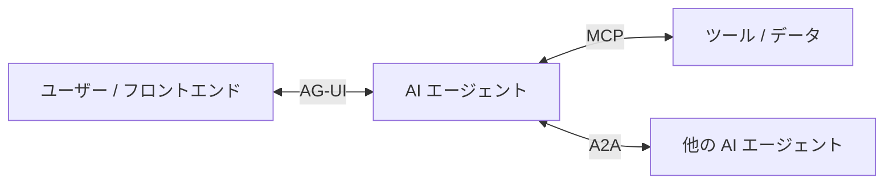

MCP がエージェントと外部ツールの接続を、A2A がエージェント同士の協調を標準化するのに対し、AG-UI はエージェントとユーザー向けアプリケーションの接続を標準化する。3 つを組み合わせると、エージェントがアクセスするツールやデータ、協力する他のエージェント、結果を届けるユーザーとの接続を、すべて標準プロトコルで扱える。

### AG-UI がない世界

AG-UI がなければ、フロントエンド開発者は次の作業をフレームワークやアプリケーションごとに繰り返すことになる。

1. <strong>フレームワーク固有の接続コード</strong>: LangGraph を使うなら LangGraph 専用のクライアントを、CrewAI なら CrewAI 専用のコードを書く
2. <strong>ストリーミングの再発明</strong>: テキストの逐次表示、ツール呼び出しの可視化、状態の同期をフレームワークごとに実装する
3. <strong>Human-in-the-Loop の再発明</strong>: ユーザー承認フローをアプリケーションごとに設計する

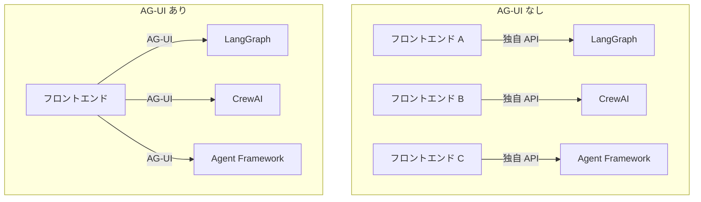

AG-UI を使えば、フロントエンドは 1 つのプロトコルを実装するだけで、AG-UI に対応したどのエージェントバックエンドとも通信できる。バックエンドも AG-UI イベントを送出すれば、AG-UI を実装したどのフロントエンドからも使える。

---

## AG-UI の設計原則

### 1. イベント駆動通信

エージェントは実行中に標準化された型のイベントを送出し、クライアントはそのストリームを順に処理する。REST のように 1 回のレスポンスで完了するのではなく、実行が終わるまでイベントが届き続ける。

### 2. 双方向インタラクション

エージェントはユーザーからの入力を受け取れるので、AI と人間が協調するワークフローを組める。

### 3. トランスポート非依存

AG-UI はイベントの配信方法を規定しない。SSE（Server-Sent Events）、WebSocket、Webhook など、アーキテクチャに合ったトランスポートを選択できる。

### 4. 柔軟なイベント構造

イベントは AG-UI のフォーマットに完全に一致しなくても、AG-UI 互換であればよい。そのため既存のエージェントフレームワークは、独自のイベント形式を少ない変更で AG-UI に合わせられる。

---

## アーキテクチャ概観

AG-UI はクライアント・サーバー型のアーキテクチャをとる。

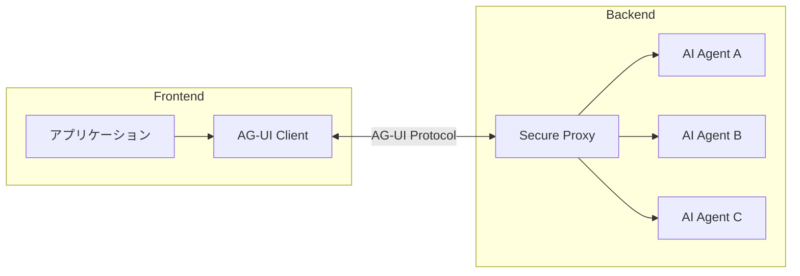

| コンポーネント | 役割 |
|--------------|------|
| Application | ユーザー対面のアプリケーション（チャット UI、AI 搭載アプリなど） |
| AG-UI Client | `HttpAgent` などの汎用通信クライアント |
| Secure Proxy | 追加機能を提供し、セキュアなプロキシーとして機能するバックエンドサービス |
| Agents | リクエストを処理し、ストリーミングレスポンスを生成する AI エージェント |

### プロトコル層

プロトコル層の中心にあるのは、エージェントを実行するとイベントのストリームが返る、という単純な抽象化だ。

```typescript
// AG-UI の核心的な抽象化
type RunAgent = () => Observable<BaseEvent>

class MyAgent extends AbstractAgent {
  run(input: RunAgentInput): RunAgent {
    const { threadId, runId } = input
    return () =>
      from([
        { type: EventType.RUN_STARTED, threadId, runId },
        {
          type: EventType.MESSAGES_SNAPSHOT,
          messages: [
            { id: "msg_1", role: "assistant", content: "Hello!" }
          ],
        },
        { type: EventType.RUN_FINISHED, threadId, runId },
      ])
  }
}
```

`run()` メソッドは `RunAgentInput` を受け取り、`Observable<BaseEvent>` を返す関数を返す。すべての通信はこの `BaseEvent` のストリームとして表現される。

### 標準 HTTP クライアント

AG-UI は `HttpAgent` という標準 HTTP クライアントを提供する。任意のエンドポイントに POST リクエストを送り、`BaseEvent` のストリームを受信する。

```typescript
import { HttpAgent, type AgentSubscriber } from "@ag-ui/client"
import { EventType } from "@ag-ui/core"

const agent = new HttpAgent({
  url: "https://your-agent-endpoint.com/agent",
  agentId: "my-agent",
  threadId: "conversation-123",
})

const subscriber: AgentSubscriber = {
  onEvent: ({ event }) => {
    switch(event.type) {
      case EventType.TEXT_MESSAGE_CONTENT:
        // テキストを UI に表示
        break
      case EventType.TOOL_CALL_START:
        // ツール呼び出しの開始を表示
        break
    }
  },
  onRunFailed: ({ error }) => console.error("Agent error:", error),
  onRunFinalized: () => console.log("Run complete")
}

await agent.runAgent({
  tools: [...],
  context: [...]
}, subscriber)
```

`HttpAgent` が対応するトランスポートは次の 2 つだ。

| トランスポート | 特徴 |
|--------------|------|
| HTTP SSE | テキストベースのストリーミング。デバッグが容易 |
| HTTP Binary Protocol | 高性能・省スペースなバイナリーシリアライゼーション |

---

## イベントシステム ─ 通信の基本単位

AG-UI の通信はすべて型付きイベントで行われ、各イベントは `BaseEvent` を継承する。

```typescript
interface BaseEvent {
  type: EventType       // イベントタイプの識別子
  timestamp?: number    // イベント生成時刻（オプション）
  rawEvent?: any        // 変換元の生イベントデータ（オプション）
  metadata?: Record<string, any> // 追加イベントメタデータ（オプション）
}
```

イベントは目的別に 8 つのカテゴリーに分類される。

| カテゴリー | 目的 | イベント例 |
|---------|------|----------|
| Lifecycle Events | エージェント実行の進行を監視 | `RUN_STARTED`, `RUN_FINISHED`, `RUN_ERROR` |
| Text Message Events | ストリーミングテキストコンテンツ | `TEXT_MESSAGE_START`, `TEXT_MESSAGE_CONTENT`, `TEXT_MESSAGE_END` |
| Tool Call Events | ツール実行の管理 | `TOOL_CALL_START`, `TOOL_CALL_ARGS`, `TOOL_CALL_END`, `TOOL_CALL_RESULT` |
| State Management Events | エージェントと UI 間の状態同期 | `STATE_SNAPSHOT`, `STATE_DELTA`, `MESSAGES_SNAPSHOT` |
| Activity Events | 進行中のアクティビティーの進捗 | `ACTIVITY_SNAPSHOT`, `ACTIVITY_DELTA` |
| Reasoning Events | 推論プロセスの可視化 | `REASONING_START`, `REASONING_MESSAGE_CONTENT`, `REASONING_END` |
| Subagent Events | ネストしたエージェント実行の追跡 | `SUBAGENT_STARTED`, `SUBAGENT_FINISHED`, `SUBAGENT_ERROR` |
| Special Events | カスタム機能 | `RAW`, `CUSTOM` |

### Lifecycle Events ─ 実行の境界

Lifecycle Events は、1 回のエージェント実行の開始、途中のステップ、終了を表す。典型的な流れは次のとおりだ。

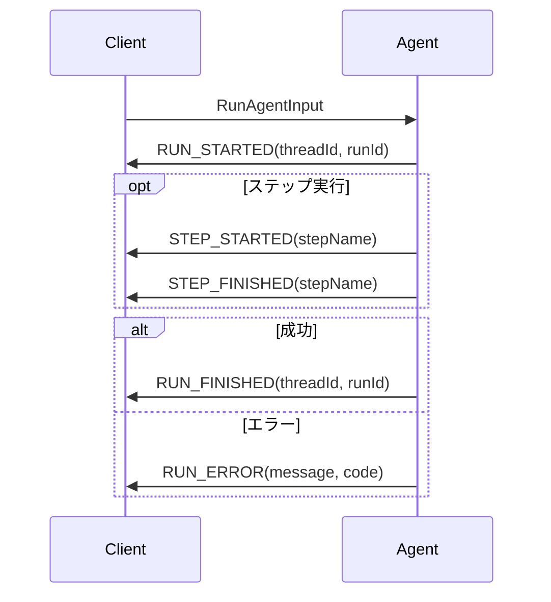

| イベント | 必須 | 説明 |
|---------|------|------|
| `RUN_STARTED` | 常に必須 | 実行の開始。`threadId` と `runId` で一意に識別。オプションで `parentRunId` を持ち、ブランチ/タイムトラベルをサポート |
| `RUN_FINISHED` | 成功時に必須 | 正常完了。オプションの `result` フィールドで結果データを返せる |
| `RUN_ERROR` | エラー時に必須 | エラーによる実行中断。`message` と `code` でエラー情報を提供 |
| `STEP_STARTED` | 任意 | サブタスクやフェーズの開始。エージェントの進捗をきめ細かく追跡 |
| `STEP_FINISHED` | 任意 | サブタスクの完了。`STEP_STARTED` とペアで使用 |

`RUN_STARTED` と `RUN_FINISHED`（または `RUN_ERROR`）が実行の境界を示し、その間に任意の数のステップイベントが入る。

### Text Message Events ─ ストリーミングテキスト

テキストメッセージは、全体の生成を待たずに、生成されたチャンクから順に送られる。

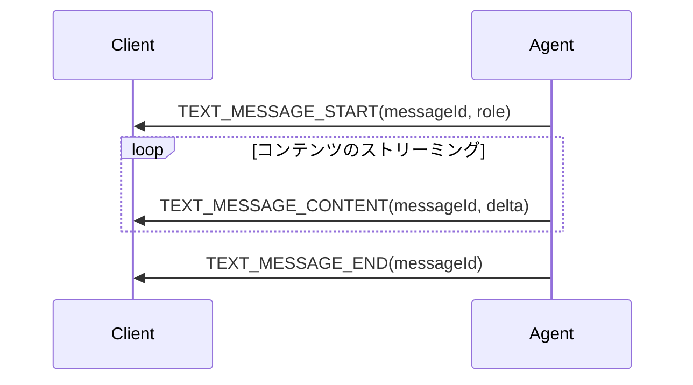

| イベント | 説明 |
|---------|------|
| `TEXT_MESSAGE_START` | メッセージの初期化。`messageId` と `role`（developer, system, assistant, user, tool）を設定 |
| `TEXT_MESSAGE_CONTENT` | テキストチャンク。`delta` プロパティーに含まれるテキストを前のチャンクに追記 |
| `TEXT_MESSAGE_END` | メッセージの完了。UI はローディング表示を解除し、レンダリングを確定 |

便利イベントの `TEXT_MESSAGE_CHUNK` は、Start → Content → End に自動展開される。最初のチャンクに `messageId` を含めると `TEXT_MESSAGE_START` が暗黙的に発行され、ストリームが新しいメッセージ ID に切り替わるか完了した時点で `TEXT_MESSAGE_END` が自動発行される。

### Tool Call Events ─ ツール呼び出しの可視化

ツール呼び出しも、テキストメッセージと同じ形でストリーミングされる。

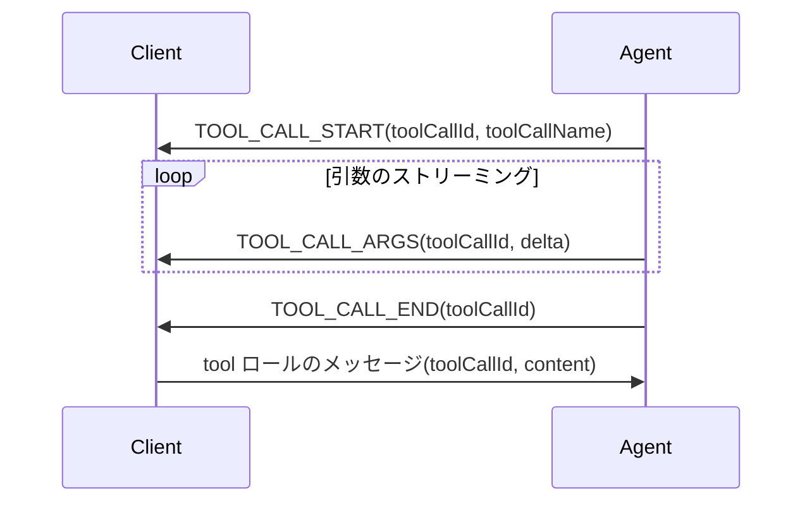

AG-UI では、<strong>フロントエンドで定義したツールを、実行時にエージェントに渡せる</strong>。そのため、次のような Human-in-the-Loop ワークフローを組める。

1. エージェントがツール呼び出しを要求する（TOOL_CALL_START → TOOL_CALL_ARGS → TOOL_CALL_END）
2. フロントエンドがツールを実行する（ユーザーの判断を含む場合もある）
3. 結果を tool ロールのメッセージとしてエージェントに返す
4. エージェントが結果を踏まえて推論を続ける

バックエンドで実行したツールの結果は、エージェントが `TOOL_CALL_RESULT` イベントでクライアントに送る。

ツール呼び出しにも、`TEXT_MESSAGE_CHUNK` に相当する便利イベント `TOOL_CALL_CHUNK` がある。最初のチャンクに `toolCallId` と `toolCallName` を含めると `TOOL_CALL_START` が暗黙的に発行され、ストリームが新しい `toolCallId` に切り替わるか完了した時点で `TOOL_CALL_END` が自動発行される。

### State Management Events ─ 効率的な状態同期

状態管理は、状態全体を送るスナップショットと差分だけを送るデルタを組み合わせる「スナップショット - デルタパターン」に従う。

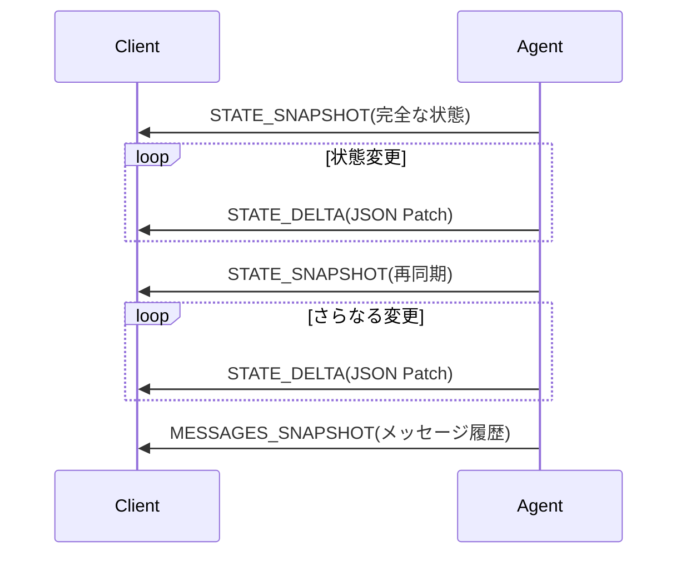

| イベント | 説明 |
|---------|------|
| `STATE_SNAPSHOT` | 完全な状態のスナップショット。初回や再同期時に送信 |
| `STATE_DELTA` | JSON Patch（RFC 6902）による差分更新。帯域効率が高い |
| `MESSAGES_SNAPSHOT` | 会話メッセージの完全な履歴。チャット表示の初期化や再同期に使用 |

スナップショットはクライアントの状態全体をそろえる同期点になり、その間の変更はデルタで差分だけを送る。こうして、状態全体の正しさを保ちながら通信量を抑える。

### イベントフローパターン

ここまでのイベントは、送り方によって 3 つのパターンに分けられる。

| パターン | 用途 | 例 |
|---------|------|-----|
| Start-Content-End | ストリーミングコンテンツ | TextMessage, ToolCall |
| Snapshot-Delta | 状態同期 | STATE_SNAPSHOT + STATE_DELTA |
| Lifecycle | 実行監視 | RUN_STARTED → RUN_FINISHED |

---

## Reasoning Events ─ 推論プロセスの可視化

Reasoning Events は、モデルが提供する推論サマリーやメタデータを UI に表示するためのイベントだ。非公開の生の Chain-of-Thought をユーザーに見せる仕組みではない。

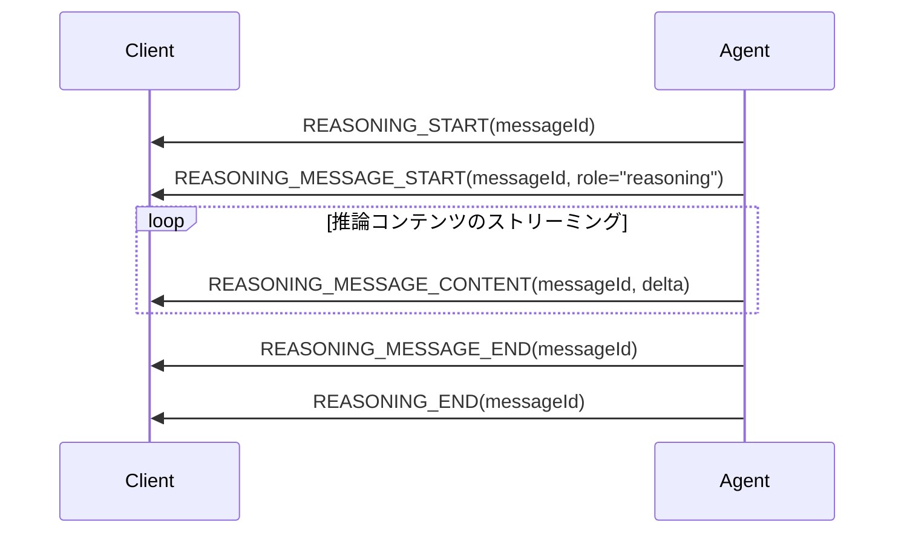

`REASONING_ENCRYPTED_VALUE` イベントは、暗号化された推論状態をターン間で引き継ぐ。この値はモデル／プロバイダー向けの不透明な継続トークンで、クライアントは保存して転送するだけで、内容を読んだり表示したりできない。そのため、非公開の Chain-of-Thought を露出せずに推論の継続性を保てる。

| イベント | 説明 |
|---------|------|
| `REASONING_START` | 推論プロセスの開始 |
| `REASONING_MESSAGE_START` | 推論メッセージの開始（可視部分） |
| `REASONING_MESSAGE_CONTENT` | 推論コンテンツのチャンク |
| `REASONING_MESSAGE_END` | 推論メッセージの完了 |
| `REASONING_MESSAGE_CHUNK` | Start/End を自動展開する便利イベント |
| `REASONING_END` | 推論プロセスの完了 |
| `REASONING_ENCRYPTED_VALUE` | 不透明な暗号化済み推論継続値 |

---

## ミドルウェア ─ イベントストリームのインターセプト

AG-UI のミドルウェアは、エージェントとイベントを受け取る側の間に入り、イベントストリームを変換したり、絞り込んだり、情報を付け加えたりする。

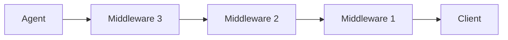

ミドルウェアは追加した順に実行され、各ミドルウェアが次のミドルウェアをラップする。エージェントが返したイベントは、逆の順にミドルウェアを通ってクライアントに届く。

```text
→ middleware1
  → middleware2
    → middleware3
      → agent.run()
    ← events flow back through middleware3
  ← events flow back through middleware2
← events flow back through middleware1
```

### 関数ベースミドルウェア

単純な変換なら、ミドルウェアを関数として書ける。

```typescript
import { MiddlewareFunction } from "@ag-ui/client"
import { EventType } from "@ag-ui/core"

// テキストメッセージにプレフィックスを付加するミドルウェア
const prefixMiddleware: MiddlewareFunction = (input, next) => {
  return next.run(input).pipe(
    map(event => {
      if (
        event.type === EventType.TEXT_MESSAGE_CHUNK ||
        event.type === EventType.TEXT_MESSAGE_CONTENT
      ) {
        return { ...event, delta: `[AI]: ${event.delta}` }
      }
      return event
    })
  )
}

agent.use(prefixMiddleware)
```

### クラスベースミドルウェア

ミドルウェア自身に状態や設定を持たせる場合は、クラスとして実装する。

```typescript
import { Middleware } from "@ag-ui/client"

class MetricsMiddleware extends Middleware {
  private eventCount = 0

  run(input: RunAgentInput, next: AbstractAgent): Observable<BaseEvent> {
    const startTime = Date.now()
    return this.runNext(input, next).pipe(
      tap(event => {
        this.eventCount++
        this.metricsService.recordEvent(event.type)
      }),
      finalize(() => {
        this.metricsService.recordDuration(Date.now() - startTime)
      })
    )
  }
}
```

### 組み込みミドルウェア

組み込みミドルウェアには、許可リストやブロックリストでツール呼び出しを絞り込む `FilterToolCallsMiddleware` などがある。

```typescript
import { FilterToolCallsMiddleware } from "@ag-ui/client"

// 許可リスト
const filter = new FilterToolCallsMiddleware({
  allowedToolCalls: ["search", "calculate"]
})

// ブロックリスト
const blocker = new FilterToolCallsMiddleware({
  disallowedToolCalls: ["delete", "modify"]
})

agent.use(filter)
```

---

## エージェントの能力

AG-UI のエージェントは `AbstractAgent` を拡張して実装し、次の能力を持てる。

### 双方向コミュニケーション

エージェントはイベントストリームを通じて、フロントエンドと双方向にやり取りする。応答のリアルタイムなストリーミング、即時のフィードバック、長時間かかる処理の進捗表示、構造化データの受け渡しに使える。

### マルチエージェント協調

エージェントは他のエージェントにタスクを委任できる。複数のエージェントでワークフローを組み、エージェント間で状態やコンテキストを受け渡せる。担当するエージェントが切り替わっても、フロントエンドはその切り替えを意識せずに扱える。

### Human-in-the-Loop

エージェントは特定の判断でユーザーに入力を求め、実行を一時停止し、人間のフィードバックを受けてから再開できる。AI の効率と人間の判断を組み合わせたワークフローを作れる。

### 会話メモリー

エージェントは会話メッセージの履歴をすべて保持し、過去のやり取りを以降の応答に反映する。メッセージ履歴はクライアントとサーバーの間で同期される。

---

## Microsoft Agent Framework による AG-UI の実装

ここからは、これまでに説明したイベントと機能を Microsoft Agent Framework で実装する。

### agent-framework-ag-ui パッケージ

Microsoft Agent Framework は、AG-UI 対応をファーストパーティーの `agent-framework-ag-ui` パッケージとして提供している。このパッケージは、Agent Framework のイベントを AG-UI のイベントに変換する。

```text
pip install agent-framework-ag-ui
```

#### アーキテクチャ

パッケージは次のコンポーネントで構成される。

| コンポーネント | 役割 |
|--------------|------|
| AgentFrameworkAgent | Agent Framework のエージェントをラップし、AG-UI 互換にする軽量ラッパー |
| Orchestrators | デフォルト、Human-in-the-Loop など異なる実行フローを処理 |
| AgentFrameworkEventBridge | Agent Framework のイベントを AG-UI イベントに変換 |
| Message Adapters | AG-UI と Agent Framework のメッセージフォーマットを相互変換 |
| FastAPI Endpoint | SSE（Server-Sent Events）によるストリーミング HTTP エンドポイント |

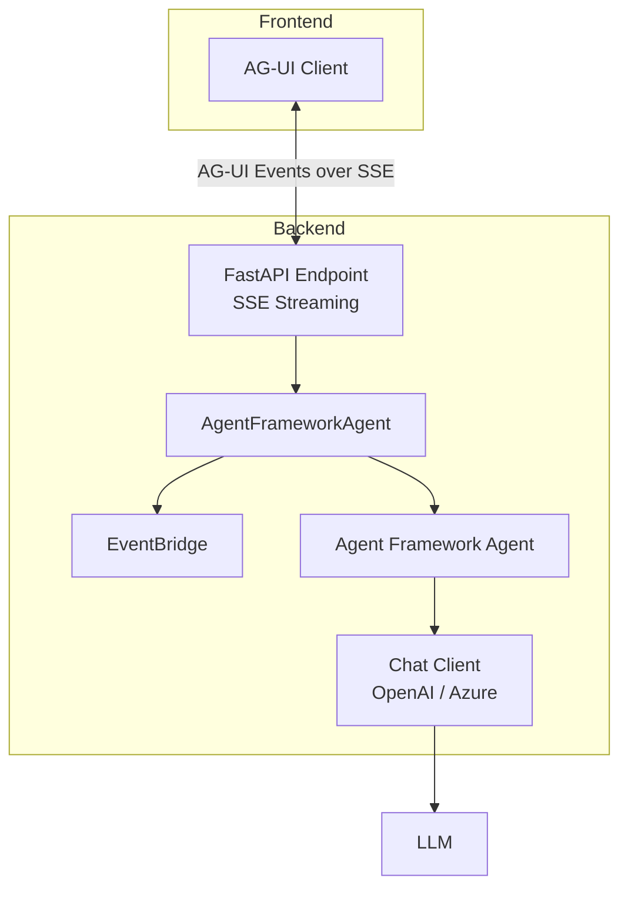

### Feature 1: Agentic Chat ─ 基本的な会話エージェント

Agentic Chat は、ストリーミングチャットとツール呼び出しに対応した基本的な会話エージェントだ。

```python
# simple_agent.py
from typing import Any
from agent_framework import Agent, SupportsChatGetResponse


def simple_agent(client: SupportsChatGetResponse[Any]) -> Agent[Any]:
    """シンプルなチャットエージェントを作成する。"""
    return Agent[Any](
        name="simple_chat_agent",
        instructions="You are a helpful assistant. Be concise and friendly.",
        client=client,
    )
```

Agent Framework の `Agent` は、名前、指示文、チャットクライアントを渡すだけで動く。AG-UI エンドポイントとして公開するには `add_agent_framework_fastapi_endpoint` を使う。

```python
# server.py
from fastapi import FastAPI
from agent_framework.openai import OpenAIChatCompletionClient
from agent_framework.ag_ui import add_agent_framework_fastapi_endpoint
from agents.simple_agent import simple_agent

app = FastAPI(title="AG-UI Demo Server")

# チャットクライアントを作成
chat_client = OpenAIChatCompletionClient(model="gpt-4o")

# AG-UI エンドポイントとして登録（ローカル・単一ユーザー用）
add_agent_framework_fastapi_endpoint(
    app, simple_agent(chat_client), "/agentic_chat", single_user=True
)
```

登録時には、認可スコープの決め方として `authorization_scope_resolver` か `single_user=True` のどちらかを指定する。どちらもないと `ValueError` になる（[agent-framework の `_endpoint.py`](https://github.com/microsoft/agent-framework/blob/main/python/packages/ag-ui/agent_framework_ag_ui/_endpoint.py)）。この記事の例はローカルで試す前提なので `single_user=True` とする。複数の利用者が使う場合は「セキュリティーの考慮事項」で扱う。

`add_agent_framework_fastapi_endpoint` は次の処理を行う。

1. FastAPI ルートに POST エンドポイントを登録する
2. AG-UI クライアントからの `RunAgentInput` を受信する
3. Agent Framework のエージェントを実行する
4. `AgentFrameworkEventBridge` を通じてイベントを AG-UI 形式に変換する
5. SSE（Server-Sent Events）としてストリーミング返却する

このエンドポイントにリクエストを送ると、たとえば次のような AG-UI イベントが返る。

```text
→ RUN_STARTED(threadId, runId)
  → TEXT_MESSAGE_START(messageId, role="assistant")
    → TEXT_MESSAGE_CONTENT(messageId, delta="こん")
    → TEXT_MESSAGE_CONTENT(messageId, delta="にちは")
    → TEXT_MESSAGE_CONTENT(messageId, delta="！")
  → TEXT_MESSAGE_END(messageId)
→ RUN_FINISHED(threadId, runId)
```

### Feature 2: Backend Tool Rendering ─ ツール実行と結果のストリーミング

Backend Tool Rendering では、ツールをバックエンドで実行し、その結果をクライアントにストリーミングする。

```python
# weather_agent.py
from typing import Any
from agent_framework import Agent, SupportsChatGetResponse, tool


@tool
def get_weather(location: str) -> dict[str, Any]:
    """指定された場所の現在の天気を取得する。

    Args:
        location: 天気を取得する都市名

    Returns:
        温度、天候、湿度などを含む辞書
    """
    weather_data = {
        "tokyo": {
            "temperature": 22,
            "conditions": "sunny",
            "humidity": 55,
            "wind_speed": 8,
        },
        "osaka": {
            "temperature": 24,
            "conditions": "partly cloudy",
            "humidity": 60,
            "wind_speed": 6,
        },
    }
    location_lower = location.lower()
    if location_lower in weather_data:
        return weather_data[location_lower]
    return {"temperature": 21, "conditions": "unknown", "humidity": 50, "wind_speed": 10}


@tool
def get_forecast(location: str, days: int = 3) -> str:
    """指定された場所の天気予報を取得する。

    Args:
        location: 天気予報を取得する都市名
        days: 予報日数（デフォルト: 3）

    Returns:
        天気予報の文字列
    """
    forecast: list[str] = []
    for day in range(1, min(days, 7) + 1):
        forecast.append(f"Day {day}: Partly cloudy, {20 + day}°C")
    return f"{days}-day forecast for {location}:\n" + "\n".join(forecast)


def weather_agent(client: SupportsChatGetResponse[Any]) -> Agent[Any]:
    """天気エージェントを作成する。"""
    return Agent[Any](
        name="weather_agent",
        instructions=(
            "You are a helpful weather assistant. "
            "Use the get_weather and get_forecast functions to help users. "
            "Always provide friendly and informative responses."
        ),
        client=client,
        tools=[get_weather, get_forecast],
    )
```

関数に `@tool` デコレーターを付けると、Agent Framework がツールスキーマを自動生成して LLM に渡す。エージェントがツールを呼び出すと、次の AG-UI イベントが流れる。

```text
→ RUN_STARTED
  → TOOL_CALL_START(toolCallId, toolCallName="get_weather")
    → TOOL_CALL_ARGS(toolCallId, delta='{"location":')
    → TOOL_CALL_ARGS(toolCallId, delta=' "Tokyo"}')
  → TOOL_CALL_END(toolCallId)
  → TOOL_CALL_RESULT(toolCallId, content='{"temperature": 22, ...}')
  → TEXT_MESSAGE_START(messageId, role="assistant")
    → TEXT_MESSAGE_CONTENT(messageId, delta="東京の現在の天気は...")
  → TEXT_MESSAGE_END(messageId)
→ RUN_FINISHED
```

フロントエンドは `TOOL_CALL_START` を受け取った時点でローディングスピナーなどの実行中表示を出し、`TOOL_CALL_RESULT` で結果を表示できる。どれも標準化されたイベントなので、この表示処理はバックエンドのフレームワークに依存しない。

### Feature 3: Human-in-the-Loop ─ ユーザー承認フロー

Human-in-the-Loop を使うと、エージェントはツールを実行する前にユーザーの承認を得られる。

```python
# human_in_the_loop_agent.py
from typing import Any
from agent_framework import Agent, SupportsChatGetResponse, tool


@tool(approval_mode="always_require")
def delete_file(filename: str) -> str:
    """ファイルを削除する（承認が必要）。

    Args:
        filename: 削除するファイル名

    Returns:
        削除結果のメッセージ
    """
    return f"File '{filename}' has been deleted."


@tool(approval_mode="always_require")
def send_email(to: str, subject: str, body: str) -> str:
    """メールを送信する（承認が必要）。

    Args:
        to: 宛先
        subject: 件名
        body: 本文

    Returns:
        送信結果のメッセージ
    """
    return f"Email sent to {to} with subject '{subject}'."


def human_in_the_loop_agent(
    client: SupportsChatGetResponse[Any],
) -> Agent[Any]:
    """Human-in-the-Loop エージェントを作成する。"""
    return Agent[Any](
        name="hitl_agent",
        instructions=(
            "You are a helpful assistant that can delete files and send emails. "
            "Always confirm with the user before performing these actions."
        ),
        client=client,
        tools=[delete_file, send_email],
    )
```

`@tool(approval_mode="always_require")` を指定したツールは、実行前に必ずユーザーの承認を求める。イベントの流れは次のとおりだ。

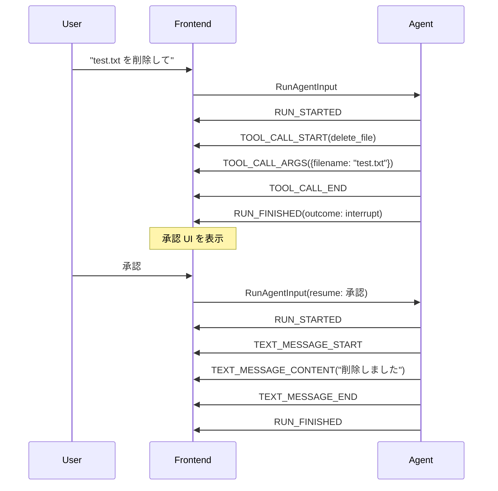

承認が必要なツールを呼ぶと、実行はいったん `RUN_FINISHED` で終わり、その `outcome` に承認待ちの中断（interrupt）が入る。フロントエンドは同じスレッドで、承認か拒否を `resume` に載せて実行を再開する。承認されればツールを実行し、拒否されれば実行しない（[Microsoft Learn: Human-in-the-Loop with AG-UI](https://learn.microsoft.com/agent-framework/integrations/by-component/ui/ag-ui/human-in-the-loop)）。中断と再開も AG-UI のプロトコルの型で表されるので、フロントエンドは汎用的な承認 UI を一度実装すれば、AG-UI に対応したほかのエージェントでも使い回せる。

### Feature 4: Shared State ─ 双方向の状態同期

Shared State は、エージェントとフロントエンドの間で構造化された状態を双方向に同期する。

```python
# recipe_agent.py
from typing import Any
from agent_framework import Agent, SupportsChatGetResponse, tool
from agent_framework.ag_ui import AgentFrameworkAgent


@tool
def update_recipe(recipe_data: dict[str, Any]) -> str:
    """レシピ情報を更新する。

    Args:
        recipe_data: レシピの情報（name, ingredients など）

    Returns:
        更新結果のメッセージ
    """
    return f"Recipe '{recipe_data.get('name', 'Unknown')}' has been updated."


def recipe_agent(client: SupportsChatGetResponse[Any]) -> AgentFrameworkAgent:
    """レシピ管理エージェントを作成する。"""
    agent = Agent[Any](
        name="recipe_agent",
        instructions=(
            "You are a recipe assistant. Help users create and modify recipes. "
            "Use the update_recipe tool to save changes."
        ),
        client=client,
        tools=[update_recipe],
    )

    # 状態スキーマを定義
    state_schema = {
        "recipe": {
            "type": "object",
            "properties": {
                "name": {"type": "string"},
                "ingredients": {"type": "array"},
                "instructions": {"type": "array"},
            },
        }
    }

    return AgentFrameworkAgent(
        agent=agent,
        state_schema=state_schema,
        name="RecipeAgent",
        description="A recipe management agent with shared state",
    )
```

`state_schema` で、フロントエンドと共有する状態の構造を定義する。エージェントが `update_recipe` ツールを呼び出すと状態が更新され、`STATE_DELTA` イベントがフロントエンドに送られる。

### Feature 5: Predictive State Updates ─ 楽観的な状態更新

Predictive State Updates は、LLM が生成している途中のツール引数を、リアルタイムで状態に反映する機能だ。

```python
# document_writer_agent.py
from typing import Any
from agent_framework import Agent, SupportsChatGetResponse, tool
from agent_framework.ag_ui import AgentFrameworkAgent


@tool
def write_document(title: str, content: str) -> str:
    """ドキュメントを作成する。

    Args:
        title: ドキュメントのタイトル
        content: ドキュメントの内容

    Returns:
        作成結果のメッセージ
    """
    return f"Document '{title}' has been created."


def document_writer_agent(
    client: SupportsChatGetResponse[Any],
) -> AgentFrameworkAgent:
    """ドキュメント作成エージェントを作成する。"""
    agent = Agent[Any](
        name="document_writer",
        instructions="You are a document writer. Create documents based on user requests.",
        client=client,
        tools=[write_document],
    )

    # Predictive State の設定
    predict_state_config = {
        "current_title": {"tool": "write_document", "tool_argument": "title"},
        "current_content": {"tool": "write_document", "tool_argument": "content"},
    }

    return AgentFrameworkAgent(
        agent=agent,
        state_schema={
            "current_title": {"type": "string"},
            "current_content": {"type": "string"},
        },
        predict_state_config=predict_state_config,
        require_confirmation=True,
    )
```

`predict_state_config` は、どのツールのどの引数をどの状態フィールドに対応させるかを定義する。LLM がツール引数をストリーミングで生成すると、届いたチャンクがその都度、対応する状態フィールドに反映される。

```text
→ RUN_STARTED
  → TOOL_CALL_START(write_document)
    → TOOL_CALL_ARGS(delta='{"title": "AG-')
      → STATE_DELTA(op: replace, path: /current_title, value: "AG-")
    → TOOL_CALL_ARGS(delta='UI Guide"')
      → STATE_DELTA(op: replace, path: /current_title, value: "AG-UI Guide")
    → TOOL_CALL_ARGS(delta=', "content": "AG-UI is...')
      → STATE_DELTA(op: replace, path: /current_content, value: "AG-UI is...")
  → TOOL_CALL_END
→ RUN_FINISHED
```

ユーザーは、ツールの実行完了を待たずに、ドキュメントが書かれていく様子を見られる。

### Feature 6: Workflow の AG-UI 統合

Agent Framework のワークフロー（グラフベースのマルチステップ実行エンジン）も AG-UI エンドポイントとして公開できる。

```python
from fastapi import FastAPI
from agent_framework import WorkflowBuilder, WorkflowContext, executor
from agent_framework.ag_ui import add_agent_framework_fastapi_endpoint


@executor(id="start")
async def start(message: str, ctx: WorkflowContext) -> None:
    """ワークフローの開始ステップ。"""
    await ctx.yield_output(f"Workflow received: {message}")


@executor(id="analyze")
async def analyze(data: str, ctx: WorkflowContext) -> None:
    """分析ステップ。"""
    result = f"Analysis of '{data}': positive sentiment detected."
    await ctx.yield_output(result)


workflow = (
    WorkflowBuilder(start_executor=start)
    .add_executor(analyze)
    .add_edge("start", "analyze")
    .build()
)

app = FastAPI()
add_agent_framework_fastapi_endpoint(app, workflow, "/workflow", single_user=True)
```

ワークフローのイベント（run/step/activity/tool/custom）は、対応する AG-UI イベントに自動的に変換される。

### 1 つのサーバーへの統合

Feature 1〜5 のエージェントを 1 つのサーバーにまとめると、次のようになる。

```python
"""AG-UI Demo Server — 全機能統合"""
import os
from fastapi import FastAPI
from agent_framework.openai import OpenAIChatCompletionClient
from agent_framework.ag_ui import add_agent_framework_fastapi_endpoint

# エージェントのインポート
from agents.simple_agent import simple_agent
from agents.weather_agent import weather_agent
from agents.human_in_the_loop_agent import human_in_the_loop_agent
from agents.recipe_agent import recipe_agent
from agents.document_writer_agent import document_writer_agent

app = FastAPI(title="AG-UI Demo Server")

# 共有チャットクライアント
chat_client = OpenAIChatCompletionClient(
    model=os.getenv("OPENAI_CHAT_MODEL", "gpt-4o"),
    api_key=os.getenv("OPENAI_API_KEY"),
)

# 各機能のエンドポイントを登録
add_agent_framework_fastapi_endpoint(
    app, simple_agent(chat_client), "/agentic_chat",
    single_user=True,
)
add_agent_framework_fastapi_endpoint(
    app, weather_agent(chat_client), "/backend_tool_rendering",
    single_user=True,
)
add_agent_framework_fastapi_endpoint(
    app, human_in_the_loop_agent(chat_client), "/human_in_the_loop",
    single_user=True,
)
add_agent_framework_fastapi_endpoint(
    app, recipe_agent(chat_client), "/shared_state",
    single_user=True,
)
add_agent_framework_fastapi_endpoint(
    app, document_writer_agent(chat_client), "/predictive_state_updates",
    single_user=True,
)

if __name__ == "__main__":
    import uvicorn
    uvicorn.run(app, host="0.0.0.0", port=8888)
```

### AG-UI クライアントからの接続

Python から AG-UI サーバーに接続するには、`AGUIChatClient` を使う。

```python
import asyncio
from agent_framework.ag_ui import AGUIChatClient


async def main():
    async with AGUIChatClient(endpoint="http://localhost:8888/agentic_chat") as client:
        # ストリーミングレスポンス
        async for update in client.get_response("Hello!", stream=True):
            for content in update.contents:
                if content.type == "text" and content.text:
                    print(content.text, end="", flush=True)
        print()


asyncio.run(main())
```

`AGUIChatClient` は、ストリーミング／非ストリーミングのレスポンス、クライアント側とサーバー側を組み合わせたハイブリッドなツール実行、スレッドの自動管理に対応している。

---

## セキュリティーの考慮事項

AG-UI エンドポイントは、デフォルトでは認証を強制しない。本番環境では、FastAPI の依存性注入を使って認証を追加する必要がある。

```python
import os
from fastapi import Depends, FastAPI, HTTPException, Security
from fastapi.security import APIKeyHeader
from agent_framework import Agent
from agent_framework.ag_ui import add_agent_framework_fastapi_endpoint

# API キー認証の設定
API_KEY_HEADER = APIKeyHeader(name="X-API-Key", auto_error=False)
EXPECTED_API_KEY = os.environ.get("AG_UI_API_KEY")


async def verify_api_key(
    api_key: str | None = Security(API_KEY_HEADER),
) -> None:
    """リクエストヘッダの API キーを検証する。"""
    if not api_key or api_key != EXPECTED_API_KEY:
        raise HTTPException(status_code=401, detail="Invalid or missing API key")


app = FastAPI()

# エージェントは前のセクションで作成済みと仮定
# agent = simple_agent(chat_client)

# 認証付きでエンドポイントを登録
# 1 つの API キーを共有する呼び出し元を 1 人の利用者として扱う
add_agent_framework_fastapi_endpoint(
    app,
    agent,
    "/",
    dependencies=[Depends(verify_api_key)],
    single_user=True,
)
```

`dependencies` には任意の FastAPI 依存性を渡せるので、API キーの代わりに OAuth 2.0、JWT、Azure AD / Entra ID による認証を組み込んだり、レート制限を加えたりできる。ただし `dependencies` が担うのは認証だけで、認可スコープは決めない。利用者ごとに会話の状態や承認状態を分けるなら、`single_user=True` の代わりに、認証済みの利用者から認可スコープを返す `authorization_scope_resolver` を渡す。

---

## CopilotKit との連携

[CopilotKit](https://docs.copilotkit.ai/) は、React アプリケーションに AI コパイロット機能を組み込むフレームワークで、AG-UI にネイティブ対応した代表的なクライアントだ。

CopilotKit の `useCopilotAction` フックを使うと、AG-UI のフロントエンドツールを簡潔に定義できる。

```typescript
import { useCopilotAction } from "@copilotkit/react-core"

// フロントエンドでツールを定義
useCopilotAction({
  name: "confirmAction",
  description: "ユーザーにアクションの確認を求める",
  parameters: [
    { name: "action", type: "string", description: "確認するアクション" },
    { name: "importance", type: "string", enum: ["low", "medium", "high"] },
  ],
  handler: async ({ action, importance }) => {
    // ユーザーに確認ダイアログを表示
    const confirmed = await showConfirmDialog(action, importance)
    return confirmed ? "approved" : "rejected"
  },
})
```

ここで定義したツールはエージェントに渡され、エージェントがこのツールを呼び出すと、フロントエンドの `handler` が実行される。この往復は AG-UI が標準化しているので、バックエンドのフレームワークに合わせたコードは要らない。

---

## AG-UI が提供するビルディングブロック

AG-UI の公式ドキュメントに挙がっているビルディングブロックは次のとおりだ。

| ビルディングブロック | 説明 | 状態 |
|-------------------|------|------|
| Streaming Chat | リアルタイムトークン・イベントストリーミング | サポート済み |
| Multimodality | ファイル、画像、音声のアタッチメント | サポート済み |
| Generative UI（Static） | 型付きコンポーネントとしての出力レンダリング | サポート済み |
| Generative UI（Declarative） | 宣言的な UI 言語 | サポート済み |
| Shared State | 読み取り専用/読み書き可能な共有状態 | サポート済み |
| Thinking Steps | 中間的な推論プロセスの可視化 | サポート済み |
| Frontend Tool Calls | フロントエンド実行のツールハンドオフ | サポート済み |
| Backend Tool Rendering | バックエンドツール出力の可視化 | サポート済み |
| Interrupts（HITL） | 中断・承認・再試行 | サポート済み |
| Sub-agents | ネストされた委任 | サポート済み |
| Agent Steering | リアルタイム入力によるエージェント制御 | サポート済み |
| Tool Output Streaming | ツール結果のリアルタイムストリーミング | サポート済み |
| Custom Events | プロトコルでカバーされない独自データ交換 | サポート済み |

> <strong>追記（2026 年 8 月時点）</strong>：上の一覧は現行の公式ドキュメントと一致している。周辺のエコシステムには次の動きがあった。
>
> - <strong>生成 UI 仕様との併用</strong>。AG-UI は、Google の [A2UI](https://github.com/google/A2UI) や [MCP Apps](https://blog.modelcontextprotocol.io/posts/2025-11-21-mcp-apps/) といった生成 UI 仕様（generative UI spec）をサポートする。A2UI や MCP Apps は、エージェントが UI ウィジェットをどう記述するかの仕様だ。AG-UI は、フロントエンドとエージェントのバックエンドをどうつなぐかのプロトコルだ。扱う層が違うので、組み合わせて使える。
> - <strong>Microsoft Agent Framework の位置づけ</strong>。ファーストパーティーの統合として、サポート済みに分類されている。本記事の実装方針はそのまま使える。
> - <strong>Web 以外のクライアント</strong>。AG-UI はレンダリング先ではなくイベントストリームを規定するため、ターミナル、モバイル、Slack / Microsoft Teams などのチャットプラットフォームもクライアントになりうる。

---

## サポート対象のインテグレーション

AG-UI は CopilotKit から生まれたプロトコルで、現在は次のエージェントフレームワークが対応している。

### エージェントフレームワーク

| フレームワーク | 状態 |
|--------------|------|
| LangGraph | サポート済み |
| CrewAI | サポート済み |
| Microsoft Agent Framework | サポート済み |
| Google ADK | サポート済み |
| AWS Strands Agents | サポート済み |
| Mastra | サポート済み |
| Pydantic AI | サポート済み |
| Agno | サポート済み |
| LlamaIndex | サポート済み |
| AG2 | サポート済み |
| AWS Bedrock AgentCore | サポート済み |

### SDK

執筆時点では、TypeScript に加えて Kotlin、Go、Dart、Java、Rust の SDK がコミュニティー主導で開発されており、.NET と Nim の SDK は開発中だった。2026 年 8 月時点では、コミュニティー提供を含め、Kotlin、Go、Dart、Java、Rust、Ruby、C++、.NET の SDK がサポート済みになっている。

---

## まとめ ─ AG-UI の意義

AG-UI は、エージェントとユーザーの間という「最後の 1 マイル」の通信を標準化するプロトコルだ。

### 3 つのプロトコルの補完性

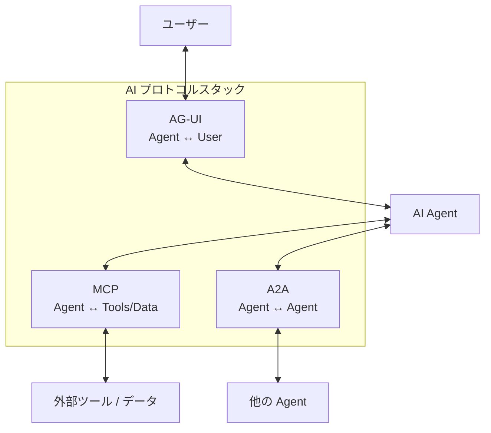

MCP がツールやデータとの接続、A2A が他のエージェントとの接続を受け持ち、AG-UI はユーザーとの接続を受け持つ。3 つがそろうと、エージェントの外部との接続をすべてオープンな標準プロトコルで扱える。

### AG-UI を使う利点

1. <strong>フレームワーク非依存</strong>: 1 つのプロトコルで、LangGraph、CrewAI、Microsoft Agent Framework、Google ADK など AG-UI に対応した各バックエンドと接続できる
2. <strong>リアルタイム性</strong>: テキスト、ツール呼び出し、状態の変化がイベントとして逐次届くので、エージェントの動作を実行中に表示できる
3. <strong>Human-in-the-Loop の標準化</strong>: ユーザー承認フローが標準プロトコルの一部として定義されている
4. <strong>状態同期</strong>: スナップショットとデルタの組み合わせで、エージェントとフロントエンドの状態を少ない通信量で双方向に同期できる
5. <strong>拡張性</strong>: ミドルウェア、カスタムイベント、カスタムオーケストレーターで拡張できる

Microsoft Agent Framework は `agent-framework-ag-ui` パッケージで、これらの機能をファーストパーティーとしてサポートしている。既存のエージェントは、`add_agent_framework_fastapi_endpoint` を 1 回呼べば AG-UI 互換のエンドポイントとして公開できる。
