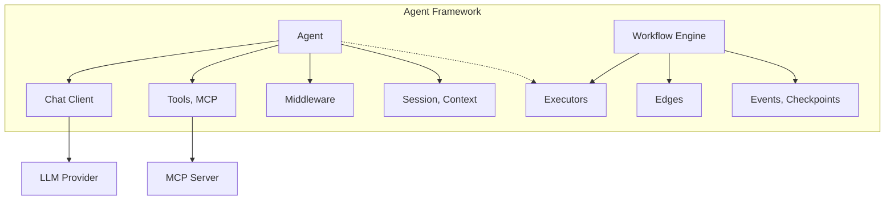
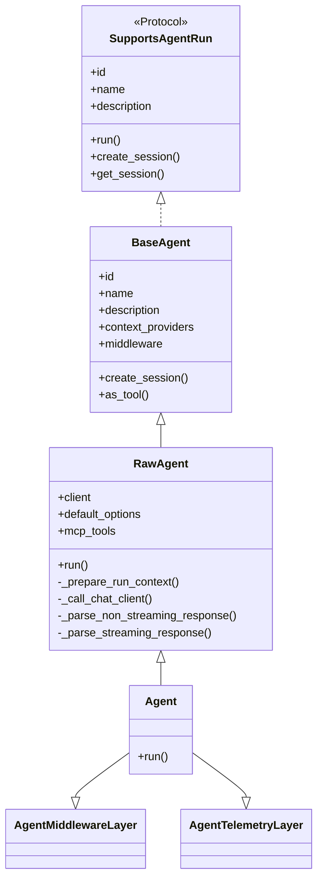
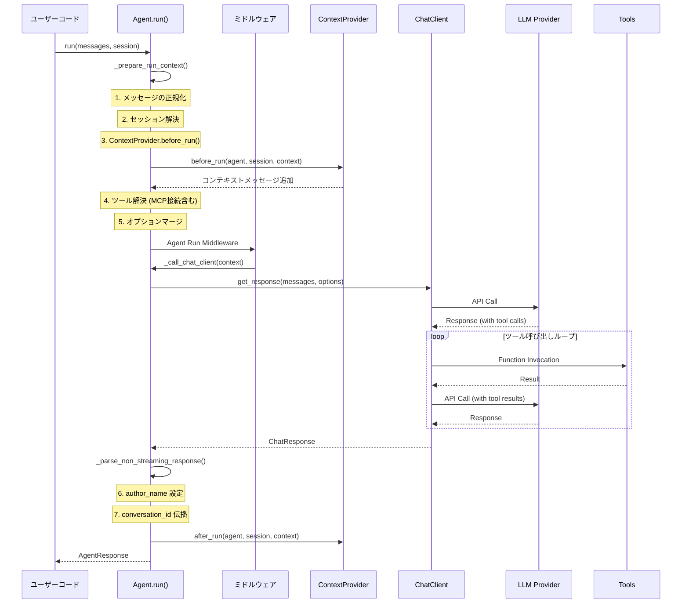
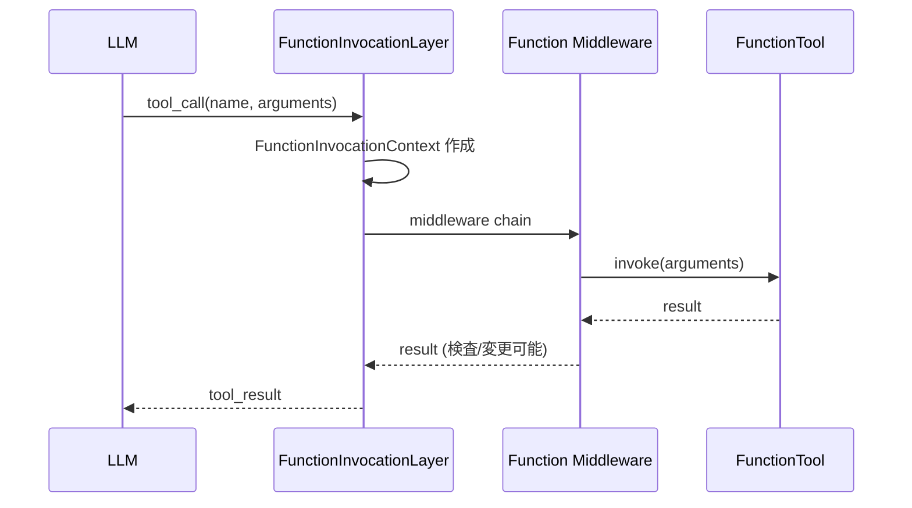
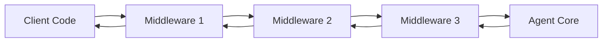
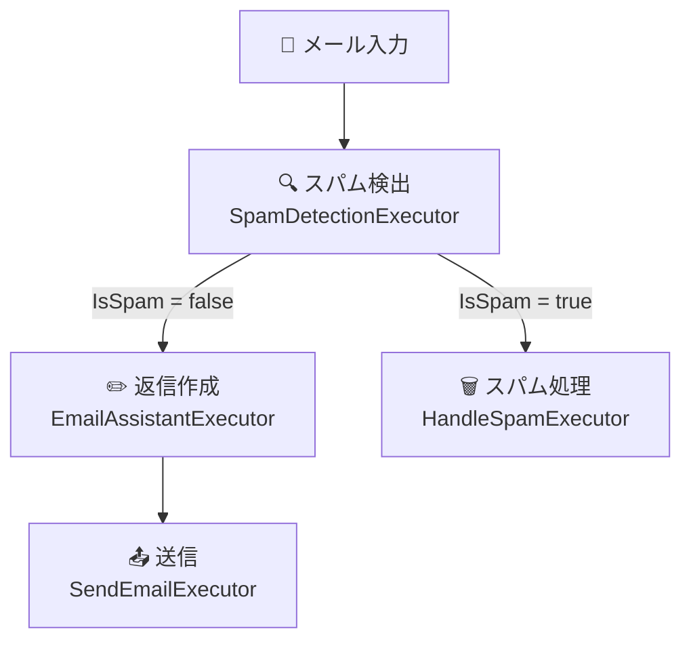

## はじめに

2025 年ごろから、LLM にツールを自律的に呼び出させ、計画を立てさせ、ほかのエージェントと協調させて複雑なタスクをこなす AI エージェントが、開発者の間で主要な話題になった。こうしたエージェントを一から作るには、セッション管理、ツール呼び出しのループ、エラーハンドリング、テレメトリー、マルチエージェントの協調をすべて自前で実装する必要があり、作業量が膨大になる。この部分を引き受けるフレームワークとして Microsoft が公開したのが [Microsoft Agent Framework](https://github.com/microsoft/agent-framework) だ。

Agent Framework は、Microsoft が開発してきた [Semantic Kernel](https://github.com/microsoft/semantic-kernel) と [AutoGen](https://github.com/microsoft/autogen) の直接的な後継と位置づけられている。Semantic Kernel のエンタープライズ機能（セッション管理・型安全性・ミドルウェア・テレメトリー）と AutoGen のシンプルなエージェント抽象化を統合し、グラフベースのワークフローエンジンを加えている。

フレームワークは、個々のエージェントを作る Agent と、複数のエージェントや関数をつなぐ Workflow の 2 本柱で構成される。以下では、全体構成を確認した後、エージェント側の仕組み（`run()` の実行フロー、ツール、ミドルウェア、セッション）を Python 実装のソースコードに沿って説明する。続いて、ワークフローエンジン、外部との統合とデプロイ、オブザーバビリティーを扱う。

## 全体アーキテクチャ

### フレームワークの二本柱

Agent Framework の機能は、次の 2 つのカテゴリーに分かれる。

| カテゴリー | 概要 |
|---------|------|
| Agents | LLM を使って入力を処理し、ツールや MCP サーバーを呼び出し、レスポンスを生成する個々のエージェント |
| Workflows | エージェントと関数をグラフで接続し、型安全なルーティング・チェックポイント・Human-in-the-Loop をサポートするマルチステップワークフロー |

このほか、基盤となる部品として、モデルクライアント（Chat Completions / Responses API）、AgentSession（ステート管理）、ContextProvider（エージェントメモリー）、Middleware（インターセプト）、MCP クライアント（ツール統合）がある。



### パッケージ構成

Python 側のパッケージは次のように分かれている。

| パッケージ | 役割 |
|-----------|------|
| `core` | `Agent`, `RawAgent`, `BaseAgent`, `Workflow`, `WorkflowBuilder` 等のコア抽象 |
| `foundry` | Microsoft Foundry 連携の `FoundryChatClient` |
| `openai` | OpenAI / Azure OpenAI の `OpenAIChatClient` |
| `anthropic` | Anthropic Claude の `AnthropicChatClient` |
| `ollama` | ローカル Ollama の `OllamaChatClient` |
| `orchestrations` | マルチエージェントオーケストレーションパターン |
| `a2a` | Agent-to-Agent プロトコル統合 |
| `ag-ui` | AG-UI プロトコル統合 |
| `devui` | 開発者向けデバッグ UI |

.NET 側も同じ構成で、`Microsoft.Agents.AI` を基盤に `Microsoft.Agents.AI.OpenAI`、`Microsoft.Agents.AI.Foundry`、`Microsoft.Agents.AI.Workflows` などが提供される。

> <strong>追記（2026-09-10 時点）</strong>：Agent Framework は安定版に到達し、`Microsoft.Agents.AI` は 1.x 系列（本稿更新時点で 1.20.0）の正式リリースとして NuGet で配布されている。Python パッケージ `agent-framework` / `agent-framework-core` も PyPI で 1.17.0 が公開済みで、通常利用では `--pre` は不要だ。また、対応言語に Go（[microsoft/agent-framework-go](https://github.com/microsoft/agent-framework-go)、public preview）が加わった。公式ドキュメントは現在、基礎概念を Agents / Workflows / Agent Harness を中心に整理し、Integrations & Hosting を別領域として案内している。計画・TODO・コンテキスト圧縮・ツール承認を備えた [Harness Agent](/ja/blog/agent-harness-doc-reviewer) は、この基礎概念の 1 つとして扱われている。

### クイックスタート

最小構成のエージェントに必要なのは、LLM と通信する ChatClient、エージェントの振る舞いを定義する instructions、ユーザーの入力を処理する `run()` の 3 つだ。Python では次のように書く。

```python
# pip install agent-framework azure-identity
import asyncio
from agent_framework import Agent
from agent_framework.foundry import FoundryChatClient
from azure.identity import AzureCliCredential

async def main():
    agent = Agent(
        client=FoundryChatClient(
            project_endpoint="https://your-project.services.ai.azure.com",
            model="gpt-4o",
            credential=AzureCliCredential(),
        ),
        name="HaikuBot",
        instructions="あなたは美しい俳句を詠む詩人です。",
    )
    print(await agent.run("Microsoft Agent Framework について俳句を詠んでください。"))

asyncio.run(main())
```

`FoundryChatClient` は Azure AI Foundry 上のモデルへの接続を担い、`AzureCliCredential()` はローカル開発時の認証を行う。`Agent` のコンストラクターに渡した `instructions` はシステムプロンプトとして LLM に送られ、`run()` にユーザーメッセージを渡すと、構成したチャット／モデルプロバイダーが呼ばれてレスポンスが返る。この数行の裏では、次節で説明するメッセージの正規化 → ContextProvider → Chat Client → レスポンスの後処理のパイプラインが動いている。

.NET では次のように書く。

```csharp
using Microsoft.Agents.AI;
using Azure.AI.Projects;
using Azure.Identity;

var agent = new AIProjectClient(
        new Uri(Environment.GetEnvironmentVariable("FOUNDRY_PROJECT_ENDPOINT")!),
        new DefaultAzureCredential())
    .AsAIAgent(
        model: Environment.GetEnvironmentVariable("FOUNDRY_MODEL") ?? "gpt-4o-mini",
        name: "HaikuBot",
        instructions: "あなたは美しい俳句を詠む詩人です。");

Console.WriteLine(await agent.RunAsync("Agent Framework について俳句を詠んでください。"));
```

.NET 版では、`AIProjectClient` の拡張メソッド `AsAIAgent()` でプロジェクトクライアントから直接エージェントを生成している。API のスタイルは Python 版と異なるが、Agent + ChatClient + instructions という 3 つの構成要素は共通だ。

## Agent の実行モデル — `run()` の内部

### クラス階層

Python 実装のエージェントは、Protocol の `SupportsAgentRun` と、`BaseAgent` → `RawAgent` → `Agent` の 3 層のクラス階層で構成される。層ごとに担う機能が異なり、必要な機能に応じてどの層のクラスを使うかを選べる。



- <strong>`SupportsAgentRun`</strong> — Protocol（ダックタイピング用インターフェース）。`run()`、`create_session()`、`id`/`name`/`description` プロパティーを定義
- <strong>`BaseAgent`</strong> — コンテキストプロバイダー・ミドルウェア・セッション管理を実装する基底クラス。`as_tool()` で他のエージェントのツールになれる
- <strong>`RawAgent`</strong> — Chat Client を使った LLM 呼び出しの実装。ミドルウェアとテレメトリーは含まない
- <strong>`Agent`</strong> — `AgentMiddlewareLayer`（ミドルウェア）と `AgentTelemetryLayer`（OpenTelemetry）を Mix-in したフル機能クラス

### `run()` の実行フロー

`Agent.run()` を呼ぶと、内部では次の順に処理が進む。



#### ステップ 1: `_prepare_run_context()`

`_prepare_run_context()` は、Chat Client を呼ぶ前の準備をまとめて行う。ソースコード（[`_agents.py`](https://github.com/microsoft/agent-framework/blob/main/python/packages/core/agent_framework/_agents.py)）では、次の 5 つの処理が行われる。

1. <strong>メッセージの正規化</strong>: `normalize_messages()` で入力を `Message` のリストに変換。文字列が渡された場合は `user` ロールの `Message` に変換される
2. <strong>履歴プロバイダーの自動追加</strong>: `session` が渡されているが `context_providers` が未設定（かつサービス側セッション ID や `store` フラグもない）場合、自動的に `InMemoryHistoryProvider` が追加される
3. <strong>ContextProvider 実行</strong>: `before_run()` を forward order で実行。履歴メッセージやシステムプロンプトが `SessionContext` に追加される
4. <strong>ツール解決</strong>: デフォルトツール＋ランタイムツール＋MCP サーバーのツールを統合。MCP サーバーが未接続なら `AsyncExitStack` 経由で接続する
5. <strong>オプションマージ</strong>: `_merge_options()` でデフォルトオプションとランタイムオプションをマージ。ツールは名前が重複しないように統合、`instructions` は連結、`logit_bias` や `metadata` は辞書マージされる

```python
# _merge_options() の動作イメージ
def _merge_options(base, override):
    result = dict(base)
    for key, value in override.items():
        if value is None:
            continue
        if key == "tools":
            # ツールは名前ベースでユニーク統合
            result["tools"] = _append_unique_tools(base_tools, override_tools)
        elif key == "instructions" and result.get("instructions"):
            # instructions は連結
            result["instructions"] = f"{result['instructions']}\n{value}"
        elif key == "logit_bias" and result.get("logit_bias"):
            # logit_bias は辞書マージ
            result["logit_bias"] = {**result["logit_bias"], **value}
        elif key == "metadata" and result.get("metadata"):
            # metadata は辞書マージ
            result["metadata"] = {**result["metadata"], **value}
        else:
            result[key] = value
    return result
```

#### ステップ 2: Chat Client 呼び出し

`_call_chat_client()` は `_RunContext` を基に Chat Client を呼び出す。

```python
def _call_chat_client(self, context, *, stream):
    return self.client.get_response(
        messages=context["session_messages"],
        stream=stream,
        options=context["chat_options"],
        compaction_strategy=context["compaction_strategy"],
        tokenizer=context["tokenizer"],
        function_invocation_kwargs=context["function_invocation_kwargs"],
        client_kwargs=context["client_kwargs"],
    )
```

Chat Client 内部で<strong>ツール呼び出しループ</strong>が実行される。LLM がツール呼び出しを要求すると、`FunctionInvocationLayer` がツールを実行し、結果を含むメッセージを LLM に再送信する。このループは LLM が最終応答を返すまで繰り返される。

#### ステップ 3: レスポンスの後処理

`_finalize_response()` は次の処理を行う。

- `author_name` の設定（各メッセージにエージェント名を付与）
- `conversation_id` のセッションへの伝播
- `after_run()` の ContextProvider 呼び出し（逆順）

### ストリーミング

LLM の応答生成には数秒かかることがあり、応答全体がそろうまで待つと、その間ユーザーには何も表示されない。ストリーミングを使えば、生成されたトークンを順に表示できるので、体感的な待ち時間が短くなる。Agent Framework では `run()` に `stream=True` を渡すだけでよい。

`stream=True` の場合、`_parse_streaming_response()` が `ResponseStream` を返す。`ResponseStream` は `AsyncIterator` として `AgentResponseUpdate` を yield し、`get_final_response()` で最終的な `AgentResponse` も取得できる。

```python
# ストリーミング使用例
stream = agent.run("こんにちは", stream=True)
async for update in stream:
    print(update.text, end="")
final = await stream.get_final_response()
print(f"\nTokens used: {final.usage_details}")
```

内部では `map()` でアップデートを変換し、`with_transform_hook()` で `conversation_id` の伝播や `response_id` の抑制をする。

## ツール統合

LLM 単体ではテキストを生成することしかできない。ツールを与えると、エージェントは外部 API の呼び出し、データベースの検索、ファイル操作などを通じて外部に働きかけられるようになる。

### ツールの種類

Agent Framework は次のツールタイプをサポートする。

| ツールタイプ | 説明 |
|------------|------|
| Function Tools | エージェントが対話中に呼び出せるカスタムコード |
| Tool Approval | ツール実行前の Human-in-the-Loop 承認 |
| Code Interpreter | サンドボックス環境でのコード実行 |
| File Search | アップロードファイルの検索 |
| Web Search | Web 検索 |
| Hosted MCP Tools | Microsoft Foundry がホストする MCP ツール |
| Local MCP Tools | ローカルまたはカスタムサーバーの MCP ツール |

### Function Tools の定義

Python では、関数に `@tool` デコレーターを付けてツールを定義する。

```python
from agent_framework import Agent, tool

@tool
def get_weather(location: str) -> str:
    """指定された場所の天気を取得する。"""
    return f"{location}の天気は晴れです。"

agent = Agent(
    client=client,
    name="WeatherBot",
    instructions="天気について答えるアシスタントです。",
    tools=[get_weather],
)
```

`@tool` デコレーターは関数のシグネチャと docstring から JSON Schema を生成し、`FunctionTool` インスタンスを作成する。LLM がこのツールを呼び出すと、`FunctionInvocationLayer` が次の流れで実行する。



### Agent-as-Tool パターン

エージェントは、別のエージェントのツールとしても使える。これを使うと、1 つのコーディネーターエージェントが、専門分野を持つ複数のエージェントを必要に応じて呼び出す構成を作れる。

```python
# 専門エージェントの定義
weather_agent = Agent(
    client=client,
    name="weather_agent",
    description="天気に関する質問に答えるエージェント。",
    tools=[get_weather],
)

# メインエージェントが weather_agent をツールとして使用
main_agent = Agent(
    client=client,
    name="coordinator",
    instructions="あなたは質問を適切な専門家に委任するコーディネーターです。",
    tools=[weather_agent.as_tool()],
)
```

`as_tool()` は内部で次の処理を行う。

1. エージェントの `name` と `description` から `FunctionTool` を生成
2. ツール呼び出し時に `agent.run(task, stream=True)` を実行
3. レスポンスのテキストを文字列として返却

```python
# as_tool() の内部実装（簡略化）
def as_tool(self, *, name=None, description=None):
    async def _agent_wrapper(ctx, **kwargs):
        stream = self.run(
            str(kwargs.get(arg_name, "")),
            stream=True,
            session=ctx.session if propagate_session else None,
        )
        final_response = await stream.get_final_response()
        return final_response.text
    
    return FunctionTool(
        name=tool_name,
        description=tool_description,
        func=_agent_wrapper,
    )
```

### MCP（Model Context Protocol）統合

[MCP](https://modelcontextprotocol.io/) は LLM とツールをつなぐ標準プロトコルだ。Agent Framework は `MCPStdioTool`、`MCPStreamableHTTPTool`、`MCPWebsocketTool` の 3 種の接続方式をサポートする。

```python
from agent_framework import Agent, MCPStdioTool

# MCP サーバーのファイルシステムツールを利用
mcp_tool = MCPStdioTool(
    name="filesystem",
    command="npx",
    args=["-y", "@modelcontextprotocol/server-filesystem", "/tmp"],
)

async with Agent(client=client, tools=[mcp_tool]) as agent:
    response = await agent.run("/tmp 配下のファイル一覧を教えて")
```

MCP ツールの解決は `_prepare_run_context()` の中で行われる。未接続の MCP サーバーは `AsyncExitStack` 経由で接続され、`functions` プロパティーからツール一覧が取得される。

コード例で `async with Agent(...) as agent:` を使っているのは、MCP サーバーとの接続が Agent の `__aenter__` で確立され、`__aexit__` で切断されるためだ。接続のライフサイクルがエージェントのスコープに結び付くので、接続が閉じられずに残ることを防げる。MCP を使わない場合は、`async with` なしで `agent.run()` を直接呼べる。

## ミドルウェアシステム

Agent Framework のミドルウェアは、ASP.NET や Express.js のミドルウェアと同じ仕組みで、ロギング・バリデーション・エラーハンドリングなどの横断的な処理をエージェントの実行パイプラインに差し込む。エージェント本体のコードを変えずに、すべてのツール呼び出しの前に承認を挟んだり、特定の入力をブロックするガードレールを設けたりできる。

### 3 種類のミドルウェア

| 種類 | 対象 | 用途 |
|------|------|------|
| Agent Run Middleware | `agent.run()` 全体 | 入出力の検査・変更、ガードレール |
| Function Calling Middleware | ツール呼び出し | ツール呼び出しの検査・変更、承認フロー |
| Chat Client Middleware | LLM API 呼び出し | リクエスト/レスポンスの検査・変更 |

### Python でのミドルウェア実装

次の例では、`logging_middleware` がすべてのエージェント呼び出しの入出力メッセージ数をログに記録し、`approval_middleware` が危険なツール（ファイル削除や SQL 実行）の呼び出し前に承認フローを挟む。

```python
from agent_framework import (
    Agent,
    AgentContext,
    FunctionInvocationContext,
    agent_middleware,
    function_middleware,
)

@agent_middleware
async def logging_middleware(context: AgentContext, call_next):
    """すべてのエージェント呼び出しをログに記録するミドルウェア。"""
    print(f"Input: {len(context.messages)} messages")
    await call_next()
    print(f"Output: {len(context.result.messages)} messages")

@function_middleware
async def approval_middleware(context: FunctionInvocationContext, call_next):
    """危険なツール呼び出しに承認を要求するミドルウェア。"""
    if context.function.name in ["delete_file", "execute_sql"]:
        # 承認ロジック（例: ユーザーへの確認）
        print(f"Approval required for: {context.function.name}")
    await call_next()

agent = Agent(
    client=client,
    instructions="あなたは親切なアシスタントです。",
    middleware=[logging_middleware, approval_middleware],
)
```

ミドルウェアの中の `await call_next()` は、処理を次のミドルウェアに委譲する。`call_next()` より前のコードはリクエスト時に、後のコードはレスポンス時に実行される。Express.js の `next()` や ASP.NET Core の `await next(context)` と同じ仕組みだ。`call_next()` を呼ばなければチェーンはそこで止まり、エージェント本体には到達しない。

### .NET でのミドルウェア実装

.NET では Builder パターンを使い、既存のエージェントにミドルウェアを加えた新しいエージェントを作る。`AsBuilder()` で既存エージェントのコピーを作り、`Use()` でミドルウェアをチェーンし、`Build()` で新しいエージェントを生成する。元のエージェントは変更されない。

```csharp
var middlewareAgent = originalAgent
    .AsBuilder()
        .Use(runFunc: async (messages, session, options, innerAgent, ct) =>
        {
            Console.WriteLine($"Input: {messages.Count()} messages");
            var response = await innerAgent.RunAsync(messages, session, options, ct);
            Console.WriteLine($"Output: {response.Messages.Count} messages");
            return response;
        })
        .Use(async (agent, context, next, ct) =>
        {
            Console.WriteLine($"Function: {context.Function.Name}");
            return await next(context, ct);
        })
    .Build();
```

### ミドルウェアの内部実装

ミドルウェアのチェーンは `AgentMiddlewareLayer` が管理する。複数のミドルウェアを登録すると、コールスタックのように入れ子で連鎖する。リクエストはミドルウェアを順に通ってエージェント本体に届き、レスポンスは逆の順に戻る。



`MiddlewareTermination` 例外を送出すると、チェーンを途中で打ち切ってレスポンスを返せる。たとえば入力のバリデーションで問題が見つかったときに、LLM を呼ばずにすぐエラーレスポンスを返せる。

## セッションとコンテキストプロバイダー

ここまでの実行フロー、ツール、ミドルウェアは、1 回のリクエストとレスポンスの中で完結する。一方、LLM の API はステートレスで、各呼び出しは前回の会話を覚えていない。ユーザーとの対話は複数のターンにわたるので、前のターンの内容を踏まえて応答する仕組みが要る。Agent Framework では AgentSession と ContextProvider がこの役割を担う。

### AgentSession

`AgentSession` はエージェントの対話状態を保持するコンテナーだ。

```python
session = agent.create_session()

# 1回目の呼び出し
response1 = await agent.run("私は東京に住んでいます。", session=session)

# 2回目の呼び出し — セッションが会話履歴を保持
response2 = await agent.run("私はどこに住んでいますか？", session=session)
# → "東京に住んでいます。"
```

セッションの主なプロパティーは次のとおり。

- `session_id` — ローカルセッション ID（自動生成）
- `service_session_id` — サービス側のセッション ID（Foundry Agents の thread ID 等）
- `state` — プロバイダーごとのステートを保持する辞書

### ContextProvider

`ContextProvider` はエージェント呼び出しの前後にフックする拡張ポイントだ。`before_run()` で追加のコンテキスト（履歴メッセージ・システムプロンプト・追加ツール）を注入し、`after_run()` で応答を永続化できる。

```python
from agent_framework import ContextProvider, SessionContext, AgentSession

class CustomContextProvider(ContextProvider):
    """カスタムコンテキストプロバイダの例。"""
    
    async def before_run(self, agent, session, context, state):
        # 追加のシステムプロンプトを注入
        context.instructions.append("常に日本語で回答してください。")
    
    async def after_run(self, agent, session, context, state):
        # 応答をログに記録
        if context.response:
            state["last_response"] = context.response.text
```

組み込みプロバイダーの代表は、会話履歴を保持する `InMemoryHistoryProvider` だ。前述のとおり、セッションを渡してプロバイダーを設定していなければ Agent がこれを自動で追加するので、上の AgentSession の例のように `session` を渡すだけでマルチターンの会話が成り立つ。

### CompactionStrategy

会話が長くなるほど、LLM に送るメッセージのトークン数が増える。`CompactionStrategy` は、メッセージを圧縮してトークン数を抑える戦略を提供する。

| 戦略 | 説明 |
|------|------|
| `TruncationStrategy` | 古いメッセージを削除 |
| `SlidingWindowStrategy` | 直近 N 件のメッセージを保持 |
| `SummarizationStrategy` | 古いメッセージを LLM で要約 |
| `TokenBudgetComposedStrategy` | 複数戦略を組み合わせてトークン予算内に収める |

## ワークフローエンジン — グラフベースのオーケストレーション

業務プロセスには、複数のステップを決まった順序で実行し、途中で条件分岐するものがある。たとえば、メールをスパム判定し、正常なら返信を生成し、スパムなら隔離する処理だ。こうしたプロセスは 1 つのエージェントだけでは処理しきれないことが多く、ワークフローエンジンで組み立てる必要がある。

### Agent vs Workflow

| Agent を使うべき場面 | Workflow を使うべき場面 |
|---------------------|----------------------|
| オープンエンドまたは対話的なタスク | 明確に定義されたステップがあるプロセス |
| 自律的なツール使用と計画が必要 | 実行順序を明示的に制御したい |
| 単一の LLM 呼び出しで十分 | 複数のエージェントや関数を協調させたい |

ワークフローは <strong>Executor</strong>（処理ノード）を <strong>Edge</strong>（接続）でつなぐ有向グラフだ。

### Executor（実行ノード）

Executor はワークフローの基本的な処理単位だ。メッセージを受け取り、処理し、出力メッセージを生成する。

```python
from agent_framework import Executor, handler, WorkflowContext

class UppercaseExecutor(Executor):
    """入力文字列を大文字に変換する Executor。"""
    
    @handler
    async def handle(self, message: str, context: WorkflowContext) -> str:
        return message.upper()
```

.NET では `partial` クラスと `[MessageHandler]` 属性を使ったソース生成で実装する。

```csharp
internal sealed partial class UppercaseExecutor() : Executor("UppercaseExecutor")
{
    [MessageHandler]
    private ValueTask<string> HandleAsync(string message, IWorkflowContext context)
    {
        return ValueTask.FromResult(message.ToUpperInvariant());
    }
}
```

Executor はステートフルにできる。複数の実行で同じインスタンスを共有する場合は、`IResettableExecutor` を実装して、実行の間に古い状態をクリアする。

### Edge（接続）

Edge はメッセージの流れを定義する。次のタイプがある。

| Edge タイプ | 説明 | ユースケース |
|------------|------|------------|
| Direct | 単純な 1 対 1 接続 | パイプライン |
| Conditional | 条件付きルーティング | if/else 分岐 |
| Switch-Case | 条件に基づくマルチブランチルーティング | 3 分岐以上のルーティング |
| Fan-out | 1 つの Executor から複数ターゲットへ | 並列処理 |
| Fan-in | 複数ソースから 1 つのターゲットへ | 集約 |

### ワークフロー実装例 — メール分類パイプライン

次の例は、メールをスパム判定し、スパムなら隔離処理を行い、正常なメールなら返信を自動作成するワークフローだ。Executor の定義、Edge による条件分岐、`WorkflowBuilder` によるグラフの組み立てを順に含む。



```python
from agent_framework import (
    Agent, Executor, handler, WorkflowBuilder, WorkflowContext,
)

class SpamDetectionExecutor(Executor):
    def __init__(self, agent):
        super().__init__("SpamDetection")
        self._agent = agent
    
    @handler
    async def handle(self, message: str, context: WorkflowContext):
        response = await self._agent.run(message)
        is_spam = "spam" in response.text.lower()
        return {"is_spam": is_spam, "content": message}

class EmailAssistantExecutor(Executor):
    def __init__(self, agent):
        super().__init__("EmailAssistant")
        self._agent = agent
    
    @handler
    async def handle(self, message: dict, context: WorkflowContext):
        response = await self._agent.run(
            f"以下のメールに丁寧な返信を作成してください: {message['content']}"
        )
        await context.yield_output(f"返信: {response.text}")

class SpamHandler(Executor):
    @handler
    async def handle(self, message: dict, context: WorkflowContext):
        await context.yield_output(f"スパムとしてマーク: {message['content'][:50]}...")

# ワークフローの構築
spam_detector = SpamDetectionExecutor(detection_agent)
assistant = EmailAssistantExecutor(reply_agent)
spam_handler = SpamHandler("SpamHandler")

workflow = (
    WorkflowBuilder(start_executor=spam_detector)
    .add_edge(
        spam_detector,
        assistant,
        condition=lambda msg: not msg["is_spam"],
    )
    .add_edge(
        spam_detector,
        spam_handler,
        condition=lambda msg: msg["is_spam"],
    )
    .build()
)

# ワークフロー実行
async for event in workflow.run("重要な会議のお知らせ", stream=True):
    print(event)
```

`WorkflowBuilder` は、グラフを宣言的に組み立てるビルダーだ。`add_edge(source, target, condition=...)` に条件関数を渡すと、実行時の条件分岐を定義できる。`workflow.run(..., stream=True)` はワークフローをインプロセスで実行し、Executor 間でメッセージが受け渡されるたびにイベントをストリーミングする。

.NET では `WorkflowBuilder` を使って次のように書く。こちらは図と同じく送信ステップ（`sendEmailExecutor`）まで含む。

```csharp
var workflow = new WorkflowBuilder(spamDetectionExecutor)
    .AddEdge(spamDetectionExecutor, emailAssistantExecutor,
             condition: GetCondition(expectedResult: false))
    .AddEdge(emailAssistantExecutor, sendEmailExecutor)
    .AddEdge(spamDetectionExecutor, handleSpamExecutor,
             condition: GetCondition(expectedResult: true))
    .WithOutputFrom(handleSpamExecutor, sendEmailExecutor)
    .Build();
```

### Switch-Case パターン

3 つ以上に分岐する場合は、`AddSwitch()` を使うと分岐を 1 か所にまとめて書ける。各ケースに条件関数を与え、デフォルトのブランチも指定できる。

```csharp
builder.AddSwitch(spamDetectionExecutor, switchBuilder =>
    switchBuilder
        .AddCase(GetCondition(SpamDecision.NotSpam), emailAssistantExecutor)
        .AddCase(GetCondition(SpamDecision.Spam), handleSpamExecutor)
        .WithDefault(handleUncertainExecutor)
);
```

### Fan-out / Fan-in パターン

1 つの Executor から複数のターゲットに処理を振り分けて並列に実行し、結果を集約するパターンだ。Fan-out では `targetSelector` が入力に応じて実行先を選び、Fan-in のバリアはすべてのソースが完了するまで待つ。

```csharp
// Fan-out: 1 → N
builder.AddFanOutEdge(
    analysisExecutor,
    targets: [spamHandler, emailAssistant, summarizer, uncertainHandler],
    targetSelector: (result, targetCount) =>
    {
        if (result.IsSpam) return [0];
        var targets = new List<int> { 1 };
        if (result.EmailLength > 100) targets.Add(2);
        return targets;
    }
);

// Fan-in: N → 1
builder.AddFanInBarrierEdge(
    sources: [worker1, worker2, worker3],
    target: aggregator
);
```

### ワークフローの実行とイベント

ワークフローの実行は<strong>スーパーステップ方式</strong>で進行する。各スーパーステップで、アクティブな Executor が並行して実行され、出力メッセージは Edge に沿って次のスーパーステップの Executor に配送される。

`WorkflowEvent` には次の種類がある。

| イベント | 説明 |
|---------|------|
| `WorkflowOutputEvent` | 最終出力 |
| `ExecutorStartEvent` / `ExecutorEndEvent` | Executor のライフサイクル |
| カスタムイベント | `context.yield_output()` でワークフロー出力を発火 |

### チェックポイント

長時間実行するワークフローは、途中で障害が起きることがある。`CheckpointStorage` でワークフローのステートを永続化しておけば、障害やプロセスの再起動の後に途中から再開できる。

```python
from agent_framework import FileCheckpointStorage

storage = FileCheckpointStorage("./checkpoints")
runner_context = InProcRunnerContext(workflow, checkpoint_storage=storage)
```

## デプロイとインテグレーション

Agent Framework で作ったエージェントやワークフローは、A2A や AG-UI のプロトコルで外部とつないだり、Azure Functions や Container Apps にデプロイしたり、MCP サーバーとして公開したりできる。

### A2A（Agent-to-Agent）プロトコル

A2A は Google が提唱した、異なるフレームワーク間でエージェントを連携させるためのオープンプロトコルだ。Agent Framework は A2A サーバーとクライアントの両方をサポートしており、他のフレームワークで構築されたエージェントとも相互運用できる。

```python
from agent_framework.a2a import A2AServer

# エージェントを A2A サーバーとして公開
server = A2AServer(agent=my_agent)
await server.start(host="0.0.0.0", port=8080)
```

### AG-UI（Agent-User Interface）プロトコル

AG-UI は CopilotKit が提唱した、エージェントとフロントエンドをリアルタイムに接続するプロトコルだ。ストリーミング応答、ツール呼び出しの進捗表示、Human-in-the-Loop の承認 UI など、エージェントの動作をユーザーに可視化するための標準的なインターフェースを提供する。

### Azure Functions / Container Apps

エージェントは、サーバーレス関数やコンテナーとしてデプロイできる。Azure Functions を使えば、HTTP トリガーで起動するエージェントを数行で構成できる。Container Apps を使えば、長時間実行のワークフローやストリーミング応答にも対応できる。

### MCP サーバーとしてのエクスポート

エージェント自体を MCP サーバーに変換し、他のツールやエージェントから呼び出し可能にすることもできる。

```python
# エージェントを MCP サーバーに変換
server = agent.as_mcp_server(server_name="MyAgent", version="1.0.0")
```

`as_mcp_server()` の実装は、エージェントを `as_tool()` でツール化し、MCP の `@server.call_tool()` ハンドラーとして登録する。その結果、MCP クライアントからエージェントを 1 つのツールとして呼び出せる。

### DevUI

DevUI は開発者向けのインタラクティブ UI で、エージェントの開発・テスト・デバッグに使う。ワークフローの実行グラフをリアルタイムで可視化し、各 Executor の入出力や Edge のメッセージフローを確認できる。

## オブザーバビリティー

Agent Framework は OpenTelemetry をネイティブサポートしており、`AgentTelemetryLayer`（`Agent` クラスの Mix-in）がすべての `run()` 呼び出しに対してスパンを自動生成する。

```python
from opentelemetry import trace
from opentelemetry.sdk.trace import TracerProvider
from opentelemetry.sdk.trace.export import ConsoleSpanExporter, SimpleSpanProcessor

# OpenTelemetry セットアップ
provider = TracerProvider()
provider.add_span_processor(SimpleSpanProcessor(ConsoleSpanExporter()))
trace.set_tracer_provider(provider)

# Agent は自動的にスパンを出力する
agent = Agent(client=client, name="TracedAgent")
response = await agent.run("こんにちは")
```

トレースには次の情報が含まれる。

- エージェント名・ID
- メッセージ数
- ツール呼び出しの詳細
- トークン使用量
- レスポンスタイム

これを Jaeger や Azure Monitor など OpenTelemetry 対応のバックエンドにエクスポートすれば、レスポンスタイムからボトルネックを探したり、トークン使用量からコストを見積もったりできる。

## 設計上の特徴

### プロトコルベースの拡張性

`SupportsAgentRun` が Protocol として定義されているため、Agent Framework のクラスを継承せずとも、必要なメソッドを実装すれば互換性のあるエージェントを作れる。Python のダックタイピングと同じ考え方で、既存のコードベースに Agent Framework を段階的に導入するときに役立つ。

### ミドルウェアの層分離

ミドルウェアは Agent Run Middleware → Function Calling Middleware → Chat Client Middleware の 3 層に分かれ、層ごとにインターセプトする対象が異なる。そのため、たとえば「すべてのエージェント呼び出しにロギングを追加」「特定のツール呼び出しだけに承認を追加」「LLM リクエストにリトライを追加」を、それぞれ独立したミドルウェアとして書ける。

### Semantic Kernel / AutoGen からの移行パス

Agent Framework は Semantic Kernel と AutoGen それぞれからの移行ガイドを公式に提供しており、既存のコードを活かしながら段階的に移行できる。

### Python と .NET の対称性

Python と C#/.NET で概念と API のパターンが共通なので、一方の言語で覚えた知識をもう一方でもそのまま使える。複数の言語を使うチームには便利だ。現在は Go 実装（public preview）も加わり 3 言語になったが、成熟度は揃っていない。Go では宣言的エージェント・RAG・CodeAct・関数型ワークフローなどがまだ提供されていない。

## まとめ

Agent Framework の内部は、次の層に分けて捉えられる。

1. <strong>Agent 層</strong> — メッセージ正規化 → ContextProvider → ChatClient → レスポンス後処理のパイプラインで、LLM との対話を管理する
2. <strong>ツール層</strong> — `@tool` デコレーター、MCP 統合、Agent-as-Tool により、エージェントと外部世界を接続する
3. <strong>ミドルウェア層</strong> — Agent / Function / ChatClient の 3 レベルで横断的関心事を注入する
4. <strong>セッション層</strong> — AgentSession と ContextProvider で、ステートレスな LLM API の上にマルチターン対話を実現する
5. <strong>ワークフロー層</strong> — Executor と Edge のグラフで、条件分岐・並列処理・Human-in-the-Loop を宣言的に記述する
6. <strong>オブザーバビリティー層</strong> — OpenTelemetry でエージェントの動作を監視・デバッグする

Agent Framework は、Semantic Kernel のエンタープライズ向け機能と AutoGen のシンプルなエージェント抽象を 1 つにまとめ、MCP・A2A・AG-UI にも対応する。Microsoft は、これを両者の後継となるエージェント開発の統一基盤として位置づけている。

## 参考リンク

- [Microsoft Agent Framework — GitHub](https://github.com/microsoft/agent-framework)
- [公式ドキュメント — MS Learn](https://learn.microsoft.com/en-us/agent-framework/)
- [Python パッケージ — PyPI](https://pypi.org/project/agent-framework/)
- [.NET パッケージ — NuGet](https://www.nuget.org/profiles/MicrosoftAgentFramework/)
