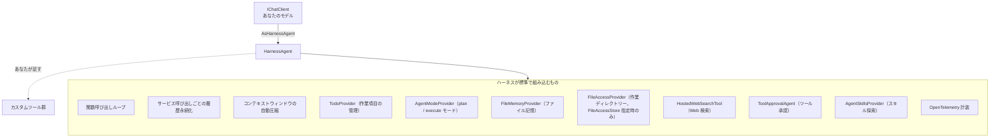
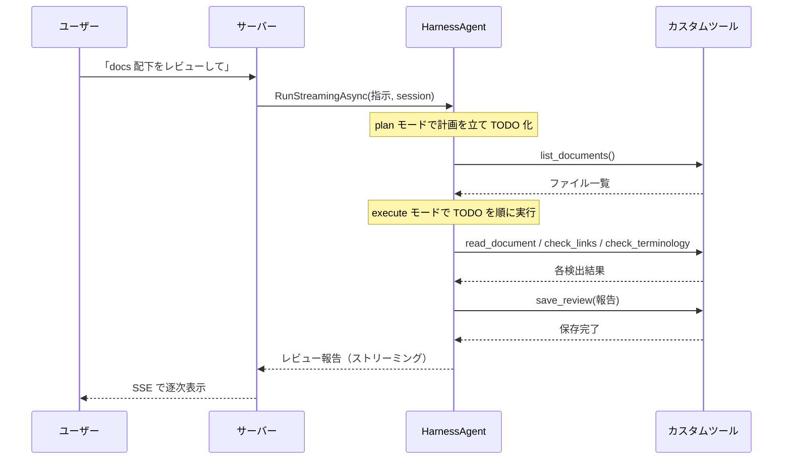

## はじめに

姉妹編「[オーケストレーションを手放す — GitHub Copilot SDK でツールを足すだけの文書レビューエージェントを作る](/ja/blog/copilot-doc-reviewer)」では、次の発想で文書レビューエージェントを実装した。

> エージェントの司令塔（計画 → ツール選択 → 実行 → 評価のループ）を自分で書くのをやめ、本番で揉まれたランタイムに丸ごと委譲する。自分はレビューに必要な処理をツールとして提供するだけ。

今回は、同じ文書レビューエージェントを Microsoft Agent Framework の Agent Harness（`HarnessAgent`）で実装する。ツールと指示を足すだけで動く点は同じだが、設計判断は 2 点で Copilot SDK 版と異なる。任せる先が別プロセスの CLI ではなく同一プロセス内の .NET ライブラリーであることと、エージェントの能力を実行時の承認ではなく構成時の取捨選択で絞ることだ。

> Microsoft Agent Framework 自体の全体像は「[Microsoft Agent Framework 完全解説](/ja/blog/agent-framework)」で解説している。ここでは Agent Harness だけを扱う。

## Agent Harness とは何か

Microsoft Agent Framework の通常の使い方では、`ChatClientAgent` を作り、ツールやコンテキストプロバイダーを自分で組み合わせる。柔軟だが、長いタスクを自律的にこなすエージェントを作るには、計画・TODO 管理・コンテキスト圧縮・ツール承認といった<strong>運用基盤（ハーネス）</strong>を自分で組む必要がある。

`Microsoft.Agents.AI.Harness` パッケージの Agent Harness（`HarnessAgent`）は、この運用基盤を組み込み済みのエージェントで、Claude Code のような自律エージェントを 1 行で構成できる。`IChatClient` に対して `AsHarnessAgent()` を呼ぶと、次の機能がまとめて構成される。



開発者が書くのは、Copilot SDK 版と同じくツールと指示だけだ。計画・TODO・コンテキスト圧縮・ツール承認の処理は書かない。

`AgentModeProvider` の既定モードは "plan"（計画）と "execute"（実行）で、`TodoProvider` は作業項目を追跡する。このためハーネスは、まず計画を立てて TODO に分け、順に実行するという Claude Code のような進め方を標準で備えている。この明示的な計画/TODO の仕組みがハーネスの特徴だ。Copilot SDK のランタイムも内部では計画するが、plan モードや TODO プロバイダーに当たるものは外部に公開していない。

> <strong>追記（2026-09-10 時点）</strong>：執筆時点の `HarnessAgent` は実験的（experimental / preview）な API で、コンパイル時に診断 ID `MAAI001` の警告が出ていた。現在は安定版の `Microsoft.Agents.AI.Harness` パッケージ（本稿更新時点で 1.20.0）で正式 API として提供され、公式ドキュメントでも Agent Framework の基礎概念（Agents / Workflows / Agent Harness）の一つに挙げられている。ハーネスを使うためだけに `--prerelease` を付けたり `MAAI001` を抑制したりする必要はもうない。ただし `MAAI001` は Agent Framework 全体の実験的機能を示す診断 ID として残っており、ファイル記憶、A2A、Mem0、DevUI、宣言的エージェント、シェル実行などを使う場合は引き続き抑制が必要だ。

## Copilot SDK との対比 — 2 つの「委譲」

どちらもオーケストレーションをランタイムに任せ、開発者はツールを足すだけだ。ただし任せる先のランタイムの性質が違うため、設計判断も変わる。

| 観点 | GitHub Copilot SDK | Agent Harness（`HarnessAgent`） |
|------|--------------------|-------------------------------|
| ランタイムの形 | 別プロセスの Copilot CLI に JSON-RPC で接続 | 同一プロセス内の .NET ライブラリー |
| モデル | Copilot 経由、または BYOM/BYOK で自前のモデル | 自前のモデル（Azure OpenAI / OpenAI など）を持ち込む |
| 課金 | 使用量ベース（GitHub AI Credits、トークン消費量で課金） | 利用したモデルプロバイダーへの支払いのみ |
| 計画・TODO | 明示的な仕組みはない（ランタイムが内部で計画し、進め方は指示で誘導する） | plan/execute モードと TodoProvider を標準で備える |
| 能力の絞り込み | 実行時に `onPermissionRequest` で承認/拒否 | 構成時に `Disable*` フラグと提供ツールで決める |
| 言語 | Node/Python/Go/.NET/Java/Rust | .NET が最も成熟（Python も正式提供、Go は public preview） |
| 配布 | CLI ランタイム同梱 | NuGet ライブラリー（安定版） |

設計に最も影響する違いは、能力の絞り込み方だ。Copilot SDK 版では、強力なランタイムが操作を要求するたびに、実行時に許可または拒否する<strong>動的なゲート</strong>で安全性を確保した。ハーネスでは、どの能力を組み込むかを構成時に選ぶ<strong>静的な組み立て</strong>で安全性を確保する。`DisableWebSearch = true` のように不要な組み込み能力を外し、`FileAccessStore` のように指定したときだけ有効になる能力は最初から渡さない。

## 設計 — 同じ 5 つのツール

ツールは Copilot SDK 版と同じ 5 つだ。

1. `list_documents` — レビュー対象の一覧
2. `read_document` — 本文の読み込み
3. `check_links` — リンク切れの確認
4. `check_terminology` — 用語の表記ゆれ確認
5. `save_review` — レビュー結果の保存

違いは、計画を立てて TODO に分解し、順に実行するという進め方をハーネスが最初から持っていることだ。Copilot SDK 版ではシステムメッセージでこの進め方を誘導したが、ハーネスでは `AgentModeProvider`（plan/execute）と `TodoProvider` がその骨組みになる。指示に書くのは、レビューの観点（リンク・用語・明確さ）と出力形式だけでよい。



## 実装

### プロジェクト構成と依存

ファイル構成は Copilot SDK 版と対応させてある。

```text
agent-harness-doc-reviewer/
├── AgentHarnessDocReviewer.csproj
├── Program.cs              # ASP.NET 最小 API + SSE サーバ
├── ReviewTools.cs          # 5 つのカスタムツール（AIFunction）
├── ReviewPrompt.cs         # レビュー指示
├── glossary.json           # 用語統一チェック用の正規表記辞書
├── docs/                   # レビュー対象
├── reviews/                # 出力先
└── wwwroot/
    └── index.html          # ブラウザ UI（バニラ JS、Copilot SDK 版とはタイトルとアクセントカラーだけが異なる）
```

依存パッケージを追加する。執筆時点では Agent Harness が実験的だったため `--prerelease` が必要だったが、現在は `Microsoft.Agents.AI.Harness` に安定版があるので、ハーネスのためにこのフラグを付ける必要はない。

```bash
dotnet add package Microsoft.Agents.AI.Harness
dotnet add package Microsoft.Extensions.AI.OpenAI
dotnet add package Azure.AI.OpenAI
dotnet add package Azure.Identity
```

執筆時点の `HarnessAgent` は実験的 API だったため、`.csproj` で `MAAI001` の警告を抑制している。現行版でハーネスだけを使うならこの抑制は不要だが、ほかの実験的機能を使う場合は引き続き必要になる。

```xml
<PropertyGroup>
  <TargetFramework>net9.0</TargetFramework>
  <NoWarn>$(NoWarn);MAAI001;OPENAI001</NoWarn>
</PropertyGroup>
```

### ツールを定義する

Copilot SDK 版では `defineTool` と Zod でツールを定義した。Agent Framework のツールは `Microsoft.Extensions.AI` の `AIFunction` で、`AIFunctionFactory.Create()` でデリゲートから生成する。各ツールが UI 通知用の `emit` を閉じ込める点は Copilot SDK 版と同じだ。

```csharp
// ReviewTools.cs
using System.ComponentModel;
using Microsoft.Extensions.AI;

public static class ReviewTools
{
    private static readonly string DocsRoot = Path.GetFullPath("docs");
    private static readonly string ReviewsRoot = Path.GetFullPath("reviews");

    // パストラバーサル対策: 解決後のパスがルート配下にあることを保証する
    private static string ResolveWithin(string root, string target)
    {
        string resolved = Path.GetFullPath(Path.Combine(root, target));
        if (!resolved.StartsWith(root + Path.DirectorySeparatorChar, StringComparison.Ordinal)
            && resolved != root)
        {
            throw new InvalidOperationException($"許可されていないパスです: {target}");
        }
        return resolved;
    }

    public static IList<AITool> Create(Action<string, string> emit)
    {
        return new List<AITool>
        {
            AIFunctionFactory.Create(() =>
            {
                var files = Directory
                    .EnumerateFiles(DocsRoot, "*.*", SearchOption.AllDirectories)
                    .Where(f => f.EndsWith(".md") || f.EndsWith(".mdx"))
                    .Select(f => Path.GetRelativePath(DocsRoot, f))
                    .ToArray();
                emit("list_documents", $"{files.Length} 件のドキュメントを検出");
                return new { files };
            }, "list_documents", "レビュー対象の docs/ 配下にあるドキュメントの一覧を返す"),

            AIFunctionFactory.Create((
                [Description("docs/ からの相対パス")] string filePath) =>
            {
                string abs = ResolveWithin(DocsRoot, filePath);
                string content = File.ReadAllText(abs);
                emit("read_document", $"{filePath} を読み込み（{content.Length} 文字）");
                return new { filePath, content };
            }, "read_document", "指定したドキュメントの本文を読み込んで返す"),

            AIFunctionFactory.Create(async (
                [Description("チェック対象の本文")] string content) =>
            {
                var urls = System.Text.RegularExpressions.Regex
                    .Matches(content, @"https?://[^\s)\]]+")
                    .Select(m => m.Value)
                    .Distinct()
                    .ToArray();
                var broken = new List<object>();
                using var http = new HttpClient { Timeout = TimeSpan.FromSeconds(5) };
                foreach (var url in urls)
                {
                    try
                    {
                        using var reqMsg = new HttpRequestMessage(HttpMethod.Head, url);
                        var res = await http.SendAsync(reqMsg);
                        if (!res.IsSuccessStatusCode)
                            broken.Add(new { url, status = ((int)res.StatusCode).ToString() });
                    }
                    catch
                    {
                        broken.Add(new { url, status = "unreachable" });
                    }
                }
                emit("check_links", $"{urls.Length} 件中 {broken.Count} 件が到達不能");
                return new { checked_ = urls.Length, broken };
            }, "check_links", "本文中の HTTP(S) リンクが生きているかを確認し、到達不能なものを返す"),

            AIFunctionFactory.Create((
                [Description("チェック対象の本文")] string content) =>
            {
                var glossary = System.Text.Json.JsonSerializer
                    .Deserialize<Dictionary<string, string[]>>(File.ReadAllText("glossary.json"))
                    ?? new();
                var hits = new List<object>();
                foreach (var (canonical, variants) in glossary)
                    foreach (var variant in variants)
                        if (content.Contains(variant))
                            hits.Add(new { canonical, found = variant });
                emit("check_terminology", $"{hits.Count} 件の表記ゆれ候補");
                return new { issues = hits };
            }, "check_terminology", "glossary.json の正規表記に照らして表記ゆれを検出する"),

            AIFunctionFactory.Create((
                [Description("保存するファイル名")] string fileName,
                [Description("レビュー結果の Markdown 本文")] string markdown) =>
            {
                string abs = ResolveWithin(ReviewsRoot, fileName);
                Directory.CreateDirectory(Path.GetDirectoryName(abs)!);
                File.WriteAllText(abs, markdown);
                emit("save_review", $"{fileName} に保存");
                return new { saved = fileName };
            }, "save_review", "完成したレビュー結果を reviews/ に Markdown として保存する"),
        };
    }
}
```

`AIFunctionFactory.Create(デリゲート, 名前, 説明)` にデリゲートを渡すとツールになり、引数の `[Description]` 属性はモデルに渡すパラメーター説明になる。戻り値の匿名オブジェクトは JSON に変換されてモデルに返る。Copilot SDK 版と同様に、実際の処理はすべて自分のコードの中にある。`fetch` に当たる `HttpClient` による外部アクセスも、`save_review` のファイル書き込みも、自分で制御できる。

### ハーネスを組み立てる — 能力を絞り込む

Copilot SDK 版では実行時に権限ハンドラーで操作を拒否したが、ハーネスでは<strong>構成時に不要な能力を外す</strong>。

文書レビューには、ハーネスが標準で持つ Web 検索・ファイル記憶・スキル探索は要らない。信頼できない文書を読むので、使わない能力は攻撃面を広げるだけだ。そこで `Disable*` フラグでこれらを外し、計画機能（`TodoProvider`・`AgentModeProvider`）と自前のツールだけを残す。任意のファイル IO は `FileAccessStore` を渡した場合だけ有効になるので、この例では渡さない。

```csharp
// Program.cs（抜粋）— ハーネスの組み立て
using Microsoft.Agents.AI;
using Microsoft.Extensions.AI;

AIAgent CreateReviewer(IChatClient client, Action<string, string> emit) =>
    client.AsHarnessAgent(new HarnessAgentOptions
    {
        Name = "DocReviewer",
        Description = "技術文書をレビューするエージェント",

        // ── 能力の絞り込み（攻撃面の最小化）──
        DisableWebSearch = true,          // 広範な Web 検索は無効化（自前の check_links だけ使う）
        DisableFileMemory = true,         // ファイル記憶も無効化
        DisableAgentSkillsProvider = true,// スキル探索も無効化
        DisableToolAutoApproval = true,   // 承認が必要なツールを使わないため自動承認ミドルウェアは外す

        // TodoProvider と AgentModeProvider（plan/execute）は残す → 計画機能を活かす
        // FileAccessStore と ShellExecutor は設定しない → 任意ファイル IO とシェル実行は最初から不可能

        ChatOptions = new ChatOptions
        {
            Instructions = ReviewPrompt.Instructions,
            Tools = ReviewTools.Create(emit),
        },
    });
```

`FileAccessStore` と `ShellExecutor` を設定していないので、任意のファイル IO とシェル実行は構成されない。承認が必要なツールは使わず自前のツールだけに絞っているので、`DisableToolAutoApproval = true` で自動承認のミドルウェアも外した。実行時の承認に頼る代わりに、提供する能力を安全なものに限って安全性を確保する。これがハーネスでの防御の基本になる。

`Disable*` フラグが無効化するのは、`HostedWebSearchTool` や `FileMemoryProvider` などハーネスの組み込みプロバイダーだけだ（`FileAccessProvider` は `FileAccessStore` を明示的に渡したときだけ追加される）。自前のツールはハーネスのプロバイダーではなく自分で渡した `AIFunction` なので、フラグを立てても `save_review` はファイルを書き、`check_links` は外部へアクセスする。Copilot SDK 版と同じく、カスタムツールの防御はツールの内側（パストラバーサル対策・タイムアウト・許可ドメイン）で行う。

### サーバーとストリーミング

`IChatClient`（モデルクライアント）は起動時に 1 つだけ作る。ツールがリクエストごとの `emit` を閉じ込めるので、ハーネスエージェントはリクエストごとに生成する。応答は `RunStreamingAsync` でストリーミングし、SSE で UI に流す。

```csharp
// Program.cs
using System.Text.Json;
using Azure.AI.OpenAI;
using Azure.Identity;
using Microsoft.Agents.AI;
using Microsoft.Extensions.AI;

var builder = WebApplication.CreateBuilder(args);
var app = builder.Build();
app.UseDefaultFiles(); // "/" を wwwroot/index.html にマップ
app.UseStaticFiles();  // wwwroot を配信

// モデルクライアントは起動時に 1 つだけ生成する
string endpoint = Environment.GetEnvironmentVariable("AZURE_OPENAI_ENDPOINT")!;
string deployment = Environment.GetEnvironmentVariable("AZURE_OPENAI_DEPLOYMENT") ?? "gpt-5";
IChatClient chatClient = new AzureOpenAIClient(new Uri(endpoint), new DefaultAzureCredential())
    .GetChatClient(deployment)
    .AsIChatClient();

app.MapPost("/api/review", async (HttpContext ctx) =>
{
    var req = await ctx.Request.ReadFromJsonAsync<ReviewRequest>();
    var instruction = req?.Instruction ?? "docs 配下をレビューして report.md に保存して";

    ctx.Response.Headers.ContentType = "text/event-stream";
    ctx.Response.Headers.CacheControl = "no-cache";

    // ツールの emit がストリーミングループと同時にレスポンスボディへ
    // 書き込まないよう、書き込みを直列化する。
    var writeLock = new SemaphoreSlim(1, 1);
    async Task Send(string type, object data)
    {
        await writeLock.WaitAsync();
        try
        {
            var payload = JsonSerializer.Serialize(new { type, data });
            await ctx.Response.WriteAsync($"data: {payload}\n\n");
            await ctx.Response.Body.FlushAsync();
        }
        finally
        {
            writeLock.Release();
        }
    }

    // このリクエスト専用の emit を閉じ込めたツールでハーネスを生成
    void Emit(string tool, string detail) =>
        _ = Send("tool", new { tool, detail });

    AIAgent agent = CreateReviewer(chatClient, Emit);
    AgentSession session = await agent.CreateSessionAsync();

    try
    {
        // レビュー報告をストリーミング
        await foreach (var update in agent.RunStreamingAsync(instruction, session))
        {
            if (!string.IsNullOrEmpty(update.Text))
                await Send("delta", new { text = update.Text });
        }
        await Send("done", new { });
    }
    catch (Exception ex)
    {
        await Send("error", new { message = ex.Message });
    }
});

app.Run();

record ReviewRequest(string Instruction);
```

`agent.RunStreamingAsync(instruction, session)` が返す更新の `.Text` は SSE の `delta` イベントとして送る。ツールの実行状況は、ツール内の `emit` が `tool` イベントとして送る。

> ハーネスは OpenTelemetry の計装を標準で持つので、ツール呼び出し・モデル呼び出し・コンテキスト圧縮といった内部の動きはトレースとして収集できる（`DisableOpenTelemetry = true` で無効化できる）。UI に出す「どのツールが何をしたか」は、これとは別に、Copilot SDK 版と同じくツールハンドラーの内側から `emit` している。ランタイムに任せた部分は内部が見えにくくなりがちだが、ツールの動きは自分のコードが出す情報として確実に表示できる。

### レビュー指示

進め方の骨組み（計画 → 実行）はハーネスが持つので、指示は観点と出力形式に絞れる。

```csharp
// ReviewPrompt.cs
public static class ReviewPrompt
{
    public const string Instructions = """
        あなたは技術文書のレビュアーです。与えられたツールを使ってドキュメントをレビューしてください。

        レビューの観点:
        - リンク切れ（check_links を使う）
        - 用語の表記ゆれ（check_terminology を使う）
        - 文章の明確さ・構成・誤りの可能性

        まず計画を立てて作業項目に分解し、各観点をツールで検証し、
        最後に save_review でレビュー結果を Markdown として保存してください。

        報告は次の構成で、簡潔に日本語で書くこと:
        ## 要約
        ## 重大な問題
        ## 軽微な指摘
        ## 確認した項目
        """;
}
```

この指示は `HarnessAgentOptions.ChatOptions.Instructions` に渡り、ツールの使い方や進め方の一般則を定めたハーネス自身の指示（`HarnessInstructions`）の後ろに連結される。一般的な進め方はハーネスが、レビュー固有の観点はこちらが与えるという分担だ。

### UI

サーバーが送る SSE のイベント形式（`tool` / `delta` / `error`）を Copilot SDK 版と揃えたので、フロントエンドはタイトルとアクセントカラーを変えただけで、SSE を処理するスクリプトはそのまま使える。ランタイムを差し替えても同じツール構成と UI を使い回せることは、オーケストレーションをランタイムに任せる方式の利点だ。

```html
<!-- wwwroot/index.html -->
<!DOCTYPE html>
<html lang="ja">
  <head>
    <meta charset="utf-8" />
    <title>文書レビューエージェント（Agent Harness 版）</title>
    <style>
      body { font-family: system-ui, sans-serif; max-width: 760px; margin: 2rem auto; }
      #timeline div { padding: 4px 8px; border-left: 3px solid #16a34a; margin: 4px 0; }
      #report { white-space: pre-wrap; background: #f6f8fa; padding: 1rem; border-radius: 8px; }
    </style>
  </head>
  <body>
    <h1>文書レビューエージェント（Agent Harness 版）</h1>
    <input id="instruction" size="60" value="docs 配下をレビューして report.md に保存して" />
    <button id="run">レビュー実行</button>
    <h2>ツールの実行</h2>
    <div id="timeline"></div>
    <h2>レビュー報告</h2>
    <div id="report"></div>
    <script>
      const $ = (id) => document.getElementById(id);
      $("run").onclick = async () => {
        $("timeline").innerHTML = "";
        $("report").textContent = "";
        const res = await fetch("/api/review", {
          method: "POST",
          headers: { "Content-Type": "application/json" },
          body: JSON.stringify({ instruction: $("instruction").value }),
        });
        const reader = res.body.getReader();
        const decoder = new TextDecoder();
        let buffer = "";
        while (true) {
          const { value, done } = await reader.read();
          if (done) break;
          buffer += decoder.decode(value, { stream: true });
          const parts = buffer.split("\n\n");
          buffer = parts.pop() ?? "";
          for (const part of parts) {
            if (!part.startsWith("data: ")) continue;
            const evt = JSON.parse(part.slice(6));
            if (evt.type === "tool") {
              const div = document.createElement("div");
              div.textContent = `🔧 ${evt.data.tool}: ${evt.data.detail}`;
              $("timeline").appendChild(div);
            } else if (evt.type === "delta") {
              $("report").textContent += evt.data.text;
            } else if (evt.type === "error") {
              $("report").textContent += `\n[エラー] ${evt.data.message}`;
            }
          }
        }
      };
    </script>
  </body>
</html>
```

### 動かす

プロジェクトは `dotnet new web` で Web SDK のプロジェクトとして作り、前掲の `dotnet add package` でパッケージを足す。Web SDK では `WebApplication` などの暗黙の using が有効になる。`CreateReviewer` は同じ `Program.cs` 内のローカル関数だ。トップレベル文では `using` をファイル先頭にまとめ、その後ろにローカル関数を、末尾に `record ReviewRequest` を置けばよい。

`glossary.json` は Copilot SDK 版と同じ形式（正規表記 → 表記ゆれの配列）でルートに置く。実行前に、Azure OpenAI への認証（`az login` など `DefaultAzureCredential` が解決できる方法）とエンドポイントの環境変数を用意する。

```bash
az login
export AZURE_OPENAI_ENDPOINT="https://<your-resource>.openai.azure.com/"
export AZURE_OPENAI_DEPLOYMENT="gpt-5"   # デプロイ名

dotnet run   # → 起動時に表示される URL（http://localhost:5000 など）を開く
```

## メリット

オーケストレーションを書かなくてよいという、ランタイムに任せる方式に共通する利点は姉妹編で述べた。ここではハーネス固有の利点を挙げる。

1. <strong>運用基盤が組み込み済み</strong> — 計画（plan/execute モード）・TODO 管理・コンテキスト圧縮・ツール承認・ファイル記憶・テレメトリーを、自分で実装せずに使える。
2. <strong>同一プロセス・自前モデル</strong> — 別プロセスの CLI ランタイムに依存せず、Azure OpenAI でも OpenAI でも `IChatClient` として差し替えられる。追加のサブスクリプションは要らず、料金はモデルプロバイダーにだけ支払う。
3. <strong>能力を構成で組み立てる</strong> — `Disable*` フラグで必要な能力だけを残す。安全性を実行時の承認ではなく構成時の取捨選択で確保できるので、人が承認できないサーバーのような非対話環境に向く。
4. <strong>コンテキスト圧縮が組み込み</strong> — `MaxContextWindowTokens` / `MaxOutputTokens` を渡すと、関数呼び出しループがコンテキストを溢れさせないよう自動で圧縮する。長いレビューでもコンテキスト超過で止まりにくい。
5. <strong>OpenTelemetry を標準で備える</strong> — ツール呼び出し・モデル呼び出し・圧縮などが、Semantic Conventions に沿ったトレースとして出力される。
6. <strong>オープンソースの .NET ライブラリー</strong> — ソースを読んで拡張でき、必要なのはパッケージの追加だけだ。

## デメリットと注意点

非決定性・テストの難しさ・コストとレイテンシーといった、ランタイムに任せる方式に共通する代償は姉妹編で詳しく述べた。ここではハーネスを使う場合の注意点を挙げる。

### API の安定性（執筆時は実験的 API だった）

執筆時点の `HarnessAgent` は実験的（`MAAI001`）で、GA（一般提供）の Copilot SDK とはこの点で差があった。現在は安定版の `Microsoft.Agents.AI.Harness`（本稿更新時点で 1.20.0）で提供され、`[Experimental]` 属性も付いていないので、この差はすでに埋まっている。

ただし、ハーネス本体が安定しても、周辺機能がすべて安定したわけではない。.NET では A2A、Mem0、DevUI、宣言的エージェント、シェルツールなどが今も `MAAI001` の対象で、Python では background agents・file access・looping が実験的、シェルツールはプレリリースのパッケージで提供されている。本番で採用するなら、使う機能ごとに安定性を確かめるとよい。

### 非決定性とコストは委譲共通

どのツールをどの順で呼ぶか、そもそも呼ぶかどうかはモデルが決めるので、手順が毎回同じになる保証はない。さらにハーネスは計画・TODO・圧縮のためにモデルを多めに呼ぶ傾向があり、その分のトークンコストとレイテンシーは自前のループより見積もりにくい。Copilot SDK が GitHub AI Credits で使用量に応じて課金されるのと同じく、ハーネスも消費トークンに応じて課金される。違うのは支払先が GitHub ではなく自分のモデルプロバイダーになる点だけで、使うほど料金がかかる構造は変わらない。

### セキュリティー — 防御線は「構成」にある

信頼できない文書を強力なランタイムに読ませるリスクは Copilot SDK 版と同じで、違うのは防御を置く場所だ。

- <strong>プロンプトインジェクション</strong> — 文書に埋め込まれた悪意ある指示への対策は、ハーネスでは能力の最小化が中心になる。`FileAccessStore` や Web 検索を有効にしたり `ShellExecutor` を渡したりするほど、インジェクションの被害は大きくなる。
- <strong>SSRF</strong> — `check_links` のように外部へアクセスするツールには、タイムアウトと許可ドメインを設ける。Web 検索やファイルアクセスも、必要がなければ有効にしない。
- <strong>承認モデルの選択</strong> — 本実装は非対話のサーバーなので `DisableToolAutoApproval = true` とし、承認の代わりに能力を絞った。対話的な用途なら、ツール承認を有効にして人に判断させる設計も取れる。

### .NET 中心

最も成熟しているのは .NET 実装だ。Agent Framework のハーネスは Python でも正式に提供されている（`create_harness_agent`。リポジトリーに [Python のハーネスサンプル](https://github.com/microsoft/agent-framework/tree/main/python/samples/02-agents/harness)もある）。Agent Framework 自体には Go 向けの実装（public preview）もあるが、Go には現時点でパッケージ化されたハーネスがなく、各パッケージを自分で組み合わせる必要がある。ここでは検証済みの C# を使った。複数の言語を使うチームでは、この点が制約になりうる。

## どれを選ぶか

ツールを足すだけの方式には複数の実装手段があり、手順を明示的に書く方式も選択肢になる。それぞれが向いている場面は次の通りだ。

| 選択肢 | 向いている場面 |
|--------|--------------|
| GitHub Copilot SDK | Node/TS をはじめ多言語で素早く作りたい。GitHub のエコシステムやサブスクリプションの中で使いたい。実行時に細かく権限を制御したい。 |
| Agent Harness | .NET 中心で開発する。自前のモデル（Azure OpenAI など）を使いたい。計画・TODO・圧縮込みの自律エージェントを 1 行で作りたい。能力を構成時に絞りたい。 |
| 明示的ワークフロー（[Agentic Workflow](/ja/blog/agentic-workflow) / [Agent Framework のワークフローエンジン](/ja/blog/agent-framework)） | 手順の決定性、再現性、テストのしやすさ、コスト制御が要件になる。 |

実際には<strong>併用</strong>も有力だ。定型的な部分は明示的なワークフローで固め、探索的な判断が要る部分だけをハーネス（または Copilot SDK）に任せれば、手順の制御と判断の柔軟性を用途ごとに配分できる。

## まとめ

Agent Harness でも、オーケストレーションをランタイムに任せてツールを足すだけという発想はそのまま成り立った。書いたのは Copilot SDK 版と同じ 5 つのツールとレビュー指示で、計画・TODO・コンテキスト圧縮・ツール承認・テレメトリーはハーネスが受け持つ。

違いは任せる先の性質にある。Copilot SDK が別プロセスの CLI に任せるのに対し、ハーネスは同一プロセス内の .NET ライブラリーに任せ、自前のモデルを使う。能力も、実行時の承認ではなく構成時の取捨選択で絞る。一方で、SSE のイベント形式を揃えたので、フロントエンドはタイトルとアクセントカラー以外をそのまま共有できた。

非決定性・コスト・セキュリティーという代償は、どちらの方式にも付いて回る。執筆時にあった「ハーネスは実験的 API」という制約は解消され、現在は安定版として提供されている。

どれを選ぶかは、優劣ではなく、言語・モデル・運用・安定性要件といった自分の制約に合うかで決まる。姉妹編と並べて読み、自分の現場に合う方式を選んでほしい。

### 参考文献

- Microsoft. *[Microsoft Agent Framework (GitHub)](https://github.com/microsoft/agent-framework)*.
- Microsoft. *[Agent Harness サンプル（.NET）](https://github.com/microsoft/agent-framework/tree/main/dotnet/samples/02-agents/Harness)*.
- Microsoft. *[Agent Harness サンプル（Python）](https://github.com/microsoft/agent-framework/tree/main/python/samples/02-agents/harness)*.
- 拙稿. *[オーケストレーションを手放す — GitHub Copilot SDK でツールを足すだけの文書レビューエージェントを作る](/ja/blog/copilot-doc-reviewer)*.
- 拙稿. *[Microsoft Agent Framework 完全解説](/ja/blog/agent-framework)*.
