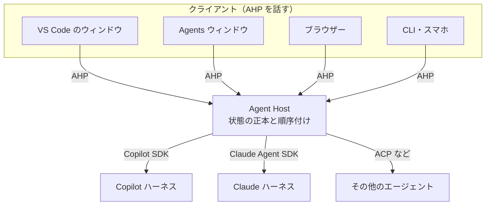
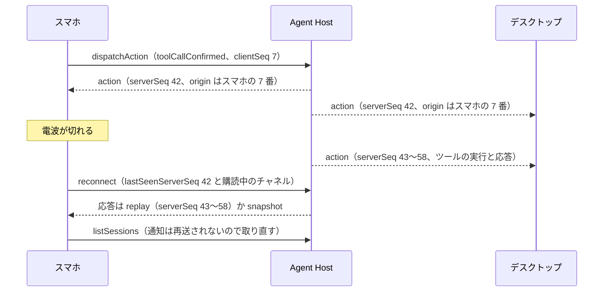
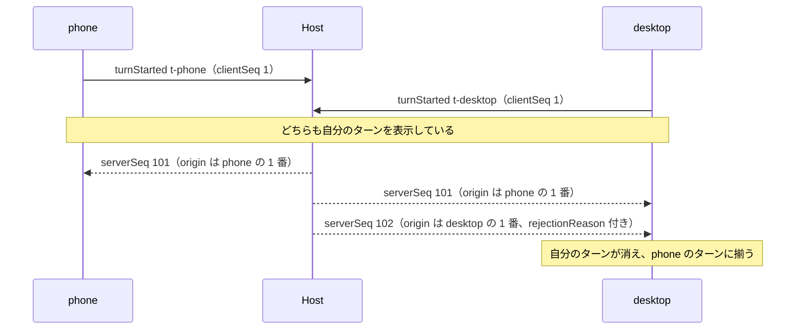
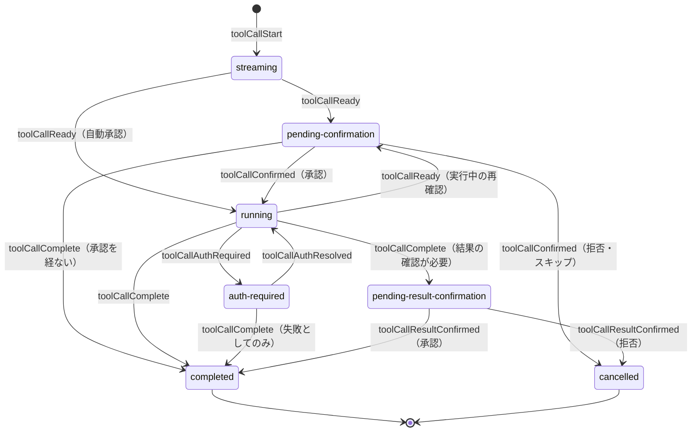

## はじめに

2026 年 8 月 26 日、VS Code チームはブログ記事「[Introducing the Agent Host for persistent, portable agent sessions](https://code.visualstudio.com/blogs/2026/08/26/agent-host-architecture)」で Agent Host を発表した。エージェントのセッションをエディターのウィンドウから切り離し、専用のプロセスに持たせる仕組みだ。Agent Host はローカルでは VS Code のユーティリティプロセスとして、リモートではスタンドアロンのサーバーとして動く。フォルダーを閉じてもターンは走り続け、同じセッションをエディターのウィンドウからも、Agents ウィンドウからも、ブラウザーからも開ける。

このホストとクライアントの間の通信を定めたのが、本稿で扱う Agent Host Protocol（AHP）である。仕様は 2026 年 10 月 2 日に v1.0.0 になり、10 月 28 日の [VS Code 1.144 のリリースノート](https://code.visualstudio.com/updates/v1_144)では「言語サーバーを念頭に、どんなクライアントからでもエージェントのセッションを扱えるように設計した」と紹介された。リポジトリの説明は "Synchronized multi-client state for AI agent sessions"。AI エージェントのセッションの状態を、複数のクライアントの間で同期する、という意味だ。

MCP はエージェントとツールのつなぎ方を、Agent Client Protocol（ACP）はエディターとエージェントの 1 対 1 の会話を定める。AHP が扱うのは、そのどちらとも違う次の問題である。

> 長時間動き、途中で人間の判断を待ち、どこからでも開けるエージェントのセッションを、複数の画面で矛盾なく共有するには、何を決めておけばよいか。

本稿では、AHP の仕様がこの問いにどう答えているかを読み、クライアントやホストを実装するときに押さえるべき点を整理する。仕様をなぞるだけでなく、公開されている公式のリデューサを実際に動かして、文書には書かれていない振る舞いも確かめた。

参照したソースは次のとおり。

- [microsoft/agent-host-protocol](https://github.com/microsoft/agent-host-protocol) の仕様・ガイド・基準となる型定義（`types/`）・各言語の SDK。`spec/v1.0.0` タグと、2026 年 11 月 2 日時点の main（コミット [`ff7d6a1`](https://github.com/microsoft/agent-host-protocol/tree/ff7d6a1c7b4f5e47925d3ce1c3bcf685266a6d49)）
- npm の `@microsoft/agent-host-protocol` 1.0.0。本文の検証コードは、このパッケージのリデューサで実行した
- VS Code の [Agent Host のドキュメント](https://code.visualstudio.com/docs/agents/concepts/agent-host)と、[microsoft/vscode](https://github.com/microsoft/vscode/tree/main/src/vs/platform/agentHost) の `src/vs/platform/agentHost`（2026 年 11 月 2 日時点の main）

1 つ断っておく。AHP は変化の速いプロジェクトで、2026 年 5 月の 0.2.0 から 10 月の 1.0.0 まで、4 か月あまりで 11 回リリースされた。main ではすでに次の開発版（1.1.0）の作業が進んでおり、v1.0.0 の後に windowed delivery（購読ごとのフロー制御）、TCP チャネル、steering メッセージの複数化、チャットごとの設定やエージェントなどが加わっている。本文は v1.0.0 の仕様を基本にし、それ以外には「ドラフト（main）」と明記する。なお VS Code は main に追随しており、執筆時点で取り込んでいる AHP は v1.0.0 より新しいコミット（`d7a5579b`、10 月 30 日）だ。

構成は次のとおり。1 章で問題設定を、2〜3 章でプロトコルの骨格と接続のライフサイクルを扱う。4〜6 章が本稿の中心で、楽観的更新の実装、リデューサとホストの役割分担（最小のホストの実装と、ホストの再起動への備えを含む）、再接続と再送を、コードを動かしながら読む。7〜11 章では人間の判断、クライアントのツール、ターミナル、セキュリティ、大きなセッションの扱いを、12〜14 章ではバージョニング、他のプロトコルとの比較、実装の状況を扱い、15〜16 章で実装のチェックリストと考察をまとめる。

## 先に結論

| 問い | AHP の答え | 主な仕組み | 章 |
|---|---|---|---|
| 正しい状態を誰が持つか | ホストが持つ。クライアントは購読して写しを持つ | チャネルごとの状態、スナップショット | 1、2 |
| 状態はどう変わるか | 型付きのアクションを純粋なリデューサに通す。同じリデューサをホストとクライアントの両方で動かす | `ActionEnvelope`、`chatReducer` など | 2 |
| 途中から開いた画面や、切断から戻った画面はどう追いつくか | 途中から開いた画面は、購読してスナップショットを受け取る。切断から戻った画面は、最後に見た通し番号を伝え、取りこぼしたアクションか、新しいスナップショットを受け取る | `subscribe` と `fromSeq`、`serverSeq`、`reconnect` | 3 |
| 操作の結果をどう待つか | 待たない。手元に先に反映し、ホストが番号を付けて送り返すアクション（エコー）で確定させる | `dispatchAction`、`clientSeq`、`origin` | 4 |
| 同時に操作されたらどうなるか | ホストが順番を決め、受け付けない操作は理由を付けて送り返す。マージはしない | `rejectionReason`、ホストの検証 | 4、5 |
| 不変条件は誰が守るか | リデューサではなくホスト。リデューサは対象の合わない操作を捨てるだけで、受け付けてよいかは判断しない | 検証の表、ターンの受け付け判定 | 5 |
| 切断中に送った操作はどうするか | プロトコルは決めていない。届いたかを判定してから、操作の種類ごとに送り直すかを決める | エコーの照合、クライアントが選ぶ ID | 6 |
| 人間の判断をどう待つか | 承認・質問・認証を、状態機械の状態として持つ。どの画面からでも答えられる | ツール呼び出しの状態、`inputNeeded`、`SessionStatus` | 7 |
| クライアントにしかない能力をどう使うか | ツールの登録も実行も、RPC ではなく共有された状態で表す | `session/activeClientSet`、`contributor` | 8 |
| 何を決めていないか | エージェントの推論、ツールの定義、モデル、接続そのものの認証、ファイルシステムの前提、エージェント同士の連携 | doctrine の anti-goals、Transport の章 | 1、10 |

## 1. 問題設定: セッションを誰が持つか

### 1.1 ウィンドウがセッションを持つ設計の限界

Agent Host 以前の VS Code では、エージェントのハーネス（モデルを呼び、ツールを動かし、エージェントのループを回す実装）は、ウィンドウごとの拡張機能ホストの中で動いていた。VS Code チームのブログによれば、この構成ではエージェントの実行がウィンドウに結び付き、ウィンドウを閉じると止まり、ウィンドウごとに同じ仕組みを読み込むことになる。そこで、セッションの状態、ハーネスのアダプター、作業に最低限必要な機能を専用のプロセスに移し、ウィンドウはそこへ接続するクライアントになった。

これは VS Code に限った話ではない。エージェントのセッションには、これまでのチャットにはなかった性質がいくつもある。

- <strong>長く動く。</strong>数分から数時間、人が見ていない間も作業が続く
- <strong>途中で人間の判断を待つ。</strong>ツール実行の承認、エージェントからの質問、認証
- <strong>出力が少しずつ届く。</strong>テキストもツールの進み具合もストリーミングされる
- <strong>実行する場所と見る場所が分かれる。</strong>リポジトリのあるマシンやコンテナで動かし、ノート PC やブラウザー、スマホで見る
- <strong>複数の画面から同時に開かれる。</strong>そして、同時に操作されうる

UI のプロセスがセッションを持つ限り、最初の 4 つを満たすのは難しい。かといってセッションを UI から切り離すと、今度は最後の性質、つまり複数の画面の間で状態をどう揃えるかが問題になる。

### 1.2 複数の画面で共有すると何が起きるか

具体的な場面で考えてみる。デスクトップでエージェントにビルドの修正を頼み、移動中にスマホで進み具合を見てツールの実行を承認し、帰宅してからブラウザーで結果を確かめる。

素朴に作るなら、ホストがイベントを WebSocket か SSE で各画面に流し、画面は操作を HTTP で送る形になるだろう。だがこれでは、すぐに次のような問題にぶつかる。

- <strong>途中から開いた画面。</strong>過去のイベントを持っていないので、今の状態をどこかからまとめて受け取る必要がある
- <strong>切断。</strong>電波が切れていた間のイベントを、どこから受け取り直せばよいかわからない
- <strong>同時の操作。</strong>スマホで承認し、同時にデスクトップで拒否したらどちらが通るのか。負けた画面の表示はどう戻すのか
- <strong>応答の遅さ。</strong>送信ボタンを押してからサーバーの応答を待つと、モバイル回線では表示が遅れる
- <strong>エージェントの違い。</strong>Copilot、Claude、Codex のそれぞれのイベントの形を、すべての画面が理解しなければならない

どれも、複製された状態をどう揃えるかという、分散システムで古くから扱われてきた問題の言い換えだ。

### 1.3 AHP の答え

AHP の答えをまとめると次のようになる。

1. ホスト（Agent Host）が状態の正本を持つ
2. 状態は URI で名前の付いた「チャネル」ごとに分かれ、クライアントは見たいチャネルだけを購読する
3. 購読すると、まず今の状態のスナップショットが届き、その後は状態を変えるアクションが、ホストの付けた通し番号の順に届く
4. アクションを状態に適用するのは純粋関数のリデューサで、同じものをホストとクライアントが使う
5. クライアントは自分の操作もアクションとして送り、送ると同時に手元にも適用しておく。ホストが番号を付けて送り返してきた時点で確定する
6. 接続が切れたら、最後に見た番号を伝えて、取りこぼした分か新しいスナップショットを受け取る

状態を 1 か所に集め、アクションとリデューサで変えるところは Redux と同じだ。手元に先に反映しておき、サーバーが決めた順序で確定させるところは、対戦ゲームのネットコードでいうクライアント側の予測とサーバーによる調停（client-side prediction と server reconciliation）や、Replicache のような同期エンジンに近い。一方で AHP は、CRDT のように並行した変更をマージする道は取らない。競合はホストが順番を付けて解き、通らなかった操作は理由を付けて送り返す。それでも困らない理由は 4.6 節で述べる。



ホストは、その下にいるエージェントとはエージェントごとの SDK や ACP で話し、そのイベントを AHP のアクションに翻訳する。VS Code の Agent Host は、Copilot（Copilot SDK）、Claude（Claude Agent SDK）、Codex のそれぞれにアダプターを持つ。AHP の仕様が定めるのは、図の上半分、クライアントとホストの間だけだ。

公式のガイド「[AHP and the Agent Client Protocol](https://microsoft.github.io/agent-host-protocol/guide/ahp-and-acp)」は、この関係を「AHP は ACP の上のミューテックスだ」と表現している。ACP が定めるのは 1 つのクライアントと 1 つのエージェントの会話であり、AHP はその会話に N 個のクライアントが互いを邪魔せずに参加できるよう、順序付けと同期の仕組みをかぶせる。

設計の方針は「[doctrine](https://microsoft.github.io/agent-host-protocol/guide/doctrine)」という文書にまとまっている。要点を訳すと次のとおりだ。

| 方針 | 意味 |
|---|---|
| 状態が先にある（state-first） | 追加する機能は「どのバックエンドのイベントが起きたか」ではなく「クライアントが描画や調停に使う、残る状態は何か」から考える。ユーザーに見える事実は、状態から復元できなければならない |
| 正本はホストに、即時の反映はクライアントで | クライアントは自分の操作を先に反映してよいが、正本はホストで、競合したらホストが結果の順序を決める |
| 少しずつ導入できる | ルートとセッションのチャネル、セッションの作成、基本的なターンだけで役に立つホストやクライアントを作れるようにする |
| 同期の仕方は決めるが、エージェントの作り方には口を出さない | エージェントのループ、モデルの提供元、ツールの形式、認証の方式、ファイルシステムの前提は決めない |
| チャネル単位で考える | プッシュされるものはすべて、URI で名前の付いたチャネルに属する |
| クライアント向けの表示モデルである | バックエンド固有のツール名などを、クライアントとの約束事にしない |
| 標準の外への拡張は、それとわかる場所に置く | プロバイダ固有の情報は `_meta` などに置き、基本の体験には必要としない |
| 互換性とケイパビリティで進化する | 任意のフィールド、未知のメタデータの無視、ケイパビリティの確認を、全員の同時更新より優先する |

逆に、AHP が定めないと明言しているもの（anti-goals）は、エージェントの推論、計画、ツールの呼び方、コンテキストの管理、モデルの提供元や認証情報の流れ、バックエンドのツールの共通レジストリ、UI のレイアウト、ワークスペースにローカルのファイルシステムや Git があること、エージェント同士の連携、そして ACP の置き換えである。

## 2. 全体像: チャネル、状態、アクション、リデューサ

### 2.1 チャネル

AHP では、プッシュされるものはすべて「チャネル」に属する。チャネルは URI で識別され、それぞれが状態ツリーを持つ（状態はその場で書き換えず、変更のたびに新しいオブジェクトを作る）。v1.0.0 にあるチャネルは次のとおりだ（安定度は 12 章で説明する）。

| URI | 状態の型 | 中身 | 安定度 |
|---|---|---|---|
| `ahp-root://` | `RootState` | 使えるエージェントとモデル、ターミナルの一覧、ホストの設定。必ず 1 つ存在する | 2（安定） |
| `ahp-session:/<uuid>` | `SessionState` | セッションのメタデータ、チャットの一覧、既定のチャット、参加中のクライアント、入力待ちの集約 | 2（安定） |
| `ahp-chat:/<uuid>` | `ChatState` | 1 つの会話。ターン、ストリーミング中の応答、ツール呼び出し、保留中のメッセージ、入力要求 | 2（安定） |
| `ahp-terminal:/<id>` | `TerminalState` | 1 つの擬似端末（pty） | 2（安定） |
| `ahp-changeset:/<id>` | `ChangesetState` | ファイル変更の集まり（ブランチの差分、未コミットの変更など） | 1.2（リリース候補） |
| `ahp-resource-watch:/<id>` | `ResourceWatchState` | ファイルの監視 | 2（安定） |
| `ahp-otlp:` で始まる URI | 空 | OpenTelemetry のログ・トレース・メトリクス。データは通知だけで届く | 2（安定） |
| `ahp-automations://` と `ahp-automation-run:/<id>` | `AutomationState` など | 定期実行やイベントで起動する自動化の定義と、その実行 | 1.0（初期開発） |
| `ahp-canvas:/<id>` | `CanvasState` | キャンバス | 1（実験的） |

このほか、セッションの注釈（`ahp-session:/<uuid>/annotations`）と、MCP Apps のための `mcp://` チャネル（13.3 節）がある。ドラフト（main）では、ホストのネットワーク上の TCP 接続を転送する `ahp-tcp:` チャネルが加わった。

チャネルは、通信路を流れるメッセージを振り分けるためのキーでもある。すべてのリクエストと通知の `params` に、`channel` というメンバーが必ず入る。セッションに関するコマンドならそのセッションの URI、接続全体に関わるコマンド（`initialize`、`ping`、`reconnect`、`listSessions`、`authenticate`、ファイル操作の `resource*` など）なら `ahp-root://` だ。そのため、サーバーもクライアントも、間に挟まるプロキシも、`(method, params.channel)` だけを見ればメッセージを振り分けられる。基準となる TypeScript の型定義には、この規則をコンパイル時に検査する仕掛け（`types/version/message-checks.ts`）まである。

なお、セッションの URI はクライアントが選ぶ。チャットの URI については、仕様の本文が「作成時にサーバーが割り当てる」と書く一方で、型定義の `CreateChatParams.chat` には「クライアントが選ぶ（client-chosen）」と書かれ、必須の引数になっている（v1.0.0、main とも）。実際のメッセージの形を決めるのは型定義なので、`createChat` を呼ぶ側が URI を用意することになる。どちらの URI も、受け取った側は中身を解釈せずに扱う。

### 2.2 1 台のスマホが購読するもの

具体的な流れで見てみよう。スマホのクライアントがセッション一覧を出し、1 つの会話を開くまでの手順は次のようになる。

1. `initialize` で接続を始め、`initialSubscriptions` に `ahp-root://` を入れておく。応答に `RootState`（使えるエージェントとモデル、ターミナルの一覧など）のスナップショットが入っている
2. `listSessions` でセッション一覧を取る。`limit` と `cursor` でページ分けでき、結果は最近更新されたものから並ぶ
3. 以後は、ルートチャネルに届く `root/sessionAdded`・`root/sessionRemoved`・`root/sessionSummaryChanged` の通知で一覧を最新に保つ
4. セッションを開いたら `ahp-session:/<uuid>` を購読する。チャットの一覧、既定のチャット（`defaultChat`）、入力待ちの集約（`inputNeeded`）が届く
5. 会話を開いたら `ahp-chat:/<uuid>` を購読する。直近の 20 ターンだけ欲しければ `view: { turns: 20 }` を付け、古いターンは必要になってから `fetchTurns` で読み込む

セッションの一覧が状態ツリーに入っていないことに注意したい。一覧はいくらでも大きくなりうるので、リクエストで明示的に取得し、軽い通知で差分を受け取る形にしてある。同じ理由で、各セッションの要約（タイトル、ステータス、更新時刻など）は `root/sessionSummaryChanged` で配られるので、一覧画面はセッションを 1 つずつ購読しなくてよい。

### 2.3 状態と通知

チャネルから届くものは 2 種類ある。状態を変えるアクションと、状態には残らない通知だ。

| | アクション | 通知 |
|---|---|---|
| 例 | `chat/delta`、`chat/toolCallReady`、`session/titleChanged` | `root/sessionAdded`、`auth/required`、`root/progress` |
| 状態への反映 | リデューサを通して状態を変える | 変えない |
| 通し番号 | `serverSeq` が付く | 付かない |
| 再接続のとき | 取りこぼした分が再送される | 再送されない。必要なら取り直す |

doctrine が「ユーザーに見える事実は状態から復元できなければならない」と言うのは、この区別のためだ。通知は一時的な合図にとどめ、残るべき事実は必ず状態に置く。これを守っていれば、途中から開いた画面も、切断から戻った画面も、スナップショットとアクションだけで同じ表示にたどり着ける。

### 2.4 アクションとエンベロープ

アクションは `type` で区別される判別共用体で、状態を変える唯一の手段である。実際のメッセージでは、必ずエンベロープに包まれて届く。

```json
{
  "jsonrpc": "2.0",
  "method": "action",
  "params": {
    "channel": "ahp-chat:/3f1c...",
    "action": { "type": "chat/toolCallConfirmed", "turnId": "t1", "toolCallId": "tc1", "approved": true, "confirmed": "user-action" },
    "serverSeq": 6,
    "origin": { "clientId": "client-1", "clientSeq": 1 }
  }
}
```

| メンバー | 意味 |
|---|---|
| `channel` | アクションが変えるチャネル。アクション本体にはセッションやターミナルの URI を入れず、宛先はエンベロープで示す |
| `action` | アクション本体 |
| `serverSeq` | ホストが付ける、単調に増える通し番号 |
| `origin` | 送ったクライアントの `clientId` と、そのクライアントが付けた `clientSeq`。ホスト自身が起こしたアクションでは付かない |
| `rejectionReason` | ホストがクライアントの操作を受け付けなかったときにだけ付く、人が読める理由 |

アクションには、クライアントが送れるもの（client-dispatchable）と、ホストしか起こせないものがある。たとえば `chat/turnStarted`（メッセージを送る）、`chat/toolCallConfirmed`（ツールの承認・拒否）、`chat/turnCancelled`（取り消し）、`session/titleChanged`（名前の変更）はクライアントが送れる。`chat/delta`（応答のテキストの追記）、`chat/responsePart`（応答パーツの作成）、`chat/toolCallStart`・`chat/toolCallReady`（ツール呼び出しの開始と準備完了）は、エージェントのバックエンドから来るものなので、ホストだけが起こす。この区別は型定義の JSDoc の `@clientDispatchable` から生成され、SDK の `isClientDispatchable()` で判定できる。上の例は、クライアントが送った承認のエコーだ。なお仕様の購読の章にあるエンベロープの例は、`chat/delta` に `origin` を付けているが、ホストが起こすアクションに `origin` は付かない。

### 2.5 コマンドとアクションの使い分け

AHP のメッセージは JSON-RPC 2.0 で、応答のあるリクエストと、応答のない通知に分かれる。

| 種類 | 例 | 応答 |
|---|---|---|
| コマンド（リクエスト） | `initialize`、`reconnect`、`subscribe`、`createSession`、`disposeSession`、`createChat`、`listSessions`、`fetchTurns`、`completions`、`authenticate`、`resourceRead` など | あり（結果か JSON-RPC のエラー） |
| アクションの送信 | `dispatchAction` | なし。エンベロープのエコーが返事の代わり |
| 購読の解除 | `unsubscribe` | なし |

ここで重要なのは、`dispatchAction` が通知であることだ。送りっぱなしで、JSON-RPC の応答は返らない。操作が受け付けられたかどうかは、ホストが `serverSeq` を付けて送り返してくるエンベロープ（`origin` に自分の `clientId` と `clientSeq` が入ったもの）でわかる。

また、対話の中心になる操作は、コマンドではなくアクションそのものとして送る。クライアントが `chat/turnStarted` を送ると、ホストはそれを状態に適用すると同時に、副作用としてエージェントの処理を始める。`chat/turnCancelled` なら処理を止める。Actions のガイドはこれを「コマンドをアクションに翻訳する層を別に設けずに済む」と説明している。セッションの作成やファイルの読み書きのように、結果を返す必要があるものだけがコマンドになっている。

### 2.6 純粋なリデューサと、その適合性テスト

アクションを状態に適用するのは、チャネルの種類ごとのリデューサだ。

```typescript
rootReducer(state: RootState, action: RootAction): RootState
sessionReducer(state: SessionState, action: SessionAction): SessionState
chatReducer(state: ChatState, action: ChatAction): ChatState
terminalReducer(state: TerminalState, action: TerminalAction): TerminalState
```

リデューサは副作用を持たない純粋関数で、同じコードがホストとクライアントの両方で動く。これが、クライアントが自分の操作を先に反映できる（write-ahead）根拠になる。エージェントへの転送のような副作用は、リデューサとは別の層が受け持つ。

リデューサの中で現在時刻を読むと、ホストと各クライアントで結果がずれてしまう。そこで、時刻もアクションに含めて渡す。`chat/turnStarted` には `startedAt`（ISO 8601 の時刻）が、`chat/turnComplete` には `duration`（ミリ秒）が入っていて、リデューサは `modifiedAt` を `startedAt + duration` として計算する。型定義のコメントは、クライアントが自分の時計で経過時間を計算してはならない（クライアント同士で時計がずれうるため）と念を押している。

未知のアクションへの備えもある。リデューサの `switch` は網羅的で、型を追加して処理を書き忘れるとコンパイルエラーになる。一方、実行時に未知の `type` が届いた場合は、例外を投げずにログを出すだけ（`softAssertNever`）にしてある。新しいホストにつながった古いクライアントが、知らないアクションで落ちないようにするためだ。

型は、基準となる TypeScript の型定義から Rust、Kotlin、Swift、Go、.NET に生成される。リデューサの振る舞いは、`types/test-cases` にある言語に依存しない JSON のフィクスチャで揃えている。v1.0.0 の時点でリデューサのフィクスチャが 308 件、シリアライズの往復のフィクスチャが 68 件、ほかにバージョン交渉のフィクスチャがあり、各言語の SDK のテストがこれを読み込む。リデューサのフィクスチャは、初期状態・アクションの列・期待される状態の 3 つからなる単純な形をしている。

```json
{
  "description": "session/ready",
  "reducer": "session",
  "initial": { "provider": "copilot", "title": "Test Session", "status": 1, "lifecycle": "creating", "activeClients": [], "chats": [] },
  "actions": [{ "type": "session/ready" }],
  "expected": { "provider": "copilot", "title": "Test Session", "status": 1, "lifecycle": "ready", "activeClients": [], "chats": [] }
}
```

ホストやクライアントを自分で実装するなら、まずこのフィクスチャを通すのが近道だ。

## 3. 接続のライフサイクル

### 3.1 initialize とバージョン交渉

接続はクライアントの `initialize` リクエストから始まる。

```json
{
  "jsonrpc": "2.0",
  "id": 1,
  "method": "initialize",
  "params": {
    "channel": "ahp-root://",
    "protocolVersions": ["1.0.0", "0.9.0"],
    "clientId": "phone-7f3c",
    "clientInfo": { "name": "my-ahp-client", "version": "0.1.0" },
    "initialSubscriptions": ["ahp-root://"],
    "locale": "ja"
  }
}
```

`clientId` は再接続をまたいで同じクライアントを識別するための ID で（6.4 節）、`clientInfo` は実装の名前とバージョンだ。`clientInfo` と、ホストが返す `serverInfo` は LSP にならったもので、ログや表示のための情報にすぎない。仕様は、相手のバージョン文字列を見て機能の有無を判断すべきでない（SHOULD NOT）と書いている。機能の有無はケイパビリティで判断する。`locale` はツール承認ボタンの文言などをホストが訳すために使う。

ホストの応答には、選ばれたプロトコルのバージョン、現在の `serverSeq`、`initialSubscriptions` に対応するスナップショットのほか、ファイルを選ぶ画面の起点になる `defaultDirectory`、`@` メンションの補完を起動する文字（`completionTriggerCharacters`）、ターミナルのコマンドとして扱うメッセージの接頭辞（`terminalCommandPrefix`。慣例は `!` で、なければホストは対応していない）、テレメトリーのチャネル（`telemetry`）、自動化への対応（`automations`）といった、ホストのケイパビリティが入る。

バージョン交渉は WebSocket のサブプロトコル交渉に似ている。クライアントは話せるバージョンを並べて送り、ホストはそこから 1 つ選ぶ。ただし選び方には注意がいる。仕様は配列を「好ましい順」と書くが、ホストは並び順に関係なく、自分が対応する範囲（キャレット互換の範囲。v1.0.0 では `>=1.0.0 <2.0.0` と `>=0.9.0 <0.10.0`）に入る中で最も新しいものを選ぶ。SDK の `negotiateProtocolVersion` で確かめると、次のようになる。

```text
negotiateProtocolVersion(['0.9.0', '1.0.0'])  → '1.0.0'   並び順に関係なく新しい方
negotiateProtocolVersion(['1.2.99', '1.10.0']) → '1.10.0'  数値として比べる（文字列比較ではない）
negotiateProtocolVersion(['2.0.0', '0.10.0'])  → undefined どれも対応範囲の外
```

選べるものがなければ、ホストは `UnsupportedProtocolVersion`（`-32005`）を、対応するバージョンの一覧（`data.supportedVersions`）を付けて返し、接続を閉じる。`1.0` や `1.0.0-beta` のような形式の崩れた文字列が 1 つでも混じっていれば、交渉そのものがエラーになる。

この選び方から、もう 1 つ注意点が出てくる。ホストが選ぶのは「自分の対応範囲に入る、相手が申告した中で最も新しい文字列」なので、1.0.0 の機能しか実装していないホストでも、クライアントが `1.10.0` を申告すれば `1.10.0` を返す（上の 2 つ目の例）。合意したバージョンの文字列は、ホストがどの機能を持っているかを示さない。機能の有無は、必ずケイパビリティで確かめる。

仕様は、クライアントはなるべく広い範囲のバージョンを申告するべきだ（SHOULD）としている。ホストはリモートのマシンやクラウドのサービスで、利用者が更新できるとは限らないのに対し、クライアントは更新しやすいからだ。各 SDK は、そのビルドが話せるバージョンの一覧を `SUPPORTED_PROTOCOL_VERSIONS` として公開しているので、普通はそれをそのまま渡せばよい。

### 3.2 subscribe とスナップショット

接続した後は、チャネルを購読して状態を受け取る。

```json
{ "jsonrpc": "2.0", "id": 3, "method": "subscribe", "params": { "channel": "ahp-session:/9b2e..." } }
```

```json
{
  "jsonrpc": "2.0",
  "id": 3,
  "result": {
    "snapshot": {
      "resource": "ahp-session:/9b2e...",
      "state": { "provider": "copilot", "title": "New Session", "status": 1, "lifecycle": "creating", "chats": [], "activeClients": [] },
      "fromSeq": 5
    }
  }
}
```

`fromSeq` は、スナップショットを取った時点の `serverSeq` だ。仕様は、スナップショットの後にホストが送るアクションの `serverSeq` は必ず `fromSeq` より大きいと定めている。だから、受け取ったアクションが `fromSeq` 以下なら、それはスナップショットにもう含まれている。

v1.0.0 の `subscribe` には、任意のオプションが 2 つある。

- <strong>`delivery.maxLatencyMs`</strong>: 更新をまとめるために、ホストが手元に留めてよい時間の上限。ホストはこの時間内の更新をまとめて送ってよいが、まとめた後の状態が、1 つずつすぐに送った場合にクライアントが得る状態と同じになる場合に限られる（ドラフトでは、チャネルが必要とするイベントをすべて届けることも条件に加わった）。同じ応答パーツへの 2 つの `chat/delta` を 1 つにまとめる、といった使い方だ。`0` を渡すと、まとめずにすぐ送るよう求めることになる
- <strong>`view.turns`</strong>: チャットのスナップショットに含める、完了済みのターンの数の目安。古いターンが残っていれば `ChatState.turnsNextCursor` が付くので、それを `fetchTurns` に渡すと、ホストが `chat/turnsLoaded` で古いターンを状態の先頭に足す。ホストは、範囲外の古いターンを参照する操作（フォークや、古いターンまでの切り詰めなど）を受け付ける前に、そのターンを状態に読み込んでおかなければならない

ドラフト（main）では、1 つのクライアントが同じチャネルに持てる購読は 1 つだけで、購読中のチャネルにもう一度 `subscribe` を送ると既存の購読の設定を変える意味になる、という規則が加わった（windowed delivery と一緒に入ったもので、v1.0.0 にはない）。

実装上の注意を 1 つ。`subscribe` の応答の直後に、そのチャネルのアクションが届くことがある。応答を受け取ってからイベントの受け口を用意すると、その間のアクションを落としかねない。TypeScript の SDK の `subscribe()` は、リクエストを送る前に受け口を登録するようになっている。自前で書くときも同じ順序にしたい。

### 3.3 serverSeq の性質

`serverSeq` には、実装の前に押さえておきたい性質がいくつかある。

- <strong>ホスト全体で 1 本の数列として扱われる。</strong>`initialize` の応答の `serverSeq`、スナップショットの `fromSeq`、各アクションの `serverSeq` は同じ数列の値で、再接続のときにクライアントが送るのも 1 つの `lastSeenServerSeq` だけだ
- <strong>クライアントから見ると欠番がある。</strong>クライアントには購読しているチャネルのアクションしか届かないので、番号は飛び飛びになる。欠番を見て取りこぼしと判断してはいけない
- <strong>通信路での取りこぼしは、トランスポートの性質で防ぐ。</strong>仕様はトランスポートに、順序どおりに届くこと、途中で失われないこと、双方向であること、メッセージが途中で切れないことを求めている。WebSocket なら、1 つのテキストフレームに 1 つの JSON-RPC メッセージを入れる。通信路で取りこぼしが起きうるのは接続が切れたときだけで、それは次の `reconnect` で埋める

ただし、受け取った後のクライアントの中で失われることはある。TypeScript の SDK は、購読ごとに既定で 4096 件まで（複数ホストのイベントを 1 本にまとめる `MultiHostClient` のストリームは 1024 件まで）イベントを溜め、読み出しが追いつかずに上限を超えると、古いイベントから捨てて読み出し位置を先へ進める。欠番はふだんから起きるので、クライアントはこれを取りこぼしとして検出できない。イベントを 1 件も落とせないなら、すぐに読み出すか上限を上げるよう、SDK のコメント自身が勧めている。受け取ったイベントの処理を、描画などの重い処理で滞らせない作りにしておきたい。

接続の生存確認には、AHP の `ping` コマンドを使える。ホストは、`initialize` の前でも購読がなくても `ping` に応答しなければならない。間に挟まるプロキシやロードバランサーが、何も流れていない接続をタイムアウトで切るのを防ぐのにも役立つ。WebSocket 自体の ping フレームを使ってもよいが、TypeScript の SDK が注意しているとおり、ブラウザーは WebSocket の ping フレームを送れない。ブラウザーのクライアントでは `ping` コマンドを使う。

ホスト全体で 1 本の数列という性質は、16 章でもう一度取り上げる。

### 3.4 reconnect

接続が切れたら、クライアントは新しい接続で `reconnect` を送る。

```json
{
  "jsonrpc": "2.0",
  "id": 2,
  "method": "reconnect",
  "params": {
    "channel": "ahp-root://",
    "clientId": "phone-7f3c",
    "lastSeenServerSeq": 42,
    "subscriptions": ["ahp-root://", "ahp-session:/9b2e...", "ahp-chat:/3f1c..."]
  }
}
```

ホストは 2 通りの返し方をする。取りこぼした分がまだ手元に残っていれば、その間のアクションを応答の中にまとめて返す（`type: "replay"`）。もう続きから送れないチャネル（破棄されたセッションや、見る権限を失ったチャネル）は `missing` に並ぶので、クライアントはそれを購読の一覧から外す。間が空きすぎて再送できなければ、各チャネルの新しいスナップショットを返す（`type: "snapshot"`）。こちらには `missing` がないので、状態を持つのにスナップショットが返らなかったチャネルは、続けられなかったものとみなす。一方、`ahp-otlp:` のような状態を持たないチャネルには、もともとスナップショットがない。v1.0.0 は、こうしたチャネルは購読し直され、取りこぼした分は捨てられる、としている（`subscribe` を改めて送る必要があるかは 11.3 節で述べる。ドラフトでは、状態が空のチャネルについてスナップショットを省くことも認めている）。どこまで再送できるか、つまり再送用のバッファの大きさは実装に任されていて、VS Code のホストは直近の 1000 件を持っている。

```json
{
  "jsonrpc": "2.0",
  "id": 2,
  "result": {
    "type": "replay",
    "actions": [
      { "channel": "ahp-chat:/3f1c...", "action": { "type": "chat/delta", "turnId": "t1", "partId": "p1", "content": "..." }, "serverSeq": 43 },
      { "channel": "ahp-chat:/3f1c...", "action": { "type": "chat/turnComplete", "turnId": "t1", "duration": 5300 }, "serverSeq": 44 }
    ],
    "missing": []
  }
}
```

再送される分が応答の中に入っている点が大事だ。応答を処理し終えた時点で、取りこぼしがすべて埋まったことがわかる。

ただし、応答より先に通常の `action` 通知が届くことはありうる。v1.0.0 は、再送分を応答の中に入れることは求めているが、応答より前に通常の通知を送ってはならないとは書いていない（ドラフトが禁じているのは、windowed delivery の購読についてだけだ）。4 章のストアのように `serverSeq` で重複を捨てる作りだと、応答より先に新しい番号のアクションを処理した時点で、それより小さい番号の再送分がすべて捨てられてしまう。クライアントは、`reconnect` の応答を適用し終えるまで届いた通知を溜めておき、その後で順に処理する（再接続の手順の全体は 6.6 節にまとめる）。ホストの側も、応答を送ってから、そのクライアントへの通常の配信を再開するのが安全だ（5.5 節のコードはそうしている）。



一方、通知は再送されない。再接続したクライアントは、`listSessions` でセッションの一覧を取り直し、認証が必要なリソースの状態も確かめ直す必要がある（`auth/required` も通知なので、切断中に届いたものは失われている）。

### 3.5 ホストが落ちたとき

仕様は、ホストのプロセスが予期せず終了した場合について、実行中のターンは失敗として扱うべきだ（SHOULD）としている。再起動したホストには、クライアントが通常の再接続の手順でつなぎ直す。

VS Code のドキュメントも、再接続できたからといって、ホストが止まっていた間も作業が進んでいたとは限らない、と注意している。ローカルの Agent Host は VS Code が管理しているので、ローカルのセッションを走らせ続けるには、フォルダーを閉じてもアプリケーション自体は終了しないでおく必要がある。セッションの寿命は、ホストのプロセスの寿命を超えない。

## 4. 楽観的更新（write-ahead）を実装する

### 4.1 3 つの状態

AHP のガイド「[Write-Ahead Reconciliation](https://microsoft.github.io/agent-host-protocol/guide/reconciliation)」は、クライアントが購読ごとに次の 3 つを持つ形を示している。

- <strong>`confirmedState`</strong>: ホストが確定させた状態
- <strong>`pendingActions`</strong>: 手元には反映したが、まだホストからエコーが返っていない自分の操作
- <strong>`optimisticState`</strong>: `confirmedState` に `pendingActions` を順に適用したもの。保存せず、その都度計算する

画面に出すのは常に `optimisticState` だ。送信ボタンを押した瞬間にメッセージが表示され、ホストが確定させるとそのまま残り、断られると消える。

エンベロープを受け取ったときの処理は、次の 3 つの場合に分かれる。どの場合も、最後に `optimisticState` を計算し直す。

1. <strong>自分の操作のエコー。</strong>`origin.clientId` が自分で、`pendingActions` の先頭と一致する。先頭を取り除き、`confirmedState` に適用する
2. <strong>他人の操作か、ホスト自身の操作。</strong>`confirmedState` に適用する。残っている `pendingActions` は、新しい `confirmedState` の上に載せ直される
3. <strong>断られた操作。</strong>`rejectionReason` が付いている。`pendingActions` から取り除く（先に反映した分が消える）。理由は利用者に見せてよい

リデューサが純粋なので、「載せ直す」といっても特別な処理はいらない。`confirmedState` が変わった後で、保留中の操作をもう一度適用し直せばよいだけだ。

### 4.2 1 チャネル分のストア

これをそのまま TypeScript に書くと、次のようになる。本稿の検証用に書いたもので、npm の `@microsoft/agent-host-protocol` 1.0.0 の型に対して `tsc --strict` を通し、後で示すシミュレーションで動かしている。

```typescript
import type { ActionEnvelope, StateAction } from '@microsoft/agent-host-protocol';

type Reducer<S> = (state: S, action: StateAction) => S;
type Pending = { clientSeq: number; action: StateAction };

/** 1 つのチャネルの写しを、確定した状態と保留中の操作に分けて持つ */
export class OptimisticChannel<S> {
  private confirmed: S;
  private appliedSeq: number;
  private pending: Pending[] = [];
  private readonly clientId: string;
  private readonly reduce: Reducer<S>;

  constructor(clientId: string, reduce: Reducer<S>, snapshot: { state: S; fromSeq: number }) {
    this.clientId = clientId;
    this.reduce = reduce;
    this.confirmed = snapshot.state;
    this.appliedSeq = snapshot.fromSeq;
  }

  /** 画面に出すのは常にこちら */
  get view(): S {
    return this.pending.reduce((s, p) => this.reduce(s, p.action), this.confirmed);
  }

  get pendingCount(): number {
    return this.pending.length;
  }

  /** dispatchAction を送るときに、同じ clientSeq で積んでおく */
  addPending(clientSeq: number, action: StateAction): void {
    this.pending.push({ clientSeq, action });
  }

  /** ホストから action 通知を受け取ったとき */
  receive(env: ActionEnvelope): void {
    if (env.serverSeq <= this.appliedSeq) return; // スナップショットか適用済みの分に含まれている
    this.appliedSeq = env.serverSeq;

    const origin = env.origin;
    if (origin?.clientId === this.clientId) {
      // 自分の操作のエコー。届く順序に頼らず clientSeq で照合する
      this.pending = this.pending.filter(p => p.clientSeq !== origin.clientSeq);
    }
    if (env.rejectionReason === undefined) {
      this.confirmed = this.reduce(this.confirmed, env.action);
    }
  }

  /** reconnect の結果と、それまでに溜めた通知を処理し終えたら呼ぶ。エコーの来なかった操作を取り出す */
  takeUnacknowledged(): Pending[] {
    const unacknowledged = this.pending;
    this.pending = [];
    return unacknowledged; // 送り直すかどうかはアプリが決める（6 章）
  }

  /** reconnect の結果がスナップショットだったとき（保留中の操作は、溜めた通知を処理してから takeUnacknowledged() で取り出す） */
  resetTo(snapshot: { state: S; fromSeq: number }): void {
    this.confirmed = snapshot.state;
    this.appliedSeq = snapshot.fromSeq;
  }
}
```

### 4.3 このコードで判断していること

短いコードだが、仕様を読んで決めたことがいくつか入っている。

<strong>1. 返事を待たない。</strong>`dispatchAction` は通知なので、JSON-RPC の応答は来ない。受け付けられたかどうかは、`origin` に自分の `clientId` と `clientSeq` が入ったエンベロープでわかる。

<strong>2. `serverSeq` で重複を捨てる。</strong>スナップショットの `fromSeq` 以下のアクションは、スナップショットに含まれている。後で述べるように、`chat/delta` は同じものを 2 回適用するとテキストが 2 回つながる。重複の排除はリデューサではなく、受け取る側の仕事だ。

<strong>3. エコーは `clientSeq` で照合し、エコーの来ない操作は再接続のときにまとめて扱う。</strong>ガイドのアルゴリズムは、エコーが保留中の操作の先頭と一致することを前提にしている。だが、1 つのクライアントの操作が送った順にエコーされることは、仕様に明文化されていない。`clientSeq` で照合しておけば、順序に依存しない。一方で、エコーが来ないまま残る操作はありうる。接続が切れる直前に送った操作が典型だ。ほかにも、VS Code のホストの実装（`protocolServerHandler.ts` の `_dispatchClientActionNow`）は、検証の途中で接続が閉じられたことに気づくと、エコーを返さずに処理を打ち切る。存在しないチャネル宛ての操作も、ホストはエコーを返さずに無視しなければならない（MUST）。こうした操作は、再接続の結果と溜めた通知を処理し終えた時点で `takeUnacknowledged()` でまとめて取り出し、6 章の方針で扱う（手順は 6.6 節）。なお `resetTo()` は、そのチャネルの適用済みの番号をスナップショットの `fromSeq` に置き換える。番号が下がることもある理由は、5.6 節で確かめる。接続が続いているのに長くエコーの来ない操作があれば、利用者に知らせるのもよい。

<strong>4. 断られた操作は確定状態に適用しない。</strong>当たり前に見えるが、SDK に付属する簡易ミラー（TypeScript の `AhpStateMirror` と `MultiHostStateMirror`、Rust・Swift・Go・.NET の各ミラー）は、執筆時点のコミットではどれも `rejectionReason` を見ずにエンベロープを適用する。しかも、後で見るように VS Code のホストは断ったエンベロープも購読者全員に配る（5.2 節）。簡易ミラーを確定状態として使うなら、`rejectionReason` の付いたエンベロープは自分で除いてから渡したい。なお TypeScript の 2 つのミラーは `ahp-chat:` のチャネルを扱わない（Rust のミラーは扱う）ので、TypeScript ではチャットの状態をリデューサを直接使って自分で持つことになる。

<strong>5. 載せ直しは毎回計算する。</strong>`view` は呼ばれるたびに保留中の操作を適用し直す。保留中の操作は普通は数件なので、これで十分に速い。

### 4.4 SDK とつなぐ

TypeScript の SDK と組み合わせると、次のようになる（`loadOrCreateClientId`、`render`、`hostUrl`、`chatUri` はアプリ側で用意するものとする。これも `tsc --strict` を通してある）。

```typescript
import { chatReducer, SUPPORTED_PROTOCOL_VERSIONS, ActionType, MessageKind } from '@microsoft/agent-host-protocol';
import type { ChatAction, ChatState, StateAction } from '@microsoft/agent-host-protocol';
import { AhpClient } from '@microsoft/agent-host-protocol/client';
import { WebSocketTransport } from '@microsoft/agent-host-protocol/ws';
import { OptimisticChannel } from './optimistic-channel';

const clientId = await loadOrCreateClientId(); // 端末に保存しておいた ID（6.4 節）
const transport = await WebSocketTransport.connect(hostUrl); // 接続そのものの認証はホストの実装次第（10 章）
const client = new AhpClient(transport);
client.connect();
await client.initialize({ clientId, protocolVersions: SUPPORTED_PROTOCOL_VERSIONS, initialSubscriptions: ['ahp-root://'] });

// subscribe() はリクエストを送る前に受け口を登録するので、応答直後のアクションも落とさない
const { result, subscription } = await client.subscribe(chatUri, { view: { turns: 20 } });
const snapshot = result.snapshot!;
const chat = new OptimisticChannel<ChatState>(
  clientId,
  (state, action) => chatReducer(state, action as ChatAction),
  { state: snapshot.state as ChatState, fromSeq: snapshot.fromSeq },
);

void (async () => {
  for await (const event of subscription) {
    if (event.type === 'action') {
      chat.receive(event.params);
      render(chat.view);
    }
  }
})();

let nextClientSeq = 1; // clientSeq は自分で振る（6.4 節）
function send(action: StateAction): void {
  const clientSeq = nextClientSeq++;
  chat.addPending(clientSeq, action);
  client.dispatch(chatUri, action, clientSeq);
  render(chat.view);
}

send({
  type: ActionType.ChatTurnStarted,
  turnId: crypto.randomUUID(),
  startedAt: new Date().toISOString(),
  message: { text: 'ビルドを直して', origin: { kind: MessageKind.User } },
});
```

TypeScript で使うときに 1 つ引っかかる点がある。npm の 1.0.0 の型定義（`.d.ts`）は、`ActionType` や `SessionStatus` などを `declare const enum` として宣言している。実行時のコードには普通の enum のオブジェクトがあるのだが、`isolatedModules`（Next.js や Vite の既定の設定）や `verbatimModuleSyntax` を有効にしたプロジェクトでは、`ActionType.ChatTurnStarted` のように値として参照すると TS2748 のエラーになる。その場合は、型だけを import して `'chat/turnStarted' as ActionType.ChatTurnStarted` のように型の位置で使い、オブジェクト全体に `satisfies StateAction` を付けると型検査を通せる。

### 4.5 2 つの画面で同時に操作したとき

このストアを 2 つ用意し、メモリ上の簡単なホストにつないで、スマホ（phone）とデスクトップ（desktop）が同時に操作する場面を再現してみた。ホストには検証を 2 つだけ入れてある。仕様が求める「承認待ちでないツール呼び出しへの `chat/toolCallConfirmed` は断る」と、仕様には書かれていない「アクティブなターンがあるチャットへの `chat/turnStarted` は断る」だ（後者については 5.3 節で述べる）。



各段階で、それぞれの画面に表示される状態は次のとおりだった（`status` は 7.2 節で説明するビット集合で、8 は実行中、24 は入力待ち）。

| 段階 | phone の表示 | desktop の表示 |
|---|---|---|
| 1. 両方が `chat/turnStarted` を送った直後 | 自分のターン「fix the build」、保留 1 | 自分のターン「write tests」、保留 1 |
| 2. エコーを受け取った後 | 「fix the build」、保留 0 | 「fix the build」、保留 0（自分の操作は断られた） |
| 3. ツールが承認待ちになった | 承認待ち（`status` 24） | 承認待ち（`status` 24） |
| 4. phone は承認、desktop は拒否を押した直後 | 実行中（`running`） | 取り消し（`cancelled`） |
| 5. エコーを受け取った後 | 実行中 | 実行中（自分の拒否は断られた） |

最後に 2 つの画面の状態を JSON にして比べると、完全に一致した。どちらの画面も、押した瞬間には自分の操作が反映され、ホストの決めた順序が届いた時点で同じ状態に揃っている。

このシミュレーションでは断ったエンベロープを送り手にだけ返したが、VS Code のホストのように全員に配る実装でも、受け取る側が `rejectionReason` を見て適用しなければ結果は変わらない。

一方で、この実験からは UX の問題も見えてくる。desktop で入力した「write tests」は、一瞬表示されてから消えてしまう。プロトコルとしてはこれで正しいが、利用者から見れば入力が失われたことになる。断られた理由を表示し、入力欄に文字を戻すか、後述の待ち行列（`chat/pendingMessageSet`）に入れ直すといった配慮は、クライアントの側で行う必要がある。

### 4.6 なぜマージせずに済むのか

共同編集のエディターは OT や CRDT で並行した変更をマージする。AHP がそれをしないのは、扱う操作の性質が違うからだ。ガイドは理由を次のように説明している。

- チャットの操作の多くは<strong>追記</strong>である。ターンの追加、テキストの追記、ツール呼び出しの追加、応答パーツの追加。保留中の操作を新しい確定状態の上に載せ直しても、自分の作ったターンは残り、追記した内容もそのまま有効だ
- 本当に競合しうるのは、同じツール呼び出しの承認と拒否、同じターンの取り消しのような操作で、これは<strong>先に届いたほうが勝つ</strong>と決めておけば足りる。負けた側は、断られたことを知って表示を戻せばよい

さらに、操作の多くは ID で対象を指す。`turnId`、`partId`、`toolCallId`、保留中のメッセージの `id` などだ。リデューサは、対象が見つからなかったり状態が合わなかったりする操作を何もせずに捨てる（次章で確かめる）。古くなった操作が届いても状態を壊さないので、載せ直しが安全に行える。

## 5. リデューサは不変条件を守らない

### 5.1 確かめた振る舞い

AHP のガイドには「1 つのチャットで同時に実行されるターンは 1 つだけ」と書かれている。では、アクティブなターンがあるチャットに、別の `chat/turnStarted` が届いたらどうなるか。npm の 1.0.0 の `chatReducer` を直接動かして確かめた。

```js
import { chatReducer, ActionType, SessionStatus } from '@microsoft/agent-host-protocol';

const chat0 = { resource: 'ahp-chat:/c1', title: 'Chat', status: SessionStatus.Idle, modifiedAt: '2026-11-01T00:00:00.000Z', turns: [] };
const started = (turnId, text) => ({
  type: ActionType.ChatTurnStarted, turnId, startedAt: '2026-11-01T00:00:01.000Z',
  message: { text, origin: { kind: 'user' } },
});

const s = [started('t1', 'from A'), started('t2', 'from B')].reduce(chatReducer, chat0);
console.log(s.activeTurn.id, s.turns.length); // → t2 0
```

2 つ目の `chat/turnStarted` は、1 つ目のターンをそのまま上書きした。1 つ目のターンは完了済みのターンの一覧（`turns`）にも残らず、消えてしまう。同じ要領で確かめた結果を表にまとめる。

| 入力 | 結果 | 読み取れること |
|---|---|---|
| アクティブなターンがあるときに別の `chat/turnStarted` | 新しいターンで上書きされ、前のターンは `turns` にも残らない | 1 チャットに 1 ターンという制約は、リデューサにはない |
| 同じ `chat/turnStarted` をもう一度 | ストリーミング済みの応答パーツが消える（1 件 → 0 件）。完了後に同じものを送ると、同じ ID のターンが 2 つできる | 再送は危ない（6 章） |
| 同じ `chat/delta` を 2 回 | テキストが 2 回つながる（`Hello` が `HelloHello` になる） | 追記は冪等ではない。重複は `serverSeq` で捨てる |
| `chat/responsePart` より前の `chat/delta` | 何も起きない | パーツを作ってから追記する（create-then-append） |
| 承認待ちでないツール呼び出しへの `chat/toolCallConfirmed` | 何も起きない（承認の後の拒否は無視され、`running` のまま） | 「先に届いたほうが勝つ」は、リデューサだけで成り立つ |
| 古い `turnId` の `chat/turnComplete` | 何も起きない（状態のオブジェクトがそのまま返る） | 古くなった操作は無害 |
| `chat/turnComplete` | 終わっていないツール呼び出しは `cancelled`（理由は `skipped`）になる。`modifiedAt` は `startedAt` に `duration` を足した値 | 後始末と時刻の計算もリデューサが決定論的に行う |

リデューサは、ID が合わない操作や状態に合わない操作は何もせずに捨てるが、それ以外は届いたものをそのまま適用する。誰が送ってよいか、今それを受け付けてよいかは判断しない。

### 5.2 不変条件はホストの検証層にある

不変条件を守るのはホストの役目だ。仕様は、クライアントから届いたアクションを、ホストは適用する前に検証しなければならない（MUST）と定め、チャットのチャネルについて次の表を示している（抜粋）。

| アクション | 条件 | ホストの振る舞い |
|---|---|---|
| 存在しないチャット宛ての任意のアクション | チャネルの URI が見つからない | エコーを返さずに無視する（MUST） |
| `chat/toolCallConfirmed` | ツール呼び出しが承認待ちでない | 断る（MUST） |
| `chat/turnCancelled` | アクティブなターンがない | 断る（MUST） |
| `chat/turnResume` | アクティブなターンがある、またはエラーで終わった最新のターンでない、または再開できないエラー | 断る（MUST） |
| `chat/inputAnswerChanged`、`chat/inputCompleted` | 対応する入力要求がない、答えの形が合わない、必須の質問に答えがない | 断るべき（SHOULD） |
| `chat/pendingMessageRemoved` | ID と種類の合う保留中のメッセージがない | 断るべき（SHOULD） |

ほかの箇所にも同じ考え方が出てくる。複数の作業ディレクトリを持つセッションでは、先頭のディレクトリを固定（immutable primary）にできるが、仕様は「リデューサはこれらの変更をそのまま適用する。先頭を固定する保証は、リデューサではなく、ディスパッチの検証とホストの受け付けの層にある」とはっきり書いている。クライアントが提供するツールの結果（8 章）についても、送り手がそのツール呼び出しの持ち主でなければホストは断るべきだ、とされている。

断るときは、元のアクションに `rejectionReason` を付けたエンベロープを返す。VS Code のホストの実装（`agentHostStateManager.ts` の `rejectClientAction`）は、この処理を次のように説明している。断ったアクションにも新しい `serverSeq` を振り、元の `origin` と理由を付けたエンベロープを出す。そうするのは、送り手のクライアントが先に反映した操作を、再接続まで保留のままにせず、通常の経路で取り消せるようにするためだ。リデューサは意図的に走らせない。また `protocolServerHandler.ts` を読む限り、このエンベロープは一部のリレー接続を除いて、そのチャネルの購読者全員に配られる。受け取る側は、送り手が自分でなくても `rejectionReason` を見る必要がある。

ここで次のように考えると、全体がすっきりする。<strong>クライアントが送ったアクションは、ホストにエコーされるまでは「提案」であり、断られずにエコーされた時点で「事実」になる。</strong>ホストが自分で起こすアクション（`chat/delta` など）は、最初から事実だ。リデューサは事実を状態に適用する関数で、提案を審査するのはホストの仕事になる。イベントソーシングで、コマンドは集約が検証し、イベントは検証なしに適用されるのと同じ分け方である。

### 5.3 仕様が決めていないところ

ところが、v1.0.0 の検証の表には、アクティブなターンがあるときの `chat/turnStarted` の扱いが載っていない。エラーコードの一覧には `TurnInProgress`（`-32004`、「アクティブなターンがあってはならない操作で、ターンが進行中」）が定義されているが、v1.0.0 の文書と型定義のどこからも参照されていない。そもそも `dispatchAction` は通知なので、JSON-RPC のエラーは返せない。拒否を伝える手段は `rejectionReason` しかない。

つまり、2 つの画面がほぼ同時にメッセージを送ったときにどうなるかは、ホストの実装次第ということになる。考えられる方針は 2 つある。

- <strong>断る。</strong>4.5 節のシミュレーションのホストはこちらで、後から届いた `chat/turnStarted` に `rejectionReason` を付けて返す
- <strong>待ち行列に回す。</strong>後から届いたメッセージを、ホストが保留中のメッセージ（7.5 節）として扱い、今のターンが終わってから始める

VS Code のホストの実装を見ると、プロトコル層（`protocolServerHandler.ts`）で `rejectionReason` 付きで断るのは、サーバー専用のアクション、対応していないアクション、読み取り専用の接続、認証の済んでいないリレー接続、書き換えられない設定などに限られる。ターンを始めてよいかどうかは、その先の受け付け判定（`agentHostTurnStarter.ts` の `startTurn`）で決まる。ここで断られたターンは、`rejectionReason` ではなく、ホストがそのターンに `chat/error` を送って終わらせる形で表される。つまり「始まって、すぐにエラーで終わったターン」として記録に残る。コメントには、クライアントは入力欄の下書きを保持しているので、断られても入力は失われない、という趣旨の説明がある。ただし、アクティブなターンがあるチャットに 2 つ目の `chat/turnStarted` が届いたとき、VS Code のホストがそれを受け付け判定より前にリデューサに通すのかどうかまでは、コードから確かめきれなかった。

クライアントの側にも決まった作法がある。公式の Swift のサンプルアプリは、メッセージを送るとき、チャットが待機中ならターンを始めるアクションを、ターンの実行中なら待ち行列に入れるアクション（種類は `queued`）を送り分けている。このサンプルは、ターンがセッションからチャットのチャネルへ移る前の書き方（`session/turnStarted` や `session/pendingMessageSet`）のままだが、考え方は今の `chat/turnStarted` と `chat/pendingMessageSet` にそのまま当てはまる。実行中のターンがあるところに `chat/turnStarted` を送らないのが、クライアントとしての基本になる。それでも 2 つの画面がほぼ同時に送る競合は避けられないので、断られたときに入力を失わない作りにしておきたい。

### 5.4 なぜリデューサで守らないのか

リデューサで不変条件を守れば、安全に見える。そうしない理由は 2 つ考えられる。

1 つ目に、リデューサは、同じアクションの列を同じ順に適用すれば、どの複製でも同じ結果を返さなければならない。リデューサが「アクティブなターンがあれば無視する」と判断すると、その判断は手元の状態に依存する。保留中の操作を載せた楽観的な状態と、確定した状態とで結果が変わり、確定した状態の上でもホストとクライアントで判断がずれる余地が生まれる。リデューサは「受け付けられた事実をどう状態に反映するか」だけを決め、「受け付けるかどうか」は 1 か所、つまり順序を決めるホストに集めたほうが、全員が同じ状態にたどり着くことを保証しやすい。

2 つ目に、受け付けの判断には、リデューサが持たない情報が要る。接続の認証、エージェントのケイパビリティ、バックエンドの実際の状態（プロバイダにもう渡してしまったメッセージは取り消せない、など）、どのクライアントがツール呼び出しの持ち主か、といった情報だ。

この分け方のため、AHP のホストを書く人の仕事は、リデューサを共有しただけでは終わらない。どのアクションを、どんな条件で断るかを、仕様の検証の表に従って、そして表にない部分は自分で決めて実装する必要がある。

### 5.5 ホスト側の最小構成

ここまでの話を、ホストの側から 1 つのコードにまとめておく。1 つのチャットだけを受け持つ最小の構成で、本物のホストでは `serverSeq` と記録をホスト全体で共有し、各クライアントが購読しているチャネルの分だけを配る。これも npm の 1.0.0 の型に対して `tsc --strict` を通し、4 章のストアを持つ 2 つのクライアントをつないで動かした。

```typescript
import { chatReducer, isClientDispatchable, ActionType, ResponsePartKind, ToolCallStatus } from '@microsoft/agent-host-protocol';
import type { ActionEnvelope, ChatAction, ChatState, Snapshot, StateAction } from '@microsoft/agent-host-protocol';

type Send = (env: ActionEnvelope) => void;
/** reconnect の結果を 1 チャネル分に絞ったもの（形は仕様の replay と snapshot に合わせてある） */
type ChatReconnectResult =
  | { type: 'replay'; actions: ActionEnvelope[]; missing: string[] }
  | { type: 'snapshot'; snapshots: Snapshot[] };

/** 1 つのチャットを受け持つホスト側の最小構成（本物のホストでは serverSeq と記録はホスト全体で共有する） */
export class ChatChannelHost {
  private state: ChatState;
  private serverSeq = 0;
  private readonly log: ActionEnvelope[] = []; // 再送用の記録
  private evictedUpTo = 0;                      // 記録から追い出した最大の serverSeq
  private readonly baselined = new Set<string>(); // このプロセスがスナップショットを渡したクライアント
  private readonly subscribers = new Map<string, Send>();
  private readonly uri: string;
  private readonly logLimit: number;

  constructor(uri: string, initial: ChatState, logLimit = 1000) {
    this.uri = uri;
    this.state = initial;
    this.logLimit = logLimit;
  }

  subscribe(clientId: string, send: Send): { state: ChatState; fromSeq: number } {
    this.subscribers.set(clientId, send);
    this.baselined.add(clientId);
    return { state: this.state, fromSeq: this.serverSeq };
  }

  disconnect(clientId: string): void {
    this.subscribers.delete(clientId);
  }

  /** クライアントからの dispatchAction */
  dispatchFromClient(clientId: string, clientSeq: number, action: StateAction): void {
    const rejectionReason = this.validate(action);
    if (rejectionReason === undefined) {
      this.state = chatReducer(this.state, action as ChatAction);
    }
    this.publish({
      channel: this.uri,
      action,
      serverSeq: ++this.serverSeq,
      origin: { clientId, clientSeq },
      ...(rejectionReason !== undefined ? { rejectionReason } : {}),
    });
    // 受け付けた操作の副作用（エージェントへの転送など）は、エコーを配った後でリデューサとは別に行う
  }

  /** エージェントのイベントを翻訳したアクション */
  emit(action: StateAction): void {
    this.state = chatReducer(this.state, action as ChatAction);
    this.publish({ channel: this.uri, action, serverSeq: ++this.serverSeq, origin: undefined });
  }

  /** 結果を先に送ってから、このクライアントへの通常の配信を再開する */
  reconnect(clientId: string, lastSeenServerSeq: number, send: Send, sendResult: (r: ChatReconnectResult) => void): void {
    // このプロセスがまだ状態を渡していないクライアント（ホストの再起動後など）には、番号に関係なくスナップショットで答える
    const canReplay = this.baselined.has(clientId)
      && lastSeenServerSeq >= this.evictedUpTo
      && lastSeenServerSeq <= this.serverSeq;
    sendResult(canReplay
      ? { type: 'replay', actions: this.log.filter(e => e.serverSeq > lastSeenServerSeq), missing: [] }
      : { type: 'snapshot', snapshots: [{ resource: this.uri, state: this.state, fromSeq: this.serverSeq }] });
    this.baselined.add(clientId);
    this.subscribers.set(clientId, send);
  }

  private publish(env: ActionEnvelope): void {
    this.log.push(env); // 断ったエンベロープも記録する（送り手が再接続で結果を知れるように）
    while (this.log.length > this.logLimit) {
      this.evictedUpTo = this.log.shift()!.serverSeq;
    }
    for (const send of this.subscribers.values()) send(env);
  }

  private validate(action: StateAction): string | undefined {
    // 1.0.0 の isClientDispatchable は引数の型に ChatAction を含まないのでキャストする（実行時はどの type でも判定できる）
    if (!isClientDispatchable(action as Parameters<typeof isClientDispatchable>[0])) {
      return `server-only action: ${action.type}`;
    }
    switch (action.type) {
      case ActionType.ChatTurnStarted:
        if (this.state.activeTurn) return 'chat already has an active turn';
        return this.state.turns.some(t => t.id === action.turnId) ? 'duplicate turnId' : undefined;
      case ActionType.ChatTurnCancelled:
        return this.state.activeTurn?.id === action.turnId ? undefined : 'no matching active turn';
      case ActionType.ChatToolCallConfirmed: {
        const part = this.state.activeTurn?.responseParts.find(
          p => p.kind === ResponsePartKind.ToolCall && p.toolCall.toolCallId === action.toolCallId,
        );
        return part?.kind === ResponsePartKind.ToolCall && part.toolCall.status === ToolCallStatus.PendingConfirmation
          ? undefined
          : 'tool call not pending confirmation';
      }
      default:
        return undefined;
    }
  }
}
```

要点は 5 つある。

- <strong>検証してから番号を振る。</strong>受け付けた操作も断った操作も、同じ `serverSeq` の数列に載せて配る。リデューサに通すのは受け付けた操作だけだ
- <strong>断った操作も記録に残す。</strong>送り手が切断中だった場合でも、再接続の再送で自分の操作が断られたことを知れる
- <strong>再送してよいかを慎重に判断する。</strong>再送で答えるのは、`lastSeenServerSeq` が記録から追い出した最大の番号（`evictedUpTo`）以上かつホストの現在の番号以下で、しかもこのプロセスがそのクライアントに状態を渡したことがある場合だけだ。それ以外はスナップショットで答える。後の 2 つの条件は、ホストの再起動に備えたものだ（5.6 節で確かめる）。結果の形は仕様の `replay`（`actions` と `missing`）と `snapshot`（`snapshots`）に合わせ、1 チャネル分に絞ってある
- <strong>結果を送ってから配信を再開する。</strong>`reconnect` の結果より先に通常の通知が届くと、クライアントが再送分を捨ててしまうおそれがある（3.4 節）。だから結果を先に送り、その後でこのクライアントを配信先に戻す
- <strong>副作用は後で行う。</strong>リデューサは状態の変え方だけを受け持ち、エージェントへの転送は、エコーを配った後に別の層で行う

検証は 5.2 節の表の一部（承認待ちでないツール呼び出しへの承認、アクティブなターンがないか、別のターンを指している取り消し）に、5.3 節の方針（アクティブなターンがあるときの `chat/turnStarted` を断る）と、`turnId` の重複の拒否を足したものだ。存在しないチャネル宛ての操作を無視する処理や、クライアントのツールの持ち主の確認は省いている。なお `isClientDispatchable` の引数の型は、1.0.0 では `ChatAction` を含んでいないのでキャストしている（実行時には、どの種類のアクションでも判定できる）。

これを 4 章のストアを持つ 2 つのクライアント（デスクトップとスマホ）とつないで、次の場面を動かした。2 つのクライアントがほぼ同時にターンを始め、スマホの操作は断られる。スマホが切断している間に、ホストが応答を流してターンを終える。デスクトップは、終わったターンと同じ `turnId` でもう一度ターンを始めようとして断られる。その後、スマホが再接続する。記録の上限を 1000 にすると、切断中の 6 件（応答パーツの作成、3 回の追記、ターンの完了、断られたデスクトップの操作）が再送で届き、エコーの来なかった操作は 0 件だった。上限を 2 にすると、スナップショットに切り替わった。どちらの場合も、再接続したスマホの状態はデスクトップと完全に一致した。

### 5.6 ホストの再起動に備える

ホストが再起動すると、`serverSeq` の扱いに注意がいる。5.5 節のホストで再起動を再現した。状態は保存しておいたものから戻し、番号は 0 から振り直す。この条件で、再接続の場面ごとに結果を確かめた（記録の上限は 1000 件）。再起動の前に、スマホは 5 番まで受け取っている。再送の判断に使う 2 つの条件がそれぞれ何を防いでいるかを確かめるため、片方だけを残した版も動かした。表の「一致」は、その後のやり取りを終えた時点で、スマホの状態がホストの状態と一致したことを表す。

| 再接続の場面 | 「現在の番号以下」だけ | 「状態を渡したことがある」だけ | 両方 |
|---|---|---|---|
| 再起動の直後（ホストは 0 番） | 一致 | 一致 | 一致 |
| デスクトップが先に再接続して新しいターンを動かし、ホストが 6 番まで進んだ後 | 食い違う | 一致 | 一致 |
| 新しいホストから状態と 1〜3 番を受け取った後も、5 番を送り続けるクライアント（ホストは 4 番） | 一致 | 食い違う | 一致 |
| 同じクライアントで、ホストが 6 番まで進んだ後 | 食い違う | 食い違う | 食い違う |

1 行目は、どちらの条件でも防げる。両方を外すと、再送は 0 件になる。再起動後のアクションは小さい番号で届くので、4 章のストアがそれを捨ててしまう。2 行目は、新しい番号がクライアントの古い番号をすでに追い越している場合で、「状態を渡したことがある」の条件でしか防げない。この条件がないと 6 番（新しいターンの完了）だけが再送され、ターンの始まりを知らないスマホのストアはそれを無視した。VS Code のホストのコメントも、同じ点を指摘している。「接続全体の番号が示すのは、クライアントがすべてのアクションを見たことだけだ。それを適用する状態を、そのチャネルがこのプロセスから受け取ったかどうかは何も示さない」。

3 行目と 4 行目は、送る番号を大きくなる方向にしか更新しないクライアント（TypeScript の複数ホスト用ランタイムと同じ）の場合だ。新しいホストからスナップショットを受け取っても、送る番号は 5 のまま下がらない。「現在の番号以下」の条件が効くのは、ホストの番号がクライアントの古い番号に届くまでだ。届いた後は、ホストの側では見分けられない。クライアントが、スナップショットや `initialize` で受け取った番号に置き換える必要がある（6.6 節）。置き換えれば、4 行目の場面でも 4〜6 番が再送され、状態は一致した。

ランダムな操作の列でも確かめた。1 本の列は 400 ステップで、3 つのクライアントの操作（ターンの開始と取り消し、承認と拒否）、エージェントの出力、遅れて少しずつ届く配信、切断と再接続、ホストの再起動をランダムに混ぜる。再送用の記録の上限は 3・8・1000 件のいずれかにして、500 本を流した。最後に、全員の状態がホストと一致すること、各操作がエコーとエコーの来なかった操作のどちらか一方にちょうど 1 回だけ数えられることを確かめる。5.5 節のとおりのホストでは、約 10,900 件の操作のうち約 2,400 件が断られ、再起動は約 2,000 回あったが、すべての列が通った。ホストとクライアントを変えた結果は次のとおりだ。

| ホストとクライアント | 失敗した列 |
|---|---|
| 5.5 節のとおり（両方の条件を使う） | 0 / 500 |
| 「状態を渡したことがある」の条件を外す | 162 / 500 |
| 「現在の番号以下」の条件を外す | 0 / 500 |
| 両方の条件を外す | 493 / 500 |
| 両方の条件を使うが、クライアントは番号を大きくなる方向にしか更新しない | 75 / 500 |
| 番号を永続化して両方の条件を外す（番号を大きくなる方向にしか更新しないクライアントでも） | 0 / 500 |

「現在の番号以下」の条件は、受け取った番号に置き換えるクライアントしかいなければ要らない。大きくなる方向にしか更新しないクライアントへの備えだが、それで防ぎきれるわけでもない。クライアントの側で番号を置き換えるのが本筋だ。

VS Code のホストは、クライアントの記録をメモリ上に持つ。そのため再起動の後の `reconnect` は `NotFound`（`-32008`）で断られ、クライアントは `initialize` からやり直す。`initialize` で購読したのにスナップショットをまだ渡せていないチャネル（認証が済むまで中身を用意できないチャットなど）は、「状態を渡していない」チャネルとして覚えておき、それが残っている間の `reconnect` にはスナップショットで答える。コメントによれば、終わったはずのターンがいつまでも実行中に見える不具合を防ぐためだ。

まとめると、ホストの再起動への備え方は 2 通りある。

- <strong>番号を永続化する。</strong>アクションを配る前に、状態と `serverSeq` を保存しておく。配った後で保存する作りだと、再起動したホストが、クライアントの見た番号を別の内容で使い直すことがある。再送用の記録まで保存しないなら、起動したときの番号以下は再送できないものとして扱う（5.5 節のコードなら、`serverSeq` と `evictedUpTo` を起動時の番号にする）。こうすれば「状態を渡したことがある」の条件は要らなくなり、再起動をまたいでも再送で答えられる
- <strong>番号を 0 から振り直す。</strong>このプロセスが状態を渡していないクライアントやチャネル、`lastSeenServerSeq` が現在の番号を超えるクライアントには、スナップショットで答える。VS Code のように、知らない `clientId` からの `reconnect` を断って `initialize` からやり直させ、スナップショットを渡せなかったチャネルを覚えておく方法もある

## 6. 再接続と再送: 送ったはずの操作をどう扱うか

### 6.1 ガイドと SDK で書き方が違う

接続が切れたとき、保留中の操作はどうするべきか。ここは文書によって書き方が違う。

ガイドの「Write-Ahead Reconciliation」は、再接続の後は再送でもスナップショットでも「確定状態を置き換え、`pendingActions` を空にする」と書いている。一方、Swift の SDK の README は、楽観的に反映した操作の再送はアプリの方針として SDK の外に置くと明言し、再接続の手順の最後に「確認の取れていない、アプリが持つ保留中の操作を再開する」と書いている。チャットのメッセージ、ターミナルのサイズ変更、ターミナルへの入力、一時的な UI の切り替えでは、送り直し方もまとめ方も違うから、というのが理由だ。

両者は矛盾しているわけではない。プロトコルが保証するのは、ホストの状態に全員が揃うことまでで、切断中に送った操作を送り直すかどうかは決めていない。ガイドの書き方は、いちばん単純な方針（捨てる）を示したものと読める。ただし捨てるだけだと、電波が切れる直前に送ったメッセージが、利用者の知らないうちに消えることがある。実用的なクライアントは、届いたかどうかを判定し、届いていない操作を種類ごとの方針で扱う必要がある。

### 6.2 届いたかどうかを判定する

判定の方法は、`reconnect` の結果によって変わる。

<strong>再送（replay）の場合。</strong>応答に含まれるアクションの `origin` を見る。自分の `clientId` と、保留中の操作の `clientSeq` が入ったエンベロープがあれば、その操作はホストに届いて処理されている（`rejectionReason` があれば断られている）。なければ、ホストは<strong>応答を作った時点では</strong>その操作を処理していない。届いたことを確実に示せるのは、このエコーだけだ。ただし、エコーがないからといって、この先も処理されないとまでは言えない。v1.0.0 は、`reconnect` に答える前に古い接続の処理を止めることをホストに求めていない。そのため、ホストがまだ切断に気づいていない古い接続に届いていた操作が、後から処理されることがある。そのエコーは、通常の通知として遅れて届く（ドラフトは、windowed delivery の購読について、新しい接続を使う前に古い接続を閉じ、古い接続から遅れて届くものを無視するよう定めている）。VS Code のホストは、同じクライアントの接続が重なることをむしろ想定していて、新しい接続が先に閉じたときに古い接続へ戻れるよう、古い接続も残しておく。

だから、片付けは 6.6 節の順序で行う。再送分と溜めておいた通知を処理し終えてから、4 章のストアの `takeUnacknowledged()` を呼ぶ。最後まで残ったものが、エコーの来なかった操作だ。新しい操作を送るのは、これを片付けてからにする。そして送り直すときは、必ず<strong>同じ `turnId` や同じメッセージの `id`</strong> を使う。遅れて処理された元の操作と重なっても、ホストが重複として断れるようにするためだ。

<strong>スナップショット（snapshot）の場合。</strong>エコーが含まれないので、状態そのものを見るしかない。ここではクライアントが選ぶ ID が手がかりになる。`chat/turnStarted` の `turnId`、保留中のメッセージの `id`、セッションの URI はクライアントが決めるので、スナップショットにその ID が<strong>あれば</strong>、操作は反映されている。ただし、ID が<strong>ない</strong>ことは、届かなかった証拠にならない。保留中のメッセージは、ホストが取り出してターンを始めると状態から消える。npm の 1.0.0 のリデューサで確かめると、`chat/turnStarted` の `queuedMessageId` はターンに保存されず、消費された後の状態にはその ID がどこにも残らなかった。`view.turns` で直近のターンだけを受け取っているなら、古いターンがまだ読み込まれていないだけかもしれない。

応答のあるコマンドも同じ考え方で扱える。`createSession` の応答を受け取る前に切れた場合、同じ URI でもう一度送ればよい。すでに作られていれば `SessionAlreadyExists`（`-32003`）が返るので、それを「作成済み」と解釈できる。ID をクライアントが選ぶ設計は、こうした冪等な再試行のためにも効いている。

### 6.3 送り直してよい操作、危ない操作

届いていないとわかった操作でも、届いたかどうかがわからない操作でも、そのまま送り直してよいとは限らない。主なアクションについて整理すると次のようになる。

| アクション | 送り直し | 理由 |
|---|---|---|
| `chat/pendingMessageSet` | 届いたかどうかわからなければ慎重に | ID をキーにした上書きなので、待ち行列に残っている間は二重にならない。だが消費された後に送り直すと、新しいメッセージとして入り直し、同じ依頼がもう一度実行されうる（6.2 節）。v1.0.0 の steering は 1 枠しかないので、古いものを送り直すと、別の画面が送った新しい steering を消してしまう |
| `chat/turnStarted` | 状態を見てから | 5.1 節のとおり、同じものを送ると応答が消えたり、ID の重複したターンができたりしうる。その `turnId` がスナップショットになく（`view.turns` で古いターンを省いているなら、6.2 節の注意も参照）、アクティブなターンもなければ、同じ `turnId` で送る。アクティブなターンがあれば、`chat/pendingMessageSet`（`queued`）に切り替える |
| `chat/toolCallConfirmed` | 送り直すより、最新の状態を見せる | 承認待ちでなくなっていればホストが断る。そもそも切断中に別の画面が判断しているかもしれず、利用者の意図が今も同じとは限らない |
| `chat/toolCallComplete`（クライアントのツールの結果） | 状態を見てから | その呼び出しがまだ実行中（`running`）で、`contributor` が自分のときだけ送り直す。猶予期間（6.5 節）を過ぎてホストが失敗として完了させた後に送っても、リデューサは無視する。その場合は、結果が使われなかったことを利用者に知らせる |
| `chat/turnCancelled` | `turnId` を確かめてから | 取り消したかったターンがもう終わっていれば不要。別のターンを止めないよう、`turnId` を必ず照合する |
| `session/titleChanged`、`chat/draftChanged`、既読・アーカイブの切り替えなど | 再接続後の状態と比べてから、最新の値だけを送る | 最後の値にだけ意味がある。手元の最新の値でも、切断中に別の画面が変えた値を上書きしうるので、再接続後の状態と比べ、利用者の意図がまだ有効なときだけ送る |
| `terminal/input` | 送り直さない | 状態を変えない、副作用だけのアクション（9 章）。届いたかどうかを状態から判定できず、送り直すと同じキー入力が二重に打たれうる |

保留中のメッセージの二重実行は、ホストの側でも防いでおきたい。消費したメッセージの ID をしばらく覚えておき、同じ ID が再び届いたら受け付けない、といった対策だ。ドラフト（main）の仕様は、同じ内容の上書きを繰り返してもプロバイダへ二重に送ってはならない（MUST NOT）と定めており、これを守るには、実質的にこうした記録が必要になる。

### 6.4 clientId と clientSeq

再接続で使う `clientId` は、同じ論理的なクライアントであることを示す ID だ。アプリを再起動した後も進行中のターンにつなぎ直したいなら、`clientId` を永続化しておく必要がある。TypeScript の SDK には `ClientIdStore` というインターフェースがあり、既定の実装は ID をメモリ上にしか持たない。ドキュメントは、本番のアプリではキーチェーンや `localStorage` などに保存する実装を用意するよう勧めている。Swift の SDK にはファイルに保存する `FileClientIdStore` もある。

`clientSeq` の振り方にも注意がいる。TypeScript の SDK の `AhpClient` は、`clientSeq` を省略すると内部のカウンターで 1 から振る。このカウンターは `AhpClient` のインスタンスごとにあり、複数ホスト用のランタイムは再接続のたびに新しいインスタンスを作るので、番号は接続ごとに 1 に戻る。`clientId` は同じなのに `clientSeq` が戻ると、切断前の操作のエコーと切断後の操作のエコーを区別しにくくなる。再接続をまたいで保留中の操作を持つなら、Swift の README の例にあるように、アプリが自分で単調に増える `clientSeq` を振り、`dispatch` に明示的に渡すのが安全だ（4.4 節のコードはそうしている）。

アプリを再起動したときも同じことが起きる。メモリ上のカウンターは 1 に戻るので、`clientId` を永続化して再起動後もつなぎ直すなら、使った `clientSeq` の最大値も一緒に保存しておく。そうしないと、再起動前の操作のエコーが再送で届いたとき、再起動後の新しい操作のエコーと区別できない。

### 6.5 参加中のクライアントには猶予期間がある

クライアントがツールを提供している場合（8 章）、もう 1 つ考えることがある。ホストはセッションごとに「参加中のクライアント（active clients）」を管理していて、クライアントが購読を解除したとき、切断して猶予期間内に戻らなかったとき、再接続したのにそのセッションを `subscriptions` に含めなかったときに、そのクライアントを外すべきだとされている（SHOULD）。外したクライアントが実行中だったツール呼び出しも、ホストが失敗として完了させるべきだ（SHOULD）。猶予期間の長さはホストの実装次第で、VS Code のホストは 30 秒にしている（`protocolServerHandler.ts` の `CLIENT_TOOL_CALL_DISCONNECT_TIMEOUT`）。

つまり、ツールを提供するクライアントは、再接続のときに参加していたセッションを `subscriptions` に必ず含める必要がある。含め忘れると、実行中のツール呼び出しが失敗扱いになる。

### 6.6 再接続の手順をまとめる

ここまでの内容を、クライアントの再接続の手順として並べておく。

1. 新しい接続を開き、購読していたチャネルの通知の受け口を先に用意する。届いた通知は、手順 5 まで処理せずに溜めておく
2. 同じ `clientId` と、最後に見た `serverSeq` と、購読していたチャネルの一覧を付けて `reconnect` を送る。ホストが JSON-RPC のエラーで断ったら、同じ `clientId` で `initialize` からやり直し、購読していたチャネルを `initialSubscriptions` に入れる。VS Code のホストは、再起動した後や、切断から 5 分ほど経って記録を消した後は `NotFound`（`-32008`）で断るので、ホストが再起動したときはこちらが通常の流れになる
3. `reconnect` の結果を適用する。再送なら各アクションを順に適用し、`missing` のチャネルを購読から外す。スナップショットなら各チャネルを `resetTo()` で置き換え、状態を持つのにスナップショットが返らなかったチャネルを外す。接続全体の `lastSeenServerSeq` は、再送なら最後のアクションの番号まで進め、スナップショットなら各 `fromSeq` の最大値に<strong>置き換える</strong>
4. `initialize` からやり直したときは、スナップショットの届いたチャネルを `resetTo()` で置き換え、接続全体の `lastSeenServerSeq` を応答の `serverSeq` に<strong>置き換える</strong>。ホストが再起動していれば、番号は下がる（5.6 節）。状態を持つのにスナップショットが届かなかったチャネルは、購読は続いているが、手元の状態を古いものとして扱い、手順 7 で `subscribe` し直す。ストアの番号は前のプロセスのものなので、そのままでは新しいアクションを捨ててしまう
5. 溜めておいた通知を順に処理する（`serverSeq` で重複を捨てる）
6. `takeUnacknowledged()` で、エコーの来なかった操作を取り出す。ここまでは、新しい操作を送らない
7. 認証の状態は接続ごとに扱われるので、必要なら `authenticate` でトークンを渡し直す。ツールを提供しているなら、セッションの `activeClients` に自分が残っているかを確かめ、外されていれば `session/activeClientSet` で参加し直す。手順 4 で状態の届かなかったチャネルには、ここで `subscribe` を送り直す（応答のスナップショットを適用するまで、そのチャネルの通知は溜めておく）
8. 手順 6 で取り出した操作が届いたかを、6.2 節の方法で判定する。そして 6.3 節の方針に従い、同じ ID で送り直すか、利用者に知らせる。購読から外したチャネル宛ての操作は、送り直さずに利用者に知らせる
9. `listSessions` でセッションの一覧を取り直す

手順 6 で先に取り出しておくのは、手順 7 で送る操作を、エコーの来なかった操作と取り違えないためだ。手順 7 を手順 8 より前に置くのは、送り直したターンを、トークンのないまま始めさせないためだ。VS Code のホストは、ターンを始めた操作の送り手の認証情報を、そのターンに結び付ける（10.1 節）。状態を持たないチャネル（テレメトリーなど）の扱いは 11.3 節で述べる。windowed delivery（ドラフト）の購読も同じ `reconnect` で再開するが、`windows` に購読ごとの番号を入れ、購読ごとに再開の方法が決まる（11.2 節）。

TypeScript の SDK の複数ホスト用ランタイムは、この手順の一部を受け持つ。新しい接続のイベントの受け口をハンドシェイクの前に用意し、前回の `serverSeq` と購読の一覧があれば `reconnect` を試し、JSON-RPC のエラーで断られたら、同じ `clientId` と購読の一覧で `initialize` からやり直す。つながったら `listSessions` で一覧を取り直し、再送されたアクションを流し終えてから「接続済み」を通知する。ただし、ルート以外のチャネルのスナップショットはアプリに渡さず、接続全体の番号も大きくなる方向にしか更新しない（14.2 節）。`AhpClient` を直接使う場合は、新しい `AhpClient` で `reconnect` を送る前に、`attachSubscription()` で受け口を作っておく。SDK の待ち行列は受け口を作った後に届いた通知だけを溜めるので、作るのが遅れると、応答より先に届いた通知を取りこぼす。受け口を先に作り、結果を適用し終えるまで読み出しを始めなければ、その間の通知は溜まっている（上限には注意。3.3 節）。手順 6〜8 は、どちらの場合もアプリが受け持つ。複数ホスト用ランタイムを使うなら、ルート以外のスナップショットがアプリに届かないので、手順 3・4 の代わりに、`connected` のイベントで世代が変わるたびにセッションやチャットを `subscribe` し直して、スナップショットを取り直す（14.2 節）。

## 7. 人間の判断を待つ: 承認、入力要求、認証

### 7.1 ツール呼び出しの状態機械

エージェントのセッションが普通のチャットと違うのは、途中で人間の判断を待つところだ。AHP は、待っていることを通知や RPC ではなく、状態として表す。その中心がツール呼び出しの状態機械である。ツール呼び出しは `status` で区別される判別共用体で、各状態はその段階で意味のあるフィールドだけを持つ。



| 状態 | 意味 |
|---|---|
| `streaming` | モデルがツールの引数を生成している途中 |
| `pending-confirmation` | 引数がそろい、利用者の承認を待っている。実行内容の説明、引数、ファイル変更のプレビュー（`edits`）、承認の選択肢（`options`）を持てる |
| `running` | 実行中。どう承認されたか（`confirmed`）を記録している |
| `auth-required` | MCP サーバーのツールが、実行中に追加の認証を求めて止まっている |
| `pending-result-confirmation` | 実行は終わったが、結果をモデルに渡してよいか利用者の確認を待っている |
| `completed` | 終了。成功か失敗か（`success`）と結果を持つ |
| `cancelled` | 拒否・スキップ・結果の拒否のいずれかで終わった |

この状態機械には、実務で効いてくる工夫がいくつかある。

- <strong>実行中の再確認。</strong>シェルの実行中に追加の権限が必要になった場合などに、ホストは `chat/toolCallReady` をもう一度送り、`running` から `pending-confirmation` に戻す。クライアントは通常の承認と同じ手順で答えればよい
- <strong>承認の選択肢。</strong>単純な承認・拒否のほかに、「このセッションでは常に承認」「理由を付けて拒否」のような選択肢を、ホストが `options` で示せる。各選択肢は承認か拒否かの区別（`kind`）を持ち、表示文言は `initialize` で受け取った `locale` に合わせてホストが訳すことになっている
- <strong>引数の編集。</strong>`editable` が真なら、利用者が引数を書き換えてから承認できる（`editedToolInput`）。引数が大きくて参照（`ContentRef`）で渡されている場合は、ホストが承認を受け付ける前に参照先の中身を書き換える。クライアントは、参照された引数を承認の前後でキャッシュしてはならない
- <strong>認証待ちは独立した状態。</strong>`auth-required` は「何かで止まっている」という汎用の状態ではなく、MCP のステップアップ認証専用の状態だ。解決方法（トークンを取って `authenticate` を呼ぶ）が、承認・拒否とは違うからである。リデューサは、`auth-required` から成功の結果で完了させる操作を受け付けない。認証を飛ばして成功を装うことを防ぐためだ。失敗の結果で完了させれば、認証しないまま取り消せる。ガイドの状態モデルの章は、クライアントがこれを送ってよいと書く。ところが同じガイドのアクションの一覧は、クライアントが `chat/toolCallComplete` を送れるのは自分が提供するツールに限る、としている
- <strong>承認待ちからの完了。</strong>v1.0.0 のリデューサは、承認待ち（`pending-confirmation`）のツール呼び出しに対する `chat/toolCallComplete` も受け付け、承認を経ずに完了させる（`confirmed` は `not-needed` になる）。クライアントから届いたものをそのまま通すと、承認を飛ばせてしまう。ホストは、クライアントからの完了を受け付ける状態を絞り、承認待ちの呼び出しへの完了は断るようにしたい
- <strong>ターンの終わりの後始末。</strong>5.1 節で見たとおり、ターンが終わると、終端に達していないツール呼び出しは `skipped` で取り消される。承認待ちのまま宙に浮くツール呼び出しは残らない

### 7.2 SessionStatus はビット集合

セッションやチャットのステータスは、数値のビット集合で表される。

| 名前 | 値 | 意味 |
|---|---:|---|
| `Idle` | 1 | アクティブなターンも、未回答の入力要求もない |
| `Error` | 2 | 直近のターンがエラーで終わった |
| `InProgress` | 8 | ターンが実行中 |
| `InputNeeded` | 24 | ターンが実行中で、未回答の入力要求か、承認待ち・結果の確認待ち・認証待ちのツール呼び出しがある（`InProgress` のビットを含む） |
| `IsRead` | 32 | 最後の変更の後に、利用者が見た |
| `IsArchived` | 64 | アーカイブされている |

下位のビット（0〜4）は実行の状態を表し、`Idle`・`Error`・`InProgress`・`InputNeeded` のどれか 1 つの値をとる。上位のビットは既読やアーカイブのような、実行の状態と独立したフラグだ。判定は等号ではなくビット演算で行う。`(status & SessionStatus.InProgress) !== 0` は、実行中にも入力待ちにも真になる。入力待ちかどうかは `(status & SessionStatus.InputNeeded) === SessionStatus.InputNeeded` で判定する。4.5 節のシミュレーションで `status` が 8 から 24 に変わったのは、ツール呼び出しが承認待ちになったからだ。

チャットのステータスは、リデューサが状態から計算する。未回答の入力要求や、承認待ち・結果の確認待ち・認証待ちのツール呼び出しがあるかどうかを見て、実行の状態のビットを決め直す。新しいターンが始まると、既読のフラグは自動的に外れる。セッションのステータスは、ホストがチャットのステータスを集約して作る（仕様は SHOULD としている）。既定のチャット（なければ最近更新されたチャット）の実行の状態を基本にしつつ、どれか 1 つのチャットでも入力待ちやエラーがあれば、そちらを優先して表す。

### 7.3 inputNeeded: チャットを購読せずに答える

スマホに「承認が必要です」と通知を出し、その場で答えられるようにしたい。だが、そのためにすべてのチャットを購読するのは重い。そこで `SessionState.inputNeeded` がある。セッション内のすべてのチャットで、誰かの応答を待っているものを集めた一覧だ。人間の判断を待つもののほかに、クライアントに実行を任せたツール呼び出しも入る。

| 種類 | 中身 | 答え方 |
|---|---|---|
| `chatInput` | エージェントからの質問（入力要求） | そのチャットに `chat/inputCompleted` などを送る |
| `toolConfirmation` | 承認待ち・結果の確認待ちのツール呼び出し | そのチャットに `chat/toolCallConfirmed` か `chat/toolCallResultConfirmed` を送る |
| `toolClientExecution` | あるクライアントが実行すべきツール呼び出し（8 章） | 持ち主のクライアントが `chat/toolCallComplete` を送る |
| `toolAuthentication` | 認証待ちで止まったツール呼び出し | `authenticate` コマンドでトークンを渡す |

各項目には、チャットの URI と、答えるのに必要な ID（`turnId` と `toolCallId` など）が入っている。仕様は、クライアントはそのチャットを購読していなくても、そのチャットのチャネル宛てにアクションを送って答えてよいとしている。

ただし、ここには小さな落とし穴がある。購読していないチャネルのアクションは届かないので、自分の操作のエコーも届かない。購読していないチャネルに送った操作は、4 章のストアの保留中の一覧に積まないようにしたい。積むと、いつまでも確定しない。結果は、`inputNeeded` からその項目が消えたことで確かめればよい。

この一覧とセッションのステータスの関係は、仕様とリデューサで食い違っている。v1.0.0 の仕様は、一覧が空でなければセッションのステータスに入力待ちのビットが立つ、と書く。だが v1.0.0 のリデューサは、`toolClientExecution` の項目だけではビットを立てない。リデューサのコメントによれば、数えてしまうと、クライアントのツールが動いている間ずっと、利用者の入力を待っていると表示されるからだ。

### 7.4 入力要求と下書きの共有

エージェントが利用者に質問するときは、ホストが `chat/inputRequested` を送り、入力要求をアクティブなターンの応答パーツとして差し込む。質問はテキスト、数値、真偽値、単一選択、複数選択などの型を持ち、URL を開いて確認してもらう形の要求もある。

面白いのは、答えの下書きも状態に入る点だ。クライアントは `chat/inputAnswerChanged` で、質問 1 つ分の下書き・回答・スキップを送れる。下書きは応答パーツの中にあるので、チャットを購読している全員に見える。ガイドには、利用者がある質問にはクライアント A で、別の質問にはクライアント B で答えても、全員がまとめられた答えを見られる、と書かれている。最後に `chat/inputCompleted` で受諾・辞退・取り消しのどれかを送ると、要求は確定し、そのまま記録として残る。

チャットの入力欄の下書きも同じように共有できる。`ChatState.draft` は、利用者が書きかけているメッセージで、クライアントは `chat/draftChanged` で（入力のたびではなく、間を置いて）同期してよい。デスクトップで書きかけたメッセージを、スマホで書き継いで送れる。

### 7.5 保留中のメッセージ: 待ち行列と steering

ターンの実行中に利用者が追加で入力したメッセージは、保留中のメッセージ（pending message）として扱われる。種類は 2 つある。

- <strong>待ち行列（`queued`）。</strong>今のターンが終わったら、新しいターンとして始める。ホストは、ターンが終わると最初の `queued` のメッセージを取り出し、`chat/pendingMessageRemoved` と、`queuedMessageId` を付けた `chat/turnStarted` を続けて送る。チャットが待機中に追加された場合は、すぐに始めるべきだ（SHOULD）とされる
- <strong>steering（`steering`）。</strong>実行中のターンの途中で、エージェントの方向を修正するために差し込む。差し込むタイミングはホストに任されている

どちらも `chat/pendingMessageSet` で追加・上書きし、`chat/pendingMessageRemoved` で取り下げる。待ち行列は ID をキーにした一覧で、`chat/queuedMessagesReordered` で並べ替えられる。v1.0.0 の steering は 1 枠しかなく、`chat/pendingMessageSet` は ID に関係なくそれを上書きする（取り下げは ID が一致したときだけ効く）。ドラフト（main）では、待ち行列と同じ 1 つのリストに、steering と queued の両方を複数入れられるように変わった（古いクライアントのために、最新の steering を旧来の 1 枠にも写す互換の仕組みがある）。ドラフトの仕様は、プロバイダに渡した後のメッセージの編集や取り下げのように、もう応じられない操作をホストが断らなければならない（MUST）とも定めている。

steering をどう見せるかには、実装による違いが出る。AHP のターンの応答パーツには「途中で届いた利用者のメッセージ」を置く場所がない。AHP のホストの 1 つである hydra-ahp は、steering が届くと実行中のターンをそこで終わらせ、steering のメッセージで新しいターンを始める。hydra-ahp の README によれば、VS Code のホストも同じようにしている。仕様のドラフトも、steering の消費を「新しい表示上のターン」として表す選択肢を認めている。

## 8. クライアントが提供するツール: RPC ではなく状態で表す

### 8.1 登録から実行まで

エージェントはホストで動くが、クライアントにしかできないこともある。エディターで開いているファイルの選択範囲を読む、ブラウザーを操作する、拡張機能が提供する機能を呼ぶ、といったことだ。AHP では、クライアントがこうしたツールを提供できる。その仕組みは、すべて共有された状態の上に組まれている。

クライアントはまず、`session/activeClientSet` を送ってセッションの参加者になり、ツールの一覧を登録する。

```typescript
dispatch({
  type: 'session/activeClientSet',
  activeClient: {
    clientId: 'my-client-id',
    displayName: 'VS Code',
    tools: [
      {
        name: 'runUnitTests',
        title: 'Run Unit Tests',
        description: 'Runs unit tests in the project',
        inputSchema: { type: 'object', properties: { pattern: { type: 'string' } } },
      },
    ],
    customizations: [],
  },
});
```

`clientId` をキーにした上書きなので、ツールを増やしたり減らしたりするときも、一覧全体を送り直す。登録したツールは `SessionState.activeClients[].tools` に入り、セッションを購読している全員に見える。

モデルがそのツールを呼ぶと、次のように進む。

1. ホストが `chat/toolCallStart` を送る。ツール呼び出しの `contributor` には、持ち主のクライアントの `clientId` が入る
2. 引数がそろったら、ホストが `chat/toolCallReady` を送る。クライアントのツールでは、承認不要（`confirmed: 'not-needed'`）としてそのまま `running` に進めることが多い。承認を求めたいなら、通常の承認の手順を挟める
3. `contributor.clientId` が自分の ID になっている呼び出しを、そのクライアントが実行する。途中経過は `chat/toolCallContentChanged` で（届くたびに内容の配列全体が置き換わる）、結果は `chat/toolCallComplete` で送る

`chat/toolCallComplete` は普段はホストしか送らないアクションだが、クライアントのツールに限り、持ち主のクライアントが送れる。ホストは、持ち主以外からの完了を断るべきだ（SHOULD）。リデューサの側でも、ツール呼び出しの持ち主は `chat/toolCallStart` の時点で決まり、後から別のクライアントに変えようとする操作は無視される。

自分の知らないツールを割り当てられた場合（登録が古かった場合など）について、ガイドは、`approved: false` の `chat/toolCallConfirmed` を送って断らなければならない（MUST）と書いている。ただしこれは、ツール呼び出しが承認待ちのときにしか効かない。上で述べたとおり、クライアントのツールは承認待ちを経ずに `running` になることが多い。その場合、`chat/toolCallConfirmed` はリデューサに無視され、ホストも、承認待ちでない呼び出しへの承認として断らなければならない。ツール呼び出しは `running` のまま残ってしまう。ガイドの指示が、ガイド自身の示す流れと噛み合っていないのだ。実装では、`running` なら持ち主として `chat/toolCallComplete` を `success: false` で送って終わらせるのが確実だ。

ガイドは、サーバーのツールとクライアントのツールが同じ名前空間を共有するので、クライアントのツールに接頭辞を付けるなどして名前が重ならないようにするべきだ（SHOULD）、ともホストに求めている。

### 8.2 なぜ RPC にしないのか

素直に考えれば、ホストからクライアントへの RPC（「このツールを実行して結果を返せ」）で済みそうに見える。AHP がそうしない理由は、ここまでの章を読めば想像がつく。

- <strong>全員から見える。</strong>どのクライアントで何のツールが実行中かが、状態として全員に見える。スマホからも「デスクトップでテストを実行中」とわかる
- <strong>切断に強い。</strong>RPC は接続が切れると、要求も応答も失われる。状態なら、再接続した後もツール呼び出しはそこにあり、結果を送れば続きから進む
- <strong>状態機械が 1 つで済む。</strong>サーバーのツールと同じ状態機械を通るので、承認や結果の確認も同じ手順で扱える
- <strong>集約できる。</strong>7.3 節の `inputNeeded` に `toolClientExecution` として現れるので、どのクライアントの作業待ちで止まっているかがセッションの単位でわかる

その代わり、クライアントがいなくなったときの扱いを決めておく必要がある。6.5 節で述べたとおり、ホストは猶予期間の後にクライアントを参加者から外し、そのクライアントが実行中だったツール呼び出しを、`success: false` の `chat/toolCallComplete` で失敗として終わらせる（どちらも SHOULD。取り消し状態ではなく、失敗した完了になる）。VS Code のドキュメントにも、クライアントが提供したツールは、そのクライアントが接続している間しか使えないと書かれている。

### 8.3 ファイル操作は双方向

もう 1 つ、見落としやすい点がある。ファイルの読み書きのコマンド（`resourceRead`、`resourceWrite`、`resourceList`、`resourceDelete` など）は、クライアントからホストへ送るだけでなく、ホストからクライアントへ送ることもできる。仕様は、たとえばクライアントが公開した URI の中身をホストが読む用途を挙げている。ノート PC で添付したファイルを、リモートのホストのエージェントが読む、といった場面だ。アクセスの許可を求める `resourceRequest` も、どちらの側から送ってもよい。

クライアントを実装する側から見ると、ホストからのファイル操作の要求を受け付ける窓口を持つことになる。TypeScript の SDK の `AhpClient` は、ハンドラを登録しない限り、こうした要求に `MethodNotFound` で答える。何を許すかは、クライアントが自分で決めなければならない（10 章）。

### 8.4 カスタマイズ

クライアントは、ツールと同じ `session/activeClientSet` で、プラグイン（[Open Plugins](https://open-plugins.com/) の形式のカスタマイズ）も持ち込める。ホストはそれを解釈して、セッションのカスタマイズの一覧（`SessionState.customizations`）に、スキルやエージェント、MCP サーバーといった子の要素とともに並べる。ホスト自身が持つプラグインやディレクトリも、同じ一覧に入る。どれを有効にするかは `session/customizationToggled` で切り替える。ここでも、カスタマイズの一覧は状態であり、全員から同じように見える。

## 9. ターミナル: 楽観的更新が使えない状態

ターミナルは、セッションとは独立した、ルートに属するチャネルだ。セッションが作ったターミナルがセッションより長く生きることもある（エージェントが起動した開発サーバーなど）。

誰がターミナルを使っているかは「クレーム（claim）」で表される。クライアントが直接触っている（`kind: 'client'`）か、セッションのチャットが持っている（`kind: 'session'`）かのどちらかで、後者は `turnId` と `toolCallId` があればツール呼び出しが実行中、なければバックグラウンドで保持しているだけ、という意味になる。ターミナルには必ず持ち主がいる。2 つのクライアントが同時にクレームを取ろうとすれば、ホストが一方を受け付け、もう一方を `rejectionReason` 付きで断る。

ターミナルは、楽観的更新が使えない例として、仕様の中で取り上げられている。

| アクション | 送れるのは | リデューサの効果 |
|---|---|---|
| `terminal/input` | クライアント | なし。ホストが pty に転送するだけ |
| `terminal/data` | ホスト | 出力を内容の末尾に追記する |

キー入力（`terminal/input`）は状態を変えない副作用だけのアクションで、出力（`terminal/data`）はホストだけが送る。ガイドの説明によれば、pty は内部に状態を持ち、刻々と変わっていくプロセスなので、入力を先に反映したり出力を予測したりすると、誤った状態ができてしまう。そのため、入力は状態に入れず、出力はホストを正本とする形に分けてある。6.3 節で `terminal/input` を送り直してはいけないとしたのは、この性質のためだ。

シェル統合があれば、ターミナルの内容はコマンドの単位に区切られる。`terminal/commandExecuted` と `terminal/commandFinished` によって、コマンドの文字列・出力・終了コード・所要時間をまとめた部品になる。シェル統合がなければ、出力は区切りなく積み上がる。ホストは、シェル統合のエスケープシーケンスを `terminal/data` から取り除いて送らなければならない（MUST）。

## 10. 認証とセキュリティ

### 10.1 認証は 2 層に分かれている

AHP の認証には、性質の違う 2 つの層がある。

<strong>接続そのものの認証は、AHP の範囲の外だ。</strong>仕様の Transport の章は、AHP のエンドポイントへの接続を制限するのはトランスポート層の関心事で、ワイヤープロトコルの範囲外だとしている。そのうえで、接続を制限する実装は、トランスポートのハンドシェイクの段階で（WebSocket ならクエリ文字列、ヘッダー、HTTP のアップグレード要求で）行うべきだ（SHOULD）、と書く。`initialize` より前に、相手を確かめておけということだ。

VS Code はこれを次のように実装している。`code agent host` で起動するスタンドアロンのホストは、既定では localhost で待ち受け、接続トークンで保護される。`--tunnel` を付けると dev tunnel 経由で公開できる。同じマシンの他のプロセス向けには、Unix ドメインソケット（Windows では名前付きパイプ）の上で WebSocket を待ち受け、エンドポイントの情報を VS Code のユーザーデータディレクトリにファイルとして置く（VS Code のソースの `src/vs/platform/agentHost/LOCAL_ENDPOINT.md` による）。そのファイルに入っている接続トークンは、WebSocket のアップグレードのときにクエリ文字列の `?tkn=` で渡す決まりで、トークンがないか誤っていれば HTTP 403 で断られる。ブラウザーの WebSocket の API は任意のヘッダーを付けられないので、ブラウザーから接続させるホストは、トークンをクエリ文字列などで受け取るしかない。

<strong>`authenticate` は、エージェントが使うトークンをホストに渡すためのものだ。</strong>名前から誤解しやすいが、これはクライアントがホストに対して身元を示す仕組みではない。エージェントが外部のサービス（GitHub の API や MCP サーバーなど）を使うための OAuth のトークンを、クライアントからホストへ渡すコマンドである。流れは次のとおり。

1. 各エージェントは、認証が必要なリソースを `AgentInfo.protectedResources` で宣言する。形式は OAuth 2.0 の Protected Resource Metadata（RFC 9728）に従い、リソースの識別子、認可サーバー、スコープなどを持つ
2. クライアントはルートの状態からそれを読み、通常の OAuth の手順で認可サーバーからトークンを取る
3. `authenticate` でリソースの識別子とトークンをホストに渡す。トークンの扱いは Bearer トークンの使い方を定めた RFC 6750 の考え方に従う
4. 認証が足りないまま操作すると、ホストは `AuthRequired`（`-32007`）を、必要なリソースの一覧を付けて返す。トークンの期限切れや取り消しは、`auth/required` の通知で知らされる

細部にも配慮がある。`expiresIn` は、絶対時刻ではなく `authenticate` を送った時点からの残り秒数で表す。クライアントとホストの時計が合っていなくても済むようにするためだ。空のトークンを送ると、そのリソースの認証を取り消せる。認証の状態はルートの状態ツリーに入れず、接続ごとに扱う。ルートの状態は全員に見えるが、認証は各クライアントが個別に行うものだからだ。ドラフト（main）では、MCP サーバー向けのトークンを、セッションとカスタマイズの ID で特定の MCP サーバーだけに渡す `target` が加わった。

認証が接続ごとだということは、1 つのセッションを複数のクライアントで共有するとき、誰のトークンでターンを動かすかをホストが決めなければならない、ということでもある。仕様はここを決めていない。VS Code のホストは、ターンを始める要求（`agentHostTurnStarter.ts` の `ITurnStartRequest`）に、それを送ったクライアントの認証情報（`credentials`）を持たせている。待ち行列のメッセージについても、送り手の認証情報をメッセージの ID ごとに覚えておく仕組みがある（`node/chatContributions/queueDrain/queueDrainContribution.ts`）。ターンを、それを始めたクライアントの認証情報に結び付けて扱っているわけだ。

### 10.2 脅威モデル: AHP のエンドポイントはシェルと同じ

AHP のホストに接続できる相手は、少なくとも次のことができる。

- `resourceRead`・`resourceWrite`・`resourceDelete` などで、ホストのファイルを読み書きする
- `createTerminal` と `terminal/input` で、ホストの上で任意のコマンドを実行する
- セッションを作ってエージェントに指示し、ツールの実行を承認する
- （ドラフト）TCP チャネルで、ホストのネットワークの内側に接続する

つまり、認証のない AHP のエンドポイントは、認証のない SSH と変わらない。AHP のホストの 1 つである hydra-ahp の README は、この点を率直に書いている。発行するトークンには権限の段階があるが、「どのトークンでもセッションを動かせる。つまりエージェントに指示し、その権限の要求に答えられるので、どのトークンを使っても、あなたの権限でコマンドを実行させられる」。段階が制限するのは、エージェントを介さずにクライアントが直接できることだけだ。

ここから、運用で守るべきことが見えてくる。

- <strong>接続の認証を必ず入れる。</strong>待ち受けは localhost かドメインソケットにし、外に出すなら認証付きのトンネルや TLS（`wss://`）を使う
- <strong>接続トークンを秘密として扱う。</strong>hydra-ahp の README は、VS Code がリモートのホストの接続トークンを `settings.json` に平文で保存するので、設定の同期（Settings Sync）の対象から `chat.remoteAgentHosts` と `chat.workspaceRemoteAgentHosts` を外し、ワークスペースの `.vscode/settings.json` にトークンを書かないよう注意している
- <strong>ホストを信頼できる相手に限る。</strong>`authenticate` で渡したトークンは、ホストがエージェントのために使う。信頼できないホストにトークンを渡すことは、そのトークンの権限を相手に渡すことと同じだ。スコープの狭いトークンを使いたい
- <strong>複数の利用者で共有するホストは、認可を自前で持つ。</strong>ルートの状態は購読者全員に見える。誰にどのセッションを見せるかは仕様の外で、ホストが決める。`reconnect` の結果の `missing` には「もう見る権限のないチャネル」も入りうる、と仕様が書いているのはこのためだ。利用者・権限・使用量の管理を持つ ahpd のようなホストは、この部分を作り込んでいる
- <strong>クライアントも、ホストからの要求を審査する。</strong>8.3 節で述べたとおり、ホストはクライアントのファイルを読み書きする要求も送れる。クライアントは、公開した範囲の外へのアクセスを断る必要がある
- <strong>承認の画面に十分な情報を出す。</strong>スマホの小さな画面で、内容をよく見ずにシェルの実行を承認できてしまうのは危ない。`chat/toolCallReady` には、実行内容の説明（`invocationMessage`）、ファイル変更のプレビュー（`edits`）、承認の判断に使ったリスク評価（`riskAssessment`）などが入りうるので、クライアントはそれを省略せずに見せたい

ドラフトの TCP チャネルの仕様は、ホストが守るべきことを具体的に挙げている。どの宛先への接続を許すかの方針を持ち、名前だけでなく解決後のアドレスも検査すること（DNS の書き換えで内部のアドレスに向けられる攻撃への対策になる）、クライアントごとの接続数を制限すること、接続を開く時間や購読を待つ時間に上限を設けることだ。TCP の接続は作ったクライアントだけのもので、ルートの状態にもセッションにも現れない。

## 11. 大きなセッションを流すための仕組み

エージェントのセッションは大きくなる。長い会話、巨大なツールの出力、画像、延々と流れるビルドのログ。AHP にはこれを扱う仕組みがいくつか用意されている。

### 11.1 大きな内容は参照で渡す

大きな内容は、状態ツリーに直接入れず、参照（`ContentRef`）として置く。応答パーツの `kind: 'contentRef'` は、URI、おおよその大きさ（`sizeHint`）、内容の種類（`contentType`）、内容が変わったときに変わる値（`nonce`）だけを持ち、中身はクライアントが必要になったときに `resourceRead` で取りに行く。ツール呼び出しの引数も、ホストの判断で参照にできる。状態を小さく、シリアライズしやすく保つための工夫だ。

ほかに、3.2 節で述べた 2 つのオプションがある。`view.turns` で直近のターンだけを受け取り、残りは `fetchTurns` で必要になってから読む。`delivery.maxLatencyMs` で、細かい `chat/delta` をホストがまとめて送れるようにする。どちらも v1.0.0 にある。

### 11.2 windowed delivery（ドラフト）

v1.0.0 の後、main に windowed delivery が加わった（安定度は 1.0、初期開発）。購読ごとに、受け手がまだ処理していないデータの量に上限（ウィンドウ）を設け、送り手は受け手から「ここまで処理した」という通知（クレジット）を受け取るまで、それ以上送らない。ターミナルの出力のように、受け手の処理より速くデータが出てくるチャネルのための仕組みだ。

- <strong>交渉。</strong>クライアントが `subscribe` に `flowControl.receive` を付けて申し出て、ホストが受け入れたときだけ有効になる。上限は 2 つで、`windowBytes` はこれ以上送ったら待つという目安（多少超えてよい）、`maximumFrameBytes` は 1 つの JSON-RPC メッセージの大きさの絶対的な上限（1024 以上）だ
- <strong>大きさの数え方。</strong>すべて UTF-16 のバイト数（UTF-16 のコード単位 1 つにつき 2 バイト）で数える。UTF-8 で送るトランスポートでも同じで、JavaScript なら `text.length * 2` になる。受け手は、受け取ったテキストそのものの長さを数えなければならず、パースしてからシリアライズし直して数えてはいけない（空白やエスケープが変わりうるため）
- <strong>分割。</strong>上限より大きいメッセージは、JSON のテキストを切り分けて `channel/frame` の通知で送り、最後の断片に `final: true` を付ける。サロゲートペアの途中で切ってはならない。断片に分けると、1 つの購読の大きなメッセージが接続全体をふさがず、他の購読と交互に送れる
- <strong>クレジット。</strong>受け手は処理した量の累計（`consumedBytes`）を `channel/credit` で知らせる。送り手は、ウィンドウが埋まったときにデータを無制限にため込んではならない。ターミナルなら pty からの読み取りを止め、TCP ならソケットからの読み取りを止め、チャットなら同じ応答パーツへの `chat/delta` をまとめる、というように、チャネルごとの方法で流量を落とす
- <strong>双方向。</strong>制限は両方向にかかる。交渉の結果には、ホストからクライアントへの制限（`clientReceive`）と、クライアントからホストへの制限（`hostReceive`）の 2 組が入り、後者はその購読でクライアントが送る `dispatchAction` などにかかる。ドラフトの TCP チャネルは、常にこの方式で送る

購読ごとに流量を制御する点は、HTTP/2 のフロー制御（`WINDOW_UPDATE`）に似ている。ただし、HTTP/2 には接続全体のウィンドウもある。AHP のクレジットは購読ごとにしかなく、接続全体については、購読の間で公平に送り、送信の待ち行列に上限を設けることを求めているにとどまる。また、HTTP/2 の `WINDOW_UPDATE` がウィンドウの増分を送るのに対し、AHP の `channel/credit` は処理した量の累計を送る。数える対象も、HTTP/2 は DATA フレームのオクテット数、AHP は JSON のテキストの UTF-16 のバイト数だ。

再接続の扱いに、この仕組みの性格がよく表れている。windowed delivery を使う購読は、`reconnect` の結果の `actions` や `snapshots` には含まれない。クライアントは、`reconnect` の `windows` に購読ごとの `lastAppliedServerSeq`（そのチャネルで最後に適用した `serverSeq`）を入れて送り（そのチャネルは `subscriptions` にも入れなければならない）、ホストは購読ごとに、スナップショットを送り直すか、続きから再送するか、再接続後の新しいデータだけを送るかを選ぶ。

なぜ接続全体の `lastSeenServerSeq` では足りないのか。仕様に理由は書かれていないが、次のように考えると筋が通る。ホストがすべてのアクションを `serverSeq` の順に 1 本の接続で送っている限り、最後に見た番号より小さいアクションは、どのチャネルのものも受け取り済みだと考えてよい。ところが、ウィンドウで流量を絞られた購読のデータは、他の購読より遅れて届く。チャット X では 500 番まで受け取っていても、絞られているターミナル T は 300 番で止まっているかもしれない。このとき 500 番から再開すると、T の 301〜499 番が失われる。だから、遅れうる購読には、購読ごとの再開位置が要る。

同じ問題は、v1.0.0 の `delivery.maxLatencyMs` でも起こりうる。ホストがある購読の更新を手元に留めている間に、別の購読でより新しい番号のアクションを送ることは禁じられていない。この場合に `lastSeenServerSeq` からの再送がどうなるべきかは、v1.0.0 には書かれていない。ホストを実装するなら、手元に留めている更新がある間は、それより新しい番号のアクションを同じ接続に先に送らないか、まだ送っていない更新を再接続のときの再送に必ず含めるようにしておきたい。前者は単純だが、`maxLatencyMs: 0` を求めた購読まで、他の購読の待ちに付き合わせることになる。

### 11.3 テレメトリー

ホストは OpenTelemetry のログ、トレース、メトリクスを、`ahp-otlp:` のチャネルで流せる。中身は OTLP/JSON の `Export*ServiceRequest` そのままで、AHP はルーティングの包みを足すだけだ。チャネルの URI は `initialize` の応答の `telemetry` で知らされ、ログについては `{level}` を含む URI テンプレートで重要度の下限を指定できる。セッションやターン、ツール呼び出しと結び付けるために、`ahp.session.id`、`ahp.turn.id`、`ahp.tool_call.id` といった属性を使う慣例も示されている。テレメトリーは通知なので、再接続のときには再送されない。

再接続の後にテレメトリーの購読がどうなるかは、v1.0.0 でははっきりしない。購読の章とテレメトリーの章は「クライアントは購読し直し、最新の位置から再開する」と書き、ライフサイクルの章は「状態を持たないチャネルは、単に購読し直される」と書く。再接続の `subscriptions` に入れれば足りるのか、改めて `subscribe` を送るのかは、どちらとも読める。ドラフトは、再接続で続いたテレメトリーの購読は再接続の後に出たデータだけを受け取る、という書き方に改めた。VS Code のホストも、再接続の `subscriptions` からテレメトリーの購読を作り直す。ほかのホストで購読が続いているかを確かめられないなら、再接続の後に `subscribe` を送り直す手もある（ドラフトは、購読中のチャネルへの `subscribe` を、データを失わない購読の変更として扱うと定めている）。なお TypeScript の `AhpClient` は、`otlp/export*` の通知をアプリに渡さない（14.2 節）。

## 12. バージョニングと拡張

### 12.1 互換性の保証

仕様の Versioning の章は、冒頭で LSP や DAP との違いをはっきり書いている。LSP や DAP は事実上いつまでも後方互換を保つが、エージェントのホストの設計はまだ固まっておらず、速く変わっているので、後方互換でない変更は避けられない、と。そのうえで、互換性を次のように定めている。

- バージョンは SemVer の `MAJOR.MINOR.PATCH`。プレリリースやビルドメタデータは使わない
- `MAJOR` が 1 以上で同じなら互換。0.x の間は `MINOR` まで同じなら互換
- 互換の範囲での追加（既存の型への任意のフィールド、新しいアクション、新しいコマンド）は、古い側が無視しなければならない
- 新しい機能はまずケイパビリティで有効にする形で入り、成熟したら将来のバージョンで必須に格上げされることがある

仕様とクライアントの SDK は、それぞれ独立に SemVer でリリースされる。各 SDK は、話せるプロトコルのバージョンを `SUPPORTED_PROTOCOL_VERSIONS` として公開し、`release-metadata.json` との整合を CI で検査している。

### 12.2 チャネルごとの安定度

互換性を補うのが、Node.js にならったチャネルごとの安定度の指標だ。v1.0.0 時点では次のようになっている。

| 安定度 | チャネル |
|---|---|
| 2（安定） | ルート、セッション、チャット、ターミナル、テレメトリー、ファイル監視 |
| 1.2（リリース候補） | チェンジセット、MCP |
| 1.1（活発に開発中） | 注釈 |
| 1.0（初期開発） | 自動化のカタログ、自動化の実行 |
| 1（実験的） | キャンバス |

ドラフト（main）では TCP チャネルが 1.0 で加わり、フィールドの単位でも安定度を示せるようになった（windowed delivery の入口のフィールドは 1.0）。会話の中心であるルート・セッション・チャットは安定とされているので、まずここを実装し、他のチャネルは安定度を見ながら足していくのが現実的だ。

### 12.3 拡張の置き場所

標準の外に何かを足すための場所も決まっている。

- <strong>`x-` の接頭辞。</strong>チャネルの URI のスキーム、コマンド、通知、アクションの名前で `x-` から始まるものは、実装が独自に定義するために予約されている。AHP の標準の名前が `x-` で始まることはない。使うには相手との事前の合意が要る
- <strong>`_meta`。</strong>メッセージ、モデルの情報、使用量、アクションなど、多くの型に任意のメタデータを入れる `_meta` がある。MCP の `_meta` の慣習にならったもので、知らないキーは無視しなければならない。`initialize` の応答の `_meta` は、ホスト独自のケイパビリティを示すのに使える
- <strong>格上げ。</strong>doctrine は、相互運用に必要になった機能は、`_meta` のような標準外の拡張の置き場から、型の付いた状態やケイパビリティで制御される振る舞いに格上げするべきだとしている

実例がある。pi-ahp は、Web フックを登録する独自のリクエスト `x-qusic/ahp-webhook/set` を持ち、対応していることを `initialize` の応答の `_meta` に `"me.qusic.ahp-webhook": 1` を入れて知らせている。クライアント（`clientId`）ごとに URL と本文を 1 つ保存し、iPhone 向けのクライアントはこれを使ってプッシュ通知を出す。`x-` の名前で独自の機能を足し、その有無を `_meta` で知らせるという、仕様が想定したとおりの使い方だ。

知らないものに出会ったときの振る舞いも揃っている。知らないアクションは無視し（リデューサはログを出すだけ）、知らない `_meta` のキーは無視し、知らない URI スキームのチャネルは購読しない。ドラフト（main）では、スナップショットの状態が知らない形をしていてもエラーにせず、そのスナップショットを無視する、という規則も加わった。

## 13. 他のプロトコルとの比較

### 13.1 比較表

エージェントの周りには、いくつものプロトコルがある。AHP はそれらと競合するというより、別の層を受け持つ。

| | AHP | ACP | MCP | AG-UI | A2A |
|---|---|---|---|---|---|
| つなぐもの | 複数のクライアントとエージェントのホスト | 1 つのクライアント（エディターなど）と 1 つのエージェント | エージェント（のホスト）と、ツールやコンテキストの提供元 | エージェントのバックエンドと、利用者が触るフロントエンド | エージェントとエージェント |
| 状態の持ち主 | ホスト（正本）。クライアントは写しを持つ | エージェント | — | エージェント。状態はスナップショットと JSON Patch の差分で共有する | 各エージェント |
| 複数のクライアントの同期 | 中心の目的 | 扱わない（1 つのクライアントが前提） | — | 扱いの中心ではない | — |
| AHP との関係 | — | ホストの下でエージェントと話すのに使える | ホストのセッションに MCP サーバーを組み込める | 層が違う（13.4 節） | AHP は扱わないと明言している |

### 13.2 ACP: ホストの下で話すプロトコル

公式のガイドは、AHP と ACP を「AHP は調整の層、ACP は通信の層で、両者は無理なく組み合わせられる」と位置付けている。ホストが上では AHP を、下では ACP を話す場合、流れは次のようになる。

1. クライアントが AHP で `chat/turnStarted` を送る
2. ホストが `serverSeq` を付けて状態に適用し、購読者全員に配る
3. ホストが ACP の `session/prompt` をエージェントに送る
4. エージェントは、テキストの断片やツール呼び出しの進み具合を ACP の `session/update` の通知で、ツールを実行してよいかの確認を `session/request_permission` のリクエストで送ってくる（AHP のガイドは、これらをまとめて `session/update` と書いている）
5. ホストのイベント変換の層が、それを `chat/delta`、`chat/toolCallStart`、`chat/toolCallReady` などの AHP のアクションに翻訳する
6. 翻訳されたアクションに `serverSeq` が付き、通常の同期の経路で全員に届く

取り消しは `chat/turnCancelled` から ACP の `session/cancel` に、権限の確認は `pending-confirmation` の状態に対応付けられる。ACP の権限の確認には「今回だけ許可」「常に拒否」のような選択肢（`allow_once`、`reject_always` など）があり、これは AHP の承認の選択肢（`options`）にそのまま対応させられる。ガイドの比較表では、再接続と再送は ACP では「プロトコルとしては規定されていない」とされ、AHP が足すのはまさにこの部分だ。実際、ACP のエージェントを AHP で公開する AHP-ACP Gateway は、README で、ACP のエージェントが自分では持たない永続的なセッションの状態、再接続と再送、ACP のサブプロセスの管理を提供する、と説明している。

### 13.3 MCP: セッションに組み込まれる

AHP は MCP を置き換えない。MCP サーバーは、セッションのカスタマイズ（`McpServerCustomization`）として組み込まれ、起動中・準備完了・認証待ちといった実行時の状態がセッションの状態に現れる。MCP サーバーのツールの呼び出しは、`contributor` の種類が `mcp` のツール呼び出しとして、7.1 節の状態機械を通る。ステップアップ認証で止まった呼び出しが `auth-required` になるのは、7.1 節で見たとおりだ。

もう 1 つ、MCP Apps（MCP サーバーが提供する UI）のための `mcp://` チャネルがある（安定度 1.2）。クライアントは、ホストがすでに動かしている MCP サーバーに対して、MCP の JSON-RPC をそのまま、ただし `channel` を足して送れる。使えるメソッドは、そのカスタマイズが宣言したケイパビリティ（ツール、リソース、ログ、サンプリング）の範囲に限られ、それ以外はホストが `-32601`（メソッドが見つからない）で断らなければならない。MCP の `initialize` はやり取りされない。また、エージェントのツール実行のように AHP の状態ですでに表されているものは、このチャネルでは扱わない。ただし、MCP Apps の UI 自身が MCP サーバーのツールを呼ぶための `tools/call` は、`serverTools` のケイパビリティがあれば、このチャネルで使える。

### 13.4 AG-UI: 1 つのフロントエンドとの対話

AG-UI は、エージェントのバックエンドと利用者が触るアプリの間のイベントのプロトコルだ。実行（run）ごとにテキストやツール呼び出しのイベントを流し、共有の状態はスナップショット（`STATE_SNAPSHOT`）と JSON Patch（RFC 6902）の差分（`STATE_DELTA`）で同期する（詳しくは「[AG-UI プロトコル超詳細解説](/ja/blog/ag-ui-protocol)」を参照）。

どちらもスナップショットと差分で状態を揃える点は似ているが、狙いが違う。AG-UI の主眼は、1 つのフロントエンドとエージェントの対話を表すイベントの語彙にある。AHP の主眼は、ホストが順序を決める 1 本の数列、クライアントの操作のエコーと拒否、番号による再送といった、複数のクライアントの間の同期の仕組みにある。AG-UI のエージェントを AHP のホストの下に置き、そのイベントを AHP のアクションに翻訳する、という組み合わせも考えられる。

### 13.5 LSP との類比

VS Code 1.144 のリリースノートが「言語サーバーを念頭に」と書いたとおり、AHP には LSP と共通する点が多い。JSON-RPC を使い、トランスポートを決めず、初期化で互いの能力を伝え、`clientInfo` と `serverInfo` を交換する。LSP が「言語の知識」をエディターから切り離して、どのエディターからも使えるプロセスにしたように、AHP は「エージェントのセッション」を画面から切り離して、どの画面からも使えるプロセスにしようとしている。

違いは状態の扱いにある。LSP では、文書の状態の正本はクライアント（エディター）にあり、サーバーは要求に応じて答える。AHP では、セッションの状態の正本はホストにあり、クライアントはその写しを持つ。向きが逆なのだ。

## 14. 実装の状況

### 14.1 VS Code

リファレンス実装は VS Code の中にある。[Agent Host のアーキテクチャのドキュメント](https://code.visualstudio.com/docs/agents/concepts/agent-host)によれば、Agent Host はローカルではユーティリティプロセスとして、リモートではスタンドアロンのサーバーとして動き、ローカルの接続には MessagePort を、リモートの接続には WebSocket の上の AHP の JSON-RPC を使う。プロセスの中には、Copilot、Claude、Codex のそれぞれのアダプターがあり、各ハーネスのイベントを AHP のセッションのモデルに翻訳する。

- <strong>リモート。</strong>Agents ウィンドウは、同じマシン、SSH、dev tunnel、WSL のホストに接続できる。dev tunnel 経由なら、ブラウザーの Agents ウィンドウもクライアントになる。プレビューの GitHub Environments を使うと、手元のマシンを GitHub アカウントに登録し、そのセッションを VS Code、GitHub Copilot アプリ、Copilot CLI、github.com、GitHub Mobile から開ける（クライアントによって扱えるセッションや操作は違う）
- <strong>Agent Host を使わないセッション。</strong>Local ハーネスを選んだセッションや、Agent Host 以前に作られたセッションは、従来どおりウィンドウの拡張機能ホストで動く。ウィンドウを閉じると止まり、他の画面からは続けられない
- <strong>拡張機能のツール。</strong>拡張機能が提供するツールは、その拡張機能が動いているウィンドウのチャットでしか使えない。8 章のクライアントのツールの仕組みそのものだ
- <strong>プロトコルの取り込み方。</strong>VS Code は AHP の型を `src/vs/platform/agentHost/common/state/protocol/` に自動生成で取り込み、取り込んだコミットを `.ahp-version` に記録している。執筆時点では `d7a5579b` で、v1.0.0 より新しい main のコミットだ

### 14.2 SDK

公式の SDK は 6 言語ある。

| 言語 | パッケージ | 備考 |
|---|---|---|
| TypeScript | `@microsoft/agent-host-protocol`（npm） | 型とリデューサ、`/client`、`/hosts`（複数ホスト）、`/ws`（WebSocket）の 4 つの入口。ブラウザーと Node.js 21 以降で動く |
| Rust | `ahp-types`、`ahp`、`ahp-ws`（crates.io） | 型、クライアント、WebSocket のトランスポートに分かれる |
| Kotlin | `com.microsoft.agenthostprotocol:agent-host-protocol`（Maven Central） | Java 8 のバイトコード。トランスポートは同梱せず、OkHttp や Ktor を自分でつなぐ |
| Swift | SwiftPM（`AgentHostProtocol`、`AgentHostProtocolClient`） | `URLSession` と `NWConnection` のトランスポートを同梱 |
| Go | `github.com/microsoft/agent-host-protocol/clients/go` | `ahptypes`、`ahp`、`ahpws` |
| .NET | `Microsoft.VisualStudioCode.AgentHostProtocol`（NuGet） | `netstandard2.0` と `net8.0`。名前空間は `Microsoft.AgentHostProtocol` |

複数のホストに同時につなぐ `MultiHostClient` もある（TypeScript では `/hosts`）。ホストごとの再接続の監督、バックオフ、セッション一覧のキャッシュなどを受け持つ。

ただし SDK は、プロトコルとクライアントの層までを受け持つ。Swift の README は、接続先の選択、認証、再接続の UX、永続的なセッションのキャッシュ、楽観的な操作の再送といったアプリ固有の方針はアプリの側に置く、と明言している。4 章のストアや 6 章の再送の方針は、自分で書くことになる。

SDK を使うときの細かな注意も、ここまでにいくつか見てきた。まとめると次のとおりだ（いずれも執筆時点のコミットと npm の 1.0.0 で確かめた）。

- <strong>簡易ミラー。</strong>TypeScript の 2 つの簡易ミラー（`AhpStateMirror` と `MultiHostStateMirror`）はチャットのチャネルを扱わない。どの言語の簡易ミラーも `rejectionReason` を見ずにエンベロープを適用する（4.3 節。SDK の中で `rejectionReason` を参照しているのは、生成された型定義とテストだけだった）
- <strong>イベントのバッファ。</strong>TypeScript の `AhpClient` は購読ごとに 4096 件、`MultiHostClient` がまとめるストリームは 1024 件までイベントを溜め、読み出しが遅れて溢れると古いものから捨てる（3.3 節）
- <strong>テレメトリー。</strong>TypeScript の `AhpClient` は、`otlp/export*` の通知をアプリに渡さない。購読ごとのストリームにも、すべてのイベントを流す `events()` にも出てこない（ソースのコメントは `events()` で受け取れるかのように書いているが、実際には何もせずに捨てている）。テレメトリーを受け取るなら、トランスポートを包み、`recv()` で受け取ったメッセージから自分で取り出す。なお複数ホスト用ランタイムは、`reconnect` がスナップショットで返ってきたとき、スナップショットのないチャネルを、状態の有無にかかわらず購読から外す。そのため、スナップショットで答えられた再接続の後は、テレメトリーの購読も外れている。必要なら `subscribe` し直す
- <strong>接続全体の番号。</strong>TypeScript の複数ホスト用ランタイムは、再接続で送る `serverSeq` を大きくなる方向にしか更新しない。ホストが再起動して `initialize` からやり直し、番号が下がっても、再起動前の大きな番号を送り続ける（5.6 節の最初の表の 3 行目と 4 行目にあたる）。VS Code のホストは、送られてきた番号が現在の番号を超えていないかを確かめないので、コードを読む限り、次の再接続で再送が空になったり、一部が抜けたりしうる
- <strong>再接続で届いたスナップショット。</strong>TypeScript の複数ホスト用ランタイムは、`reconnect` や `initialize` の応答に入っているスナップショットを、ルートの状態の更新と購読の整理にしか使わない。セッションやチャットのスナップショットはアプリに渡されず、再送とスナップショットのどちらで答えられたのかも、公開された API からはわからない。セッションやチャットの状態を自前で持つなら、再接続のたび（`connected` のイベントで世代が変わったとき）に `subscribe` し直して、スナップショットを取り直すことになる。`MultiHostStateMirror` のコメントも、取りこぼしのあったチャネルの写しは新しいスナップショットで作り直すまで食い違ったままだと注意し、取りこぼしなく状態を流し込む仕組みは SDK にまだない、と書いている
- <strong>申告するバージョン。</strong>TypeScript の複数ホスト用ランタイムは、`initialize` で `SUPPORTED_PROTOCOL_VERSIONS`（`1.0.0` と `0.9.0`）ではなく `PROTOCOL_VERSION`（`1.0.0`）だけを申告する。0.9 系のホストにはつながらない
- <strong>`clientSeq`。</strong>TypeScript の自動採番は接続ごとに 1 に戻る（6.4 節）
- <strong>型定義。</strong>npm の 1.0.0 の `.d.ts` は enum を `const enum` として宣言しているので、`isolatedModules` の環境では値として参照できない（4.4 節）。`isClientDispatchable` の引数の型は `ChatAction` を含まない（5.5 節）
- <strong>README の例。</strong>npm の 1.0.0 に同梱の README の最初の例は、1.0.0 には存在しない `ActionType.SessionTurnStarted` と、`protocolVersions: ['0.3.0']` を使ったままになっている。ターンがセッションからチャットのチャネルへ移る前の書き方なので、写すときは `ActionType.ChatTurnStarted` と `SUPPORTED_PROTOCOL_VERSIONS` に読み替える

### 14.3 VS Code 以外のホストとクライアント

AHP のリポジトリの README には、コミュニティの実装が並んでいる。

- <strong>クライアント。</strong>AHPX（CLI と Node.js のクライアント）、ahpc（CLI と TUI。MCP サーバーとしても動く）、ahpw（Web クライアント）、WeChat AHP（ローカルの Agent Host のチャットを WeChat とつなぐ VS Code 拡張機能）
- <strong>ホスト。</strong>pi-ahp（コーディングエージェント pi のセッションを公開する）、ahpd（プラグインで機能を足せるサーバー。利用者・権限・使用量を管理する）、hydra-ahp（ACP のセッションを複数のクライアントで共有するデーモン hydra-acp を、AHP で公開する）、AHP-ACP Gateway（ACP のエージェントを AHP で使えるようにする）

仕様をどこまで実装すればよいかを考えるうえで参考になるのが、pi-ahp の README だ。AHP の機能ごとに対応状況を表にしている。v1.0.0 と 0.9.0 の両方に対応し、ストリーミング、ツール呼び出し、steering と待ち行列、下書き、ターミナル、チェンジセットなどには対応する一方で、複数のチャット、ツールの承認（「pi には組み込みの権限の仕組みがない」）、MCP、自動化、認証、テレメトリーは対象外としている。接続が一時的に切れても実行中の作業は続くが、ホストを再起動すると続かない、とも書いている。

doctrine の「少しずつ導入できる」が、実際にこう使われている。エージェントが持たない機能は実装しなくてよく、それでも VS Code の Agents ウィンドウのような既存のクライアントから使える。

AHP-ACP Gateway の README は、ACP のエージェントを AHP で公開するときにホストが何を足すかを具体的に示している。AHP のチャット 1 つにつき、ACP のサブプロセスを 1 つ、必要になった時点で起動する。セッション、会話の記録、アクションのログ、スナップショットは SQLite に保存する。再送には上限があり、超えたらスナップショットに切り替える。再起動の後は、ACP の `session/load` が使えれば、それで続きを読み込む。

## 15. 実装のチェックリスト

ここまでの内容を、実装するときに確かめる項目としてまとめる。

### 15.1 クライアント

1. `clientId` を永続化し、再接続では同じ ID を使う。使った `clientSeq` の最大値も一緒に保存する
2. `subscribe` を送る前に、そのチャネルのイベントの受け口を用意する
3. スナップショットの `fromSeq` 以下のアクションは捨てる。`serverSeq` の欠番は気にしない
4. 確定した状態と保留中の操作を分けて持ち、画面には保留中の操作を載せた状態を出す
5. `rejectionReason` の付いたエンベロープは、送り手が誰であってもリデューサに通さない
6. 自分の操作のエコーは `clientSeq` で照合し、エコーの来なかった操作は再接続のときにまとめて扱う
7. 購読していないチャネルに送った操作は、保留中の一覧に積まない
8. 断られた操作は理由を見せ、利用者の入力を失わない（入力欄に戻す、待ち行列に入れ直すなど）
9. アクティブなターンがあるチャットには、`chat/turnStarted` ではなく `chat/pendingMessageSet`（`kind: 'queued'`）を送る
10. 再接続は 6.6 節の手順で行う。応答を適用し終えるまで届いた通知を溜め、エコーの来なかった操作を取り出してから、認証と参加をやり直し、その後で届いたかを判定する。`missing` のチャネルと、状態を持つのにスナップショットが返らなかったチャネルは購読から外す。`initialize` からやり直して状態が届かなかったチャネルは `subscribe` し直す
11. 接続全体の `lastSeenServerSeq` は、スナップショットや `initialize` で受け取った番号に置き換える。下がることもあるので、大きくなるときだけ更新する作りにはしない
12. 送り直すかどうかは操作の種類ごとに決め、送り直すときは同じ ID を使う（6.3 節）。新しい操作は、それを片付けてから送る
13. `clientSeq` を自分で単調に振る
14. ツールを提供するなら、再接続の `subscriptions` に参加中のセッションを必ず含める。`contributor.clientId` が自分の呼び出しだけを実行し、知らないツールが `running` で割り当てられたら、`success: false` の `chat/toolCallComplete` で終わらせる
15. 届いたイベントの処理を滞らせない（SDK のバッファが溢れると、古いイベントが捨てられる）
16. ステータスはビット演算で判定する
17. 未知のアクション、未知の `_meta` のキー、未知のスキームのチャネルは無視する
18. 機能の有無はケイパビリティで判断し、合意したバージョンの文字列や `serverInfo` のバージョンで分岐しない
19. ホストからのファイル操作の要求は、公開した範囲に限って受け付ける

### 15.2 ホスト

1. 接続そのものの認証を、トランスポートのハンドシェイクで必ず行う
2. クライアントからのアクションは、送ってよいアクションか（`isClientDispatchable`）、今の状態で受け付けてよいかを検証し、断るときは `rejectionReason` を付けて返す。存在しないチャネル宛ての操作には、エコーを返さない。クライアントからの `chat/toolCallComplete` は、送り手が `contributor` で、呼び出しが承認待ちでないときだけ受け付ける
3. 1 つのチャットのアクティブなターンは 1 つに保つ。2 つ目の `chat/turnStarted` は断るか、待ち行列に回す
4. 同じ `turnId` による重複を除き、消費した保留中のメッセージの ID もしばらく覚えて、送り直しによる二重実行を防ぐ
5. 時刻（`startedAt`、`duration`）はアクションに入れ、リデューサの中で時計を読まない
6. 再送用のバッファを持ち、足りなくなったらスナップショットに切り替える。断ったエンベロープも記録する
7. `reconnect` の応答を送ってから、そのクライアントへの通常の配信を再開する。古い接続から遅れて届く `dispatchAction` もありうるので、ID の重複検査で断れるようにしておく
8. 更新を手元に留めている間は、それより新しい番号のアクションを同じ接続に先に送らないか、まだ送っていない更新を再接続のときの再送に含める
9. ステータスの集約（チャットからセッションへ、セッションからルートの要約へ）を同期させる
10. 参加中のクライアントに猶予期間を設け、外したクライアントのツール呼び出しは失敗として完了させる
11. 共有されたセッションで、どのクライアントの認証情報でターンを動かすかを決めておく
12. ホストの再起動に備える（5.6 節）。`serverSeq` を永続化するなら、アクションを配る前に状態と一緒に保存し、再送用の記録を保存しないなら起動時の番号以下は再送できないものとして扱う。番号を 0 から振り直すなら、このプロセスがまだ状態を渡していないクライアントやチャネル、`lastSeenServerSeq` が現在の番号を超えるクライアントには、スナップショットで答える。どちらの場合も、実行中だったターンは失敗として扱う
13. ルートの状態は全員に見えるので、複数の利用者で共有するなら、何を誰に見せるかを自前で決める
14. `types/test-cases` のフィクスチャを、自分のリデューサに通す

## 16. 考察: AHP の設計をどう評価するか

### 16.1 よくできている点

<strong>難しい問題を 1 つの仕組みにまとめた。</strong>途中から開いた画面、切断から戻った画面、複数の画面からの同時の操作。どれも「スナップショットと、ホストが順序を決めたアクションの列」という 1 つの仕組みで扱える。新しい機能を足すときも、状態とアクションを定義すれば、同期・再接続・途中参加は自動的に付いてくる。ターミナル、自動化、チェンジセットが同じ形のチャネルとして足されているのは、その表れだ。

<strong>提案と事実を分けた。</strong>クライアントの操作は、エコーされるまでは提案、エコーされたら事実。この区別のおかげで、楽観的な表示と、ホストが決める順序を、無理なく両立できる。リデューサを共有するので、手元の予測とホストの結果は、競合がない限り一致する。

<strong>相互運用のための道具がそろっている。</strong>基準となる型定義、6 言語の SDK、言語に依存しないフィクスチャ。ほかの言語でクライアントを書く人も、まずフィクスチャを通せばよい。

<strong>エージェントの違いを、ホストの中に閉じ込めた。</strong>VS Code が Copilot、Claude、Codex を同じ UI で扱えるのは、表示に必要なものが AHP の状態として定義され、ハーネスごとの違いはアダプターの中に収まっているからだ。pi-ahp のように一部の機能だけを実装したホストでも、既存のクライアントから使える。

### 16.2 気になる点

<strong>不変条件の一部が、仕様の外にある。</strong>5 章で見たとおり、2 つ目の `chat/turnStarted` の扱いは v1.0.0 の検証の表になく、`TurnInProgress` のエラーコードも使われていない。リデューサは上書きしてしまうので、ホストの実装ごとに振る舞いが分かれうる。クライアントは、断られる場合にも、エラーで終わるターンとして記録される場合にも備えておく必要がある。

<strong>再送の方針の書き方が、文書によって違う。</strong>6 章で見たとおり、ガイドは保留中の操作を捨てる書き方をし、SDK の README はアプリが再送すると書く。プロトコルとしては矛盾しないが、どちらを既定と考えるべきかは、実装する人が自分で判断しなければならない。

<strong>ほかにも、文書どうしや、文書と実装の食い違いが残っている。</strong>本文で触れたものをまとめておく。

| 項目 | 一方の記述 | もう一方の記述 | 実装での扱い |
|---|---|---|---|
| チャットの URI を決めるのは誰か（2.1 節） | 型定義: クライアントが選ぶ（`CreateChatParams.chat` は必須） | 仕様の本文: 作成時にサーバーが割り当てる | 型定義に従い、`createChat` を呼ぶ側が用意する |
| `initialize` の応答のスナップショット（5.6、6.6 節） | 仕様: 状態を持つチャネルには付ける | VS Code のホスト: 中身を用意できないチャットは、付けずに購読させる | 届かなければ `subscribe` し直す |
| 認証待ちのツール呼び出しの取り消し（7.1 節） | ガイドの状態モデルの章: クライアントが失敗の `chat/toolCallComplete` を送ってよい | ガイドのアクションの一覧: クライアントが送れるのは自分のツールの場合だけ | ホストがどちらに合わせるかを決めておく |
| `inputNeeded` と入力待ちのビット（7.3 節） | セッションのチャネルの章: 一覧が空でなければビットが立つ | リデューサ: `toolClientExecution` だけではビットを立てない | 公式のリデューサの振る舞いに合わせる |
| 知らないクライアントのツールの断り方（8.1 節） | ガイド: `approved: false` の `chat/toolCallConfirmed` で断る（MUST） | ガイドの流れ: クライアントのツールは承認待ちを経ずに `running` になることが多い | `running` なら `success: false` の `chat/toolCallComplete` で終わらせる |
| 状態を持たないチャネルの再接続（11.3 節） | ライフサイクルの章: 単に購読し直される | 購読とテレメトリーの章: クライアントが購読し直す | `subscriptions` に入れ、必要なら `subscribe` を送り直す |
| ACP の権限の確認が届くメッセージ（13.2 節） | AHP のガイド: `session/update` にまとめて書く | ACP の仕様: `session/request_permission` のリクエスト | ACP の仕様に従う |

迷ったら、型定義と仕様の規範的な記述（MUST や SHOULD）を優先し、公式のリデューサとフィクスチャで振る舞いを確かめるのが確実だ。

<strong>SDK と仕様の間に隙間がある。</strong>簡易ミラーが `rejectionReason` を見ないこと、TypeScript のミラーがチャットを扱わないこと、複数ホスト用ランタイムがセッションやチャットのスナップショットをアプリに渡さず、ホストの再起動をまたいで古い番号を送り続けること、README の例が古いままなこと（14.2 節）。SDK は便利だが、仕様を読まずにそのまま確定状態として使うと、断られた操作を事実として取り込んでしまう。

<strong>`serverSeq` がホスト全体で 1 本の数列になっている。</strong>3.3 節で見たとおり、再接続でクライアントが送る番号は 1 つだけで、VS Code のホストも状態管理の 1 つのカウンターで番号を振っている。単純で強い保証が得られる反面、ホストを複数のマシンに分けて規模を広げるときには、全体で 1 本の数列を発行する仕組みを用意するか、接続ごとに番号を振り直す層を挟む必要がある。windowed delivery で購読ごとに再開位置（`lastAppliedServerSeq`）を持たせるようにしたのは、接続全体で 1 つの再開位置だけでは足りない場面が出てきたことの表れとも読める。

<strong>中心のモデルがチャットを前提にしている。</strong>ターン、応答パーツ、ツール呼び出しという組み立ては、人とエージェントのやり取りを下敷きにしている。Elixir のアクターとエージェントの SDK である Jido の作者は、Hacker News への投稿で、AHP は自分の求めるものに「近かったが、チャットを中心にしていた」と書き、別のプロトコルを作った。AHP 自身は、ターミナル、自動化、キャンバスといったチャネルを足すことで、チャットの外へ広げようとしている。

<strong>変化が速い。</strong>4 か月あまりで 11 回のリリースがあり、main はもう次の開発版に進んでいる。VS Code も main に追随している。自前のクライアントは、`SUPPORTED_PROTOCOL_VERSIONS` を広く申告し、機能をケイパビリティで判断し、安定度の低いチャネルへの依存を最小限にしておくのが安全だ。

<strong>セキュリティの大部分を実装に委ねている。</strong>接続の認証は仕様の外で、エンドポイントはシェルと同等の力を持つ。仕様がトランスポートを決めない以上やむを得ないが、ホストを書く人の責任は重い。

## おわりに

AHP を一言でまとめるなら、<strong>エージェントのセッションを、ホストが順序を決める複製状態として扱うためのプロトコル</strong>である。

ホストが正本を持ち、すべての変更に番号を付けて配る。クライアントは同じリデューサで写しを作り、自分の操作は先に反映しておいて、エコーで確定させる。リデューサは状態の変え方だけを決め、何を受け付けるかはホストが決める。人間の判断を待つことも、クライアントにしかないツールを使うことも、すべてこの共有された状態として表される。どれも分散システムでは古くから知られた技法だが、エージェントのセッションという、長く動き、人を待ち、どこからでも開かれる対象に合わせて組み直したところに、AHP の価値がある。

LSP は、言語の知識をエディターから切り離し、どのエディターからも使えるプロセスにした。AHP は、エージェントのセッションを画面から切り離し、どの画面からも使えるプロセスにしようとしている。その試みが LSP のように広く使われるようになるかは、まだわからない。仕様は速く変わり、決めきれていないところも残っている。それでも、「1 つのセッションを複数の画面で共有するには何を決めればよいか」という問いに対して、現時点でもっとも具体的な答えの 1 つだと思う。

## 参考

- [Agent Host Protocol のドキュメント](https://microsoft.github.io/agent-host-protocol/) — ガイド、仕様、リファレンス。ルートの URL は v1.0.0、`/draft/` 以下は main
- [microsoft/agent-host-protocol](https://github.com/microsoft/agent-host-protocol) — 仕様、基準となる型定義（`types/`）、フィクスチャ（`types/test-cases`）、各言語の SDK
- [What is the Agent Host Protocol?](https://microsoft.github.io/agent-host-protocol/guide/what-is-ahp) と [Doctrine](https://microsoft.github.io/agent-host-protocol/guide/doctrine) — 設計の要件と方針
- [Write-Ahead Reconciliation](https://microsoft.github.io/agent-host-protocol/guide/reconciliation) と [Actions](https://microsoft.github.io/agent-host-protocol/guide/actions) — 楽観的更新とアクションの一覧
- [Connection Lifecycle](https://microsoft.github.io/agent-host-protocol/specification/lifecycle) と [Channels and Subscriptions](https://microsoft.github.io/agent-host-protocol/specification/subscriptions) — 接続、再接続、購読
- [Chat Channel](https://microsoft.github.io/agent-host-protocol/specification/chat-channel) と [Session Channel](https://microsoft.github.io/agent-host-protocol/specification/session-channel) — 検証の表、保留中のメッセージ、入力待ちの集約
- [State Model](https://microsoft.github.io/agent-host-protocol/guide/state-model) — 状態ツリー、ツール呼び出しの状態機械、ステータスのビット集合
- [Authentication](https://microsoft.github.io/agent-host-protocol/specification/authentication) と [Transport](https://microsoft.github.io/agent-host-protocol/specification/transport) — 認証の 2 つの層
- [Versioning](https://microsoft.github.io/agent-host-protocol/specification/versioning) — 互換性の保証と安定度の指標
- [AHP and the Agent Client Protocol](https://microsoft.github.io/agent-host-protocol/guide/ahp-and-acp) — ACP との関係
- [Windowed Delivery（ドラフト）](https://microsoft.github.io/agent-host-protocol/draft/specification/windowed-delivery) — 購読ごとのフロー制御
- [Introducing the Agent Host for persistent, portable agent sessions](https://code.visualstudio.com/blogs/2026/08/26/agent-host-architecture) — VS Code チームによる発表（2026 年 8 月 26 日）
- [Agent Host architecture](https://code.visualstudio.com/docs/agents/concepts/agent-host) — VS Code の Agent Host の構成
- [VS Code 1.144 のリリースノート](https://code.visualstudio.com/updates/v1_144) — Agent Host と AHP の紹介
- [microsoft/vscode の src/vs/platform/agentHost](https://github.com/microsoft/vscode/tree/main/src/vs/platform/agentHost) — リファレンス実装（`node/protocolServerHandler.ts`、`node/agentHostStateManager.ts`、`node/agentHostTurnStarter.ts` など）
- [Qusic/pi-ahp](https://github.com/Qusic/pi-ahp)、[smagnuso/hydra-ahp](https://github.com/smagnuso/hydra-ahp)、[formulahendry/ahp-acp-gateway](https://github.com/formulahendry/ahp-acp-gateway)、[softov/ahpd](https://github.com/softov/ahpd) — VS Code 以外のホスト
- [Show HN: Durable Actor Session Protocol (DASP)](https://news.ycombinator.com/item?id=49877270) — AHP を「チャット中心」と評した投稿
- 本ブログの関連記事: [Model Context Protocol (MCP) 超詳細解説](/ja/blog/model-context-protocol)、[AG-UI プロトコル超詳細解説](/ja/blog/ag-ui-protocol)、[Agentic UI のランタイムは何を抽象化すべきか](/ja/blog/agentic-ui-runtime-abstractions)
