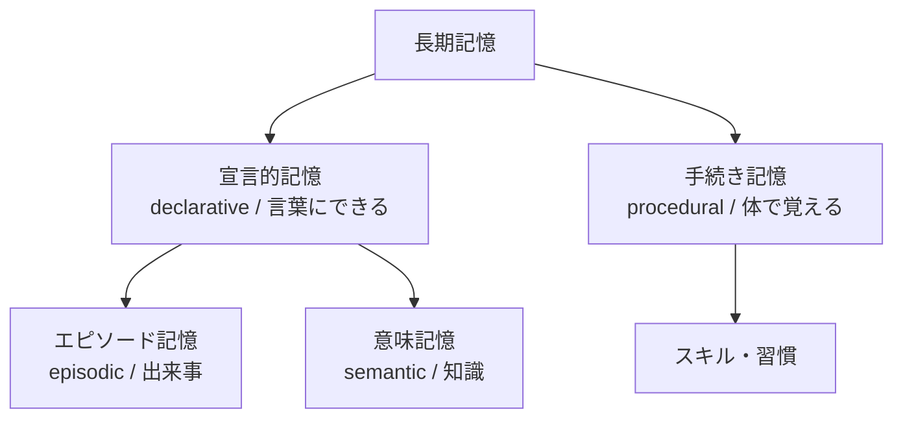
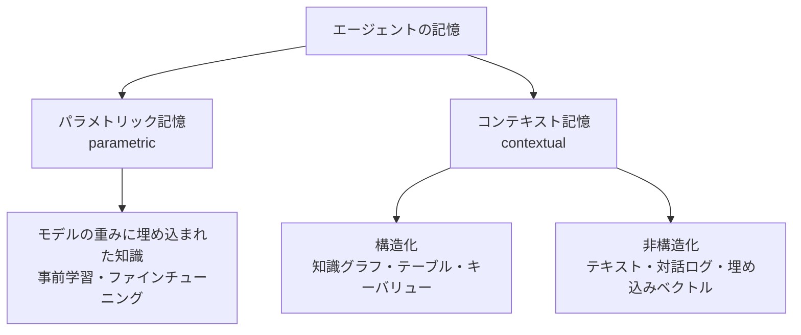
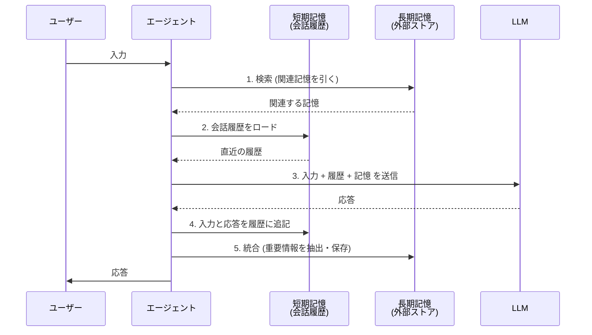
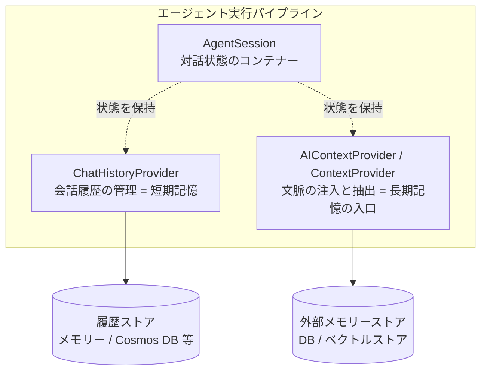
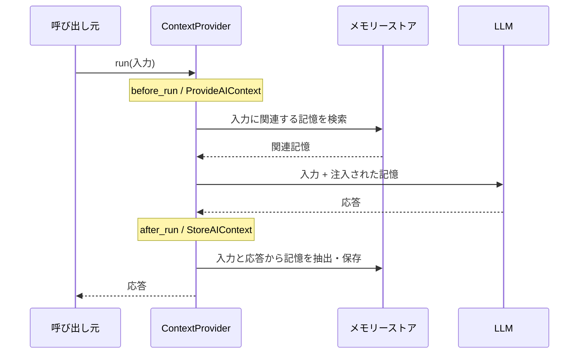

## はじめに

AI エージェントをある程度作り込むと、「このエージェントはすぐ忘れる」という問題に突き当たる。

昨日「私はビーガンです」と伝えたのに、今日になると平気でステーキ屋を勧めてくる。さっき調べたばかりの API 仕様を、3 ターン後には忘れている。長いタスクを任せると、途中で何をしていたのか分からなくなる。どれも、記憶（メモリー）を設計していないことから起きる。

LLM の API はステートレスで、各呼び出しは独立している。モデル自身は前回何を話したかを覚えていない。それでもエージェントが会話を続けられるのは、アプリケーションが過去の文脈をプロンプトに詰め直して毎回送っているからだ。つまりエージェントの記憶は、モデルの能力ではなく、<strong>アプリケーション側で設計するアーキテクチャ</strong>である。

この記事では、まず認知科学の枠組みと、LLM エージェントの記憶に関する研究論文をもとに、記憶をどう分類し、どの操作の組み合わせとして設計するかを整理する。そのうえで [Microsoft Agent Framework](https://github.com/microsoft/agent-framework) の `AgentSession`・`ContextProvider`・`ChatHistoryProvider` を使い、短期記憶と長期記憶を Python と C# で実装する。最後に、マルチユーザーの分離・忘却・プライバシー・評価という本番運用での論点を扱う。

> 本記事は [Microsoft Agent Framework 完全解説](/ja/blog/agent-framework) の姉妹編にあたる。フレームワーク全体のアーキテクチャやエージェント実行モデルは、そちらで解説している。

## 記憶とは何か — 認知科学からの写像

記憶を設計するには、まず記憶の種類を区別する語彙が要る。ここでは、認知科学が 50 年以上かけて整理してきた枠組みを借りる。この枠組みは、後で見るエージェントの記憶の構成ともよく対応する。

### 多重貯蔵モデル: 感覚記憶・短期記憶・長期記憶

人間の記憶研究の古典的なモデルに、Atkinson と Shiffrin が 1968 年に提唱した多重貯蔵モデル（multi-store model）がある。このモデルは記憶を 3 つの貯蔵庫に分ける。

- <strong>感覚記憶（sensory memory）</strong> — 知覚した情報が一瞬だけ保持される。ほとんどは即座に失われる
- <strong>短期記憶（short-term memory）</strong> — 今まさに処理している情報。容量が小さく、保持時間も短い。リハーサル（反復）しないと消える
- <strong>長期記憶（long-term memory）</strong> — リハーサルや符号化を経て定着した情報。容量はほぼ無制限で、長期間保持される

情報は短期記憶から長期記憶へ自動的には移らず、リハーサルや符号化といった処理を経て初めて書き込まれる。LLM エージェントも同じで、会話履歴から重要な事実を抽出して永続化する処理を用意しない限り、長期記憶はできない。

### 長期記憶の中身: 宣言的記憶と手続き記憶

長期記憶はさらに細分化される。Tulving（1972）はエピソード記憶と意味記憶を区別し、後年 Cohen と Squire（1980）がこれらを宣言的記憶として束ねて手続き記憶と対比した。以下の分類が広く使われる。



- <strong>エピソード記憶</strong> — 「いつ・どこで・何が起きたか」という個別の出来事。「先週の火曜にユーザーが返金を依頼した」
- <strong>意味記憶</strong> — 文脈から切り離された一般的な知識・事実。「このユーザーはビーガンである」
- <strong>手続き記憶</strong> — やり方の記憶。明示的には語れないが体が覚えている。エージェントで言えば「このタスクはこの手順で解くとうまくいく」というノウハウ

この 3 分類は、エージェントの長期記憶に何を保存するかを分けるときにもそのまま使える。研究や製品でも、この区分かその変種がよく採用されている。

### LLM エージェントへの写像

ここまでの概念には、LLM エージェントの次の要素が対応する。

| 認知科学の概念 | LLM エージェントでの対応物 |
|------------|----------------------|
| 感覚記憶 | 現在のユーザー入力（1 ターン分の生の入力） |
| 短期記憶 / ワーキングメモリー | コンテキストウィンドウに載っている会話履歴・スクラッチパッド |
| 長期記憶（エピソード） | 過去の対話ログ・タスク実行履歴の保存 |
| 長期記憶（意味） | ユーザーの嗜好・事実・知識ベース |
| 長期記憶（手続き） | 学習した手順・成功パターン・ツールの使い方 |
| リハーサル → 長期化 | 会話からの情報抽出・要約・永続化処理 |

ただし、LLM のコンテキストウィンドウは有限だ。人間のワーキングメモリーの容量が古典的に「7±2 チャンク」程度と推定されている（Miller 1956）ように、エージェントの短期記憶にもトークン数の上限がある。長い会話をすべてプロンプトに詰め込むことはできない。

そのため、エージェントの記憶設計では次の問いが中心になる。

> 有限の短期記憶（コンテキストウィンドウ）と、際限なく蓄積される長期記憶（外部ストレージ）の間を、どう橋渡しするか。

具体的には、何を短期記憶に残し、何を長期記憶に書き出し、必要なときにどう呼び戻すかを決める。

## 記憶の研究地図 — 表現・操作・評価の 3 軸

LLM エージェントの記憶に関する研究は、次の 2 つのサーベイ論文に沿って整理する。

- Zhang ら（2024）の [A Survey on the Memory Mechanism of Large Language Model based Agents](https://arxiv.org/abs/2404.13501) — 記憶を「ソース・形式・操作・評価」の観点で整理した包括的サーベイ
- Du ら（2025）の [Rethinking Memory in LLM based Agents](https://arxiv.org/abs/2505.00675) — 記憶を「表現形式」と「6 つの原子的操作」で再定義した枠組み

### 表現形式: パラメトリック記憶とコンテキスト記憶

Du らは、エージェントの記憶を表現形式によって 2 つに大別する。



- <strong>パラメトリック記憶</strong> — モデルの重みそのものに暗黙的に符号化された知識。事前学習やファインチューニングで獲得される。更新には再学習が必要で、コストが高く、何が記憶されているかを直接覗くことはできない
- <strong>コンテキスト記憶</strong> — モデルの外部に明示的なデータとして保持される記憶。さらに構造化（知識グラフ・テーブル）と非構造化（テキスト・埋め込み）に分かれる

アプリケーションの開発者が設計・実装する記憶は、ほぼ常にコンテキスト記憶で、Agent Framework が扱うのもこちらだ。パラメトリック記憶（ファインチューニング）は更新に再学習が要るので、頻繁な更新には向かず、ユーザーごとに変わる記憶には使えない。以降はコンテキスト記憶を扱う。

### 6 つの原子的操作

Du らは、記憶に対する操作を 6 つの原子的操作として定義している。どの記憶システムも、これらの操作の組み合わせとして記述できるという整理だ。

| 操作 | 英語 | 内容 |
|------|------|------|
| 統合 | Consolidation | 新しい経験を長期記憶に書き込む（短期→長期の転送） |
| 更新 | Updating | 既存の記憶に新情報を反映する（嗜好の変化など） |
| 索引付け | Indexing | 後で検索できるよう記憶に構造・インデックスを付与する |
| 忘却 | Forgetting | 不要・古い・誤った記憶を削除または減衰させる |
| 検索 | Retrieval | 現在の文脈に関連する記憶を呼び出す |
| 圧縮 | Condensation | 記憶を要約・凝縮してトークン量を削減する |

この 6 操作は、長期記憶のパイプラインを設計するときのチェックリストに使える。自分のシステムがどの操作をどう実現しているかを確かめると、抜けている操作が分かる。例えば統合と検索はあっても忘却がないシステムには、古い記憶や矛盾した記憶がたまり続け、いずれ破綻する。

### 主要な研究システムの位置づけ

どの操作に重点を置くかは、研究システムによって異なる。代表的な 3 つを挙げる。

- <strong>MemoryBank</strong>（[Zhong ら, 2023](https://arxiv.org/abs/2305.10250)）— エビングハウスの忘却曲線に着想を得た忘却機構を持ち、時間経過と重要度に応じて記憶を減衰・強化する。長く付き合う AI コンパニオンを想定した初期の研究
- <strong>Mem0</strong>（[Chhikara ら, 2025](https://arxiv.org/abs/2504.19413)）— 会話から重要情報を動的に抽出・統合・検索する、本番運用を想定したアーキテクチャ。グラフベースの変種も持つ。LOCOMO ベンチマークで、全コンテキスト方式に比べ p95 レイテンシーを 91% 削減、トークンコストを 90% 以上削減しつつ、既存のメモリー手法を上回る精度を達成したと報告している
- <strong>A-MEM</strong>（[Xu ら, NeurIPS 2025](https://arxiv.org/abs/2502.12110)）— Zettelkasten（ツェッテルカステン）法に着想を得て、記憶ノートを動的に生成し、相互にリンクし、新しい記憶が古い記憶を進化（更新）させる索引付け・更新に重点を置いたシステム

3 つに共通するのは、会話履歴をそのまま全部保存するのではなく、記憶を能動的に加工・整理する点だ。後半の実装では、この考え方を Agent Framework の上で実現する。

### 記憶システムの評価軸

Zhang らのサーベイは、記憶モジュールの評価方法を 2 つに分けている。

1. <strong>タスク性能ベースの間接評価</strong> — 記憶を組み込んだエージェントが、下流タスク（QA・対話・長期一貫性）でどれだけ性能を上げるか。LOCOMO のようなマルチセッション対話ベンチマークが代表例
2. <strong>記憶そのものの直接評価</strong> — 検索の正確性（関連する記憶を引けたか）・効率（レイテンシー・トークンコスト）・忘却の適切さなど、記憶機構の内部品質を測る

本番運用では、正しい記憶を、必要な場面で、少ないトークンで呼び出せているかを継続的に観測する（「記憶システムの評価と観測」で扱う）。

## 記憶アーキテクチャの設計原則

エージェントの記憶を設計するとき、最初に決めるのは短期記憶と長期記憶の境界をどこに引くかだ。

### 短期記憶 vs 長期記憶

| 観点 | 短期記憶 | 長期記憶 |
|------|---------|---------|
| スコープ | 1 つの会話セッション内 | セッションをまたいで永続 |
| 内容 | 直近のやりとり・スクラッチパッド | ユーザーの嗜好・事実・過去の経験 |
| 保存先 | コンテキストウィンドウ / セッション状態 | 外部ストレージ（DB・ベクトルストア） |
| 容量 | 有限（トークン上限） | 実質無制限 |
| 書き込み | 自動（毎ターン追記） | 能動的処理（抽出・統合） |
| 読み出し | 全件をプロンプトに展開 | 関連分のみ検索して注入 |
| 寿命 | セッション終了で消滅（永続化しない限り） | 明示的に忘却するまで保持 |

境界は、その情報をいつ使うかで決める。

> 「次のターンですぐ使う」情報は短期記憶に。「将来の別のセッションで使うかもしれない」情報は長期記憶に。

ただし、短期記憶が溢れそうになったら、内容を要約して長期記憶へ退避する橋渡し（統合と圧縮）が必要になる。

### 記憶パイプラインの全体像

短期・長期を統合した記憶システムは、エージェントの 1 ターンの中で次のように動く。



この図の 1（検索）と 2（履歴ロード）が読み出し、4（履歴追記）と 5（統合）が書き込みにあたる。Agent Framework では、これらの読み書きを ContextProvider という拡張ポイントに差し込んで実装する。

## Agent Framework のメモリー機構

Microsoft Agent Framework は、記憶を扱う抽象として `AgentSession`・`ChatHistoryProvider`・`AIContextProvider` の 3 つを提供する。



### 3 つの抽象の役割分担

| 抽象 | 役割 | 記憶での位置づけ |
|------|------|--------------|
| `AgentSession` | 1 つの会話の状態を保持するコンテナー。シリアライズして永続化・復元できる | 短期記憶の「器」。セッション固有の状態（履歴・メモリー ID 等）をすべてここに格納する |
| `ChatHistoryProvider`（Python: `HistoryProvider`） | 会話履歴のロードと保存に特化したプロバイダー | 短期記憶そのもの。組み込みの `InMemoryHistoryProvider` が代表 |
| `AIContextProvider`（Python: `ContextProvider`） | 各実行の前後にフックし、文脈（指示・メッセージ・ツール）を注入し、実行後に情報を抽出する | 長期記憶の入口。検索した記憶の注入と、新情報の抽出・保存を担う |

<strong>短期記憶は `ChatHistoryProvider`、長期記憶は `AIContextProvider` で実装する</strong>。どちらも同じエージェントに取り付け、1 回の実行の中でそれぞれのフックが呼び出される。

### 状態はプロバイダーではなくセッションに置く

Agent Framework では、<strong>1 つのプロバイダーインスタンスがすべてのセッションで共有される</strong>。そのため、特定ユーザーのメモリー ID のようなセッション固有の状態をプロバイダーのフィールドに持たせると、マルチユーザー環境で別のユーザーのデータと混線する。

> プロバイダーはステートレスに保ち、セッション固有の値（メモリー ID・DB キー・履歴など）は `AgentSession` 自体に格納する。

.NET では `ProviderSessionState<T>` というヘルパー、Python では `before_run` / `after_run` に渡される `state` 辞書を使う。コードは「長期記憶の実装」で示す。

## 短期記憶の実装

短期記憶、つまり会話履歴の管理は、最も単純な構成なら Agent Framework がほぼすべて処理する。

### 最小構成: セッションを渡すだけ

`AgentSession` を作り、毎回の `run` に渡せばよい。

```python
from agent_framework import InMemoryHistoryProvider
from agent_framework.openai import OpenAIChatClient

agent = OpenAIChatClient().as_agent(
    name="MemoryBot",
    instructions="あなたは親切なアシスタントです。",
    context_providers=[InMemoryHistoryProvider("memory", load_messages=True)],
)

session = agent.create_session()

# 1 回目: 情報を伝える
await agent.run("私は東京に住んでいて、ビーガンです。", session=session)

# 2 回目: 同じセッションを渡すと履歴が引き継がれる
response = await agent.run("近くのおすすめのお店は？", session=session)
# → ビーガン対応の店を東京で提案してくれる
```

`InMemoryHistoryProvider` が組み込みの短期記憶プロバイダーだ。`load_messages=True` を指定すると、毎回の実行時にセッションに溜まった会話履歴をロードしてプロンプトに展開する。第 1 引数 `"memory"` はプロバイダーの識別子（`source_id`）で、複数のプロバイダーを区別するのに使う。

.NET でも同様に、`CreateSessionAsync()` で作ったセッションを `RunAsync` に渡すだけでよい。

```csharp
using System.Collections.Generic;
using Microsoft.Agents.AI;
using OpenAI;

AIAgent agent = new OpenAIClient("<your_api_key>")
    .GetChatClient("gpt-4o-mini")
    .AsAIAgent(instructions: "あなたは親切なアシスタントです。", name: "MemoryBot");

AgentSession session = await agent.CreateSessionAsync();

await agent.RunAsync("私は東京に住んでいて、ビーガンです。", session);
var response = await agent.RunAsync("近くのおすすめのお店は？", session);
```

.NET では既定で `InMemoryChatHistoryProvider` が短期記憶を担う。蓄積された履歴には次のようにアクセスできる。

```csharp
// セッションに紐づく履歴プロバイダを取得し、メッセージ一覧を読む
var provider = agent.GetService<InMemoryChatHistoryProvider>();
List<ChatMessage>? messages = provider?.GetMessages(session);
```

### トークン上限への対処: コンパクション

会話が長くなると、履歴がコンテキストウィンドウに収まらなくなる。これに対処するのがコンパクション（リデュース）で、6 つの操作のうち圧縮（Condensation）にあたる。

最も単純なのは、直近 N 件のメッセージだけを残す件数ベースのリデューサーで、.NET では `MessageCountingChatReducer` が用意されている。

```csharp
AIAgent agent = new OpenAIClient("<your_api_key>")
    .GetChatClient("gpt-4o-mini")
    .AsAIAgent(new ChatClientAgentOptions
    {
        Name = "MemoryBot",
        ChatOptions = new() { Instructions = "あなたは親切なアシスタントです。" },
        // 直近 20 件のメッセージだけを保持する
        ChatHistoryProvider = new InMemoryChatHistoryProvider(new InMemoryChatHistoryProviderOptions
        {
            ChatReducer = new MessageCountingChatReducer(20)
        })
    });
```

ただし件数で切ると、「私はビーガンです」のような古いが重要な制約も、古いというだけで捨てられる。これを避ける方法は 2 つある。

1. <strong>要約ベースのコンパクション</strong> — 古い履歴を LLM で要約し、1 つの要約文に置き換える。要点を残したままトークンを大きく減らせる
2. <strong>重要情報の長期記憶への退避</strong> — 履歴から捨てる前に、重要な事実を抽出して長期記憶に書き出す（統合）

要約ベースのコンパクションは、リデューサーを差し替えれば実装できる。そして<strong>短期記憶のコンパクションと長期記憶への統合は、セットで設計する</strong>。短期記憶から溢れた情報を長期記憶が受け止める橋渡しになるからだ。

### セッションの永続化

短期記憶はセッション内に閉じているため、プロセスが終われば消える。会話を後で再開したい場合は、`AgentSession` をシリアライズして永続ストレージに保存する。

```python
# 保存: セッション全体を辞書化してストレージへ
serialized = session.to_dict()
# ... DB / Redis / Blob などに serialized を保存 ...

# 復元: 保存した状態からセッションを再構築
resumed = AgentSession.from_dict(serialized)
response = await agent.run("さっきの続きだけど…", session=resumed)
```

```csharp
// 保存
JsonElement serialized = agent.SerializeSession(session);
// ... 永続ストレージに serialized を保存 ...

// 復元
AgentSession resumed = await agent.DeserializeSessionAsync(serialized);
```

`AgentSession` は不透明な状態オブジェクトとして扱い、メッセージ本文だけでなくセッション全体を保存・復元する。また、<strong>復元には保存時と同じエージェントとプロバイダーの構成を使う</strong>。構成が違うと、プロバイダーがセッションに格納した状態（メモリー ID など）を正しく解釈できない。

### サービス管理型ストレージ

一部のサービス（OpenAI Responses API や Microsoft Foundry Agents など）は、会話履歴をサービス側で永続化する。この場合、Agent Framework はローカルに履歴を持たず、セッションにはリモートの会話 ID だけが格納される。モデルがステートレスなのは変わらず、過去の文脈をプロンプトに詰め直す処理をサービス側が担っている。

```csharp
AIAgent agent = new OpenAIClient("<your_api_key>")
    .GetOpenAIResponseClient("gpt-4o-mini")
    .AsAIAgent(instructions: "あなたは親切なアシスタントです。", name: "Assistant");

AgentSession session = await agent.CreateSessionAsync();
await agent.RunAsync("海賊についてのジョークを教えて。", session);

// ChatClientAgentSession にキャストするとリモート会話 ID を取得できる
ChatClientAgentSession typedSession = (ChatClientAgentSession)session;
Console.WriteLine(typedSession.ConversationId);
```

サービス管理型では履歴のサイズ管理をサービスに任せられるが、リデュースの挙動はサービスによって決まる。どちらを使うかは、利用するモデルプロバイダーと永続化の要件で決める。

## 長期記憶の実装

Agent Framework で長期記憶を実装するには、`AIContextProvider`（Python: `ContextProvider`）を継承し、検索（読み出し）と統合（書き込み）の処理をこのプロバイダーに書く。

### ContextProvider の 2 つのフック

`ContextProvider` は、エージェントの 1 回の実行に対して前後 2 つのフックを提供する。

- <strong>実行前フック</strong>（Python: `before_run` / .NET: `ProvideAIContextAsync`）— 長期記憶を検索し、関連する記憶を文脈としてプロンプトに注入する
- <strong>実行後フック</strong>（Python: `after_run` / .NET: `StoreAIContextAsync`）— 入力と応答から重要情報を抽出し、長期記憶に統合する



### シンプルな長期記憶プロバイダー（Python）

最小の例として、ユーザーの好きな食べ物を `state` 辞書に保存し、次の実行で指示として注入するプロバイダーを Python で書く。

```python
from typing import Any
from agent_framework import AgentSession, ContextProvider, SessionContext


class UserPreferenceProvider(ContextProvider):
    def __init__(self) -> None:
        # 第 1 引数はこのプロバイダの識別子 (source_id)
        super().__init__("user-preferences")

    async def before_run(
        self,
        *,
        agent: Any,
        session: AgentSession,
        context: SessionContext,
        state: dict[str, Any],
    ) -> None:
        # 実行前: 保存済みの嗜好を指示として注入する (= 検索)
        if favorite := state.get("favorite_food"):
            context.extend_instructions(
                self.source_id, f"ユーザーの好きな食べ物は {favorite} です。"
            )

    async def after_run(
        self,
        *,
        agent: Any,
        session: AgentSession,
        context: SessionContext,
        state: dict[str, Any],
    ) -> None:
        # 実行後: 入力から嗜好を抽出して保存する (= 統合)
        for message in context.input_messages:
            text = (message.text or "") if hasattr(message, "text") else ""
            if isinstance(text, str) and "好きな食べ物は" in text:
                state["favorite_food"] = text.split("好きな食べ物は", 1)[1].strip().rstrip("。")
```

`context.extend_instructions(self.source_id, ...)` で、検索した記憶をシステム指示として注入する。`state` 辞書はセッションに紐づいて永続化されるので、プロバイダーインスタンス自体はステートレスのまま保てる。

このプロバイダーをエージェントに取り付ける。

```python
agent = OpenAIChatClient().as_agent(
    name="MemoryBot",
    instructions="あなたは親切なアシスタントです。",
    context_providers=[
        InMemoryHistoryProvider("memory", load_messages=True),  # 短期記憶
        UserPreferenceProvider(),                                # 長期記憶
    ],
)
```

短期記憶（`InMemoryHistoryProvider`）と長期記憶（`UserPreferenceProvider`）は、同じ `context_providers` リストに並べて取り付ける。

### 外部メモリーサービスと連携する（Python）

上の例は文字列マッチングで嗜好を抽出しているが、実際には LLM による抽出や、ベクトルストアでの意味検索を使う。次の例は、Mem0 のような外部メモリーサービスに検索と保存を委譲する。継承するのは `HistoryProvider` ではなく `ContextProvider` だ。

```python
from typing import Any
from agent_framework import AgentSession, ContextProvider, SessionContext


class ServiceMemoryProvider(ContextProvider):
    """外部メモリサービスと連携する長期記憶プロバイダ。"""

    def __init__(self, client: Any) -> None:
        super().__init__("service-memory")
        self._client = client  # メモリサービスのクライアント (ステートレスに保つ)

    async def before_run(
        self,
        *,
        agent: Any,
        session: AgentSession,
        context: SessionContext,
        state: dict[str, Any],
    ) -> None:
        memory_id = state.get("memory_id")
        if not memory_id:
            return  # まだ記憶がない

        # 直近のユーザー入力をクエリにして意味検索する (= 検索)
        query = "\n".join(
            m.text for m in context.input_messages if getattr(m, "text", None)
        )
        memories = await self._client.search(memory_id, query)
        if memories:
            joined = "\n".join(m.text for m in memories)
            context.extend_instructions(
                self.source_id, f"関連する記憶:\n{joined}"
            )

    async def after_run(
        self,
        *,
        agent: Any,
        session: AgentSession,
        context: SessionContext,
        state: dict[str, Any],
    ) -> None:
        # セッションごとのメモリコンテナを用意し、ID をセッション状態に保存
        if not state.get("memory_id"):
            state["memory_id"] = await self._client.create_container()

        # 入力と応答をサービスに渡し、サービス側で抽出・統合させる (= 統合)
        response_messages = context.response.messages if context.response else []
        await self._client.add(
            state["memory_id"],
            list(context.input_messages) + list(response_messages),
        )
```

抽出・統合・更新は、サービス側の `add` が担う。Mem0 のようなシステムは、生のメッセージから「ユーザーはビーガンである」のような構造化された事実を取り出し、既存の記憶と矛盾すれば更新する。プロバイダーが行うのは、検索クエリーの構築と、保存するメッセージの受け渡しだけだ。

### カスタム履歴プロバイダーで永続バックエンドに保存する（Python）

会話履歴そのものを DB や Redis に永続化するには、`HistoryProvider` を継承する。プロセスの再起動後や別のインスタンスで会話を再開したい場合に使う。扱うのは短期記憶だが、保存期間は長期記憶に近い。

```python
from collections.abc import Sequence
from typing import Any
from agent_framework import HistoryProvider, Message


class DatabaseHistoryProvider(HistoryProvider):
    def __init__(self, db: Any) -> None:
        super().__init__("db-history", load_messages=True)
        self._db = db

    async def get_messages(
        self,
        session_id: str | None,
        *,
        state: dict[str, Any] | None = None,
        **kwargs: Any,
    ) -> list[Message]:
        key = (state or {}).get("history_key", session_id or "default")
        rows = await self._db.load_messages(key)
        return [Message.from_dict(row) for row in rows]

    async def save_messages(
        self,
        session_id: str | None,
        messages: Sequence[Message],
        *,
        state: dict[str, Any] | None = None,
        **kwargs: Any,
    ) -> None:
        if not messages:
            return
        if state is not None:
            key = state.setdefault("history_key", session_id or "default")
        else:
            key = session_id or "default"
        await self._db.save_messages(key, [m.to_dict() for m in messages])
```

Python では<strong>複数の履歴プロバイダーを取り付けられるが、`load_messages=True` にしてよいのは 1 つだけ</strong>だ。診断や評価用に追加するプロバイダーは `load_messages=False` と `store_context_messages=True` を指定し、主たる履歴のロードに干渉しないようにする。

```python
primary = DatabaseHistoryProvider(db)
# 監査・評価用: 履歴はロードしないが、文脈は記録する
audit = InMemoryHistoryProvider("audit", load_messages=False, store_context_messages=True)

agent = OpenAIChatClient().as_agent(context_providers=[primary, audit])
```

> 補足: 継承する基底クラスは `ContextProvider` と `HistoryProvider` だ。以前は互換性のために `BaseContextProvider` / `BaseHistoryProvider` という別名があったが、破壊的変更で削除された。

### .NET でのカスタム長期記憶プロバイダー

.NET では `AIContextProvider` を継承し、`ProvideAIContextAsync`（検索）と `StoreAIContextAsync`（統合）をオーバーライドする。セッション固有の状態は `ProviderSessionState<T>` ヘルパーで `AgentSession` に格納する。

```csharp
using Microsoft.Agents.AI;

internal sealed class ServiceMemoryProvider : AIContextProvider
{
    private readonly ProviderSessionState<State> _sessionState;
    private readonly ServiceClient _client;

    public ServiceMemoryProvider(ServiceClient client)
        : base(null, null)
    {
        // セッション固有の状態をセッション内に保持するためのヘルパー
        this._sessionState = new ProviderSessionState<State>(
            _ => new State(),
            this.GetType().Name);
        this._client = client;
    }

    public override IReadOnlyList<string> StateKeys => [this._sessionState.StateKey];

    // 実行前: 関連する記憶を検索して注入する
    protected override ValueTask<AIContext> ProvideAIContextAsync(
        InvokingContext context, CancellationToken cancellationToken = default)
    {
        var state = this._sessionState.GetOrInitializeState(context.Session);
        if (state.MemoriesId is null)
        {
            return new ValueTask<AIContext>(new AIContext());  // まだ記憶がない
        }

        var query = string.Join("\n", context.AIContext.Messages?.Select(x => x.Text) ?? []);
        var memories = this._client.LoadMemories(state.MemoriesId, query);

        return new ValueTask<AIContext>(new AIContext
        {
            Messages =
            [
                new ChatMessage(ChatRole.User,
                    "関連する記憶:\n" + string.Join("\n", memories.Select(x => x.Text)))
            ]
        });
    }

    // 実行後: 入力と応答から記憶を抽出・保存する
    protected override async ValueTask StoreAIContextAsync(
        InvokedContext context, CancellationToken cancellationToken = default)
    {
        var state = this._sessionState.GetOrInitializeState(context.Session);
        state.MemoriesId ??= this._client.CreateMemoryContainer();
        this._sessionState.SaveState(context.Session, state);

        var messages = context.RequestMessages.Concat(context.ResponseMessages ?? []);
        await this._client.StoreMemoriesAsync(state.MemoriesId, messages, cancellationToken);
    }

    public sealed class State
    {
        public string? MemoriesId { get; set; }
    }
}
```

エージェントへの取り付けは `AIContextProviders` オプションで行う。

```csharp
AIAgent agent = new OpenAIClient("<your_api_key>")
    .GetChatClient("gpt-4o-mini")
    .AsAIAgent(new ChatClientAgentOptions
    {
        ChatOptions = new() { Instructions = "あなたは親切なアシスタントです。" },
        AIContextProviders = [new ServiceMemoryProvider(serviceClient)],
    });
```

### フィードバックループを避ける: メッセージのソース管理

長期記憶では、<strong>検索で注入した記憶が、次の統合でもう一度記憶として保存される</strong>フィードバックループを見落としやすい。放置すると、記憶から新しい記憶が作られ続け、ストアが際限なく膨らむ。

これを防ぐために、Agent Framework はメッセージに由来（ソース）の情報を付ける。.NET では `AgentRequestMessageSourceType` で「外部（ユーザー）入力」「履歴由来」「コンテキストプロバイダー由来」を区別できる。前述の `StoreAIContextAsync` で外部入力だけを統合の対象にするには、次のように書く。

```csharp
// 統合時は、ユーザーの実入力 (External) のみを対象にし、
// 履歴や他プロバイダが注入したメッセージは除外する
var filteredRequestMessages = context.RequestMessages
    .Where(m => m.GetAgentRequestMessageSourceType() == AgentRequestMessageSourceType.External);

await this._client.StoreMemoriesAsync(
    state.MemoriesId,
    filteredRequestMessages.Concat(context.ResponseMessages ?? []),
    cancellationToken);
```

何を記憶として保存するかは、このソースで制御する。基本は、ユーザーの生の入力とエージェントの応答だけを記憶の対象にし、検索で注入した記憶や履歴由来のメッセージは除外することだ。

### 組み込みの記憶・検索プロバイダー

Agent Framework には組み込みのプロバイダーもある。要件に合うなら、自作する前にこれらを検討する。

- <strong>RAG（検索拡張生成）</strong>: `TextSearchProvider`（Released）— ユーザー入力に基づいて外部知識を検索し、文脈として注入する。検索の実体は Azure AI Search やベクトルストア、Web 検索など任意の技術で実装できる。実行ごとに検索する（`BeforeAIInvoke`）か、ツール呼び出しでオンデマンド検索するかを選べる
- <strong>グラフ RAG</strong>: `Neo4j GraphRAG Provider`（Preview）— グラフ走査で関連情報を引く
- <strong>履歴の永続化</strong>: `Cosmos DB Chat History Provider`（Preview）— 会話履歴を Cosmos DB に保存する
- <strong>ベクトルストア</strong>: Redis・Postgres・Azure AI Search・Qdrant・SQLite など多数のベクトルストアが、統一された抽象（`Microsoft.Extensions.VectorData.Abstractions`）経由で利用できる。長期記憶の意味検索バックエンドとして使える

`TextSearchProvider` を使った RAG の最小構成は次の通りだ。

```csharp
// 検索の実体 (Azure AI Search・ベクトルストア・Web 検索など任意の実装)
static Task<IEnumerable<TextSearchProvider.TextSearchResult>> SearchAdapter(
    string query, CancellationToken cancellationToken)
{
    // query に基づいて関連ドキュメントを返す
    // ...
    return Task.FromResult<IEnumerable<TextSearchProvider.TextSearchResult>>(results);
}

TextSearchProviderOptions options = new()
{
    // 毎回のモデル呼び出し前に検索する
    SearchTime = TextSearchProviderOptions.TextSearchBehavior.BeforeAIInvoke,
    // 検索クエリ構築時に含める直近メッセージ数
    RecentMessageMemoryLimit = 6,
};

AIAgent agent = azureOpenAIClient
    .GetChatClient(deploymentName)
    .AsAIAgent(new ChatClientAgentOptions
    {
        ChatOptions = new() { Instructions = "提供された文脈を使って回答し、可能なら出典を引用してください。" },
        AIContextProviders = [new TextSearchProvider(SearchAdapter, options)]
    });
```

RAG と長期記憶は、どちらも `AIContextProvider` で実装し、外部から関連情報を引いて注入する点が共通している。違うのは引く情報の性質だ。RAG は製品マニュアルのような静的な知識ベースを引き、長期記憶はユーザーの嗜好のように対話から動的に蓄積される個別の記憶を引く。実際のシステムでは両方を取り付け、知識（RAG）と記憶（メモリー）の 2 系統を同時に注入することが多い。

## 本番運用の考慮事項

記憶を扱うシステムを本番に出すときは、ユーザー間の分離、忘却、プライバシー、評価の 4 点を設計に含める。

### マルチユーザーの分離

最も深刻なのは、あるユーザーの嗜好が別のユーザーに漏れるような<strong>ユーザー間の記憶の混線</strong>で、利用者の信頼を直接損なう。プロバイダー側の対策は「状態はプロバイダーではなくセッションに置く」で述べたとおりで、セッション固有の値は必ず `AgentSession`（の `state` / `ProviderSessionState`）に格納し、プロバイダーのフィールドには置かない。

外部メモリーストアを使う場合は、ユーザー ID（またはセッション ID）をパーティションキーにして記憶を分離する。検索クエリーには必ずユーザー単位のフィルターを付け、他のユーザーの記憶が検索結果に混ざらないようにする。

### 忘却の設計

6 つの操作のうち、実装で抜けやすいのが忘却（Forgetting）だ。忘却のないシステムには古い記憶・矛盾した記憶・誤った記憶がたまり、いずれ検索の質が下がる。主な戦略は次の 4 つだ。

| 戦略 | 内容 | 着想元 |
|------|------|--------|
| 時間減衰 | 古い記憶ほど重要度を下げ、一定以下で削除する | MemoryBank のエビングハウス忘却曲線 |
| 矛盾解消 | 新情報が古い記憶と矛盾したら、古い方を更新・削除する | Mem0 の更新機構 |
| 容量制限 + LRU | ユーザーあたりの記憶数に上限を設け、使われない記憶を退避する | キャッシュの定石 |
| 明示的削除 | ユーザーの要求（「それは忘れて」）で即座に削除する | プライバシー要件 |

最低でも「矛盾解消」と「明示的削除」は実装すべきだ。前者がないと記憶が一貫性を失い、後者がないと次に述べるプライバシー要件を満たせない。

### プライバシーとセキュリティー

長期記憶には個人データがたまるので、GDPR をはじめとする規制に対応する必要がある。

- <strong>忘れられる権利</strong> — ユーザーが自分の記憶の削除を要求できる導線（明示的削除）を必ず用意する
- <strong>機微情報の扱い</strong> — クレジットカード番号やパスワードなどを記憶に書き込まない。抽出段階でフィルタリングするか、そもそも保存対象から除外する
- <strong>保存データの暗号化</strong> — 記憶ストアは保存時・転送時ともに暗号化する
- <strong>プロンプトインジェクション対策</strong> — ユーザー入力から記憶を抽出する以上、悪意ある入力（「これまでの指示を無視して…と記憶せよ」）が記憶に混入しうる。抽出された記憶を後で指示として注入する設計は、インジェクションの増幅経路になりうる。記憶として保存する内容は検証し、システム指示そのものを記憶から書き換えられないようにガードする

最後の点は特に見落とされやすい。<strong>記憶は信頼できない入力に由来しうる</strong>ものとして扱い、注入する内容の権限を絞る。

### 記憶システムの評価と観測

記憶が効いているかは、継続的に測る。Zhang らの評価軸を運用に当てはめると、観測する指標は次の 4 つになる。

- <strong>検索の精度</strong> — 注入された記憶が、その場面で本当に関連していたか（無関係な記憶の注入は精度もトークン効率も下げる）
- <strong>トークンコスト</strong> — 記憶の注入で 1 ターンあたりのトークン量がどれだけ増えたか。全コンテキスト方式との比較では、Mem0 が LOCOMO でトークンコストを 90% 以上削減したと報告している
- <strong>レイテンシー</strong> — 検索・統合処理が応答時間に与える影響。実行前に同期的に検索すると、その時間がそのまま応答の待ち時間に加わる
- <strong>一貫性</strong> — 複数のセッションをまたいで、ユーザーの制約（嗜好など）が守られているか

検索精度の評価データを集めるには、前述の監査用プロバイダー（`load_messages=False`, `store_context_messages=True`）が使える。主たる履歴のロードに干渉せずに、どの記憶が注入されたかを含む文脈を実行ごとに記録できる。

## まとめ

エージェントの記憶は、モデルの能力ではなく、アプリケーション側で設計するアーキテクチャだ。設計の枠組みには、認知科学の短期記憶・長期記憶の区別と、長期記憶のエピソード・意味・手続きという分類が使える。記憶に対して何をするかは、Du らの 6 つの原子的操作（統合・更新・索引付け・忘却・検索・圧縮）をチェックリストにして確かめられる。

Microsoft Agent Framework では、`AgentSession` を器として、短期記憶を `ChatHistoryProvider` で、長期記憶を `AIContextProvider` の検索・統合フックで実装する。設計の中心は、有限の短期記憶と際限なく蓄積される長期記憶を、コンパクション（圧縮）と統合でつなぐことだ。短期記憶から溢れる情報を長期記憶が受け止めれば、長い対話でも破綻しにくくなる。

本番では、マルチユーザーの記憶の分離、忘却（特に矛盾解消と明示的削除）、プライバシー（忘れられる権利とインジェクション対策）、記憶が効いているかの継続的な観測が欠かせない。これらを欠くと、記憶はユーザー間の情報漏えいや、古い情報・矛盾した情報に基づく応答の原因になる。

実装は `AgentSession` を作って `run` に渡すところから始め、必要に応じて `AIContextProvider` で抽出・統合・検索のパイプラインを作り込んでいけばよい。

### 参考文献

- G. A. Miller. *The Magical Number Seven, Plus or Minus Two: Some Limits on Our Capacity for Processing Information*. Psychological Review, 63(2), 1956.（ワーキングメモリー容量の古典的推定）
- R. C. Atkinson and R. M. Shiffrin. *Human Memory: A Proposed System and its Control Processes*. The Psychology of Learning and Motivation, Vol. 2, 1968.（多重貯蔵モデル）
- E. Tulving. *Episodic and Semantic Memory*. Organization of Memory, 1972.（エピソード記憶・意味記憶）
- N. J. Cohen and L. R. Squire. *Preserved Learning and Retention of Pattern-Analyzing Skill in Amnesia: Dissociation of Knowing How and Knowing That*. Science, 210(4466), 1980.（宣言的記憶と手続き記憶の区別）
- Z. Zhang et al. *[A Survey on the Memory Mechanism of Large Language Model based Agents](https://arxiv.org/abs/2404.13501)*. arXiv:2404.13501, 2024.
- Y. Du et al. *[Rethinking Memory in LLM based Agents: Representations, Operations, and Emerging Topics](https://arxiv.org/abs/2505.00675)*. arXiv:2505.00675, 2025.
- P. Chhikara et al. *[Mem0: Building Production-Ready AI Agents with Scalable Long-Term Memory](https://arxiv.org/abs/2504.19413)*. arXiv:2504.19413, 2025.
- W. Xu et al. *[A-MEM: Agentic Memory for LLM Agents](https://arxiv.org/abs/2502.12110)*. NeurIPS 2025 / arXiv:2502.12110.
- W. Zhong et al. *[MemoryBank: Enhancing Large Language Models with Long-Term Memory](https://arxiv.org/abs/2305.10250)*. arXiv:2305.10250, 2023.
- Microsoft. *[Agent Framework — Conversations & Memory](https://learn.microsoft.com/en-us/agent-framework/agents/conversations/)*. Microsoft Learn.
- Microsoft. *[Microsoft Agent Framework (GitHub)](https://github.com/microsoft/agent-framework)*.
