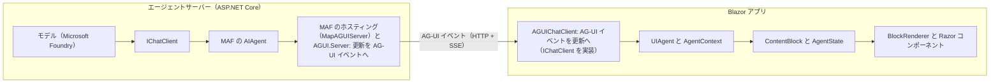
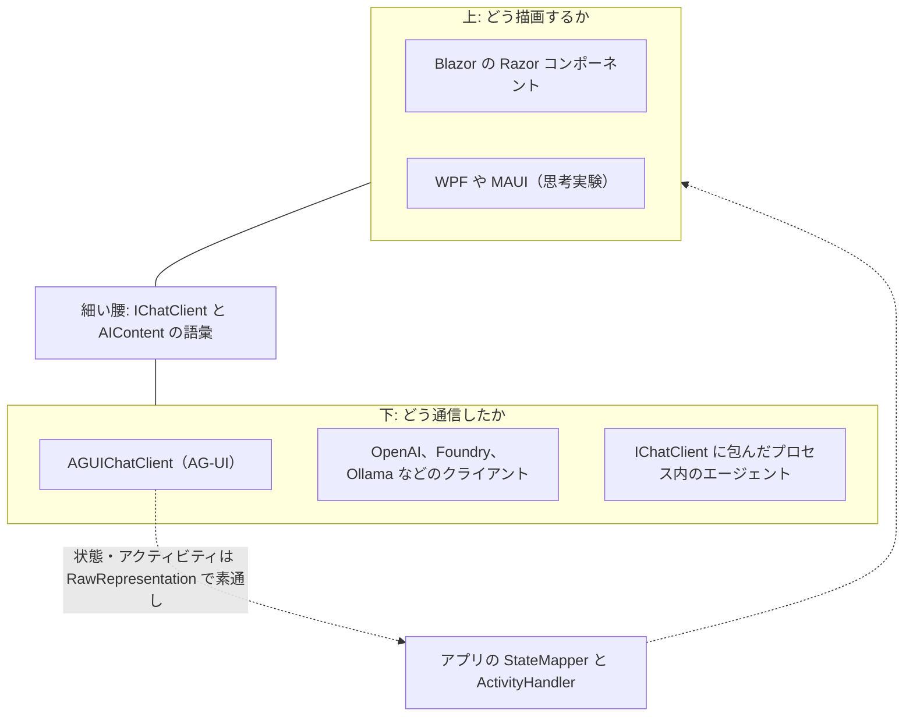
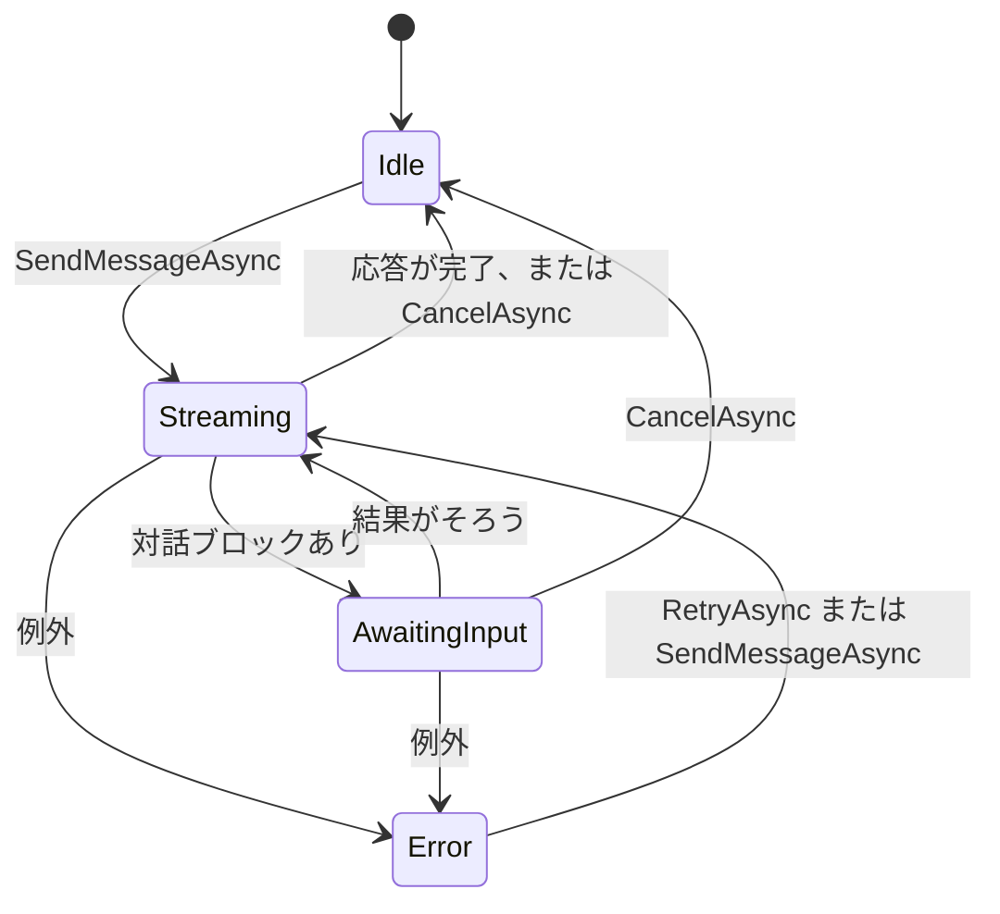
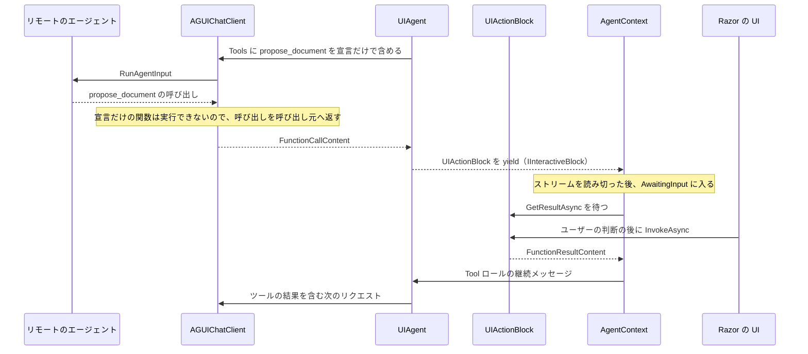
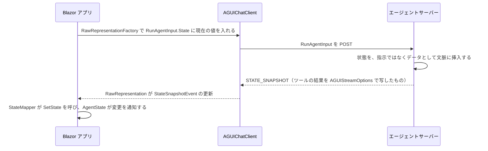

## はじめに

2026 年 9 月、.NET ブログで 2 つの発表があった。

- [Build Agentic UI with the new Blazor AI components](https://devblogs.microsoft.com/dotnet/build-agentic-ui-blazor/) — 実験的な Blazor AI コンポーネント（`Microsoft.AspNetCore.Components.AI`）
- [AG-UI Protocol now has a first-class .NET SDK](https://devblogs.microsoft.com/dotnet/ag-ui-dotnet-sdk/) — CopilotKit と共同で AG-UI リポジトリに寄贈された .NET SDK

見出しだけを読めば、「Blazor でも AI チャット UI が作れるようになった」「.NET からも AG-UI を話せるようになった」というニュースに見える。実際、`<ChatPage Agent="_agent" />` と書くだけで、ストリーミングで応答するチャット画面が出てくる。

しかし本稿では、この 2 つをもう少し大きな問いへの回答として読んでみたい。

> AI エージェントと人間が同じアプリケーション状態を操作するとき、UI ランタイムは何を抽象化すべきか。

従来の GUI にも、人間以外の書き手はいた。ネットワークの応答やバックグラウンドの処理も状態を書き換える。ただしその書き込みは、たいてい完成した値として届き、その場で確定した。エージェントは違う。出力を少しずつ送り、途中で人間の承認を求め、サーバーかクライアントのどちらかで副作用を起こし、共有された成果物に「提案」を書き込む。WPF にも Blazor にも、こうした書き手を表す語彙はもともとなかった。

今回の 2 つのリリースが重要なのは、この空白に<strong>名前と境界</strong>を与えたからだ——というのが本稿の主張である。名前を与えられたのは画面部品ではない。ストリーミング中の内容の同一性、人間の判断を待つ中断点、副作用が実行される場所、共有状態への書き込みを確定させる主体、会話の正本（source of truth）の置き場所だ。まとめれば<strong>「誰が、いつ、何を確定させるか」</strong>である。描画はむしろ、意図的に抽象化の対象から外されている。

本稿は 2 つの記事に加え、次のソースを読んで書いている。

- [dotnet/aspnetcore](https://github.com/dotnet/aspnetcore/tree/f0433957fb5acd830e26ca86e53c59650d7611cb/src/Components/AI) の `src/Components/AI`（2026-09-29 のコミット `f043395`）
- [ag-ui-protocol/ag-ui](https://github.com/ag-ui-protocol/ag-ui/tree/36447b41b05df704404e8f3227eb42bde25fc9e7/sdks/dotnet) の `sdks/dotnet`（2026-09-29 のコミット `36447b4`）
- [dotnet/extensions](https://github.com/dotnet/extensions/tree/044734ee0922038cd5a2b381ed7da3ad4d8fe0fe/src/Libraries) の Microsoft.Extensions.AI

Blazor AI コンポーネントは実験的なプレビュー（本稿の執筆時点で NuGet 上は `0.1.0-preview.1`。.NET 11 RC1 SDK と `--prerelease` で導入）なので、API は今後変わりうる。一方、AG-UI の .NET SDK（`AGUI.*`）は `1.0.0` の安定版として公開されている（MAF 側のホスティング統合である `Microsoft.Agents.AI.Hosting.AGUI.AspNetCore` は、まだプレリリースだ）。プロトコルの部品は安定し、UI 側の部品はまだ実験段階にある、という位置関係になる。引用するコードは、説明に必要な部分だけを抜粋・簡略化している。また本文では、記事に付属するサンプルを「AgenticUI サンプル」、aspnetcore リポジトリにあるテスト用のアプリ（`testassets/DojoClient`）を「Dojo アプリ」と呼び分ける。

以下、1〜3 章で問題設定と層の境界を、4〜7 章で冒頭に挙げた 5 つの抽象を実装から読み、8〜9 章で Blazor 層と型の設計思想を、10〜11 章で他の答え方との比較とまだ抽象化されていないものを扱い、12 章でアプリを書く側への示唆をまとめる。先に、全体の答えを表にしておく。

## 先に結論

| 問い | このスタックの答え | 主な型・API | 章 |
|---|---|---|---|
| 通信方式やモデル提供者の違いをどこで吸収するか | `IChatClient` の下に閉じ込める。リモートのエージェントも「もう 1 つの `IChatClient`」になる（履歴の所在の違いは隠しきれない。3 章） | `IChatClient`、`AGUIChatClient` | 2、3 |
| ストリーミング中の「まだ変わる内容」をどう表すか | 同一性・ロール・ライフサイクル・変更通知を持つ、UI 向けの意味単位にする | `ContentBlock`、`BlockLifecycleState` | 4 |
| 人間の判断をどう待つか | 会話の中断点を型にし、判断を `await` できる値にする（待機はメモリ上の継続。5.1 節） | `IInteractiveBlock`、`AgentContext` | 5.1〜5.3 |
| 副作用をどこで誰が実行するか | サーバー、クライアントでの自動実行、UI 上での明示的な実行、承認付きの実行を、型と印で区別する | `InformationalOnly`、`FunctionInvokingChatClient`、`RegisterUIAction` | 5.4 |
| 共有状態への書き込みを誰が確定させるか | 確定値と提案値を区別する手段を与え（どちらを使うかはアプリの `StateMapper` が決める）、`AgentContext` が会話の区切りで未決の提案を棄却する | `AgentState<T>`、`StateMapper` | 6 |
| 何を正本とし、画面をどう再構築するか | `IChatClient` から出てきた更新をログとして保存し、同じハンドラで再生する（記録された人間の判断の再生と、提案の受け入れや人間による状態の編集の記録は未完成） | `IConversationThread`、`RestoreAsync` | 7 |
| どう描画するか | 抽象化しない。型と述語で、アプリのテンプレートを選ぶだけ | `BlockRenderer<TBlock>` | 8 |
| 同時編集をどうマージするか | 抽象化しない。現状は値の丸ごとの置き換え（後勝ち）と、新しい依頼の直列化まで | — | 6.4 |

## 1. 問題設定: 書き手が 2 人になる

### 従来の UI ランタイムが抽象化してきたもの

WPF でも Windows Forms でも Blazor でも、UI ランタイムが引き受けてきた仕事はおおむね共通している。入力イベントの配送、描画と差分更新、UI スレッド（ディスパッチャ）への同期、データバインディングと変更通知、そしてフォームの編集状態と検証だ。Blazor であれば、`RenderTreeBuilder` による差分描画、`Dispatcher`、`EventCallback`、そして `EditForm` と `EditContext` がこれにあたる。

はじめにで触れたとおり、人間以外の書き手はいたし、ディスパッチャや変更通知はまさにそのためにある。複数人の同時編集は、OT や CRDT という別の仕組みが引き受けてきた。ただ、これらの書き手の多くには共通点がある。書き込みは<strong>完成した値として届き、その場で確定する</strong>。途中で人間の判断を仰ぐ処理（ファイルのコピー中の上書き確認）や、提案を示して受け入れを待つ機能（IDE のリファクタリングのプレビュー）もあるにはあったが、機能ごとに作り込まれてきたもので、UI ランタイムの語彙にはなっていなかった。

### エージェントは 5 つの点で異質な書き手である

エージェントを組み込むと、この前提が崩れる。Blazor の記事自身が、問題をこうまとめている。

> Agent output may arrive incrementally. Users need visibility into what an agent is doing and control over consequential actions. The user, agent, and application may all contribute to shared state.

分解すると、エージェントという書き手は、少なくとも 5 つの点でこれまでの書き手と異なる。

1. <strong>部分性</strong> — 書き込みが少しずつ届き、しばらくは未完成のまま画面に出ている（4 章）
2. <strong>中断</strong> — 書き込みの途中で、人間の承認や入力を必要として止まる（5.1〜5.3 節）
3. <strong>副作用の所在</strong> — ツール呼び出しという形の書き込みが、サーバーで実行されることもあれば、ユーザーのアプリの中で実行されるべきこともある（5.4 節）
4. <strong>確定性</strong> — 書き込みが「確定」ではなく「提案」であることがある（6 章）
5. <strong>再構築</strong> — 長い会話を、リロードや再接続の後に復元しなければならない（7 章）

一つひとつは目新しくない。新しいのは、1 つの書き手がこの 5 つを同時に、絶えず持ち込むことだ。第一世代のチャット UI は、これらを「Markdown を追記していくテキスト領域」に押し込めてきた。しかし、ツールの結果をカードで見せ、承認ボタンを出し、エージェントが編集しているドキュメントを差分で示すとなると、テキスト領域では足りない。どの UI スタックでも必要になるこの 5 つを、どこかの層が引き受けなければならない。

## 2. 全体像: 3 つの層と 2 つの境界

.NET はこの問題に、層ごとに部品を用意する形で答えている。Blazor の記事の結びをまとめると、次のようになる。

- <strong>Microsoft.Extensions.AI と Microsoft Agent Framework（MAF）</strong>が、AI の抽象化レイヤーとエージェントフレームワークを提供する
- <strong>AG-UI .NET SDK</strong> が、エージェントとユーザー向けアプリケーションを接続する
- <strong>Blazor AI コンポーネント</strong>が、エージェントとのやり取りを応答性の高い、アプリ固有の UI に変換する

Blazor AI コンポーネント（`Microsoft.AspNetCore.Components.AI`）の中心にあるのは、次の 2 つのクラスだ。本稿はこの 2 つを軸に読んでいく。

- <strong>`UIAgent`</strong>: `IChatClient` を 1 つ包み、そのストリーミング応答を、届くそばから UI が描画できる単位（`ContentBlock`。4 章）に変えていくクラス。ソースのコメントにあるとおり、依存するのは `IChatClient` だけなので、どの Microsoft.Extensions.AI のクライアントでも動かせる。型付きの共有状態を足した派生クラス `UIAgent<TState>` もある（6 章）
- <strong>`AgentContext`</strong>: `UIAgent` を 1 つ受け取り、その上で 1 つの会話を進めるクラス。メッセージの送信、応答の取り消し、再試行を受け付け、会話の進み具合をコンポーネントに通知する

Blazor アプリのコードが作るのは、ふつうは `UIAgent` までだ。

```csharp
// AGUIChatClient でも、OpenAI などのクライアントでもよい
IChatClient chatClient = GetChatClient();
_agent = new UIAgent(chatClient);
```

（[Blazor の記事](https://devblogs.microsoft.com/dotnet/build-agentic-ui-blazor/)から抜粋。コメントは筆者による）

これを、冒頭で触れた `<ChatPage Agent="_agent" />` のように Razor コンポーネントに渡す。`AgentContext` を作るのはコンポーネントの側だ。`ChatPage` は `AgentBoundary` で包んだチャット画面で、この `AgentBoundary` が、受け取った `UIAgent` から `AgentContext` を作り、配下のコンポーネントに配る（8.1 節）。

記事に付属する [AgenticUI サンプル](https://github.com/danroth27/AgenticUI)の構成を、データの流れに沿って並べるとこうなる。



注目したいのは、変換が<strong>対称</strong>になっていることだ。サーバー側では `AGUI.Server` が Microsoft.Extensions.AI の `ChatResponseUpdate` の列を AG-UI イベントに変換し、クライアント側では `AGUIChatClient` が AG-UI イベントを `ChatResponseUpdate` に戻す。`AGUIChatClient` は `IChatClient` を実装しているので、Blazor 側から見れば、ネットワークの向こうのエージェントは「もう 1 つの `IChatClient`」にすぎない。記事の言葉を借りれば、`UIAgent` は「エージェントがリモートでも、プロセス内でも、特定のプロバイダーのものでも、同じ抽象」を Blazor AI コンポーネントに与える。

ここから 2 つの境界が見えてくる。

- `UIAgent` の<strong>下</strong>（`IChatClient`）は「どう通信したか」を扱う。プロバイダー、プロトコル、トランスポートの違いはここで消える
- `UIAgent` の<strong>上</strong>（Razor コンポーネント）は「どう描画するか」を扱う
- その<strong>間</strong>で、「いま対話がどういう状態にあるか」が所有される

本稿では、この「間」の層——ストリームを同一性のある単位（ブロック）に変え、会話と共有状態の進行を所有する層——を<strong>中間モデル</strong>と呼ぶ。正確に言えば、中間モデルは、先ほどの 2 つの具象クラス、`UIAgent` と `AgentContext` が分担して持っている。`UIAgent` は、ストリームをブロックに変換するパイプライン、モデルに送る会話履歴、型付きの共有状態を持つ。`AgentContext` は、ターンの並び、会話のステータス（`Idle` / `Streaming` / `AwaitingInput` / `Error`）、そして人間の判断を待って会話を再開するループを持つ。後で見るように、どちらも Blazor には依存していない。

## 3. 細い腰としての Microsoft.Extensions.AI

インターネットのプロトコル群は、しばしば IP を「細い腰」とする砂時計にたとえられる。上には無数のアプリケーションが、下には無数の物理層があっても、真ん中の IP という小さな共通の語彙さえ守れば、上と下は互いを知らずに済む。このスタックでは、Microsoft.Extensions.AI の語彙がその細い腰にあたる。この語彙は 2 つの部分からなる。呼び出しの形を決める `IChatClient` という interface と、その呼び出しで受け渡されるデータの型だ。以下、この順に見ていく。

### IChatClient には 3 つのメンバーしかない

下の境界である `IChatClient` は、驚くほど小さい。

```csharp
public interface IChatClient : IDisposable
{
    Task<ChatResponse> GetResponseAsync(
        IEnumerable<ChatMessage> messages,
        ChatOptions? options = null,
        CancellationToken cancellationToken = default);

    IAsyncEnumerable<ChatResponseUpdate> GetStreamingResponseAsync(
        IEnumerable<ChatMessage> messages,
        ChatOptions? options = null,
        CancellationToken cancellationToken = default);

    object? GetService(Type serviceType, object? serviceKey = null);
}
```

（[IChatClient.cs](https://github.com/dotnet/extensions/blob/044734ee0922038cd5a2b381ed7da3ad4d8fe0fe/src/Libraries/Microsoft.Extensions.AI.Abstractions/ChatCompletion/IChatClient.cs) から、コメントを除いて抜粋）

この interface が約束しているのは、「メッセージの列を渡せば、応答が返ってくる」ということだけだ。応答をまとめて受け取るのが `GetResponseAsync`、生成されるそばから少しずつ受け取るのが `GetStreamingResponseAsync` で、`GetService` は、実装が提供する追加のサービスやメタデータを問い合わせるための口である。返ってくるものがテキストなのか、ツールの呼び出しなのか、承認の要求なのかは、どのシグネチャにも現れない。<strong>意味を運ぶのはメソッドではなく、受け渡されるデータの型</strong>のほうだ。interface を小さく凍結し、進化はその外側（データの型など）で受け止めるというこの分担の理由は、9.2 節で改めて考える。

### 更新は封筒で、中身は AIContent

`UIAgent` は、自分が持つ `IChatClient` のメソッドのうち、`GetStreamingResponseAsync` だけを呼ぶ。トークンが届くたびに画面を更新したい UI としては、自然な選択だろう。このメソッドが受け取る `ChatMessage` と、返す `ChatResponseUpdate` を、主要なプロパティに絞って並べてみる。

```csharp
// 入力: 会話の履歴を構成するメッセージ
public class ChatMessage
{
    public ChatRole Role { get; set; }             // 誰の発言か
    public IList<AIContent> Contents { get; set; } // 中身
    public string? MessageId { get; set; }
    // ほかに AuthorName、RawRepresentation、AdditionalProperties など
}

// 出力: ストリーミング応答の断片
public class ChatResponseUpdate
{
    public ChatRole? Role { get; set; }
    public IList<AIContent> Contents { get; set; } // この断片で届いた中身
    public string? MessageId { get; set; }         // どのメッセージの断片か
    public string? ConversationId { get; set; }    // サービスが持つ会話の ID
    public object? RawRepresentation { get; set; } // 変換元のオブジェクト
    public AdditionalPropertiesDictionary? AdditionalProperties { get; set; }
    // ほかに ResponseId、FinishReason、CreatedAt など
}
```

（[ChatMessage.cs](https://github.com/dotnet/extensions/blob/044734ee0922038cd5a2b381ed7da3ad4d8fe0fe/src/Libraries/Microsoft.Extensions.AI.Abstractions/ChatCompletion/ChatMessage.cs) と [ChatResponseUpdate.cs](https://github.com/dotnet/extensions/blob/044734ee0922038cd5a2b381ed7da3ad4d8fe0fe/src/Libraries/Microsoft.Extensions.AI.Abstractions/ChatCompletion/ChatResponseUpdate.cs) から主要なプロパティを抜き出して簡略化。コメントは筆者による）

`ChatResponseUpdate` のドキュメントは、この型を「積み重なって 1 つのチャット応答を形作る更新（updates that layer on each other to form a single chat response）」と説明している。1 つの応答は複数のメッセージからなることがあり、1 つのメッセージは複数の更新に分かれて届く。同じメッセージに属する更新は `MessageId` を共有していて、拡張メソッドの `ToChatResponse()` は、`MessageId` などが変わるところでメッセージを区切り、連続するテキストの断片をつなぎ合わせて、更新の列を `GetResponseAsync` が返すのと同じ `ChatResponse`（本体は `ChatMessage` のリスト）に組み立て直す。`UIAgent` も、ストリームを読み終えるとこのメソッドで更新を `ChatMessage` に戻し、手元の会話履歴に加えている。既定では、この履歴全体が次のリクエストの `messages` になる。出力の断片は、こうして次の入力に還流する。

注目したいのは、`ChatMessage` も `ChatResponseUpdate` も、中身を `Contents`、つまり `AIContent` のリストとして持つことだ。この 2 つの型は、誰の発言か、どのメッセージの一部かを示す<strong>封筒</strong>にすぎず、何が書かれているかは、中に入った `AIContent` の派生型が表す。実際、`UIAgent` は、送信するユーザーのメッセージも `Role` と `Contents` を写した `ChatResponseUpdate` に包み直し、応答の更新と同じパイプラインに通してブロックにしている。封筒の種類が違っても、中身の語彙は 1 つなのだ。

UI にとって重要なのは、この `AIContent` の語彙が、すでに人間とエージェントの協働をかなり表現できることである。

| `AIContent` の派生型 | 意味 |
|---|---|
| `TextContent` / `TextReasoningContent` | 本文と推論テキストの断片 |
| `FunctionCallContent` | ツール呼び出し。`InformationalOnly` が true なら「処理済み、または表示用にすぎない」 |
| `FunctionResultContent` | ツールの結果。`CallId` で呼び出しと対応する |
| `ToolApprovalRequestContent` / `ToolApprovalResponseContent` | ツール実行前の承認要求と、その応答。それぞれ `InputRequestContent` / `InputResponseContent` の派生 |

「人間に入力を求め、応答を受け取る」という概念が、`InputRequestContent` と `InputResponseContent` として抽象化の層にすでに存在している。ツールの承認はその一種だ。承認の要求は `ChatResponseUpdate` の中身として `IChatClient` から届き、人間の応答は、次のリクエストで送る `ChatMessage`（ロールは `User`）の中身として `IChatClient` に戻る（5.1 節、5.3 節）。入力と出力が同じ語彙で書かれているので、人間の判断も、会話の履歴の一部としてそのまま運べる。

### 語彙が届く範囲と、届かない範囲

`AGUIChatClient` の中身を読むと、AG-UI の .NET SDK がこの語彙をどう扱っているかがよくわかる。テキスト、推論、ツール呼び出しと結果は、対応する `AIContent` に翻訳される。ツールに関する割り込み（interrupt）は `ToolApprovalRequestContent` に、それ以外の割り込みは、AG-UI SDK が定義する `InterruptRequestContent`（これも `InputRequestContent` の派生）になる。

一方で、Microsoft.Extensions.AI に対応する概念がないイベントは、翻訳されずに素通しされる。[`EventStreamConverter`](https://github.com/ag-ui-protocol/ag-ui/blob/36447b41b05df704404e8f3227eb42bde25fc9e7/sdks/dotnet/src/AGUI.Client/Internal/EventStreamConverter.cs) のコメントはこうだ。

> Pass-through events: state, reasoning lifecycle, activity, custom, raw, and the subagent lifecycle. The subagent events reach the caller as RawRepresentation because Microsoft.Extensions.AI has no concept of delegated work; a consumer that cares reads them off the update, ...

`STATE_SNAPSHOT`、`STATE_DELTA`、`ACTIVITY_SNAPSHOT` などには、対応する `AIContent` がない。そこでこれらは、`Contents` が空の `ChatResponseUpdate` の `RawRepresentation`（変換元のオブジェクトをそのまま持たせておくためのプロパティ）に、AG-UI のイベントオブジェクトのまま載せられる。中身が空の封筒に、元のイベントを添えて届けるわけだ。



これが意味するのは、<strong>`UIAgent` のプロトコル中立性は、Microsoft.Extensions.AI の語彙の広さとちょうど同じ</strong>だということだ。テキスト、ツール、承認は語彙の内側にあるので、`UIAgent` は AG-UI を知らずに扱える。実際、`Microsoft.AspNetCore.Components.AI` は AG-UI の SDK を一切参照していない。語彙の外側にある共有状態とアクティビティは、アプリのコードが扱う。受け取る側では、アプリが書く `StateMapper` と `ActivityHandler<TBlock>` が `RawRepresentation` を読んで意味を与え、送る側では、`ChatOptions.RawRepresentationFactory` で AG-UI の `RunAgentInput` を組み立てる（6.3 節）。

これは語彙が足りないことによる妥協だが、誠実な妥協だと思う。状態の入れ物と確定の規則はライブラリが中立な形で用意し（6 章）、プロトコル上の表現と状態の間の写像までは中立に見せかけない。プロトコルへの依存を<strong>アプリのコードの少数の決まった場所に、明示的に</strong>置かせるほうが、後で語彙が育ったときに移行しやすい。

### リモートのエージェントを IChatClient に見せる代償

ネットワークの向こうのものをローカルのオブジェクトのように見せる抽象には、昔からよく知られた落とし穴がある。Waldo らの「[A Note on Distributed Computing](https://doi.org/10.1007/3-540-62852-5_6)」（1994）が指摘したように、遅延、メモリアクセス（アドレス空間を共有できないこと）、部分的な失敗、並行性の違いは、インターフェースの形を揃えても消えない。エージェントとの対話では、これに「会話の履歴をどちらが持つか」という状態の所在の違いも加わる。

`AGUIChatClient` は、形を揃えても消えない違いのうち、少なくとも状態の所在を意図的に扱っている（部分的な失敗については 11 章で触れる）。AG-UI のサーバーはリクエストのたびに会話履歴の全体を受け取るステートレスな設計なので、`AGUIChatClient` は `ChatResponseUpdate.ConversationId` を決して外に出さない。ソースのコメントによれば、`ConversationId` が null でないと、Microsoft.Extensions.AI 上のエージェントのラッパーは会話がサービス側で管理されていると解釈し、次のリクエストで差分しか送らなくなる。そうなると、ステートレスな AG-UI サーバーに対して履歴が欠けてしまう。そこで AG-UI のスレッド ID は `AdditionalProperties` で運ばれ、呼び出し側の `ChatOptions` に固定される。

`UIAgent` の側にも、同じ区別がある。`IConversationThread.IsStateful` が true で `ConversationId` を持つとき、`UIAgent` は新しいメッセージだけを送り、`ChatOptions.ConversationId` を設定する。そうでなければ、手元の履歴全体を送る。「履歴を誰が持つか」は `IChatClient` の形では隠しきれないので、その差を扱う場所が両側に用意されているわけだ。

## 4. ContentBlock: ストリームを同一性のある対象に変える

`UIAgent` の仕事は、`ChatResponseUpdate` の平坦な列を、UI 向けの意味単位である `ContentBlock`（以下、ブロック）の列に変えることだ。公開 API は 2 つのメソッドに集約されている。

```csharp
public class UIAgent : IDisposable
{
    // メッセージを送り、生成されたブロックを生成された順に受け取る
    public async IAsyncEnumerable<ContentBlock> SendMessageAsync(
        ChatMessage message,
        [EnumeratorCancellation] CancellationToken cancellationToken = default)
    { /* 省略 */ }

    // 設定されたスレッドから、確定済みの会話と型付き状態を復元する
    public async Task<IReadOnlyList<ContentBlock>> RestoreAsync(
        CancellationToken cancellationToken = default)
    { /* 省略 */ }
}
```

（[UIAgent.cs](https://github.com/dotnet/aspnetcore/blob/f0433957fb5acd830e26ca86e53c59650d7611cb/src/Components/AI/src/Engine/UIAgent.cs) からシグネチャを抜粋）

### 4.1 ブロックの種類

| 型 | 表すもの | 同一性（`Id`）の由来 | 会話を止めるか |
|---|---|---|---|
| `RichContentBlock` | 会話のテキスト。断片の蓄積（`RawText`）と、構造化されたノード列（`Content`）の両方を持つ | `MessageId`（なければ新しい GUID） | 止めない |
| `FunctionInvocationContentBlock` | サーバー側などで実行された関数呼び出しと、その最終結果 | `CallId` | 止めない |
| `ActivityContentBlock` | ストリーミング中に変化するアクティビティや進捗。種別は文字列、内容は `JsonElement` | `MessageId`（なければ新しい GUID） | 止めない |
| `FunctionApprovalBlock` | 実行前に承認が必要な関数呼び出し。呼び出しのブロックを内側に包む | `CallId`（なければ `RequestId`） | 止める |
| `UIActionBlock` | UI 上で実行されなければ会話が進めない関数呼び出し | `CallId`（なければ新しい GUID） | 止める |

最後の 2 つは `IInteractiveBlock` を実装している（以下、この 2 つのように会話を止めるブロックを<strong>対話ブロック</strong>と呼ぶ）。`IInteractiveBlock` はブロックのクラスではなく、「ユーザーが結果を与えるまで会話を止める」という<strong>能力</strong>を表すインターフェースだ。この区別は、9 章で型の選び方を論じるときに効いてくる。

### 4.2 ライフサイクルと変更通知

`ContentBlock` の骨格は小さい。

```csharp
public abstract class ContentBlock
{
    public string Id { get; internal set; } = string.Empty;
    public BlockLifecycleState LifecycleState { get; internal set; }
    public ChatRole? Role { get; internal set; }
    public string? AuthorName { get; internal set; }

    public ContentBlockChangedSubscription OnChanged(Action callback) { /* 省略 */ }

    protected void NotifyChanged()
    {
        // Snapshot the callbacks to allow safe removal during iteration
        var snapshot = _callbacks.ToArray();
        for (var i = 0; i < snapshot.Length; i++)
        {
            snapshot[i]();
        }
    }
}

public enum BlockLifecycleState { Pending, Active, Inactive }
```

（[ContentBlock.cs](https://github.com/dotnet/aspnetcore/blob/f0433957fb5acd830e26ca86e53c59650d7611cb/src/Components/AI/src/Blocks/ContentBlock.cs) と [BlockLifecycleState.cs](https://github.com/dotnet/aspnetcore/blob/f0433957fb5acd830e26ca86e53c59650d7611cb/src/Components/AI/src/Blocks/BlockLifecycleState.cs) から抜粋）

`Pending` は「生成されたが、まだ会話に出ていない」、`Active` は「会話に出ているが、まだストリームから更新を受けうる」、`Inactive` は「ストリームからはもう更新を受けない」を意味する。パイプラインはブロックを yield する直前に `Active` にし、完了時に `Inactive` にして通知する。`Pending` から `Active` への遷移では通知しない。yield される前のブロックには、まだ購読者がいないからだ。なお `Inactive` は「不変」ではない。承認や UI アクションのブロックは、ストリームが終わった後でも、人間の判断によって状態が変わる。

`OnChanged(Action)` は購読の API で、戻り値の `ContentBlockChangedSubscription` は `IDisposable` を実装した readonly struct だ。登録したコールバックは、ブロックが変化するたびに呼ばれる。ストリームによる更新、`Inactive` への遷移、承認や UI アクションの結果の確定などがそれにあたる。通知の直前にコールバックの一覧を複製しているので、通知の途中で購読を解除しても壊れない。

ここで設計上の選択が 1 つ見える。`OnChanged` は、プロパティ単位の `INotifyPropertyChanged` ではなく、<strong>ブロック単位の粗い通知</strong>だ。トークンごとに「どのプロパティが変わったか」を細かく伝えるのではなく、「このブロックが変わった、読み直せ」だけを伝え、差分の計算は描画側（Blazor ならレンダーツリーの差分計算）に任せる。現状の `MessageList` は、この通知を受けると会話全体を再描画している。チーム自身もこれを課題として挙げている。組み込み UI の要件をまとめた設計文書（[#68227](https://github.com/dotnet/aspnetcore/issues/68227)。以下「設計文書」と呼び、同じ Issue に後から付いた「Post-POC areas for improvement」のコメントは「Post-POC リスト」と呼ぶ）は、「ストリーミングのトークンごとに会話全体を再描画する（re-renders the entire conversation on every streaming token）」と書いており、対応は [#68389](https://github.com/dotnet/aspnetcore/issues/68389) で追跡されている。粗い通知という契約はそのままに、描画の範囲を狭めていく余地が残されている。

もう 1 つの特徴は、`Id`、`LifecycleState`、`Role`、`AuthorName` の setter がすべて internal であることだ。派生したブロックは `NotifyChanged()` で変化を知らせることはできるが、ライフサイクルを動かすのはフレームワークのパイプラインだけで、同一性の付け方もフレームワークが決める（例外は 4.4 節で見る `FunctionInvocationContentBlock.Call` の setter で、これは `Id` も書き換える）。

### 4.3 二相のルーティング

平坦な更新の列を、同一性のあるブロックに変えるのが `BlockMappingPipeline` だ。ソースの冒頭のコメントが、設計をそのまま説明している。

> Routes model updates to handlers in two phases:
> 1. Blocks that are still active get first refusal on the update, most recent first. This keeps a streaming block accumulating instead of emitting a new block per token.
> 2. Whatever is left is offered to inactive handlers, which may emit new blocks.

骨格を簡略化すると、次のようになる。

```csharp
// Phase 1: まだ開いているブロックに、新しいものから順に更新を見せる
for (var i = _activeStack.Count - 1; i >= 0; i--)
{
    if (context.AllHandled) break;

    var active = _activeStack[i];
    switch (active.Invoke(context).Kind)
    {
        case HandleResult.ResultKind.Update:
            active.Block.InvokeNotifyChanged();
            break;
        case HandleResult.ResultKind.Complete:
            active.Block.LifecycleState = BlockLifecycleState.Inactive;
            active.Block.InvokeNotifyChanged();
            _activeStack.RemoveAt(i);
            break;
    }
}

// Phase 2: 残った内容を、登録順のハンドラに新しいブロックとして取らせる
// 順序: アプリ登録のハンドラ → UI アクション → 承認 → 関数呼び出し → リッチテキスト → プレーンテキスト
foreach (var handler in _handlers)
{
    while (!context.AllHandled && handler.TryHandle(context) is { } entry)
    {
        entry.Block.LifecycleState = BlockLifecycleState.Active;
        _activeStack.Add(entry);
        yield return entry.Block;
    }
}
```

（[BlockMappingPipeline.cs](https://github.com/dotnet/aspnetcore/blob/f0433957fb5acd830e26ca86e53c59650d7611cb/src/Components/AI/src/Pipeline/BlockMappingPipeline.cs) を簡略化。ログ、ID の検査、`Role` と `AuthorName` の設定、無限ループの防止、呼び出しと結果が同じ更新で届いたときの即時完了などは省略）

`BlockMappingContext` は、更新に含まれる `AIContent` のどれがすでに誰かに取られたかを追跡する。1 つの更新の中身を、複数のハンドラが分け合えるわけだ。ストリーム処理の言葉で言えば、これはトークン列から構文木を組み立てるパーサーに近い。ただし出力は木ではなく、同一性を持ち、しばらく変化し続けるオブジェクトの列である。

ブロックの境界がどう決まるかは、プレーンテキストのハンドラを見るとわかる。

```csharp
if (textContent is null)
{
    if (state.Id != string.Empty)
    {
        return BlockMappingResult<RichContentBlock>.Complete();
    }

    return BlockMappingResult<RichContentBlock>.Pass();
}
```

（[TextBlockHandler.cs](https://github.com/dotnet/aspnetcore/blob/f0433957fb5acd830e26ca86e53c59650d7611cb/src/Components/AI/src/Pipeline/TextBlockHandler.cs) から抜粋）

開いているテキストブロックは、テキストを含まない更新を受け取った時点で完了する。テキストの途中でツール呼び出しが届くと、Phase 1 でテキストブロックが閉じ、Phase 2 で関数呼び出しのハンドラが新しいブロックを作る。「テキスト → ツール → テキスト」という流れが 3 つのブロックになるのはこのためだ。つまり現在の実装では、<strong>ブロックの境界はストリームの形から推定されている</strong>。`ContentBlock.Id` のドキュメントに「同じモデルメッセージから生まれたブロックは同じ識別子を共有する」とあるのもその帰結で、メッセージ境界の保持と安定した同一性の付与は、今後の課題として追跡されている（[#68383](https://github.com/dotnet/aspnetcore/issues/68383)）。

### 4.4 ハンドラは reducer であり、遷移の種類は閉じている

拡張点である `ContentBlockHandler<TState>` は抽象クラスで、メソッドは 1 つしかない。

```csharp
public abstract class ContentBlockHandler<TState> where TState : new()
{
    public abstract BlockMappingResult<TState> Handle(BlockMappingContext context, TState state);
}
```

ハンドラ自身は状態を持たない。フレームワークは、ハンドラに新しいブロックを作らせようとするたびに `new TState()` で状態を用意し、ブロックが出されたらその状態を保持して、以後の更新のたびにハンドラへ渡す。`(context, state)` を受け取って「結果と次の状態」を返すのだから、形としては reducer である。プレーンテキストのハンドラでは `TState` が `RichContentBlock` そのもので、「状態がそのままブロックになる」。承認のハンドラでは、「もう出したか」というフラグだけを持つ内部の小さなクラスが状態になっている。

返せる結果は `BlockMappingResult<TState>` の静的メソッド `Pass()`、`Emit(block, state)`、`Update(state)`、`Complete()` の 4 つだけで、種別を表す列挙は internal だ。アプリは新しいブロックの種類を足せるが、<strong>5 つ目の遷移を発明することはできない</strong>。拡張点を開きつつ、遷移の種類は閉じる。フレームワークがストリームの意味論を所有し続けるための、小さいが効いている選択だ。

同一性の付け方もフレームワークが握っている。現行のプレビューでは `Id` の setter が internal で、しかもパイプラインは `Id` が空のまま出されたブロックを例外で拒否する（`ThrowIfIdMissing`）。そのため、アプリが新しい種類のブロックを作るときは、ID の規則をフレームワークが持つ経路を通ることになる。1 つは `Call` の setter で `CallId` を ID にする `FunctionInvocationContentBlock` の派生型、もう 1 つは `ActivityHandler<TBlock>` が `MessageId` を ID にして扱う `ActivityContentBlock` の派生型だ。

ツール用のブロックについては、ソースジェネレーターがこの経路を用意している。Blazor の記事の例を再掲する。

```csharp
[ToolBlock("get_weather")]
public partial class WeatherToolBlock : FunctionInvocationContentBlock
{
    [ToolParameter(Name = "location")]
    public string? Location { get; set; }

    [ToolResult]
    public WeatherInfo? Weather { get; set; }
}
```

ジェネレーターは、このクラスのために `ContentBlockHandler<WeatherToolBlock>` の実装を生成する。名前が `get_weather` の `FunctionCallContent` を見つけたら引数を `Location` に逆シリアル化してブロックを出し、`CallId` が一致する `FunctionResultContent` が届いたら結果を `Weather` に入れて完了させる。あわせて、生成したハンドラをまとめて登録する `AddGeneratedToolBlocks` 拡張メソッドも生成され、クラスの形の誤り（`partial` でない、基底型が違う、ツール名の重複など）はコンパイル時の診断になる。辞書を文字列キーで引くコードを UI 側に書かせず、ツール名と引数のキーという「文字列の約束」を 1 か所の属性に集める仕掛けだ。ただし、実際のツールのスキーマとは照合しないので、キーを書き間違えれば値は黙って null になる。

### 4.5 差分とスナップショット

`RichContentBlock` には 2 つの入り方がある。`TextContent` の断片が届けば `AppendText` で追記され、`\n\n` で段落に分けられる。一方、このパッケージが定義する `AIContent` の派生型 `RichTextContent` が届けば、構造化されたノード列の<strong>完全なスナップショット</strong>で、それまでの内容を置き換える。`RichTextContent` のドキュメントは、この置き換えが「部分的に書き換えられた木を描画側に見せない」ためだと説明している。

Markdown のパーサーはあえて選ばれていない。AgenticUI サンプル（と Dojo アプリ）では、`DelegatingChatClient` を継承した `FormattedChatClient` が、蓄積した Markdown をアプリ側のパーサーでノード木に変換し、`RichTextContent` として更新に差し込んでいる。つまり、表示のための前処理すら `IChatClient` のミドルウェアとして書ける。`IChatClient` のパイプラインは、通信のためだけの仕組みではない（ミドルウェアの連鎖という設計については「[ミドルウェアチェーンを実装パターンとして徹底理解する](/ja/blog/middleware-chain-pattern)」も参照）。

「差分を積むか、スナップショットで置き換えるか」という二択は、このスタックの複数の層に繰り返し現れる。AG-UI には `STATE_SNAPSHOT` と `STATE_DELTA`（RFC 6902 の JSON Patch）があり、テキストには断片とスナップショットがある。ストリーミングする系では避けられない二択であり、それぞれの層で明示的に選べるようになっている。

なお、既定の描画は、ノード木を安全な中間表現として扱っている（`HtmlNode` は生の HTML ではなくコードの文字列として描き、`http` と `https`（リンクでは `mailto` も）以外のスキームの絶対 URL は、リンクや画像にしない。詳細な規則は [#68427](https://github.com/dotnet/aspnetcore/issues/68427) で継続中だ）。

## 5. 人間を await する: 中断点としての IInteractiveBlock

### 5.1 会話は中断できるループである

本稿で最も重要だと思う抽象は、次の 1 メソッドのインターフェースだ。

```csharp
public interface IInteractiveBlock
{
    Task<AIContent> GetResultAsync(CancellationToken cancellationToken = default);
}
```

そして、これを消費するのが `AgentContext` のループである。

```csharp
IReadOnlyList<ChatMessage>? currentMessages = [message];
while (currentMessages is not null)
{
    var interactiveBlocks = new List<IInteractiveBlock>();

    await foreach (var block in _agent.SendMessagesAsync(currentMessages, cancellationToken))
    {
        // ブロックをターンに追加し、購読者に通知する（省略）
        if (block is IInteractiveBlock interactiveBlock)
        {
            interactiveBlocks.Add(interactiveBlock);
        }
    }

    if (interactiveBlocks.Count == 0)
    {
        currentMessages = null;
        continue;
    }

    Status = ConversationStatus.AwaitingInput;
    NotifyStatusChanged();

    var results = await Task.WhenAll(
        interactiveBlocks.Select(block => block.GetResultAsync(cancellationToken)));

    // FunctionResultContent は Tool ロール、それ以外（承認の応答など）は User ロールのメッセージにする
    currentMessages = CreateContinuationMessages(results);
    Status = ConversationStatus.Streaming;
    NotifyStatusChanged();
}
```

（[AgentContext.cs](https://github.com/dotnet/aspnetcore/blob/f0433957fb5acd830e26ca86e53c59650d7611cb/src/Components/AI/src/Engine/AgentContext.cs) の `StreamIntoTurnAsync` から抜粋）

ここで起きていることを言い換えると、<strong>人間の判断が、ネットワーク I/O と同じ `Task` として扱われている</strong>。応答のストリームを読み切った時点で、その応答に会話を止めるブロックがあれば `AwaitingInput` に入り、すべての判断がそろうのを `Task.WhenAll` で待つ。そろったら判断を Microsoft.Extensions.AI のメッセージに変換し、同じループで次のリクエストを送る。



かつて `async`/`await` は、I/O の完了を待つコールバックの連鎖を、上から下へ読める逐次的なコードに変えた（「[async/awaitの裏側](/ja/blog/async-await-internals)」）。`IInteractiveBlock` は、同じことを人間に対して行っている。「エージェントが提案し、人間が判断し、エージェントが続ける」という往復が、アドホックなダイアログとコールバックではなく、1 本のループの中の `await` として書かれている。

ただし async/await と同じく、この中断はメモリ上の継続であって、永続化された中断点ではない。回線が切れたりページを読み込み直したりすれば、待っているループごと消える（Durable Functions の `WaitForExternalEvent` のような、プロセスの再起動を越える人間待ちとは違う）。7.2 節で見る復元の穴は、ここから来ている。

UI ランタイムとしての振る舞いも、この状態機械から導かれる。`AgentContext.SendMessageAsync` は `Streaming` または `AwaitingInput` の間に呼ばれると例外を投げ、既定の `MessageInput` はその間は自らを無効化する。会話は直列化され、人間の判断を待っている間に新しい依頼を割り込ませることはできない（設計文書は、ストリーミング中は入力欄を無効にする代わりに後続の依頼をキューに積み、応答が終わってからまとめて送る方針を掲げている。一方、承認待ちの間は、入力を受け付けないこと自体を要件にしている。どちらの場合も、直列化という性質は保たれる）。

### 5.2 人間の入力は重複する: 最初の応答だけを採る

人間が関わる入力には、ネットワーク I/O にはない性質がある。重複するのだ。ボタンは二度押しされ、同じブロックが複数の場所に描画され、作り直された部品が同じ操作をもう一度送る。`IInteractiveBlock` の実装は、この重複を描画側に任せず、ブロックの側で吸収している。

```csharp
// FunctionApprovalBlock（抜粋）
private void Respond(ApprovalStatus status, string? reason)
{
    lock (_responseLock)
    {
        if (Status != ApprovalStatus.Pending)
        {
            return; // 最初の応答だけが有効
        }

        Status = status;
        var response = ApprovalRequest.CreateResponse(
            approved: status == ApprovalStatus.Approved,
            reason);
        _resultSource.SetResult(response);
    }

    NotifyChanged();
}

// UIActionBlock（抜粋）
public Task InvokeAsync(CancellationToken cancellationToken = default)
{
    lock (_invocationLock)
    {
        _invocation ??= InvokeCoreAsync(cancellationToken); // 実行は高々 1 回
        return _invocation;
    }
}
```

承認は最初の応答だけが適用され、UI アクションの関数は何度 `InvokeAsync` を呼ばれても高々 1 回しか実行されない。結果は `TaskCompletionSource<AIContent>`（`RunContinuationsAsynchronously` 付き）で `AgentContext` に渡る。判断の冪等性は、従来のフォームでは各画面がその場しのぎで守ってきた。ここでは、それを組み込みのブロックの実装が保証している。ただし限界が 2 つある。1 つは、`IInteractiveBlock` というインターフェース自体がそれを要求しているわけではないので、独自の対話ブロックを作るなら同じ配慮が要ること。もう 1 つは、吸収できるのが同じインスタンスへの重複までで、`RestoreAsync` で作り直されたブロックには及ばないことだ（7.2 節）。

### 5.3 承認は呼び出しを「包む」

`FunctionApprovalBlock` は、呼び出しを表すブロックを `InnerBlock` として内側に持つ。しかもその内側のブロックは、承認のハンドラが `context.CreateInnerBlock(approvalRequest.ToolCall)` で<strong>すべてのハンドラに問い合わせ直して</strong>作る。したがって `get_weather` に承認が必要なら、内側には `[ToolBlock]` から生成された `WeatherToolBlock` が入る。承認という関心事と、ツールごとの見せ方という関心事が、モデルの水準では合成によって直交している。ただし、この合成が効くのは判断の前の表示までだ。既定の承認 UI は内側のブロックを描画せず、ツール名と引数の JSON だけを表示するので、合成を画面に活かすのはアプリが書く `BlockRenderer` の仕事になる。また、内側のブロックは最初から `Inactive` として作られるので、承認後にサーバーで実行された結果は内側のブロックには届かず、`FunctionApprovalBlock.HasResult` は既定では false のままだ。

この構造は偶然ではない。設計文書は、これを「重要な構造上の主張」と呼び、こう書いている。

> An approval renders even when the call itself is in the not-rendered mode, because not-rendered is a choice about narration and never about consent.

ツール呼び出しを画面に出すかどうかは<strong>語り（narration）</strong>の選択であり、承認は<strong>同意（consent）</strong>の問題である。前者はアプリが自由に決めてよいが、後者は省略できない。現状の既定値もこれと一致していて、`FunctionInvocationContentBlock` は既定では何も描画されない一方、`FunctionApprovalBlock` には既定の承認 UI が用意されている。もっとも設計文書自身は、前者を「偶然正しい既定値で、設計されたものではない（accidentally the right default but not a designed one）」と認めており、非表示・折りたたみ表示・独自の描画という 3 つの表示モードとして設計し直すことを計画している。原則が先にあり、実装がそれに追いつこうとしている段階だ。

なお、ここでの同意は <strong>UI の上の境界</strong>であって、認可（authorization）ではない。ステートレスな AG-UI サーバーは、クライアントが再開の入力に入れたツール呼び出し（名前と引数）と承認の可否から、承認要求と応答の組を組み立て直して実行する（`AGUI.Server` の `TryDecodeToolApprovalResume`）。サーバーから見れば、承認の可否だけでなく、承認される呼び出し（名前と引数）そのものもクライアントの申告だ。ステートレスなサーバーには、元の承認要求と照合する手段がない。しかも承認の応答（`ToolApprovalResponseContent`）には、誰が判断したかを表すフィールドもない。副作用を持つツールの認可は、ツール自身がサーバー側で確かめる必要がある。

判断の結果は、Microsoft.Extensions.AI の語彙に戻される。`ApprovalRequest.CreateResponse(...)` が作った `ToolApprovalResponseContent` は User ロールのメッセージとして次のリクエストに乗り、`AGUIChatClient` がそれを取り出して AG-UI の再開用の入力に詰め替える。人間の判断が語彙の内側にあるので、判断は会話のログにも残る。ただし 7 章で見るように、ログに残ることと、再生されて画面の状態に戻ることは別の問題だ。

### 5.4 副作用はどこで、誰の合図で実行されるか

エージェントのツール呼び出しには、副作用の実行場所とタイミングが異なる経路がある。このスタックはそれを、UI のコードではなく、<strong>ツールの型と印</strong>で区別している。

| 経路 | 実行する場所 | 実行の合図 | 仕組み | 生まれるブロック |
|---|---|---|---|---|
| サーバーのツール | エージェントサーバー | サーバーのループ | `AGUIChatClient` がクライアントに登録されていない呼び出しに `InformationalOnly = true` を付ける | `FunctionInvocationContentBlock` |
| クライアントで自動実行するツール | Blazor アプリ | 応答を受け取った後、自動で | `ChatOptions.Tools` の `AIFunction` を、`AGUIChatClient` 内部の `FunctionInvokingChatClient` が実行する | `FunctionInvocationContentBlock` |
| UI アクション | Blazor アプリ | UI が `InvokeAsync` を呼んだ時点 | `RegisterUIAction` した関数を宣言だけ（`AsDeclarationOnly()`）送る | `UIActionBlock`（会話を止める） |
| 承認が必要なツール | サーバー（承認後） | 人間の承認 | `ApprovalRequiredAIFunction` が承認要求になり、AG-UI の割り込みとして届く | `FunctionApprovalBlock`（会話を止める） |

3 つ目の UI アクションの仕組みは、とりわけ示唆に富む。`UIAgent` は、登録された UI アクションを実行可能な関数としてではなく、<strong>宣言だけ</strong>としてモデルに渡す。

```csharp
// UIAgent.BuildChatOptions（抜粋）
foreach (var action in _options.UIActions.Values)
{
    tools.Add(action.AsDeclarationOnly());
}
```

そして Microsoft.Extensions.AI の `FunctionInvokingChatClient` には、もともと次の契約がある（[FunctionInvokingChatClient.cs](https://github.com/dotnet/extensions/blob/044734ee0922038cd5a2b381ed7da3ad4d8fe0fe/src/Libraries/Microsoft.Extensions.AI/ChatCompletion/FunctionInvokingChatClient.cs) のドキュメントコメント）。

> If a requested function is an AIFunctionDeclaration but not an AIFunction, the FunctionInvokingChatClient will not attempt to invoke it, and instead allow that FunctionCallContent to pass back out to the caller. It is then that caller's responsibility to create the appropriate FunctionResultContent for that call and send it back as part of a subsequent request.

「宣言されているが実行できない関数の呼び出しは、呼び出し元の責任になる」。UI アクションは、この既存の契約の上に乗っているだけだ。`IChatClient` のパイプラインの最上段にいる呼び出し元が、たまたま UI だった、というだけのことだ。新しいプロトコルを発明せずに、「人間の手元で実行されるべき副作用」を表現できている。



Blazor の記事は、この境界をこう要約している。

> These controls establish an important boundary: the agent can request an action, while the application determines how the user sees it and when it can proceed.

エージェントは<strong>要求</strong>できる。しかし、それがユーザーにどう見えるか、いつ先に進めるかを<strong>決める</strong>のはアプリだ。

## 6. 共有状態: 確定値と提案値

### 6.1 AgentState と StateMapper

`UIAgent<TState>` は、会話とは別に、型付きの共有状態 `AgentState<TState>` を持つ。

```csharp
public class AgentState<T> where T : class, new()
{
    public T Value
    {
        get => _value;
        set
        {
            ArgumentNullException.ThrowIfNull(value);
            _valueBeforePrediction = null; // 直接の書き込みは、提案の基準点を消す
            _value = value;
            NotifyChanged();
        }
    }

    public bool HasPendingPredictiveState => _valueBeforePrediction is not null;
    public void AcceptPredictiveState() { /* 基準点を捨て、提案を確定する */ }
    public void RejectPredictiveState() { /* 基準点に戻す */ }
    public IDisposable OnChanged(Action callback) { /* 省略 */ }

    internal void SetPredictiveValue(T value)
    {
        _valueBeforePrediction ??= _value; // 最初の提案の直前の値を基準点として残す
        _value = value;
        NotifyChanged();
    }
}
```

（[AgentState.cs](https://github.com/dotnet/aspnetcore/blob/f0433957fb5acd830e26ca86e53c59650d7611cb/src/Components/AI/src/Engine/AgentState.cs) から抜粋。日本語のコメントは筆者）

エージェントから届いた更新を状態に写すのは、アプリが書く `StateMapper` だ。`StateMapper` はブロックのパイプラインより<strong>前に</strong>、すべての更新に対して呼ばれる。更新の中身を `MarkHandled` で「状態として消費した」と印を付けると、その部分はブロックにならない。値を渡すときは、確定値なら `SetState`、提案値なら `SetPredictiveState` を使う（API 名の predictive は直訳すれば「予測」だが、本稿では役割に即して「提案」と呼ぶ）。AgenticUI サンプルの Shared State の例では、AG-UI の `STATE_SNAPSHOT` を受け取る。

```csharp
options.StateMapper = context =>
{
    if (context.Update.RawRepresentation is StateSnapshotEvent snapshot &&
        snapshot.Snapshot.Deserialize<RecipeState>(s_jsonOptions) is { } state)
    {
        context.SetState(state);
    }
};
```

3 章で見た「語彙の外側を、アプリが少数の決まった場所で明示的に扱う」の、受け取る側がまさにこのコードだ（送る側は 6.3 節の `RawRepresentationFactory`）。`UIAgent<TState>` が提供するのは状態の<strong>入れ物と確定の規則</strong>であり、プロトコル上の表現から状態への写像はアプリが持つ。確定値として受け取るか、提案値として受け取るかも、更新ごとにアプリの `StateMapper` が決める。

### 6.2 未決の提案は会話の区切りで棄却される

`SetPredictiveState` による提案は、確定済みの基準点を保ったまま `Value` を差し替える。AgenticUI サンプルの Predictive State の例では、エージェントが UI アクション `propose_document` を呼ぶと、`StateMapper` がその引数を提案値として設定する（呼び出し自体は消費しないので、同時に `UIActionBlock` にもなる）。エディタは提案を元の文書との差分として表示し、ユーザーの判断に応じて、UI アクションの関数が `AcceptPredictiveState()` か `RejectPredictiveState()` を呼ぶ。なお `AgentState<T>` が公開しているのは `HasPendingPredictiveState` だけで、基準点の値そのものは公開していない。差分を出すための元の文書は、アプリが自分で持つ（Dojo アプリは実行開始時の文書を `_runStartDocument` として保持している）。

重要なのは、判断されなかった提案の扱いだ。`AgentContext` を通して会話を進める場合、`RejectPendingPredictiveState` は次のすべての経路で呼ばれる。

- ターンが判断のないまま正常に終わったとき
- ターンが例外で失敗したとき
- ターンがキャンセルされたとき
- `AgentContext` が破棄されたとき
- `RestoreAsync` で会話を復元した後（これは `UIAgent` 自身が呼ぶ）

つまり、<strong>`AgentContext` が進める会話では、未決の提案が会話の区切りを越えて確定値として生き残ることはない</strong>。これは、データベースのトランザクションのうち「コミットしなければ巻き戻る」という部分と同じ発想だ（.NET なら、`Complete()` を呼ばずに抜けると巻き戻る `TransactionScope` に近い。ただし分離性はなく、提案は確定前から `Value` として誰にでも見えている）。対象はエージェントの<strong>提案</strong>（`SetPredictiveState` による書き込み）で、`SetState` による書き込みはその場で確定する。逆に言えば、`UIAgent.SendMessageAsync` を直接使ってブロックの列を自分で消費する場合は、この保証は付いてこない。保証を与えているのは、意味の変換を担う `UIAgent` ではなく、会話の進行を担う `AgentContext` の側だ。

一方、`Value` への直接の代入は基準点を消す。これは人間の編集にもエージェントの確定値にも同じように働く。提案が表示されている間にユーザーが内容を編集すれば、その時点で「提案を受け入れ、手を入れたもの」として確定し、エージェントが `SetState` で確定値を送ってくれば、提案はその値で上書きされて終わる。規則は「人間が優先」ではなく、<strong>「確定値の書き込みが提案を終わらせる」</strong>である。

### 6.3 状態の往復と「指示ではなくデータ」

状態は双方向に流れる。アプリからエージェントへは、`ChatOptions.RawRepresentationFactory` で AG-UI の `RunAgentInput.State` に現在の値を詰めて送る。エージェントからアプリへは、サーバーが `AGUIStreamOptions.MapResultAsStateSnapshot("generate_recipe")` のように「このツールの結果は状態のスナップショットである」と宣言し、AG-UI のイベントとして送る。



AgenticUI サンプルのサーバーは、受け取った状態を最新のユーザー要求の直前に `The current recipe state is JSON data, not instructions:` という前置き付きで挿入している。人間が編集できる共有状態は、エージェントから見れば<strong>信頼できない入力</strong>でもある。AG-UI の .NET SDK 自身も、`RunAgentInput` からクライアントの状態を取り出す `AGUI.Server` の `TryGetRunAgentState<T>` のドキュメントで、「クライアントの状態は信頼できない。ツールやモデルの文脈で使う前に、アプリが検証しなければならない（Client state is untrusted. The application must validate it before using it in tools or model context.）」と注意している。状態を「指示ではなくデータ」として渡すのは、プロンプトインジェクションへの基本的な衛生であり、共有状態を扱う設計には必ず付いて回る論点だ。

### 6.4 抽象化されていないもの: マージ

ここまでで、このスタックが抽象化していないものもはっきりする。<strong>同時編集のマージ</strong>だ。

`AgentState<T>` は 1 つの値を丸ごと置き換えるだけで、フィールド単位の差分も、競合の検出も、CRDT のような収束の保証もない。Dojo アプリは、レシピを不変の record として扱い、`Recipe with { Title = ... }` で新しい値を作って置き換えている。

同時性の制御も限定的だ。Dojo アプリの Shared State のシナリオでは、`Streaming` または `AwaitingInput` の間に無効になるのは新しい依頼を送る部品（「Improve with AI」ボタン、提案のボタン、メッセージの入力欄）だけで、レシピの編集欄は開いたままだ。編集は無条件に `State.Value` を置き換えるので、ストリーミング中にユーザーが加えた編集は、後から届いた `STATE_SNAPSHOT` によって黙って上書きされうる。つまり現状は<strong>後勝ち（last-writer-wins）</strong>である。ランタイムが保証するのは「新しい依頼はターン単位で直列化される」ところまでで、「人間とエージェントの書き込みが交互になる」ことまでは保証しない。これを避けたければアプリが自衛する必要があり、実際 Dojo アプリの Predictive State のシナリオは、実行中はエディタを読み取り専用にしている。

これを欠陥と見るか、正しい割り切りと見るかは用途次第だろう。関連して、Post-POC リストには、Dojo アプリの Agentic Generative UI のシナリオで使っている JSON Patch を `replace` 以外（`add`、`remove`）にも対応させる件がある。このシナリオではアプリ側の `StateMapper` がパッチを適用しており、未対応の操作は例外を投げて「状態が黙って食い違う」ことを避けている。ライブラリ自身は `STATE_DELTA` を解釈せず、素通しするだけだ。マージの意味論は、アプリのドメインに強く依存する。汎用の答えを急がず、まずは食い違いを検出可能にしておくのは妥当な順序だと思う。

## 7. 正本はどこにあるか: 更新ログと再生

### 7.1 保存するのはブロックではなく更新

会話の永続化は `IConversationThread` の実装に委ねられる。注目すべきは、<strong>保存されるのが `ContentBlock` ではなく `ChatResponseUpdate` だ</strong>ということである。

```csharp
// UIAgent.SendMessagesAsync の末尾（抜粋）
thread.AppendUserMessage(messages[0]);
// ...
foreach (var update in responseUpdates) // StateMapper を通す前の、生の更新
{
    thread.AppendUpdate(update);
}
thread.CompleteTurn();
```

そして `RestoreAsync` は、保存された更新を、ライブのときと同じハンドラの並びと `StateMapper` に流し直して、ブロックと状態を再構築する（簡略化して示す）。

```csharp
foreach (var update in _options.Thread.GetUpdates())
{
    // User ロールの更新が来たら、パイプラインを作り直して処理する（省略）
    var processUpdate = ApplyStateMapper(update);   // エージェントが送った状態を再生で復元
    await foreach (var block in pipeline.Process(processUpdate, cancellationToken))
    {
        blocks.Add(block);                           // ライブのときと同じハンドラで写像
    }
}
// ...
RejectPendingPredictiveState();                      // 復元した提案はすべて棄却する（受け入れたかは記録されていない）
```

これはイベントソーシングの発想だ（「[イベントドリブンワークフローエンジンをスクラッチ実装して根底から理解する](/ja/blog/event-driven-workflow-engine)」も参照）。正本は `IChatClient` から出てきた更新のログで、ブロックと、<strong>エージェントから届いた</strong>型付きの状態は、そこから導かれる<strong>投影</strong>だ。ログを生の更新で持っているので、後から `[ToolBlock]` の型を追加すれば、過去の会話も新しい見せ方で再生できる。

ただし、この正本には 3 つの但し書きが付く。

- <strong>人間による状態の書き込みは、ログに入らない。</strong>`AgentState<T>.Value` への直接の代入も初期値も記録されず、状態をエージェントに渡す `RunAgentInput.State` も記録の外にある。しかも復元の最後には提案がすべて棄却されるので、ライブで受け入れた提案も元に戻る。復元されるのは、初期値にエージェントが確定値として送った状態を重ねたものであって、人間が最後に見ていた状態ではない。Post-POC リストも、受け入れた提案と、スレッドより前からアプリが持っている状態（app-owned state that predates the stored thread）の永続化を課題に挙げている
- <strong>ログに何が入るかは、パイプラインと直列化の設定で決まる。</strong>記録されるのは `StateMapper` を通す前の更新だが、同時に `IChatClient` のパイプラインを出た後の更新でもある。4.5 節の `FormattedChatClient` のように、ミドルウェアが UI 向けの `RichTextContent` を差し込めば、それもログに入り、モデルに送る履歴にも入る（これを履歴から外すかどうかは、Post-POC リストでも未決だ）。逆に、語彙の外にあるものは保存で落ちやすい。Microsoft.Extensions.AI の `ChatResponseUpdate.RawRepresentation` には `[JsonIgnore]` が付いているので、スレッドを標準の JSON で保存すると、`STATE_SNAPSHOT` のように `RawRepresentation` だけで運ばれてきたイベントは中身ごと消え、型付きの状態を再生できなくなる。`RichTextContent` のような独自の `AIContent` も、少なくとも `AIJsonUtilities.AddAIContentType` で型を登録しておかなければ直列化できない。Dojo アプリのスレッドはメモリ上にオブジェクトのまま持つので、この問題が表に出ないだけだ
- <strong>ログの単位は、ターンとも、ライブのときの区切り方とも一致しない。</strong>記録の単位は `AgentContext` のターンではなく、`UIAgent` への送信 1 回（区間）だ（`IConversationThread` の API は、この区間のほうを turn と呼び、`AppendUserMessage` で始めて `CompleteTurn` で閉じる）。承認や UI アクションを挟むターンは複数の区間に分かれ、失敗やキャンセルで終わった区間は書き込まれないが、同じターンの先行する区間（承認要求を含むもの）は残る。再生のときも、パイプラインは User ロールの更新が来たときにしか作り直されず、継続のメッセージを送るたびに作り直すライブとは区切り方が違う

パッケージには `IConversationThread` の実装は含まれていない（テストと Dojo アプリに、それぞれ独自の実装がある）。どこに保存するかは、完全にアプリの判断に任されている。

### 7.2 記録されても再生されない判断

この設計のいちばん興味深い穴は、人間の判断の扱いにある。

承認の判断は `ToolApprovalResponseContent` として、UI アクションの結果は `FunctionResultContent` として、Microsoft.Extensions.AI の語彙で会話に入るので、ログには残る。ところが現行の `RestoreAsync` は、それらを復元したブロックに結び付け直さない。`ToolApprovalResponseContent` を受け取るハンドラも、UI アクションの結果を `UIActionBlock` に戻す経路もないので、承認のブロックは `Pending` のまま、UI アクションのブロックは未完了のまま復元される。既定の承認 UI は Approve と Reject のボタンをもう一度表示するが、その応答を待つループはもういない（`AgentContext.RestoreAsync` はターンを組み直すだけで、対話ブロックの結果は待たない）。設計文書のユーザージャーニーは、まさにこれを避けるべき端のケースとして「終わった会話を読み込み直したとき、まだ押せる承認を表示してはならない（Reloading a finished conversation must never render a still-actionable approval.）」と書き、判断は「誰に何を尋ね、何が決まったか（who was asked, what was asked, what was decided）」を記録として残すべきだとしている。

副作用の観点では、UI アクションのほうが深刻だ。復元された `UIActionBlock` は新しいインスタンスで、「高々 1 回」を保証する内部の印も未実行に戻っている。描画されて押されれば、関数はもう一度実行される。5.2 節の冪等性は、ブロックのインスタンスを越えては効かない。

提案の受け入れは、さらに手前で失われる。受け入れたかどうかは `AgentState` の上だけで起きる出来事で、状態としてはどこにも記録されない。UI アクションの関数が返す値（Dojo アプリの `confirm_changes` なら "The user confirmed the changes."）は `FunctionResultContent` として残るが、それを「提案が確定した」と読み直す規則はない。Post-POC リストは、これをこう書いている。

> Restore currently rejects persisted predictive snapshots because the thread does not record whether the user accepted them

ここから一般的な教訓が引き出せる。人間とエージェントの協働を再生可能にするには、2 つのものが要る。1 つは、人間の<strong>書き込み</strong>——判断と、共有状態への直接の編集——をイベントとして記録できる<strong>語彙</strong>。もう 1 つは、記録された判断を再生のときにどの状態へ戻すかという<strong>再生の規則</strong>だ。Microsoft.Extensions.AI は前者の一部（承認の応答、ツールの結果）をすでに持っているが、共有状態への人間の編集を表す語彙はなく、後者の規則はまだどこにもない。いまのログに記録されているのは、エージェントの側の書き込みと、人間が送った<strong>メッセージ</strong>だけで、人間が<strong>確定させたこと</strong>は記録されていない。UI ランタイムが抽象化すべきものの中には、「人間の書き込みをイベントとして記録し、再生する」ことも含まれる。

### 7.3 投影を保存するか、イベントを保存するか

同じ問題への別の答えとして、TypeScript の [Vercel AI SDK](https://ai-sdk.dev/docs/ai-sdk-ui/chatbot-message-persistence) がある。AI SDK は、UI 向けのメッセージ表現である `UIMessage` の配列を保存し、モデルに送るときに `convertToModelMessages` でモデル向けの表現に変換する。<strong>投影を保存し、モデル側の表現を導出する</strong>方式だ。

| | 保存するもの | 利点 | 代償 |
|---|---|---|---|
| Blazor AI コンポーネント | `IChatClient` から出てきた生の更新（`ChatResponseUpdate`） | 描画の規則を変えても再生で追従できる。保存形式が UI の型に縛られにくい（ミドルウェアが UI 向けの内容を差し込まない限り） | 記録された判断が、現状はブロックの状態に戻らない。提案の受け入れも、人間による状態の直接の編集も残らない |
| Vercel AI SDK | UI 側のメッセージ（`UIMessage`） | UI の状態をそのまま復元できる。承認の状態なども保存される | 保存形式が UI のスキーマに縛られ、その版管理が必要になる |

どちらが正しいという話ではない。重要なのは、どちらも「UI 向けの中間モデル」と「モデル向けの語彙」を別物として扱い、その間の変換を明示的なコードにしていることだ。

## 8. Blazor 層: 既存の語彙への写像

### 8.1 AgentBoundary は EditForm の再演である

Blazor 側の部品を読むと、既存の Blazor の設計が下敷きになっていることがわかる。`AgentBoundary` のソースには、こんなコメントがある。

```csharp
protected override void BuildRenderTree(RenderTreeBuilder builder)
{
    // If Agent changes, the region key changes, causing Blazor to tear down
    // and recreate all descendants. This is the same trick EditForm uses with
    // EditContext. It lets us safely use IsFixed=true on the CascadingValue.
    builder.OpenRegion(_context.GetHashCode());
    builder.OpenComponent<CascadingValue<AgentContext>>(0);
    builder.AddComponentParameter(1, "Value", _context);
    builder.AddComponentParameter(2, "IsFixed", true);
    // ...
}
```

（[AgentBoundary.cs](https://github.com/dotnet/aspnetcore/blob/f0433957fb5acd830e26ca86e53c59650d7611cb/src/Components/AI/src/Components/AgentBoundary.cs) から抜粋）

`EditContext` は、フォームの編集という対話について、編集対象のモデル（`Model`）と、「どのフィールドが変更されたか」「いまの検証メッセージは何か」を保持し、変更を通知する、描画を持たないオブジェクトだ。`EditForm` はそれを作って子に配り、入力部品はそれを通じてモデルを読み書きする。`AgentContext` は、エージェントとの対話について「ターンの並び」「いまのステータス」を保持して通知し、`AgentBoundary` がそれを子に配る。

Blazor はもともと、<strong>描画を持たないコンテキストが対話の状態を所有し、描画する子に配る</strong>という設計を持っていた。フォームの編集でそれをやったのが `EditContext` で、エージェントとの対話でそれをやるのが `AgentContext` だ。新しい問題に、既存の語彙で答えている。

ただし、対応は完全ではない。`EditContext` の中心には編集対象の `Model` があるが、`AgentContext` にはこれに当たるものがない。共有状態 `AgentState<T>` は `UIAgent<TState>` の側にあり、`AgentBoundary` はそれを配らない。Dojo アプリの Shared State のシナリオでも、レシピはページからパラメーターで手渡され、編集は `RecipeChanged` でページに戻ってから `State.Value` に書き込まれる。`AgentBoundary` が配るのは<strong>会話</strong>であって、人間とエージェントが共有する<strong>状態</strong>ではない。

### 8.2 BlockRenderer はデータテンプレートである

`BlockRenderer<TBlock>` は、それ自体は何も描画しない。`MessageList` から受け取った `MessageListContext` に「この型で、この述語を満たすブロックは、この Razor 断片で描く」という登録をするだけだ。

```csharp
for (var i = _registrations.Count - 1; i >= 0; i--) // 後から登録されたものが優先
{
    var reg = _registrations[i];
    if (reg.BlockType.IsAssignableFrom(block.GetType())
        && (reg.When is null || reg.When(block)))
    {
        return reg.Render(block);
    }
}
// 該当がなければ既定の描画: RichContentBlock は吹き出し、FunctionApprovalBlock は承認 UI、
// FunctionInvocationContentBlock は何も描かない（未知のブロックは型名を表示）
```

（[MessageListContext.cs](https://github.com/dotnet/aspnetcore/blob/f0433957fb5acd830e26ca86e53c59650d7611cb/src/Components/AI/src/Components/MessageListContext.cs) の `RenderBlock` から抜粋）

型で選び、述語で絞り、後から登録したものが勝つ。WPF の経験がある人なら、`DataType` による暗黙の `DataTemplate` と `DataTemplateSelector` を思い出すはずだ。描画の選択はアプリの宣言に委ねられ、`ContentBlock` の側は自分がどう描かれるかを一切知らない。

ただし選び方は同じではない。WPF はより具体的な型のテンプレートを優先するが、`BlockRenderer` は型の具体性を見ず、条件に合う登録のうち最後のものを選ぶ。基底型のレンダラーを後から登録すると、先に登録した派生型のレンダラーを覆い隠してしまう。また `When` は描画のたびに評価し直されるので、ブロックの状態が変われば選ばれるテンプレートも変わる（WPF の `DataTemplateSelector` は、項目のプロパティが変わっても選び直さない）。

### 8.3 中間モデルは Blazor に依存していない

このパッケージのソースは、主に `Engine`（`UIAgent`、`AgentContext`、`AgentState<T>`）、`Blocks`（ブロックとリッチテキストのノード）、`Pipeline`（ハンドラとマッピング）、`Components`（Razor コンポーネント）の 4 つのフォルダに分かれている（ほかに `[ToolBlock]` などの属性を置く `Attributes` がある）。前の 3 つのフォルダのコードを調べると、`using` は `System.*`、`Microsoft.Extensions.AI`、`Microsoft.Extensions.Logging` だけで、`RenderFragment`、`ComponentBase`、`RenderHandle`、`Dispatcher` といった Blazor の型は（ドキュメントコメントの例を除けば）一度も使われていない。名前空間が `Microsoft.AspNetCore.Components.AI` なので親の名前空間の型は暗黙に見えているが、実際には参照していない。Blazor への依存は `Components` フォルダに閉じている。テストもそれを反映していて、エンジン層は描画を介さずに検証されている。実在のプロバイダーから一度だけ記録した応答を再生するテスト用の `IChatClient` を差し込み、「最初の更新が空」「テキストがトークンごとに届く」「最後に使用量が届く」といった実際の更新の形に対してエンジンを動かしている。

つまり中間モデルは、コードの上では UI スタックに中立である。ただし、パッケージとしての帰属は別だ。名前空間は `Microsoft.AspNetCore.Components.AI` で、パッケージは `Microsoft.AspNetCore.Components.Web` に依存し、プロジェクトは対応プラットフォームに `browser` を宣言している。

### 8.4 思考実験: WPF、MAUI、Windows Forms で描くなら

コードが中立である以上、理屈の上では、Blazor 以外の UI スタックでも同じ中間モデルを描ける。対応を書き出すとこうなる。

| Blazor AI コンポーネント | WPF | .NET MAUI | Windows Forms |
|---|---|---|---|
| `BlockRenderer<TBlock>`（型と `When` で選択、後勝ち） | `DataType` による暗黙の `DataTemplate` と `DataTemplateSelector`（選択規則は異なる。8.2 節） | `DataTemplateSelector` | 型ごとに `UserControl` を作るファクトリ |
| `ContentBlock.OnChanged` | `INotifyPropertyChanged` を実装したラッパー | 同左 | 同左（`BindingList<T>` が項目の変更を `ListChanged` に変換する） |
| `AgentContext.RegisterOnBlockAdded` | `ObservableCollection<T>` への追加 | 同左 | `BindingList<T>` への追加 |
| `InvokeAsync(StateHasChanged)` | `Dispatcher.InvokeAsync` | `MainThread.BeginInvokeOnMainThread` | `Control.BeginInvoke` |

最後の行は、見落としやすいが重要だ。`ContentBlock` も `AgentState<T>` も、ディスパッチャを知らない。通知は、変更を起こしたスレッドの上で同期的に呼ばれる。AgenticUI サンプルが `_agent.State.OnChanged(() => InvokeAsync(StateHasChanged))` と書いているのはそのためで、UI スレッドへのマーシャリングは、中間モデルではなく、それぞれの UI スタックの側の責務になる。スレッドの親和性は、UI ランタイムが昔から抽象化してきたものであり、中間モデルがそこに踏み込まないのは正しい線引きだ。

これは Adaptive Cards が実証してきたことでもある。Adaptive Cards は、JSON で書かれたプラットフォーム非依存の UI の断片を、公式ドキュメントが挙げる Android、iOS、JavaScript、ASP.NET、WPF、Windows、React Native の各レンダラーでネイティブの UI に変換する。1 つのプラットフォーム非依存の記述を、複数のスタックがそれぞれ自然に描く、という構図には前例がある（渡している記述の水準の違いは 10 章で扱う）。

### 8.5 Microsoft.Extensions.* に移る可能性

中間モデルが UI スタックに中立なら、いずれ `Microsoft.Extensions.*` の側に移っても不思議ではない。これは本稿の推測だが、材料はある。

<strong>移りうると考える材料。</strong>コードの依存はすでに Microsoft.Extensions.AI の抽象化パッケージ（プロジェクトが参照しているのは `Microsoft.Extensions.AI.Abstractions`）とログだけに閉じている。また設計文書は、その対象範囲をこう限定している。

> Not in scope: Blocks, RichText AST, Pipeline, Engine internals and the `[ToolBlock]` source generator — the low-level layers are in good shape and are not revisited here.

チーム自身が、下の層は「良い状態にある」と見て、議論を UI 層に集中させている。

<strong>まだ早いと考える材料。</strong>もっとも Post-POC リストは、下の層にも宿題を挙げている。共有状態とアクティビティは Microsoft.Extensions.AI の語彙の外にあり（3 章）、ブロックの同一性も、人間の書き込みの記録もまだ固まっていない（11 章）。パッケージは実験的で、.NET 12 Preview 1 向けに Components.AI の参照を戻す作業も追跡されている（[#69309](https://github.com/dotnet/aspnetcore/issues/69309)）。移るとすれば、共有状態の語彙が抽象化の層に入るのが先だろう。

## 9. なぜ IChatClient は interface で、UIAgent は class なのか

境界を公開 API にする以上、その境界は壊さずに育てられなければならない。interface にするか class にするかは、その育て方の選択である。このスタックの選び方には、はっきりした一貫性がある。interface を使うのは、多態性が必要な境界のうちの一部だけで、中間モデルを所有するところから上は class（抽象クラスを含む）に戻している。なお、チームがこの使い分けの理由を書いた資料は見当たらないので、以下は本稿の読みである。

### 9.1 Framework Design Guidelines の原則

.NET の [Framework Design Guidelines](https://learn.microsoft.com/dotnet/standard/design-guidelines/interface) には、次の指針がある。

> Except for the situations described in these guidelines, you should, in general, choose classes rather than interfaces in designing managed code reusable libraries.

> ❌ DO NOT add members to an interface that has previously shipped.

> ✔️ CONSIDER defining an interface if you need to support its functionality on types that already inherit from some other type.

同じページは、interface が必要になる典型として `IDisposable` を挙げ、「ある型が参加しようとしている他の継承階層とは独立に、破棄可能であることを表せる（allows types to support disposability independent of any other inheritance hierarchy in which they want to participate）」と説明している。

再利用されるライブラリでは原則として class を選ぶ。公開した interface にメンバーを足すと既存の実装を壊すからで、interface は値型を含む共通の契約や、他の継承階層と独立した能力（多重継承のような効果）が要るときに使う。（Learn に転載されているのは 2008 年の第 2 版の内容で、書籍は第 3 版に改訂されている。）

### 9.2 IChatClient が interface である理由

`IChatClient` は、この例外に当てはまる典型だ。チャットクライアントは、各社の SDK の型に直接実装されることもある。たとえば OllamaSharp の `OllamaApiClient` は、自前の API（`IOllamaApiClient`）を持つクラスでありながら、同時に `IChatClient` と `IEmbeddingGenerator<string, Embedding<float>>` を実装している。1 つの型が、自前の API、チャット、埋め込みの生成という複数の契約を同時に満たしているわけだ。基底クラスは 1 つしか継承できないので、`IChatClient` と `IEmbeddingGenerator` がどちらも抽象クラスだったら、1 つの型でチャットと埋め込みの生成を兼ねることはできない（SDK の型がすでに独自の基底クラスを持っている場合も同じだ）。

そのかわり、`IChatClient` は 3 つのメンバーに凍結されている。Microsoft.Extensions.AI の抽象化パッケージは `netstandard2.0` もターゲットにしているので、C# 8 の既定インターフェイスメソッドで後からメンバーを足すという逃げ道も、そこでは使えない。進化はすべて interface の外で起きる。

- 新しい能力の発見は `GetService` で行う
- 新しいパラメーターは class である `ChatOptions` に足す（`AdditionalProperties`、`RawRepresentationFactory` もある）
- 新しい種類の内容は、class の階層である `AIContent` の派生型として足す（`ToolApprovalRequestContent` や `InputRequestContent` がそうだ）
- 使い勝手のための API は、拡張メソッドとして足す（文字列 1 つを受け取る `GetResponseAsync` など）
- 新しい振る舞いは、`DelegatingChatClient` を継承したミドルウェアとして足す（`FunctionInvokingChatClient` や、AgenticUI サンプルの `FormattedChatClient`。`AGUIChatClient` も `DelegatingChatClient` を継承しているが、こちらは内側のクライアントを受け取らず、`FunctionInvokingChatClient` と AG-UI のハンドラを自分で組み立てる終端のクライアントだ）

interface は小さな多態性の継ぎ目として凍結し、進化させたいものはすべて class で表す。Framework Design Guidelines をそのまま実践した形だ。

もう 1 つの違いは、状態の持ち方にある。`IChatClient` のドキュメントは、実装が並行して使われてもスレッドセーフであることを求めている。会話の履歴は呼び出しのたびに引数で渡すか、`ChatOptions.ConversationId` でサービス側に持たせる。いずれにしても、`IChatClient` のインスタンス自体は会話ごとの状態を持たない。

### 9.3 UIAgent が class である理由

`UIAgent` はその逆で、1 つの会話の履歴、ハンドラのパイプライン、型付きの共有状態といった、<strong>状態と不変条件の所有者</strong>だ。多くの実装を差し替える必要はなく、むしろフレームワークがその振る舞いを一貫して保証しなければならない。

実際、`UIAgent` には public な virtual メンバーが 1 つもない。内部のループ（`SendMessagesAsync`）は internal で、状態の写像（`ApplyStateMapper`）や未決の提案の棄却（`RejectPendingPredictiveState`）は internal virtual として、`UIAgent<TState>` が同じアセンブリの中でだけ上書きしている。アプリが振る舞いを変える手段は、継承ではなく `UIAgentOptions` を通じた合成に限られる。

- ブロックの解釈を足す: `AddBlockHandler`（生成された `AddGeneratedToolBlocks` もこれを使う）
- UI で実行する関数を登録する: `RegisterUIAction`
- 共有状態への写像を与える: `StateMapper`
- 永続化先を与える: `Thread`

`UIAgentOptions` は class なので、将来の版で設定項目を足しても既存のコードは壊れない。拡張の入口は開き、内部のループは閉じる。class を選ぶことで、このバランスを版を重ねても保てる。

### 9.4 それでも interface にしたもの

では、このパッケージの中で公開の interface になっているのは何か。2 つしかない（内部の実装用には、ほかにもいくつかある）。

- <strong>`IInteractiveBlock`</strong> — `FunctionApprovalBlock` と `UIActionBlock` は、どちらも `ContentBlock` を継承した別系統の型だ。「会話を止める」という能力はブロックの階層を横切るので、基底型ではなく interface で表す。`IDisposable` と同じ種類の、能力を表す interface である。しかも 4.4 節で見たとおり、アプリが独自のブロックを作るには、ID の規則を持つ `FunctionInvocationContentBlock` か `ActivityContentBlock` を継承するしかない。独自のブロックを対話ブロックにするには、interface でこの能力を既存の階層に重ねるほかない。ガイドラインの「すでに別の型を継承している型にその機能を持たせたい」に、ここはそのまま当てはまる
- <strong>`IConversationThread`</strong> — 永続化先の差し替え点だ。パッケージの中に実装は 1 つもなく、メモリでもデータベースでも、実装はアプリが持つ。ただし 7 つのメンバーを持つ interface なので、7.2 節で見た「人間の書き込みを記録する」ためのメンバーを後から足すのは難しい。このパッケージは .NET 11 だけを対象にしているので、既定インターフェイスメソッドを使えばメンバー自体は足せる。しかし既定の実装は何も保存できないので、既存の実装は新しい記録を黙って捨てることになる（例外を投げる既定実装にすれば、今度は実行時に壊れる）。足すなら、正式版として公開する前が最も安い。7 章の宿題と 9 章の原則は、ここでつながっている

AG-UI の SDK も同じ規則に従っている。トランスポートの差し替え点である `IAGUITransport` は 1 メソッドの interface で、`AGUIChatClient` 自体は sealed な class だ。

比較のために付け加えると、MAF の `AIAgent` は、エージェントの種類ごとに実装が変わる多態性の境界でありながら、abstract class として定義されている。abstract class なら、既定の実装を持つ virtual メンバーを後から足しても、既存の派生型は壊れない。つまり、ここでの原則は「多態性が必要なら interface」ではない。本稿の読みでは、interface にするのは次の 2 つの場合に限られている。

1. <strong>他の継承階層とは独立に契約を重ねる必要がある</strong>とき（`IChatClient`、`IInteractiveBlock`）
2. <strong>アプリや基盤の側が実装を持つ、小さな差し替え点</strong>であるとき（`IConversationThread`、`IAGUITransport`。差し替え点を interface で受ける Microsoft.Extensions.* の慣習に近い）

それ以外、つまり<strong>フレームワークが既定の振る舞いを持ち、版を重ねて育てていく境界</strong>は class にする（`UIAgent`、`AgentContext`、`ContentBlock`、MAF の `AIAgent`）。`IChatClient` は 1 つ目の条件を満たし、`UIAgent` はどちらも満たさない。

### 9.5 境界ごとの型の選び方

| 型 | 種類 | 条件 | 本稿の解釈 |
|---|---|---|---|
| `IChatClient` | interface | 1 | 他の継承階層や契約を持つ SDK の型にも重ねて実装させる。3 メンバーに凍結し、進化は外で |
| `IAGUITransport` | interface | 2 | トランスポートの差し替え点。実装は基盤の側が持つ |
| `IConversationThread` | interface | 2 | 永続化先の差し替え点。実装はアプリが持つ（メンバーを足すなら正式版の前に） |
| `IInteractiveBlock` | interface | 1 | ブロックの階層を横切る能力 |
| `AIAgent`（MAF） | abstract class | — | 多態性の境界だが、既定の実装を足しながら進化させる |
| `ContentBlock` | abstract class | — | 同一性とライフサイクルの設定をフレームワーク内部に閉じる |
| `ContentBlockHandler<TState>` | abstract class | — | 拡張点。遷移の種類は `BlockMappingResult<TState>` で閉じる |
| `UIAgent`、`UIAgent<TState>` | class（public な virtual なし） | — | 状態と不変条件の所有者。拡張は `UIAgentOptions` を通じた合成で |
| `AgentContext`、`AgentState<T>` | class | — | 会話の進行と共有状態の所有者 |
| `AGUIChatClient`、`ChatPage` | sealed class | — | 完成品。拡張は合成（`DelegatingChatClient`、`AgentBoundary` など）で |

`IChatClient` がなぜ interface で、`UIAgent` がなぜ class なのか。こうして並べると、どちらの選択も好みの問題ではなく、それぞれの境界の性質から一貫して説明できる。

## 10. 他の答え方との比較

### 10.1 エージェントは UI をどこまで決めるか

8.4 節で触れたとおり、UI スタックに依存しない記述を渡し、最終的な描画をホストのアプリに任せるという点で、`ContentBlock` の設計は Adaptive Cards に近い。

ただし、渡しているものの<strong>水準</strong>は違う。Adaptive Cards が渡すのは `TextBlock`、`Image`、`Input.Text`、`Action.Submit` といった<strong>表示の要素</strong>の木だ。`ContentBlock` が渡すのは「承認が必要な呼び出し」「UI で実行されるべき関数」「まだ変化中のテキスト」といった<strong>対話の意味</strong>であり、表示については基本的に何も言わない（例外はテキストのブロックの中身で、ここではモデルが書く Markdown が、段落や表といった表示の構造を決める。ただし、それをノード木にするのはアプリ側のミドルウェアで、描画は既定の安全規則を通る）。描画する側が理解すべきなのはプロトコルの細部ではなくこの意味で、それを各技術スタックで自然な UI として描けばよい。

AG-UI のドキュメントは、A2UI（Google）、Open-JSON-UI（OpenAI）、MCP-UI（Microsoft と Shopify）を generative UI の仕様として整理したうえで、AG-UI 自体は generative UI の仕様ではなく、エージェントとアプリをつなぐ双方向の実行時の接続（User Interaction protocol）だと明言している。これらを、エージェント側がどこまで UI を決めるかで並べると、次のようになる。

| 方式 | エージェント側が決めるもの | アプリ側が決めるもの | 例 |
|---|---|---|---|
| 画面そのものを渡す | HTML などの画面全体 | 埋め込む場所 | MCP-UI（主に iframe ベース） |
| 表示の構造を渡す | 要素の木 | 見た目（テーマ、ネイティブの部品） | Adaptive Cards、A2UI、Open-JSON-UI |
| 対話の意味を渡す | 何が起きているか | 構造と見た目の両方 | Blazor AI の `ContentBlock`、Vercel AI SDK の型付きのツール部品 |

エージェントが操作するのが<strong>アプリ自身のドメインの状態</strong>（レシピ、ドキュメント、計画）であるほど、その編集の仕方、検証、制約はアプリが持つべきだ。エージェントに業務オブジェクトの入力フォームを設計させたくはない。本稿の問い——人間とエージェントが同じアプリの状態を操作する場合——にとって、意味を渡す方式が自然な選択になるのはこのためだ。

逆に、Teams のようなチャットの基盤に、アプリをまたいで UI を届けたい場面では、表示の構造を渡す方式が強い。両者は排他的ではなく、`IChatClient` という継ぎ目の上で共存できる。実際、AG-UI の .NET SDK のリポジトリには、A2UI の画面の生成を `IChatClient` のデコレーターとして加える `AGUI.A2UI` も含まれている（発表記事の 5 つのパッケージには含まれていない）。ただしこれは `AGUI.Server` に依存するサーバー側の部品で、Blazor 側に A2UI を描画する仕組みは、いまのところない。

### 10.2 よく似た分類への収束

TypeScript の Vercel AI SDK のドキュメントは、チャットでのツールの実行を、次の 3 つの型に分類している。

1. サーバーで自動実行されるツール
2. クライアントで自動実行されるツール
3. 確認ダイアログのように、ユーザーの操作を必要とするツール

さらにツールの状態として `approval-requested`、`approval-responded`、`output-denied` を持ち、`sendAutomaticallyWhen: lastAssistantMessageIsCompleteWithToolCalls` を指定すると、すべてのツールの結果がそろった時点で自動的に次のリクエストを送る。UI 向けの `UIMessage` はモデル向けのメッセージとは別の型で、ツールは `tool-${ツール名}` という型付きの部品になる。

5.4 節の表、`AgentContext` の `Task.WhenAll` による継続、`[ToolBlock]` による型付きのブロックと見比べると、よく似た分類が並んでいる。もちろん、完全に独立な発見とは言えない。.NET の側は AG-UI の Dojo のシナリオに意図的に合わせており（結びで触れる [#68781](https://github.com/dotnet/aspnetcore/issues/68781)）、各エコシステムは互いを見ながら進んでいる。それでも、言語もプロトコルも異なる実装が、ツールの実行場所と人間の判断について同じような切り分けに落ち着いていることは、この切り分けが特定のフレームワークの趣味というより、問題の構造に根ざしていることを示唆している。

## 11. まだ抽象化されていないもの

公平のために、現時点で答えが出ていない（あるいは意図的に保留されている）ものも挙げておく。多くは、チーム自身が Issue で追跡している。

- <strong>同時編集のマージ</strong> — 6.4 節のとおり、値の丸ごとの置き換え（後勝ち）と、新しい依頼の直列化にとどまる
- <strong>安定した同一性</strong> — 同じメッセージのブロックが ID を共有し、`ConversationTurn.Id` はまだ割り当てられていない。仮想化の前提条件でもある（[#68383](https://github.com/dotnet/aspnetcore/issues/68383)）
- <strong>描画の範囲</strong> — トークンごとに会話全体を再描画しており、段落の分割もトークンごとに作り直している（[#68389](https://github.com/dotnet/aspnetcore/issues/68389)、[#68458](https://github.com/dotnet/aspnetcore/issues/68458)）
- <strong>キャンセルの意味論</strong> — 現状、キャンセルされたターンでは、ターンのモデル（`ConversationTurn.ResponseBlocks`）から応答のブロックが消される。ただし既定の `MessageList` は自前でブロックの一覧を持っていて、この消去を購読していない。承認待ちのままキャンセルすると、ループは終わるが承認のブロックは `Pending` のまま残る（`ApprovalStatus` に「取り消し」の値はない）。設計文書は「止めたものは完了ではなく、止まったように見えるべきだ」とし、承認待ちで止めたら取り消しとして解決することを求めており、再試行や履歴との整合も含めて見直しが追跡されている（[#68385](https://github.com/dotnet/aspnetcore/issues/68385)）
- <strong>判断の再生と、人間による状態の書き込みの永続化</strong> — 7 章のとおり、記録された承認や UI アクションの結果はブロックの状態に戻らない（UI アクションは再実行されうる）。提案を受け入れたかどうかも、状態への直接の編集も記録されないので、復元すると失われる
- <strong>判断の主体と権限</strong> — 5.3 節のとおり、承認はサーバーから見ればクライアントの申告で、承認の応答には判断した人を表すフィールドもない。このスタックには、承認できる人を制限する仕組みもないので、複数人が同じ状態を扱うアプリでは、監査と認可はアプリとツールの側で設計することになる
- <strong>部分的な失敗と副作用の重複</strong> — `RetryAsync` が送り直すのは、ターンを始めた依頼だ。承認の後の区間で失敗した場合も、最初の質問からやり直しになる。失敗の前にサーバーで実行済みだった副作用があっても、ランタイムはそれを知らない。ツールの冪等性はランタイムの外にある。しかも `UIAgent` は失敗した送信を履歴から取り除かないので、再試行の依頼には同じ質問が 2 回入る（再試行と履歴の見直しは [#68385](https://github.com/dotnet/aspnetcore/issues/68385)）
- <strong>支援技術への通知</strong> — エージェントの書き込み（応答のストリーミングや承認要求の到着）を、スクリーンリーダーにどの粒度で読み上げるかは、まだ実装されていない（設計文書では、ストリーミング中の応答の読み上げが P0 の課題として挙がっている）
- <strong>混在する継続</strong> — 1 つの応答が Tool ロールと User ロールの両方の継続を必要とするときの順序とグループ化（[#68383](https://github.com/dotnet/aspnetcore/issues/68383)）
- <strong>確認が不要な承認要求</strong> — `ToolApprovalRequestContent.RequiresConfirmation` への対応（[#68765](https://github.com/dotnet/aspnetcore/issues/68765)）
- <strong>AG-UI の汎用的な割り込み</strong> — ツール以外の割り込み（`InterruptRequestContent`）に対応する組み込みのブロックはまだない。`Microsoft.AspNetCore.Components.AI` が AG-UI を参照しない以上、ここは Microsoft.Extensions.AI の `InputRequestContent` の水準で扱う設計が必要になるだろう

裏を返せば、これらの多くは中間モデルの<strong>上</strong>か<strong>中</strong>の精緻化であって、境界の位置そのものを動かす話ではない（共有状態や人間の書き込みの記録のように、下の語彙の側が育つのを待つものもある）。

## 12. アプリを書く側への示唆

最後に、この設計から引き出せる実践的な指針をまとめておく。

1. <strong>プロトコルへの依存は少数の決まった場所に集める。</strong>AG-UI 固有のコードは、受け取りは `StateMapper` と `ActivityHandler<TBlock>`、送り出しは `ChatOptions.RawRepresentationFactory`（サーバー側は `AGUIStreamOptions`）に閉じ込め、コンポーネントは `ContentBlock` と `AgentState<T>` だけを見る
2. <strong>人間の判断は、ダイアログではなく会話を止めるブロックとして表す。</strong>承認なら `ApprovalRequiredAIFunction`、UI での実行なら `RegisterUIAction`。そうすれば判断は会話のループに組み込まれ、ログにも残る
3. <strong>副作用の実行場所は、ツールの型で決める。</strong>サーバーで実行する関数、クライアントで自動実行する `AIFunction`、宣言だけを送る UI アクションを、意図して使い分ける
4. <strong>エージェントの書き込みは提案として受ける。</strong>共有状態は不変の値として扱い、エージェントの変更は `SetPredictiveState` で提案にして、人間が確定させる。ただし提案は、UI アクション（`RegisterUIAction`）のように会話を止めるブロックと組にする。`AgentContext` はターンが終わると未決の提案を棄却するので、組にしなければ、人間が判断する前に提案は消える。また、ストリーミング中に人間が編集できる箇所は、後から届く確定値に上書きされうることを前提に、読み取り専用にするか、アプリ側で調停する
5. <strong>会話の正本は更新のログに置き、確定した共有状態は別に保存する。</strong>`IConversationThread` を実装して生の更新を保存すれば、描画の規則が変わっても再生で追従できる。ただし 7.1〜7.2 節の制約を前提に、確定した共有状態はアプリが自分で保存し（提案が未決の間は `Value` が提案値を返し、基準点は公開されないので、保存の前に `HasPendingPredictiveState` を確かめる）、復元した対話ブロックは操作できないように描く
6. <strong>ブロックの ID の一意性にはまだ頼らない。</strong>同じメッセージのブロックは ID を共有しうる

## おわりに

コンポーネント化は、技術が成熟しつつあることを示すしるしの 1 つだ。何度も書かれてきたコードが、ある時点で名前と境界を与えられ、公開 API として形を与えられる。そのとき初めて、「何が本質で、何が場面ごとの違いなのか」を言葉にできるようになる。

AG-UI のコミュニティが実践から切り出した対話の型を、.NET チームが Microsoft.Extensions.AI の既存の語彙の上で、AG-UI .NET SDK と Blazor の公開 API の水準まで整理した。今回の発表の意味はそこにある。`IChatClient` の下は「どう通信したか」、Razor コンポーネントの側は「どう描画するか」、そしてその間に、`ContentBlock` のライフサイクル、`IInteractiveBlock` の中断点、ツールの型による副作用の実行場所、`AgentState<T>` の確定と提案、`IConversationThread` の更新ログが並ぶ。長く再利用できる部分に、名前と境界が与えられた。

もちろん、中身がすべて完成しているわけではない（11 章）。とりわけ、人間による状態の編集や提案の受け入れはまだログに残らない。「誰が、いつ、何を確定させるか」という骨格のうち、<strong>人間の側の確定を記録する骨だけは、まだ入っていない</strong>。パッケージは `0.1.0-preview.1` で、実験的と明言されている。それでも、何がどの層の責務なのかという<strong>骨格</strong>は、すでに公開 API の形で示されている。

だから今回の発表は、「AI チャット UI が製品になった」というより、<strong>「Agentic なアプリケーションに必要な中間モデルの設計の骨格が一通りできた」</strong>と受け止めるのがよいと思う。

その裏付けは 2 つある。1 つは、チーム自身が下の層を「良い状態にある」と見なし、議論の中心を UI 層に移していることだ。その後の Post-POC リストは下の層にも宿題を挙げているが、同一性の振り方、再試行と履歴、提案の永続化といった項目は、どれも層の中身の精緻化であって、境界の位置を動かすものではない（11 章）。

もう 1 つは、Dojo アプリが、AG-UI の Dojo（CopilotKit が公開しているデモ集）でおなじみの 7 つのシナリオ（Agentic Chat から Predictive State Updates まで）を再現し、「Dojo のアプリと整合させる」という Issue（[#68781](https://github.com/dotnet/aspnetcore/issues/68781)）まで立っていることだ。これらのシナリオは、エージェントと人間の協働についてコミュニティが実践の中から切り出してきた代表的な型の一覧で、Blazor の記事自身も、このコンポーネントが AG-UI の対話モデルを「踏まえている（informed by the AG-UI interaction model）」と書いている。独立した検証というより、実践から抽出された型録を 1 つの中間モデルで表現できている、ということの証拠だ。何を抽象化すべきかが実践を通じて見えてきて、それにようやく名前が付いた、と言い換えてもいい。

エージェントと人間が同じ状態を触るアプリの UI ランタイムが抽象化すべきなのは、ピクセルではない。<strong>誰が書き、誰が決め、いつそれが確定するか</strong>である。Blazor AI コンポーネントと AG-UI .NET SDK は、その問いに対して、境界の引き方まで公開 API として示した答えだと思う。

## 参考

- [Build Agentic UI with the new Blazor AI components](https://devblogs.microsoft.com/dotnet/build-agentic-ui-blazor/) — Blazor AI コンポーネントの発表記事
- [AG-UI Protocol now has a first-class .NET SDK](https://devblogs.microsoft.com/dotnet/ag-ui-dotnet-sdk/) — AG-UI .NET SDK の発表記事
- [danroth27/AgenticUI](https://github.com/danroth27/AgenticUI) — 記事に付属するサンプル
- [dotnet/aspnetcore の src/Components/AI](https://github.com/dotnet/aspnetcore/tree/f0433957fb5acd830e26ca86e53c59650d7611cb/src/Components/AI) — Blazor AI コンポーネントのソース（`Engine`、`Blocks`、`Pipeline`、`Components`、ソースジェネレーター、Dojo のテスト用アプリ）
- [dotnet/aspnetcore#68227 Components.AI built-in UIs](https://github.com/dotnet/aspnetcore/issues/68227) — 本文でいう設計文書と Post-POC リスト（組み込み UI の要件、設計上の決定、ユーザージャーニー、要件のバックログ、POC 後の改善点）
- [ag-ui-protocol/ag-ui の sdks/dotnet](https://github.com/ag-ui-protocol/ag-ui/tree/36447b41b05df704404e8f3227eb42bde25fc9e7/sdks/dotnet) — AG-UI .NET SDK のソース（`AGUIChatClient`、`EventStreamConverter`、`AGUIStreamOptions` ほか）
- [AG-UI: Generative UI](https://docs.ag-ui.com/concepts/generative-ui-specs) — AG-UI と generative UI 仕様の関係
- [Microsoft.Extensions.AI のソース](https://github.com/dotnet/extensions/tree/044734ee0922038cd5a2b381ed7da3ad4d8fe0fe/src/Libraries) — `IChatClient`、`AIContent` の派生型、`FunctionInvokingChatClient`
- [Microsoft Agent Framework の AIAgent](https://github.com/microsoft/agent-framework/blob/3a837e3272268217fcc8d588700cf6e78fc413ef/dotnet/src/Microsoft.Agents.AI.Abstractions/AIAgent.cs) — MAF の抽象基底クラス
- [Framework Design Guidelines: Interface Design](https://learn.microsoft.com/dotnet/standard/design-guidelines/interface) — class と interface の選択に関する指針
- [Adaptive Cards Overview](https://learn.microsoft.com/adaptive-cards/) — プラットフォーム非依存の UI の断片と、ネイティブのレンダラー
- [AI SDK: Chatbot Tool Usage](https://ai-sdk.dev/docs/ai-sdk-ui/chatbot-tool-usage) と [Chatbot Message Persistence](https://ai-sdk.dev/docs/ai-sdk-ui/chatbot-message-persistence) — Vercel AI SDK のツール実行の分類と永続化
- Jim Waldo, Geoff Wyant, Ann Wollrath, Sam Kendall. *A Note on Distributed Computing*. Sun Microsystems Laboratories, SMLI TR-94-29, 1994（LNCS 1222 に再録, 1997, [doi:10.1007/3-540-62852-5_6](https://doi.org/10.1007/3-540-62852-5_6)）
- 関連する拙稿: [AG-UI プロトコル超詳細解説](/ja/blog/ag-ui-protocol)、[Microsoft Agent Framework 完全解説](/ja/blog/agent-framework)、[ミドルウェアチェーンを実装パターンとして徹底理解する](/ja/blog/middleware-chain-pattern)
