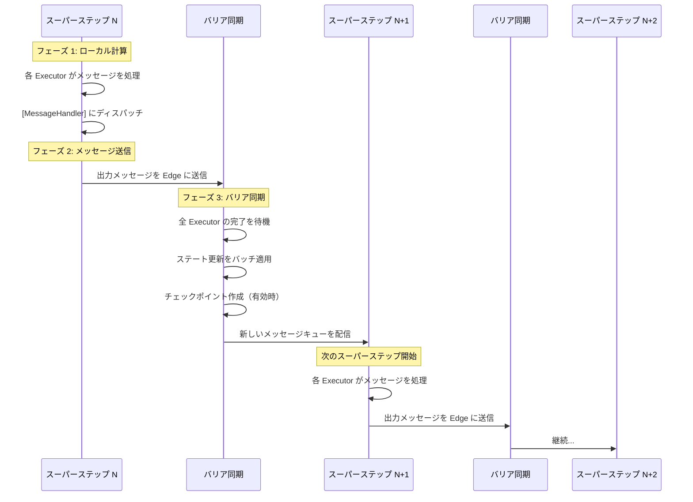
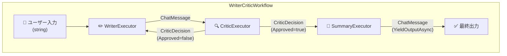

## はじめに

2025 年から 2026 年にかけて、LLM をチャットの応答に使うだけでなく、複数のエージェントを協調させて複雑なタスクを遂行する「Agentic Workflow」という設計が急速に広まっている。

Agentic Workflow では、LLM で推論するエージェントをグラフのノードに置き、実行順序・分岐・並列度を開発者が定義する。この記事では、この組み合わせが従来の自動化やチャットボットで扱えないタスクをなぜ扱えるのかを整理し、代表的なワークフローパターンを [Microsoft Agent Framework](https://github.com/microsoft/agent-framework) の C# コードで実装する。各パターンでメッセージがどう流れるかは、インタラクティブなビジュアライザーで確認できる。扱う内容は次のとおりだ。

1. Agentic Workflow とは何か — 定義・背景・従来手法との比較
2. ワークフローの設計パターン — Sequential・Concurrent・Conditional・Handoff・Writer-Critic・Group Chat
3. 発展的な構成パターン — Sub-Workflow・Workflow-as-Agent・Declarative Workflow
4. Microsoft Agent Framework の C# 実装 — WorkflowBuilder・Executor・Edge のコードレベル解説
5. 実践的な実装例 — Writer-Critic ループのフル実装
6. 本番運用の考慮事項 — エラーハンドリング・チェックポイント・オブザーバビリティー・Human-in-the-Loop
7. 設計指針 — いつ Agent を使い、いつ Workflow を使うべきか

## Agentic Workflow とは何か

### 定義

<strong>Agentic Workflow（エージェンティック・ワークフロー）</strong>とは、1 つ以上の AI エージェントを明確に定義された実行グラフの中で協調させ、複雑なタスクを達成するシステム設計パターンである。

この定義には 2 つの要素がある。

1. 「エージェント」が構成要素である — LLM で推論するエージェントが、ワークフローのノードとして働く
2. 「ワークフロー」で制御される — エージェントの実行順序・条件分岐・並列度は、ワークフロー定義で明示的に制御される。次に何をするかをエージェントの判断に任せず、開発者がグラフ構造で実行フローを設計する

つまり Agentic Workflow は、個々の判断に LLM の柔軟性を使い、実行の流れをワークフローで決定論的に制御する設計だ。

### 従来手法との比較

次の表の 4 つのアプローチのうち、高い柔軟性と高い制御性を両立するのは Agentic Workflow だけだ。

| 特性 | 従来の自動化 (RPA等) | チャットボット | 単一エージェント | Agentic Workflow |
|------|---------------------|-------------|---------------|-----------------|
| 柔軟性 | 低い（ルールベース） | 中程度 | 高い | 高い |
| 制御性 | 非常に高い | 低い | 低い | 高い |
| 複雑なタスク | ハードコード | 不向き | 単一視点 | 多角的に対応 |
| エラーハンドリング | 分岐で対応 | LLM任せ | LLM任せ | 構造的に対応 |
| 品質保証 | テスト可能 | 困難 | 困難 | レビューループで対応 |
| 実装コスト | 高い | 低い | 低い～中程度 | 中程度 |

従来の自動化（RPA 等）は、定義済みのルールに厳密に従うため制御性は高いが、想定外の入力やあいまいな判断には対応できない。「もしメールの件名にキーワード X が含まれたら Y をする」というルールは書けるが、「このメールの意図を理解して適切に返信する」は不可能だ。

チャットボットは LLM の柔軟性を活かせるが、単発の応答に限られ、複雑な業務プロセスの遂行には向かない。「旅行の予約を手伝って」と言えば会話はできるが、予約・決済・確認メール送信という一連のプロセスを確実にこなすのは難しい。

単一エージェントはツール呼び出しで外部世界とやりとりでき、かなり複雑なタスクもこなせる。しかし、すべてのロジックが 1 つのエージェントに集中するため、関心の分離が難しく、品質管理の過程も外から見えなくなる。

Agentic Workflow では、各エージェントに専門領域を持たせ、ワークフローで実行順序を制御し、品質ゲート（Critic による審査ループなど）をグラフに組み込める。

### なぜ今 Agentic Workflow なのか

Agentic Workflow が実用的になった背景には、次の 4 つの技術的進歩がある。

1. <strong>LLM の能力向上</strong> — GPT-4 以降のモデルは、ツール呼び出し・構造化出力・ロールプレイの能力が大幅に向上し、ワークフロー内のノードとして十分に機能するようになった
2. <strong>Structured Output</strong> — LLM が JSON スキーマに従った構造化出力を確実に生成できるようになり、エージェント間でメッセージを型安全に受け渡せるようになった
3. <strong>MCP の標準化</strong> — Model Context Protocol によってエージェントとツールの接続方法が標準化され、ツール統合のコストが大きく下がった
4. <strong>フレームワークの成熟</strong> — Microsoft Agent Framework、LangGraph、CrewAI などのフレームワークが成熟し、少ないコードでワークフローを構築できるようになった

## ワークフローの設計パターン

Agentic Workflow には定番の設計パターンがいくつかあり、単独でも、組み合わせても使える。

次のビジュアライザーでは、ボタンでパターンを切り替え、ステップ実行でメッセージの流れを追える。

<AgenticWorkflowVisualizer />

### パターン 1: Sequential（直列パイプライン）

複数のエージェントを直列につなぎ、前のエージェントの出力を次のエージェントの入力として渡す、最も単純なパターンだ。

<SequentialPatternDiagram />

<strong>ユースケース</strong>: 翻訳チェーン、データ変換パイプライン、段階的な文書処理

<strong>メリット</strong>: 実装が簡単で、各ステップの入出力が明確なのでデバッグしやすい。

<strong>トレードオフ</strong>: ステップを並列化できないため、全体のレイテンシーは各ステップの合計になる。

Microsoft Agent Framework では `AgentWorkflowBuilder.BuildSequential()` の 1 行でこのパターンを構築できる。

```csharp
// Sequential: 翻訳チェーンの構築
// AgentWorkflowBuilder.BuildSequential() は内部で
// AddEdge(agent[0], agent[1]), AddEdge(agent[1], agent[2]), ...
// を自動生成する
Workflow workflow = AgentWorkflowBuilder.BuildSequential(
    from lang in new[] { "French", "Spanish", "English" }
    select new ChatClientAgent(
        chatClient,
        instructions: $"You are a translation assistant. Translate the input to {lang}.",
        name: $"{lang}Translator"
    )
);

// ワークフロー実行
await using StreamingRun run =
    await InProcessExecution.RunStreamingAsync(workflow, "Hello, world!");

await foreach (WorkflowEvent evt in run.WatchStreamAsync())
{
    if (evt is AgentResponseUpdateEvent e)
        Console.Write(e.Update.Text);
    else if (evt is WorkflowOutputEvent output)
        Console.WriteLine($"\nFinal: {output.Data}");
}
```

### パターン 2: Concurrent（Fan-out / Fan-in）

入力を複数のエージェントに同時に配信し、すべての結果を集約するパターンだ。

<ConcurrentPatternDiagram />

<strong>ユースケース</strong>: 複数言語への同時翻訳、複数角度からの分析、並列データ処理

<strong>メリット</strong>: 全体のレイテンシーは、Sequential のような各ステップの合計ではなく、最も遅いエージェントの処理時間で決まる。

<strong>トレードオフ</strong>: API の同時呼び出しが増えるため、レート制限に注意が必要になる。結果を集約するロジックも必要だ。

```csharp
// Concurrent: 並列翻訳
// BuildConcurrent() は内部で Fan-out Edge と Fan-in Barrier Edge を生成する
// Fan-out: 入力ノードから全エージェントに同時にメッセージを配信
// Fan-in Barrier: 全エージェントの完了を待ってから結果を集約
Workflow workflow = AgentWorkflowBuilder.BuildConcurrent(
    from lang in new[] { "French", "Spanish", "English" }
    select new ChatClientAgent(
        chatClient,
        instructions: $"Translate the input to {lang}. Output only the translation.",
        name: $"{lang}Translator"
    )
);
```

### パターン 3: Conditional Routing（条件分岐）

Executor の出力に基づいて次の実行先を動的に決定するパターンだ。`if-else` や `switch-case` に相当する。

<ConditionalPatternDiagram />

<strong>ユースケース</strong>: メール分類（スパム/正常）、チケットルーティング、コンテンツモデレーション

```csharp
// Conditional Routing: スパム分類の例
// AddSwitch() で ClassificationResult の Category プロパティに基づき分岐
// ラムダ式による型安全な条件判定
WorkflowBuilder builder = new WorkflowBuilder(classifier)
    .AddSwitch(classifier, sw => sw
        .AddCase<ClassificationResult>(
            result => result?.Category == "spam",
            spamHandler)
        .AddCase<ClassificationResult>(
            result => result?.Category == "normal",
            replyGenerator)
        .WithDefault(manualReviewHandler)
    )
    .WithOutputFrom(spamHandler, replyGenerator, manualReviewHandler);
```

`AddSwitch` は内部で単一の `FanOutEdge` を生成し、`EdgeSelector` が最初にマッチしたケースで早期リターンする。そのため `AddSwitch` の分岐は switch-case と同じく排他的だ。一方、`AddEdge` で条件付き Edge を個別に複数追加すると、分岐は独立した複数の if 文と同じく非排他的になり、条件を満たすすべての Edge にメッセージが配信される。この違いは「実装上の注意点」で、ソースコードとともに説明する。

### パターン 4: Handoff（委任）

トリアージ・エージェントが入力を分析し、適切な専門エージェントに処理を委任するパターンだ。Conditional と似ているが、エージェント自身が委任先を決定する点が異なる。

<HandoffPatternDiagram />

<strong>ユースケース</strong>: カスタマーサポートの振り分け、教育チューター、専門家チーム

```csharp
// Handoff: トリアージ → 専門エージェントへの委任
// CreateHandoffBuilderWith() でトリアージエージェントを起点に構築
// WithHandoffs() で双方向のハンドオフルートを定義
ChatClientAgent triageAgent = new(chatClient,
    instructions: "Determine which specialist to use. ALWAYS hand off.",
    name: "triage_agent",
    description: "Routes to the right specialist.");

ChatClientAgent mathTutor = new(chatClient,
    instructions: "You help with math. Explain step by step.",
    name: "math_tutor",
    description: "Math specialist.");

ChatClientAgent historyTutor = new(chatClient,
    instructions: "You help with history. Explain events and context.",
    name: "history_tutor",
    description: "History specialist.");

// Handoff ワークフローの構築
// WithHandoffs(source, targets) は source が targets の description を
// ツール定義として受け取り、LLM が handoff ツールを呼び出すことで
// 自動的にルーティングが行われる
Workflow workflow = AgentWorkflowBuilder
    .CreateHandoffBuilderWith(triageAgent)
    .WithHandoffs(triageAgent, [mathTutor, historyTutor])
    .WithHandoffs([mathTutor, historyTutor], triageAgent)
    .Build();
```

`WithHandoffs(triageAgent, [mathTutor, historyTutor])` を呼ぶと、`mathTutor` と `historyTutor` の `name` と `description` がツール定義として `triageAgent` に注入される。LLM が `handoff_to_math_tutor` のようなツール呼び出しを生成すると、ワークフローエンジンがそれを検知し、対応する Executor にメッセージをルーティングする。委任先を判断するのは LLM で、実行を制御するのはワークフローエンジンだ。

> <strong>注意</strong>: Handoff API（`CreateHandoffBuilderWith` / `HandoffWorkflowBuilder`）には `[Experimental("MAAIW001")]` が付いており、使うにはコンパイラー警告 `MAAIW001` を抑制する必要がある。API は今後変わる可能性がある。2026 年 8 月に再確認した時点で、Agent Framework 本体は安定版 1.x に到達したが、Handoff は実験的なままだ。旧名の `HandoffsWorkflowBuilder`（s 付き）は `[Obsolete]` になっているので、`HandoffWorkflowBuilder` を使う。

### パターン 5: Writer-Critic ループ（反復改善）

Writer が成果物を生成し、Critic がレビューし、承認されるまでこれを繰り返す。人がレビューと修正を繰り返す手順を、エージェント同士で行うパターンだ。

<WriterCriticPatternDiagram />

<strong>ユースケース</strong>: コンテンツ生成、コードレビュー、翻訳品質管理

<strong>メリット</strong>: 品質ゲートがグラフに組み込まれ、反復のたびに出力の品質を高められる。

<strong>トレードオフ</strong>: ループ回数に比例して LLM の呼び出しが増える。最大イテレーション数の安全弁が必要になる。

```csharp
// Writer-Critic ループ: 反復改善ワークフロー
// WorkflowBuilder でグラフ構造を宣言的に定義
WorkflowBuilder builder = new WorkflowBuilder(writer)
    .AddEdge(writer, critic)                    // Writer → Critic
    .AddSwitch(critic, sw => sw
        .AddCase<CriticDecision>(                // 承認 → Summary
            cd => cd?.Approved == true, summary)
        .AddCase<CriticDecision>(                // 拒否 → Writer に戻る
            cd => cd?.Approved == false, writer))
    .WithOutputFrom(summary);                    // Summary の出力が最終出力
```

### パターン 6: Group Chat（グループチャット）

Handoff パターンでは「今のエージェントが次のエージェントを 1 つ選ぶ」のに対し、Group Chat は複数のエージェントがラウンドで会話するパターンだ。誰が次に発言するかは `GroupChatManager` が制御する。

<GroupChatPatternDiagram />

<strong>ユースケース</strong>: ブレインストーミング、多角的レビュー、ディベート形式の分析

```csharp
// Group Chat: マネージャーが発言順を制御する複数エージェントの会話
// CreateGroupChatBuilderWith() で GroupChatManager のファクトリを指定
// RoundRobinGroupChatManager: エージェントを順番に指名する最もシンプルなマネージャー
Workflow workflow = AgentWorkflowBuilder
    .CreateGroupChatBuilderWith(
        agents => new RoundRobinGroupChatManager(agents) { MaximumIterationCount = 3 })
    .AddParticipants(researchAgent, criticAgent, synthesizerAgent)
    .Build();
```

`GroupChatManager` は抽象クラスなので、派生クラスを実装すれば発言順を独自のロジックで決められる。例えば、各発言の内容を分析し、最も関連性の高いエージェントを次に指名するマネージャーも実装できる。

### 発展的な構成パターン

Agent Framework には、ワークフローを部品として組み合わせたり、別の形で公開・定義したりする仕組みもある。

#### Sub-Workflow（サブワークフロー）

ワークフローを Executor として別のワークフローに埋め込める。ワークフローを再利用できる部品にして、階層的に組み合わせられる。

```csharp
// Sub-Workflow: ワークフローを Executor として埋め込む
// 1. まず子ワークフローを通常通り構築
Workflow textProcessingWorkflow = new WorkflowBuilder(uppercase)
    .AddEdge(uppercase, reverse)
    .AddEdge(reverse, append)
    .WithOutputFrom(append)
    .Build();

// 2. BindAsExecutor() でワークフローを Executor に変換
ExecutorBinding subWorkflowExecutor =
    textProcessingWorkflow.BindAsExecutor("TextProcessingSubWorkflow");

// 3. 親ワークフローの中で通常の Executor と同様に接続
Workflow mainWorkflow = new WorkflowBuilder(prefix)
    .AddEdge(prefix, subWorkflowExecutor)
    .AddEdge(subWorkflowExecutor, postProcess)
    .WithOutputFrom(postProcess)
    .Build();
```

#### Workflow-as-Agent（ワークフローのエージェント化）

逆に、ワークフロー全体を 1 つの `AIAgent` として外部に公開することもできる。呼び出し側はワークフローの内部構造を意識する必要がない。

```csharp
// Workflow-as-Agent: ワークフローを AIAgent として公開
// AsAIAgent() でワークフローを AIAgent インターフェースにラップ
Workflow workflow = WorkflowFactory.BuildWorkflow(chatClient);
AIAgent agent = workflow.AsAIAgent("workflow-agent", "Workflow Agent");

// 通常のエージェントと同じように対話できる
AgentSession session = await agent.CreateSessionAsync();
await foreach (AgentResponseUpdate update in
    agent.RunStreamingAsync("Hello!", session))
{
    Console.Write(update.Text);
}
```

呼び出し側から見ると通常のエージェントと変わらないので、最初は単一エージェントで始め、要件が複雑になった時点でワークフローに置き換えても、呼び出し側のコードを変えずに済む。

#### Declarative Workflow（宣言的ワークフロー）

C# のコードでグラフを構築する代わりに、YAML ファイルでワークフローを宣言的に定義することもできる。YAML なら、エンジニアでなくてもワークフローの構造を読んで編集でき、コードをデプロイし直さずにワークフローを変更できる。

YAML の定義はパースされ、コードで組んだワークフローと同じ実行エンジンで動く。Agent Framework の `Declarative/` サンプルには、カスタマーサポート・マーケティング・ディープリサーチなど、YAML によるワークフロー定義の例が多数ある。

## Microsoft Agent Framework の C# 実装

Agent Framework のワークフローは、処理ノードである Executor を Edge でつないだグラフで、`WorkflowBuilder` で組み立てる。

### パッケージ構成

.NET で Agentic Workflow を開発するには、次のパッケージを使う。

```xml
<!-- csproj ファイルに追加 -->
<PackageReference Include="Microsoft.Agents.AI" Version="1.1.0" />
<PackageReference Include="Microsoft.Agents.AI.Workflows" Version="1.1.0" />
<PackageReference Include="Microsoft.Agents.AI.Workflows.Generators" Version="1.1.0"
                OutputItemType="Analyzer" ReferenceOutputAssembly="false" />
<PackageReference Include="Microsoft.Agents.AI.OpenAI" Version="1.1.0" />
<!-- or Microsoft.Agents.AI.Foundry for Azure AI Foundry -->
```

`Microsoft.Agents.AI` がフレームワークのコアで、`AIAgent`、`ChatClientAgent`、`AgentResponseUpdate` といったエージェント関連の基盤型が含まれる。`Microsoft.Agents.AI.Workflows` にはワークフロー関連の型（`WorkflowBuilder`、`Executor`、`InProcessExecution`、`StreamingRun` 等）が含まれる。`Microsoft.Agents.AI.Workflows.Generators` はソースジェネレーターで、`[MessageHandler]` 属性のディスパッチコードを自動生成する。`Microsoft.Agents.AI.OpenAI` は OpenAI / Azure OpenAI と、`Microsoft.Agents.AI.Foundry` は Microsoft Foundry (旧 Azure AI Foundry) と統合するためのパッケージだ。

### コア概念: Executor

<strong>Executor</strong> はワークフローグラフの処理ノードで、メッセージを受け取って処理し、出力メッセージを生成する。Agent Framework では、partial クラスとソースジェネレーターにより、少ない定型コードで Executor を定義できる。

```csharp
// Executor の基本形
// partial キーワードとソースジェネレータにより、
// メッセージのディスパッチコードが自動生成される
internal sealed partial class UpperCaseExecutor() : Executor("UpperCase")
{
    // [MessageHandler] 属性でメッセージハンドラを定義
    // 引数の型 (string) でメッセージのルーティングが決まる
    [MessageHandler]
    public ValueTask<string> HandleAsync(
        string message,
        IWorkflowContext context,
        CancellationToken cancellationToken = default)
    {
        return ValueTask.FromResult(message.ToUpperInvariant());
    }
}
```

`[MessageHandler]` 属性が付いたメソッドは、ソースジェネレーターによってメッセージのディスパッチテーブルに登録される。ルーティングのキーになるのはメソッドの引数の型で、`string` 型のメッセージには `HandleAsync(string)`、`CriticDecision` 型には `HandleAsync(CriticDecision)` が呼ばれる。そのため、1 つの Executor で複数の型のメッセージを型安全に処理できる。

#### ChatClientAgent を使った Executor

Executor の中から LLM を呼び出すには `ChatClientAgent` を使う。`ChatClientAgent` は `IChatClient` を `AIAgent` として扱えるようにするアダプターだ。

```csharp
// LLM を呼び出す Executor の例
// ChatClientAgent は IChatClient を受け取り、AIAgent インターフェースを提供する
internal sealed partial class WriterExecutor : Executor
{
    private readonly AIAgent _agent;

    public WriterExecutor(IChatClient chatClient) : base("Writer")
    {
        // ChatClientAgent: IChatClient → AIAgent のアダプタ
        // instructions がシステムプロンプトとして LLM に送信される
        this._agent = new ChatClientAgent(
            chatClient,
            name: "Writer",
            instructions: """
                You are a skilled writer. Create clear, engaging content.
                If you receive feedback, revise to address all concerns.
                """
        );
    }

    // 初回リクエスト用のハンドラ（string 型）
    [MessageHandler]
    public async ValueTask<ChatMessage> HandleInitialRequestAsync(
        string message,
        IWorkflowContext context,
        CancellationToken cancellationToken = default)
    {
        // RunStreamingAsync で LLM にストリーミングリクエスト
        StringBuilder sb = new();
        await foreach (AgentResponseUpdate update in
            this._agent.RunStreamingAsync(
                new ChatMessage(ChatRole.User, message),
                cancellationToken: cancellationToken))
        {
            if (!string.IsNullOrEmpty(update.Text))
            {
                sb.Append(update.Text);
                Console.Write(update.Text); // リアルタイム出力
            }
        }

        return new ChatMessage(ChatRole.User, sb.ToString());
    }

    // 修正リクエスト用のハンドラ（CriticDecision 型）
    // 同じ Executor が異なる型のメッセージを処理できる
    [MessageHandler]
    public async ValueTask<ChatMessage> HandleRevisionAsync(
        CriticDecision decision,
        IWorkflowContext context,
        CancellationToken cancellationToken = default)
    {
        string prompt =
            $"Revise based on this feedback:\n{decision.Feedback}\n\n" +
            $"Original:\n{decision.Content}";

        StringBuilder sb = new();
        await foreach (AgentResponseUpdate update in
            this._agent.RunStreamingAsync(
                new ChatMessage(ChatRole.User, prompt),
                cancellationToken: cancellationToken))
        {
            if (!string.IsNullOrEmpty(update.Text))
                sb.Append(update.Text);
        }

        return new ChatMessage(ChatRole.User, sb.ToString());
    }
}
```

`HandleInitialRequestAsync`（`string` 型を受け取る）と `HandleRevisionAsync`（`CriticDecision` 型を受け取る）は、同じ Executor の中にある。ワークフローエンジンが受信メッセージの型を調べて適切なハンドラーにディスパッチするので、Writer は初回の執筆依頼と、Critic のフィードバック付きの修正依頼を 1 つの Executor で処理できる。

### コア概念: Edge

<strong>Edge</strong> は Executor 間のメッセージフローを定義する接続だ。

```csharp
// Direct Edge: 無条件で A → B にメッセージを流す
builder.AddEdge(executorA, executorB);

// Conditional Edge: 条件を満たすときだけメッセージを流す
builder.AddEdge<ClassificationResult>(executorA, executorB,
    condition: r => r?.Category == "normal");

// Switch-Case Edge: 複数の条件分岐
builder.AddSwitch(executorA, sw => sw
    .AddCase<ResultType>(r => r?.IsSuccess == true, successHandler)
    .AddCase<ResultType>(r => r?.IsSuccess == false, failureHandler)
    .WithDefault(fallbackHandler));

// Fan-out Edge: 1 → N の並列配信
builder.AddFanOutEdge<RoutingResult>(
    sourceExecutor,
    targets: [handlerA, handlerB, handlerC],
    targetSelector: (result, count) =>
    {
        // result の内容に応じて実行先を選択
        // 戻り値は実行先のインデックスのリスト
        if (result?.NeedsAll == true) return Enumerable.Range(0, count);
        return [0]; // handlerA のみ
    });

// Fan-in Barrier Edge: N → 1 の集約（全ソースの完了待ち）
builder.AddFanInBarrierEdge(
    sources: [workerA, workerB, workerC],
    target: aggregator);
```

Edge は、ワークフローエンジンがスーパーステップ（後述する実行の区切り）を進めるときに使われる。各スーパーステップでアクティブな Executor が実行され、その出力メッセージが Edge の条件に従って次の Executor に配送される。条件は Edge ごとに独立して評価されるため、`AddEdge` で作った複数の条件付き Edge に、1 つの出力が同時にマッチすることがある。この挙動を含む注意点は「実装上の注意点」で説明する。

### コア概念: WorkflowBuilder

<strong>WorkflowBuilder</strong> は Executor と Edge を組み合わせてワークフローの有向グラフを構築するビルダーだ。

```csharp
// WorkflowBuilder のフル活用例
Workflow workflow = new WorkflowBuilder(entryExecutor)
    // Direct Edge: entry → processor
    .AddEdge(entryExecutor, processorExecutor)
    // Switch-Case: processor の出力で分岐
    .AddSwitch(processorExecutor, sw => sw
        .AddCase<ProcessResult>(r => r?.Status == "approved", approvedHandler)
        .AddCase<ProcessResult>(r => r?.Status == "rejected", rejectedHandler)
        .WithDefault(manualReviewHandler))
    // 出力元の指定: これらの Executor の出力がワークフロー全体の出力になる
    .WithOutputFrom(approvedHandler, rejectedHandler, manualReviewHandler)
    // ビルド: Workflow インスタンスの生成
    .Build();
```

`WorkflowBuilder` のコンストラクターに渡した Executor がワークフローのエントリーポイントになる。`.Build()` はグラフの整合性を検証し（孤立ノードがないか、出力元が指定されているか等）、`Workflow` インスタンスを返す。

### ワークフローの実行

ワークフローの実行には `InProcessExecution` を使う。ストリーミング実行と非ストリーミング実行の両方に対応している。

```csharp
// ストリーミング実行
// InProcessExecution.RunStreamingAsync() は StreamingRun を返す
// StreamingRun は IAsyncDisposable で、using で確実にリソースが解放される
await using StreamingRun run =
    await InProcessExecution.RunStreamingAsync(workflow, "入力メッセージ");

// WatchStreamAsync() でリアルタイムにイベントを購読
await foreach (WorkflowEvent evt in run.WatchStreamAsync())
{
    switch (evt)
    {
        case AgentResponseUpdateEvent agentUpdate:
            // エージェントのストリーミング出力（トークン単位）
            Console.Write(agentUpdate.Update.Text);
            break;

        case WorkflowOutputEvent output:
            // ワークフロー全体の最終出力
            Console.WriteLine($"\n=== Final Output ===");
            Console.WriteLine(output.Data);
            break;
    }
}
```

`InProcessExecution` はワークフローを同一プロセス内で実行する。ワークフローエンジンはスーパーステップ方式（BSP: Bulk Synchronous Parallel）で動く。この方式は、Google が 2010 年に発表した大規模グラフ処理フレームワーク [Pregel](https://research.google/pubs/pregel-a-system-for-large-scale-graph-processing/) に由来する。分散グラフ処理で確立された計算モデルを、AI エージェントのワークフロー実行に応用したものだ。

#### Pregel / BSP とは何か

<strong>BSP（Bulk Synchronous Parallel）</strong>は 1990 年に Leslie Valiant が提唱した並列計算モデルで、計算を「スーパーステップ」と呼ぶ区切りの繰り返しとして組み立てる。各スーパーステップは次の 3 つのフェーズからなる。

1. <strong>ローカル計算</strong> — 各プロセッサー（Executor）がローカルのメッセージキューを読み取り、計算を実行する
2. <strong>メッセージ送信</strong> — 計算結果を他のプロセッサーへのメッセージとして送信する
3. <strong>バリア同期</strong> — 全プロセッサーの計算完了を待ち、状態更新をバッチ適用する。次のスーパーステップでは新しいメッセージが利用可能になる

Pregel は BSP を有向グラフの頂点ベース計算に特化させたもので、「各頂点が受信メッセージを処理し、隣接頂点にメッセージを送信し、自身の状態を更新する」というループを繰り返す。



次のシミュレーターでは、Concurrent 翻訳ワークフローを例に、各フェーズ（ローカル計算 → メッセージ送信 → バリア同期）で Executor のメッセージキューとステートがどう変わるかをステップ実行で追える。

<BSPVisualizer />

#### Agent Framework での具体的な実行フロー

[`InProcessRunner.cs`](https://github.com/microsoft/agent-framework/blob/main/dotnet/src/Microsoft.Agents.AI.Workflows/InProc/InProcessRunner.cs) の `RunSuperStepAsync` メソッドは、1 回のスーパーステップを次のように実行する。

```csharp
// InProcessRunner.RunSuperStepAsync() の内部動作（簡略化）
// https://github.com/microsoft/agent-framework/blob/main/dotnet/src/Microsoft.Agents.AI.Workflows/InProc/InProcessRunner.cs
async ValueTask<bool> RunSuperStepAsync(CancellationToken cancellationToken)
{
    // 1. AdvanceAsync(): 前のスーパーステップでキューされた
    //    メッセージを、現在のスーパーステップの StepContext に移動
    StepContext currentStep = await RunContext.AdvanceAsync(cancellationToken);

    // メッセージがなければスーパーステップは不要
    if (!currentStep.HasMessages && !RunContext.HasQueuedExternalDeliveries)
        return false;

    // 2. SuperStepStartedEvent を発火
    await RaiseWorkflowEventAsync(StepTracer.Advance(currentStep));

    // 3. 全ての宛先 Executor に対してメッセージを並行配信
    //    Task.WhenAll で同一スーパーステップ内の Executor を並行実行
    List<Task> receiverTasks = currentStep.QueuedMessages.Keys
        .Select(receiverId =>
            DeliverMessagesAsync(receiverId,
                currentStep.MessagesFor(receiverId),
                cancellationToken).AsTask())
        .ToList();
    await Task.WhenAll(receiverTasks);

    // 4. サブワークフローがあればそちらも並行駆動
    List<Task> subworkflowTasks = [];
    foreach (var subRunner in RunContext.JoinedSubworkflowRunners)
        subworkflowTasks.Add(subRunner.RunSuperStepAsync(cancellationToken).AsTask());
    await Task.WhenAll(subworkflowTasks);

    // 5. バリア同期: ステート更新をバッチ適用
    //    StateManager.PublishUpdatesAsync() が
    //    QueueStateUpdateAsync() でキューされた更新を一括適用
    await StateManager.PublishUpdatesAsync(StepTracer);

    // 6. チェックポイント作成（有効時）
    await CheckpointAsync(cancellationToken);

    // 7. SuperStepCompletedEvent を発火
    await RaiseWorkflowEventAsync(
        StepTracer.Complete(
            RunContext.NextStepHasActions,
            RunContext.HasUnservicedRequests));
}
```

このメソッドのうち、ワークフローの設計に関わるのは次の 3 つのステップだ。

<strong>並行実行</strong>: ステップ 3 では `Task.WhenAll` で、同一スーパーステップ内のすべての Executor を並行に実行する。Concurrent（Fan-out）パターンで複数のエージェントが同時に動くのはこのためだ。Sequential パターンでは各スーパーステップでアクティブな Executor が 1 つだけなので、実行は実質的に直列になる。

<strong>バリア同期</strong>: ステップ 5 で `PublishUpdatesAsync()` が呼ばれ、スーパーステップ中に `QueueStateUpdateAsync()` でキューされたステート更新がまとめて適用される。そのため、同一スーパーステップ内の複数の Executor は同じスナップショットを読む。別の Executor がキューした更新は、次のスーパーステップまで見えない。

<strong>チェックポイント</strong>: チェックポイントが有効なら、ステップ 6 で各スーパーステップの終わりに自動で作成される。チェックポイントには次の情報が含まれる。
- `StepContext` — 次のスーパーステップに配送予定のメッセージキュー
- `StateManager` — 全 Executor のステート
- `EdgeMap` — Edge のステート（Fan-in バリアの待機状態等）
- `WorkflowInfo` — ワークフローグラフの構造情報

#### StepContext — メッセージキューの仕組み

各スーパーステップのメッセージ管理は [`StepContext`](https://github.com/microsoft/agent-framework/blob/main/dotnet/src/Microsoft.Agents.AI.Workflows/Execution/StepContext.cs) が担う。

```csharp
// StepContext: スーパーステップのメッセージキュー管理
// https://github.com/microsoft/agent-framework/blob/main/dotnet/src/Microsoft.Agents.AI.Workflows/Execution/StepContext.cs
internal sealed class StepContext
{
    // 宛先 Executor ID → メッセージキュー
    // ConcurrentDictionary + ConcurrentQueue でスレッドセーフ
    public ConcurrentDictionary<string, ConcurrentQueue<MessageEnvelope>>
        QueuedMessages { get; } = [];

    public bool HasMessages =>
        !QueuedMessages.IsEmpty &&
        QueuedMessages.Values.Any(q => !q.IsEmpty);
}
```

`MessageEnvelope` はメッセージ本体に加え、送信元 Executor ID、メッセージの型情報、トレースコンテキスト（OpenTelemetry）を持つ。Edge のルーティング処理（`EdgeRunner`）が出力メッセージを条件判定し、次のスーパーステップ用の `StepContext` にエンキューする。

#### 実行モードの選択

`InProcessExecution` は 3 つの実行モードを提供する。

| モード | 説明 | 用途 |
|--------|------|------|
| `OffThread`（デフォルト） | バックグラウンドスレッドでスーパーステップを実行し、イベントをリアルタイムにストリーミング | 本番環境・ストリーミング UI |
| `Lockstep` | イベント監視スレッドでスーパーステップを実行し、各ステップ完了後にイベントをまとめて配信 | テスト・デバッグ |
| `Concurrent` | `OffThread` + 同一ワークフローインスタンスの複数同時実行を許可 | 高スループットシナリオ |

```csharp
// 実行モードの選択
// デフォルト（OffThread）: リアルタイムストリーミング
await using var run = await InProcessExecution.RunStreamingAsync(workflow, input);

// Lockstep: テスト・デバッグ用（イベントがバッチで配信される）
await using var run = await InProcessExecution.Lockstep
    .RunStreamingAsync(workflow, input);

// Concurrent: 同一ワークフローの並行実行
// ワークフロー内の全 Executor が IResettableExecutor を実装している必要がある
await using var run = await InProcessExecution.Concurrent
    .RunStreamingAsync(workflow, input);
```

#### SuperStepStartedEvent / SuperStepCompletedEvent

各スーパーステップの開始と完了はイベントとして通知される。これらを購読すると、どの Executor がどのスーパーステップで動いたかを実行中に追える。

```csharp
await foreach (WorkflowEvent evt in run.WatchStreamAsync())
{
    switch (evt)
    {
        case SuperStepStartedEvent stepStarted:
            // SendingExecutors: 前ステップでメッセージを送った Executor の ID
            Console.WriteLine(
                $"[Step Start] Senders: {string.Join(", ", stepStarted.StartInfo.SendingExecutors)}");
            break;

        case SuperStepCompletedEvent stepCompleted:
            // ActivatedExecutors: このステップで実行された Executor の ID
            // HasPendingMessages: 次のステップに配送予定のメッセージがあるか
            // StateUpdated: ステートが更新されたか
            Console.WriteLine(
                $"[Step Done] Activated: {string.Join(", ", stepCompleted.CompletionInfo.ActivatedExecutors)}, " +
                $"Pending: {stepCompleted.CompletionInfo.HasPendingMessages}, " +
                $"StateUpdated: {stepCompleted.CompletionInfo.StateUpdated}");
            break;

        case AgentResponseUpdateEvent agentUpdate:
            Console.Write(agentUpdate.Update.Text);
            break;

        case WorkflowOutputEvent output:
            Console.WriteLine($"\nFinal: {output.Data}");
            break;
    }
}
```

#### なぜ Pregel / BSP なのか

Agent Framework がこのモデルを採用した利点として、次の 5 つが挙げられる。

1. <strong>決定論的な実行順序</strong>: バリア同期により、「スーパーステップ N で送信されたメッセージはスーパーステップ N+1 で処理される」ことが保証される。そのため、デバッグとテストがしやすい
2. <strong>一貫したステート</strong>: ステート更新はバリア時にまとめて適用されるため、同一ステップ内の複数の Executor が同じステートを読み書きしても競合しない
3. <strong>チェックポイントとの親和性</strong>: バリアがチェックポイントを作る自然な位置になるため、障害復旧やワークフローの再開を簡潔に実装できる
4. <strong>並行実行の制御</strong>: ステップ内の `Task.WhenAll` による並行実行と、ステップ間のバリアによる同期を組み合わせて、並行度を制御できる
5. <strong>オブザーバビリティー</strong>: スーパーステップ単位でイベントが発生するため、ワークフローの進行をステップごとに追跡できる

全 Executor のキューが空になるか、`WithOutputFrom` で指定された Executor が出力を生成するとワークフローが完了する。

#### 2 つのキュー — Message Queue と Event Queue

ワークフローエンジンの内部には、目的の異なる 2 つのキューがある。Executor 間のメッセージを運ぶ Message Queue と、実行状況を外部に知らせる Event Queue だ。次の構造図は、`currentStep` / `_nextStep` のスワップと Event Queue の関係を示している。

<BSPArchitectureDiagram />

##### Message Queue（`StepContext.QueuedMessages`）

<strong>流れるもの</strong>: Executor 間のビジネスメッセージ（`MessageEnvelope`）

キューは Executor ごとにあるわけではない。[`StepContext`](https://github.com/microsoft/agent-framework/blob/main/dotnet/src/Microsoft.Agents.AI.Workflows/Execution/StepContext.cs) が `ConcurrentDictionary<string, ConcurrentQueue<MessageEnvelope>>` を保持し、Executor ID をキーにしてメッセージを振り分ける。

Executor が送ったメッセージは、次の経路で次のスーパーステップ用のキューに入る。

```text
Executor A が context.SendMessageAsync(output) を呼ぶ
  → InProcessRunnerContext.SendMessageAsync(sourceId, output) が呼ばれる
    → sourceId に紐づく全 Edge を走査
      → EdgeMap.PrepareDeliveryForEdgeAsync() で条件判定
        → DeliveryMapping.MapInto(_nextStep) で
          次のスーパーステップ用 StepContext にエンキュー
            → _nextStep.MessagesFor(targetId).Enqueue(envelope)
```

スーパーステップを切り替えるときには、[`InProcessRunnerContext.AdvanceAsync()`](https://github.com/microsoft/agent-framework/blob/main/dotnet/src/Microsoft.Agents.AI.Workflows/InProc/InProcessRunnerContext.cs) が `_nextStep` をアトミックにスワップする。

```csharp
// InProcessRunnerContext.AdvanceAsync() — スーパーステップの切り替え
// https://github.com/microsoft/agent-framework/blob/main/dotnet/src/Microsoft.Agents.AI.Workflows/InProc/InProcessRunnerContext.cs
public async ValueTask<StepContext> AdvanceAsync(CancellationToken cancellationToken = default)
{
    // まず外部メッセージを Edge 経由で _nextStep にルーティング
    while (_queuedExternalDeliveries.TryDequeue(out var deliveryPrep))
        await deliveryPrep();

    // _nextStep をアトミックに取り出して新しい空の StepContext に差し替え
    return Interlocked.Exchange(ref _nextStep, new StepContext());
}
```

取り出された `StepContext` の `QueuedMessages` は、`RunSuperstepAsync()` 内で Executor ID ごとにフィルターされ、各 Executor に並行配信される。

```csharp
// InProcessRunner.RunSuperstepAsync() — Executor ID でフィルタして配信
List<Task> receiverTasks = currentStep.QueuedMessages.Keys
    .Select(receiverId =>
        DeliverMessagesAsync(
            receiverId,
            currentStep.MessagesFor(receiverId),  // Executor ID でフィルタ
            cancellationToken).AsTask())
    .ToList();
await Task.WhenAll(receiverTasks);  // 同一ステップ内は並行実行
```

##### Event Queue（`ConcurrentEventSink`）

<strong>流れるもの</strong>: ワークフローの観測・制御イベント（`WorkflowEvent`）

[`ConcurrentEventSink`](https://github.com/microsoft/agent-framework/blob/main/dotnet/src/Microsoft.Agents.AI.Workflows/Execution/ConcurrentEventSink.cs) は `InProcessRunner` が 1 つだけ保持するイベントシンクで、Executor 間のメッセージルーティングには関与しない。

```csharp
// ConcurrentEventSink — イベント通知の仕組み
// https://github.com/microsoft/agent-framework/blob/main/dotnet/src/Microsoft.Agents.AI.Workflows/Execution/ConcurrentEventSink.cs
internal class ConcurrentEventSink : IEventSink
{
    public ValueTask EnqueueAsync(WorkflowEvent workflowEvent)
        => this.EventRaised?.Invoke(this, workflowEvent) ?? default;

    public event Func<object?, WorkflowEvent, ValueTask>? EventRaised;
}
```

ここに流れる主なイベントは次のとおり。

| イベント | 発火タイミング |
|---------|-------------|
| `SuperStepStartedEvent` | スーパーステップ開始時 |
| `SuperStepCompletedEvent` | スーパーステップ完了時 |
| `AgentResponseUpdateEvent` | LLM ストリーミング出力（トークン単位） |
| `WorkflowOutputEvent` | `YieldOutputAsync()` で最終出力が生成された時 |
| `RequestInfoEvent` | Human-in-the-Loop の入力待ち |
| `WorkflowErrorEvent` | 例外発生時 |

これらは `StreamingRun.WatchStreamAsync()` でクライアントコードに公開される。

##### 両者の違いのまとめ

| 項目 | Message Queue | Event Queue |
|------|--------------|-------------|
| 正体 | `StepContext.QueuedMessages` | `ConcurrentEventSink` |
| 流れるデータ | `MessageEnvelope`（ビジネスデータ） | `WorkflowEvent`（観測イベント） |
| 目的 | Executor 間のメッセージルーティング | ワークフロー実行状況の外部通知 |
| ルーティング | Edge の条件判定で宛先決定 | なし（全イベントが外部に流れる） |
| スーパーステップとの関係 | ステップ境界でアトミックにスワップ | ステップ中にリアルタイム発火 |
| チェックポイント | 含まれる（永続化対象） | 含まれない |
| 消費者 | 次のスーパーステップの Executor | `WatchStreamAsync()` のクライアントコード |

### Structured Output で型安全な分岐

Writer-Critic パターンでは、Critic の判断を後続の条件分岐で確実に読み取る必要がある。承認か拒否かを自由形式のテキストで返させると、分岐のためのパースが不安定になる。Structured Output を使うと、LLM の出力を JSON スキーマに従わせ、分岐条件を型付きのプロパティーで書ける。

```csharp
// CriticDecision: Structured Output 用の DTO
// Description 属性は JSON Schema の description フィールドにマップされ、
// LLM がフィールドの意味を理解するためのヒントになる
[Description("Critic's review decision")]
internal sealed class CriticDecision
{
    [JsonPropertyName("approved")]
    [Description("Whether the content is approved (true) or needs revision (false)")]
    public bool Approved { get; set; }

    [JsonPropertyName("feedback")]
    [Description("Specific feedback for improvements if not approved")]
    public string Feedback { get; set; } = "";

    // ワークフロー内部で使用するフィールド（JSON には含まれない）
    [JsonIgnore]
    public string Content { get; set; } = "";

    [JsonIgnore]
    public int Iteration { get; set; }
}

// Critic Executor: Structured Output を使ったレビュー
internal sealed class CriticExecutor : Executor<ChatMessage, CriticDecision>
{
    private readonly AIAgent _agent;

    public CriticExecutor(IChatClient chatClient) : base("Critic")
    {
        this._agent = new ChatClientAgent(chatClient, new ChatClientAgentOptions
        {
            Name = "Critic",
            ChatOptions = new()
            {
                Instructions = """
                    You are a constructive critic. Review content and provide feedback.
                    Provide your decision as structured output.
                    """,
                // ChatResponseFormat.ForJsonSchema<T>() で
                // CriticDecision の JSON Schema を LLM に送信
                // LLM はこのスキーマに準拠した JSON を必ず返す
                ResponseFormat = ChatResponseFormat.ForJsonSchema<CriticDecision>()
            }
        });
    }

    public override async ValueTask<CriticDecision> HandleAsync(
        ChatMessage message,
        IWorkflowContext context,
        CancellationToken cancellationToken = default)
    {
        // ストリーミングでレスポンスを取得
        IAsyncEnumerable<AgentResponseUpdate> updates =
            this._agent.RunStreamingAsync(message, cancellationToken: cancellationToken);

        // ストリーミング出力をリアルタイムで表示
        await foreach (AgentResponseUpdate update in updates)
        {
            if (!string.IsNullOrEmpty(update.Text))
                Console.Write(update.Text);
        }

        // ストリームを AgentResponse に変換し、JSON をデシリアライズ
        AgentResponse response = await updates.ToAgentResponseAsync(cancellationToken);
        CriticDecision decision = JsonSerializer.Deserialize<CriticDecision>(
            response.Text, JsonSerializerOptions.Web)
            ?? throw new JsonException("Failed to deserialize CriticDecision");

        return decision;
    }
}
```

`ChatResponseFormat.ForJsonSchema<CriticDecision>()` を指定すると、LLM は `CriticDecision` クラスの JSON Schema に従った JSON を出力する。`[Description]` 属性が各フィールドの意味を LLM に伝え、`[JsonPropertyName]` が JSON のキー名を指定する。`[JsonIgnore]` が付いたフィールドは JSON Schema に含まれず、ワークフロー内部の状態管理専用として使える。

### IWorkflowContext による状態管理

Executor 間でステートを共有するには、`IWorkflowContext` を使う。

```csharp
// 共有ステートの読み書き
// IWorkflowContext は各 Executor に注入される
// scopeName でスコープを分離し、key で個別のステートを識別する

// ステートの読み取り
FlowState? state = await context.ReadStateAsync<FlowState>(
    key: "singleton",
    scopeName: "FlowStateScope");

// ステートの書き込み（キュー経由でスーパーステップ終了時に適用）
await context.QueueStateUpdateAsync(
    key: "singleton",
    value: updatedState,
    scopeName: "FlowStateScope");
```

`ReadStateAsync` は現在のステートを読み、`QueueStateUpdateAsync` はステートの更新をキューに入れる。キューに入れた更新は、前述のバリア同期でスーパーステップの終了時にまとめて適用される。

### IResettableExecutor — ステートフル Executor の再利用

ステートフルな Executor（内部にリストやカウンターを持つもの）を、複数のワークフロー実行で共有インスタンスとして再利用するには、`IResettableExecutor` インターフェースを実装する必要がある。フレームワークは各実行の終わりに `ResetAsync()` を呼び出し、蓄積された内部状態をクリアする。

```csharp
// IResettableExecutor: ステートフルな共有 Executor の再利用
// フレームワーク提供の Executor（ChatForwardingExecutor 等）は既に実装済み
// カスタム Executor でステートを持つ場合は自分で実装する必要がある
internal sealed class AggregationExecutor()
    : Executor<List<ChatMessage>>("Aggregator"), IResettableExecutor
{
    private readonly List<ChatMessage> _messages = [];

    public override async ValueTask HandleAsync(
        List<ChatMessage> message,
        IWorkflowContext context,
        CancellationToken cancellationToken = default)
    {
        this._messages.AddRange(message);
        if (this._messages.Count >= 2)
            await context.YieldOutputAsync(
                string.Join("\n", this._messages.Select(m => m.Text)),
                cancellationToken);
    }

    // フレームワークがワークフロー実行間で自動的に呼び出す
    public ValueTask ResetAsync()
    {
        this._messages.Clear();
        return default;
    }
}
```

`IResettableExecutor` を実装していないステートフルな共有 Executor を再利用しようとすると、`InvalidOperationException` がスローされる。ファクトリー経由で毎回新しいインスタンスを生成する場合は不要だが、パフォーマンス上の理由でインスタンスを共有する場合は必須だ。

## 実践: Writer-Critic ループのフル実装

ここまでの要素を組み合わせた Writer-Critic ループの実装例を示す。Microsoft Agent Framework の公式サンプル [`07_WriterCriticWorkflow`](https://github.com/microsoft/agent-framework/tree/main/dotnet/samples/03-workflows/_StartHere/07_WriterCriticWorkflow) と同じグラフを、`IChatClient` を使う形に書き換えたものだ。

### 全体構成



### Program.cs — ワークフローの組み立てと実行

```csharp
// Program.cs — Writer-Critic ワークフローのエントリーポイント
// https://github.com/microsoft/agent-framework/blob/main/dotnet/samples/03-workflows/_StartHere/07_WriterCriticWorkflow/Program.cs
using System.ComponentModel;
using System.Text;
using System.Text.Json;
using System.Text.Json.Serialization;
using Azure.AI.OpenAI;
using Azure.Identity;
using Microsoft.Agents.AI;
using Microsoft.Agents.AI.Workflows;
using Microsoft.Extensions.AI;

public static class Program
{
    public const int MaxIterations = 3; // 安全弁: 最大3回のイテレーション

    private static async Task Main()
    {
        // ── 1. IChatClient の初期化 ──
        string endpoint = Environment.GetEnvironmentVariable("AZURE_OPENAI_ENDPOINT")
            ?? throw new InvalidOperationException("AZURE_OPENAI_ENDPOINT is not set.");
        string deploymentName =
            Environment.GetEnvironmentVariable("AZURE_OPENAI_DEPLOYMENT_NAME")
            ?? "gpt-4o-mini";

        // IChatClient: Microsoft.Extensions.AI の統一インターフェース。
        // 現在の公式サンプルは AIProjectClient.AsAIAgent() で初期化するが、
        // ここではプロバイダ差し替えを示すため ChatClientAgent + IChatClient を使う。
        IChatClient chatClient = new AzureOpenAIClient(
            new Uri(endpoint),
            new AzureCliCredential()
        ).GetChatClient(deploymentName).AsIChatClient();

        // ── 2. Executor の生成 ──
        WriterExecutor writer = new(chatClient);
        CriticExecutor critic = new(chatClient);
        SummaryExecutor summary = new(chatClient);

        // ── 3. ワークフローグラフの構築 ──
        // WorkflowBuilder はコンストラクタの引数がエントリーポイント
        WorkflowBuilder workflowBuilder = new WorkflowBuilder(writer)
            .AddEdge(writer, critic)           // Writer → Critic
            .AddSwitch(critic, sw => sw        // Critic で条件分岐
                .AddCase<CriticDecision>(
                    cd => cd?.Approved == true,
                    summary)                   //   承認 → Summary
                .AddCase<CriticDecision>(
                    cd => cd?.Approved == false,
                    writer))                   //   拒否 → Writer（ループ）
            .WithOutputFrom(summary);          // Summary の出力が最終出力

        // ── 4. ワークフロー実行 ──
        Workflow workflow = workflowBuilder.Build();
        await using StreamingRun run =
            await InProcessExecution.RunStreamingAsync(
                workflow,
                "Write a 200-word blog post about AI ethics.");

        // ── 5. イベント購読 ──
        await foreach (WorkflowEvent evt in run.WatchStreamAsync())
        {
            switch (evt)
            {
                case AgentResponseUpdateEvent agentUpdate:
                    if (!string.IsNullOrEmpty(agentUpdate.Update.Text))
                        Console.Write(agentUpdate.Update.Text);
                    break;

                case WorkflowOutputEvent output:
                    Console.WriteLine($"\n\n=== FINAL APPROVED CONTENT ===");
                    Console.WriteLine(output.Data);
                    break;
            }
        }
    }
}
```

### FlowState — 共有ステート

```csharp
// FlowState: Executor 間で共有されるイテレーション追跡用ステート
// IWorkflowContext の ReadStateAsync / QueueStateUpdateAsync で読み書きする
internal sealed class FlowState
{
    public int Iteration { get; set; } = 1;
    public List<ChatMessage> History { get; } = [];
}

// ステートのスコープとキーの定数定義
internal static class FlowStateShared
{
    public const string Scope = "FlowStateScope";
    public const string Key = "singleton";
}

// ヘルパーメソッド
internal static class FlowStateHelpers
{
    public static async Task<FlowState> ReadFlowStateAsync(IWorkflowContext context)
    {
        FlowState? state = await context.ReadStateAsync<FlowState>(
            FlowStateShared.Key,
            scopeName: FlowStateShared.Scope);
        return state ?? new FlowState();
    }

    public static ValueTask SaveFlowStateAsync(
        IWorkflowContext context, FlowState state)
        => context.QueueStateUpdateAsync(
            FlowStateShared.Key,
            state,
            scopeName: FlowStateShared.Scope);
}
```

### 安全弁: MaxIterations

LLM が期待どおりに判断しないと、ループは終わらない可能性がある。そのため、Writer-Critic ループに限らず、ループを含むワークフローには必ず安全弁を設ける必要がある。

```csharp
// CriticExecutor 内の安全弁ロジック
if (!decision.Approved && state.Iteration >= Program.MaxIterations)
{
    Console.WriteLine(
        $"⚠️ Max iterations ({Program.MaxIterations}) reached - auto-approving");
    decision.Approved = true;
    decision.Feedback = "";
}
```

人間のレビューでも「修正は最大 3 回まで。それ以降はベストエフォートで出す」というルールは珍しくない。上限に達したら自動で承認するこのロジックは、同じ考え方を AI ワークフローに適用したものだ。

## 本番運用の考慮事項

### エラーハンドリングと障害モード

Agentic Workflow のエラーハンドリングでは、従来のアプリケーションにない事情を考慮する。LLM の呼び出しは非決定的で、レート制限・タイムアウト・不正な出力など、障害の種類も多い。

#### Executor 内の例外処理

Executor 内でスローされた例外はワークフローエンジンにキャッチされ、ワークフロー全体が失敗する。そのため、LLM 呼び出しの一時的なエラーは Executor 内でリトライするべきだ。

```csharp
// Executor 内のリトライとエラーハンドリング
[MessageHandler]
public async ValueTask<ChatMessage> HandleAsync(
    string message,
    IWorkflowContext context,
    CancellationToken cancellationToken = default)
{
    const int maxRetries = 3;
    for (int attempt = 1; attempt <= maxRetries; attempt++)
    {
        try
        {
            StringBuilder sb = new();
            await foreach (AgentResponseUpdate update in
                this._agent.RunStreamingAsync(
                    new ChatMessage(ChatRole.User, message),
                    cancellationToken: cancellationToken))
            {
                if (!string.IsNullOrEmpty(update.Text))
                    sb.Append(update.Text);
            }
            return new ChatMessage(ChatRole.User, sb.ToString());
        }
        catch (HttpRequestException ex) when (attempt < maxRetries)
        {
            // レート制限やタイムアウトの場合はエクスポネンシャルバックオフで再試行
            int delay = (int)Math.Pow(2, attempt) * 1000;
            Console.WriteLine($"⚠️ Attempt {attempt} failed: {ex.Message}. Retrying in {delay}ms...");
            await Task.Delay(delay, cancellationToken);
        }
    }
    throw new InvalidOperationException("All retry attempts exhausted");
}
```

#### 主な障害モード

| 障害モード | 症状 | 対策 |
|-----------|------|------|
| レート制限 | HTTP 429 | エクスポネンシャルバックオフ付きリトライ |
| 不正な出力 | Structured Output のパース失敗 | デフォルト値でフォールバック、またはリトライ |
| 無限ループ | Writer-Critic が収束しない | MaxIterations の安全弁 |
| タイムアウト | LLM が応答しない | CancellationToken + タイムアウト設定 |
| 部分的な障害 | Concurrent の一部が失敗 | Fan-in Barrier でエラーのあった結果を除外する集約ロジック |

### チェックポイント

長時間動くワークフローが途中で失敗したとき、最初からやり直すのは非効率だ。Agent Framework のチェックポイント機構を使うと、ワークフローのステートを永続化し、途中から再開できる。

```csharp
// チェックポイントの設定
// FileSystemJsonCheckpointStore はファイルシステムにステートを保存する
// 本番環境では Cosmos DB や Azure Table Storage ベースの ICheckpointStore を使うことが多い
var store = new FileSystemJsonCheckpointStore("./checkpoints");
var checkpointManager = new CheckpointManager(store);

// チェックポイント付きワークフロー実行
await using StreamingRun run =
    await InProcessExecution.RunStreamingAsync(
        workflow,
        input,
        checkpointManager);
```

### オブザーバビリティー

Agent Framework は OpenTelemetry に標準で対応しており、各 Executor の実行時間・入出力・LLM のトークン使用量をトレースできる。

```csharp
// OpenTelemetry セットアップ例
using var tracerProvider = Sdk.CreateTracerProviderBuilder()
    .SetResourceBuilder(ResourceBuilder.CreateDefault()
        .AddService("WriterCriticWorkflow"))
    .AddSource("Microsoft.Agents.AI")     // Agent Framework のトレース
    .AddOtlpExporter()                     // Jaeger / Azure Monitor 等に送信
    .Build();
```

ワークフローのイベントも実行の追跡に使える。`ExecutorInvokedEvent` / `ExecutorCompletedEvent` を見れば、どの Executor がいつ実行されたかが分かる。

### Human-in-the-Loop

ワークフローの途中でユーザーの承認が必要な場合は、`RequestPort` と `RequestInfoEvent` による request/response 機構を使う。ワークフローは外部入力を待ち、対応するレスポンスが戻ると実行を再開する。例えば、Critic が人間のレビューが必要だと判断したときに、ワークフローを一時停止してユーザーのフィードバックを待てる。

## 設計指針: Agent vs Workflow

Microsoft の公式ドキュメントは、Agent と Workflow の使い分けを次のように示している。

| Agent を使うべき場面 | Workflow を使うべき場面 |
|---------------------|----------------------|
| タスクがオープンエンドまたは対話的 | プロセスに明確なステップ定義がある |
| 自律的なツール使用と計画が必要 | 実行順序を明示的に制御したい |
| 単一の LLM 呼び出し（＋ツール）で十分 | 複数のエージェント・関数の協調が必要 |

中でも最も重要な指針は、<strong>関数で処理できるなら AI エージェントを使う必要はない</strong>ということだ。LLM の呼び出しにはコスト・レイテンシー・非決定性が伴う。確定的なロジックは通常の関数で実装し、LLM が本当に必要な部分にだけエージェントを使えば、コストを抑えながらシステムの信頼性も高められる。

### 実装上の注意点（Gotchas）

Microsoft Agent Framework のワークフローには、ドキュメントだけでは見落としやすい挙動がある。以下は、ソースコードで確認できたものだ。

#### 1. `AddEdge` の条件付き Edge は排他的ではない

`AddEdge` で複数の条件付き Edge を同一ソースに追加すると、すべての Edge が独立に評価される。if-else ではなく、独立した if 文が並んでいるのと同じだ。

```csharp
// ⚠️ 両方の条件が true なら、processorA と processorB の両方が実行される！
builder
    .AddEdge<MyResult>(source, processorA, r => r?.Score > 50)
    .AddEdge<MyResult>(source, processorB, r => r?.Score > 30);
// Score = 70 の場合 → processorA と processorB の両方にメッセージが配信される
```

根拠は [`InProcessRunnerContext.SendMessageAsync()`](https://github.com/microsoft/agent-framework/blob/main/dotnet/src/Microsoft.Agents.AI.Workflows/InProc/InProcessRunnerContext.cs) にある。このメソッドは全 Edge を `foreach` で走査し、マッチした Edge すべての宛先にメッセージを配信する。

```csharp
// InProcessRunnerContext.SendMessageAsync() — 全 Edge を独立評価
foreach (Edge edge in edges)  // break も return もない
{
    DeliveryMapping? maybeMapping =
        await _edgeMap.PrepareDeliveryForEdgeAsync(edge, envelope, cancellationToken);
    maybeMapping?.MapInto(this._nextStep);  // マッチした分だけ全部配信
}
```

<strong>排他的な分岐が必要な場合は `AddSwitch` を使う。</strong> `AddSwitch` は内部的に単一の `FanOutEdge` を生成し、[`SwitchBuilder.ReduceToFanOut()`](https://github.com/microsoft/agent-framework/blob/main/dotnet/src/Microsoft.Agents.AI.Workflows/SwitchBuilder.cs) 内の `EdgeSelector` が最初にマッチしたケースで早期リターンする。

```csharp
// SwitchBuilder 内部の EdgeSelector（簡略化）
IEnumerable<int> EdgeSelector(object? input, int targetCount)
{
    for (int i = 0; i < caseMap.Count; i++)
    {
        if (caseMap[i].Predicate(input))
            return caseMap[i].OutgoingIndicies;  // 最初のマッチで即 return
    }
    return defaultIndicies;  // どれにもマッチしなければデフォルト
}
```

| API | 内部 Edge | セマンティクス | 複数マッチ |
|------|----------|------------|--------|
| `AddEdge` × N | 複数の `DirectEdge` | 複数の独立した `if` | あり得る |
| `AddSwitch` | 単一の `FanOutEdge` | `switch-case`（最初のマッチで確定） | なし |

#### 2. 型が合わないメッセージは黙って捨てられる

`DirectEdgeRunner` は、メッセージの型がターゲット Executor の `[MessageHandler]` で受け付ける型に合致しない場合、メッセージをエラーなしで破棄する（`DroppedTypeMismatch`）。

```csharp
// DirectEdgeRunner.ChaseEdgeAsync() — 型不一致はサイレントにドロップ
if (CanHandle(target, messageType))
{
    return new DeliveryMapping(envelope, target);  // 配信
}
// ↓ ここに到達すると DroppedTypeMismatch — 例外は発生しない
return null;
```

これは意図的な設計で、同一ソースから異なる型のメッセージが出るポリモーフィックなルーティングを可能にするためだ。ただし、意図しない型の不一致によるバグが、エラーなしで起きるリスクがある。デバッグ時は OpenTelemetry のトレースで `DroppedTypeMismatch` タグを確認するとよい。

#### 3. `FanOutEdge` の `targetSelector` が null なら全ターゲットに配信

`AddFanOutEdge` で `targetSelector` を省略すると、すべてのターゲット Executor にメッセージが配信される。ブロードキャストが目的なら問題ないが、配信先を選びたいなら必ず `targetSelector` を指定する。

```csharp
// ⚠️ targetSelector 省略 → 全ターゲットに配信
builder.AddFanOutEdge(source, [handlerA, handlerB, handlerC]);

// ✅ targetSelector で配信先を制御
builder.AddFanOutEdge<MyResult>(source, [handlerA, handlerB, handlerC],
    targetSelector: (result, count) =>
    {
        if (result?.Category == "urgent") return [0];  // handlerA のみ
        return Enumerable.Range(0, count);              // 全ターゲット
    });
```

#### 4. `FanInBarrierEdge` は「全ソースの完了」を待つ

`AddFanInBarrierEdge` は、すべてのソース Executor が少なくとも 1 つのメッセージを送信するまでターゲットへの配信を保留する。メッセージを送らないソースが 1 つでもあると、ワークフローはそこで止まったままになる。

```csharp
// ⚠️ workerC がメッセージを送らないと、aggregator は永遠に実行されない
builder.AddFanInBarrierEdge(
    sources: [workerA, workerB, workerC],
    target: aggregator);
```

対策として、処理対象外の場合でも各ソース Executor が空のレスポンスメッセージを送るようにするか、タイムアウト付きの安全弁を設けることを検討する。

#### 5. `QueueStateUpdateAsync` の更新は別 Executor には即座に反映されない

`QueueStateUpdateAsync()` でキューされたステート更新の可視性は、読み取り元の Executor によって異なる。`StateManager` の `ReadValueOrDefaultAsync()` は未公開のキュー（`_queuedUpdates`）を最初に参照するため、同一 Executor 内では自分自身の書き込みを即座に読める。一方、別の Executor がキューした更新は `PublishUpdatesAsync()` が実行されるスーパーステップ終了時まで見えない。

```csharp
// ✅ 同一 Executor 内では自分の書き込みは即座に読める
await context.QueueStateUpdateAsync("key", newValue, scopeName: "MyScope");
var value = await context.ReadStateAsync<MyState>("key", scopeName: "MyScope");
// value は newValue が返る（StateManager が _queuedUpdates を参照するため）

// ⚠️ ただし、別の Executor がキューした更新は同一スーパーステップ内では見えない
// Executor A の書き込みは、同一スーパーステップ内の Executor B からは読めない
// 反映されるのは次のスーパーステップから（PublishUpdatesAsync() 実行後）
```

#### 6. 同一ソース-ターゲット間に無条件 Edge は 1 本だけ

同一の source → target ペアに対して条件なしの `AddEdge` を 2 回呼ぶと、`InvalidOperationException` がスローされる。`idempotent: true` を渡すと 2 回目は NoOp になり、例外を避けられる。

```csharp
// ⚠️ 例外がスローされる
builder.AddEdge(source, target);
builder.AddEdge(source, target);  // InvalidOperationException!

// ✅ idempotent で安全に
builder.AddEdge(source, target, idempotent: true);
builder.AddEdge(source, target, idempotent: true);  // OK（2回目は NoOp）
```

### ワークフロー設計のベストプラクティス

1. <strong>単一責任の Executor</strong> — 各 Executor には 1 つの責務を持たせる。「文章を書く」「レビューする」「整形する」を分離する
2. <strong>型安全なメッセージング</strong> — Structured Output と C# の型システムを活用し、Executor 間のメッセージを型で保証する
3. <strong>安全弁の設置</strong> — ループには必ず MaxIterations を設ける。LLM は非決定的であり、常に期待どおりに判断するとは限らない
4. <strong>ステートの最小化</strong> — 共有ステートは必要最小限にする。状態が多いほどデバッグが困難になる
5. <strong>イベントの活用</strong> — ワークフローイベントでオブザーバビリティーを確保する。本番環境では「何が起きたか」を追跡できることが欠かせない
6. <strong>段階的な複雑化</strong> — シンプルなパターン（Sequential）から始め、必要に応じて複雑なパターン（Writer-Critic）に移行する
7. <strong>排他分岐には `AddSwitch` を使う</strong> — `AddEdge` の条件付き Edge は非排他的なので、意図せず複数の Edge に配信されるのを防ぐには `AddSwitch` を使う
8. <strong>Edge の型一致を意識する</strong> — 型が一致しないメッセージはエラーなしで破棄される。OpenTelemetry のトレースで `DroppedTypeMismatch` を監視する

## まとめ

Agentic Workflow は、AI エージェントの実行をワークフローで決定論的に制御する設計だ。単一エージェントでは扱いきれない複雑な業務プロセスも、ワークフローグラフで構造化し、各エージェントに専門領域を持たせ、品質ゲートをグラフに組み込めば、信頼性の高い AI システムとして構築できる。

Microsoft Agent Framework では、C# で次のように実装する。

- Executor と Edge で有向グラフを定義
- `WorkflowBuilder` で宣言的にグラフを組み立て
- Structured Output で型安全なエージェント間通信
- `IWorkflowContext` で状態管理
- チェックポイントで障害回復
- OpenTelemetry でオブザーバビリティー

6 つの基本パターン（Sequential、Concurrent、Conditional、Handoff、Writer-Critic、Group Chat）と、サブワークフローなどの構成パターンを組み合わせれば、ほとんどの業務シナリオに対応できる。Workflow-as-Agent を使えば単一エージェントから段階的にワークフローへ移行でき、Declarative Workflow ならコードをデプロイし直さずにワークフローを変更できる。そして最も重要な設計指針は「関数で済むなら関数で。LLM が必要な部分だけエージェントで。」だ。

## 参考リンク

- [Microsoft Agent Framework — GitHub](https://github.com/microsoft/agent-framework)
- [公式ドキュメント — MS Learn](https://learn.microsoft.com/en-us/agent-framework/)
- [Workflows 概要](https://learn.microsoft.com/en-us/agent-framework/workflows/)
- [.NET ワークフローサンプル](https://github.com/microsoft/agent-framework/tree/main/dotnet/samples/03-workflows)
- [Writer-Critic サンプル](https://github.com/microsoft/agent-framework/tree/main/dotnet/samples/03-workflows/_StartHere/07_WriterCriticWorkflow)
- [NuGet パッケージ](https://www.nuget.org/profiles/MicrosoftAgentFramework/)
