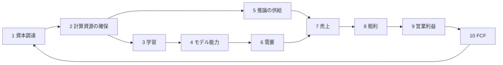

## はじめに —— 同じ週に出た 3 つの資料

2026 年 10 月の最後の週に、AI 産業の現在地を示す資料が続けて公開された。

- <strong>10 月 26 日</strong>、Anthropic が米証券取引委員会（SEC）に新規株式公開（IPO）の登録届出書 [Form S-1](https://www.sec.gov/Archives/edgar/data/2130357/000162828026067168/anthropicpbc-sx1.htm) を提出した。Nasdaq Global Select Market に「ANT」のティッカーで上場を申請している
- <strong>10 月下旬</strong>、Microsoft、Amazon、Alphabet が 2026 年 7〜9 月期の四半期報告書（[Microsoft](https://www.sec.gov/Archives/edgar/data/789019/000119312526436133/msft-20260930.htm)、[Amazon](https://www.sec.gov/Archives/edgar/data/1018724/000101872426000040/amzn-20260930.htm)、[Alphabet](https://www.sec.gov/Archives/edgar/data/1652044/000165204426000084/goog-20260930.htm) の 10-Q）を提出した
- <strong>10 月末</strong>、The Wall Street Journal が [OpenAI の最新の資金調達が 300 億ドルの目標の半分に届いていない](https://www.wsj.com/tech/ai/openai-raises-less-than-half-of-30-billion-target-in-latest-round-91aecdc5) と報じた

並べてみると、明暗がはっきりしている。Anthropic の売上高は 2023 年通期で 4,100 万ドルだった。それが 2026 年 1〜6 月の半年で 163 億ドルに達し、4〜6 月期には 9 億 7,400 万ドルの営業黒字を出した。営業キャッシュフローも上期で 39 億ドルの黒字に転じている（手元資金の利息収入なども含む）。一方の OpenAI は、当初は評価額 1.4 兆ドルで最大 300 億ドルを集めようとしたが、評価額を 1.25 兆ドルに、調達額の目標を最大 200 億ドルに引き下げてもなお、WSJ の報道時点で約 110 億ドルしか集まっていない。そしてハイパースケーラー 3 社では、Azure が 48%、AWS が 39%、Google Cloud が 103% 伸びるなかで、設備投資が営業キャッシュフローを食い尽くし始めている。Amazon の過去 12 か月のフリーキャッシュフロー（FCF）は −424 億ドルになり、Alphabet は 2026 年 6 月に普通株と強制転換優先株で約 500 億ドルを調達した。

本稿は、この 3 つの資料をきっかけに「AI 産業はこれからどうなるのか」を考える。中心に置く問いは 2 つである。

1. <strong>OpenAI や Anthropic のようなフロンティア AI ラボが、次の巨額の資本を集めるのに足る理由を示すには何が必要なのか</strong>
2. <strong>次に何をスケールすれば、AI の能力は予測できる形で大きく伸びるのか</strong>

そのために、資本が計算資源になり、計算資源がモデルになり、モデルが売上になり、売上が FCF になって次の資本を呼ぶ、という因果チェーンを分解し、それぞれの環で 3 年前（2023 年秋）と現在（2026 年秋）で何がどう変わったのかを調べる。そのうえで、事業環境の変化と、電力・低精度化・半導体プロセス・メモリ・先端パッケージ・モデルアーキテクチャという技術的な制約の変化を、2030 年までに見えている次の手とその限界まで含めて整理する。最後に、同じチェーンを Microsoft に当てはめ、OpenAI との違いを論じる。

先に結論をまとめておく。

- <strong>3 年前、フロンティアラボへの資本は「将来の能力」への前払いだった。</strong> 2023 年の Anthropic は、売上 1 ドルに対して計算資源に約 10.6 ドルを使っていた。2026 年上期にはこれが 0.55 ドルまで下がった。チェーンの後半、つまり粗利と営業利益が、はじめて財務諸表の数字で確認できる段階に入った
- <strong>次の資本を集める条件は「能力への期待」から「ユニットエコノミクス（1 単位あたりの採算）の証明」に移った。</strong> 具体的には次の 3 点が中心になる。(a) 計算資源 1 ドルあたりの売上が 1 を超えて改善し続け、推論の粗利が価格競争の下でも残ること。(b) 需要が契約や継続利用で裏づけられていること。(c) 何年も先まで続く計算資源の支払い義務と、売上が入ってくる期間が釣り合っていること。これに学習投資の回収とガバナンスが加わる（第 6 章）。1 回の調達額が数百億ドルを超え、それだけの資金を出せる相手が限られてきたことが、この変化を強めた
- <strong>技術的な制約の重心は、2023 年の GPU と CoWoS から、電力・データセンター・メモリへ移った。</strong> いずれも増強に年単位の時間がかかる。そのため計算資源の支払い義務が売上より何年も先行し、その時間差を誰が負担するのかが資本市場の問題になった
- <strong>Amazon と Alphabet は AI 投資を営業キャッシュフローだけでは賄えなくなり、Microsoft も余力が縮んでいる。</strong> 計算資源を供給する側も、借入と株式発行に頼り始めている
- <strong>次に伸ばす軸として最も予測しやすいのは、「検証可能なタスクでの強化学習と推論時計算」と「1 ドル・1 ワットあたりの実効計算量」である。</strong> 事前学習の規模拡大は、損失（loss）の面では今も予測どおりに効く。しかし、それが売上にどう効くかは読みにくくなった
- <strong>Microsoft は同じチェーンの上で、資本の出し手、計算資源の売り手、モデルの買い手、OpenAI の株主を兼ねている。</strong> OpenAI との最大の違いは、チェーンの入口である資本を自社の営業キャッシュフローで賄えることと、出口の売上が、どのモデルが勝つかに左右されないことである

> <strong>数字の扱いについて。</strong> 本稿の数値は、断りのない限り SEC に提出された書類（S-1、10-Q、10-K、XBRL データ）から取った一次情報である。報道に基づく数値は「報道によれば」と明記した。Anthropic の S-1 は予備的な届出書で、2026 年 7〜9 月期の金額や契約総額の一部が空欄のまま提出されている。そのため 7〜9 月期の数値は報道に頼った。金額はすべて米ドルで、端数は丸めている。

---

## 1. 3 年前といまを並べる

### 1.1 2023 年秋の地図

3 年前の 2023 年 11 月、AI 産業の話題の中心は OpenAI だった。11 月 6 日の開発者会議 DevDay で GPT-4 Turbo を発表し、ChatGPT の週間利用者は 1 億人に達したと述べた。その 11 日後に取締役会が Sam Altman CEO を解任し、5 日後に復帰させる騒動が起きた。資本の出し手は、2023 年 1 月に 100 億ドル規模と報じられた追加出資を決めた Microsoft だった。

Anthropic はまだ小さかった。S-1 によれば、2023 年通期の売上高は 4,100 万ドルにすぎない。同年 9 月に Amazon と最大 40 億ドル、Google と最大 20 億ドルの転換社債の引受契約を結び、大手クラウド 2 社から資金と計算資源を同時に受け取る形をつくった。

ハイパースケーラーの設備投資は、いまから見れば小さい。SEC の XBRL データで確認すると、2023 年の設備投資（現金ベース）は Amazon が 527 億ドル、Alphabet が 323 億ドル、Meta が 273 億ドル、Microsoft が 2023 会計年度（2023 年 6 月期）で 281 億ドルだった。4 社合計でも約 1,400 億ドルである。各社とも設備投資を差し引いてもなお巨額の FCF が残り、Microsoft、Alphabet、Meta は自社株買いを続けていた。

技術面での制約は、NVIDIA H100 の不足だった。H100 そのものよりも、TSMC の先端パッケージ CoWoS の生産能力がボトルネックだと言われていた。学習は BF16 が標準で、FP8 での大規模学習はまだ一般的ではなかった。構造が公開されているモデルでは密（dense）な Transformer が主流で、12 月に Mistral AI が Mixtral 8x7B を公開して MoE（Mixture of Experts）が改めて注目され始めた段階だった。そして業界全体が、「パラメータとデータと計算量を増やせば能力は伸びる」という事前学習のスケーリング則を前提に動いていた。

### 1.2 主要な数字の比較

| 指標 | 2023 年秋 | 2026 年秋 | 出典 |
|---|---|---|---|
| Anthropic の売上高 | 4,100 万ドル（2023 年通期） | 162.9 億ドル（2026 年 1〜6 月）。7〜9 月期は報道で 168 億ドル | S-1、報道 |
| Anthropic の計算資源費 ÷ 売上高 | 10.6 倍（2023 年通期） | 0.55 倍（2026 年 1〜6 月） | S-1 |
| Anthropic の営業キャッシュフロー | −16.3 億ドル（2023 年通期） | +39.3 億ドル（2026 年 1〜6 月） | S-1 |
| Anthropic の財務キャッシュフロー（調達額） | 23.2 億ドル（2023 年通期） | 1,107.7 億ドル（2026 年 1〜6 月） | S-1 |
| Microsoft Cloud の四半期売上 | 318 億ドル（2023 年 7〜9 月） | 639 億ドル（2026 年 7〜9 月） | 10-Q |
| Microsoft Cloud の粗利率 | 73% | 66% | 10-Q |
| AWS の四半期売上（営業利益） | 231 億ドル（70 億ドル） | 460 億ドル（178 億ドル） | 10-Q |
| Google Cloud の四半期売上 | 84 億ドル | 307 億ドル | 10-Q |
| Microsoft の四半期設備投資（現金） | 99 億ドル | 394 億ドル | 10-Q |
| Amazon の四半期設備投資（購入額） | 125 億ドル | 773 億ドル | 10-Q |
| Amazon の過去 12 か月 FCF（Amazon の定義） | +214 億ドル | −424 億ドル | 10-Q |
| ハイパースケーラーの受注残（RPO） | Microsoft 商用 2,120 億ドル | Microsoft 商用 6,770 億ドル、Amazon（主に AWS）約 5,780 億ドル、Google Cloud 5,608 億ドル | 10-Q |
| フロンティアモデルが自律的にこなせる作業の長さ（METR） | 約 4 分（GPT-4 Turbo） | 約 12 時間（Claude Opus 4.6、2026 年 2 月） | METR |

Google Cloud の伸びには TPU のシステムの販売が含まれ、受注残は 2026 年 1〜3 月期から 1 年以内の契約も含める定義に変わり、関連会社 Crux AI との 168 億ドルも含んでいる。一方、Amazon の受注残は当初の契約期間が 1 年を超える契約だけを数え、Microsoft の商用 RPO にはクラウド以外の商用契約も含まれる。Amazon の FCF は、設備の売却収入などを差し引いた純額の設備投資で計算する同社の定義による。比べるときはこれらの点に注意が要る。

数字の桁が変わったのは売上だけではない。支払い義務の大きさと、その資金の出どころも変わった。以下では、この変化を因果チェーンに沿って見ていく。

---

## 2. 資本から FCF までの因果チェーン

### 2.1 チェーンを 10 の環に分ける

フロンティア AI ラボの事業は、次のような因果の連鎖として書ける。

1. <strong>資本調達</strong>: 株式、転換社債、借入、リース、取引先からの融資など
2. <strong>計算資源の確保</strong>: クラウド契約、チップのリース、自社データセンター。電力・チップ・HBM・パッケージの供給に縛られる
3. <strong>学習</strong>: 事前学習、強化学習などの事後学習、研究のための計算
4. <strong>モデル能力</strong>: ベンチマークの点数ではなく、顧客が対価を払う仕事をどれだけこなせるか
5. <strong>推論の供給</strong>: トークンを生成できる量（処理能力）と、その単価
6. <strong>需要</strong>: 利用者数、顧客数、トークン消費量
7. <strong>売上</strong>: 従量課金とサブスクリプション
8. <strong>粗利</strong>: 売上から顧客向け推論のコストを引いたもの
9. <strong>営業利益</strong>: 粗利から学習・研究の計算資源費、人件費、営業費を引いたもの
10. <strong>FCF</strong>: 営業キャッシュフローから設備投資（とリースの元本返済）を引いたもの。これが次の資本調達の条件を決める（本稿の表では、データをそろえるため営業キャッシュフロー − 設備投資で計算し、ファイナンスリースは含めていない）

FCF を式で書くと、各環のどこに何が効くかが見やすい。

$$
\mathrm{FCF}_t = R_t - C^{\mathrm{serve}}_t - C^{\mathrm{train}}_t - O_t - \Delta W_t - I_t
$$

ここで $R_t$ は売上、$C^{\mathrm{serve}}_t$ は顧客向け推論のコスト、$C^{\mathrm{train}}_t$ は学習と研究の計算資源費、$O_t$ は人件費や営業費、$\Delta W_t$ は運転資本の増加、$I_t$ は設備投資である（税金と利息の支払い、株式報酬などの非現金項目、リースの元本返済は省いた概念式である）。2023 年のフロンティアラボは、$R_t$ が小さく $C^{\mathrm{train}}_t$ が大きい状態で、FCF のマイナスを外部資本で埋めていた。2026 年に変わったのは、$R_t$ が $C^{\mathrm{serve}}_t + C^{\mathrm{train}}_t$ を上回り始めたこと、そしてクラウド契約で計算資源を借りる形から、リースや自社設備で持つ形へ移ることで、$I_t$ とリース債務が急に大きくなり始めたことである。

### 2.2 各環で何が変わったか —— Anthropic の S-1 を中心に

Anthropic の S-1 は、単独のフロンティアラボが損益とキャッシュフローを、2023 年からの年次と 2025 年からの四半期の単位で開示した初めての資料である。なお、2026 年に上場した SpaceX の目論見書も傘下の xAI の部門業績を開示しており、報道によれば 2025 年の売上は 32 億ドル（X の収入を含む）、営業損失は 64 億ドルだった。チェーンを検証する材料としてこれ以上のものはないので、まずこれを使う。

#### 環 1: 資本調達 —— 戦略投資家から公開市場へ

2023 年の Anthropic の財務キャッシュフローは 23 億ドルで、内訳は Amazon と Google が引き受けた転換社債 17.5 億ドル、シリーズ C の優先株 4.5 億ドル、SAFE（将来株式取得契約）1.2 億ドルだった。転換社債で受け取った資金の多くは、出資者へのクラウド利用料として戻っていく。2026 年上期の財務キャッシュフローは 1,108 億ドルで、ほぼ全額が優先株の発行による。S-1 によれば、シリーズ G（2026 年 1〜5 月、1 株 259.14 ドル）で約 452 億ドル（議決権のある G-1 が 235 億ドル、議決権のない G-2 が 217 億ドル）、シリーズ H（5〜6 月、1 株 589.01 ドル）で約 652 億ドル（H-1 が 457 億ドル、H-2 が 195 億ドル）を集めた。議決権のない G-2 と H-2 は、それぞれ 5 社と 11 社だけが引き受けており、シリーズ H には Google（100 億ドル）と Amazon（50 億ドル）も参加している。発表された評価額は、シリーズ G が 3,800 億ドル、シリーズ H が 9,650 億ドルで、2 年前の 200 億ドル未満から約 50 倍になった。

資金の形も多様になった。S-1 には、次のような契約が並ぶ。Google は、2030 年末まで最大 300 億ドル（うち 100 億ドルはシリーズ H に充当済み）の転換社債や普通株を引き受ける。Amazon は、計算資源の引き渡しの節目に応じて最大 200 億ドルまで転換社債や株式を引き受ける枠を設けた（シリーズ H への 50 億ドルで残りは 150 億ドル）。Broadcom からは TPU を載せたラックをリースし、その賃料の一部を Broadcom に発行する転換社債で賄える。<strong>計算資源の売り手が、買い手の資金繰りまで面倒を見る</strong>構図である。

OpenAI の資本調達も同じ方向に動いた。2023 年 1 月の Microsoft の追加出資は約 100 億ドルと報じられた。2025 年 3 月には SoftBank 主導で 400 億ドル（評価額 3,000 億ドル）、2026 年 3 月には Amazon（約 500 億ドル）、NVIDIA（300 億ドル）、SoftBank（300 億ドル）などから 1,220 億ドル（評価額 8,520 億ドル）を集めたと報じられている。Amazon の 10-Q は、同社が 2026 年 1〜9 月に OpenAI のシリーズ C 優先株へ計 500 億ドルを投じ、あわせて AWS の利用契約を結んだことを確認している。ここでも、出資者が計算資源の売り手を兼ねている。

#### 環 2: 計算資源の確保 —— 短期の確保から、十数年の支払い義務へ

2023 年の制約は「GPU が手に入らない」ことだった。2026 年の S-1 が描くのは、計算資源を 12〜18 か月前に契約し、何年も先まで支払う仕組みである。S-1 の「契約上の義務」に名前が挙がっている主な契約を並べる。

| 相手 | 内容 | 金額 | 期間 |
|---|---|---|---|
| Google | クラウド（TPU）の最低支出 | 約 1,145 億ドル以上 | 2026 年 4 月〜2033 年 7 月 |
| Google ほか TPU 提供者 | 追加の TPU 計算資源（金額は未確定） | 1,250〜1,500 億ドルの見込み | 2028〜2031 年に引き渡し |
| Amazon | AWS の最低支出 | 1,100 億ドル以上 | 2026 年 5 月〜2036 年 4 月 |
| Microsoft | Azure の最低支出 | 449 億ドル以上 | 2026 年 11 月〜2033 年 5 月 |
| SpaceXAI（旧 xAI） | NVIDIA GPU の計算資源 | 最大 1,205 億ドル | 2029 年まで |
| Nscale | NVIDIA GPU の計算資源 | 最大約 446 億ドル | 2033 年まで |
| Lambda | NVIDIA GPU の計算資源 | 約 413 億ドル | 2034 年まで |
| Broadcom | TPU 機材の 5 年ファイナンスリース | 賃料総額 約 1,612 億ドル | 2026〜2027 年から稼働 |
| AMD | Helios ラックの初期調達（金額の定めなし） | 200 億ドル超の見込み | 2027 年 |

上限値を含むものの、名前が挙がった契約だけで 6,000 億ドルを超え、金額が確定していない TPU と AMD の分を足すと 8,000 億ドル規模になる。S-1 は総額と「2030 年末までに発生する額」を空欄にしたまま提出しているが、残りの大半は 2031〜2045 年に発生すると書いている。名前の挙がった契約の合計（約 6,400〜8,000 億ドル）は、2026 年上期の売上を年換算した約 330 億ドルと比べると 20〜25 倍、報道されている 7 月のランレート（約 650 億ドル）と比べても 10〜12 倍の規模である。上限値を使わない数字もある。2025 年度の監査済み財務諸表の注記（後発事象）によれば、2026 年 1 月から 6 月 1 日までに新たに結んだり変更したりした契約の最低支払額は約 4,170 億ドルにのぼる。さらに未監査の中間財務諸表の注記によれば、6 月末より後に結んだ契約の最低支払額として約 2,450 億ドルが加わる（一部は契約上の条件を満たすことが前提）。目先の負担も大きい。SpaceXAI の容量がすべて引き渡される 2026 年 12 月以降、その支払いだけで月約 31 億ドル（四半期で約 93 億ドル）になり、4〜6 月期の計算資源・インフラ費全体（56 億ドル）の 1.7 倍に当たる。

新しいのは、Anthropic が「Anthropic Direct」と呼ぶ調達形態である。チップを直接リースし、他社が運営する専用施設に置く。S-1 は、データセンターは建設に時間がかかるがコスト全体に占める割合は小さいので、施設の確保を先に進め、高価なアクセラレータへの投資は需要が見えてから決められる、と説明している。<strong>施設と中身の契約を切り離して、拘束の強さを調整する</strong>工夫である。

#### 環 3〜4: 学習とモデル能力 —— 「閉ループ」という新しい主張

S-1 の機能別費用の内訳では、2026 年上期の研究開発費は 97 億ドルで、売上の 60% にあたる。研究開発費の大半は、モデル開発・研究・社内利用のための計算資源費である。学習への支出は、絶対額では増え続けているが、売上に対する比率は 2023 年（約 10 倍）から大きく下がった。

S-1 で目を引くのは、「各世代の Claude が次の世代の開発を助ける」という主張で、Anthropic はこれを「closing the loop（ループを閉じる）」と呼ぶ。2026 年 9 月にコードベースへ加えられた変更の 90% 超は Claude が書き、エンジニア 1 人が 1 日に書き加えるコードの量は、2024 年平均の 45 倍を超えたという。過去 12 か月で売上は約 13 倍、従業員数は約 2.7 倍になり、従業員 1 人あたりの売上は 140 万ドルから 660 万ドル超になった。

#### 環 5〜7: 推論の供給、需要、売上 —— チャットからエージェントへ

需要の中身は 3 年で大きく変わった。2023 年の生成 AI の売上は、チャットのサブスクリプションと、試験的な API 利用が中心だった。2026 年の Anthropic では、トークン量に応じた従量課金（S-1 は「pay-for-intelligence」と呼ぶ）が 2026 年上期の売上の 80%（131 億ドル）を占め、サブスクリプションは 20%（32 億ドル）である。

けん引役はコーディングエージェントの Claude Code と、その仕組みを知識労働に広げた Claude Cowork だ。S-1 によれば、2026 年 7〜9 月期に Claude Code を使わない Claude Enterprise の利用者の月額支出は平均 75 ドル未満だったが、Claude Code を使う上位 5% の利用者はその約 20 倍を支払っていた。エージェントは人間の会話よりはるかに多くのトークンを消費する。<strong>エージェント化は、利用者 1 人あたりの支出と計算資源の需要を大きく押し上げる</strong>。

顧客層も厚くなった。過去 12 か月の売上が 10 万ドル以上の顧客は、2025 年 9 月末の 950 社超から 2026 年 9 月末の 1 万 1,900 社超へ増えた。100 万ドル以上は 1,900 社超、1,000 万ドル以上は約 250 社である。売上継続率（Net Revenue Retention。四半期ベースで、Pro と Max の個人向けプランを除く）は約 900% だという。既存顧客の支出が 1 年で 9 倍になった計算になる。

四半期ごとの業績は次のとおりである。

| 四半期 | 売上高 | 計算資源・インフラ費 | 費用 ÷ 売上 | 営業損益 |
|---|---|---|---|---|
| 2025 年 1〜3 月 | 3.8 億ドル | 9.4 億ドル | 251% | −9.4 億ドル |
| 2025 年 4〜6 月 | 7.9 億ドル | 13.9 億ドル | 177% | −12.0 億ドル |
| 2025 年 7〜9 月 | 13.8 億ドル | 20.5 億ドル | 148% | −30.9 億ドル（和解金 15 億ドルを含む） |
| 2025 年 10〜12 月 | 20.4 億ドル | 29.5 億ドル | 144% | −28.4 億ドル |
| 2026 年 1〜3 月 | 47.3 億ドル | 33.9 億ドル | 72% | −16.7 億ドル |
| 2026 年 4〜6 月 | 115.6 億ドル | 55.6 億ドル | 48% | +9.7 億ドル |
| 2026 年 7〜9 月（報道） | 168 億ドル | — | — | — |

OpenAI の需要は消費者の側から伸びた。ChatGPT の週間利用者は 2023 年 11 月の 1 億人から、2026 年 8 月には 10 億人に達したと報じられている。両社の需要の違いは第 2.4 節で比べる。

#### 環 8: 粗利 —— 機能別に組み替えると 85%

S-1 の損益計算書は、費用を「計算資源・インフラ」「人件費」などの性質別に並べている。一方、財務諸表の注記には機能別の内訳があり、売上原価（顧客向け推論の計算資源費が大半）を取り出せる。これで粗利率を計算すると次のようになる。

| 期間 | 売上高 | 売上原価 | 粗利率 |
|---|---|---|---|
| 2023 年通期 | 0.41 億ドル | 0.26 億ドル | 37% |
| 2024 年通期 | 3.86 億ドル | 7.52 億ドル | −95% |
| 2025 年通期 | 45.9 億ドル | 27.7 億ドル | 40% |
| 2026 年 1〜6 月 | 162.9 億ドル | 23.8 億ドル | 85% |

2024 年は顧客向け推論のコストが売上の 2 倍近くあった。2026 年上期には推論のコストが売上の 15% まで下がっている。報道によれば、7〜9 月期には計算資源 1 ドルあたり 1.70 ドルの売上があった（学習を含む全計算資源に対する比率）。

ただし、この 85% はいくつかの条件の上に成り立っている。第一に、無料ユーザーへの推論のコストと、販売パートナー（クラウド事業者など）への手数料は、売上原価ではなく販売・マーケティング費に分類されている。第二に、計算資源は 12〜18 か月前に契約した固定費で、需要が供給を上回る状態では稼働率が高く、販売価格も下がりにくい。S-1 自身も、利益率を押し下げる要因を 2 つ挙げている。まとまった計算資源が新たに稼働する時期には、費用が売上より先に計上され、営業利益率が縮みうる。需要が長期契約の容量を上回れば、割高な短期の計算資源を調達することになり、当面の営業利益率を押し下げる。さらに S-1 によれば、2026 年 1〜9 月の売上の約 5〜7% は、利用規約や契約条件に違反していた顧客からのものだった。8〜9 月に取り締まりを強めたので、この比率は今後下がる見込みである。報道によれば、その中には他社が Claude の出力で自社モデルを学習させる「蒸留」目的の利用が含まれ、10〜12 月期の売上を押し下げる見通しだという。上で見た SpaceXAI の支払いのように、新しい計算資源の費用も間もなく本格的に乗ってくる。<strong>85% は構造的な水準というより、供給制約と先行契約が生んだ一時的に高い水準と見るべき</strong>である。

#### 環 9〜10: 営業利益と FCF —— 黒字化と、その先の設備投資

営業利益率は 2023 年の −1,344% から、2026 年上期の −4% まで改善した。株式報酬などを除いた調整後営業利益は、2026 年上期に 16 億ドルの黒字（利益率 10%）である。報道によれば、1〜9 月の調整後営業利益率は 11% だった。

キャッシュフローは次のとおりである。

| 期間 | 営業 CF | 設備投資 | FCF（営業 CF − 設備投資） | 財務 CF |
|---|---|---|---|---|
| 2023 年通期 | −16.3 億ドル | 0.02 億ドル | −16.3 億ドル | +23.2 億ドル |
| 2024 年通期 | −56.9 億ドル | 0.15 億ドル | −57.1 億ドル | +72.5 億ドル |
| 2025 年通期 | −26.4 億ドル | 1.3 億ドル | −27.7 億ドル | +199.6 億ドル |
| 2026 年 1〜6 月 | +39.3 億ドル | 4.8 億ドル | +34.5 億ドル | +1,107.7 億ドル |

2026 年上期の FCF はプラスである。ただし、上期の営業キャッシュフロー 39 億ドルには、投資家から集めた資金（6 月末で 1,300 億ドル超に達した）が生んだ利息収入（約 11 億ドル）、現金の出ていかない株式報酬の足し戻し（約 22 億ドル）、仕入先への支払いの時期などによる運転資本の変動が含まれている。GAAP の営業損益は上期で −6.9 億ドルである。チェーンの後半が回り始めた証拠としては、営業キャッシュフローより、4〜6 月期の営業黒字（9.7 億ドル）と粗利率のほうが確かである。

また、設備投資が小さいのは、計算資源をクラウド契約で調達し、使えるようになった分から代金を払う形をとってきたからでもある。S-1 は、Anthropic Direct による自社設備やリースの比重が増えるので、設備投資は大きく増え、当面は営業・投資活動で多額の現金を使うと明言している。Broadcom とのリースだけで、賃料総額は約 1,612 億ドルにのぼる。このリースはファイナンスリースとして会計処理されるので、賃料の元本部分は財務キャッシュフローに入り、営業キャッシュフロー − 設備投資で計算した FCF にはほとんど表れない。クラウドの利用料として払えば営業キャッシュフローから出ていく支出が、リースに置き換わると FCF の計算から抜け落ちる。移行後の FCF は、リースの元本返済も差し引いて見る必要がある。<strong>チェーンの後半が黒字になった直後に、環 2（計算資源の確保）の資金の出し方が「費用」から「投資と負債」へ変わる</strong>。

### 2.3 支払いと売上の時期のずれ —— 支払い義務が売上より何年も先行する

2023 年と 2026 年で最も大きく変わったのは、各環の大きさよりも、環と環のあいだの時間差である。

| 支払い義務の種類 | 支払いが始まるまで | 支払いが続く期間 |
|---|---|---|
| クラウドの計算資源契約 | 12〜18 か月（S-1） | 6〜10 年（Google・Amazon・Microsoft との契約） |
| チップのリース | 施設の完成まで | 5 年（Broadcom） |
| データセンターのリース | 1〜8 年（Microsoft の開始前のリースは 2027〜2034 会計年度に開始） | 1〜20 年（Microsoft）、1〜26 年（Alphabet） |
| 発電・送電設備 | 数年 | 数十年 |

これに対して、売上の側は、契約期間も入金までの期間も短い。Anthropic の売上の 8 割は従量課金で、顧客は使った分だけ払う。年単位や複数年で最低利用額を約束する大口契約も増えているが、サブスクリプションの契約期間は一般に 12 か月以下である（S-1）。ハイパースケーラーの受注残を見ても、Microsoft の商用 RPO（残存履行義務）は加重平均の残存期間が約 2.3 年、Alphabet の受注残（5,677 億ドル、うち Google Cloud が 5,608 億ドル）は 24 か月以内に 55% 強が売上になる。最も長い Amazon の受注残（主に AWS）は加重平均の残存期間が 6.1 年あるが、それでも 20 年を超えるデータセンターのリースよりは短い。

つまり、<strong>支払い義務は 5〜20 年、売上は月単位から数年単位</strong>という期間のずれがある。このずれを誰が負担するのかが、3 年前にはなかった問いである。2026 年の資料から読み取れる構図は、次のような「ずれの押し付け合い」である。

1. フロンティアラボは、ハイパースケーラーやネオクラウド（Nscale、Lambda など）と「容量が引き渡されてから支払う」「一定期間の後は解約できる」といった条件の契約も結び、ずれの一部を相手に渡す（SpaceXAI との契約は、2027 年初めまでの解約できない期間を過ぎると、どちらの側からも 90 日前の通知で解約できる）。ただし、Google、Amazon、Broadcom などとの大口の契約は、相手が重大な契約違反を是正しない場合を除き、解約できない
2. ハイパースケーラーは、受注残という形で需要を確保したうえで、データセンターを最長 20 年の期間でリースし、借入と株式で資金を集める。ずれの一部を資本市場に渡す
3. ネオクラウドは、ラボとの長期契約を裏づけに、GPU とデータセンターの資金を外部から調達する。S-1 によれば、Nscale は一定期間内にその資金調達を終えるよう「最善の努力」を求められている

連鎖のどこか一か所で需要の見込みが外れると、その負担は連鎖をさかのぼって広がる。WSJ が報じた OpenAI の調達難は、この連鎖の入口に負担が表れた例と読める。

### 2.4 Anthropic と OpenAI は、チェーンのどこが違うのか

OpenAI は非上場で財務諸表を公開していない。以下の OpenAI の数字は、Microsoft の開示を除いてすべて報道（CNBC、The Information、Financial Times、TechCrunch など）に基づく。精度は S-1 の数字より落ちることを前提に読んでほしい。

| 項目 | OpenAI（報道） | Anthropic（S-1。一部は報道） |
|---|---|---|
| 2023 年の売上 | 約 16 億ドル | 0.41 億ドル |
| 2025 年の売上 | 約 131 億ドル | 45.9 億ドル |
| 2026 年の売上 | 1〜3 月期 57 億ドル。年換算（ランレート）は 8 月に約 400 億ドル（その後 500 億ドルを超えたとの推計もある） | 1〜6 月 162.9 億ドル。7〜9 月期 168 億ドル、ランレートは 7 月に約 650 億ドル（報道） |
| 売上の中心 | ChatGPT の個人・法人向けサブスクリプション、API、広告（2026 年に開始） | 従量課金 80%、サブスクリプション 20%（2026 年上期） |
| 利用者・顧客 | ChatGPT の週間利用者 10 億人（2026 年 8 月） | 過去 12 か月の売上 10 万ドル以上の顧客が 1 万 1,900 社超 |
| 2025 年の粗利率 | 約 33%（推論費 約 84 億ドルのほかの原価も含むとみられる） | 40% |
| 営業損益 | 2025 年 約 −209 億ドル、2026 年上期 約 −216 億ドル | 2025 年 −80.6 億ドル、2026 年上期 −6.9 億ドル（4〜6 月期は +9.7 億ドル） |
| キャッシュ | 2025 年の現金流出 約 80 億ドル、2026 年 1〜3 月期 37 億ドル | FCF は 2025 年 −27.7 億ドル、2026 年上期 +34.5 億ドル |
| 計算資源の支払い義務 | 2030 年までの計算資源支出 約 6,000 億ドル（2026 年 2 月に投資家へ説明。2025 年秋には 1.4 兆ドル・約 30 GW と説明していた） | 名前の挙がった契約だけで 6,000 億ドル超（上限値を含む。2030 年より後の分も含み、Amazon との契約は 2036 年まで） |
| 直近の調達 | 2026 年 3 月に 1,220 億ドル（評価額 8,520 億ドル）。10 月は当初目標 300 億ドル（のちに最大 200 億ドルへ縮小）に対し約 110 億ドル | 2026 年上期に 1,100 億ドル超（5 月の評価額 9,650 億ドル） |
| FCF の見通し | 2026〜2030 年の累計で約 2,800 億ドルの現金流出、手元資金は 2028 年に尽きる想定（2026 年 7 月の投資家向け資料、FT 報道） | 2026 年上期は黒字。今後は自社設備への投資で再びマイナスになる見込み |

3 年前は売上で約 40 倍の差があった。2026 年の夏には、ランレートで Anthropic（7 月に約 650 億ドル）が OpenAI（8 月に約 400 億ドル）を上回ったと報じられている。両社は収益の認識方法が違う。Anthropic はクラウド事業者のマーケットプレイス経由の売上を総額で計上しているため、厳密には比べられない。それでも、順位は入れ替わったとみられる。

違いは 3 つの環に集約できる。

<strong>需要と売上の環（6〜7）。</strong> OpenAI は週 10 億人という消費者の規模を持つが、利用者 1 人あたりの収益は小さい。無料利用者の推論コストを回収するため、2026 年 2 月に広告を試験導入し、7 月にはセルフサービスの広告管理画面を公開した。Anthropic は企業のエージェント利用に集中した。1 人あたりのトークン消費が桁違いに大きく、支払う意欲も高い需要である。Menlo Ventures の調査（2025 年 12 月）では、企業の LLM API 支出に占める比率は Anthropic 40%、OpenAI 27%（2023 年は 50%）、Google 21% で、コーディング用途では Anthropic が 54% を占めた。

<strong>粗利の環（8）。</strong> 2025 年の粗利率は、OpenAI 約 33%、Anthropic 40% で大差なかった。2026 年の OpenAI の粗利率は報じられていない。Anthropic では、12〜18 か月前に契約した計算資源の固定費に対して需要が急に増え、粗利率が 85% まで上がった。OpenAI は、無料利用者の多い消費者事業に加え、動画生成アプリの Sora のようにコストの重い製品を抱えていた（Sora は 2026 年 3 月に終了した）。

<strong>資本の環（1）。</strong> OpenAI は 2025 年秋に「1.4 兆ドル・約 30 GW」という計算資源の構想を掲げ、Stargate で自前のデータセンターを持つ方針を打ち出した。2026 年 2 月には投資家への説明を「2030 年までに約 6,000 億ドル」に引き下げ、データセンターを自ら建てるより、Microsoft、Oracle、AWS などから借りる形に寄せた（ノルウェーの Stargate のサイトは Microsoft が引き継いだ）。構想を先に大きく掲げ、後から縮めたことで、投資家は支払い義務と売上の釣り合いを以前より厳しく見るようになったとみられる。10 月のラウンドで、評価額の目標を 1.4 兆ドルから 1.25 兆ドルに、調達額の目標を 300 億ドルから最大 200 億ドルに下げてもなお出資の集まりが鈍かった（FT、CNBC、WSJ）のは、その表れと読める。

---

## 3. 事業環境は 3 年でどう変わったか

チェーンの各環の外側にある事業環境も、3 年で大きく変わった。先に全体を表にまとめる。

| 観点 | 2023 年秋 | 2026 年秋 |
|---|---|---|
| フロンティアの顔ぶれ | OpenAI が先頭で、少数が追う | OpenAI、Anthropic、Google が数か月単位で首位を入れ替え、xAI（SpaceXAI）なども追う。中国のオープンウェイトモデルは約 8 か月遅れ |
| 需要の中心 | チャット、試験的な API 利用 | エージェント（コーディングから知識労働へ） |
| 価格 | 高止まり | 同じ能力は年 5〜10 倍のペースで安くなり、最先端の能力はむしろ高くなる |
| 流通 | ラボとクラウドがほぼ 1 対 1 で組む | どのモデルもどのクラウドでも買える |
| 資本の出し手 | クラウド事業者などの戦略投資家 | 戦略投資家に加え、政府系ファンド、機関投資家、個人、公開市場。クラウド事業者自身も外部資本に頼り始めた |
| 主な制約 | GPU | 電力、HBM、資本コスト |

### 3.1 競争 —— 1 社の独走から、短いリードの奪い合いへ

2023 年の生成 AI は、OpenAI の独走だった。Menlo Ventures の[調査](https://menlovc.com/perspective/2025-the-state-of-generative-ai-in-the-enterprise/)では、2023 年の企業の LLM API 支出の 50% を OpenAI が占め、Anthropic は 12% だった。2025 年には Anthropic 40%、OpenAI 27%、Google 21% に入れ替わった。2025 年 11 月に Google が Gemini 3 を出すと、OpenAI の社内では「コードレッド」が宣言されたと報じられた。2026 年 9 月に OpenAI が GPT-6 Astra を出すと、Anthropic は同じ月のうちに Claude Opus 5.5 で応じたと報じられている。xAI は 2026 年 2 月に SpaceX に買収され（Anthropic の S-1 では「SpaceXAI」）、SpaceX はその後上場した。SpaceXAI は、自社の GPU の計算資源を Anthropic に売る側にも回っている。米国立標準技術研究所（NIST）の CAISI が 2026 年 5 月に公表した評価によれば、中国のオープンウェイトモデルは米国のフロンティアから約 8 か月遅れている。

チェーンへの影響ははっきりしている。<strong>フロンティアにいる期間が短くなるほど、1 つのモデルの学習費を回収できる期間も短くなる。</strong> Anthropic の S-1 によれば、2026 年 7〜9 月期の売上の 80% 超は、直前の 6 か月に出たモデルのバージョンによるものだった。半年より前のモデルが稼ぐのは売上の 2 割に満たない。第 6 章で見るように、「学習投資の回収」は次の資本を集めるための条件の 1 つになった。

### 3.2 価格 —— 同じ能力は安く、最先端は高く

MIT FutureTech の[分析](https://arxiv.org/abs/2511.23455)では、ベンチマークで同じ性能を出すための価格は年 5〜10 倍のペースで下がってきた。一方で、モデルの大型化と考える量の増加によって、最新のフロンティアモデルを動かす価格は年 3〜18 倍のペースで上がっている。報道によれば、2026 年には OpenAI、Anthropic、Google などが数か月にわたって価格競争を続けた。

ただし、値下げは利益を削るだけのものではない。Anthropic の S-1 によれば、2025 年 11 月に前のモデルより高性能で安い Opus 4.5 を出したあと、売上の前期比の伸びは 10〜12 月期の 48% から 2026 年 1〜3 月期の 132% に加速した。2026 年 9 月にも、最上位の Mythos クラスに属する Fable 5.1 で典型的な作業のコストを約 25%（複雑なコーディングやエージェントの作業では最大 45%）、Opus 5.5 で 1 タスクあたりのコストを約 40% 下げ、それでも利益率は保てたと書いている。S-1 自身は、この加速を能力の向上、新製品、普及の広がりなど複数の要因の組み合わせとしている。それでもこの局面では、<strong>1 タスクあたりのコストを下げると、任される仕事の量がそれ以上に増えた</strong>ように見える。

もっとも、需要の曲線は 2 本に分けて考える必要がある。同じ能力の市場では、値下げを量の増加で補うしかない。一方、最先端の能力の価格はむしろ上がっており、そこでは値下げよりも能力の差が売上を決める。7〜9 月期に、価格競争のなかで Anthropic の売上の前期比の伸びが +45% に鈍ったことは、量で補える範囲にも限りがあることを示唆している（8〜9 月に規約違反の顧客への取り締まりを強めたことも影響した可能性がある）。

価格を巡る新しい問題も現れた。他社の出力を使って自社モデルを学習させる「蒸留」である。Anthropic の S-1 によれば、2026 年 1〜9 月の売上の約 5〜7% は、利用規約や契約条件に違反していた顧客からのもので（報道によれば蒸留目的の利用を含む）、取り締まりを強めたためこの比率は今後下がり、それが売上の伸びを押し下げうるという。自社の出力が、競合が追いつくための材料にもなる。<strong>フロンティアの能力を売ることは、その能力を複製する材料を売ることでもある</strong>という難しさが、価格設定につきまとうようになった。

### 3.3 需要 —— 「利用者数」から「任せる仕事の量」へ

消費者の側では、第 2.2 節で見たとおり、ChatGPT の週間利用者が 10 億人に達したと報じられている。企業の生成 AI への支出も、Menlo Ventures の推計で 2024 年の 115 億ドルから 2025 年の 370 億ドルへ増えた。

量よりも大きく変わったのは中身である。最初に大きな売上を生んだのはコーディングのエージェントだった。Menlo Ventures の調査では、2025 年のコーディング用途で Anthropic のシェアは 54% に達した。第 2 章で見たとおり、Claude Code を使う上位 5% の利用者は、使わない利用者の平均の約 20 倍を支払っている。エージェントは人間の会話よりはるかに多くのトークンを消費し、しかもその消費は人間が画面の前にいる時間に縛られない。<strong>需要の単位が「利用者数」から「任せる仕事の量」に変わった</strong>ことが、2026 年の売上急増の大きな背景にある。

### 3.4 流通 —— どのモデルもどのクラウドでも

2023 年は、OpenAI と Microsoft Azure、Anthropic と AWS・Google Cloud という組み合わせがほぼ固定していた。2026 年には、Anthropic の Claude は AWS、Google Cloud、Azure のすべてで提供され、OpenAI も 2026 年 4 月の契約改定でどのクラウドからでも製品を提供できるようになった。Amazon は OpenAI に 500 億ドルを出資し、Microsoft は Anthropic のモデルを自社製品で売り、Anthropic は Microsoft に 449 億ドル以上を支払う。

その結果、<strong>ハイパースケーラーはどのラボに対しても、出資者、計算資源の売り手、販売チャネル、そして自社モデル（Gemini、MAI、Nova）で競う相手、という 4 つの役を同時に兼ねる</strong>ようになった。Anthropic の S-1 も、この点をリスク要因に挙げている。計算資源の提供者は、資本や信用を供与し、インフラを売り、しかも競合するモデルを提供している。そのため利益相反が生じ、計算資源の利用や価格、優先順位に影響しうるという。

### 3.5 資本市場 —— 自己資金の時代の終わり

事業環境のなかで最も大きく変わったのは、AI 投資の資金の出どころである。

<strong>設備投資の規模。</strong> 2023 年の 4 社（Microsoft、Alphabet、Amazon、Meta）の設備投資は約 1,400 億ドルだった（XBRL データ）。2025 年には約 3,600〜3,800 億ドル（Microsoft の会計年度をどう暦年に合わせるかで幅がある）になり、2026 年は各社の見通しを合計すると 7,000 億ドルを超えると集計されている（Amazon は 10-Q で約 2,200 億ドルの見通しを確認している）。証券会社の多くは、2027 年に 1 兆ドルを超えると予想している。

<strong>FCF の縮小。</strong> 設備投資は営業キャッシュフローに追いついた。Amazon の過去 12 か月の FCF は −424 億ドル、Alphabet は 2026 年 1〜9 月の営業キャッシュフロー 1,271 億ドルに対して設備投資が 1,320 億ドルで、FCF はマイナスになった。Microsoft はプラスを保っているが、7〜9 月期の FCF ÷ 営業キャッシュフローは、2023 年の 68% から 2026 年の 32% に下がった。

<strong>外部資金への依存。</strong> Alphabet は 2026 年 1〜9 月に自社株買いをやめた（前年同期は 398 億ドル）。そのうえで 6 月に普通株の公募（205 億ドル）、Berkshire Hathaway への第三者割当（100 億ドル）、強制転換優先株（190 億ドル）で計 495 億ドルを調達し、社債などで 852 億ドルを借り入れた。7〜9 月期には、6 月に設けた最大 400 億ドルの ATM（市場で随時株式を売り出す仕組み）を通じて 124 億ドルの普通株も発行した（主に従業員の株式報酬にかかる税の支払いに充てる）。Amazon の長期借入の額面は、2025 年末の 688 億ドルから 2026 年 9 月末の 1,809 億ドルに増え、購入した設備を担保にする最大約 800 億ドルの融資枠（2027 年 1〜3 月期から 2028 年 7〜9 月期まで借入可能）も設けた。さらに、貸借対照表に載る前の開始前リースが、Microsoft で 3,646 億ドル、Amazon で 1,649 億ドル、Alphabet で 1,305 億ドルある。<strong>AI の計算資源を供給する側も、自社の営業キャッシュフローだけでは投資を賄いきれなくなりつつある。</strong>

<strong>FCF の縮小は問題なのか。</strong> 受注残が売上に変われば、FCF が縮むのは先行投資の結果にすぎない。Microsoft の商用 RPO 6,770 億ドルのうち約 30% は 12 か月以内に売上になる見込みである。問題になるのは、受注残が特定の顧客に集中している場合（第 7 章）と、チップが減価償却の年数より早く経済的に古くなる場合である。サーバーの耐用年数は、Anthropic が 3〜5 年、Meta が 5.5 年、Alphabet が 6 年、Microsoft が 2〜6 年である（各社の 10-K と S-1）。Amazon は 2025 年に一部を 6 年から 5 年に短くした。AI 向けの計算資源の世代交代が 1〜2 年で進むなかで、6 年という前提がどこまで持つかは、ハイパースケーラーの利益の質を左右する。供給側の遅れも出ている。Microsoft は 2027 会計年度の設備投資の見通しを 1,750 億ドルから 1,700 億ドルに下げ、外部の GPU 事業者の遅れで、一部の容量の稼働が 2027 年 1〜6 月にずれ込むと説明した（CNBC）。

<strong>循環と利益の質。</strong> ハイパースケーラーはラボに出資し、ラボはその出資者から計算資源を買う。Amazon の 10-Q によれば、同社が保有する Anthropic の優先株の簿価は 925 億ドル、転換社債の公正価値は 1,462 億ドルである（転換社債の含み益 1,403 億ドルは、純利益ではなくその他の包括利益に計上されている）。2026 年 1〜9 月の「その他の損益（純額）」684 億ドルの大半は、Anthropic の資金調達に伴う優先株の評価益（628 億ドル）と、転換社債の一部を優先株に転換した際の利益（45 億ドル）だった。同じ期間に、Anthropic は Amazon に対して 2036 年まで 1,100 億ドル以上を支払う契約を結んでいる。

Alphabet も 1〜9 月に 1,273 億ドルの株式の評価益を計上した。10-Q は、その大半を社名を伏せた「ある非上場企業」と、上場前の SpaceX によるものと説明している。Alphabet はこの非上場企業に対して、2030 年までの節目に応じて最大 200 億ドルを追加で出資する約束も負っており、その条件は Anthropic の S-1 にある Google との契約（残り 200 億ドル）と一致する。ハイパースケーラーの純利益の一部は、自社の顧客でもあるラボの株式の評価益で膨らんでいる。こうした循環は、需要が見込みどおりにある限りは問題にならない。しかし、需要の見込みが外れたときには、売上の減少と評価損が同時に来る。評価損益は四半期ごとにも大きく振れる。Alphabet の株式の評価損益は、1〜9 月の累計では 1,273 億ドルの利益だが、7〜9 月期だけでは 87 億ドルの損失だった。

<strong>市場の反応。</strong> 報道によれば、2026 年 10 月末にはハイテク株が売られた。Alphabet は検索広告の売上が予想を下回り（AI Mode の収益化が進んでいないことが一因と説明）、7〜9 月期の FCF もマイナスになって、上場以来最大の下げを記録した。Intel、Micron、NVIDIA、そして CoreWeave などのネオクラウドや Oracle も下げた。AI が既存の稼ぎ頭を侵食する可能性も、意識され始めている。OpenAI の資金調達は、その中で目標に届かなかった。Anthropic の IPO に対しても、評価額の期待が引き下げられたと報じられている。3 年前、AI への投資を疑う声は少数派だった。2026 年の資本市場は、AI の需要そのものではなく、<strong>需要と支払い義務の釣り合い</strong>を疑い始めている。

### 3.6 供給網と政治

最後に、チェーンの外から効いてくる要因がある。第一に、メモリの価格である。HBM への生産の振り向けで汎用 DRAM の価格が急騰し、AI 以外の電子機器にも影響が及んだ（第 4.4 節）。第二に、電気料金を巡る政治である。家庭向けの電気料金の上昇がデータセンターと結びつけて語られ、Anthropic は自社のデータセンターが原因の料金上昇分を負担すると公約した（第 4.1 節）。第三に、著作権である。Anthropic は書籍の著者らとの集団訴訟（Bartz 訴訟）で 15 億ドルの和解金を 2025 年 7〜9 月期に計上した。第四に、地政学である。S-1 は、最先端のチップの製造が台湾に集中していることと、輸出規制がチップの設置場所やモデルの重みの保存場所にまで及ぶ可能性を、リスク要因として挙げている。報道によれば、中国向けの NVIDIA の H20 や H200 の販売は、売上の一部を米政府に納める条件で認められたが、出荷は限られている。第五に、規制である。EU の AI 法では、汎用 AI モデルの提供者に対する義務が 2025 年 8 月に適用され始めた。米国では連邦政府が州ごとの AI 規制を抑えようとしているが、州の規制を連邦法で一律に無効にするには至っていない。

---

## 4. 技術的な制約は 3 年でどう変わったか

ここからは、チェーンの「計算資源の確保」と「学習」「推論の供給」を縛る技術的な制約を 6 つに分けて見る。各項目について、3 年前の状態、現在の状態、2030 年までに見えている次の手とその限界の順に整理する。

### 4.1 電力とデータセンター —— 「数十 MW」から「GW」へ

<strong>3 年前。</strong> 2023 年のフロンティアの学習クラスタの消費電力は、数十 MW の規模だった。2023 年 11 月の TOP500 で 3 位に入った Microsoft の Eagle（H100 ベース）や、2024 年 3 月に Meta が公表した H100 2 万 4,576 基のクラスタ 2 つが、当時の最大級である。米ローレンス・バークレー国立研究所（LBNL）の[報告](https://eta-publications.lbl.gov/sites/default/files/2024-12/lbnl-2024-united-states-data-center-energy-usage-report.pdf)によれば、2023 年の米国のデータセンターの電力消費は 176 TWh で、米国の総電力消費の 4.4% だった。ラックあたりの電力は、Uptime Institute の 2023 年の調査で「大半の事業者は 20 kW を超えるラックを持っていない」水準で、空冷が前提だった。データセンターの建屋は 18〜24 か月で建ち、電力網にはまだ余裕があった。ボトルネックは電力ではなく、CoWoS と GPU の割り当てだった。

<strong>いま。</strong> 単一のサイトが GW（ギガワット）の単位になった。[Epoch AI](https://epoch.ai/data/ai-data-centers) が衛星画像や許認可資料をもとに追跡しているデータでは、2026 年 11 月時点で最大の計算資源を持つサイトは xAI（現 SpaceXAI）の Colossus 2（メンフィス）で、H100 換算で約 111 万基に相当する。OpenAI・Oracle・SoftBank の Stargate の最初のサイト（テキサス州アビリーン）は、8 棟すべてが完成した時点の IT 電力が 824 MW で、Oracle の 2026 年 9 月の決算説明によれば 6 棟（618 MW）が引き渡し済みだった。報道でよく見る「1.2 GW」は冷却などを含むサイト全体の電力で、IT 電力とは区別する必要がある。Meta はオハイオ州で 1 GW 超を計画する Prometheus の第 1 期を稼働させ、ルイジアナ州の Hyperion では最終的に 5 GW を目指す。Microsoft はウィスコンシン州とアトランタの Fairwater を専用の広域網「AI WAN」でつなぎ、1 つの計算機として使い始めた。Anthropic 向けには、Amazon がインディアナ州の Project Rainier で約 50 万基の Trainium2 を稼働させ、Google は最大 100 万基の TPU（2026 年に 1 GW を大きく超える）を供給する。

ラックの電力も桁が変わった。GB200 NVL72 は 1 ラックあたり約 120〜130 kW、2026 年の Vera Rubin NVL72（当初は NVL144 と呼ばれていた）は約 190〜230 kW（TrendForce）で、2027 年の Rubin Ultra（Kyber）は 600 kW〜1 MW を想定している。この水準では、ラック内の配電を 800 V の直流に切り替え、液冷を標準にするしかない。NVIDIA は電源・電機メーカー約 20 社と、[800 V 直流への移行](https://developer.nvidia.com/blog/nvidia-800-v-hvdc-architecture-will-power-the-next-generation-of-ai-factories/)を打ち出した。

電力の確保の仕方も変わった。系統への接続を待つと何年もかかるので、サイト内にガスタービンや燃料電池を置く「ビハインド・ザ・メーター」の発電が当たり前になった。アビリーンでは Crusoe が約 360 MW 分のガスタービンを動かし、Oracle は Bloom Energy の燃料電池を最大 2.8 GW 導入する。

その結果、上流の機器の供給が逼迫した。報道によれば、GE Vernova のガスタービンの受注残は 116 GW に達して 2031 年まで埋まり、大型変圧器の納期は 30〜36 か月に延びた。テキサス州の電力系統（ERCOT）には、州の過去最大の需要（91 GW）の 4 倍を超える 410〜474 GW の大口需要の接続申請が集まり、州はデータセンターの監査を命じた。米国東部の PJM の容量市場の価格は、2025/26 年度の 1 MW・1 日あたり 270 ドルから、2026/27 年度は上限の 329 ドル、2027/28 年度も上限の 333 ドルと過去最高を更新し続け、2027/28 年度は供給信頼度の基準を満たす容量に 6.6 GW 足りなかった。

家庭向けの電気料金の上昇は政治問題になり、Anthropic は S-1 に、自社のデータセンターが原因で生じる消費者の電気料金の上昇分を負担すると公約したことを書いている。Goldman Sachs の推計では、2026 年末の米国のデータセンターの稼働容量は約 41 GW、そのうち AI 向けは 10〜20 GW で、2026 年に稼働する予定だった AI 向けの容量のうち約 7 GW が後ずれした。

<strong>2030 年までの次の手と限界。</strong> 国際エネルギー機関（IEA）の [Energy and AI](https://www.iea.org/reports/energy-and-ai/executive-summary) は、世界のデータセンターの電力消費が 2024 年の 415 TWh から 2030 年に約 945 TWh へ倍増すると見る。Epoch AI と米電力研究所（EPRI）の[分析](https://epoch.ai/publications/power-demands-of-frontier-ai-training)は、フロンティアの学習 1 回に必要な電力が年 2.2 倍のペースで増えてきたことから、2030 年の最大の学習は 1 回で 4〜16 GW を必要とすると試算し、上限側の実現可能性は確かでないと注記している。次の手は 5 つある。

1. <strong>サイト内の発電</strong>: ガスタービン、レシプロエンジン、燃料電池
2. <strong>原子力</strong>: 停止した原子炉の再稼働（Crane〔旧スリーマイル島 1 号機〕、Palisades、Duane Arnold）と、小型モジュール炉（SMR）の購入契約
3. <strong>複数のサイトにまたがる分散学習</strong>: Microsoft の AI WAN、Google の [Decoupled DiLoCo](https://deepmind.google/blog/decoupled-diloco/) のように、離れたサイトを 1 つの学習に使う
4. <strong>電力に余裕のある国への分散</strong>: Stargate UAE やノルウェーのサイト
5. <strong>需要側の柔軟性</strong>: 系統が逼迫する時間帯に負荷を下げることを条件に、早く接続してもらう。Duke 大学 Nicholas Institute の[分析](https://nicholasinstitute.duke.edu/publications/rethinking-load-growth)（2025 年 2 月）は、新しい大口需要が年間の電力使用の 0.25%、0.5%、1% にあたる抑制を受け入れれば、米国の既存の系統に、それぞれ 76 GW、98 GW、126 GW の負荷を新たにつなげると試算した。Google は 2025 年 8 月、機械学習の負荷を対象にした需要応答の契約を 2 つの電力会社と[結んだ](https://blog.google/inside-google/infrastructure/how-were-making-data-centers-more-flexible-to-benefit-power-grids/)

限界は、最後の 1 つを除いて、どれも時間がかかることだ。ガスタービンは 3〜7 年待ちで、変圧器や開閉装置は 2.5〜5 年かかる。原子炉の再稼働は早くて 2027 年で、SMR は 2029〜2030 年より前には発電しない。需要側の柔軟性は早く効くが、使えるのは学習のように後回しにできる負荷に限られ、顧客を待たせられない推論には向かない。加えて、水の使用、地元の反対、電気料金を巡る政治、ガスに頼ることによる排出の問題がある。<strong>2023 年には「チップを作る速さ」が上限だったが、2026 年には「GW 単位の電源を建て、送電網につなぎ、許認可を得る速さ」が上限になった。</strong> NVIDIA の Jensen Huang CEO は、AI データセンター 1 GW あたりの総費用を約 500 億ドルと見積もっている（ベンダー自身の見積もりである点には注意が要る）。電力が上限になると、1 GW をどれだけの売上に変えられるかが、チェーン全体の効率を決めることになる。

### 4.2 低精度化 —— FP32 から FP4 へ、そして収穫逓減

<strong>3 年前。</strong> 2023 年秋の学習の標準は BF16 だった。数値フォーマットの変遷を振り返ると、2017 年ごろまでは FP32 が基本で、V100 の世代で FP16 と FP32 を組み合わせる混合精度学習が広まった。指数部が FP32 と同じ 8 ビットの BF16 は、Google の TPU で先に使われた。A100（2020 年）で NVIDIA の GPU にも BF16 が入り、行列演算用の TF32 とともに標準になった。H100（2022 年）は NVIDIA の GPU として初めて FP8（指数部と仮数部の配分が違う E4M3 と E5M2 の 2 種類）の演算器を載せたが、2023 年の時点で FP8 は主に推論に使われ、大規模な学習での利用は実験段階だった。ブロック単位でスケールを共有する MX（Microscaling）形式は、2023 年に OCP（Open Compute Project）が仕様 v1.0 を公開したばかりで、対応するハードウェアはまだなかった。

<strong>いま。</strong> 学習の手順を公開している開発元の間では、FP8 は学習でも標準になった。転機は 2024 年 12 月の [DeepSeek-V3 の技術報告](https://arxiv.org/abs/2412.19437) である。DeepSeek はまず小さめのモデルで BF16 と比べ、FP8 で学習したときの損失の相対誤差が 0.25% 未満にとどまることを確かめた。そのうえで、総パラメータ 6,710 億（1 トークンあたり 370 億が稼働）の MoE モデルを FP8 で学習した。工夫は 3 つある。第一に、活性化は 1×128、重みは 128×128 のタイルごとにスケールを持たせ、外れ値の影響を局所化した。第二に、H800 の FP8 行列演算器の累積精度が約 14 ビットしかないことを突き止め、128 要素ごとに FP32 へ移して足し合わせた。第三に、埋め込み層や出力層、MoE のゲート、正規化、アテンションなど数値に敏感な部分は、高い精度のまま残した。Meta も 2025 年 4 月、Llama 4 の最大のモデル（Behemoth）を 3.2 万基の GPU を使って FP8 で事前学習し、GPU 1 基あたり 390 TFLOPS を出したと[公表した](https://ai.meta.com/blog/llama-4-multimodal-intelligence/)。

その先にあるのが 4 ビットである。Blackwell（B200）は FP4 の演算器を持ち、MX 形式の MXFP4（32 要素ごとに 2 のべき乗のスケール E8M0 を 1 つ共有）と、NVIDIA 独自の NVFP4（16 要素ごとに FP8 E4M3 のスケールを持ち、さらにテンソル全体に FP32 のスケールを掛ける）に対応した。2025 年 8 月に OpenAI が公開した [gpt-oss](https://github.com/openai/gpt-oss) は MoE の層の重みを MXFP4 で配布し、約 1,200 億パラメータのモデルを 80 GB の GPU 1 枚に載せた。学習については、NVIDIA が 2025 年 9 月の論文 [Pretraining Large Language Models with NVFP4](https://arxiv.org/abs/2509.25149) で、120 億パラメータのモデルを NVFP4 で 10 兆トークン学習し、FP8 とほぼ同じ精度（MMLU-Pro で 62.58% 対 62.62%）を得たと報告した。ランダム・アダマール変換で外れ値を散らし、確率的丸めで勾配の偏りをなくし、一部の層を高い精度に残す、という組み合わせで成り立っている。ただし、フロンティア級の非公開モデルが事前学習の全体を FP4 で行ったという公開情報は、調べた範囲では見つからなかった。<strong>学習の主力は FP8（と MXFP8）、推論の主力は FP4</strong>というのが 2026 年の現実的な整理である。

チップ単体のピーク性能を密行列の値で比べると、H100 SXM は FP8 で 1.98 PFLOPS、B200 は FP8 で 4.5 PFLOPS、FP4 で 9 PFLOPS、Rubin は FP8 で 17.5 PFLOPS、NVFP4 で 35 PFLOPS である。Rubin の性能としてよく引用される「NVFP4 で 50 PFLOPS」は、NVIDIA の[仕様表](https://www.nvidia.com/en-us/data-center/vera-rubin-nvl72/)で疎（スパース）の値と注記された推論時の数字で、密の値の約 1.4 倍にあたる。Hopper と Blackwell の仕様表に並ぶ疎行列（2:4 スパース）の値は密行列の 2 倍なので、比べるときは密か疎かを揃える必要がある。Rubin の BF16 の性能は 4 PFLOPS で、FP8 の 4 分の 1 以下にとどまる（H100 と B200 では FP8 の半分だった）。チップの回路そのものが、低い精度の演算に振り向けられている。

<strong>2030 年までの次の手と限界。</strong> 次の手は、FP4 を学習でも主力にすることである。NVIDIA が Rubin の仕様表に「NVFP4 での学習」の性能（密で 35 PFLOPS）を独立した項目として載せているのは、その賭けの表れだ。しかし限界も見えている。第一に、ビット数を半分にしたときのピーク性能は、カタログの上ではこれまでどおり約 2 倍になる（NVIDIA は FP8 から FP4 への向上を「2〜3 倍」と書く）。ただし、学習や推論全体で得られる速度向上は、後述する補助の処理の分だけピークより小さくなる。しかも、4 ビットの下にはもう半分にできる余地がほとんど残っていない。4 ビットより下では、演算を速くすることよりも、重みを保存して読み出すデータの量を減らすこと（メモリ帯域の節約）に利得が移る。第二に、Kumar らの [Scaling Laws for Precision](https://arxiv.org/abs/2411.04330)（2024 年）は 3 つの結果を示した。低い精度で学習すると、モデルの「実効パラメータ数」が減る。計算量あたりで最適な学習精度は 7〜8 ビット程度である。そして、学習データを増やすほど、学習後の量子化による劣化が大きくなる。この結果は、最大 17 億パラメータのモデルを主に整数形式で学習した実験から得たもので、大規模なモデルや浮動小数点形式にそのまま当てはまるとは限らない。4 ビットで精度を保つには、ブロックを細かくし、変換をかけ、一部を高精度に残すといった補助がいる。補助のコストが増えるほど、実際に得られる利得は縮む。第三に、オプティマイザの状態、勾配や MoE の出力を集める通信、アテンションのソフトマックスは、低精度化が難しいまま残っている。DeepSeek-V3 も、オプティマイザの状態は BF16 で持ち、MoE の入力を各 GPU に配る通信は FP8 にしたが、出力を集める通信は BF16 のままにした。3 値（約 1.58 ビット）の BitNet のような研究もあるが、最初から学習し直す必要があり、2030 年までにフロンティアの事前学習の標準になる根拠は乏しい。<strong>低精度化は 2023〜2026 年の性能向上を支えた大きな要因だったが、2030 年に向けて、これだけで稼げる倍率は小さくなる。</strong>

### 4.3 半導体プロセス —— 微細化より「シリコンを増やす」

<strong>3 年前。</strong> NVIDIA のデータセンター GPU は、V100（TSMC 12FFN）、A100（N7）、H100（4N。N5 系を NVIDIA 向けに調整した版）と、いずれも 1 枚のダイでできていた。H100 のダイは約 814 mm² で、露光装置が 1 回で焼ける面積の上限（レチクル限界、約 858 mm²）に近づいていた。TSMC の N3 は量産が始まったばかりだった。

<strong>いま。</strong> 2024 年に発表された Blackwell（B200）は、TSMC 4NP（N4P 系）で作ったレチクル限界サイズのダイ 2 枚を 10 TB/s の接続でつなぎ、計 2,080 億トランジスタを 1 つのパッケージに収めた。プロセスは H100 とほぼ同じ世代で、性能の向上はダイの枚数、低精度化、HBM から得ている。2026 年の Rubin は 3,360 億トランジスタで、やはり複数のダイからなる。プロセスは TSMC の N3P と報じられている（NVIDIA 自身は明示していない）。AMD も MI300X（N5 の演算ダイと N6 の I/O ダイ）から MI355X（N3P と N6）へ進んだ。Google は TPU v5 以降のプロセスを公表していない。TSMC 側では、ゲートオールアラウンド（GAA）構造の N2 が 2025 年 10〜12 月期に量産を始めた。Intel は 18A で、裏面電源供給（PowerVia）を TSMC より先に量産に入れた。

H100 から Rubin までの 1 チップあたりの性能の伸びを分解してみると、プロセスの寄与は意外に小さい。密行列のピーク性能は、BF16 では 0.99 から 4 PFLOPS へ約 4 倍、FP8 では 1.98 から 17.5 PFLOPS へ約 8.8 倍になった。H100 の FP8 と Rubin の NVFP4（35 PFLOPS）を比べれば約 18 倍である。BF16 の約 4 倍は、トランジスタ数の伸び（800 億から 3,360 億へ約 4.2 倍）とほぼ同じで、そのうち約 2 倍はダイの枚数の増加による。残る約 2 倍が、プロセスの密度向上と設計の改善である。FP8 や FP4 の伸びがこれを大きく上回るのは、回路を低い精度の演算に多く割いたうえで、精度そのものも下げたからだ。H100 とほぼ同じ世代のプロセスを使った B200 でも、トランジスタ数は H100 の約 2.6 倍、FP8 の性能は約 2.3 倍になっている。消費電力も増えた。72 基を 1 ラックにまとめた構成どうしで比べても、1 ラックあたりの電力は GB200 NVL72 の約 120〜130 kW から Vera Rubin NVL72 の約 190〜230 kW に増えている（第 4.1 節）。メモリ帯域も 3.35 TB/s から 19.2 TB/s へ約 5.7 倍に広がったが（次節）、これは演算性能とは別の軸で、トークンを 1 つずつ生成するデコードの速さを決める。<strong>3 年間の性能向上の多くは、微細化ではなく、ダイを増やし、電力を増やし、精度を下げ、メモリを積むことで得られた。</strong>

<strong>2030 年までの次の手と限界。</strong> TSMC のロードマップは、N2 の次に、裏面電源供給（Super Power Rail）を初めて採用する A16 を置く。TSMC の説明では、N2P と比べて同じ電圧で 8〜10% 速く、同じ速度なら消費電力が 15〜20% 少ない。量産開始は 2026 年後半とされてきたが、2026 年 4 月の技術シンポジウムで 2027 年に後ずれしたと報じられた（TSMC のウェブサイトは 2026 年後半のままである）。その後に A14（2028 年）、A13 と A12（2029 年）が続く。TSMC は A14 について、N2 と比べて同じ電力なら最大 15% 速く、同じ速度なら消費電力が最大 30% 少なく、論理回路の密度は 20% 超高いとしている。かつての「1 世代で密度 2 倍」には遠い。限界は 3 つある。第一に、SRAM のセル面積がほとんど縮まなくなり、オンチップのキャッシュを増やすには 3 次元積層に頼るしかない。第二に、ウェハ単価とマスク代が上がり続け、最先端を使えるのは最大手に限られる。TSMC は、2029 年の A13 と A12 でも高価な High-NA EUV 露光装置を使わない方針を示した（[TrendForce](https://www.trendforce.com/news/2026/04/23/news-tsmc-unveils-latest-roadmap-a12-a13-set-for-2029-without-high-na-euv-a16-volume-production-delayed-to-2027/)）。微細化の手段があっても、費用に見合わなければ使わないという判断である。第三に、最先端ロジックの製造の大半が台湾に集中している。TSMC のアリゾナ工場は 2025 年に Blackwell のウェハを製造したが、CoWoS による組み立ては台湾で行われており、供給網の分散は道半ばである。<strong>プロセスは今後も前進するが、2030 年までの性能向上の主役は、パッケージ（ダイと HBM をいくつ 1 つにまとめられるか）と電力に移る。</strong>

### 4.4 メモリ（HBM）—— 「メモリの壁」と争奪戦

<strong>3 年前。</strong> 2023 年秋の主力は HBM3 だった。JEDEC の規格（JESD238、2022 年 1 月）は 1,024 ビット幅、1 ピンあたり 6.4 Gb/s、1 スタックあたり約 819 GB/s で、H100 は HBM3 を 80 GB 載せ、帯域は 3.35 TB/s だった。11 月 13 日には、HBM3E を 141 GB 載せて帯域 4.8 TB/s の H200 が発表されたが、出荷はまだ先だった。H100 向けの HBM3 を量産できるのは事実上 SK hynix だけで、DRAM 市場全体の売上に HBM が占める比率は約 8%（TrendForce）にとどまっていた。

演算性能とメモリ帯域の差、いわゆる「メモリの壁」はすでに問題になっていた。Gholami らの [AI and Memory Wall](https://arxiv.org/abs/2403.14123) によれば、過去 20 年でハードウェアのピーク演算性能は約 6 万倍になったが、DRAM の帯域は約 100 倍にしかならなかった。

<strong>いま。</strong> 2024〜2025 年の主力は HBM3E で、1 ピンあたり約 9.2〜9.8 Gb/s、1 スタックあたり約 1.2 TB/s、8〜12 段（24〜36 GB）である。JEDEC は 2025 年 4 月に、次の HBM4 の規格（JESD270-4）を公開した。インターフェースを 2,048 ビットに倍増し、規格では 1 ピンあたり最大 8 Gb/s、1 スタックあたり最大 2 TB/s、16 段・64 GB まで積める。実際の製品では、Rubin のようにピンあたりの転送速度を規格より上げるものもあれば、MI455X のようにスタックの数を増やして帯域を稼ぐものもある。製品の構成は次のように変わった。

| 製品 | 時期 | HBM | 容量 | 帯域 |
|---|---|---|---|---|
| H100 SXM | 2022 年 | HBM3 | 80 GB | 3.35 TB/s |
| H200 | 2023 年 11 月発表 | HBM3E | 141 GB | 4.8 TB/s |
| B200 | 2024 年 | HBM3E | 180〜192 GB | 8 TB/s |
| B300 | 2025 年 | HBM3E（12 段 × 8 スタック） | 288 GB | 8 TB/s |
| TPU v7 Ironwood | 2025 年 | 世代は非公表 | 192 GiB | 7.37 TB/s |
| Rubin | 2026 年 | HBM4（8 スタック） | 288 GB | 19.2 TB/s（当初の発表は 22 TB/s） |
| AMD MI455X | 2026 年 | HBM4（12 スタック） | 432 GB | 23.3 TB/s（AMD の発表値） |

Rubin の帯域は、2026 年 1 月の CES で 22 TB/s と発表されたが、9 月に、告知のないまま NVIDIA のウェブサイト上で 19.2 TB/s に引き下げられた（10 月下旬の報道で明らかになった）。GPU 1 基あたりの NVLink の帯域も、3.6 TB/s から 3.0 TB/s に（NVL72 全体では 260 TB/s から 216 TB/s に）下がった。NVIDIA は Wccftech の取材に対し、当初の値は「暫定的な設計目標」で、[最終的な仕様](https://wccftech.com/nvidia-official-statement-on-vera-rubin-spec-change/)は量産品が維持できる値を反映していると説明した。HBM4 については 1 ピンあたりの速度を 10.75 Gb/s から 9.375 Gb/s に下げた計算になり、HBM4 を高い速度で量産することの難しさを示唆している。

供給側の構図も変わった。Counterpoint Research によれば、2026 年 4〜6 月期の HBM のシェアは SK hynix 50%、Samsung 33%、Micron 18% で、出遅れていた Samsung が HBM4 で巻き返している。HBM の市場規模は 2025 年の約 346 億ドルから、2026 年には約 546 億ドルに増える見込みだ（BofA の推計、SK hynix のニュースルームによる）。DRAM メーカーが製造能力を HBM とサーバー向けに振り向けたことで、2025〜2026 年には汎用 DRAM の価格も急騰した（「メモリのスーパーサイクル」と呼ばれる）。報道によれば、NVIDIA 向けの HBM4 の単価は 1 GB あたり 31〜32 ドルで、HBM3E（17〜18 ドル）のほぼ 2 倍である。2026 年 10 月の決算説明で、SK hynix は DRAM と HBM が 2029 年まで実質的に売り切れていると述べ、Samsung は 2027 年分の HBM が売り切れたと述べた。Amazon も 10-Q で、業績見通しの前提となるリスクの 1 つにメモリチップの供給の変動を挙げている。

メモリの壁はさらに高くなった。Epoch AI が 2010〜2023 年の GPU を調べたデータでは、FP32 の演算性能が約 2.3 年で 2 倍になるのに対し、メモリ帯域が 2 倍になるには約 4.1 年かかる。LLM の推論のうち、トークンを 1 つずつ生成するデコードの段階は、演算ではなくメモリ帯域で速度が決まる。第 5 章で扱う推論時計算や、エージェントの長い文脈は、KV キャッシュ（過去のトークンの中間状態）を膨らませ、この壁をさらに高くする。業界の対応は 4 つに分かれる。

1. <strong>KV キャッシュを小さくするモデル側の工夫</strong>: GQA や、KV キャッシュを 93% 削減した DeepSeek の MLA
2. <strong>処理の分離</strong>: 入力をまとめて処理するプリフィルと、1 トークンずつ生成するデコードを別の GPU に割り当てる（NVIDIA Dynamo）
3. <strong>メモリ階層の拡張</strong>: KV キャッシュを GPU の外の階層に逃がす（BlueField-4 を使ったコンテキスト用ストレージ）
4. <strong>SRAM を大量に積んだ推論専用チップ</strong>: NVIDIA は 2025 年 12 月に Groq の推論技術のライセンスと人材の獲得で合意し（約 200 億ドルと報道）、OpenAI は 2026 年 1 月に Cerebras と 100 億ドル超・最大 750 MW の契約を結んだ

<strong>2030 年までの次の手と限界。</strong> 次の手は、HBM4E（2027 年ごろ）と HBM5（2029〜2030 年ごろ）による段数と速度の上積み、ベースダイを TSMC のロジックプロセスで作る「カスタム HBM」（NVIDIA と Micron が共同開発を表明）、そしてハイブリッド接合（銅同士を直接つなぐ接合）による積層の高層化である。限界は 4 つある。第一に、パッケージの高さには JEDEC の上限（約 775 μm と報じられている）があり、段数を増やすにはダイを薄くするか、接合方式を変えるしかない。ハイブリッド接合を実用化する時期は、Samsung（2027 年ごろ）と SK hynix（HBM5 の世代）で見方が分かれている。第二に、HBM は同じ容量の汎用 DRAM よりはるかに高価で、しかもスーパーサイクルで単価が上がっている。第三に、ダイの周囲に HBM を並べられる長さには限りがあり、スタックの数を増やすにはパッケージを大きくするしかない（次節）。第四に、製造能力の増強には新しい工場が要り、年単位の時間がかかる。SK hynix は、需要が供給を上回る状態が 2030 年まで続くと見ている。<strong>HBM は、2023 年には「1 社しかまともに作れない部品」だったが、2026 年には「どのメーカーでも売り切れの部品」になった。</strong> チップの性能だけでなく、出荷できるチップの数そのものを HBM の供給が決めている。

### 4.5 先端パッケージ —— 何枚のダイを 1 つにまとめられるか

<strong>3 年前。</strong> H100 などの GPU が使っていたのは、シリコンのインターポーザを使う CoWoS-S で、面積はレチクル限界の約 3.3 倍が上限だった（有機の再配線層を使う CoWoS-R も、この年に量産が始まった）。TSMC の CoWoS の生産能力は 2023 年末に月 1.3〜1.6 万枚（ウェハ換算、推計）で、需要の 8 割ほどしか満たせなかった。H100 の出荷数を決めていたのは、この CoWoS の枠である。NVIDIA の高速相互接続（NVLink）で直結する単位は、実際には 8 GPU の HGX ボードまでだった（2023 年 5 月に発表された DGX GH200 は 256 基を NVLink でつないだが、例外的な構成だった）。Amkor のアリゾナ州のパッケージ工場は、計画が発表されたばかりだった。

<strong>いま。</strong> TSMC は 3 種類の CoWoS を使い分けている。従来のシリコンのインターポーザを使う CoWoS-S、有機の再配線層だけで作る安価な CoWoS-R、そして主力の CoWoS-L である。CoWoS-L は、シリコンの小片（LSI ブリッジ）と再配線層を組み合わせたもので、Blackwell と Rubin はこれを使う。レチクル限界の 5.5 倍の面積のものまで量産に入り、TSMC は 2026 年 8 月に歩留まりが 98〜99% に達したと述べた。生産能力は、TSMC が枚数を公表していないので推計しかないが、2026 年末に TSMC だけで月 10〜14 万枚、後工程の専業会社（OSAT）を含めて約 20 万枚とする見方がある。TSMC だけで見ても 3 年で 7〜10 倍に増えた計算になる。NVIDIA はそのおよそ 6 割を押さえているとみられる。

パッケージの外でも、相互接続の単位が大きくなった。NVLink のスイッチをラックに組み込んだ GB200 NVL72 は、72 基の GPU（ダイでは 144 枚）を 1 つの NVLink の領域につなぐ。2027 年の Rubin Ultra（Kyber）は、当初の計画では 4 ダイのパッケージ 144 基、ダイにして 576 枚をまとめる（後述のとおり、設計の変更が報じられている）。Google の TPU は以前から大きなポッドを組んでおり、v4 の 4,096 チップ、v5p（2023 年 12 月）の 8,960 チップを経て、v7 では 9,216 チップを 1 つのポッドにまとめる。光の部品をスイッチのパッケージに直接載せる CPO（Co-Packaged Optics）も、NVIDIA（Quantum-X Photonics）と Broadcom（Tomahawk 6）が製品化した。ただし 2026 年夏の時点でも出荷量は限られている。

<strong>2030 年までの次の手と限界。</strong> TSMC のロードマップは、インターポーザの面積をレチクル限界の 9.5 倍（2027 年）、14 倍（2029 年まで）へと広げ、ダイを縦に積む SoIC（ハイブリッド接合による 3 次元積層）を組み合わせる。その先には、ウェハ全体を 1 つのシステムにする SoW-X（量産は 2027 年から 2029 年に後ずれ）や、丸いウェハの代わりに 310 mm 角のパネルを使う CoPoS（2028〜2029 年に量産の予定）がある。

限界は、物理と経済の両方にある。物理面では、NVIDIA が Rubin Ultra で 1 パッケージに 4 枚のダイを載せる当初の設計を断念したと報じられている。レチクル限界の 7.5〜8 倍の大きさになると、シリコン（熱膨張係数 約 2.6 ppm/℃）と有機基板（14〜17 ppm/℃）の膨張の差で基板が反り、ダイと基板の接続が外れて歩留まりが大きく落ちたためだという（SemiAnalysis の報道。NVIDIA はコメントしていない）。熱膨張がシリコンに近いガラス基板が解決策とされるが、量産は 2028〜2029 年以降になる。検査も重くなり、1 個あたりの検査時間は Hopper の約 350 秒から Rubin では 1,200〜1,400 秒に延びたという（Morgan Stanley）。経済面では、SoIC の設備投資は月 1 万枚あたり 70 億ドル近くと推計され、CoWoS よりはるかに重い。米国内の後工程も、Amkor のアリゾナ工場（投資額は 120 億ドルに拡大）が生産を始めるのは 2028 年で、フル稼働は 2030 年になる。

2026 年のボトルネックが CoWoS なのかについては、見方が分かれている。CoWoS の容量がまだ足りないという見方、歩留まりの問題は解決して制約は HBM と ABF 基板に移ったという見方（TSMC の担当役員や SemiAnalysis）、電力と系統接続こそが制約だという見方である。<strong>確かなのは、ボトルネックが 1 か所にとどまらず、1 つを解消すると次の場所へ移っていくことである。</strong>

### 4.6 モデルアーキテクチャ —— 密から疎へ、即答から「考える」推論へ

<strong>3 年前。</strong> 2023 年秋に構造が公開されていた大規模モデルは、すべてのパラメータを毎トークン使う密（dense）な Transformer がほとんどだった（Llama 2 など）。GPT-4 は MoE だと報じられていたが、OpenAI は公式には認めていない。12 月に Mistral AI が公開した Mixtral 8x7B は、総パラメータ 467 億のうち 1 トークンあたり 129 億だけを使う MoE で、より大きな密なモデルに匹敵する性能を少ない推論コストで出せることを示した。翌 2024 年 1 月の DeepSeekMoE は、専門家（エキスパート）を細かく分け、常に使う共有エキスパートを設ける設計を示した。ルーティング、つまりどのトークンをどのエキスパートに処理させるかの割り当てでは、負荷の偏りを補助的な損失関数で抑えるのが普通だった。モデルは質問を受けるとそのまま答えを出しており、回答の前に長く「考える」段階はまだなかった。

<strong>いま。</strong> 変化は 3 つある。

第一に、<strong>MoE がオープンウェイトでも標準になり、スパース化が進み続けた。</strong> 総パラメータを 1 トークンあたりの稼働パラメータで割った比率は、Mixtral の 3.6 倍から、DeepSeek-V2（2024 年 5 月）の 11 倍、DeepSeek-V3（2024 年 12 月、6,710 億 / 370 億）の 18 倍、Kimi K2（2025 年 7 月、1 兆 / 320 億）の 31 倍へと上がった。DeepSeek-V3 は 2 つの手法を導入し、どちらも他のオープンウェイトモデルに広がった。1 つは、補助損失の代わりに、エキスパートごとのバイアスを勾配を使わない規則で調整して負荷を均す方式（補助損失なしの負荷分散）である。もう 1 つは、次のトークンに加えてもう 1 つ先のトークンも予測させる MTP（Multi-Token Prediction。Gloeckle ら〔2024 年〕の手法を発展させたもの）である。エキスパートを細かくするほど計算量あたりの性能が上がるという Krajewski らのスケーリング則（2024 年）が、この流れを実証面で裏づけている。ルーティングの方式は、各トークンが上位 k 個のエキスパートを選ぶ「トークン選択」に収束した。一方で、MoE では各トークンを担当のエキスパートがある GPU へ送り、結果を送り返す全対全（all-to-all）の通信が大量に発生する。72 基の GPU を 1 つの NVLink の領域にまとめる GB200 NVL72 のような装置は、MoE を効率よく動かすうえで大きな強みになった。ただし必須ではない。DeepSeek-V3 は、8 GPU のノードを InfiniBand でつないだ H800 のクラスタで、通信を計算の裏に隠す工夫によって効率よく学習している。<strong>モデルの形が計算機の形を決め、計算機の形がモデルの形を決める</strong>という相互の依存が強まった。

アテンションにも手が入った。DeepSeek の MLA は KV キャッシュを圧縮し、2025 年 9 月の DeepSeek-V3.2-Exp は、軽量なインデクサ（lightning indexer）で重要な 2,048 トークンだけを選んでアテンションを計算する疎なアテンション（DSA）を導入して、API の価格を半分以下に下げた。線形アテンションや状態空間モデル（Mamba）を混ぜたハイブリッドも、AI21 の Jamba、NVIDIA の Nemotron-H、IBM の Granite 4.0、Moonshot AI の Kimi Linear と相次いだ。ただし MiniMax は、M1（2025 年 6 月）で線形アテンションを 7 対 1 の比率で混ぜたが、M2（同 10 月）では通常のアテンションに戻した。同社は[その理由](https://huggingface.co/blog/MiniMax-AI/why-did-m2-end-up-as-a-full-attention-model)として、ハイブリッドは飽和したベンチマークでは問題なく見えても、規模を上げると多段の推論で明らかに劣ったこと、M1 の強化学習で深刻な数値精度の問題が起きたこと、線形アテンションを支える学習と推論の基盤（メモリ帯域に縛られるカーネル、プレフィックスキャッシュ、投機的デコーディングへの対応）がまだ成熟していないことを挙げている。

第二に、<strong>推論時に計算を使う「テスト時スケーリング」が、事前学習と並ぶ第 2 の軸になった。</strong> 2024 年 9 月の OpenAI o1 は、強化学習の計算量を増やしても、回答前に考える時間を増やしても性能が伸びることを示した。数学コンテスト AIME 2024 の正答率は、GPT-4o の 12% から、o1 の 1 回の回答で 74%、64 回の多数決で 83%、1,000 個の候補を学習済みの採点関数で順位づけすると 93% になった。2025 年 1 月の DeepSeek-R1 は、数学やプログラミングのように正誤を機械的に判定できる課題の報酬で強化学習を行う RLVR（Reinforcement Learning with Verifiable Rewards）と、価値関数のモデルを使わない GRPO という手法で、同じことを安く再現した。その後、Claude の extended thinking、Gemini の Deep Think、Grok Heavy、GPT-5 Pro と、各社が「考える量」を製品の選択肢として売るようになった。GPT-5（2025 年 8 月）は、速いモデルと考えるモデルを振り分けるルーターを備えた「システム」として発表された。ルーティングはモデルの内部だけでなく、システムの層でも行われるようになった。

第三に、<strong>非公開モデルが構造を明かさない状態が続く一方、オープンウェイトの側は開示を深めた。</strong> 構造を明かさない流れは GPT-4（2023 年 3 月）から始まり、その後の OpenAI のモデルも、Claude と Grok も、パラメータ数や構造を公表していない。例外は Google で、Gemini 1.5（2024 年 2 月）から疎の MoE であることを明らかにしており、2026 年秋の Gemini 4 Argon のモデルカードも「大規模な疎の MoE」と明記している。中国の DeepSeek（V4、2026 年 4 月）、Moonshot AI（Kimi K3、7 月）、Zhipu AI（GLM-5、2 月）は、論文や技術報告で構造を公開し続けている。NIST の CAISI は 2026 年 5 月、中国のオープンウェイトモデルで最も強い DeepSeek V4 Pro の能力が、米国のフロンティアから約 8 か月遅れていると評価した。

再帰的な深さ（recurrent depth）、つまり同じブロックを何度も繰り返し、トークンを出力せずに内部で「考える」設計は、研究としては進んだ。Geiping らの [Huginn-3.5B](https://arxiv.org/abs/2502.05171)（2025 年 2 月）は、繰り返しの回数を推論時に増やすことで、500 億パラメータ相当の計算量まで性能を伸ばした。Mixture-of-Recursions、HRM、700 万パラメータで ARC-AGI の課題に強い成績を出した TRM、ByteDance のループ型の言語モデル Ouro などが続いた。ただし、2026 年 11 月の時点で、フロンティアラボが 1,000 億パラメータを超える規模でこれを採用したという公開情報はない。HRM については、ARC Prize の検証で、成績の多くがアーキテクチャそのものではなく、外側の繰り返しの手順やデータ拡張によるものだったと指摘されている。

<strong>2030 年までの次の手と限界。</strong> 次の手は、(1) MoE のさらなる細分化と疎化、(2) DSA のような疎なアテンションの標準化、(3) ハイブリッドなアテンションへの再挑戦、(4) 再帰的な深さによる潜在空間での推論の大規模化、である。限界は 3 つある。第一に、疎化の利得は通信で頭打ちになる。エキスパートを増やすほど all-to-all 通信が増え、それを吸収する大きな NVLink の領域や光の相互接続が必要になる。アーキテクチャの進歩は、ここまで見てきたハードウェアの制約から自由ではない。第二に、ハイブリッドや再帰的な深さは、最上位の推論の品質で、まだ通常のアテンションに勝てていない。第三に、安全性の問題がある。OpenAI・Google DeepMind・Anthropic の研究者が連名で出した[思考の連鎖（CoT）の監視可能性に関する論文](https://arxiv.org/abs/2507.11473)（2025 年 7 月）は、推論が言葉として外に出ていることがモデルの意図を監視する貴重な手段になっていると指摘し、潜在空間での推論への移行はそれを損なうおそれがあると警告した。<strong>効率を上げる設計と、監視しやすさを保つ設計がぶつかる場面が、2030 年に向けて増えていく。</strong>

### 4.7 制約の重心はどこへ動いたか

6 つの制約をまとめると、重心の移動がはっきり見える。

| 時期 | 主な制約 | 増強にかかる時間 |
|---|---|---|
| 2023 年 | GPU の割り当てと CoWoS-S の枠 | 1〜2 年 |
| 2024〜2025 年 | CoWoS-L と HBM3E の供給（Epoch AI の分析） | 1〜2 年 |
| 2026 年 | 電力（系統接続、ガスタービン、変圧器）、HBM、基板、データセンターの建設 | 2〜7 年 |
| 2027〜2030 年（見通し） | 電力、HBM（2030 年まで需給が逼迫する見通し）、大型パッケージとガラス基板、資本コスト | 数年 |

ここから 3 つのことが言える。

1. <strong>制約の重心が「チップの中」から「チップの外」へ移った。</strong> 2023 年の制約は半導体工場の中にあった。2026 年には、制約の多くが電力会社、タービンや変圧器のメーカー、自治体、そして資本市場にある。AI 産業がお金を積んでも、短期間には増やせないものばかりである。ただし、HBM と大型パッケージは 2030 年まで制約であり続ける見通しである
2. <strong>制約が長期化した。</strong> 増強にかかる時間が 1〜2 年から 2〜7 年に延びた。これが、第 2.3 節で見た「支払い義務が売上より何年も先行する」構造を生んだ。計算資源を 12〜18 か月前に契約するという S-1 の記述や、Microsoft の最長 20 年のリースは、この長期化への対応である
3. <strong>物理的な制約が強まるほど、「同じ電力と同じ HBM から、どれだけ多くの売れるトークンを出せるか」が競争の軸になる。</strong> 低精度化（第 4.2 節）とモデルアーキテクチャ（第 4.6 節）は、この効率を上げるための手段である。2023 年には「どれだけの GPU を持っているか」が問われたが、2026 年には「1 GW あたりいくら稼げるか」が問われている

---

## 5. 次に何をスケールすれば、能力は予測できる形で伸びるのか

### 5.1 3 年前の答え

2023 年の答えは単純だった。事前学習の計算量（とパラメータ数とデータ量）を増やせば、損失はべき乗則に従って下がり、能力も上がる。Kaplan ら（2020 年）と Chinchilla（2022 年）のスケーリング則が、何にいくら投資すればよいかを示していた。Epoch AI の推計では、GPT-4（2023 年 3 月）の学習に使われた計算量は約 2.1 × 10²⁵ FLOP である。資本を集める論理も「次はこの 10 倍の計算量で学習する」というものだった。

### 5.2 いまの候補を「予測しやすさ」と「お金の流れ」で比べる

2026 年には、スケールできる軸が増えた。それぞれを、能力の伸びが予測しやすいかどうかと、チェーンのどこにお金がかかるかで比べる。

| 軸 | 予測しやすさ | 費用はチェーンのどこに出るか | 主な制約 |
|---|---|---|---|
| 事前学習の計算量 | 損失は最も確立したべき乗則に従う。ただし損失から下流の能力への対応は読みにくい | 学習費（環 3、研究開発費） | 電力（GW 級）、人間が書いた公開テキストの枯渇 |
| 強化学習（検証可能な報酬） | 課題の範囲内では、飽和する S 字の曲線として予測できる | 学習費（環 3） | 正誤を判定できる課題と環境の数 |
| 推論時計算（考える量） | 課題ごとに、計算量の対数に比例して伸びる | 推論費（環 5、売上原価） | メモリ帯域、KV キャッシュ、顧客が払う価格 |
| アルゴリズムの効率 | 同じ性能に必要な計算量が約 8 か月で半分になる（Epoch AI。95% 信頼区間は 5〜14 か月） | 研究費 | 発見が続くかどうか |
| 1 ドル・1 ワットあたりの計算量 | 長期では指数関数的に改善するが、新しい世代が出るたびに段階的に進む | 設備投資（環 2） | 第 4 章の物理的な制約 |

<strong>事前学習。</strong> Epoch AI によれば、フロンティアの学習計算量は 2020 年以降、年 5 倍のペースで増えてきた。同社が推計した中で最大のものは OpenAI の GPT-6 Astra（2026 年 9 月）で、約 9.4 × 10²⁶ FLOP（GPT-4 の約 45 倍）とされる（各社が開示しないので、推計がない最新モデルも多い）。GPT-4 から 3 年半で約 45 倍というのは年 3 倍程度である。年 5 倍の傾向がそのまま続いていれば、2026 年 9 月には約 6 × 10²⁷ FLOP に達していたはずで、推計値はその 6 分の 1 程度にとどまる。推計の幅は大きいが、事前学習の規模拡大が鈍ってきた兆しとも読める。Epoch AI は 2024 年の分析で、2030 年までに 2 × 10²⁹ FLOP（GPT-4 の約 1 万倍）の学習が技術的に可能だとし、制約を厳しい順に、電力、チップの製造、データ、遅延の壁（1 回の順伝播・逆伝播にかかる時間の下限）と並べた。

損失の面では、事前学習は今も最も予測しやすい軸である。しかし、損失の低下が具体的にどの能力として現れるかは読みにくい。「創発的な能力」の多くは評価指標の不連続さが生んだ見かけだとする研究（Schaeffer ら、2023 年）があり、ベンチマークも次々に飽和しては新しいものに置き換えられている。どちらも、損失と能力の対応が安定していないことを示している。Ilya Sutskever は 2025 年 11 月、2020〜2025 年の「スケーリングの時代」が終わり「研究の時代」に戻ると述べた。データには限りがあり、モデルの汎化は人間よりはるかに劣る、というのが理由である。

<strong>強化学習。</strong> xAI は 2025 年 7 月、Grok 4 で強化学習を「事前学習と同じ規模」で行い、それまでの 10 倍以上の計算量で滑らかに性能が伸びたと発表した。Meta などの研究者による [The Art of Scaling Reinforcement Learning Compute for LLMs](https://arxiv.org/abs/2510.13786)（2025 年 10 月）は、強化学習の計算量と性能の関係を、上限に近づくと飽和する S 字の曲線として定式化した。上限の高さは損失の種類やバッチの大きさで決まり、多くの工夫は上限に近づく速さを変えるだけだという。つまり強化学習は、<strong>課題の範囲を決めれば予測できるが、範囲の中では飽和する</strong>。伸ばし続けるには、正誤を判定できる課題（RL の環境）の範囲を広げ続ける必要がある。Toby Ord は、推論ベンチマークでの性能向上の大部分が、強化学習で 1 トークンあたりの賢さが増したことよりも、推論時に長く考えさせたことから来ていると[分析している](https://www.tobyord.com/writing/how-well-does-rl-scale)。Ord が OpenAI の公表したグラフから読み取ったところでは、AIME の正答率を 20% から 80% に上げるのに、推論時の計算なら約 100 倍の増加で済むが、強化学習の計算では約 1 万倍が必要になる（推定の幅は大きい）。

<strong>推論時計算。</strong> o1 の例のように、推論時計算は課題ごとには予測しやすい。経済的に大きな違いは、費用が学習費ではなく推論費、つまり売上原価に出ることである。顧客がトークン単位で払う限り、考える量を増やすことは、売上を増やすことでもある。MIT FutureTech の [The Price of Progress](https://arxiv.org/abs/2511.23455)（2025 年 11 月）は、ベンチマークで同じ性能を出すための価格が年 5〜10 倍のペースで下がってきた一方、モデルの大型化と推論で考える量の増加によって、最新のフロンティアモデルを動かす価格そのものは年 3〜18 倍のペースで上がっていると推計した。<strong>同じ能力は急速に安くなり、最先端の能力はむしろ高くなっている。</strong> 推論時計算は、この「最先端の能力」に顧客が対価を払う仕組みである。

<strong>能力を経済価値に近い単位で測る。</strong> METR は、AI が 50% の確率でこなせる作業の長さを、熟練した人間がかかる時間で測る「タイムホライズン」という指標を提案した。METR の論文（2025 年 3 月）は、この長さが 2019 年以降は約 7 か月ごとに 2 倍になってきたと報告した。最近はさらに速く、METR の公開データ（Time Horizon 1.1）では、2023 年以降は約 4 か月（129 日）ごとに 2 倍になっている。同じデータでは、2023 年 11 月の GPT-4 Turbo が約 4 分、Claude 3.7 Sonnet（2025 年 2 月）が約 1 時間、GPT-5（2025 年 8 月）が約 3.4 時間、Claude Opus 4.6（2026 年 2 月）が約 12 時間で、2026 年 4 月の Claude Mythos Preview（初期版）は約 17 時間だった。ただし METR は、16 時間を超える測定値は現在の課題セットでは信頼できないと注記しており、信頼区間も広い。しかも METR は 2026 年 9 月にこのページの更新を止めたので、それより新しいモデルの公式な測定値はない。<strong>能力の伸びが、測る道具の限界を先に越えてしまった</strong>とも言える。Anthropic の S-1 も、「Powerful AI」の条件の 1 つに「何時間、何日、何週間にもわたる複雑な仕事を自律的にこなせること」を挙げている。能力の伸びを、ベンチマークの点数ではなく「任せられる仕事の長さ」で測る考え方が、研究と事業の両方で定着しつつある。

<strong>レバーとして動かしてみる。</strong> ここまでの 5 つの軸に、第 5.3 節で答えの中心に置く「正誤を判定できる仕事の範囲」を加え、6 つのレバーとして 1 つの図にまとめた。レバーを動かすと、2 種類の仕事での能力、前払いの学習費と 1 タスクあたりの推論費、そしてぶつかる制約が変わる。「2023 年秋」と「2026 年秋」のボタンを押すと、3 年間でどのレバーがどれだけ引かれたかを比べられる。曲線の形は本文で挙げた研究に合わせたが、数値は説明のための目安で、予測ではない。

<CapabilityLeversLab />

たとえば事前学習のレバーだけを引き続けると、能力の予測の幅は広がっていき、やがて学習 1 回に必要な電力と学習データの制約に当たる。推論時計算のレバーは、強化学習のレバーと一緒に引いたときに大きく効き、そのぶん 1 タスクあたりの推論費と HBM の制約が重くなる。強化学習のレバーは上限に近づくと効かなくなるが、正誤を判定できる仕事の範囲を広げると、その上限が上がる。

### 5.3 本稿の答え

以上から、2 つ目の問いには次のように答えられる。

<strong>次にスケールすべきは、「正誤を判定できる仕事の範囲」と「その仕事 1 件に使える推論計算」であり、それを支える「1 ドル・1 ワットあたりの実効計算量」である。</strong> 事前学習の規模は、その土台として今後も増えていく。しかし、能力が予測できる形で伸び、しかもその伸びが売上につながる軸は、事前学習から、強化学習と推論時計算の組み合わせへ移った。理由は 2 つあり、そこに 1 つの条件が付く。

1. <strong>予測しやすさ</strong>: 強化学習と推論時計算は、課題を決めれば滑らかに伸びる。コーディングのように正誤を判定しやすい領域で、最初にエージェントが売上を生んだのは偶然ではない
2. <strong>お金の流れ</strong>: 事前学習の費用は、モデルが売れる期間をかけて後から回収しなければならない。中国のオープンウェイトモデルが約 8 か月遅れで追いかけてくる（NIST の 2026 年 5 月の評価）なかで、その期間は長くは見込めない。強化学習も、前払いの学習費である点は事前学習と同じで、同じ回収の問題を抱える。強化学習に資本を振り向ける根拠は、1 つ目の予測しやすさのほうにある。これに対して推論時計算は、使う計算資源そのものは前もって契約した固定費だが、使ったその場でトークン単位の売上に変わる。回収を先送りしない推論時計算のほうが、チェーンの後半を予測しやすくする
3. <strong>物理的な制約という条件</strong>: 長い思考の連鎖を生成する推論は、HBM の帯域の制約を最も強く受ける使い方でもある（第 4.4 節）。電力と HBM が上限を決める状況では、低精度化、疎な MoE、KV キャッシュの圧縮で 1 ワットあたりのトークンをどれだけ増やせるかが、推論時計算を伸ばせる上限を決める

ただし、この答えには 2 つの留保が付く。第一に、正誤を判定しにくい仕事（長い文書の質、経営判断、研究の方向づけ）には、同じやり方がそのままでは効かない。Andrej Karpathy が、結果だけを報酬にする強化学習を「ストローで教師信号を吸うようなもの」と批判したように、報酬の設計そのものが研究課題として残っている。第二に、Anthropic の S-1 が「ループを閉じる」と呼ぶ、AI が次の AI の開発を加速する効果は、アルゴリズムの効率の伸び（同じ性能に必要な計算量が約 8 か月で半分）を速める可能性があるが、予測できる軸とは言えない。<strong>予測できる部分に資本を集め、予測できない部分は研究として小さく試す</strong>、という配分そのものが、次の資本を集めるための説明の一部になる。

---

## 6. 次の巨額資本を集めるには、何を示す必要があるのか

### 6.1 2023 年に資本が集まった理由

2023 年にフロンティアラボへ資本を出したのは、Microsoft、Amazon、Google という、ラボよりはるかに大きな貸借対照表を持つ戦略投資家だった。出資額は数十億ドル単位で、出資者の FCF からすれば小さい。しかも出資の多くはクラウドの利用料として出資者に戻ってくる。出資者が信じる必要があったのは、「スケーリング則はまだ続く」「このラボはフロンティアにいる」「市場は大きくなる」という 3 点で、ラボの損益はほとんど問われなかった。2023 年の Anthropic は、売上の 10 倍以上を計算資源に使っていても資金を集められた。

### 6.2 何が変わったのか

2026 年には、この前提が 3 つの点で崩れた。

1. <strong>1 回の調達額が桁違いになった。</strong> Anthropic は 2026 年上期だけで 1,100 億ドル超を調達し、OpenAI は当初 300 億ドルを目指した追加調達で苦戦している。計算資源の支払い義務は数千億ドル単位である。この規模の資金を出せる主体は限られる
2. <strong>戦略投資家自身が外部資本を必要とし始めた。</strong> 第 3 章で見たとおり、Amazon の FCF はマイナスになり、Alphabet は株式を発行した。「出資がクラウド利用料として戻ってくる」循環を続けるには、ハイパースケーラーも資本市場から資金を集める必要がある
3. <strong>大口の出し手は 3 種類に分かれ、それぞれ求める証拠が違う。</strong> 1 つ目は公開市場で、AGI への期待ではなく、監査済みの損益とキャッシュフローで値段を付ける。単独のフロンティアラボとしては、Anthropic の S-1 がその評価を受ける最初の事例になる。2 つ目は貸し手である。取引先からの転換社債（Amazon の 2023 年の社債は年 8.0%、Google の 2026 年の枠は年 9.0%）、Meta がルイジアナのデータセンターを Blue Owl との特別目的会社で賄った約 270 億ドルの負債（報道）、Alphabet が第三者のデータセンターの賃料や電力費の支払いに付けている 757 億ドルの保証（10-Q。貸し手はこうした信用補完を当てにして資金を出す）などがこれにあたる。貸し手が見るのは、契約で裏づけられたキャッシュフローと、担保になるチップやデータセンターの価値がどれだけ長く持つかである。3 つ目は政府系ファンドや戦略投資家で、OpenAI の 10 月のラウンドは UAE の投資家と Coatue が主導した（CNBC）。こちらは計算資源へのアクセスや、自国の産業政策との整合を重視する

出し手の目はすでに厳しい。報道によれば、OpenAI の最新ラウンドは、評価額の目標を 1.4 兆ドルから 1.25 兆ドルに、調達額の目標を 300 億ドルから最大 200 億ドルに下げたが、集まったのは約 110 億ドルで、残りを富裕層やファミリーオフィスから集めようとしている。Anthropic についても、7〜9 月期の数字が示されたあと、一部の投資家が IPO 時の評価額の期待を 1.5 兆ドル未満に引き下げたと報じられている。売上の伸びが 4〜6 月期の前期比 +144% から 7〜9 月期の +45% に鈍ったことや、9 月のランレートや通期の見通しを示さなかったことが理由とされる。<strong>市場はもはや成長率の高さではなく、成長率の変化とユニットエコノミクスを見ている。</strong>

### 6.3 示すべき 5 つのこと

以上を踏まえると、フロンティアラボが次の巨額資本を集めるには、少なくとも次の 5 つを数字で示す必要がある。

<strong>(1) 計算資源 1 ドルあたりの売上が 1 を超え、改善し続けていること。</strong> Anthropic のこの比率は、2023 年 0.09、2024 年 0.15、2025 年 0.63、2026 年上期 1.82 と上がってきた。ただし四半期で見ると、1〜3 月期 1.40、4〜6 月期 2.08 のあと、報道によれば 7〜9 月期は 1.70 に下がった。新しい計算資源の費用が売上より先に乗る局面では、この比率は一時的に下がりうる。1 を超えて初めて、学習と推論の計算資源を売上で賄える。ただし、この比率は学習と推論を混ぜた指標である。投資家は、推論の粗利率と、学習・研究の計算資源費の売上比を分けて見たがるだろう。S-1 が機能別の費用を注記で開示したのは、その要求に応えるためと読める。

<strong>(2) 推論の粗利が、価格競争とオープンウェイトモデルの追い上げの下でも残ること。</strong> Anthropic の 2026 年上期の粗利率 85% は、需要が供給を上回り、計算資源の単価が過去の契約で固定されていた時期の数字である。新しい計算資源が稼働して供給が追いつき、価格競争が続いたときに、どこまで粗利が残るのか。フロンティアのモデルが「最も賢い」ことに顧客がいくら上乗せして払うのか、その上乗せが何か月続くのかを示す必要がある。

<strong>(3) 需要が契約と継続利用で裏づけられていること。</strong> 従量課金は伸びるときは速いが、減るときも速い。顧客数の階層（10 万ドル以上、100 万ドル以上、1,000 万ドル以上）、売上継続率、最低利用額付きの複数年契約、特定の顧客への依存度を示し、需要が一過性のブームではないことを示す必要がある。Anthropic の S-1 は、売上の約 5〜7% が利用規約や契約条件に違反していた顧客（報道によれば蒸留目的の利用を含む）からのものだったと開示した。上位 5 社の顧客が売上に占める比率は、1〜3 月期の約 36% から 7〜9 月期の約 21% に下がり、10% を超える顧客はいない（1〜9 月）。こうした需要の質の開示が求められる。

<strong>(4) 支払い義務の期間と、売上が入ってくる期間が釣り合っていること。</strong> 第 2.3 節で見たように、支払い義務は 5〜20 年、売上は月単位から数年単位である。投資家が知りたいのは、「需要が想定の半分だったら、どれだけの固定費が残るのか」という最悪の場合の姿である。解約できない義務がいくらあり、何年分の売上に相当するのか。Anthropic の場合、名前の挙がった契約のうち、Google、Amazon、Broadcom のリースなど約 3 分の 2 は、相手が重大な契約違反を是正しない場合を除き、解約できない。解約の余地があるのは、SpaceXAI（2027 年初め以降は 90 日前の通知で解約できる）や、Lambda との契約の大半（約 349 億ドル。Lambda が施設のリースを確保できない場合に解約できる）などに限られる。施設と機材の契約を分ける、段階ごとの条件を付けるといった、拘束の強さを調整する設計をどこまで広げられるかが問われる。

<strong>(5) 学習への投資が回収できていること。</strong> モデルの世代ごとに、学習に使った計算資源と、そのモデルが稼いだ売上を対応させる。Anthropic の売上は 2026 年 1〜3 月期から 4〜6 月期にかけて 2.4 倍になったが、S-1 はその理由を新しいモデルと製品の投入に求めている。新モデルが売上を押し上げ、競合が追いつく前に学習費を回収できる、という回転を示せれば、次の世代の学習への資本は集まる。示せなければ、学習費は回収のめどが立たない費用の積み上げと見なされる。S-1 にある「7〜9 月期の売上の 80% 超が直前 6 か月のモデルによる」という数字は、1 つのモデルが売上の中心にいる期間が、およそ半年から 1 年しかないことを示唆している。

これに、上場や資金の出口に関わるガバナンスの論点が加わる。Anthropic の S-1 では、議決権の 50.1% を創業者の LLC が持つクラス F 株と、取締役の過半数を長期利益信託（LTBT）が選ぶクラス T 株を設けている。パブリック・ベネフィット・コーポレーション（PBC。公益の追求を定款に掲げる営利企業の形態）としての使命と、公開市場の株主の利益をどう両立させるかは、評価額の割引要因にもなりうる。

なお、FCF がしばらくマイナスでも、資本が集まらなくなるわけではない。問われるのは、契約した計算資源の 1 単位（トランシュ）ごとに、その費用を回収したうえで、資本コストを上回る収益を上げられているかどうかである。上げられていれば、FCF のマイナスは成長のための投資と見なされる。上げられていなければ、同じマイナスが資金繰りの問題として扱われる。

### 6.4 OpenAI と Anthropic を、この 5 項目で比べる

| 項目 | OpenAI（報道） | Anthropic（S-1。一部は報道） |
|---|---|---|
| (1) 計算資源 1 ドルあたりの売上 | 2025 年は推論費だけで約 84 億ドル（売上は約 131 億ドル）。学習費を含めると 1 を大きく下回るとみられる | 2026 年上期 1.82（1〜3 月期 1.40、4〜6 月期 2.08）。7〜9 月期は 1.70（報道） |
| (2) 推論の粗利率 | 約 33%（2025 年） | 40%（2025 年）、85%（2026 年上期） |
| (3) 需要の質 | 週 10 億人の消費者。広告は始まったばかり。企業の LLM API 支出のシェアは 27% | 10 万ドル以上の顧客が 1 万 1,900 社超、売上継続率は約 900%。ただし規約違反の顧客からの売上が 5〜7%（S-1） |
| (4) 支払い義務と売上の期間 | 2030 年までの計算資源支出 約 6,000 億ドル。2026〜2030 年に累計約 2,800 億ドルの現金流出、手元資金は 2028 年に尽きる想定 | 名前の挙がった契約だけで 6,000 億ドル超。約 3 分の 2 は解約できず、解約の余地は SpaceXAI などの一部に限られる |
| (5) 学習投資の回収（代わりの目安として営業損益） | 2026 年上期の営業損失は約 216 億ドル | 2026 年上期の営業損失は 6.9 億ドル（4〜6 月期は 9.7 億ドルの営業黒字） |

OpenAI が示す必要があるのは、主に (1)(2)(4) である。報道されている社内の見通しでは、FCF が黒字に転じるのは 2030 年前後で、それより 2 年早い 2028 年に手元資金が尽きる。黒字化までの 2 年間をつなぐ資本を、上場前のラウンドか上場そのもので集めなければならない（報道によれば、OpenAI は 2027 年の上場を計画している）。報道は 10 月のラウンドの不振をハイテク株の下落や、投資家が AI 関連への配分を絞ったことと結びつけているが、筆者は、投資家がユニットエコノミクスの改善を確かめたがっていることの表れでもあると読む。

Anthropic が示す必要があるのは、主に (2)(3) が続くことと、リースへ移っても (4) の釣り合いを保てることである。2026 年上期の粗利率は、供給制約と先行契約が重なった時期の高い水準で、新しい計算資源が稼働し、価格競争が続くなかでどこまで保てるかはまだわからない。売上の前期比の伸びが +144% から +45% に鈍ったことで評価額の期待が下がったと報じられているように、市場は伸びの「大きさ」ではなく「変化」を見ている。さらに、計算資源をクラウド契約で借りる形から、Broadcom のリースのような自社設備に近い形へ移すことで、キャッシュフローの姿が変わる。

(5) は両社に共通する。モデルの世代ごとの学習費と、その世代が稼いだ売上を対応させて見せることが、次の世代の学習に資本を集める前提になる。

---

## 7. Microsoft に因果チェーンを当てはめる —— OpenAI との違い

### 7.1 Microsoft のチェーン

同じチェーンの主な環を Microsoft に当てはめる。3 年前と比べるため、2024 会計年度第 1 四半期（2023 年 7〜9 月）と 2027 会計年度第 1 四半期（2026 年 7〜9 月）の 10-Q を並べた。

| 環 | 2023 年 7〜9 月 | 2026 年 7〜9 月 |
|---|---|---|
| 1 資本調達（営業キャッシュフロー） | 306 億ドル | 580 億ドル |
| 2 計算資源の確保（設備投資、現金ベース） | 99 億ドル（このほかファイナンスリースで 17 億ドルの使用権資産を取得） | 394 億ドル（同じく 52 億ドル） |
| 2 計算資源の確保（開始前のリース） | 826 億ドル（2024〜2030 会計年度に開始、期間 1〜18 年） | 3,646 億ドル（2027〜2034 会計年度に開始、期間 1〜20 年） |
| 6 需要（商用 RPO） | 2,120 億ドル | 6,770 億ドル（加重平均の残存期間 約 2.3 年） |
| 7 売上（Microsoft Cloud） | 318 億ドル（前年比 +24%） | 639 億ドル（+30%） |
| 7 売上（Azure の成長率） | +29% | +48% |
| 8 粗利率（Microsoft Cloud） | 73% | 66% |
| 9 営業利益率（全社） | 47.6% | 49.8% |
| 10 FCF（営業 CF − 設備投資） | 207 億ドル | 186 億ドル |

会計年度の通期でも同じ傾向が見える。2023 会計年度（2023 年 6 月期）の営業キャッシュフローは 876 億ドル、設備投資は 281 億ドルで、FCF は 595 億ドルだった。2026 会計年度は営業キャッシュフローが 1,829 億ドルに増えたが、設備投資が 1,159 億ドルに膨らみ、FCF は 670 億ドルにとどまった。営業キャッシュフローのうち FCF として残る割合は、68% から 37% に下がっている。

このチェーンには、フロンティアラボのチェーンと違う点が 3 つある。

第一に、<strong>環 1（資本）を外部に頼っていない。</strong> 2026 年 7〜9 月期も、Microsoft は配当（73 億ドルを決議）と自社株買い（29 億ドル）を続け、借入を 49 億ドル返済した。設備投資は営業キャッシュフローの範囲に収まっている。ただし、開始前のリースは 3 年前の 826 億ドルから 3,646 億ドルへ 4 倍以上に増えた。これは貸借対照表に載る前の実質的な長期債務である。資本を外から集めていないのではなく、<strong>リースという形で、将来の営業キャッシュフローを当てにして資本を先に使っている</strong>と見るのが正確だろう。

第二に、<strong>環 3（学習）のうち、フロンティアの学習費を直接負担する割合は小さい。</strong> Microsoft は、OpenAI のモデルと製品に関する知的財産のライセンスを 2032 年まで持つ（2026 年 4 月の改定で非独占になった）。2025 年 10 月に OpenAI が PBC（OpenAI Group PBC）に再編されたとき、Microsoft の持分は希薄化後で約 27% だった。その後の資金調達で薄まり、2026 年 9 月末の 10-Q では転換後ベースで約 24% になっている。OpenAI が負担した学習費の成果を、Microsoft は自社製品に組み込める。もっとも、負担がまったくないわけではない。Microsoft は OpenAI に 130 億ドルの出資を約束して 120 億ドルを払い込み、この投資の損益を持分法で計上している（2025 年 7〜9 月期は 41 億ドルの純損失、2026 年 7〜9 月期は 2.7 億ドルの純利益）。ただし、計算には HLBV 法を使う。OpenAI の純資産を簿価で分配したと仮定して、Microsoft が受け取る額がどれだけ変わったかで損益を測る方法である。OpenAI の資金調達で持分が薄まったときの希薄化益なども入るので（2026 会計年度に計上した OpenAI 投資の純利益は、主に再編に伴う希薄化益だった）、OpenAI 自体の損益を持分比率で割り振った数字ではない。さらに Microsoft は自社の MAI モデルを自前の費用で開発し、Anthropic のモデルも Microsoft 365 Copilot や Microsoft Foundry で提供している。<strong>Microsoft にとってモデルは、自分で作るものでもあり、仕入れるものでもある</strong>。

第三に、<strong>環 7（売上）の源泉が分散している。</strong> 2026 会計年度の 10-K によれば、OpenAI との商取引（収益分配を含む）から計上した売上は 241 億ドルで、全社売上 3,318 億ドルの約 7% だった。残りは OpenAI 以外の顧客による Azure の利用、Microsoft 365、GitHub、Dynamics、LinkedIn、Windows、検索広告、ゲームに広がる。2026 年 9 月には事業区分を「Agents and Infra」と「Devices and Consumer」の 2 つに組み替え、エージェントとインフラを中核に据えた。

ただし、分散の度合いは下がりつつある。2026 年 7〜9 月期の 10-Q によれば、OpenAI との商取引から計上した売上は 1 四半期で 100 億ドルに増え、全社売上の約 11% を占めた。OpenAI に対する売掛金も 6 月末の 60 億ドルから 72 億ドルに増えた。Microsoft は 2026 年 1 月の決算説明で、2025 年 12 月末の商用 RPO 6,250 億ドルの約 45% が OpenAI 関連だと説明した（報道）。2026 会計年度末の商用 RPO（6,780 億ドル、前年比 +84%）についても、Amy Hood CFO は OpenAI を除くと伸びは 25% だったと説明しており、逆算すると少なくとも約 3 分の 1 が OpenAI 関連になる。

Microsoft のチェーンにはもう 1 つ弱点がある。粗利率である。Microsoft Cloud の粗利率は 3 年で 73% から 66% に下がった。10-Q は、前年同期からの低下の理由として、売上の構成が Azure に移ったことを挙げている（Azure 自体の利益率の改善で一部は相殺された）。

### 7.2 OpenAI との違い

同じチェーンの主な環で、Microsoft と OpenAI を並べる。

| 環 | Microsoft | OpenAI（報道） |
|---|---|---|
| 1 資本調達 | 自社の営業キャッシュフロー（2026 会計年度 1,829 億ドル）。配当と自社株買いを続けている | 外部資本。2026 年 3 月に 1,220 億ドル、10 月は当初目標（300 億ドル）の半分未満 |
| 2 計算資源の確保 | 自社で建設・保有（2026 会計年度の設備投資 1,159 億ドル）とリース（開始前 3,646 億ドル）。一部はコロケーションや外部のクラウド事業者にも頼る（10-Q） | 他社から借りる（Azure の追加購入 2,500 億ドル、Oracle 約 3,000 億ドル、AWS 約 1,380 億ドル〔2025 年 11 月の 380 億ドルを 2026 年 1〜3 月期に 1,000 億ドル拡大、Amazon の 10-Q〕など） |
| 3 学習 | 直接の負担は小さい（OpenAI の IP の利用権と他社モデルの調達。自社の MAI の学習費と、OpenAI 投資の持分法（HLBV 法）による損益はある） | 全額を負担する |
| 6〜7 需要と売上 | 分散（Azure、Microsoft 365、GitHub など）。OpenAI 関連は 2026 年 7〜9 月期に約 11% | 自社モデルの利用に集中 |
| 8 粗利率 | Microsoft Cloud 66%（2026 年 7〜9 月期） | 約 33%（2025 年） |
| 9 営業利益 | 営業利益率 49.8%（2026 年 7〜9 月期） | 赤字（2026 年上期 約 −216 億ドル） |
| 10 FCF | 670 億ドル（2026 会計年度） | マイナス（黒字化は 2030 年前後の想定） |

違いの根本は、<strong>チェーンの入口と出口の位置</strong>にある。OpenAI のチェーンは、外部資本から始まり、自社モデルの売上で終わる。どこか 1 つの環が詰まれば、チェーン全体が止まる。Microsoft のチェーンは、既存事業の営業キャッシュフローから始まり、どのモデルが勝っても Azure と Microsoft 365 の売上で終わる。

ただし、2 つのチェーンは独立していない。Microsoft が 2026 年 7〜9 月期に OpenAI から計上した売上は 100 億ドルだった。報道されている OpenAI のランレート（8 月に約 400 億ドル、その後 500 億ドルを超えたとの推計もある）から見た OpenAI の四半期売上は 100〜125 億ドル程度なので、<strong>OpenAI は自社の売上に近い額を、Azure の利用料と収益分配として Microsoft 1 社に払っている</strong>計算になる。収益分配は OpenAI の売上の 20% と報じられており（両社とも確認していない）、100 億ドルのうち収益分配を除く大半は計算資源の代金である。OpenAI はこの支払いの一部を、外部から集めた資本で賄っている。つまり、<strong>OpenAI の環 1（資本調達）は、Microsoft の環 6〜7（需要と売上）に直結している</strong>。OpenAI の資金調達が細れば、Microsoft の受注残の 3 分の 1 から半分近くと、72 億ドルの売掛金に影響が及ぶ。Microsoft の 10-Q のリスク要因も、戦略的なパートナーが購入の判断や利用計画を変えれば、見込んだ利用が実現しない、遅れる、減る可能性があると書いている。

### 7.3 Microsoft は何に賭けているのか

Microsoft は、OpenAI への集中を減らす手を打っている。OpenAI が公表した 2026 年 4 月の[契約改定](https://openai.com/index/next-phase-of-microsoft-partnership/)で、OpenAI はどのクラウドからでも製品を提供できるようになり、Microsoft が持つ OpenAI の知的財産のライセンスは非独占になった。その代わり、Microsoft から OpenAI への収益分配の支払いはなくなり、OpenAI から Microsoft への収益分配は、技術の進み具合とは関係なく 2030 年まで同じ比率で続く（総額に上限あり）ことになった。Anthropic の S-1 によれば、Anthropic は Microsoft に対して 2026 年 11 月から 2033 年 5 月までに少なくとも 449 億ドルを支払う契約を結んでいる。Microsoft は OpenAI の株主であると同時に、競合する Anthropic の大口の売り手でもある。

整理すると、Microsoft が賭けているのは特定のモデルではなく、<strong>AI の需要全体と、それを自社の計算資源と製品に流し込む力</strong>である。うまくいけば、Azure の利用料、収益分配、OpenAI の持分の値上がり、Microsoft 365 の単価上昇のすべてが入る。うまくいかなければ、最長 20 年に及ぶリースの固定費と、稼働率の下がった設備と、OpenAI の持分の評価損が残る。それでも上振れに比べて下振れを小さく抑えられるのは、本業の営業キャッシュフローが、設備投資とリースの支払いを吸収できるからだ。その余力を示す FCF ÷ 営業キャッシュフローの比率は、7〜9 月期で比べると、2023 年の 68% から 2026 年の 32% まで下がった。ファイナンスリースで新たに取得した設備（使用権資産。2023 年は 17 億ドル、2026 年は 52 億ドル）も設備投資とみなすと、62% から約 23% への低下になる（2026 年 7〜9 月期に実際に払ったリースの元本は 10 億ドル）。<strong>Microsoft の弱点は、OpenAI のような存続にかかわるリスクではなく、この余力が少しずつ削られていくことにある。</strong> Microsoft の戦略の詳細は、[フロンティアはモデルからシステムへ](/ja/blog/outcome-per-dollar-frontier) でも扱った。

---

## 8. 2030 年までに何を見ればよいか

最後に、本稿のチェーンに沿って、今後数年で注目すべき指標をまとめる。どれも公開情報から追える。

| 環 | 指標 | 2026 年秋の値 | 何がわかるか |
|---|---|---|---|
| 1 資本 | フロンティアラボの IPO の価格と、上場後の株価 | Anthropic は 2026 年 11 月の上場を予定していると報道。OpenAI は 2027 年初めの上場を計画していると報道 | 公開市場がチェーンの後半（粗利と FCF）にいくらの値を付けるか |
| 1 資本 | ハイパースケーラーの FCF ÷ 営業キャッシュフロー | Microsoft 32%（7〜9 月期）。Amazon は過去 12 か月で FCF がマイナス、Alphabet も 1〜9 月でマイナス | 供給側が自己資金で投資を続けられる余力 |
| 2 計算資源 | 解約できない支払い義務 ÷ 年間売上 | Anthropic は S-1 で総額を空欄のまま提出 | 需要が想定を下回ったときに残る固定費の大きさ |
| 2 計算資源 | 系統接続の待ち時間、ガスタービンと変圧器の納期 | ガスタービンは 2031 年まで受注済み、大型変圧器は 30〜36 か月 | 計算資源を増やせる速さの上限 |
| 2 計算資源 | HBM の供給と価格 | SK hynix は 2029 年まで実質的に売り切れと説明。HBM4 の単価は HBM3E のほぼ 2 倍（報道） | 1 チップあたりの性能と、出荷できるチップの数の上限 |
| 4 能力 | エージェントが自律的にこなせる作業の長さ（METR のタイムホライズン） | Claude Opus 4.6 で約 12 時間（2026 年 2 月）、Claude Mythos Preview で約 17 時間（同 4 月。16 時間超は信頼性が低い）。METR は 2026 年 9 月に更新を停止 | 能力の伸びを経済価値に近い単位で測る |
| 6 需要 | 受注残の集中度 | Microsoft の商用 RPO の約 45% が OpenAI 関連（2025 年 12 月末、報道）。2026 年 6 月末も少なくとも約 3 分の 1 | 1 社の資金繰りがチェーン全体に広がるリスク |
| 7 売上 | 売上の前期比成長率（とくに新モデルの投入直後） | Anthropic は 4〜6 月期 +144%（S-1）、7〜9 月期 +45%（報道） | 能力の向上が売上に変わる速さ |
| 7 売上 | 同じ能力あたりのトークン単価の下落率 | 同じ性能あたりの価格は年 5〜10 倍のペースで低下。一方、最新のフロンティアモデルを動かす価格は年 3〜18 倍で上昇（MIT FutureTech の推計） | 価格競争の強さ、値下げのあとに利用量がどれだけ増えるか（価格弾力性）、最先端の能力に上乗せの対価が付くか |
| 8 粗利 | 推論の粗利率 | Anthropic 85%（2026 年上期）、OpenAI 約 33%（2025 年、報道） | 価格競争と供給の増加のもとで、粗利が残るか |

この先の道筋は、大きく 3 つに分けられる。

1. <strong>能力の伸びと需要の拡大が続く場合。</strong> エージェントが知識労働の多くの仕事に広がり、推論の需要が供給を上回り続ける。粗利が保たれ、ラボは IPO で資本を得て、設備投資の山を越えたあとは FCF が黒字に定着する。電力とメモリの制約は、むしろ既存の計算資源の値打ちを高める方向に働く
2. <strong>能力の伸びが鈍るか、値下げが利用の伸びを上回る場合。</strong> オープンウェイトモデルや他社が追いつき、トークン単価の下落が利用量の増加を上回る。長期の支払い義務が残り、ネオクラウドから順に資金繰りが詰まり、ハイパースケーラーは稼働率の低下と減価償却に苦しむ
3. <strong>選別が進む場合。</strong> ユニットエコノミクスを数字で示せるラボには資本が集まり、示せないラボは調達条件が悪化して、統合や提携に向かう。計算資源の供給側も、契約の拘束の強さを調整できる事業者とできない事業者に分かれる

2026 年 10 月の 3 つの資料は、3 つ目の道筋がすでに始まっていることを示唆している。同じ月に、一方のラボは上場の届出書を出し、もう一方のラボは調達目標を引き下げた。

---

## おわりに

3 年前、AI 産業の問いは「スケーリングは続くのか」だった。2026 年の問いは「スケーリングの成果を、支払い義務より速く現金に変えられるのか」に変わった。

Anthropic の S-1 は、チェーンの後半が成り立ちうることを、初めて SEC への届出書類の数字で示した（2026 年上期の数字は、未監査の中間財務諸表による）。売上は 2023 年通期の 4,100 万ドルから、2026 年 4〜6 月期の 1 四半期で 116 億ドル近くまで増え、4〜6 月期には営業黒字になった。同時に S-1 は、その黒字が、前もって契約した計算資源と供給制約の上に成り立っていること、そしてこれから自社設備への投資でキャッシュフローの姿が変わることも示した。OpenAI の調達難からは、資本の出し手がチェーンの入口で投資先を選び始めたことがわかる。ハイパースケーラーの 10-Q からは、計算資源の供給側でも Amazon と Alphabet が借入と株式に頼り始め、Microsoft でも自己資金の余力が縮んだことが読み取れる。

2 つの問いへの答えをもう一度まとめる。

1. <strong>次の巨額資本を集めるには</strong>、能力への期待に頼るのではなく、ユニットエコノミクス（計算資源 1 ドルあたりの売上と推論の粗利率）、需要の質、支払い義務と売上の期間の釣り合い、学習投資の回収を数字で示す必要がある
2. <strong>能力を予測できる形で伸ばすには</strong>、正誤を判定できる仕事の範囲と、その仕事 1 件に使える推論計算を広げ、それを支える 1 ドル・1 ワットあたりの実効計算量を上げることが、いま最も確かな道である

2 つの答えはつながっている。電力と HBM が上限を決める状況では、能力を伸ばす手段と、ユニットエコノミクスを改善する手段が重なる。1 ワットあたりの売れるトークンを増やすことは、能力の上限を引き上げることであり、同時に粗利を守ることでもある。2030 年に向けた AI 産業の競争は、モデルの賢さの競争であると同時に、この効率の競争になる。

---

## 参考資料

### 一次資料

- Anthropic, PBC. [Form S-1 Registration Statement](https://www.sec.gov/Archives/edgar/data/2130357/000162828026067168/anthropicpbc-sx1.htm). 2026-10-26.
- Microsoft. [Form 10-Q（2026 年 9 月期）](https://www.sec.gov/Archives/edgar/data/789019/000119312526436133/msft-20260930.htm)、[Form 10-K（2026 年 6 月期）](https://www.sec.gov/Archives/edgar/data/789019/000119312526323660/msft-20260630.htm)、[Form 10-Q（2023 年 9 月期）](https://www.sec.gov/Archives/edgar/data/789019/000095017023054855/msft-20230930.htm).
- Amazon. [Form 10-Q（2026 年 9 月期）](https://www.sec.gov/Archives/edgar/data/1018724/000101872426000040/amzn-20260930.htm)、[Form 10-Q（2023 年 9 月期）](https://www.sec.gov/Archives/edgar/data/1018724/000101872423000018/amzn-20230930.htm).
- Alphabet. [Form 10-Q（2026 年 9 月期）](https://www.sec.gov/Archives/edgar/data/1652044/000165204426000084/goog-20260930.htm)、[Form 10-Q（2023 年 9 月期）](https://www.sec.gov/Archives/edgar/data/1652044/000165204423000094/goog-20230930.htm).
- SEC. [EDGAR Application Programming Interfaces](https://www.sec.gov/search-filings/edgar-application-programming-interfaces)（XBRL の年次の設備投資と営業キャッシュフロー）.
- OpenAI. [The next phase of the Microsoft OpenAI partnership](https://openai.com/index/next-phase-of-microsoft-partnership/). 2026-04.

### 報道

- The Wall Street Journal. [OpenAI Raises Less Than Half of \$30 Billion Target in Latest Round](https://www.wsj.com/tech/ai/openai-raises-less-than-half-of-30-billion-target-in-latest-round-91aecdc5). 2026-10.
- The Decoder. [OpenAI raises just \$11 billion of its \$30 billion target as big investors lose their AI appetite](https://the-decoder.com/openai-raises-just-11-billion-of-its-30-billion-target-as-big-investors-lose-their-ai-appetite/). 2026-10-31.
- The Decoder. [Anthropic's Q3 revenue hits \$16.8B but growth slows ahead of planned November IPO](https://the-decoder.com/anthropics-q3-revenue-hits-16-8b-but-growth-slows-ahead-of-planned-november-ipo/). 2026-10.
- CNBC. [OpenAI closes funding round at an \$852 billion valuation](https://www.cnbc.com/2026/03/31/openai-funding-round-ipo.html). 2026-03-31.
- CNBC. [OpenAI resets spend expectations, targets around \$600 billion by 2030](https://www.cnbc.com/2026/02/20/openai-resets-spend-expectations-targets-around-600-billion-by-2030.html). 2026-02-20.
- Menlo Ventures. [2025: The State of Generative AI in the Enterprise](https://menlovc.com/perspective/2025-the-state-of-generative-ai-in-the-enterprise/). 2025-12.
- Wccftech. [NVIDIA Quietly Lowers Vera Rubin HBM4 Bandwidth](https://wccftech.com/nvidia-quietly-lowers-vera-rubin-hbm4-bandwidth-by-up-to-26-nvlink-speeds-also-reduced/). 2026-10-26.
- Wccftech. [NVIDIA's Official Statement on Vera Rubin Spec Change](https://wccftech.com/nvidia-official-statement-on-vera-rubin-spec-change/). 2026-10-29.
- TrendForce. [TSMC Latest Roadmap: A12, A13 for 2029 Without High-NA EUV; A16 Volume Production Delayed to 2027](https://www.trendforce.com/news/2026/04/23/news-tsmc-unveils-latest-roadmap-a12-a13-set-for-2029-without-high-na-euv-a16-volume-production-delayed-to-2027/). 2026-04-23.
- NIST. [CAISI Evaluation of DeepSeek V4 Pro](https://www.nist.gov/news-events/news/2026/05/caisi-evaluation-deepseek-v4-pro). 2026-05.

### 研究・データ

- Epoch AI. [AI data centers](https://epoch.ai/data/ai-data-centers)、[Can AI Scaling Continue Through 2030?](https://epoch.ai/blog/can-ai-scaling-continue-through-2030)、[Power demands of frontier AI training](https://epoch.ai/publications/power-demands-of-frontier-ai-training).
- Lawrence Berkeley National Laboratory. [2024 United States Data Center Energy Usage Report](https://eta-publications.lbl.gov/sites/default/files/2024-12/lbnl-2024-united-states-data-center-energy-usage-report.pdf).
- IEA. [Energy and AI](https://www.iea.org/reports/energy-and-ai/executive-summary). 2025.
- METR. [Task-Completion Time Horizons of Frontier AI Models](https://metr.org/time-horizons/)、[Measuring AI Ability to Complete Long Software Tasks](https://arxiv.org/abs/2503.14499).
- DeepSeek-AI. [DeepSeek-V3 Technical Report](https://arxiv.org/abs/2412.19437).
- NVIDIA. [Pretraining Large Language Models with NVFP4](https://arxiv.org/abs/2509.25149)、[800 V HVDC architecture](https://developer.nvidia.com/blog/nvidia-800-v-hvdc-architecture-will-power-the-next-generation-of-ai-factories/)、[Vera Rubin NVL72](https://www.nvidia.com/en-us/data-center/vera-rubin-nvl72/)（仕様表）.
- Meta. [The Llama 4 herd](https://ai.meta.com/blog/llama-4-multimodal-intelligence/). 2025-04.
- TSMC. [CoWoS](https://3dfabric.tsmc.com/english/dedicatedFoundry/technology/cowos.htm).
- Kumar et al. [Scaling Laws for Precision](https://arxiv.org/abs/2411.04330).
- Gholami et al. [AI and Memory Wall](https://arxiv.org/abs/2403.14123).
- Ho et al. [Algorithmic progress in language models](https://arxiv.org/abs/2403.05812).
- Villalobos et al. [Will we run out of data? Limits of LLM scaling based on human-generated data](https://arxiv.org/abs/2211.04325).
- Toby Ord. [How Well Does RL Scale?](https://www.tobyord.com/writing/how-well-does-rl-scale). 2025-10.
- Norris et al. (Duke University Nicholas Institute). [Rethinking Load Growth](https://nicholasinstitute.duke.edu/publications/rethinking-load-growth). 2025-02.
- Google. [How we're making data centers more flexible to benefit power grids](https://blog.google/inside-google/infrastructure/how-were-making-data-centers-more-flexible-to-benefit-power-grids/). 2025-08-04.
- Khatri et al. [The Art of Scaling Reinforcement Learning Compute for LLMs](https://arxiv.org/abs/2510.13786).
- Gundlach et al. [The Price of Progress: Price Performance and the Future of AI](https://arxiv.org/abs/2511.23455).
- Geiping et al. [Scaling up Test-Time Compute with Latent Reasoning: A Recurrent Depth Approach](https://arxiv.org/abs/2502.05171).
- Korbak et al. [Chain of Thought Monitorability: A New and Fragile Opportunity for AI Safety](https://arxiv.org/abs/2507.11473).
- MiniMax. [Why Did MiniMax M2 End Up as a Full Attention Model?](https://huggingface.co/blog/MiniMax-AI/why-did-m2-end-up-as-a-full-attention-model)
- OpenAI. [gpt-oss](https://github.com/openai/gpt-oss).
- Google DeepMind. [Decoupled DiLoCo](https://deepmind.google/blog/decoupled-diloco/).
- 拙稿. [フロンティアはモデルからシステムへ — cost-to-outcome 曲線と Microsoft の垂直統合](/ja/blog/outcome-per-dollar-frontier).
