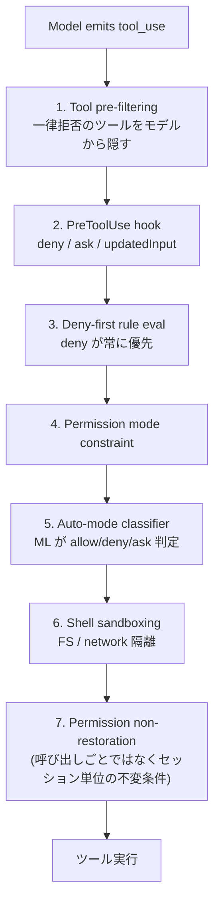

> <strong>元論文</strong>: Liu, Zhao, Shang, Shen (MBZUAI / UCL).
> [_Dive into Claude Code: The Design Space of Today's and Future AI Agent Systems_](https://arxiv.org/abs/2604.14228) — arXiv:2604.14228, 2026-04-14.
> [GitHub: VILA-Lab/Dive-into-Claude-Code](https://github.com/VILA-Lab/Dive-into-Claude-Code)

## はじめに —— 同じモデルでも成果が変わる理由

AI によるコーディング支援は、GitHub Copilot のようにカーソル位置へコード断片を提案するツールから、Cursor や Windsurf のように IDE 上の対話で複数ファイルを編集するツールを経て、自律型 CLI へと広がってきました。Claude Code、Codex CLI、Aider などはシェルコマンドを実行し、ファイルを書き換え、テストを走らせ、その結果を見て次の操作を自分で決めます。Devin、SWE-Agent、OpenHands のように、サンドボックス内でほぼ人の介入なしに開発を進める完全自律型のシステムもあります。

こうしたツールをめぐる議論は、主にモデルの賢さ、たとえば SWE-bench で何パーセント解けるか、HumanEval のスコアがいくつかに集中してきました。一方で現場のエンジニアは、同じモデルを使っても、ツールによって成果が大きく違うことに気づき始めています。モデルの性能は成果の必要条件ですが、十分条件ではありません。では、差を生んでいるのは何でしょうか。

2026 年 4 月、MBZUAI と UCL の研究グループがこの問いに答える技術レポートを公開しました。Anthropic の Claude Code（v2.1.88）の TypeScript ソースコード約 1,884 ファイル / 512,000 行を解析し、アーキテクチャ全体を再構成したものです。

中心となる発見は、次の比率です。

> Claude Code のコードベースのうち、AI の意思決定ロジックは推定わずか 1.6%。残りの 98.4% は、モデルを取り囲む決定論的な「運用ハーネス」である。（コミュニティー分析による Tier C 推定）

この比率は行数で数えたもので、価値の配分を示すものではありません。モデルを弱いものに差し替えれば、同じハーネスでも性能は大きく落ちます。それでもこの数字からは、<strong>本番 AI エージェントの設計空間の大部分がモデルの外側にある</strong>ことが読み取れます。

この記事では、AI エージェントを開発するエンジニアに向けて、論文の内容を「なぜそう作ったのか」「自社の製品にとって何を意味するのか」という 2 つの問いを軸に整理し直します。

論文は全体を通じて「`auth.test.ts` の失敗テストを直して」という 1 つのタスクを追跡しており、この記事でも同じ例を使います。下のデモでは、エージェントの中心にある `queryLoop()` が 1 周する流れをたどれます。

<ClaudeCodeLoopVisualizer />

---

## I. 設計を導く 5 つの価値と「モデルの判断を縛らない」方針

論文はまず、Anthropic の公式ドキュメント・ブログ・社内調査から、アーキテクチャの動機となっている 5 つの人間的価値を抽出します。

<strong>第一の価値は「人間の意思決定権限」</strong>で、最終的な決定権を人間が持つことです。権限は Claude の Constitution が定める階層（Anthropic → operator → user）に沿って整理されています。ユーザーが許可プロンプトの 93% を承認しているというデータが出たとき、Anthropic は警告を増やすのではなく、問題の構造を変えました。サンドボックスと ML 分類器で境界を定め、その内側では人間が一つひとつ判断しなくてもエージェントが作業できるようにしたのです。人間の決定権を保証するために、人間の注意力を前提にしない設計です。

<strong>第二は「安全性・セキュリティー・プライバシー」</strong>で、人間が油断していてもシステムが保護することです。決定権が「人間が選ぶ力」なら、安全性は「その力が行使されなかったときの保護」にあたります。auto-mode の脅威モデルは、過剰な行動、悪意のないミス、prompt injection、モデルの価値観のずれの 4 カテゴリーを明示的に対象にしています。

<strong>第三は「確実な実行」</strong>で、人間が意図した通りの作業を、長い作業の間も一貫して続けることです。製品ドキュメントでは、情報収集 → 実行 → 検証を繰り返す 3 段階のループとして説明されています。Anthropic のハーネス設計ガイドは「エージェントは出来が平凡でも、自信満々に自分の作業を褒める傾向がある」と指摘しており、これが生成と評価を分ける動機になっています。

<strong>第四は「能力の拡張」</strong>で、人間ができることを質的に増やすことです。Anthropic の社内調査では、Claude Code で手がけたタスクの約 27% が「ツールがなければ着手しなかった仕事」でした。既存の作業が速くなるだけでなく、新しい種類の仕事ができるようになるという意味での拡張です。開発者は Claude Code を、小さな部品から組み立てた「伝統的な製品ではなく Unix ユーティリティー」だと表現しています。

<strong>第五は「文脈への適応」</strong>で、ユーザーのプロジェクトに合わせ、使い続けるほど関係が改善していくことです。長期追跡データでは、自動承認率がセッション数 50 未満で約 20%、750 セッションを超えると 40% 以上に上がります。論文はこの自律性を「モデル・ユーザー・製品の三者で共同構築される」ものと説明しており、Claude Code は固定した信頼ではなく、こうして変化していく信頼を前提に設計されています。

これら 5 つの価値は 13 の設計原則に具体化されます。アーキテクチャ全体を最もよく説明するのは<strong>「足場は最小限に、運用基盤は最大限に」</strong>という原則です。LangGraph のようにプランナーや状態グラフでモデルの意思決定を外側から構造化する代わりに、判断はモデルに任せ、その周りを決定論的な仕組みで固めます。1.6% / 98.4% という比率は、この方針の表れです。

論文は 5 つの価値とは別に、「長期的な人間の能力保全」という評価の観点も導入します。これは Claude Code の設計価値には含まれておらず、エージェントが開発者の理解やスキルを損なっていないかを後半で批判的に検討するために使われます。本番エージェントの議論でこの観点が明示されることは少なく、§X の実証データと合わせて、この論文の特徴になっています。

> <strong>産業への示唆①</strong>：自社のエージェント製品が何を重視しているかを、5 つの価値に照らして点検してください。多くのスタートアップは「能力の拡張」に力を集中させていますが、安全性と決定権のバランスを欠くと、許可プロンプトの 93% が承認されるような承認疲れに陥ります。

---

## II. エージェントループ —— queryLoop() で 1 つのタスクを追う

### すべてのインターフェースが queryLoop() に合流する

Claude Code には対話型 CLI、ヘッドレス CLI（`claude -p`）、Agent SDK、IDE 統合といった複数のインターフェースがありますが、<strong>どれも同じ `queryLoop()` 関数に合流します</strong>。違うのは表示を担う層だけです。`QueryEngine`（`QueryEngine.ts`, 47KB）は SDK とヘッドレス向けの会話ラッパーで、エンジン本体ではありません。対話型 CLI は `QueryEngine` を通らず、直接 `query()` を呼びます。共有されるコードパスはクラスではなくループ関数であり、アーキテクチャを理解するうえでこの区別は重要です。

### 1 ターンの 9 ステップ

`query.ts`（68KB）に実装された `queryLoop()` は、async generator として書かれた while-true ループです。「`auth.test.ts` の失敗テストを直して」というタスクを例に、1 ターンの流れを追います。

1. <strong>設定の解決</strong> — システムプロンプト、許可コールバック、モデル設定を展開する
2. <strong>状態の初期化</strong> — メッセージ履歴、ツール実行の文脈、圧縮の追跡情報を 1 つの State オブジェクトにまとめる。ループ内の 7 つの継続地点は、このオブジェクトをフィールド単位ではなく丸ごと置き換える
3. <strong>文脈の組み立て</strong> — 最後の圧縮境界より後のメッセージを取り出す
4. <strong>5 段の事前圧縮を順に適用する</strong>（後述）
5. <strong>`callModel()` を `for await` でストリーミングする</strong> — ここでモデルが `Bash { command: "npm test auth.test.ts" }` を出力する
6. <strong>tool_use ブロックがあれば振り分ける</strong> — 振り分け先は StreamingToolExecutor
7. <strong>許可ゲートを通す</strong> — 7 層の「まず拒否」評価（§III で詳述）
8. <strong>実行して tool_result を会話に追加する</strong> — テスト失敗ログが `tool_result` として追加される
9. <strong>テキストのみなら終了、tool_use があればループ続行</strong>

これは ReAct パターン（推論 → 行動 → 観察を繰り返す。Yao et al., 2022）を素直に実装したものです。LangGraph のような明示的なグラフによる分岐も、LATS（Language Agent Tree Search。Zhou et al., 2024）のような木探索も使わず、while-true ループで 1 つの行動を確定させ、後戻りしません。応答の速さと実装の単純さを優先し、探索の網羅性を手放した選択です。

### ループを止める 5 つの条件

while-true ループといっても、無限に走り続けるわけではありません。ループが止まるのは次の 5 つの場合です。(1) モデルがテキストだけ（tool_use なし）で返答した場合で、これが通常の終わり方です。(2) `maxTurns` の上限に達した場合。(3) API が `prompt_too_long` を返し、復旧にも失敗した場合。(4) PostToolUse フックが `hook_stopped_continuation` を設定した場合。(5) `abortController` のシグナルが発火した場合です。

この停止条件は、Huyen (2025) が指摘する複合誤差の問題と直結します。1 ステップの成功率が 95% でも、100 ステップ続ければ全体の成功率は約 0.6% まで下がります。Claude Code は、停止条件とステップごとの許可検査を組み合わせて、この崩れを抑えようとしています。

### ツールの並列実行

`StreamingToolExecutor` は、読み取り専用のツールを並列に、状態を変えるツール（Bash など）を直列に実行します。並列に実行しても、結果はモデルが期待する元の tool_use の順に並べ直されます。並列実行を安全に保つ仕組みは 2 つあります。Bash ツールでエラーが起きると実行中のほかのプロセスをすぐに止める sibling abort controller と、新しい出力が届いたときに受け手を起こす progress-available signal です。

この方式は、PASTE（Sui et al., 2026）のような投機的実行（モデルが生成している途中で、使いそうなツールを先に動かす）と、完全な直列実行の中間にあたります。全体は `AsyncGenerator` として実装されていて、`StreamEvent`、`RequestStartEvent`、`Message` などを yield しながら、UI へのストリーミング出力と、1 本の同期的な制御フローを両立させています。

### 5 段の圧縮パイプライン

Claude Code は文脈の圧縮を<strong>多段にする</strong>設計をとっています。Claude Code は文脈ウィンドウを、データを入れておく箱ではなく希少な計算資源として扱い、5 段のパイプラインで管理します。安い圧縮から順に試し、足りないときだけ次の段に進むので、文脈の質は一度に落ちず、少しずつ落ちていきます。

| 段 | 名前 | 何を削るか | 特徴 |
|---|---|---|---|
| 1 | <strong>Budget reduction</strong> | サイズを超えたツール結果 | 常に有効。内容への参照に置き換える |
| 2 | <strong>Snip</strong> | 古い履歴の区間 | フィーチャーフラグで制御される軽い切り詰め |
| 3 | <strong>Microcompact</strong> | 細かい単位、キャッシュを考慮 | 境界の確定を API レスポンスの後まで遅らせる。Anthropic の API は繰り返し送られるプロンプトの先頭部分をキャッシュするため、その境界を崩すとキャッシュの作り直しに課金が発生する |
| 4 | <strong>Context collapse</strong> | 履歴を読み出すときの射影 | 元の記録は書き換えない |
| 5 | <strong>Auto-compact</strong> | モデルが生成する要約 | 上の 4 段で足りないときの最終手段 |

圧縮は API の課金にも直結します。ソースコードに残る 2026 年 1 月の実験コメントによれば、プロンプトキャッシュの再利用を無効にした経路では 98% がキャッシュミスになり、キャッシュ生成コスト全体の約 0.76%を占めていました。圧縮アルゴリズムの細部が課金額に跳ね返るのは、本番で動くエージェントならではの事情です。

論文は 5 段の圧縮とは別に、文脈を節約する 4 つの仕組みも挙げています。CLAUDE.md の遅延読み込み、ToolSearch によるツールスキーマの遅延読み込み、サブエージェントが要約だけを返す仕組み、ツール結果ごとのサイズ上限です。

> <strong>産業への示唆②</strong>：エージェントを自作するなら、少なくとも「ツール結果ごとのサイズ上限」「セッション全体のトークン監視」「代替モデル」「出力上限エラー用の小さな固定リトライ回数」は用意してください。Claude Code のリトライ回数 3（`MAX_OUTPUT_TOKENS_RECOVERY_LIMIT = 3`）は Anthropic のワークロードに合わせた値で、どこでも通用する定数ではありません。一方、「安い圧縮から段階的に試す」という原則はほかのエージェントにも当てはまります。

### 復旧の仕組み

- 出力トークンの上限超過には、最大 3 回までリトライする
- `prompt_too_long` エラーには、context collapse、reactive compact の順で対処する
- ストリーミングの代替経路と代替モデルも用意されている

---

## III. アーキテクチャで安全を確保する —— 7 層の許可ゲート

### 承認率 93% が示すこと

Anthropic の auto-mode 分析（2026）によれば、ユーザーは許可プロンプトの 93% を承認します。一見すると「ほとんどの操作は安全だ」と読めますが、実際には<strong>対話による確認が安全装置として機能していない</strong>ことを示しています。確認が習慣になると、人は内容を読まずに承認するようになります。いわゆる承認疲れです。

長期追跡データはこの傾向をさらに裏づけます。自動承認率はセッション数 50 未満で約 20%、750 セッションを超えると 40% 以上に上がり、1 回のセッションも長くなっていきます。ユーザーは意図してモードを切り替えるのではなく、少しずつ慣れることで信頼の度合いを変えていくのです。サンドボックスの導入で、許可プロンプトの頻度は推定 84% 減りました。Anthropic は課題を「もっと承認してもらうこと」から「人間が判断しなければならない回数を減らすこと」へと定義し直したわけです。

この認識が Claude Code の安全設計の方向を決めています。SWE-Agent や OpenHands は Docker サンドボックスで環境を丸ごと隔離し、Aider は git の自動コミットと `/undo` で事後に取り消せるようにしています。Claude Code はどちらとも違い、操作ごとにポリシーを適用する層を重ねる方法を選びました。

### 7 つの許可モード

Claude Code には 7 つの許可モードがあります。

- `plan`：まず計画を立てさせ、ユーザーが承認してから実行する
- `default`：標準的な対話モード
- `acceptEdits`：作業ディレクトリー内の編集を自動で承認する
- `auto`：ML 分類器が判定する（フィーチャーフラグが必要）
- `dontAsk`：確認はしないが、deny ルールは有効なまま
- `bypassPermissions`：ほとんどの確認を省くが、安全上重要な検査は残る
- `bubble`：内部用。サブエージェントの許可プロンプトを親プロセスに回す

外部から選べる 5 つのモードに、フィーチャーフラグで制御される `auto` と内部用の `bubble` を加えて 7 つです。

### 7 段の独立した安全層



各層は独立していて、<strong>どれか 1 つでも止めればツールは実行されません</strong>。

### 許可ハンドラーの 4 つの経路

許可を評価する実装（`useCanUseTool.tsx`）は、実行時の状況に応じて 4 つの経路に分かれます。(1) <strong>Coordinator</strong> はマルチエージェントの協調モード用で、自動での解決を試み、だめならユーザーに判断を委ねます。(2) <strong>Swarm worker</strong> はエージェント群の中のワーカー用です。(3) <strong>Speculative classifier</strong> は `BASH_CLASSIFIER` が有効で BashTool を使う場合の経路で、事前の分類結果とタイムアウトを競わせ、確度が高ければユーザーに尋ねずに承認します。(4) <strong>Interactive</strong> は、ターミナル UI に標準の承認ダイアログを出す最後の経路です。

拒否されたときの扱いにも工夫があります。<strong>許可の拒否は強制停止ではなく、次の行動を選び直させる信号です</strong>。モデルは拒否の理由を受け取り、次のループでより安全な手段を試します。許可の仕組みはエージェントを止めるのではなく、その行動の向きを変えるものとして働きます。

### 自動モード分類器のトレードオフ

`yoloClassifier.ts` は、提案された tool_use を会話履歴と許可テンプレートに照らして評価し、許可・拒否・手動承認の要求のいずれかを返す独立した LLM 呼び出しです。ここには構造的なトレードオフがあります。安全のための層そのものが LLM を呼ぶので、トークンと応答時間のコストを主ループと分け合うことになります。独立したセキュリティー調査（Adversa AI, 2026）は、50 個を超えるサブコマンドを含むコマンドに対して、解析の負荷を避けるためにサブコマンドごとの拒否検査を省き、汎用の確認プロンプト 1 回で済ませてしまう挙動を報告しています。<strong>多層防御が機能するのは、各層が別々の理由で失敗する場合に限られる</strong>ということです。

### 初期化の順序に潜む脆弱性

論文は、<strong>実行の順序</strong>にも安全上の問題があると指摘しています。プロジェクトの初期化（フック、MCP サーバー、設定の解決）は、信頼ダイアログが出る前に走ります。この信頼確立前の時間帯は「まず拒否」のパイプラインの外にあり、独立に報告された複数の CVE がすべてこの一点に原因を持っています。

層を空間的に並べた図からは、こうした時間的な性質が読み取れません。セキュリティーレビューでアーキテクチャ図を読むときは、各層が「どの順番で、いつ有効になるか」も確認する必要があります。

### 許可とは独立したシェルサンドボックス

`shouldUseSandbox.ts` が制御するシェルサンドボックスは、許可の仕組みとは独立した軸で動きます。許可で承認されたコマンドでも、サンドボックスの対象ならサンドボックスの中で実行されます。逆に、拒否されたコマンドはサンドボックスまで届きません。多層防御が意味を持つのは、このように<strong>認可と隔離</strong>の 2 つの軸が独立しているからです。

> <strong>産業への示唆③</strong>：「まず拒否」だけを取り入れても、摩擦が増えるだけで安全にはなりません。Claude Code でこの方式が機能しているのは、取りこぼしを下流の分類器とサンドボックスが拾っているからです。本番のエージェントには、少なくとも「まず拒否」「分類器またはサンドボックス」「初期化の順序への配慮」の 3 つが要ります。MCP サーバーやプラグインを組み込むなら、各拡張のマニフェストで有効になる段階（信頼確立前、信頼確立後、ターンごと）を宣言させるべきです。

---

## IV. 拡げる —— 文脈コストで分けた 4 つの拡張機構

### なぜ 4 つに分けるのか

エージェント基盤を作るとき、拡張の仕組みを 1 つにまとめたくなるのは自然です。それでも Claude Code は、フック・スキル・プラグイン・MCP の 4 つに分けています。論文はその理由を、<strong>文脈ウィンドウのコストが違うものを同じ抽象で扱うと、拡張の作者に不利なトレードオフを強いるから</strong>だと説明します。

| 機構 | 文脈コスト | 注入点 | 何を提供するか |
|---|---|---|---|
| <strong>フック</strong> | ゼロ | `execute()` | ライフサイクルへの介入、イベント駆動 |
| <strong>スキル</strong> | 低 | `assemble()` | ドメインの指示とメタツール |
| <strong>プラグイン</strong> | 中 | 3 点すべて | 複数の要素をまとめて配布する |
| <strong>MCP サーバー</strong> | 高 | `model()` | 外部サービスとの統合（MCP = Model Context Protocol） |

### 3 つの注入点

エージェントループの内部には 3 つの拡張点があります。(a) `assemble()` は、モデルが「何を見るか」を決めます。CLAUDE.md、スキルの説明、MCP のリソースはここで注入されます。(b) `model()` は、モデルが「何を使えるか」を決めます。組み込みツール、MCP ツール、SkillTool、AgentTool が 1 つの平らな一覧として渡されます。(c) `execute()` は、操作を「実行するか、どう実行するか」を決めます。許可ルールや PreToolUse / PostToolUse フックはここで介入します。4 つの拡張機構は、この 3 点のそれぞれ違う場所につながっています。

### 27 種のフックイベント

`coreTypes.ts` には 27 種のフックイベントが定義されています。内訳は、ツールの認可に関わる 5 種（PreToolUse / PostToolUse / PostToolUseFailure / PermissionRequest / PermissionDenied）、セッションのライフサイクル 5 種、ユーザーとのやり取り 3 種、サブエージェントの協調 5 種、文脈の管理 4 種、ワークスペースのイベント 4 種、それに通知です。このうち 15 種は詳しい出力スキーマを持ちます。フックの実装方法は、シェルコマンド、LLM プロンプト、HTTP、エージェントによる検証、コールバックの 5 種類です。

細かい点ですが、MCP ツールとそれ以外のツールでは、フックが走るタイミングが違います。MCP 以外のツールでは、`tool_result` を出力したあとに PostToolUse フックが走ります。MCP ツールでは結果の出力をフックの完了まで遅らせ、`updatedMCPToolOutput` で出力を書き換えられるようにしています。

> <strong>産業への示唆④</strong>：MCP が Linux Foundation の Agentic AI Foundation に寄贈されたいま、「コストごとに仕組みを分けるか、コストの注釈を付けた統一 API にするか」はエコシステム全体で議論すべき問題になっています。Claude Code は、仕組みを分けることで拡張の作者にコストを意識させる方を選びました。

---

## V. 覚える —— CLAUDE.md と文脈の組み立て

### 「指示」と「強制」の分離

Claude Code の記憶の仕組みで押さえておきたいのは、<strong>CLAUDE.md の内容がシステムプロンプトではなくユーザーメッセージとして注入される</strong>点です。そのため、モデルが指示に従うかどうかは確率的になります。確実に守らせたいことは、決定論的に働く許可ルール（「まず拒否」）の側で扱います。確率的な「指示」と決定論的な「強制」が、アーキテクチャのレベルで分かれているのです。

### 4 階層の CLAUDE.md

```text
/etc/claude-code/CLAUDE.md    ← OS-level managed memory（ポリシー、Linux）
~/.claude/CLAUDE.md           ← user memory（グローバル）
<project>/CLAUDE.md           ← project memory（git commit 対象）
<project>/CLAUDE.local.md     ← local memory（gitignore 対象）
```

ファイルは、後から読み込まれたものほどモデルの注意を強く引く「逆優先順」で読み込まれます。作業ディレクトリー配下の入れ子のディレクトリーにある CLAUDE.md は遅延読み込みで、エージェントがそのディレクトリーのファイルを読んだときに初めて読み込まれます。そのため、会話の途中で、探索に合わせて指示の範囲が広がっていくという動的な振る舞いが生まれます。

記憶の検索には埋め込みベクトルもベクトルインデックスも使いません。LLM が記憶ファイルのヘッダーを走査し、最大 5 ファイルを選びます（選択はファイル単位）。埋め込みベクトルによる選択精度を手放す代わりに、何が選ばれたかを検査しやすくした設計です。

### 文脈ウィンドウの組み立て順序

文脈ウィンドウは 9 つのソースを決まった順序で組み立てます。(1) システムプロンプト、(2) 環境情報（git status など。メモ化される）、(3) CLAUDE.md の階層、(4) パス単位のルール（遅延読み込み）、(5) 自動メモリー（非同期で先読み）、(6) ツールのメタデータ、(7) 会話履歴、(8) ツール結果、(9) 圧縮の要約です。さらに、関連する記憶の先読み、MCP の指示の差分、エージェント一覧の差分は、メインのウィンドウを組み立てたあとにも追加されます。文脈ウィンドウは組み立てた時点で固定されるわけではなく、ターンの途中でも膨らむことがあります。

> <strong>産業への示唆⑤</strong>：文脈ウィンドウを、データを入れる箱ではなく希少な計算資源として、設計の中心に置いてください。安くて元の記録を壊さない圧縮から試し、次の段階に進む条件を明示しておくと、文脈の質は少しずつしか落ちません。失われた情報はユーザーが確認できるようにすべきです。この点は Claude Code 自身も、透明性と効率の釣り合いという課題を残しています。

---

## VI. 委ねる —— サブエージェントとマルチエージェントの設計

### AgentTool はメタツール

`AgentTool` は `SkillTool` と同じくメタツールですが、働きは根本的に違います。`SkillTool` が現在の文脈ウィンドウに指示を注入するのに対し、`AgentTool` は<strong>独立した新しい文脈を作ります</strong>。

現在の公式ドキュメントでは、組み込みのサブエージェントは Explore / Plan / General-purpose の 3 つと、補助的な claude / claude-code-guide / statusline-setup だと説明されています。`.claude/agents/*.md` や `~/.claude/agents/*.md` に独自のエージェントを定義することもできます。YAML フロントマターでツール、モデル、許可モード、フック、最大ターン数、スキル、隔離モードなどを指定できるので、独自のエージェントは専用のツール・モデル・許可・フックを備えた、それだけで完結したサブシステムになり得ます。

### 公開されている隔離設定

公式に公開されているサブエージェントの `isolation` フロントマターの値は `worktree` で、git worktree を使い、Docker なしで作業ツリーを分けます。指定しなければ作業ツリーは親セッションと共有され、分かれるのは会話の文脈だけです。リモートやバックグラウンドで動くエージェントは別の機能として提供されていて、公開ドキュメント上の `isolation` の値ではありません。

### 許可モードの上書きルール

サブエージェントによる許可モードの上書きには、具体的なルールがあります。親が `bypassPermissions`、`acceptEdits`、`auto` のいずれかなら、サブエージェントの `permissionMode` による上書きは適用されません。これらのモードはユーザーが明示的に選んだ安全上の設定なので、常に優先されます。`allowedTools` が渡された場合は 2 段階で範囲が決まります。SDK レベルの許可はそのまま残り、セッションレベルのルールはサブエージェントの宣言で置き換えられます。

### サイドチェーンの記録とトークン消費

サブエージェントはそれぞれ専用の `.jsonl` と `.meta.json` を書き出し、親には要約だけを返します。エージェントチームは計画モードで通常のセッションの約 7 倍のトークンを消費するというデータもあり、要約だけを返す設計の意味はそれだけ大きくなります。

複数のインスタンスはファイルロックで調整します。メッセージブローカーも分散調整サービスも要らないので、外部依存なしで配備でき、平文の JSON を覗けば状態が分かるのでデバッグもしやすくなります。ただしファイルロックは NFS 上では壊れやすく、この方式が成り立つのは Claude Code が 1 人のユーザーが使う CLI ツールだからです。

> <strong>産業への示唆⑥</strong>：「マルチエージェントにはメッセージブローカーが要る」と考えがちですが、Claude Code はファイルロックと JSONL で十分に動いています。本番のエージェントシステムでは、デバッグのしやすさが運用を左右します。ただし、分散配備が必要なら別の基盤が要ります。

---

## VII. 残す —— セッションの永続化と、持ち越さない信頼

論文は永続化の仕組みについて、2 つの設計原則を明示しています。

> <strong>Conversations Outlive Context</strong> — セッションが役に立つ期間は、文脈ウィンドウの大きさで制限されるべきではない。ディスク上の記録がすべてを残しているので、圧縮で表示中の文脈を入れ替えても会話は終わらない。
>
> <strong>Conversations Outgrow a Single Path</strong> — セッションは 1 本の直線的な流れに閉じ込められるべきではない。追記専用の記録があるので、巻き戻し・再開・分岐ができる。

永続化には 3 つの経路があり、それぞれ独立に動きます。プロジェクト単位でセッションごとに 1 ファイルを作るセッション記録、ユーザーのプロンプトだけを残すグローバルな履歴（`history.jsonl`）、そしてサブエージェントのサイドチェーンです。

中心にあるのは<strong>追記専用</strong>の方針です。JSONL に追記を続け、圧縮の境界を示すマーカーは `headUuid / anchorUuid / tailUuid` を持ち、読み出すときに連鎖をつなぎ直せるようにしています。過去の行は変更も削除もしません。検索の速さより、監査のしやすさと実装の単純さを優先した設計です。

安全面で見逃せないのは、<strong>`--resume` がセッション固有の許可を復元しない</strong>ことです。信頼はセッションごとに確立し直すという原則で、古い信頼を引き継ぐリスクを避けるために、ユーザーの手間が増えることを受け入れています。

---

## VIII. OpenClaw との比較 —— 層として重なる設計空間

論文は、複数のチャネルに対応する個人アシスタントのゲートウェイである OpenClaw と Claude Code を 6 つの軸で比べ、<strong>同じ設計上の問いでも、配備の文脈が違えば答えも変わる</strong>ことを示します。

Claude Code は一時的な CLI プロセスとして動き、操作ごとに「まず拒否」で判定します。OpenClaw は常駐する WebSocket デーモンとして動き、境界の単位でアクセスを制御します。Claude Code ではシステムの中心が `queryLoop()` にあるのに対し、OpenClaw はゲートウェイの振り分けの中にエージェントの実行環境を組み込んでいます。拡張についても、Claude Code は 4 つの機構を文脈コストで段階分けし、OpenClaw はマニフェストを先に読むプラグインと 12 種の機能型を使います。

2 つは組み合わせることもできます。OpenClaw は ACP（Agent Client Protocol）を通じて、Claude Code をコーディング用のハーネスとして内部に取り込めます。2 つは二者択一ではなく、層として重なります。AI エージェントの設計空間は平らな分類ではなく、<strong>層を持つ分類</strong>として捉える必要があります。

---

## IX. 価値の間の緊張と横断的なパターン

### 5 つの構造的な緊張

5 つの価値を同時に追うと、次のような構造的な緊張が生まれます。

- 決定権と安全性：承認疲れと、保護の確実さとの間の緊張
- 安全性と能力：性能と、防御の深さとの間の緊張（50 個を超えるサブコマンドで検査が省かれる例）
- 適応と安全性：拡張性と、攻撃対象の広さとの間の緊張（信頼確立前の初期化に関する CVE）
- 能力と適応：能動的な提案と、作業の妨げとの間の緊張（タスク完了率は 12〜18% 上がるが、提案の頻度が高いと好感度が急落する）
- 能力と確実な実行：開発の速さと、コード全体の一貫性との間の緊張（文脈の上限が、コードベース全体を見渡すことを妨げる）

### 3 つの横断的パターン

6 つのサブシステムを通して読むと、3 つの設計上の方針が見えてきます。1 つ目は<strong>段階的な多層化</strong>で、安全・文脈・拡張のいずれも、独立した仕組みを段階的に積み重ねています。2 つ目は<strong>追記専用</strong>で、検索の速さより監査のしやすさを優先しています。3 つ目は<strong>決定論的なハーネスの中でのモデルの判断</strong>で、意思決定ロジックが 1.6% しかないことが示すように、ハーネスはモデルの判断を縛るのではなく活かすように作られています。

3 つ目のパターンには具体的な代償があります。文脈の上限があるため、エージェントはコードベース全体を見渡せません。テストファイルを修正しているエージェントが、離れたモジュールにある既存のユーティリティー関数を知らずに同じロジックを書き直すことがあります。1 つずつの変更は正しくても、全体では技術的負債がたまっていきます。

### KAIROS —— 能動的に動くエージェントの試み

フィーチャーフラグで制御される KAIROS は、指示を受けてツールを使うだけのエージェントの先を示しています。バックグラウンドで常駐するエージェントが一定間隔の heartbeat で動き、ユーザーからのメッセージがないときには定期的に `<tick>` プロンプトを注入します。ターミナルにフォーカスがあるかどうかを見て、ユーザーが離れている間は自律的な行動を増やします。`SleepTool` で起床のコストを明示し、プロンプトキャッシュが 5 分で失効することと合わせて、コストを抑えながら起床の頻度を調整します。

KAIROS が取り組んでいるのは、前述の「能力」と「適応」の間の緊張です。能動的に動く AI はタスク完了率を 12〜18% 高めますが、頻繁に提案し続ける Persistent Suggest 型では好感度が 47% まで落ちます（Chi et al. 2025）。KAIROS は、ユーザーがその場にいるかどうかと、トークンのコストの両方に結びつけてこの問題を解こうとしています。ただし、本番のビルドで動いているかどうかは確認されていません。

---

## X. 実証研究から見える初期の兆候

論文は、ソースコードの解析だけでは検証できない経験的な予測を立て、隣接する分野の実証研究を引用しています。

- <strong>Cursor を導入した 807 リポジトリーの因果分析</strong>（He et al., 2026）：コードの複雑度が 40.7% 上がり、初期の速度向上は 3 か月で導入前の水準に戻った。得られた効果が、増えた複雑さで打ち消される形になっている
- <strong>AI が書いた 304,000 件のコミットの監査</strong>（Liu et al., 2026）：セキュリティー関連の問題が特に長く残り続ける
- <strong>開発者 16 人のランダム化比較試験</strong>（METR / Becker et al., 2025）：AI を使うと作業が 19% 遅くなった（開発者自身は 20% 速くなったと感じていた）。N=16 と規模は小さいが、出力量の指標と、作業全体を通した生産性が食い違いうることを示している
- <strong>54 人を対象にした脳波（EEG）研究</strong>（Kosmyna et al., 2025）：LLM の利用者は脳の領域間の結合が弱まり、AI を使わなくなったあとも続いた
- <strong>AI の支援を受けた開発者は、理解度テストの成績が 17% 低かった</strong>（Shen et al., 2026）
- <strong>エントリーレベルのテック職の採用が 25% 減った</strong>（2023 年から 2024 年。Rak et al., 2025）

これらは Claude Code のアーキテクチャへの直接の反証ではありませんが、<strong>有限の文脈とツール利用のループを持つエージェントシステムに共通する</strong>構造的な問題を示しています。どれも単独の研究で、交絡要因も小さくありません。1 つの結果を確定した事実として扱うのではなく、全体の傾向として、自社でも計測すべき理由と受け取るのがよいでしょう。

> <strong>産業への示唆⑦</strong>：「生産性が上がる」ことだけを KPI にすると、組織は数年かけて力を失っていきます。コミット数、PR 数、行数といった出力量と、全体の生産性は別のものです。エージェントが作った PR のうち、人の手を入れずにそのまま出荷できたものと、実質的なレビューが必要だったものの比率を追ってください。コードの複雑度や技術的負債が長期的にたまっていないかも、CI で継続的に測ってください。

---

## XI. 6 つの未解決問題

論文は最終章で 6 つの未解決問題を挙げます。将来の予測ではなく、設計上まだ答えの出ていない問題の一覧です。

<strong>1. 表に出ない障害と、観測と評価の差</strong>。観測の仕組みを導入している組織は 89% あるのに、オフライン評価を行っているのは 52.4% にとどまります（LangChain 2026 調査）。障害の 78% は表に出ないという報告もあります（Bessemer 2026）。生成と評価の分離をハーネスの中に置くか外に置くかは、まだ決まっていません。

<strong>2. 永続化と長期的な協働</strong>。静的な指示である CLAUDE.md と、1 セッション分の記録の間に何を置くべきかという問題です。候補には、MemGPT のようなページング型のメモリー、Mem0 のような本番向けの記憶ストア、AgentWorkflowMemory、Reflexion、AMem などがあります。Hu et al. (2025) はエージェントの記憶を独立した認知の基盤と位置づけ、自動化された記憶、強化学習で動く記憶、信頼できる記憶を、まだ手つかずの領域として挙げています。

<strong>3. ハーネスの境界の広がり</strong>。境界は 4 つの方向に広がりつつあります。どこで動くかについては、Managed Agents がセッション、ハーネス、サンドボックスをそれぞれ独立したインターフェースに仮想化しています。いつ動くかについては、KAIROS の定期的な heartbeat があります。何に働きかけるかについては、視覚・言語・行動を統合した VLA モデルが物理的な操作にまで広げています。誰と動くかについては、MetaGPT、CAMEL、マルチエージェント討論といった研究があります。

<strong>4. 作業時間の長期化</strong>。METR は、AI が 50% の確率で完了できるタスクの長さ（人間の専門家がかかる時間で測る）を「50% 時間軸」として測定しています。AI Scientist（Lu et al., 2024）は論文の草稿まで自律的に書き、CoScientist（Gottweis et al., 2025）は数日がかりで仮説を生成し、AlphaEvolve（Novikov et al., 2025）は数週間かけてアルゴリズムを発見します。

<strong>5. 大規模なガバナンス</strong>。EU AI Act は 2026 年 8 月に全面適用されます。MIT AI Agent Index に登録されたシステムのうち、エージェント固有の安全性カードを公開しているのは 13.3% だけです。

<strong>6. 長期的な人間の能力の再検討</strong>。ハーネスは、セッション単位で理解度の変化を測る信号を外に出すべきか、という問いです。生産性が上がることと、人が成長することは別だという点がここでも問われています。

---

## XII. 製品開発への 7 つの指針

ここまでの分析を、AI、LLM、エージェントを組み込んだ製品を作る人に向けた具体的な指針にまとめます。

### 1. 最先端モデルを選んだら、次はハーネスに投資する

1.6% / 98.4% は行数の比率で、価値の配分を示すものではありません。それでも次の主張は成り立ちます。<strong>最先端のモデルを選んだあと、追加の投資が最も効くのは決定論的なハーネス</strong>（許可、文脈管理、復旧、観測）であり、モデル選びをさらに詰めることではありません。ただし、51 万行のハーネスそのものが、攻撃対象、学習コスト、気づかれにくい挙動変化の原因にもなることは忘れないでください。

### 2. 人間の注意力を前提に許可を設計しない

「まず拒否」、多層防御、初期化の順序への配慮の 3 つが必要です。MCP やプラグインを使う本番のエージェントでは、拡張のマニフェストで、有効になる段階の宣言を必須にすべきです。

### 3. 文脈を計算資源として設計の中心に置く

安いものから段階的に進む圧縮、ツール結果ごとのサイズ上限、トークンの監視は、欠かせない仕組みです。

### 4. 拡張の仕組みを文脈コストで段階分けする

文脈コストがゼロのフック、低いスキル、中程度のプラグイン、高い MCP という段階で構成します。

### 5. マルチエージェントは「隔離の粒度」で設計する

ファイルシステムを分けるワークツリー、文脈だけを分けるインプロセス、リソースまで分けるコンテナーを、用途に合わせて使い分けます。サブエージェントには要約だけを返させ、文脈が膨れ上がるのを防ぎます。

### 6. 永続化は追記専用から始める

JSONL への追記、読み出し時の連鎖の修正、許可を復元しないことの 3 つを組み合わせます。再開したときに信頼を持ち越さないようにします。

### 7. 「短期的な生産性」と「長期的な能力」を分けて測る

出力量の指標だけでは足りません。エージェントが作った PR が修正なしで出荷された割合と、実質的なレビューが必要だった割合を追ってください。コードの複雑度が長期的にたまっていないかを CI で測り、開発者の理解度を測る方法も設計の範囲に含めてください。

---

## おわりに

『Dive into Claude Code』は、本番で動く AI エージェントを実際のソースコードから読み解いた研究です。推論をモデルに、実行をハーネスに任せる分離、「まず拒否」と多層防御による安全モデル、文脈を希少な資源として段階的に管理する圧縮、文脈コストで段階分けした拡張機構。こうした考え方は、今後のエージェント基盤を設計するときの共通の語彙になっていくでしょう。

一方で、6 つの未解決問題が示すように、AI エージェントの設計空間はまだ閉じていません。ハーネスの周辺では、組み合わせの可能性がむしろ広がっています。

最も重要な問いは、自律性をどこまで高めるかではなく、<strong>人間の能力を長期的にどう保つか</strong>です。この論文は、その問いをアーキテクチャ分析の中ではっきり示しました。

自社製品のハーネスを見直すなら、ツール実行前の安全確認、多段の圧縮、フックのライフサイクル、サブエージェントの隔離の 4 点から始めるとよいでしょう。

---

## 補遺：エビデンスの 3 階層と方法論

論文は、主張の根拠を 3 つの階層に分けています。<strong>Tier A</strong>（製品ドキュメント）は Anthropic の公式ドキュメントとブログで、製品が何を意図しているかは示せますが、内部の実装までは保証しません。<strong>Tier B</strong>（コードで確認）は TypeScript ソースコード v2.1.88 の特定のファイルや関数を引用したもので、最も強い根拠です。<strong>Tier C</strong>（再構成）はコミュニティーの分析、OpenClaw との比較、コードのパターンからの推論で、断定を避けた表現で書かれています。

分析対象のソースは約 1,884 ファイル、512,000 行です。分析は v2.1.88 の静的なスナップショットに基づいており、フィーチャーフラグによってビルドごとに内容が変わりえます。リバースエンジニアリングによる分析なので、設計の意図、本番で有効になっているフラグ、実行時にどの経路がどれだけ使われているか、まだ出荷されていない機能については確認できません。

## 参考文献

- 論文: [arXiv:2604.14228](https://arxiv.org/abs/2604.14228) — Liu, Zhao, Shang, Shen (2026)
- リポジトリー: [VILA-Lab/Dive-into-Claude-Code](https://github.com/VILA-Lab/Dive-into-Claude-Code)
- Anthropic ドキュメント: [How Claude Code Works](https://docs.anthropic.com/en/docs/claude-code) ほか anthropic2025/2026 系参考文献
- 比較対象: [OpenClaw](https://github.com/openclaw) — multi-channel personal assistant gateway
- MCP の Linux Foundation 寄贈: [Agentic AI Foundation](https://www.linuxfoundation.org/) (2025)
- Agent Architecture: ReAct (Yao et al., 2022), Toolformer (Schick et al., 2023), LangGraph, AutoGen, SWE-Agent, OpenHands, Aider
- Agent Patterns: Martin (2026) "Seven Patterns", Chase (2025) "Deep Agents", Swyx (2025) "Agent Engineering", Huyen (2025) "Building Agents"
- Memory: MemGPT (Packer et al., 2024), Mem0 (Chhikara et al., 2025), AMem (Xu et al., 2025), AgentWorkflowMemory (Wang et al., 2024), Reflexion (Shinn et al., 2023)
- Context Engineering: ACE (Zhang et al., 2026), Hu et al. (2025) Agent Memory Survey
- Proactive AI: Chi et al. (2025), KAIROS (feature-gated in Claude Code)
- Horizon: AI Scientist (Lu et al., 2024), CoScientist (Gottweis et al., 2025), AlphaEvolve (Novikov et al., 2025), METR (Kwa et al., 2025)
- Empirical: He et al. (2026, Cursor 807 repos), Liu et al. (2026, 304K commits), Becker et al. (2025, METR RCT), Kosmyna et al. (2025, EEG), Shen et al. (2026, comprehension), Rak et al. (2025, hiring)
- Governance: EU AI Act, GPAI Code of Practice, MIT AI Agent Index (Staufer et al., 2026), Nannini et al. (2026)
