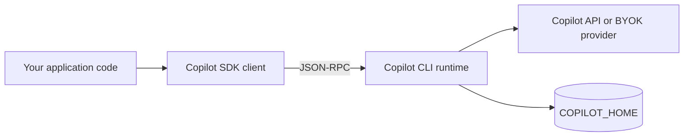
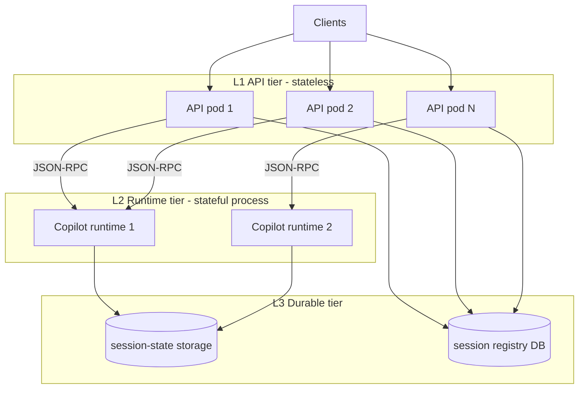
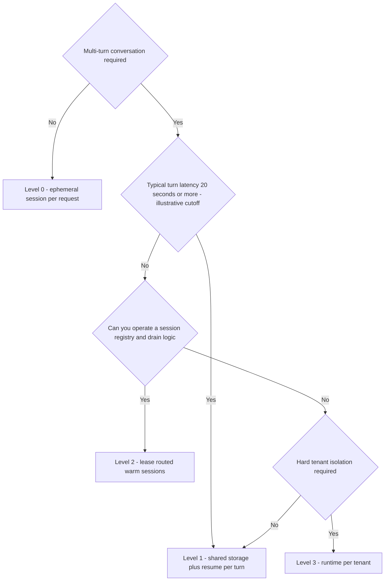
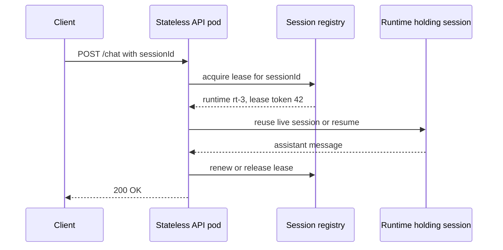
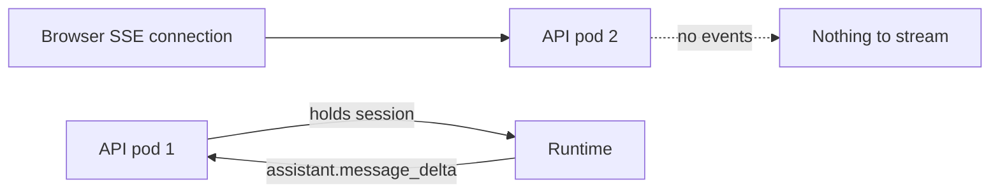

## はじめに

GitHub Copilot SDK は、Copilot CLI の背後にあるエージェントランタイムをプログラムから呼び出すためのライブラリーだ。Node.js/TypeScript、Python、Go、.NET、Java、Rust 向けに提供されており、自社プロダクトに「Copilot 相当のエージェント」を埋め込める。

サーバーサイドで使うなら、まず次の問いに答える必要がある。

> この SDK を使ったバックエンドは、ステートレスに設計して水平スケールできるのか？

結論は<strong>「アプリ層はステートレスにできるが、ランタイム層はできない」</strong>である。設計で問題になるのは、可否よりも次の3点だ。

- 状態はどこに、どんな粒度で存在するのか
- その状態境界を跨ぐコストはいくらか
- 境界の置き方を間違えたとき、どんな壊れ方をするのか

この記事は2026-08時点の公開ドキュメントと `@github/copilot-sdk` v1.0.13 の README を一次情報としている。SDK は活発に更新されているので、採用時は手元のバージョンの型定義で確認してほしい。

## 先に結論

| 問い | 答え |
|---|---|
| HTTP/API ハンドラーをステートレスにできるか | できる。セッションを ID で指定できるようにすればよい |
| Copilot ランタイムをステートレスにできるか | できない。プロセス内メモリーとディスクに状態を持つ |
| 任意の Pod が任意のセッションを扱えるか | 共有ストレージか `sessionFs` を用意すれば可能。ただし単一ライター制約がつく |
| 毎ターン resume する設計は現実的か | ターンが長い用途では現実的。短いターンでは必要な容量が数倍になることがある |
| ストリーミング UI はステートレス化を壊すか | 壊す。イベント配送は別の設計課題として切り出す必要がある |
| 一番危険な既定値は何か | `mode: "copilot-cli"` のままマルチテナントに使うこと |

## 前提: Copilot SDK は何を「持っている」のか

### SDK はクライアントであって、本体ではない

SDK は自前で LLM を呼び出すわけではない。Copilot CLI ランタイムに JSON-RPC でつなぐクライアントである。



そのため、アプリケーションのプロセスの外に、状態を持つプロセスがもう一つある。どこまでステートレスにできるかは、このプロセスの扱いで決まる。

接続方法は `RuntimeConnection` のファクトリーで選ぶ。

| 接続方式 | 生成方法 | ランタイムの寿命 |
|---|---|---|
| stdio（既定） | `RuntimeConnection.forStdio({ path, args, env })` | SDK が子プロセスとして起動・停止 |
| TCP | `RuntimeConnection.forTcp({ port, connectionToken, ... })` | SDK が起動し、TCP で通信 |
| 外部 URI | `RuntimeConnection.forUri(url, { connectionToken })` | 起動済みランタイムに接続。寿命は別管理 |
| in-process | `RuntimeConnection.forInProcess()` | 同一プロセス内（C ABI/FFI、実験的） |

サーバーサイドで主に使うのは `forUri` だ。ランタイムを `copilot --headless --port 4321` で常駐サーバーとして起動し、API プロセスからはそこに接続する。ランタイムのライフサイクルがリクエストハンドラーから切り離されるので、Pod の再起動やデプロイの単位を分けられる。

headless サーバーは既定でループバック（`127.0.0.1`）からの接続しか受け付けない。別コンテナーから接続するには `--host 0.0.0.0` が必要で、そうすると SDK とランタイムの間に組み込みの認証がないことが問題になる。`forUri` / `forTcp` は `connectionToken` を受け取るが、ドキュメントは認証がないことを制限事項として挙げている。共有シークレット1つは認証の代わりにならないので、ネットワーク境界（同一 Pod、サイドカー、mTLS を張った VPC 内など）で守る必要がある。

### 状態の棚卸し

Copilot SDK を使うシステムには、少なくとも次の5種類の状態がある。

| 状態の種類 | 実体 | 永続化されるか | 外部化できるか |
|---|---|---|---|
| 会話状態 | メッセージ列、ツール呼び出し結果 | される（checkpoints） | できる（共有 FS / `sessionFs`） |
| 計画・成果物 | `plan.md`、`files/` 配下 | される | できる |
| ランタイム内メモリー | 生きたセッションオブジェクト、購読中のイベントハンドラー | されない | できない |
| 認証情報 | BYOK の API キー、per-session GitHub トークン | されない（意図的） | 自前の秘密管理に置く |
| ツール実装の状態 | `defineTool` ハンドラーが握るインメモリー状態 | されない | 自分で設計する |

公式ドキュメントによると、`COPILOT_HOME/session-state/{sessionId}/` の中身は次のとおりだ。

```text
~/.copilot/session-state/
└── user-123-task-456/
    ├── checkpoints/
    │   ├── 001.json
    │   ├── 002.json
    │   └── ...
    ├── plan.md
    └── files/
```

永続化の扱いには、注意すべき非対称が2つある。

1. <strong>会話は永続化されるが、接続は永続化されない。</strong>ディスク上のセッションは残るが、そのセッションを握っていた「生きたオブジェクト」とイベント購読は、プロセスが死ねば消える。
2. <strong>鍵は永続化されない。</strong> BYOK 構成では、`resumeSession` のたびに `provider` 設定を再投入しなければならない。鍵をディスクに残さないのはセキュリティー上妥当な設計だが、ステートレスな resume 処理を書くときに見落としやすい。

## 「ステートレス」を層で定義し直す

ステートレスかどうかは、システム全体ではなく層ごとに決まる。Copilot SDK を使うシステムは、次の3層に分けると、どの層で状態を扱うかを決めやすくなる。



- <strong>L1（API ティア）</strong>は12ファクター的な意味で完全にステートレスにできる。リクエストが持つのはセッション ID だけ。
- <strong>L2（ランタイムティア）</strong>は本質的にステートフルだ。プロセスが生きたセッションを握っている。ここをステートレスにしようとするのは、PostgreSQL をステートレスにしようとするのと同じ種類の誤りである。
- <strong>L3（永続ティア）</strong>は共有ファイルシステム、あるいは `sessionFs` 経由のオブジェクトストレージ、そしてアプリケーション側で用意するセッションレジストリーからなる。

このうちセッションレジストリーが抜けている設計をよく見る。SDK は `listSessions()` を提供するが、これはランタイムから見えるストレージ上のセッションを列挙するだけで、「誰のものか」「今どのランタイムが握っているか」「まだ有効か」は答えてくれない。<strong>所有権とルーティングは、アプリケーション側の DB で管理する</strong>。

## ステートレス度の4段階

用途に応じて、ステートレスの度合いを次の4段階から選ぶ。図中の「20秒」という境目は、SDK や CLI のドキュメントにある値ではなく、説明用の目安だ。後述の resume コストの比で計算すると、resume に1〜5秒かかる場合、1ターン20秒なら Level 1は Level 2より同時に処理中のターンが5〜25%多くなる。実際の境目は、自分の環境で測った resume 時間から決める。



### Level 0: エフェメラルセッション

各リクエストが独立している用途（分類、要約、単発のコード生成など）では、そもそもセッションを残さない。これは真にステートレスだ。

```typescript
import { CopilotClient, RuntimeConnection } from "@github/copilot-sdk";

// プロセス起動時に1回だけ
const client = new CopilotClient({
  mode: "empty",
  connection: RuntimeConnection.forUri(process.env.COPILOT_RUNTIME_URL!),
});
await client.start();

app.post("/api/analyze", async (req, res) => {
  const session = await client.createSession({
    model: "gpt-5.4",
    availableTools: ["custom:lookupOrder"],
    gitHubToken: req.user.githubToken,
    onPermissionRequest: () => ({ kind: "approve-once" }),
  });

  try {
    const result = await session.sendAndWait({ prompt: req.body.prompt }, 120_000);
    res.json({ content: result?.data.content });
  } finally {
    await session.disconnect();
  }
});
```

注意点は3つ。

- `client` はリクエストごとに作らない。`createSession` は軽いが、`new CopilotClient()` + `start()` はランタイム接続の確立を伴う。
- `sendAndWait` にはタイムアウトを必ず渡す。エージェントは原理的に停止性が保証されないので、上限は呼び出し側が握る。
- `finally` で `disconnect()` する。これはディスク上のデータを消さず、インメモリーのリソースだけ解放する。捨ててよいセッションなら `deleteSession()` まで走らせる。

Level 0では文脈が残らない。マルチターンにするには毎回会話履歴をプロンプトに詰め直すことになり、その分トークン課金とレイテンシーが増える。

### Level 1: 共有ストレージ + 毎ターン resume

API ティアを完全にステートレスにしたまま、マルチターンを成立させる標準的な方法だ。セッション状態を共有ストレージ（NFS/CSI PVC/`sessionFs` 経由のオブジェクトストレージ）に置き、どのランタイムからでも resume できるようにする。

```typescript
app.post("/api/chat", async (req, res) => {
  const { sessionId, message } = req.body;

  // 1. 所有権チェック（SDKはやってくれない）
  const record = await db.sessions.findById(sessionId);
  if (!record || record.ownerId !== req.user.id) {
    return res.status(404).json({ error: "not found" });
  }

  // 2. 単一ライタを保証してから resume
  const result = await withSessionLease(sessionId, async () => {
    const session = await client.resumeSession(sessionId, {
      onPermissionRequest: policyFor(req.user),
      // BYOKなら provider を毎回再投入する必要がある
      provider: byokProviderFor(record.tenantId),
    });
    try {
      return await session.sendAndWait({ prompt: message }, 180_000);
    } finally {
      await session.disconnect();
    }
  });

  res.json({ content: result?.data.content });
});
```

この形なら API ティアをステートレスに保てるが、1ターンの実時間が次のように伸びる。

$$
W_{\text{L1}} = W_{\text{lease}} + W_{\text{resume}} + W_{\text{turn}} + W_{\text{disconnect}}
$$

この差が容量に与える影響は「resume のコストと容量計画」で扱う。

### Level 2: リース経路制御によるウォームセッション

resume コストを避けたいなら、セッションを一定時間ランタイム内に生かしておき、API ティアは「そのセッションを持っているランタイムはどれか」をレジストリーに問い合わせて転送する。API ティア自体はステートレスなまま、実質的なアフィニティーを得る。



このとき、<strong>ロードバランサーのスティッキーセッションには頼らない</strong>。LB のアフィニティーはクライアント接続の振り分けであって、セッションの所有権を表すものではない。Pod が落ちると LB は黙って別の Pod に振り分け、そこで二重ライターが発生する。所有権はレジストリーのリースで表し、API ティアはそれを参照するだけにする。

### Level 3: テナント専用ランタイム

コンプライアンス要件が厳しい場合や、テナントごとに別の認証情報でランタイムを走らせたい場合は、テナント単位でランタイムを分ける。分離は最も強いが、集約密度は最も低い。アイドルなテナントの分もプロセスとメモリーを確保し続けることになる。

4段階を並べると次のようになる。運用の複雑度は、そのレベルで自前に用意して運用する仕組み（共有ストレージ、リース、レジストリーとドレイン処理、テナントごとのランタイム）の量から見た目安だ。

| | Level 0 | Level 1 | Level 2 | Level 3 |
|---|---|---|---|---|
| API ティアのステートレス性 | 完全 | 完全 | 完全（レジストリー依存） | 完全 |
| 会話継続 | なし | あり | あり | あり |
| 1ターンの追加コスト | なし | resume + lease | lease のみ | なし |
| 必要な共有ストレージ | 不要 | 必須 | 望ましい（フェイルオーバー用） | 任意 |
| 単一ライター制御 | 不要 | 必須 | 必須 | 実質不要 |
| 分離レベル | セッション | セッション | セッション | プロセス |
| 運用の複雑度 | 低 | 中 | 高 | 中（密度が犠牲） |

## 外部ストレージ化で解決すること・しないこと

「セッションデータを外部ストレージに出せばステートレスになる」という理解は半分しか正しくない。

### 得られるのは「ステートレス」ではなく「再配置可能」

外部化で手に入るのは、セッションがどのノードからでも開けるという性質だけだ。残る2種類の状態は、原理的に外部化できない。

| 状態 | 外部化 | 理由 |
|---|---|---|
| 会話履歴・checkpoint・`plan.md`・`files/` | できる | 単なるデータ。`sessionFs` はこのためにある |
| 実行中ターンの待ち合わせ | できない | データではなく、アプリケーションのプロセスへの RPC だから |
| ストリーミング中のイベント | できない | そもそもディスクに書かれない（後述） |

この表で影響が最も大きいのは、実行中ターンの待ち合わせだ。ツール実行、`onPermissionRequest`、hooks では、ランタイムからアプリケーションのプロセスへ JSON-RPC で問い合わせが飛び、ランタイムは応答が返るまで待つ。ターン実行中に API Pod が落ちると、ランタイム側には応答する相手のいない保留リクエストが残る。ディスクを共有しても、この応答待ちの RPC は別の Pod に引き継げない。

外部化が守るのは<strong>ターンとターンのあいだ</strong>であって、<strong>ターンの途中</strong>ではない。Level 1のハンドラーがリトライするとき安全に仮定できるのは「直前の checkpoint まで戻っている」ことだけで、ツールの副作用は冪等に設計するしかない。

SDK 自身も、Agent Factories の durable step の実装に次のコメントを残している。

```typescript
// nodejs/src/session.ts
// Producers are best-effort at-least-once across crashes or
// concurrent callers, so authors must make side effects idempotent.
```

クラッシュや並行呼び出しをまたぐと at-least-once になるので、副作用を冪等にせよ、という内容だ。SDK の中で durability に最も配慮した機構でも、保証は at-least-once にとどまる。

### 外部化すると「偶然の単一ライター性」を失う

ローカルディスク構成では、セッション状態が特定 Pod のディスクにしかないため、その Pod しか触れないという排他が偶然成立していた。共有ストレージにするとこの保護が消えるが、SDK にはその代わりになるロック機構がない。

`nodejs/src` 全体を検索しても、ロックに関係する箇所は2つしかなく、どちらもセッションとは無関係だ。

| 場所 | 実体 | 守っている対象 |
|---|---|---|
| `client.ts` の `modelsCacheLock` | Promise ベースの排他 | `listModels()` のキャッシュ。同一プロセス内のみ |
| `sessionFsProvider.ts` の `"busyOrLocked"` | SQLite の BUSY/LOCKED 分類 | ストレージ層のリトライ可否判定 |

`createSession` / `resumeSession` には、そのセッションが既に他のクライアントに掴まれているかを確認する処理がない。2つの Pod が同じ `sessionId` を resume しても、両方とも成功する。

一方で、SDK は "already active" という概念を持っている。ただし対象はセッションではなく Factory Run である。

```typescript
// nodejs/src/factory.ts
export type FactoryResumeErrorCode =
    | "not_found"
    | "non_resumable"
    | "already_active"          // 二重実行を弾く
    | "factory_already_running"
    | "factory_limits_invalid"
    | "factory_session_disposed"
    | "factory_storage_unavailable"
    | "factory_storage_corrupt";
```

これは実装漏れではなく、セッションの排他はアプリケーションの責務という設計判断と読むのが自然だ。ライブラリーは自分より上のレイヤーの構成（Pod が何個あるか、LB がどう振るか）を知らないので、排他を提供しようがない。提供しようとすれば SDK 自身が Redis や etcd への依存を要求することになり、それは筋が悪い。

ただし、排他を提供しないレイヤーでも競合の検出手段は普通は用意される。HTTP の `If-Match`、オブジェクトストレージの条件付き書き込み、`git push` の非 fast-forward 拒否がそれだ。Copilot SDK には `listSessions()` が返す `modifiedTime` はあるが、<strong>書き込み時にバージョンを検証する compare-and-swap がない</strong>。したがって、

- 二重書き込みを防ぐことはできない（レイヤー的に妥当）
- 二重書き込みが起きたことを検出する手段も乏しい（ここは物足りない）

責任分界は次のように整理できる。

| SDK が提供するもの | アプリケーション側で用意するもの |
|---|---|
| 識別 — `sessionId` でセッションを指せる | 排他 — 同時に書き手が1つであることの保証 |
| 永続化 — checkpoint への保存と復元 | 所有権 — そのセッションが誰のものか |
| 配置の自由 — `sessionFs` で置き場所を選べる | 経路 — いまどのランタイムが握っているか |

ストレージの外部化で得られるのは左列の「配置の自由」で、右列はすべてアプリケーション側の仕事として残る。

## セッション ID は主キーであって、ACL ではない

`createSession({ sessionId })` で ID を自分で決められる。指定しなければランダムな ID が振られるので、resume するにはその ID を控えておく必要がある。

公式ドキュメントは `user-{userId}-{taskId}` のような構造化 ID を推奨し、`sessionId.split("-")` でユーザー ID をパースして所有権を検証するサンプルを載せている。<strong>このサンプルをそのまま本番に持ち込んではいけない。</strong>

この設計では、ID の文字列表現が信頼境界になってしまう。

- ユーザー ID にハイフンが含まれれば境界がずれる（`user-alice-smith-42` をどう分割する？）
- 攻撃者は任意の `sessionId` を送れる。`createSession` にクライアント由来の ID をそのまま渡すと、他人の ID を名乗れる
- テナント削除・ユーザー ID の再利用に追随できない

<strong>セッション ID は不透明な識別子として扱い、所有権は自前の DB で管理する</strong>。

```typescript
// 生成: 衝突しない不透明IDにテナント接頭辞だけ付ける
function newSessionId(tenantId: string): string {
  return `t${tenantId}-${crypto.randomUUID()}`;
}

// 認可: 文字列パースではなくレコード参照
async function authorize(sessionId: string, user: User) {
  const rec = await db.sessions.findById(sessionId);
  if (!rec) throw new NotFound();
  if (rec.tenantId !== user.tenantId) throw new NotFound(); // 403ではなく404
  if (!user.can("session:write", rec)) throw new Forbidden();
  return rec;
}
```

テナント接頭辞は、`sessionFs` でテナント別のストレージパスに振り分けるときや、障害調査で ID だけを見るときに役立つ。ただし認可の根拠にはしない。セッションが存在するかどうかを漏らさないために、他テナントのセッションには403ではなく404を返す。

## 単一ライター制約 — ロックではなくパーティションで解く

SDK ドキュメントには「セッションのロック機構は組み込まれていない」と明記されている。同じセッション ID に対して2つのクライアントが同時に `resumeSession` して書き込んだ場合の挙動は未定義だ。checkpoint は連番の JSON ファイルとして書かれるので、失われた更新（lost update）が起きうる。

公式サンプルは Redis の `SET NX EX` によるロックを示している。方向性は正しいが、そのままだと2つ問題がある。

### 問題1: ロック解放が競合する

ドキュメントのサンプルには `GET` してから `DEL` する形のものがある。この2ステップの間に TTL が切れて別クライアントがロックを取ると、他人のロックを消してしまう。解放は必ず Lua でアトミックにする。

```typescript
const RELEASE = `
if redis.call("get", KEYS[1]) == ARGV[1] then
  return redis.call("del", KEYS[1])
else
  return 0
end`;

// 更新も所有権チェックが要る。素の EXPIRE は他人のロックを延ばしてしまう
const RENEW = `
if redis.call("get", KEYS[1]) == ARGV[1] then
  return redis.call("expire", KEYS[1], ARGV[2])
else
  return 0
end`;

async function withSessionLease<T>(
  sessionId: string,
  fn: () => Promise<T>,
  ttlSec = 300,
): Promise<T> {
  const key = `copilot:lease:${sessionId}`;
  const token = crypto.randomUUID();

  const ok = await redis.set(key, token, "NX", "EX", ttlSec);
  if (!ok) throw new SessionBusyError(sessionId);

  const renew = setInterval(() => {
    void redis.eval(RENEW, 1, key, token, String(ttlSec));
  }, (ttlSec / 3) * 1000);

  try {
    return await fn();
  } finally {
    clearInterval(renew);
    await redis.eval(RELEASE, 1, key, token);
  }
}
```

更新側にも同じ競合がある。素の `EXPIRE` は「そのキーが今も自分のものか」を確かめない。TTL が切れて別クライアントがロックを取った後に更新タイマーが発火すると、他人のロックの TTL を延長してしまう。解放と同じく、更新もトークン照合込みの Lua にする。

### 問題2: そもそもロックは相互排他を保証しない

Redis ロックはアドバイザリーであって、相互排他の証明にはならない。GC の長時間停止、ネットワーク分断、コンテナーのフリーズが起きれば、TTL 切れ後も自分がロックを持っていると思い込んだプロセスが書き込みを続ける。分散ロックの一般的な処方箋は「リソース側でフェンシングトークンを検証する」ことだが、<strong>Copilot ランタイムはフェンシングトークンを受け取らない</strong>。つまり、ロックだけでは原理的に守り切れない。

実務的な解は2つある。

<strong>(a) 設計で単一ライターを作る。</strong>セッション ID をキーにしたパーティション付きキュー（Kafka のパーティション、SQS FIFO の MessageGroupId、セッション ID のハッシュでストリームを分けた Redis Streams など）を使い、同じセッションのターンは常に同じワーカーが順に処理する。相互排他が「ロックの成否」ではなく「配送の性質」から出てくるので、はるかに堅い。

<strong>(b) 破損を検出可能にする。</strong>それでも二重ライターは起きうる、という前提で、`listSessions()` が返す `modifiedTime` や自前のターンカウンターを使い、期待したバージョンから進んでいたら異常として扱う。エージェントセッションは金銭取引ではないので、「検出して当該セッションを隔離し、ユーザーに再開を促す」で十分なことが多い。

最も安価な緩和策は、同一セッションへの同時リクエストを409 Conflict で即座に落とすことだ。UI が「前の応答の生成中です」と出せば、それで大半のケースは解決する。

## resume のコストと容量計画

Level 1では毎ターン resume するので、その時間が必要な容量に跳ね返る。

同時に処理中のターン数は、リトルの法則で求められる。

$$
L = \lambda \cdot W
$$

$\lambda$ はターン到着率 [turns/sec]、$W$ は1ターンの滞在時間 [sec]、$L$ は同時に処理中のターン数だ。

たとえばチャットバックエンドで $\lambda = 3\ \text{turns/sec}$、$W = 25\ \text{s}$ なら、$L = 75$。平均して75本のターンが並行して走る。これを1ランタイムあたりの実測同時処理能力 $C$ で割れば必要ランタイム数が出る。

$$
N = \left\lceil \frac{L}{C} \right\rceil \times (1 + \text{headroom})
$$

Level 1と Level 2の差はここに現れる。resume を挟むと $W$ が伸び、$L$ が線形に増える。

$$
\frac{L_{\text{L1}}}{L_{\text{L2}}} = \frac{W_{\text{resume}} + W_{\text{turn}}}{W_{\text{turn}}}
$$

$W_{\text{lease}}$ は Level 1 / Level 2の両方にかかるが、$W_{\text{turn}}$ に比べて小さいとして省いた。$W_{\text{disconnect}}$ も $W_{\text{resume}}$ に比べて十分小さいとして省いている。

$W_{\text{resume}}$ を1秒または5秒と仮定して、Level 2に対する Level 1の $L$ の増加率を計算すると次のようになる。

| $W_{\text{turn}}$ | $W_{\text{resume}} = 1\text{s}$ | $W_{\text{resume}} = 5\text{s}$ |
|---|---|---|
| 60 s（長時間エージェント） | +1.7% | +8.3% |
| 25 s（通常のチャット） | +4.0% | +20% |
| 5 s（短い問い合わせ） | +20% | +100% |
| 1 s（補完的な用途） | +100% | +500% |

$W_{\text{resume}}$ が一定なら、<strong>ステートレス化のコストはターン長に反比例する</strong>。長時間走るエージェントワークフローなら、Level 1の追加コストはほとんどない。逆に、短いターンを高頻度で捌く API では、resume の時間がそのままインフラ費用になる。Level 1と Level 2のどちらを選ぶかは、この比で決まる。

ただし $W$ を平均で見てはいけない。エージェントのターン長は裾が重い（ツール実行が支配的で、リトライやコンパクションが混ざる）。容量は p95/p99 で見積もり、さらに同時実行に上限を設けて待たせる。上限がないと、遅いターンが積み上がってメモリーを食い潰し、全体が崩れる。

$C$ の具体的な数値は公開ドキュメントに載っていない。ランタイムはシングルプロセスで、スレッドではなくインスタンスを増やしてスケールする設計だと明記されているだけだ。$C$ は自分のワークロードで実測する。ランタイム1本に対して同時セッション数を増やしながら、次の4つを測る。

- ターンレイテンシーの p50 / p95 / p99
- RSS（生きたセッション数に対する傾き）
- `session-state` のディスク I/O とサイズ増加率
- エラー率とタイムアウト率

探すのは、何セッション載るかではなく、どこでレイテンシーが崩れ始めるかだ。

## ストリーミングがステートレス化を壊す

実装で最もつまずきやすいのがストリーミングだ。`createSession({ streaming: true })` にすると、ランタイムは `assistant.message_delta` を `deltaContent` 付きで流してくる。これを購読しているのは、そのセッションを握っている SDK クライアントのプロセスだ。ブラウザーに向けた SSE/WebSocket は、別の API Pod で終端しているかもしれない。



素朴に組むと、Pod 1がデルタを受け取っているのに、ブラウザーは Pod 2につながっていて何も届かない。

### エフェメラルイベント — 取り戻せないものがある

問題は配送だけではない。<strong>ストリーミング系のイベントはディスクに書かれない</strong>。

生成された型定義では、すべてのセッションイベントが `ephemeral` フラグを持っている。

```typescript
// nodejs/src/generated/session-events.ts
/**
 * When true, the event is transient and not persisted to the session event log on disk
 */
ephemeral?: boolean;
```

一部のイベントでは、この値がリテラル型 `true` に固定されており、型レベルで永続化されないことが保証されている。該当するイベントは63種類あり、その中には次のものが含まれる。

| イベント | 失われるもの |
|---|---|
| `assistant.message_delta` / `assistant.message_start` | 途中まで生成された応答 |
| `assistant.reasoning_delta` / `assistant.tool_call_delta` | 推論とツール呼び出しのストリーム |
| `assistant.usage` | モデル呼び出し1回ごとのトークン数とコスト |
| `tool.execution_progress` / `tool.execution_partial_result` | ツール実行の途中経過 |
| `session.usage_info` | コンテキストウィンドウの使用状況 |
| `session_limits_exhausted.requested` / `.completed` | 予算切れの通知 |
| `user_input.requested` / `elicitation.requested` | ユーザー入力・フォーム要求 |
| `session.idle` / `model.call_failure` | アイドル遷移とモデル呼び出し失敗 |

そのため、`getEvents()` を呼んでも途中まで流れたターンは復元できない。ディスクに残っているのは checkpoint に落ちた確定分だけだ。

したがってストリーミングでは、イベントの配送に加えて永続化も設計する必要がある。ブローカーに publish したイベントが唯一の記録になり、後述の追記専用バッファーは、欠けたら二度と取り戻せないイベントの保管先になる。

Pod をまたいでイベントを届ける方法は3つある。

| 方式 | 仕組み | 向く場面 | 代償 |
|---|---|---|---|
| イベントブローカー | セッションを握った Pod がデルタを Redis Pub/Sub や NATS に publish、SSE を終端した Pod が subscribe | 汎用。API ティアを本当にステートレスに保てる | ホップが1つ増える。順序保証と欠落対策が要る |
| 所有 Pod へのルーティング | レジストリーを引いて、SSE 接続自体を所有 Pod へプロキシー／リダイレクト | ホップが少なく低遅延 | Pod 間の内部ルーティングが必要。ドレイン時の扱いが面倒 |
| ストリーミングを捨てる | `streaming` を使わず最終 `assistant.message` だけ返す | バッチ処理、非対話 UI | 体感が悪い。長いターンでは無応答に見える |

イベントブローカー方式を採るなら、追記専用のターンバッファーを併設するとよい。デルタを publish すると同時に Redis の List か Stream に追記し、SSE 接続はまず既存バッファーを吐いてから購読に切り替える。これで、接続が一瞬切れて再接続したときに途中のデルタが欠ける問題を防げる。SSE の `Last-Event-ID` と組み合わせれば再開位置も決まる。

イベントは `parentId` で直前のイベントを指し、鎖をなす。順序と因果はこの鎖で表されるので、自前のバッファーでも `parentId` をそのまま保持すると再構成しやすい。

`streaming` の設定にかかわらず最終的な `assistant.message` は必ず送られるので、バッファーの整合性は最後に届く完全な内容で検算できる。

クラウドセッション（`cloud: { repository: ... }`）を使う場合は、もう一つ注意点がある。`createSession` は Mission Control がタスクを予約した時点で解決するが、リモートワーカーが接続するのは1〜2秒後だ。その前に `send` すると、ランタイム側は `"Remote session is still starting"` を投げるにもかかわらず、<strong>スキーマ側のラッパーがそのエラーを握り潰し、新しい messageId を返す</strong>。プロンプトはサーバー側で捨てられる。`session.start` イベントのうち `producer === "copilot-agent"` のものを待ってから送る必要がある。ステートレスな API ハンドラーでこれをやるなら、「セッション作成」と「最初のプロンプト送信」を別リクエストに分けるか、作成側で ready を待ってからレスポンスを返す。

## `sessionFs` — 状態をローカルディスクから切り離す

`sessionFs` を使わなければ、セッション状態はランタイムのローカルディスク上の `COPILOT_HOME`（既定は `~/.copilot`）配下に置かれる。SDK クライアントでは `baseDirectory` でこの場所を指定するが、`RuntimeConnection.forUri` で外部ランタイムに繋ぐ場合、この `baseDirectory` は<strong>無視される</strong>（`COPILOT_HOME` はランタイムプロセス側で環境変数として設定する必要がある）。

同じことが `sessionIdleTimeoutSeconds` と `enableRemoteSessions` にも当てはまる。外部ランタイムに接続する構成では、これらのクライアントオプションは例外も警告もなく無視され、ランタイムプロセス側の設定が使われる。この記事で勧めている headless 常駐構成は、まさにこの構成に当たる。アイドルタイムアウトは、ランタイムプロセスを `--session-idle-timeout <seconds>` 付きで起動して設定する。指定しなければ、セッションはタイムアウトしない（SDK v1.0.28、2026年11月時点で確認）。なお `enableRemoteSessions` 自体は v1.0.26（2026年10月）で削除された。

共有ストレージを用意する古典的な方法は、`COPILOT_HOME/session-state` を PVC や Azure File にマウントすることだ。ドキュメントにも Kubernetes と ACI の例がある。だが、ネットワークファイルシステムを複数ランタイムから同時マウントする構成は、ロック・整合性・レイテンシーのいずれにも課題を抱える。

`sessionFs` を使うと、セッションスコープのファイル I/O を、ランタイムのローカルディスクではなくアプリケーション側のストレージへ振り向けられる。

```typescript
const client = new CopilotClient({
  mode: "empty",
  sessionFs: {
    initialCwd: "/workspace",
    sessionStatePath: "/session-state",
    conventions: "posix",
  },
});
```

クライアントレベルで `sessionFs` を設定し、セッション作成／再開時にセッションごとのファイルシステムハンドラーを渡す、という二段構えになっている。言語ごとの公開 API は次のとおり。

| 言語 | クライアント設定 | セッション単位のプロバイダー |
|---|---|---|
| TypeScript | `sessionFs` | `createSessionFsAdapter` / プロバイダーコールバック |
| Python | `session_fs` | `create_session_fs_handler` |
| Go | `SessionFS` | `CreateSessionFSProvider` |
| .NET | `SessionFs` | `CreateSessionFsProvider` |
| Rust | `with_session_fs(...)` | `with_session_fs_provider(...)` |
| Java | （公開 API なし） | — |

Java には現時点で検証済みの公開 `sessionFs` オプションがない。JVM スタックで組む場合は、共有ファイルシステムを前提に設計することになる。

`sessionFs` を使う実務上の利点は3つある。

1. <strong>ローカルディスクをエフェメラルにできる。</strong> Pod が消えても状態が消えない。Cloud Run や Container Apps のようにディスクが揮発する環境で必須になる。
2. <strong>テナント境界をパスで強制できる。</strong>プロバイダー実装の中でテナント接頭辞を強制すれば、セッション ID の取り違えがあってもストレージ層で止まる。多層防御になる。
3. <strong>ライフサイクル管理を自分のツールに寄せられる。</strong>ライフサイクルポリシーによる TTL 削除や、バージョニング、監査ログといったオブジェクトストレージの機能をそのまま使える。

代償はレイテンシーだ。checkpoint の読み書きがネットワーク越しになる。Level 1の毎ターン resume と組み合わせると、この遅延がそのまま $W_{\text{resume}}$ に加わる。resume の回数が少ない Level 2のウォームセッションの方が、この遅延の影響を受けにくい。

## `mode: "empty"` — マルチテナントの前提条件

`mode` は1行の設定だが、共有ランタイムをマルチテナントで使えるかどうかは、まずこの設定にかかっている。

`CopilotClient` の `mode` は `"copilot-cli"`（既定）と `"empty"` の2択で、ドキュメントは共有サーバーで既定の `"copilot-cli"` を使ってはいけないと明記している。そのモードは CLI ライクなコーディングエージェントを想定していて、<strong>ホストのファイルシステムへアクセスできる環境依存（ambient）のツール群を露出しうる</strong>からだ。

ランタイムはサーバー上のプロセスとして動くので、そのプロセスが読めるものは原理的に全テナントの共有物になる。`.env`、サービスアカウントのトークン、他テナントのセッションディレクトリー、`/proc`、クラウドのインスタンスメタデータエンドポイントなどだ。エージェントに「サーバー上のファイルを読んで」と頼めるツールが暗黙に有効になっていれば、それだけで [OWASP Top 10:2025](https://top10.owasp.org/2025/0x00_2025-Introduction/) の A01（アクセス制御の不備）と A02（セキュリティー設定ミス）に該当する。

```typescript
const client = new CopilotClient({
  mode: "empty", // 共有ランタイムでは必須
  connection: RuntimeConnection.forUri(process.env.COPILOT_RUNTIME_URL!),
});

const session = await client.createSession({
  sessionId,
  model: "gpt-5.4",
  // 明示的な許可リスト。builtin:* のようなワイルドカードは使わない
  availableTools: ["custom:lookupOrder", "custom:createTicket"],
  gitHubToken: user.githubToken,
  sessionLimits: { maxAiCredits: 30 },
  onPermissionRequest: (request) => {
    if (request.kind === "shell") {
      return { kind: "reject", feedback: "Shell execution is disabled." };
    }
    if (request.kind === "read" || request.kind === "write") {
      return { kind: "reject", feedback: "Direct file access is disabled." };
    }
    return { kind: "approve-once" };
  },
});
```

セッションレベルの分離について、ドキュメントは次のように整理している。

| 面 | 分離の挙動 |
|---|---|
| モデル一覧キャッシュ | セッション単位 |
| セッション状態 | `COPILOT_HOME/session-state/{sessionId}` 単位 |
| GitHub アイデンティティー | セッションに `gitHubToken` を設定すればセッション単位 |
| ツール | `mode: "empty"` では明示的、`"copilot-cli"` では環境依存 |
| ホストファイルシステム | ホストツールが有効ならランタイムプロセスで共有 |

最後の行のとおり、ホストツールが有効だとホストのファイルシステムはランタイムプロセス内で共有される。そのため `mode: "empty"` は、共有ランタイムパターンを成立させるための前提条件になる。

`onPermissionRequest` にも注意点がある。ハンドラーを省略すると、パーミッション要求はイベントとして発行され、保留状態のまま残る。誰かが解決するまでセッションは進まない。バックエンドサービスでハンドラーを付け忘れると、セッションが静かにハングする。既定ではアイドルタイムアウトもないので、切断か削除をするまで居座る。ハンドラーは必ず明示的に付ける。

また、`approve-for-session` / `approve-for-location` / `approve-permanently` といったスコープは、承認を1回の要求を越えて保持する。マルチテナントでは、`approve-for-location` の `locationKey` や `approve-permanently` のドメイン承認が意図せず共有される可能性がある。共有ランタイムでは `approve-once` と `reject` だけに絞るのが安全だ。

### `mode: "empty"` は設定の検証も行う

ガイドからは既定値を切り替えるだけに見えるが、型定義のコメントによると、設定の検証も行う。

```typescript
// nodejs/src/types.ts
/**
 * When set to `"empty"`, the SDK validates that the app has supplied the
 * required configuration (baseDirectory or sessionFs, plus availableTools
 * on each session) and translates session creation requests into runtime
 * options that flip tool filter precedence to deny-wins so exclusions are
 * expressible.
 */
```

`mode: "empty"` は次の2つを強制する。設定漏れは実行時エラーになる。

1. `baseDirectory` または `sessionFs` のいずれかが設定されていること（`CopilotClient` 構築時に検証）
2. すべてのセッションで `availableTools` が指定されていること（`createSession` 時に検証）

1点目には落とし穴がある。前述のとおり `baseDirectory` は `RuntimeConnection.forUri` 接続では無視される。したがって「外部ランタイム + `mode: "empty"`」というこの記事で勧める構成では、<strong>実質的に `sessionFs` を用意する必要がある</strong>。`baseDirectory` を渡しても検証は通るが、何も設定していないのと同じだ。

2点目では、許可リストを書かないとセッションを作成できない。設定を書き忘れても、ツールが露出するのではなくエラーになるので、安全側に倒れている。

### deny-by-default にするための設定リファレンス

`mode: "empty"` は多くの既定を安全側に倒すが、全部を塞ぐわけではない。型定義から、モードで既定が変わるフィールドと、マルチテナントで明示的に固定すべきフィールドを拾うと次のようになる。

| フィールド | モードによる既定の変化 | マルチテナントでの推奨 |
|---|---|---|
| `availableTools` | `empty` では必須（未指定はエラー） | 明示的な許可リスト |
| `skipCustomInstructions` | `false` → `empty` では `true` | `true`（既定のまま） |
| `customAgentsLocalOnly` | `false` → `empty` では `true` | `true`（既定のまま） |
| `coauthorEnabled` | `true` → `empty` では `false` | `false`（既定のまま） |
| `manageScheduleEnabled` | ランタイム依存 → `empty` では `false` | `false`（既定のまま） |
| `enableExperimentalMode` | ランタイム依存 → `empty` では `false` | `false`（既定のまま） |
| `enableSessionStore` | `copilot-cli` では有効 → `empty` では無効 | 明示的に `false` |
| `memory` | `copilot-cli` はランタイム既定 → `empty` では無効 | 明示的に `{ enabled: false }` |
| `skipEmbeddingRetrieval` | モード別の既定の記載なし | `true` |
| `embeddingCacheStorage` | モード別の既定の記載なし | `"in-memory"` |
| `enableFileHooks` | モード別の既定の記載なし | `false` |
| `enableOnDemandInstructionDiscovery` | 同上 | `false` |
| `enableHostGitOperations` | 同上 | `false` |
| `enableSkills` | 同上 | 必要なければ `false` |

既定の `copilot-cli` モード（`skipCustomInstructions: false`）では、ランタイムが作業ディレクトリーから `.github/copilot-instructions.md`、`AGENTS.md`、`CLAUDE.md` を読み込んでシステムプロンプトに混ぜる。テナントがファイルをアップロードできる、あるいは作業ディレクトリーに影響を与えられる設計だと、これは<strong>プロンプトインジェクションの直通経路</strong>になる。`enableOnDemandInstructionDiscovery` も同じ系統で、ファイル閲覧後に指示ファイルを追加発見する機能だ。

### 埋め込みキャッシュという見落とされやすい漏洩経路

公式ガイドではほとんど触れられていない注意書きが、型定義にある。

```typescript
// nodejs/src/types.ts
/**
 * When true, skips embedding-based retrieval for this session.
 * Use in multitenant deployments to prevent cross-session information
 * leakage through the shared embedding cache.
 */
skipEmbeddingRetrieval?: boolean;
```

SDK 自身が、共有された埋め込みキャッシュを経由したセッション間の情報漏洩を防ぐために、マルチテナント環境でこのフィールドを使うよう名指しで勧めている。関連する `embeddingCacheStorage` は `"persistent"`（ディスクに保存され、セッションと再起動をまたいで共有）と `"in-memory"`（セッション終了とともに破棄）を選べる。

`mode: "empty"` はツールの露出面を塞ぐが、<strong>この2つについてはモード別の既定が型定義に記載されていない</strong>。マルチテナント SaaS なら、`skipEmbeddingRetrieval: true` か、少なくとも `embeddingCacheStorage: "in-memory"` を明示的に設定すべきだ。

## 認証とトークンのライフサイクル

サーバーサイドでは、認証は2階層になる。

- <strong>クライアント／ランタイムレベル</strong>: `COPILOT_GITHUB_TOKEN` などの環境変数、あるいは `gitHubToken` オプション。ランタイムプロセス自体の身元。
- <strong>セッションレベル</strong>: `createSession({ gitHubToken })`。リクエスト元ユーザーの身元。

ドキュメントは、マルチユーザーサーバーではセッション単位のトークンを渡せと明言している。コンテンツ除外（content exclusion）、モデルルーティング、クォータ、ユーザーごとの Copilot アクセス可否が、これに依存するからだ。単一のサービストークンを全ユーザーで使い回すと、これらの組織ポリシーが全部バイパスされる。

認証情報は、明示的な SDK トークン → Copilot API 環境変数認証 → 環境変数の GitHub トークン → 保存済み CLI 認証情報 → GitHub CLI 認証情報の順に解決される。危険なのは後ろの2つで、<strong>明示的なトークンを渡し忘れたコードが、ディスクに残った認証情報を拾って動いてしまう</strong>。開発中に `copilot` へログインした痕跡が `COPILOT_HOME`（既定 `~/.copilot`）に残ったままイメージを本番に出すと、ローカルでは動くのに本番で落ちる（あるいは逆に、本番で意図しないアイデンティティーで動く）典型パターンになる。

なお、クライアントオプションの `useLoggedInUser` は `RuntimeConnection.forUri` と併用できない（クライアントレベルの `gitHubToken` も同様）。したがって外部ランタイム構成でこの事故が起きるのは SDK クライアント側ではなくランタイムプロセス側であり、対策もランタイム側に打つ。コンテナーイメージに `~/.copilot` を持ち込まない、ランタイムプロセスの `COPILOT_HOME` を専用ディレクトリーに固定する、が具体策になる（SDK クライアントの `baseDirectory` は `forUri` では効かない）。

ステートレスなハンドラーで特に厄介なのが、<strong>トークンの寿命とセッションの寿命が一致しない</strong>点だ。ユーザーの OAuth トークンは数時間で失効しうるが、セッションは何日も生き残ることがある。そのため、次のように扱う。

- セッションレコードにトークンそのものを保存しない
- resume のたびに、自前の認証基盤から新しいトークンを取り直して `gitHubToken` に渡す
- トークンが取れない（ユーザーが退職した、アクセスを取り消した）場合、セッションは resume できないものとして扱う

BYOK にも同じ問題がある。API キーはセキュリティー上ディスクに永続化されないので、`resumeSession` のたびに `provider` を再投入する必要がある。ここを忘れると、作成直後は動くのに resume 後に認証エラーになる、という再現性の低いバグになる。

```typescript
async function resumeWithFreshCredentials(sessionId: string, rec: SessionRecord) {
  return client.resumeSession(sessionId, {
    // 毎回、秘密管理から取り直す
    gitHubToken: await tokenBroker.forUser(rec.ownerId),
    provider: rec.byok ? await secrets.providerConfig(rec.tenantId) : undefined,
    onPermissionRequest: policyFor(rec),
  });
}
```

BYOK の認証は静的な API キーに限らない。`provider` には `apiKey` のほかに `bearerToken`（静的な文字列）と `bearerTokenProvider`（オンデマンドでトークンを返すコールバック）があり、公式ドキュメントには Azure Managed Identity 用のガイドもある。`DefaultAzureCredential` で `https://ai.azure.com/.default` スコープのトークンを取り、`bearerTokenProvider` に渡す形だ。

ステートレス設計の観点では、この差は大きい。`apiKey` や `bearerToken` は「resume のたびに秘密管理から取り直して再投入する値」だが、`bearerTokenProvider` はコールバックそのものを渡すので、トークンの取得と更新を Identity SDK 側に委譲できる。長寿命の鍵をセッションレコードにも環境変数にも置かずに済む。ただし `provider` オブジェクト自体を resume のたびに渡し直す必要がある点は変わらない（コールバック参照もディスクには残らない）。静的な `bearerToken` は自動更新されないと明記されているので、長時間セッションでは必ず `bearerTokenProvider` を使う。

resume で再投入が必要なものは、認証情報のほかにもある。型定義のコメントによると、権限に関わる `managedSettings` も resume のたびに渡し直す必要がある。

```typescript
// nodejs/src/types.ts — SessionConfigBase.managedSettings
// This is startup-only. It is **not** persisted: it must be re-supplied on
// resume, where it replaces the prior injected layer (omitting it clears
// the layer, so warm and cold resume behave identically).
```

`managedSettings` は、ホストが注入するエンタープライズ管理ポリシーだ。`deny`/`ask` ルールは和集合で合成され、`disableBypassPermissionsMode: "disable"` は deny-wins で適用される。権限を絞る側の設定なので、これを resume で渡し忘れると層ごと消えて<strong>ポリシーが緩む</strong>。

BYOK の鍵を忘れた場合は認証エラーで即座に気づけるが、`managedSettings` を忘れてもセッションは正常に動く。失敗が静かなので、レビューかテストで見つけるしかない。resume パスで再投入すべきものを一つの関数に集め、テストを書くのが現実的だ。

なお `enableManagedSettings`（ランタイムが自ら組織ポリシーを取得するモード）はセッションの `gitHubToken` を必要とし、未設定ならランタイムがセッション作成を拒否する想定（fail-closed）だと型定義に書かれている。こちらは安全側に倒れている。

## 失敗モードカタログ

設計レビューで潰すべき項目を、症状から引ける形にまとめる。

| 症状 | 根本原因 | 対処 |
|---|---|---|
| 会話が巻き戻る／応答が混線する | 同一セッションへの二重ライター | セッション ID でパーティションしたキュー、またはリース + 409 |
| Pod 再起動でセッションが消える | `session-state` がエフェメラルディスク上 | PVC、または `sessionFs` で外部ストレージへ |
| resume 直後に認証エラー | BYOK の `provider` を再投入していない | resume 時に秘密管理から再取得 |
| 数時間後に resume すると401 | ユーザー OAuth トークンの失効 | セッションレコードにトークンを保存せず、都度発行 |
| ストリームが途中で止まる | SSE を終端した Pod がセッション所有者ではない | イベントブローカー、または所有 Pod へのルーティング |
| クラウドセッションの初回プロンプトが消える | `session.start`（`producer` が `copilot-agent`）を待たずに `send` | ready を待ってから送信。60秒程度のタイムアウトを付ける |
| ディスクが徐々に埋まる | `session-state` の無制限な蓄積 | TTL で `deleteSession`、`sessionFs` + ライフサイクルポリシー |
| アイドルセッションが溜まる | アイドルタイムアウト未設定（既定では無効） | 明示的に設定（チャットなら15〜30分が出発点）。外部ランタイム接続ではクライアントの `sessionIdleTimeoutSeconds` は無視されるので、ランタイムプロセスを `--session-idle-timeout <seconds>` 付きで起動する |
| 1テナントがコストを食い潰す | セッション予算がない | `sessionLimits.maxAiCredits` + `session_limits_exhausted.requested` のハンドリング |
| 他テナントのファイルが読まれる | `mode: "copilot-cli"` のまま共有 | `mode: "empty"` + `availableTools` 許可リスト |
| 他テナントの内容が検索結果に混ざる | 共有された埋め込みキャッシュ、またはセッション横断のストア | `skipEmbeddingRetrieval: true`、`embeddingCacheStorage: "in-memory"`、`enableSessionStore: false` |
| resume 後に権限ポリシーが緩む | resume で `managedSettings` を再投入していない（省略すると層ごと消える） | resume パスで必ず渡し、テストで担保する |
| テナントのファイルがプロンプトに混入する | `AGENTS.md` などの自動読み込み | `skipCustomInstructions: true`、`enableOnDemandInstructionDiscovery: false` |
| セッションが無言でハングする | `onPermissionRequest` 未指定で要求が保留のまま | ハンドラーを必ず指定。保留を検知する監視も置く |
| デプロイのたびにターンが失われる | ドレイン設計がない | SIGTERM で新規受付停止 → 進行中ターン完了待ち → `disconnect()` → リース解放 |

デプロイ時は実行中のターンをドレインしてから Pod を止める。Kubernetes では `terminationGracePeriodSeconds` をターン長の p99 より長く取る必要がある。エージェントのターンは分単位になりうるので、既定の30秒ではほぼ確実に切られる。かといって無制限に長くするとローリングアップデートが終わらない。現実的には、

1. preStop フックで新規ターンの受付を止める
2. 進行中ターンの完了を待つ（上限つき）
3. 上限を超えたものは `session.abort()` してから `disconnect()`
4. リースを解放し、クライアントには「再送してください」を返す

という段階的な打ち切りにする。`disconnect()` はディスク上の状態を残すので、打ち切ったセッションも後で resume できる。

プロセス終了時は `client.stop()` を呼ぶ。これは全セッションを閉じ、後始末で発生したエラーの配列 `Error[]` を返す（例外を投げない）ので、戻り値を捨てずにログへ出す。停止が長引く場合の脱出口として `forceStop()` があるが、graceful なクリーンアップを飛ばすので、ドレインの最後の手段として扱う。

## 観測性と予算制御

エージェントバックエンドは、通常の Web サービスより観測が難しい。1リクエストの中でモデル呼び出しとツール実行が何度も起きるからだ。

SDK は OpenTelemetry を組み込みでサポートしている。`telemetry` を渡すだけで、ランタイムがセッション・メッセージ・ツール呼び出しのスパンをコレクターに送る。

```typescript
const client = new CopilotClient({
  mode: "empty",
  telemetry: {
    otlpEndpoint: process.env.OTLP_ENDPOINT,
    otlpProtocol: "http/protobuf",
    captureContent: false, // マルチテナントでは既定でオフにする
  },
});
```

`captureContent` はメッセージ本文をスパンに載せるかどうかを制御する。マルチテナント SaaS では、これをオンにするとテナントのデータがトレースバックエンドに流れ込む。データ所在地・保持期間・アクセス制御の要件がトレース基盤側にも波及するので、既定はオフ、必要なときだけ同意のもとで、という運用が安全だ。

自前のアプリケーションスパンとランタイムのスパンを同じトレースに繋ぎたい場合は `onGetTraceContext` を使う。ツールハンドラー側には `ToolInvocation` の `traceparent` / `tracestate` としてコンテキストが入ってくるので、ツール実装の中の DB アクセスまで含めて1本のトレースになる。

メトリクスとしては、少なくとも次を持っておきたい。

- 生きたセッション数（ランタイムごと）
- ターンレイテンシー（p50 / p95 / p99）
- resume レイテンシー（Level 1では最重要）
- リース取得失敗率（409の頻度 = 同時操作の多さ）
- `session.compaction_start` / `session.compaction_complete` の発生率
- `session.usage_checkpoint` に基づく累積使用量
- ツール呼び出しの成功率と所要時間（ツール別）

### 使用量イベントは2種類あり、片方は消える

使用量に関するイベントは2系統あり、チャージバック（テナント別課金）を作るときはこの違いが問題になる。

| イベント | 粒度 | 永続化 | 主要フィールド |
|---|---|---|---|
| `assistant.usage` | モデル呼び出し1回ごと | されない（型で `ephemeral: true`） | `model`, `inputTokens`, `outputTokens`, `cacheReadTokens`, `cacheWriteTokens`, `reasoningTokens`, `cost`, `duration`, `timeToFirstTokenMs`, `interTokenLatencyMs`, `finishReason`, `isByok`, `serviceRequestId`, `providerCallId` |
| `session.usage_checkpoint` | セッションの累積 | される | `totalNanoAiu`, `totalPremiumRequests?` |

呼び出しごとの細かい記録である `assistant.usage` は永続化されない。購読していない、あるいは購読していた Pod が落ちたら、その呼び出しのトークン数もコストも二度と取れない。GitHub 側では課金されているのに、自社の会計には記録が残らない。

そのため、チャージバックは次のように設計する。

1. `assistant.usage` を受け取った瞬間に外部の追記先（キュー、時系列 DB、イベントストア）へ流す。ここを非同期のベストエフォートにしない
2. 帳簿の正としては `session.usage_checkpoint` の累積値を使う。こちらは永続化されるので resume 後も一貫している
3. 両者を突き合わせて欠損を検出する。差分が出たら、それは Pod 障害でイベントを取りこぼした量そのものだ

`serviceRequestId`（`x-copilot-service-request-id`）と `providerCallId`（`x-github-request-id`）は、GitHub 側のログと突き合わせるための識別子だ。「特定のリクエストが遅かった／失敗した」とサポートに問い合わせるときに、そのリクエストを特定できるので、コストと一緒に保存しておく。

なお `quotaSnapshots` と `toolCounts` は型定義で `@internal` と印が付いている。使えてしまうが、後方互換の対象外と考えるのが安全だ。

コスト面では `sessionLimits.maxAiCredits` が使える。これはセッションの現在の会計ウィンドウに対するソフトキャップで、使用量はモデル呼び出しが返ってから検査されるので、<strong>1レスポンス分は設定値を超えうる</strong>。厳密な上限ではなく、暴走を止めるためのブレーキとして使う。

予算切れは `session_limits_exhausted.requested` イベントで通知され、続行にはユーザー判断が要る。ステートレスな HTTP ハンドラーの中でこれをどう扱うかは設計判断になる。素直なのは、イベントを受けたらセッションを一旦 `disconnect()` して「予算上限に達しました」を返し、増額の意思決定を別のリクエストで受けることだ。ハンドラーの中で人間の入力を待つと、リクエストがそのまま滞留する。

`maxAiCredits` は `createSession` と `resumeSession` の両方で指定する。公式サンプルも必ず両方に書いているが、resume 時に省略したときの挙動はドキュメントに明記されていない。キャップが外れる前提で、常に両方に渡すのが安全だ。

## コンテキストのコンパクションという隠れた状態

長時間セッションでは infinite sessions が役立つ。既定で有効で、コンテキストウィンドウの上限をバックグラウンドのコンパクションで自動管理する。

```typescript
const session = await client.createSession({
  sessionId,
  infiniteSessions: {
    enabled: true,
    backgroundCompactionThreshold: 0.8,  // 使用率80%でコンパクション開始
    bufferExhaustionThreshold: 0.95,     // 95%で完了までブロック
  },
});
```

閾値は絶対トークン数ではなく<strong>コンテキスト利用率（0.0〜1.0）</strong>である。ここを誤解して `8000` のような値を入れる事故がありうる。

コンパクションは非同期に走るバックグラウンド処理なので、ステートレス設計には次の影響がある。

- ターンの実時間 $W$ は、コンパクションが挟まった回で跳ねる。レイテンシー分布の裾が重くなる主要因の一つ
- `bufferExhaustionThreshold` に達すると、コンパクション完了までブロックする。同時実行制御の上限設計はこれを見込む必要がある
- コンパクションの最中にプロセスが死ぬと、次の resume がどの checkpoint から始まるかは、アプリケーションのコードからは制御できない

対処としては、`session.compaction_start` / `session.compaction_complete` を購読してメトリクス化し、コンパクション頻度が上がってきたら、アプリ側で「セッションを畳んで新規に切り直す」かどうかを判断するのが現実的だ。セッションが伸び続ければ、resume のコストも伸び続ける。

## ドキュメントの記述ゆれに注意

SDK は更新が速く、公式ドキュメントの中でも記述が食い違っている箇所がある。2026-08時点で確認できた主な食い違いは次のとおりだ。

| 項目 | 記述 A | 記述 B | 実務上の扱い |
|---|---|---|---|
| アイドルタイムアウトの既定 | Session Persistence: 「既定ではアイドルタイムアウトなし」 | Scaling / Backend Services の制限表: 「30分のアイドルタイムアウト」 | 2026年9月1日に解消（[copilot-sdk #2417](https://github.com/github/copilot-sdk/pull/2417)）。両方の表も「既定ではアイドルタイムアウトなし」になった。明示的に設定する。`RuntimeConnection.forUri` 接続ではクライアントの `sessionIdleTimeoutSeconds` は無視されるので、ランタイムの `--session-idle-timeout <seconds>` を使う |
| 外部ランタイム接続 | npm README（v1.0.13）: トップレベルの `cliUrl` は存在せず `RuntimeConnection.forUri` を使う | Scaling ガイドのサンプル: `new CopilotClient({ cliUrl })` | Node は `RuntimeConnection.forUri`。Java は `setCliUrl` で正しい |
| セッションメタデータ | npm README: `startTime` / `modifiedTime` | Backend Services / Session Persistence のクリーンアップ例: `session.createdAt` | 型定義で確認。README 側が新しい |
| ヘルスチェック | npm README: `ping()` | Backend Services: `client.getStatus()` | `ping()` を使う |
| Azure プロバイダー設定 | npm README: `baseUrl` + `azure.apiVersion` | Session Persistence のサンプル: `endpoint` + `deploymentId` | README（公開パッケージ同梱）を優先 |
| resume で渡せる設定 | Session Persistence の Resume options 表に `gitHubToken` と `sessionLimits` の記載なし | 型定義: `ResumeSessionConfig` は `SessionConfigBase` を継承し `gitHubToken` を持つ。Session limits のガイドは resume でも `sessionLimits` を設定している | 表は網羅的ではない。型定義を正とする |
| イベントの永続化 | ガイドでは一部のイベントを ephemeral と説明 | 生成型定義: 63種類が `ephemeral: true` のリテラル型 | 依存する前に `session-events.ts` で該当イベントを確認する |

GA したばかりで進化中の SDK では、こうした食い違いは珍しくない。<strong>本番の設計は、ブログ記事やガイドのサンプルコードではなく、手元の `node_modules/@github/copilot-sdk` の `.d.ts` で確認した内容に基づいて決める</strong>。

## 設計判断のまとめ

設計レビューで確認する項目をチェックリストにまとめる。

<strong>アーキテクチャ</strong>

- ランタイムは `--headless` の常駐サーバーとして、API プロセスから分離されているか
- API プロセスは `CopilotClient` をプロセス起動時に1回だけ生成しているか
- セッションレジストリー（所有権・状態・リース）が自前の DB に存在するか
- Level 0〜3のどれを採用するか、その根拠がターン長の実測に基づいているか

<strong>分離とセキュリティー</strong>

- `mode: "empty"` になっているか（かつ `sessionFs` または `baseDirectory` の検証を満たしているか）
- `availableTools` が明示的な許可リストか（`builtin:*` を使っていないか）
- `skipEmbeddingRetrieval` / `embeddingCacheStorage` / `enableSessionStore` / `memory` を明示的に固定しているか
- `onPermissionRequest` が必ず指定され、`shell` / `read` / `write` を拒否しているか
- 承認スコープを `approve-once` / `reject` に限定しているか
- セッション ID の文字列パースを認可に使っていないか
- per-session `gitHubToken` を渡しているか（サービストークンの共有になっていないか）
- `telemetry.captureContent` がテナントデータの取り扱い方針と整合しているか

<strong>耐障害性</strong>

- 同一セッションへの同時書き込みが、パーティションかリースで防がれているか
- リース解放がアトミック（Lua）か
- ツールの副作用が冪等か（ターン途中のクラッシュ後に再送されても壊れないか）
- `assistant.usage` を受信した瞬間に外部へ退避しているか
- BYOK の `provider`、`gitHubToken`、`managedSettings` を resume のたびに再投入しているか
- SIGTERM でのドレイン手順があり、`terminationGracePeriodSeconds` が p99 より長いか
- `client.stop()` の戻り値（`Error[]`）をログに出しているか
- `session-state` が Pod のライフサイクルから独立しているか

<strong>コストと容量</strong>

- アイドルタイムアウトを明示しているか（外部ランタイム接続なら、クライアントではなくランタイムプロセス側に設定しているか）
- `sessionLimits.maxAiCredits` を `createSession` と `resumeSession` の両方で設定しているか
- 古いセッションの `deleteSession` が定期実行されているか
- 同時実行数に上限があり、超過時に待たせる（あるいは429を返す）か
- リトルの法則に基づく容量見積もりを、p95 のターン長で行っているか

## おわりに

「Copilot SDK でステートレスなバックエンドは書けるか」という問いへの答えは、「書ける。ただしステートレスになるのはアプリケーションのコードであって、システム全体ではない」だ。

エージェントは、会話履歴、計画、ツールの副作用、圧縮されたコンテキストといった状態を本質的に持つ。これらをなくすことはできないし、なくすべきでもない。設計者がすべきなのは、<strong>状態の置き場所を明示的に選び、その境界を跨ぐコストを測り、境界が破れたときの壊れ方を設計すること</strong>だ。

Copilot SDK は、そのための選択肢を設定として用意している。`sessionFs` で状態の物理的な置き場所を、`mode: "empty"` でツールの露出面を、per-session トークンでアイデンティティーの境界を、`sessionLimits` でコストの上限を選べる。一方で、セッションのロック、所有権、ルーティング、イベント配送はアプリケーション側の責務として明示的に残されている。この分担を踏まえて設計すれば、Copilot SDK は本番のマルチテナントバックエンドに十分使える。

この分担を理解しないまま「とりあえず動いた」状態で本番に出すと、二重ライターで会話が壊れ、`mode: "copilot-cli"` でテナント境界が破れ、resume 時の認証エラーが再現しにくいバグとして残る。

## 参考

- [github/copilot-sdk](https://github.com/github/copilot-sdk) — SDK 本体のリポジトリー
- [Multi-tenancy and server deployments](https://github.com/github/copilot-sdk/blob/main/docs/setup/multi-tenancy.md) — `mode: "empty"`、`sessionFs`、per-session トークン
- [Scaling and multi-tenancy](https://github.com/github/copilot-sdk/blob/main/docs/setup/scaling.md) — トポロジー、分離パターン、コンテナー配置
- [Backend services setup](https://github.com/github/copilot-sdk/blob/main/docs/setup/backend-services.md) — headless サーバーの起動と接続
- [Session resume and persistence](https://github.com/github/copilot-sdk/blob/main/docs/features/session-persistence.md) — 永続化される／されないものの一覧
- [Session limits](https://github.com/github/copilot-sdk/blob/main/docs/features/session-limits.md) — `maxAiCredits` と予算イベント
- [Cloud sessions](https://github.com/github/copilot-sdk/blob/main/docs/features/cloud-sessions.md) — GitHub ホスト実行と初回送信のレース
- [Streaming session events](https://github.com/github/copilot-sdk/blob/main/docs/features/streaming-events.md) — 全イベント型と ephemeral / persisted の区別
- [BYOK (bring your own key)](https://github.com/github/copilot-sdk/blob/main/docs/auth/byok.md) — `ProviderConfig` の全フィールドと `bearerTokenProvider`
- [Azure Managed Identity with BYOK](https://github.com/github/copilot-sdk/blob/main/docs/setup/azure-managed-identity.md) — マネージド ID での BYOK 認証
- [@github/copilot-sdk (npm)](https://www.npmjs.com/package/@github/copilot-sdk) — 公開パッケージの API リファレンス
