## はじめに

### 分散アプリケーション開発の課題

マイクロサービスや分散アプリケーションでは、ビジネスロジックを書く前に決めることが多くあります。Redis や PostgreSQL をローカルでどう起動するか、サービス間の接続文字列をどう渡すか、ヘルスチェック・テレメトリー・リトライをどう組み込むか、といった点です。こうした<strong>構成上の複雑さ（accidental complexity）</strong>に、開発の手間が取られます。

従来は `docker-compose.yml` でインフラを定義し、ポート番号をハードコードし、テレメトリー SDK をサービスごとに設定し、リトライ処理を手書きしていました。プロジェクトが大きくなると設定がサービスごとに食い違い、「ローカルでは動くがクラウドでは動かない」「サービス A の設定だけ古い」といった問題がよく起きました。

### .NET Aspire のアプローチ

.NET Aspire は、こうした課題に向けて Microsoft が提供する、分散アプリケーション開発用の<strong>オピニオネイテッド（opinionated）なフレームワーク</strong>です。オピニオネイテッドとは、設計上の判断をフレームワークがあらかじめ下していることを指します。テレメトリー（OpenTelemetry）、ヘルスチェック（`/health`, `/alive`）、レジリエンス（リトライ・サーキットブレーカー）が最初から組み込まれているので、開発者が一から選んで設定する必要はありません。

ASP.NET Core、Entity Framework Core、HttpClient などは従来どおりそのまま使います。Aspire が担うのはそれらをつなぐ部分（glue）で、サービス間の接続、テレメトリーの収集、レジリエンスのポリシー適用といった横断的関心事を、どのサービスにも同じやり方で自動的に設定します。

`builder.AddProject<Projects.Api>()` や `builder.AddRedis("cache")` は短いコードですが、その裏ではリソースの起動、依存関係の解決、エンドポイントの動的な解決が行われています。この記事では、その実装を App Model から順にたどります。

> **名称とバージョンについて（追記）**
>
> 本記事は Aspire がまだ「.NET Aspire」と呼ばれていた頃に書きました。その後、製品名は「Aspire」に変わり、.NET 専用でもなくなりました。現在の Aspire では AppHost を C# または TypeScript で記述でき、C# / JavaScript / Python / Go / Java / Rust / PowerShell などのワークロードを1つのアプリケーションモデルでオーケストレートします。
>
> - ドキュメント: [aspire.dev](https://aspire.dev/)（旧: learn.microsoft.com/dotnet/aspire）
> - リポジトリー: [microsoft/aspire](https://github.com/microsoft/aspire)（旧: dotnet/aspire）
> - バージョン: 執筆時は 9.x。[`Aspire.Hosting.AppHost`](https://www.nuget.org/packages/Aspire.Hosting.AppHost) の最新は2026年9月10日時点で13.5.3
> - CLI: `aspire run` / `aspire agent init` などの専用 CLI が中心になり、AI コーディングエージェント向けに MCP サーバーや Skill ファイルも提供されている
>
> 以下で説明する App Model、オーケストレーション、サービスディスカバリー、ヘルスチェック、テレメトリーの設計の基本は現在も同じです。名称・パッケージバージョン・ドキュメント URL は最新のものに読み替えてください。

## 全体アーキテクチャの俯瞰

.NET Aspire は、次の3つの柱で構成されます。

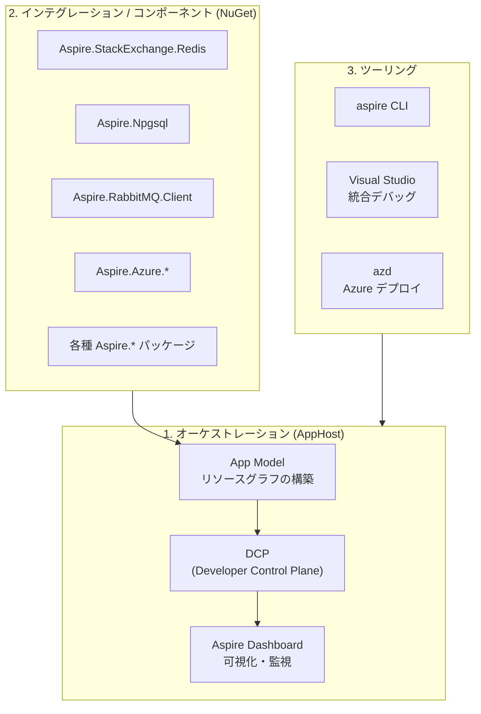

| 柱 | 役割 |
|---|---|
| **オーケストレーション** | アプリケーションの構成定義とローカル実行の管理 |
| **コンポーネント** | 外部サービス（Redis、PostgreSQL 等）へのクライアント接続を標準化 |
| **ツーリング** | 開発・デバッグ・デプロイのワークフロー支援 |

この記事で中心に扱うのは、第1の柱のオーケストレーションです。その起点になるのが AppHost と呼ばれるプロジェクトで、アプリケーション全体の構成を C# コードで定義する専用のコンソールアプリケーションです。どのサービスがあり、どのインフラに依存し、サービス同士がどうつながるかを宣言的に記述します。AppHost 自身はビジネスロジックを含まず、アプリケーションの構成（composition）だけを担います。

第2の柱のコンポーネントは、API や Worker などの各サービスプロジェクトにインストールする NuGet パッケージ群です。`Aspire.StackExchange.Redis` や `Aspire.Npgsql` などのパッケージが、接続文字列の解決・ヘルスチェック・テレメトリー計装を自動的に設定します。例えば `builder.AddRedisClient("cache")` の1行で、接続管理・監視・障害検知を組み込んだ Redis クライアントが使えるようになります。

第3の柱のツーリングには、Visual Studio、`aspire` CLI（C# AppHost では `dotnet run --project AppHost` も引き続き使えます）、Azure Developer CLI（`azd`）があります。プロジェクトの作成からローカルデバッグ、クラウドへのデプロイまでをこれらのツールで行えます。

## 第1章：App Model — リソースグラフの構築

### AppHost とは何か

.NET Aspire のオーケストレーションは **AppHost プロジェクト** から始まります。AppHost は、`dotnet new aspire` や Visual Studio のテンプレートで生成される、ソリューション内の特別なコンソールアプリケーションです。

一般的な .NET ソリューションでは、Web API、Worker、Blazor フロントエンドなどの各プロジェクトを個別に起動します。マイクロサービス構成ではさらに、「Redis と PostgreSQL を先に起動し、マイグレーションを実行してから API と Worker を立ち上げ、最後にフロントエンドを起動する」といった起動順序と接続関係を管理する必要があります。従来は `docker-compose.yml` やシェルスクリプトに手で書いていたこの内容を、AppHost では C# コードで宣言的に表現します。

AppHost の `Program.cs` には、ビジネスロジックではなく、アプリケーション全体のトポロジー（構成図）を書きます。「このソリューションには Redis、PostgreSQL、3つの .NET プロジェクトがあり、API は PostgreSQL と Redis に、Worker は RabbitMQ に、フロントエンドは API に依存する」といった関係を、`AddProject()`、`AddRedis()`、`WithReference()` などのメソッドチェーンで記述します。

AppHost の `.csproj` ファイルには、オーケストレーション対象のプロジェクトへの `ProjectReference` を並べます。ビルド時に Source Generator がこれらの参照を解析し、後述する型安全なプロジェクトメタデータクラスを生成します。ソリューション全体の構成を知っているのは AppHost だけで、ほかのプロジェクトは AppHost の存在を知りません。

### App Model とは何か

.NET Aspire の中核は **App Model** です。アプリケーションを構成するすべてのリソース（プロジェクト、コンテナー、実行ファイル、外部サービス）とその依存関係を、有向非巡回グラフ（DAG）として表します。AppHost の `Program.cs` で呼び出す `Add*()` や `WithReference()` が、内部でこの DAG を組み立てます。

DAG（Directed Acyclic Graph）は、エッジに向きがあり、循環を含まないグラフです。Aspire では Redis、PostgreSQL、API サービスなどの各リソースがノードに、`WithReference()` で宣言した依存関係がエッジに対応します。`WithReference()` は接続情報を渡す関係を表すもので、起動順序は第2章で説明する `WaitFor()` で指定します。

典型的な AppHost の `Program.cs` は次のとおりです。

```csharp
// AppHost の Program.cs
var builder = DistributedApplication.CreateBuilder(args);

// リソースの追加
var cache = builder.AddRedis("cache");
var postgres = builder.AddPostgres("pg")
    .AddDatabase("catalogdb");
var rabbit = builder.AddRabbitMQ("messaging");

// プロジェクトリソースとその依存関係
var catalogApi = builder.AddProject<Projects.CatalogApi>("catalog-api")
    .WithReference(postgres)
    .WithReference(cache);

var orderProcessor = builder.AddProject<Projects.OrderProcessor>("order-processor")
    .WithReference(rabbit)
    .WithReference(postgres);

var webFrontend = builder.AddProject<Projects.WebFrontend>("web-frontend")
    .WithReference(catalogApi)
    .WithReference(cache)
    .WithExternalHttpEndpoints();

builder.Build().Run();
```

このコードから構築されるリソースグラフは次のとおりです。

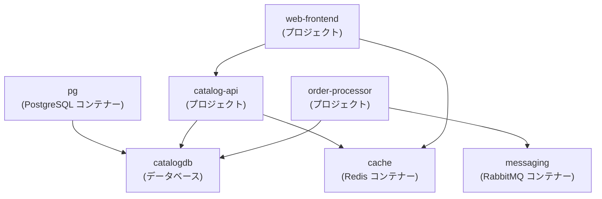

### `AddProject<T>()` の型パラメーターの仕組み

上のコードの `builder.AddProject<Projects.CatalogApi>("catalog-api")` では、C# のジェネリクス（型パラメーター）を使い、プロジェクトを型として指定しています。

AppHost の `.csproj` に次のようなプロジェクト参照を追加すると、

```xml
<ProjectReference Include="..\CatalogApi\CatalogApi.csproj" />
```

Aspire のビルドツール（[Source Generator](https://github.com/dotnet/aspire/blob/main/src/Aspire.Hosting/ProjectResourceBuilderExtensions.cs)）が `Projects` 名前空間の下にクラスを生成します。生成されるコードはおおよそ次のとおりです。

```csharp
namespace Projects;

// ビルド時に自動生成される（手書きではない）
public class CatalogApi : IProjectMetadata
{
    public string ProjectPath => @"C:\src\CatalogApi\CatalogApi.csproj";
}
```

`AddProject<T>()` のシグネチャは次のとおりです。

```csharp
public static IResourceBuilder<ProjectResource> AddProject<TProject>(
    this IDistributedApplicationBuilder builder,
    string name)
    where TProject : IProjectMetadata, new()
```

型制約 `where TProject : IProjectMetadata, new()` により、`TProject` は `IProjectMetadata` を実装し、引数なしコンストラクターを持つ型に限られます。メソッド内部では `new TProject().ProjectPath` で `.csproj` のパスを取得し、オーケストレーターが起動するプロジェクトを特定します。

文字列のパスではなく型を使う最大の理由は、<strong>コンパイル時に誤りを検出できること</strong>です。`AddProject("../CatalogApi")` のような文字列パスでは、typo は実行時に初めてエラーになります。型パラメーターの `AddProject<Projects.CatalogApi>()` なら、プロジェクト参照を削除・リネームした時点で `Projects.CatalogApi` がなくなり、ビルドエラーになります。IDE の補完やリファクタリング機能も使えるため、サービスの数が多い構成でもリソースの指定を誤りにくくなります。

### IResource インターフェースの階層

App Model に登録されるリソースは、すべて [`IResource`](https://github.com/dotnet/aspire/blob/main/src/Aspire.Hosting/ApplicationModel/IResource.cs) インターフェースを実装する型のインスタンスです。Redis コンテナーも .NET プロジェクトも RabbitMQ も、Aspire からは同じリソースとして扱われ、`ContainerResource`、`ProjectResource`、`ExecutableResource` などの具象クラスで表現されます。

Kafka、Elasticsearch、独自のサイドカーなど新しい種類のリソースを追加するときも、この型階層に沿ってクラスを定義します。

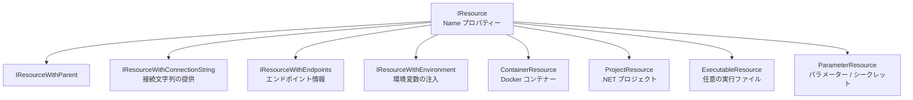

```csharp
// IResource の定義
public interface IResource
{
    string Name { get; }
    ResourceAnnotationCollection Annotations { get; }
}

// ContainerResource の例
public class RedisResource : ContainerResource, IResourceWithConnectionString
{
    public RedisResource(string name) : base(name) { }

    public ReferenceExpression ConnectionStringExpression =>
        ReferenceExpression.Create(
            $"{PrimaryEndpoint.Property(EndpointProperty.Host)}:{PrimaryEndpoint.Property(EndpointProperty.Port)}");
}
```

### アノテーションベースの拡張モデル

型階層だけでは、Redis のポート番号をどこに持つのか、環境変数を注入する処理をどう結び付けるのかが決まりません。Aspire はこれを<strong>アノテーション（Annotation）</strong>で扱います。

リソースオブジェクトにメタデータを付箋のように追加していく設計で、クラスの継承ではなくコンポジションでリソースの能力を広げます。`WithEndpoint()` や `WithEnvironment()` などのメソッドは、内部でアノテーションオブジェクトをリソースの `Annotations` コレクションに追加しています。そのため、リソースの型を変えずに、後から能力を加えられます。

```csharp
// アノテーションの例
public record EndpointAnnotation(
    string Name,
    string? Transport = null,
    string? Scheme = null,
    int? Port = null,
    int? TargetPort = null,
    bool IsExternal = false,
    bool IsProxied = true) : IResourceAnnotation;

public record EnvironmentCallbackAnnotation(
    Func<EnvironmentCallbackContext, Task> Callback)
    : IResourceAnnotation;

// WithReference() が内部で行っていること
public static IResourceBuilder<T> WithReference<T>(
    this IResourceBuilder<T> builder,
    IResourceBuilder<IResourceWithConnectionString> source)
    where T : IResourceWithEnvironment
{
    // 環境変数コールバックアノテーションを追加
    return builder.WithEnvironment(context =>
    {
        var connectionString = source.Resource
            .ConnectionStringExpression;
        context.EnvironmentVariables[$"ConnectionStrings__{source.Resource.Name}"]
            = connectionString;
    });
}
```

| アノテーション | 用途 |
|--------------|------|
| `EndpointAnnotation` | ネットワークエンドポイントの定義 |
| `EnvironmentCallbackAnnotation` | 環境変数の動的注入 |
| `ContainerImageAnnotation` | Docker イメージの指定 |
| `ContainerMountAnnotation` | ボリュームマウント情報 |
| `HealthCheckAnnotation` | ヘルスチェック方式の指定 |
| `CommandLineArgsCallbackAnnotation` | コマンドライン引数の動的構築 |
| `ManifestPublishingCallbackAnnotation` | デプロイマニフェストの生成方法 |

## 第2章：DCP（Developer Control Plane）— ローカルオーケストレーション

### DCP の役割

第1章の App Model は、アプリケーションの設計図にすぎません。コンテナーやプロセスを実際に起動し、ネットワークを接続する実行エンジンが **DCP（Developer Control Plane）** です。

AppHost プロジェクトを `dotnet run` で起動すると、まず App Model（DAG）がメモリー上に構築されます。AppHost はこの DAG をもとにしたリソース定義を、DCP が提供する Kubernetes 互換の API を通じて DCP プロセスに渡します。DCP はその定義に従って、Docker コンテナーと .NET プロジェクトのプロセスを起動し、ポートを割り当て、接続文字列を注入します。開発者は `dotnet run` を1回実行するだけですが、内部では AppHost が構成を定義し、DCP が Docker やプロセスを操作するという役割分担になっています。

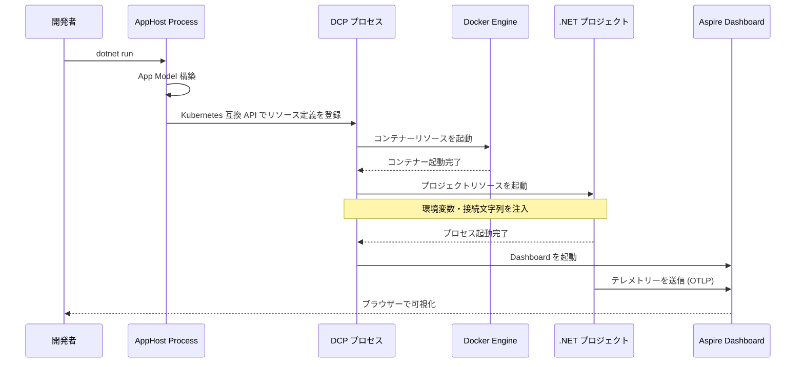

### DCP の内部アーキテクチャ

DCP は Go で実装された軽量なコントロールプレーンで、Kubernetes の Custom Resource Definition（CRD）と同じような宣言的リソースモデルを採用しています。DCP が受け取るのは「Redis コンテナーをポート6379で起動せよ」という命令ではなく、「Redis コンテナーが存在すべき」という<strong>望ましい状態（desired state）</strong>です。DCP は現在の状態との差を埋める<strong>調停（reconciliation）ループ</strong>を実行します。

コンテナーが異常終了すれば再起動し、エンドポイントが変わればプロキシーの設定を更新する、といった動作は、この宣言的モデルから導かれます。ただし DCP に Kubernetes クラスターは不要です。ローカルの開発マシン上で動く軽量なプロセスで、Docker Desktop があれば動きます。

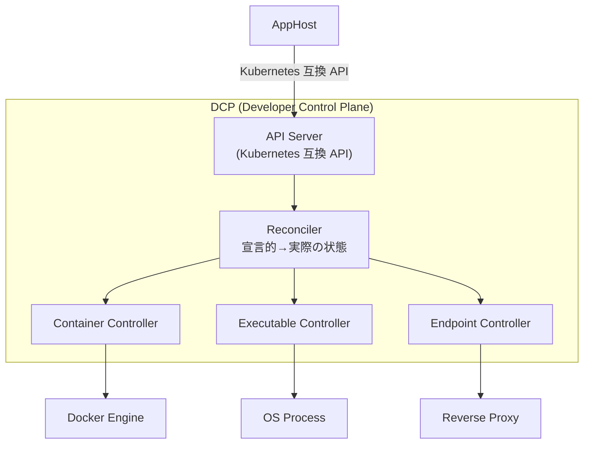

DCP が扱うリソースは次のとおりです。

| DCP リソース | 対応する概念 | 説明 |
|-------------|------------|------|
| `Container` | Docker コンテナー | イメージの pull と起動 |
| `Executable` | プロセス | .NET プロジェクトや任意の実行ファイル |
| `Endpoint` | ネットワーク | ポートマッピングとプロキシー |
| `ExecutableReplicaSet` | レプリカ | 同一プロセスの複数インスタンス |

### リソースの起動順序と依存関係解決

`WithReference()` で依存関係を宣言しただけでは、起動順序は決まりません。既定ではすべてのリソースが並行して起動するので、依存先の準備ができてから起動させたいリソースには `WaitFor()` を指定します。

依存先すべてに `WaitFor()` を指定すると、起動は次の図のような段階に分かれます。依存先のない Redis、PostgreSQL、RabbitMQ が最初に起動し、それらに依存する API と Worker が続き、最後に API に依存するフロントエンドが起動します。この順序は、図の依存グラフにおける<strong>トポロジカル順序</strong>、つまりすべてのエッジ (u → v) で u が v より前に来る順序になります。同じ段階のリソースは並行して起動するので、順番に起動するより全体の起動時間が短くなります。

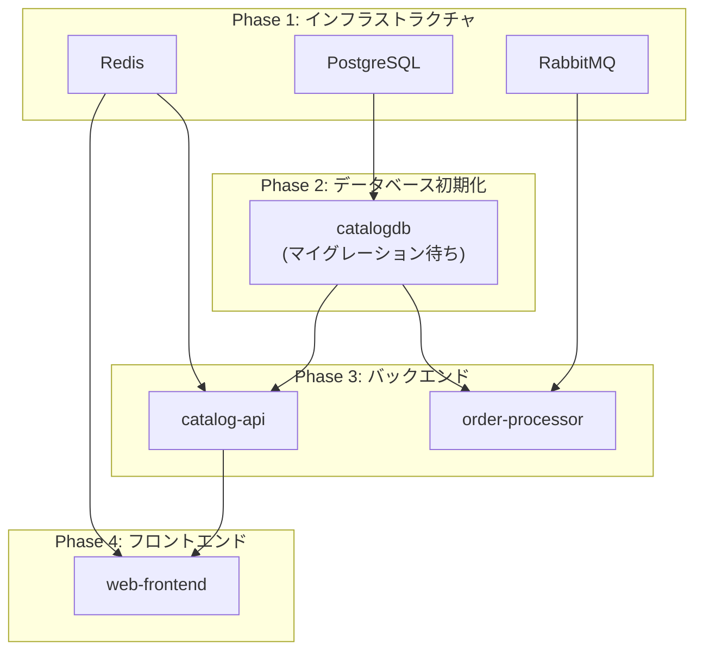

```csharp
// WaitFor() による明示的な起動順序制御
var postgres = builder.AddPostgres("pg")
    .AddDatabase("catalogdb");

var migration = builder.AddProject<Projects.DbMigration>("migration")
    .WithReference(postgres)
    .WaitFor(postgres); // PostgreSQL の準備完了を待つ

var api = builder.AddProject<Projects.Api>("api")
    .WithReference(postgres)
    .WaitForCompletion(migration); // マイグレーションの完了を待つ
```

`WaitFor()` は依存リソースのヘルスチェックが成功するまで待ちます。マイグレーションのように処理を終えて停止するリソースには `WaitForCompletion()` を使い、そのリソースの実行が終わるまで待ちます。

## 第3章：サービスディスカバリー — 動的なエンドポイント解決

### 接続文字列と環境変数

マイクロサービス構成では、サービス A がサービス B にどう接続するかを必ず決める必要があります。IP アドレスやポート番号のハードコードは避けたいところですし、ローカル開発とクラウドでは接続先が異なるため、設定ファイルで管理するのも手間がかかります。

Aspire は、接続先を<strong>環境変数で自動的に注入</strong>します。`WithReference()` でリソース間の依存関係を宣言すると、DCP が参照側のサービスのプロセスを起動するときに、参照先リソースの接続文字列やエンドポイント URL を環境変数として渡します。コードに接続先を書く必要はなく、`IConfiguration.GetConnectionString("cache")` で Aspire が注入した値を取得できます。

```csharp
// この宣言から...
var cache = builder.AddRedis("cache");
var api = builder.AddProject<Projects.Api>("api")
    .WithReference(cache);

// 以下のような環境変数が api プロセスに注入される:
// ConnectionStrings__cache = "localhost:63241"
```

環境変数の命名規則は次のとおりです。

| 参照タイプ | 環境変数パターン | 例 |
|-----------|----------------|---|
| 接続文字列 | `ConnectionStrings__{name}` | `ConnectionStrings__cache` |
| HTTP エンドポイント | `services__{name}__http__0` | `services__catalog-api__http__0` |
| HTTPS エンドポイント | `services__{name}__https__0` | `services__catalog-api__https__0` |

### サービスディスカバリーの仕組み

接続文字列の注入は、起動時に値が決まる静的な解決です。サービスに複数のレプリカがある場合や、エンドポイントが動的に変わる場合には、.NET Aspire のサービスディスカバリー機構を使います。

`Microsoft.Extensions.ServiceDiscovery` パッケージは、HttpClient のパイプラインにハンドラーを挿入します。`http://catalog-api/api/products` のように論理名（サービス名）で URL を指定すると、ハンドラーがリクエストを受け取り、環境変数や DNS SRV レコードをもとに実際のエンドポイント（`https://localhost:7234/api/products`）へ書き換えます。コードに物理アドレスが現れないため、ローカル開発でもクラウドでも同じコードで動きます。

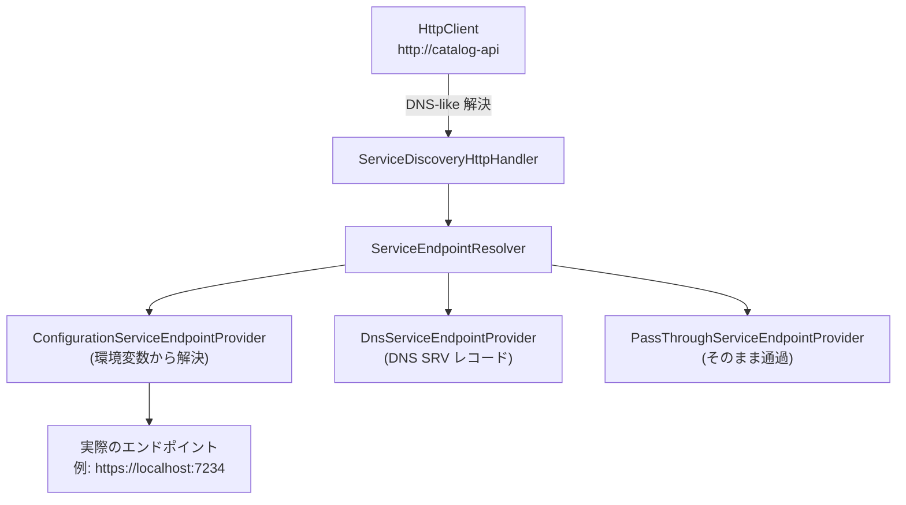

```csharp
// サービスディスカバリの使用例（ServiceDefaults プロジェクト）
builder.Services.AddServiceDiscovery();
builder.Services.ConfigureHttpClientDefaults(http =>
{
    http.AddServiceDiscovery(); // すべての HttpClient にサービスディスカバリを適用
});

// 利用側：論理名でリクエスト
app.MapGet("/products", async (HttpClient client) =>
{
    // "https://catalog-api" は実際のエンドポイントに解決される
    var products = await client.GetFromJsonAsync<Product[]>(
        "https://catalog-api/api/products");
    return products;
});
```

### エンドポイント解決の優先順位

サービスディスカバリーは、次の順にエンドポイントを解決します。

1. **Configuration** — 環境変数 `services__{name}__{scheme}__{index}` から解決
2. **DNS SRV** — DNS SRV レコードから解決（Kubernetes 環境で有用）
3. **Pass-through** — ホスト名をそのまま使う（従来の DNS 解決）

```csharp
// Aspire が注入する環境変数の実際の値
// services__catalog-api__https__0 = "https://localhost:7234"
// services__catalog-api__http__0 = "http://localhost:5234"

// これが ServiceDiscovery によって解決される:
// "https://catalog-api" → "https://localhost:7234"
```

### ロードバランシング

サービスディスカバリーはクライアントサイドのロードバランシングもサポートします。

```csharp
// レプリカを設定
var api = builder.AddProject<Projects.Api>("api")
    .WithReplicas(3); // 3インスタンス起動

// ServiceDiscovery は Round-robin で各インスタンスに分散
// services__api__https__0 = "https://localhost:7234"
// services__api__https__1 = "https://localhost:7235"
// services__api__https__2 = "https://localhost:7236"
```

## 第4章：コンポーネントシステム — 標準化されたクライアント設定

### コンポーネントの哲学

Redis に接続するには、通常は NuGet パッケージのインストール、接続文字列の取得、`IConnectionMultiplexer` の DI 登録、ヘルスチェックの追加、OpenTelemetry の計装設定、リトライポリシーの構成が必要です。これらはプロジェクトごとに繰り返すボイラープレートで、ヘルスチェックや計装の設定を1つでも忘れると、監視できない箇所が生まれます。

.NET Aspire コンポーネントは、この作業を1行のメソッド呼び出しにまとめる NuGet パッケージです。`builder.AddRedisClient("cache")` と書くと、上の作業がすべて標準的な方法で設定されます。ここはオピニオネイテッドな設計が具体的に表れている部分で、推奨される設定が既定になっているため、開発者は追加の手間をかけずにそれに従えます。

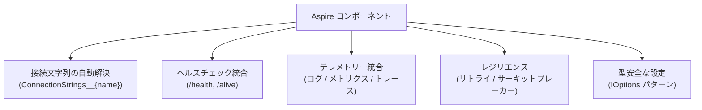

### コンポーネントの内部実装

`Aspire.StackExchange.Redis` の `AddRedisClient()` は、設定のバインド、接続文字列の取得、DI コンテナーへの登録、ヘルスチェックの追加、テレメトリーの計装という5つの処理を順に実行します。すべてが1つのメソッドにまとまっているため、一部の設定だけを忘れることがありません。

```csharp
// AddRedisClient() の内部実装（簡略化）
public static void AddRedisClient(
    this IHostApplicationBuilder builder,
    string connectionName,
    Action<AspireRedisSettings>? configureSettings = null)
{
    // 1. 設定のバインド
    var settings = new AspireRedisSettings();
    builder.Configuration
        .GetSection($"Aspire:StackExchange:Redis:{connectionName}")
        .Bind(settings);
    configureSettings?.Invoke(settings);

    // 2. 接続文字列の取得
    var connectionString = settings.ConnectionString
        ?? builder.Configuration.GetConnectionString(connectionName);

    // 3. IConnectionMultiplexer の登録
    builder.Services.AddSingleton<IConnectionMultiplexer>(sp =>
    {
        var options = ConfigurationOptions.Parse(connectionString!);
        return ConnectionMultiplexer.Connect(options);
    });

    // 4. ヘルスチェックの登録
    if (!settings.DisableHealthChecks)
    {
        builder.Services.AddHealthChecks()
            .AddRedis(connectionString!,
                name: $"Redis_{connectionName}",
                tags: ["ready"]);
    }

    // 5. テレメトリの設定
    if (!settings.DisableTracing)
    {
        builder.Services.AddOpenTelemetry()
            .WithTracing(tracing =>
                tracing.AddRedisInstrumentation());
    }
}
```

### ホスティング側 vs クライアント側

Aspire コンポーネントは、<strong>ホスティングパッケージ</strong>と<strong>クライアントパッケージ</strong>に分かれます。同じ Redis にも NuGet パッケージが2つあり、それぞれ別のプロジェクトにインストールします。

ホスティングパッケージ（`Aspire.Hosting.Redis`）は AppHost プロジェクトにインストールし、Redis コンテナーの起動方法を定義します。クライアントパッケージ（`Aspire.StackExchange.Redis`）は各サービスプロジェクトにインストールし、Redis への接続方法を設定します。両者をつなぐのは、DCP が注入する環境変数（`ConnectionStrings__cache`）です。

| パッケージ | 用途 | インストール先 |
|-----------|------|-------------|
| `Aspire.Hosting.Redis` | Redis コンテナーの定義 | AppHost プロジェクト |
| `Aspire.StackExchange.Redis` | Redis クライアントの設定 | サービスプロジェクト |

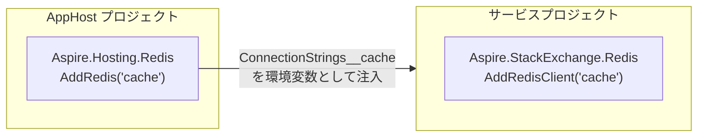

## 第5章：ServiceDefaults — 横断的関心事の標準化

### ServiceDefaults の役割

コンポーネントが外部サービスごとの推奨設定を提供するのに対し、**ServiceDefaults** はサービス自体の横断的関心事（cross-cutting concerns）を1か所にまとめたプロジェクトです。

横断的関心事とは、ビジネスロジックとは別に、すべてのサービスが必要とする機能のことで、テレメトリーの収集、ヘルスチェックエンドポイント、サービスディスカバリー、HTTP のリトライポリシーなどがあります。サービスごとに個別に設定すると、設定が食い違いやすくなります。ServiceDefaults は共有クラスライブラリーとして実装され、各サービスプロジェクトが `builder.AddServiceDefaults()` を呼び出すと、共通の設定が適用されます。

ServiceDefaults の `AddServiceDefaults()` メソッドは次のような構造で、数行で OpenTelemetry・ヘルスチェック・サービスディスカバリー・リトライをまとめて設定します。

```csharp
// ServiceDefaults/Extensions.cs の全体構造
public static IHostApplicationBuilder AddServiceDefaults(
    this IHostApplicationBuilder builder)
{
    // 1. OpenTelemetry の構成
    builder.ConfigureOpenTelemetry();

    // 2. ヘルスチェックエンドポイントの追加
    builder.AddDefaultHealthChecks();

    // 3. サービスディスカバリの登録
    builder.Services.AddServiceDiscovery();

    // 4. HttpClient のデフォルト設定
    builder.Services.ConfigureHttpClientDefaults(http =>
    {
        http.AddStandardResilienceHandler(); // リトライ・サーキットブレーカー
        http.AddServiceDiscovery();          // サービスディスカバリ
    });

    return builder;
}
```

### OpenTelemetry 統合の詳細

Aspire はテレメトリーに OpenTelemetry を使います。OpenTelemetry は CNCF（Cloud Native Computing Foundation）がホストするオープンな標準で、特定ベンダーに依存せずにログ・メトリクス・トレースを同じ方法で扱えます。Aspire は各サービスの OpenTelemetry SDK を自動的に設定し、送信先として Aspire Dashboard の OTLP レシーバーを環境変数 `OTEL_EXPORTER_OTLP_ENDPOINT` で指定します。

送信先は AppHost にも ServiceDefaults にも書かれておらず、実行時に環境変数で決まります。そのため、ローカル開発時は Dashboard に送り、本番環境では Jaeger や Azure Monitor などの別のバックエンドに、コードを変えずに切り替えられます。

```csharp
public static IHostApplicationBuilder ConfigureOpenTelemetry(
    this IHostApplicationBuilder builder)
{
    // ログ
    builder.Logging.AddOpenTelemetry(logging =>
    {
        logging.IncludeFormattedMessage = true;
        logging.IncludeScopes = true;
    });

    // メトリクスとトレース
    builder.Services.AddOpenTelemetry()
        .WithMetrics(metrics =>
        {
            metrics.AddAspNetCoreInstrumentation()  // HTTP メトリクス
                   .AddHttpClientInstrumentation()   // HttpClient メトリクス
                   .AddRuntimeInstrumentation();     // .NET ランタイムメトリクス
        })
        .WithTracing(tracing =>
        {
            tracing.AddAspNetCoreInstrumentation()   // HTTP トレース
                   .AddGrpcClientInstrumentation()    // gRPC トレース
                   .AddHttpClientInstrumentation();   // HttpClient トレース
        });

    // OTLP エクスポーターの構成
    builder.AddOpenTelemetryExporters();

    return builder;
}

private static IHostApplicationBuilder AddOpenTelemetryExporters(
    this IHostApplicationBuilder builder)
{
    // OTEL_EXPORTER_OTLP_ENDPOINT が設定されていれば OTLP エクスポーターを使用
    // Aspire Dashboard が自動的にこの環境変数を設定する
    var otlpEndpoint = builder.Configuration["OTEL_EXPORTER_OTLP_ENDPOINT"];
    if (!string.IsNullOrWhiteSpace(otlpEndpoint))
    {
        builder.Services.AddOpenTelemetry()
            .UseOtlpExporter(); // gRPC over HTTP/2 で Dashboard に送信
    }

    return builder;
}
```

テレメトリーデータは次のように流れます。

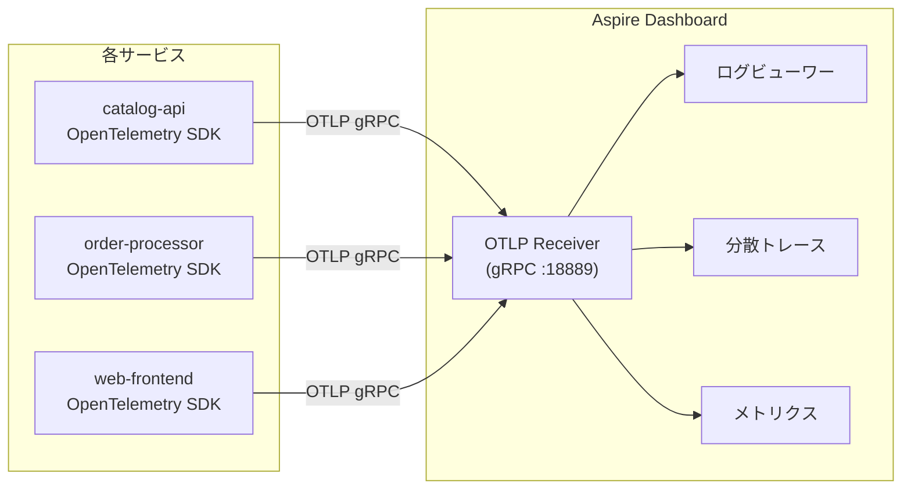

## 第6章：Aspire Dashboard — オブザーバビリティーの統合

### Dashboard のアーキテクチャ

ServiceDefaults で各サービスにテレメトリーの計装を設定しても、データを受信して表示する先が必要です。その受け皿になるのが、Blazor Server で実装された Aspire Dashboard です。

AppHost を起動すると、DCP が Dashboard をプロセスとして自動的に起動します。Dashboard の URL は AppHost の `launchSettings.json` の `applicationUrl` で決まり、AppHost は起動時にログイン用の URL をコンソールに出力します。Dashboard は OTLP（OpenTelemetry Protocol）レシーバーとして動き、すべてのサービスからログ・メトリクス・分散トレースをリアルタイムに受け取ります。受け取ったデータはメモリー上の循環バッファーに格納され、ブラウザーで検索・絞り込みができます。

開発中にエラーが起きたときは、Dashboard の分散トレース画面で、どのサービスのどの処理に何 ms かかり、どこでエラーになったかを確認できます。従来は複数サービスのログファイルを突き合わせていた作業を、1つの画面で行えます。

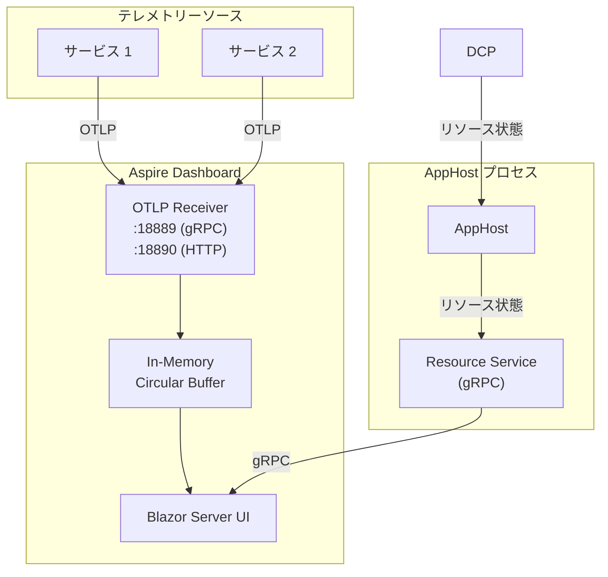

| 機能 | 説明 |
|------|------|
| **リソース一覧** | 全リソースの状態、起動ログ、環境変数の確認 |
| **構造化ログ** | OpenTelemetry で収集したログのフィルタリング・検索 |
| **分散トレース** | サービス間のリクエストフローを視覚化 |
| **メトリクス** | HTTP リクエスト率、レイテンシー、エラー率のリアルタイム表示 |

### Dashboard の独立利用

Dashboard は単体の Docker コンテナーとしても使えます（MCR では2026年9月時点で `13.5` タグが公開されています）。

```bash
docker run --rm -it -d \
  -p 18888:18888 \
  -p 4317:18889 \
  -p 4318:18890 \
  --name aspire-dashboard \
  mcr.microsoft.com/dotnet/aspire-dashboard:13.5
```

この構成では、Java、Go、Python などで書かれた任意の OTLP 対応アプリケーションのテレメトリーも受信できます。

## 第7章：ヘルスチェックと Readiness

### ヘルスチェックの階層

分散システムでは、サービスのプロセスが起動していることと、サービスがリクエストを正しく処理できることは別です。プロセスが動いていても、DB 接続が切れていればリクエストを処理できません。

.NET Aspire はこの区別を **Liveness**（生存確認）と **Readiness**（準備完了確認）の2階層で表します。Liveness（`/alive`）はプロセスが応答するかだけを確認し、デッドロックやメモリー枯渇の検知に使います。Readiness（`/health`）は DB・Redis・依存サービスを含むすべての依存先が正常かを確認し、トラフィックを受け入れてよいかを判定します。

この2階層は Kubernetes の `livenessProbe` と `readinessProbe` に対応しており、ローカル開発と Kubernetes へのデプロイで同じヘルスチェック定義を使えます。AppHost の `WaitFor()` は、依存リソースのヘルスチェックが成功して実際に使える状態になるまで、そのリソースに依存するリソースの起動を遅らせます。このヘルスチェックを実行するのは AppHost で、DCP がサービスの `/health` エンドポイントをポーリングするわけではありません。

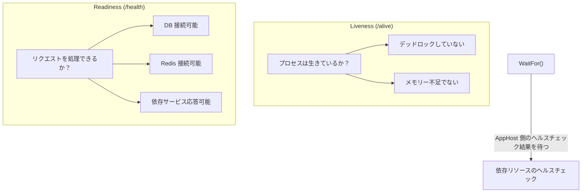

```csharp
// ServiceDefaults で設定されるヘルスチェック
public static IHostApplicationBuilder AddDefaultHealthChecks(
    this IHostApplicationBuilder builder)
{
    builder.Services.AddHealthChecks()
        // Liveness: アプリケーションプロセスが応答するか
        .AddCheck("self", () => HealthCheckResult.Healthy(),
            tags: ["live"]);

    return builder;
}

public static WebApplication MapDefaultEndpoints(
    this WebApplication app)
{
    // Readiness endpoint: すべてのヘルスチェックを評価
    app.MapHealthChecks("/health");

    // Liveness endpoint: "live" タグのチェックのみ
    app.MapHealthChecks("/alive", new()
    {
        Predicate = r => r.Tags.Contains("live")
    });

    return app;
}
```

### WaitFor の内部実装

`WaitFor()` を指定すると、AppHost は依存先リソースのヘルスチェックを繰り返し実行し、`Healthy` になるまで、そのリソースに依存するリソースの起動を遅らせます。`WaitForCompletion()` の場合は、下の図のマイグレーションのように、リソースが正常終了するまで待ちます。

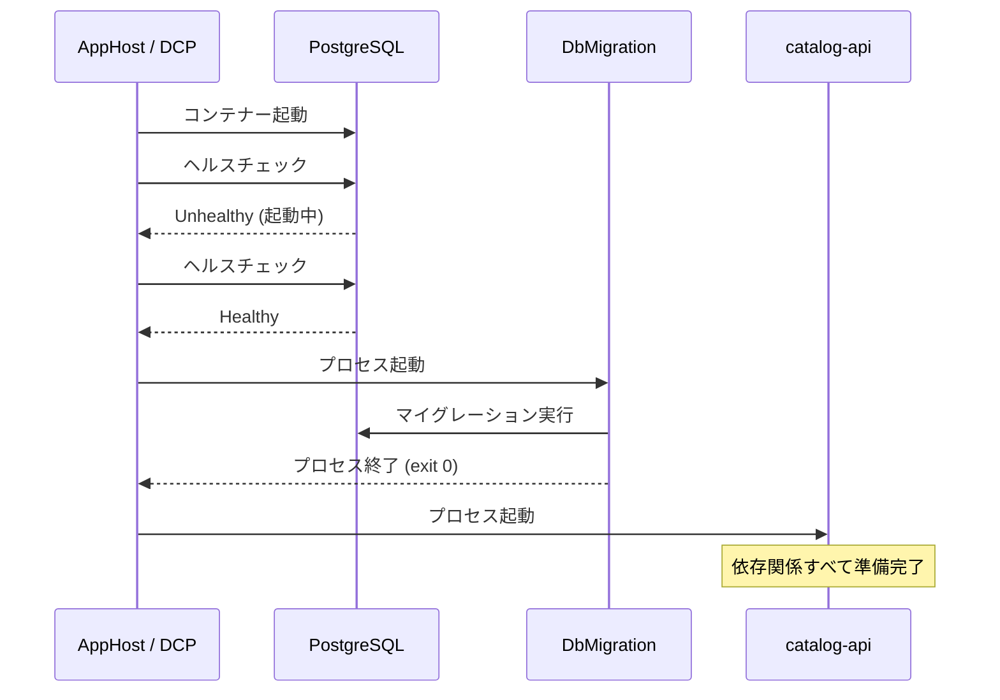

## 第8章：レジリエンスとリトライ

### 標準レジリエンスハンドラー

分散システムでは、ネットワークの遅延、一時的な障害、サービスの再起動が日常的に起こります。クライアントコードに対策がないと、1つのサービスの一時的な遅延がリトライの集中とタイムアウトの連鎖を招き、システム全体が止まることがあります。

ServiceDefaults の `AddStandardResilienceHandler()` は、`Microsoft.Extensions.Http.Resilience`（内部で [Polly v8](https://github.com/App-vNext/Polly) を使用）により、[5層のレジリエンスパイプライン](https://learn.microsoft.com/dotnet/core/resilience/http-resilience#standard-resilience-handler-defaults)をすべての `HttpClient` に適用します。各層は外側から順にリクエストを包み、それぞれ別の種類の障害に対処します。

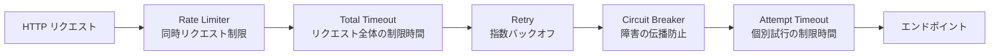

| レイヤー | 既定値 | 説明 |
|---------|--------|------|
| **Rate Limiter** | 1,000同時リクエスト | 下流サービスへの同時リクエスト数を制限 |
| **Total Request Timeout** | 30秒 | リトライを含むリクエスト全体のタイムアウト |
| **Retry** | 最大3回、指数バックオフ | 一時的な障害からの復帰 |
| **Circuit Breaker** | 失敗率10%、サンプル期間30秒 | 障害の連鎖を防止 |
| **Attempt Timeout** | 10秒 | 個別リクエスト試行のタイムアウト |

```csharp
// カスタマイズ例
builder.Services.ConfigureHttpClientDefaults(http =>
{
    http.AddStandardResilienceHandler(options =>
    {
        options.Retry.MaxRetryAttempts = 5;
        options.Retry.BackoffType = DelayBackoffType.Exponential;
        options.Retry.Delay = TimeSpan.FromMilliseconds(500);

        options.CircuitBreaker.SamplingDuration = TimeSpan.FromSeconds(60);
        options.CircuitBreaker.FailureRatio = 0.2;

        options.TotalRequestTimeout.Timeout = TimeSpan.FromSeconds(60);
    });
});
```

## 第9章：デプロイメントマニフェスト — ローカルからクラウドへ

### マニフェスト生成

ここまでは、ローカル開発環境での AppHost の働きを説明しました。AppHost が構築する App Model は<strong>デプロイメントマニフェスト</strong>として JSON に書き出せるので、ローカルの構成定義をそのままクラウドへのデプロイにも使えます。

`docker-compose.yml` から Kubernetes マニフェストや Terraform 定義へ手作業で変換する必要がなくなり、AppHost の C# コードが構成の Single Source of Truth（唯一の信頼できる情報源）になります。

```bash
# マニフェストの生成（C# AppHost は dotnet run でも起動できるが、現在は aspire CLI が中心）
aspire publish --publisher manifest --output-path manifest.json
```

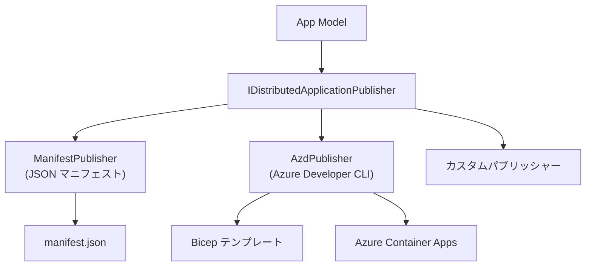

### マニフェストの構造

生成されるマニフェストには、リソース間の接続情報とデプロイに必要な設定が含まれます。

```json
{
  "resources": {
    "cache": {
      "type": "container.v0",
      "connectionString": "{cache.bindings.tcp.host}:{cache.bindings.tcp.port}",
      "image": "docker.io/library/redis:7.4",
      "bindings": {
        "tcp": {
          "scheme": "tcp",
          "protocol": "tcp",
          "transport": "tcp",
          "targetPort": 6379
        }
      }
    },
    "catalog-api": {
      "type": "project.v0",
      "path": "../CatalogApi/CatalogApi.csproj",
      "env": {
        "ConnectionStrings__cache": "{cache.connectionString}"
      },
      "bindings": {
        "http": { "scheme": "http", "protocol": "tcp", "transport": "http" },
        "https": { "scheme": "https", "protocol": "tcp", "transport": "http" }
      }
    }
  }
}
```

### Azure Container Apps へのデプロイ

`azd`（Azure Developer CLI）は Aspire のマニフェストを読み取り、Azure リソースを自動的にプロビジョニングします。

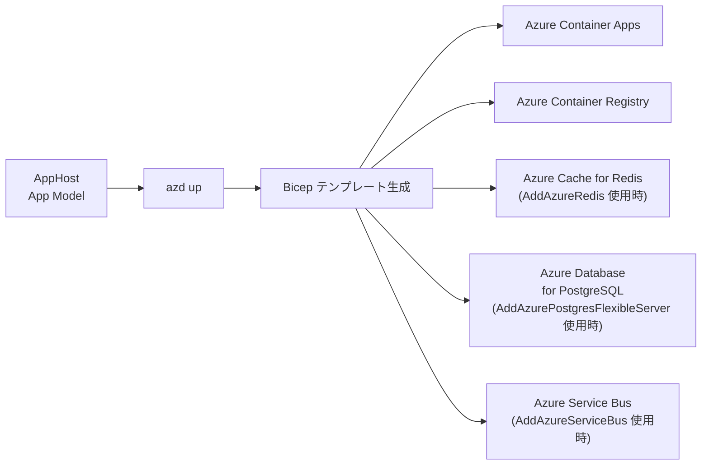

| Aspire リソース | Azure マッピング |
|---------------|----------------|
| `AddRedis()` | Azure Container Apps 上の Redis コンテナー（Azure Cache for Redis を使う場合は `AddAzureRedis()` などを選ぶ） |
| `AddPostgres()` | Azure Container Apps 上の PostgreSQL コンテナー（Azure Database for PostgreSQL を使う場合は `AddAzurePostgresFlexibleServer()` を選ぶ） |
| `AddRabbitMQ()` | RabbitMQ コンテナーまたは明示的な発行先（Service Bus を使う場合は `AddAzureServiceBus()` などを選ぶ） |
| `AddProject()` | Azure Container Apps |
| コンテナーリソース | Azure Container Apps (カスタムコンテナー) |

## 第10章：カスタムリソースの作成

### カスタムリソースの実装パターン

Aspire は Redis、PostgreSQL、RabbitMQ などのリソースを標準で提供していますが、実際のプロジェクトではそれ以外のインフラも必要になります。ローカル開発用のメールサーバー（MailDev）、社内のキューシステム、独自のサイドカープロセスなど、Aspire に組み込まれていないインフラもリソースとして扱いたい場合があります。

そのための拡張ポイントが<strong>カスタムリソース</strong>です。(1) `ContainerResource` などを継承したリソースクラスを定義し、(2) `AddMailDev()` のようなビルダー拡張メソッドを作り、(3) AppHost の `Program.cs` でほかのリソースと同じように使います。カスタムリソースでも、ヘルスチェック、テレメトリー、`WithReference()` による依存関係を標準のリソースと同じように使えます。

```csharp
// 1. リソースクラスの定義
public class MailDevResource : ContainerResource, IResourceWithConnectionString
{
    public MailDevResource(string name) : base(name) { }

    // SMTP エンドポイント
    private EndpointReference? _smtpEndpoint;
    public EndpointReference SmtpEndpoint =>
        _smtpEndpoint ??= new(this, "smtp");

    // Web UI エンドポイント
    private EndpointReference? _httpEndpoint;
    public EndpointReference HttpEndpoint =>
        _httpEndpoint ??= new(this, "http");

    // 接続文字列の式
    public ReferenceExpression ConnectionStringExpression =>
        ReferenceExpression.Create(
            $"smtp://{SmtpEndpoint.Property(EndpointProperty.Host)}:{SmtpEndpoint.Property(EndpointProperty.Port)}");
}

// 2. ビルダー拡張メソッドの定義
public static class MailDevResourceExtensions
{
    public static IResourceBuilder<MailDevResource> AddMailDev(
        this IDistributedApplicationBuilder builder,
        string name,
        int? smtpPort = null,
        int? httpPort = null)
    {
        return builder.AddResource(new MailDevResource(name))
            .WithImage("maildev/maildev", "2.1.0")
            .WithHttpEndpoint(
                port: httpPort,
                targetPort: 1080,
                name: "http")
            .WithEndpoint(
                port: smtpPort,
                targetPort: 1025,
                name: "smtp",
                scheme: "tcp")
            .WithHealthCheck("smtp"); // ヘルスチェックの追加
    }
}

// 3. AppHost での使用
var maildev = builder.AddMailDev("mail");
var api = builder.AddProject<Projects.Api>("api")
    .WithReference(maildev); // ConnectionStrings__mail が注入される
```

### カスタムリソースのライフサイクルフック

```csharp
// IDistributedApplicationLifecycleHook でリソースライフサイクルに介入
public class DatabaseSeederHook : IDistributedApplicationLifecycleHook
{
    public async Task AfterResourcesCreatedAsync(
        DistributedApplicationModel appModel,
        CancellationToken cancellationToken)
    {
        // 全リソース起動後に実行
        var dbResource = appModel.Resources
            .OfType<PostgresDatabaseResource>()
            .FirstOrDefault();

        if (dbResource != null)
        {
            // シードデータの投入 etc.
        }
    }
}

// 登録
builder.Services
    .AddLifecycleHook<DatabaseSeederHook>();
```

## 第11章：テストとインテグレーション

### DistributedApplicationTestingBuilder

マイクロサービスの統合テストは、以前から手間のかかる作業でした。各サービスを手動で起動し、テスト用のインフラを用意し、テスト後に片付ける必要があるため、テストが省かれたり、カバレッジが不十分になったりしがちです。

Aspire の `DistributedApplicationTestingBuilder` を使うと、テストコードの中で AppHost 全体を起動し、実際のコンテナーとプロセスが動く環境に HTTP リクエストを送れます。モックやスタブではなく、Docker で起動した PostgreSQL や Redis を使う統合テストです。テストが終わると、`await using` によってリソースが自動的に片付けられます。

```csharp
public class AppHostTests
{
    [Fact]
    public async Task CatalogApiReturnsProducts()
    {
        // AppHost 全体を起動
        var appHost = await DistributedApplicationTestingBuilder
            .CreateAsync<Projects.AppHost>();

        await using var app = await appHost.BuildAsync();
        await app.StartAsync();

        // catalog-api の HttpClient を取得
        var httpClient = app.CreateHttpClient("catalog-api");

        // API にリクエスト
        var response = await httpClient.GetAsync("/api/products");
        response.EnsureSuccessStatusCode();

        var products = await response.Content
            .ReadFromJsonAsync<List<Product>>();
        Assert.NotEmpty(products);
    }

    [Fact]
    public async Task WebFrontendIsHealthy()
    {
        var appHost = await DistributedApplicationTestingBuilder
            .CreateAsync<Projects.AppHost>();

        await using var app = await appHost.BuildAsync();
        await app.StartAsync();

        // ヘルスチェックエンドポイントを確認
        var httpClient = app.CreateHttpClient("web-frontend");
        var response = await httpClient.GetAsync("/health");
        Assert.Equal(HttpStatusCode.OK, response.StatusCode);
    }
}
```

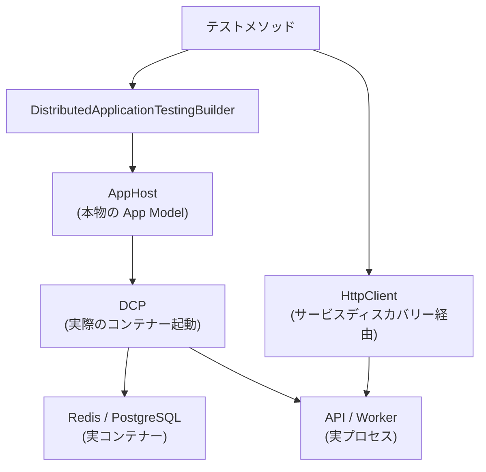

### テスト時の設定カスタマイズ

テストでは、設定を上書きしたり、サービスコレクションをカスタマイズしたりできます。

```csharp
var appHost = await DistributedApplicationTestingBuilder
    .CreateAsync<Projects.AppHost>(args =>
    {
        // テスト用の設定を上書き
        args.Configuration["Parameters:pgPassword"] = "test-password";
    });

// テスト用の HttpClient 設定
appHost.Services.ConfigureHttpClientDefaults(http =>
{
    http.AddStandardResilienceHandler();
});
```

## 第12章：.NET Aspire 9.x の進化

### 主要な新機能

Aspire はリリースの間隔が短く、.NET 9と同時にリリースされた Aspire 9でも、コミュニティーからのフィードバックを受けて、開発体験に関わる機能が多く追加・改善されました（リリースのペースはその後さらに上がり、バージョン番号は 13.x まで進んでいます。この章は Aspire 9で追加された内容として読んでください）。

`WaitFor` / `WaitForCompletion` は、第2章で触れた起動順序を宣言的に制御する API で、Aspire 9で正式に導入されました。`Persistent Containers` を使うと、`dotnet run` で再起動するたびにコンテナーが作り直される待ち時間がなくなります。`Resource Commands` と `Custom Resource States` は Dashboard の拡張ポイントで、Dashboard からカスタムリソースを操作したり、その状態を表示したりできます。`Eventing Model` はリソースのライフサイクルにフックし、「Redis の起動が完了したら特定の処理を実行する」といったイベント駆動の処理を宣言的に書けるようにします。

| 機能 | 説明 |
|------|------|
| **WaitFor / WaitForCompletion** | リソース間の起動順序を宣言的に制御 |
| **Persistent Containers** | `dotnet run` を再起動してもコンテナーを維持 |
| **Resource Commands** | Dashboard からカスタムコマンドを実行 |
| **Custom Resource States** | リソースの状態を独自に報告 |
| **Eventing Model** | リソースライフサイクルイベントの購読 |

### Eventing Model

```csharp
// リソースイベントの購読
var cache = builder.AddRedis("cache");

builder.Eventing.Subscribe<ResourceReadyEvent>(
    cache.Resource,
    async (evt, ct) =>
    {
        // Redis が起動完了した時に実行
        Console.WriteLine($"{evt.Resource.Name} is ready!");
    });

builder.Eventing.Subscribe<BeforeResourceStartedEvent>(
    cache.Resource,
    async (evt, ct) =>
    {
        // Redis が起動する前に実行
        Console.WriteLine($"{evt.Resource.Name} is about to start");
    });
```

### Persistent Containers

```csharp
// コンテナの永続化（再起動しても維持）
var postgres = builder.AddPostgres("pg")
    .WithLifetime(Lifetime.Persistent) // デフォルトは Lifetime.Session
    .AddDatabase("catalogdb");

// Lifetime.Session: AppHost 停止時にコンテナも停止
// Lifetime.Persistent: AppHost 停止後もコンテナが残る（高速な再起動）
```

## Aspire のアーキテクチャ全体像

開発時は AppHost が DCP を通じてサービスとインフラを起動し、各サービスは OTLP で Dashboard にテレメトリーを送ります。デプロイ時は AppHost が書き出したマニフェストを azd が読み取り、Azure Container Apps に展開します。

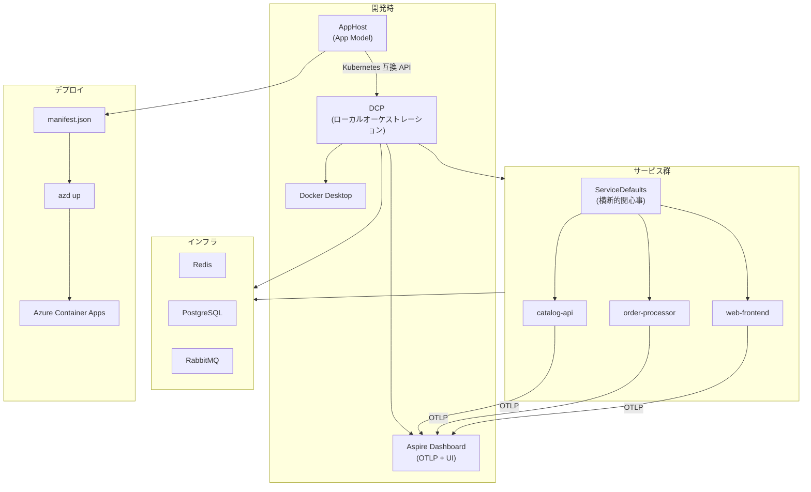

## まとめ

.NET Aspire は、分散アプリケーション開発のライフサイクル全体を扱うフレームワークです。AppHost による宣言的な構成定義、DCP によるローカルオーケストレーション、コンポーネントによる推奨設定の自動適用、デプロイメントマニフェストを使ったクラウドへの移行までが、その範囲に入ります。

Aspire は、インフラの接続・監視・障害対策という構成上の複雑さを引き受け、開発者がビジネスロジックの実装に集中できるようにします。それを支える設計は次のとおりです。

1. **宣言的な App Model** — リソースとその依存関係をコードで表現
2. **ローカルファーストのオーケストレーション** — DCP がローカルでコンテナーとプロセスを起動・管理
3. **オブザーバビリティーの組み込み** — OpenTelemetry による計装を標準で設定
4. **レジリエンスの標準化** — リトライ・サーキットブレーカーを既定で適用
5. **クラウドへの移行** — マニフェストを介してデプロイ先の構成を生成
6. **拡張性** — カスタムリソース、ライフサイクルフック、イベントモデル

## 参考資料

- [Aspire 公式ドキュメント](https://aspire.dev/)
- [Aspire ソースコード (GitHub)](https://github.com/microsoft/aspire)
- [Aspire サンプル集 (GitHub)](https://github.com/dotnet/aspire-samples)
- [Microsoft.Extensions.ServiceDiscovery ソースコード](https://github.com/microsoft/aspire/tree/main/src/Microsoft.Extensions.ServiceDiscovery)
- [Aspire Dashboard](https://aspire.dev/dashboard/)
- [Aspire インテグレーション一覧](https://aspire.dev/integrations/overview/)
- [Aspire.Hosting.AppHost (NuGet)](https://www.nuget.org/packages/Aspire.Hosting.AppHost) — 現行バージョンの確認用
