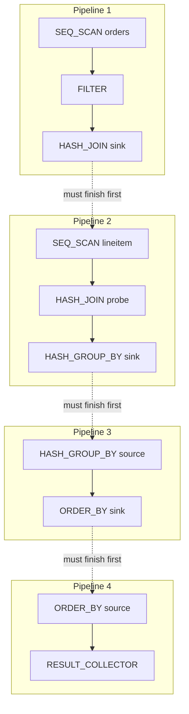
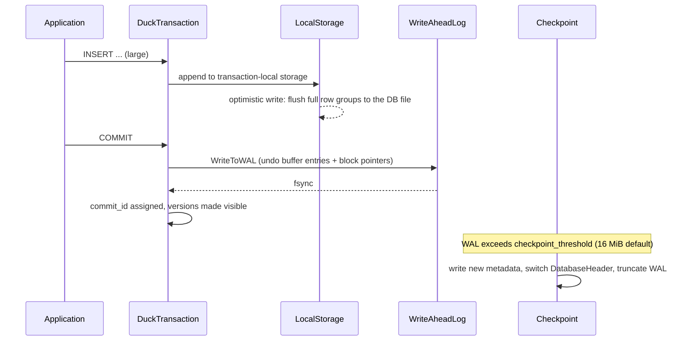

`pip install duckdb` を実行すれば、3 秒後には `SELECT` を実行できます。サーバーの起動も設定ファイルも要りません。それでいて 1 億行の Parquet を数秒で集計します。初めて触ると不安になるほどの速さですが、それには明確な技術的理由があります。

この記事で扱うのは、DuckDB の使い方ではなく内部の作りです。具体的には、ベクトル化実行エンジンのデータ表現、push ベースのパイプライン、exchange 演算子を使わない並列化、単一ファイルに閉じた列指向ストレージ、HyPer 系 MVCC、ART インデックスを取り上げます。それぞれの役割を [`duckdb/duckdb`](https://github.com/duckdb/duckdb) のどのファイルのどの構造体が担っているかまで示します。

> 厨房にたとえると、行指向の OLTP データベースが「注文が入るたびに 1 皿ずつ作るカウンター」なら、DuckDB は「同じ料理を 2048 皿ぶんまとめて仕込む厨房」です。
>
> - <strong>ベクトル化</strong>: 1 行ずつ「これは int か? NULL か?」と判定し直すのをやめ、同じ型の 2048 個を 1 回の判定でまとめて処理する。
> - <strong>push ベース</strong>: 客（上位演算子）が「次の 1 皿ください」と呼ぶのではなく、厨房（下位演算子）ができた皿を配膳台に押し出していく。
> - <strong>モーセル駆動</strong>: 仕込みの単位（row group）を小分けにして、手の空いた料理人が次の分を自分で取りに行く。誰かに割り当てられるのを待たない。
> - <strong>列指向 + 圧縮</strong>: 「食材を料理ごとに箱詰め」ではなく「食材の種類ごとに箱詰め」する。同じものが並ぶので、箱ごと圧縮できる。
>
> この 4 つを組み合わせることで、1 台のマシン上の分析クエリーが大幅に速くなります。

## 1. DuckDB の位置づけ

DuckDB は Mark Raasveldt と Hannes Mühleisen が CWI (Centrum Wiskunde & Informatica) で始めた、<strong>組み込み型の分析用（OLAP）データベース</strong>です。設計上の位置づけは、次の 2 軸で整理できます。

| | トランザクション処理 (OLTP) | 分析処理 (OLAP) |
| --- | --- | --- |
| クライアント・サーバー | PostgreSQL, MySQL | Snowflake, ClickHouse, BigQuery |
| 組み込み（プロセス内） | SQLite | DuckDB |

「SQLite の OLAP 版」という説明は、この表の位置関係から来ています。ただし似ているのは使われ方で、内部構造はまったく異なります。SQLite は行指向で B木を使い、バイトコード VM で 1 行ずつ処理します。DuckDB は列指向で、ベクトル化した push ベースの実行を行います。共通するのは、ライブラリーとしてホストプロセスにリンクされるという配置だけです。

<DuckDBArchitecture />

この配置の最大の利点は、ワイヤープロトコルもシリアライズも要らないことです。Python から 1 億行の結果を受け取る場合、PostgreSQL では結果をエンコードして TCP で送り、受信側でデコードします。DuckDB では同じプロセスのヒープ上で受け渡しが完結します。

ただし「ゼロコピー」は方向によって意味が違います。入力方向では、数値列がメモリー上に連続配置されていれば文字どおりゼロコピーです。DuckDB は呼び出し側のバッファーをそのまま指すだけで、1 バイトも詰め替えません（pandas と Arrow がそれぞれどの経路を通るかは 10.2 で見ます）。結果方向ではそうはいきません。`fetchdf()` と `fetchnumpy()` は列ごとに NumPy 配列を新しく確保して詰め替え、`to_arrow_table()` は `ArrowAppender` を通して自前の `ArrowBuffer` に書き出します。エンジン内部の `Vector` は辞書や FSST で符号化されたままのことがあり、文字列は `string_t`（2.6）なので、レイアウトの変換が避けられないからです。省けるのはシリアライズとプロセス間通信で、メモリーコピーまでなくなるわけではありません。

## 2. ベクトル化実行とデータ表現

### 2.1 3 つの実行モデル

クエリーエンジンの実行モデルは、演算子を 1 回呼び出すたびに何行処理するかで、大きく 3 つに分けられます。

| モデル | 1 呼び出しの粒度 | 代表 | 弱点 |
| --- | --- | --- | --- |
| タプル単位 (Volcano) | 1 行 | PostgreSQL, SQLite | 関数呼び出しと分岐のオーバーヘッドが行数に比例 |
| 列単位 | 列まるごと | MonetDB, 初期の Pandas | 中間結果が巨大になり DRAM へ落ちる |
| ベクトル単位 | N 行のバッチ | DuckDB, Vectorwise, Velox | — |

ベクトル単位は、タプル単位と列単位の中間をとる設計です。理論的背景は Boncz・Zukowski・Nes の "MonetDB/X100: Hyper-Pipelining Query Execution" (CIDR 2005) にあり、DuckDB はその直系の子孫にあたります。

### 2.2 なぜ 2048 なのか

DuckDB のベクトルサイズは [`src/include/duckdb/common/vector_size.hpp`](https://github.com/duckdb/duckdb/blob/main/src/include/duckdb/common/vector_size.hpp) にあります。

```cpp
// duckdb/common/vector_size.hpp
//! The default standard vector size
#define DEFAULT_STANDARD_VECTOR_SIZE 2048U

//! The vector size used in the execution engine
#ifndef STANDARD_VECTOR_SIZE
#define STANDARD_VECTOR_SIZE DEFAULT_STANDARD_VECTOR_SIZE
#endif

#if (STANDARD_VECTOR_SIZE & (STANDARD_VECTOR_SIZE - 1) != 0)
#error The vector size must be a power of two
#endif
```

この値は<strong>実行時の設定ではなくコンパイル時定数</strong>です。マクロなので、テンプレート引数にも固定長配列の宣言にも使えます。エンジンの各所に、`row_t row_data[STANDARD_VECTOR_SIZE];` のようなスタック上の固定長配列が現れます。

2048 という値は、中間結果を CPU キャッシュに収めるために選ばれています。

<VectorSizeTradeoff />

8 バイト型なら 2048 × 8 = 16 KB。典型的な L1 データキャッシュが 32〜48 KB、L2 が数百 KB〜数 MB なので、演算子の入出力と作業用バッファーを合わせても L2 に収まります。一方で 2048 行をまとめて処理すれば、演算子呼び出し 1 回あたりのオーバーヘッド（仮想関数ディスパッチ、型スイッチ、状態の読み込み）は 1 行あたり 1/2048 に薄まります。

DuckDB は `STANDARD_VECTOR_SIZE=512` や `=2` といった値でもビルドでき、テストスイートは小さいベクトルサイズでも実行されます（コード中に `#if STANDARD_VECTOR_SIZE > 2` のような分岐が現れるのはこのためです）。

### 2.3 DataChunk — 「2048 行 × N 列」の箱

演算子の間を流れる単位は `DataChunk` で、行ではなく列の集合です。

```cpp
// duckdb/common/types/data_chunk.hpp — https://github.com/duckdb/duckdb/blob/main/src/include/duckdb/common/types/data_chunk.hpp
class DataChunk {
public:
	//! The vectors owned by the DataChunk.
	vector<Vector> data;
	// ...
};
```

`DataChunk` が持つのは `vector<Vector>` と行数（cardinality）だけで、主な処理は `Vector` の側にあります。

`DataChunk::Slice()` には、値をコピーしない DuckDB の設計がよく表れています。フィルターで行を絞るとき、DuckDB は合致した行の添字を並べた `SelectionVector` を作り、各 `Vector` にその選択を被せるだけです。

### 2.4 Vector は 1 つの姿を持たない

DuckDB のコードを読むうえで最も重要なのが `Vector` です。`Vector` は「2048 個の値が並んだ配列」とは限らず、<strong>同じ論理データを複数の物理表現で持てる</strong>オブジェクトです。

```cpp
// duckdb/common/enums/vector_type.hpp — https://github.com/duckdb/duckdb/blob/main/src/include/duckdb/common/enums/vector_type.hpp
enum class VectorType : uint8_t {
	FLAT_VECTOR,       // Flat vectors represent a standard uncompressed vector
	FSST_VECTOR,       // Contains string data compressed with FSST
	CONSTANT_VECTOR,   // Constant vector represents a single constant
	DICTIONARY_VECTOR, // Dictionary vector represents a selection vector on top of another vector
	SEQUENCE_VECTOR,   // Sequence vector represents a sequence with a start point and an increment
	SHREDDED_VECTOR    // Shredded variant vector
};
```

たとえば `SELECT * FROM t WHERE country = 'JP'` を考えます。

- 定数 `'JP'` は `CONSTANT_VECTOR`。1 個の値しか実体化せず、比較演算子は「1 回計算して 2048 行に配る」最適化ができる。
- `country` 列が辞書圧縮されていれば、スキャンは `DICTIONARY_VECTOR` をそのまま返す。国名の文字列は辞書エントリーぶんしか存在しない。
- FSST 圧縮された文字列列は `FSST_VECTOR` のまま演算子に渡され、必要になるまで伸長されない。
- `range(0, 1000000)` や rowid 列は `SEQUENCE_VECTOR`。start と increment の 2 つの整数だけ。

下のプレイグラウンドで表現を切り替えると、同じ 2048 行の論理データが、物理的には 1 個の値、添字の列、2 個の整数などで表されることを確認できます。

<DuckDBVectorPlayground />

### 2.5 UnifiedVectorFormat — 抽象化の「妥協点」

物理表現が 6 通りあっても、演算子ごとに 6 通りの分岐を書く必要はありません。`UnifiedVectorFormat` が、どの表現でも同じコードで読める共通ビューを提供します。

```cpp
// duckdb/common/vector/unified_vector_format.hpp — https://github.com/duckdb/duckdb/blob/main/src/include/duckdb/common/vector/unified_vector_format.hpp
struct UnifiedVectorFormat {
	const SelectionVector *sel;
	const_data_ptr_t data;
	ValidityMask validity;
	SelectionVector owned_sel;
	PhysicalType physical_type;
	// ...
};
```

読み手のコードは常にこの形になります。

```cpp
UnifiedVectorFormat vdata;
input.ToUnifiedFormat(vdata);
auto values = UnifiedVectorFormat::GetData<int32_t>(vdata);

for (idx_t i = 0; i < count; i++) {
	auto idx = vdata.sel->get_index(i);   // 論理行 i → data の添字
	if (!vdata.validity.RowIsValid(idx)) {
		continue;                          // NULL
	}
	// values[idx] が値
}
```

- FLAT なら `sel` は恒等写像（`FlatVector::IncrementalSelectionVector()`）。
- CONSTANT なら `sel` は全要素 0 のベクトル（`ConstantVector::ZeroSelectionVector()`）で、`data[0]` に落ちる。
- DICTIONARY なら `sel` が辞書への添字そのもの。

これを<strong>妥協点</strong>と呼ぶのは、`ToUnifiedFormat()` がすべての表現をそのまま扱えるわけではないからです。

```cpp
// src/common/types/vector.cpp — https://github.com/duckdb/duckdb/blob/main/src/common/types/vector.cpp
void Vector::ToUnifiedFormat(UnifiedVectorFormat &format) const {
	format.physical_type = GetType().InternalType();
	auto vtype = GetVectorType();
	if (vtype != VectorType::FLAT_VECTOR && vtype != VectorType::CONSTANT_VECTOR &&
	    vtype != VectorType::DICTIONARY_VECTOR) {
		// FSST/SEQUENCE/SHREDDED: flatten first so the buffer can provide unified format
		Flatten();
	}
	Buffer().ToUnifiedFormat(format);
}
```

FSST や SEQUENCE は `sel` + `data` の形に落とせないので、先に `Flatten()` して 2048 個を実体化します。そのため `ToUnifiedFormat()` を呼ぶと、圧縮表現の利点は失われます。DuckDB の頻繁に実行される演算子（比較、ハッシュ、集約）が、`ToUnifiedFormat` の汎用パスとは別に CONSTANT や DICTIONARY を検出する専用の高速パスを持っているのはこのためです。

### 2.6 string_t — 16 バイトに詰め込まれた設計判断

文字列型の表現は [`src/include/duckdb/common/types/string_type.hpp`](https://github.com/duckdb/duckdb/blob/main/src/include/duckdb/common/types/string_type.hpp) にあります。

```cpp
// duckdb/common/types/string_type.hpp
struct string_t {
	static constexpr idx_t PREFIX_BYTES = 4 * sizeof(char);
	static constexpr idx_t INLINE_BYTES = 12 * sizeof(char);
	// ...
private:
	union {
		struct {
			uint32_t length;
			char prefix[4];
			char *ptr;
		} pointer;
		struct {
			uint32_t length;
			char inlined[12];
		} inlined;
	} value;
};
```

<StringTLayout />

12 バイト以下の文字列は構造体の中に収まるので、ヒープにアクセスしません。13 バイト以上でも、先頭 4 バイトはプレフィックスとして構造体側にコピーされます。この配置が効くのが等値比較です。

```cpp
// duckdb/common/types/string_type.hpp — string_t::StringComparisonOperators の内部
struct StringComparisonOperators {
	static inline bool Equals(const string_t &a, const string_t &b) {
		// (DUCKDB_DEBUG_NO_INLINE 用の分岐は省略)
		uint64_t a_bulk_comp = Load<uint64_t>(const_data_ptr_cast(&a));
		uint64_t b_bulk_comp = Load<uint64_t>(const_data_ptr_cast(&b));
		if (a_bulk_comp != b_bulk_comp) {
			// Either length or prefix are different -> not equal
			return false;
		}
		// they have the same length and same prefix!
		a_bulk_comp = Load<uint64_t>(const_data_ptr_cast(&a) + 8u);
		b_bulk_comp = Load<uint64_t>(const_data_ptr_cast(&b) + 8u);
		if (a_bulk_comp == b_bulk_comp) {
			// either they are both inlined (so compare equal) or point to the
			// same string (so compare equal)
			return true;
		}
		// ...
	}
	// ...
};
```

最初の 8 バイト（`length` 4 バイト + `prefix` 4 バイト）を 1 つの `uint64_t` として一括比較します。長さか先頭 4 文字が違えば、ここで false が返ります。実際のワークロードでは、不一致の大半がこの 1 回の比較で決まります。

次の 8 バイトも同じように一括比較します。ここが一致すれば、両方ともインライン文字列で中身が同じか、同じポインターを指しているかのどちらかです。したがって 12 バイト以下の文字列の等値判定は、ロード 4 回・比較 2 回で完結します。ポインターを追ってキャッシュミスを起こすのは、長さもプレフィックスも一致した長い文字列だけです。

大小比較（`GreaterThan`）でも同じ仕組みを使いますが、こちらではバイトオーダーを入れ替えます。

```cpp
uint32_t a_prefix = Load<uint32_t>(const_data_ptr_cast(left.GetPrefix()));
uint32_t b_prefix = Load<uint32_t>(const_data_ptr_cast(right.GetPrefix()));
if (a_prefix != b_prefix) {
	return BSwapIfLE(a_prefix) > BSwapIfLE(b_prefix);
}
```

リトルエンディアン機で 4 バイトを `uint32_t` として読むとバイト順が逆になるので、`BSwapIfLE` で戻してから比較します。これで <strong>4 文字分の辞書順比較が整数 1 回の比較になります</strong>。

### 2.7 SelectionVector と ValidityMask

`SelectionVector` は `sel_t*`（`uint32_t*`）の薄いラッパーにすぎませんが、DuckDB の実行モデル全体がこれを前提にしています。

- <strong>フィルター</strong>: 合致した行の添字を書く。
- <strong>ハッシュ結合</strong>: マッチした probe 側の行と build 側の行を、2 本の選択ベクトルで表す。

（ソートだけは例外で、選択ベクトルではなくソートキーそのものを並べ替えます — 6.6 で扱います。）

`ValidityMask` は NULL を表すビットマップです。1 ビットが 1 行に対応し、<strong>ビットが立っていれば有効（NULL でない）</strong>です。NULL が 1 つもない場合は `ValidityMask` の実体を確保しない（`GetData()` が `nullptr` を返す）という最適化があり、`CannotHaveNull()`（旧称 `AllValid()`）が真なら NULL チェックのループごと省略できます。実データの多くの列は NULL を含まないので、この省略が働く場面は多くあります。

### 2.8 `Value` と `Vector` — 実行エンジンの内と外の表現

ソースを読むとすぐに `Value` という型が出てきますが、これは `Vector` の 1 要素版ではありません。<strong>`Vector` は実行エンジン内の表現で、`Value` はそれ以外の場面すべてで使う表現</strong>です。定数畳み込み、統計の min/max、`SET` の設定値、カタログのデフォルト値、後述する実行時フィルターの境界値は、すべて `Value` で表します。`Value` は型タグと 1 個の値を持つ、単純ですがサイズの大きいオブジェクトです。

2 つの表現の変換には決まった関数を使います。`Vector::GetValue(i)` は 1 行を取り出して `Value` に詰め直します。逆向きには `Vector::Reference(const Value &, count_t)` や `ConstantVector` 化を使います。ホットループで `GetValue()` を呼ぶと性能が落ちるので、DuckDB のコードでこれが現れるのは、Finalize で 1 個だけ取り出すような場所に限られます。

キャストも 2 系統あります。`Value` に対しては `value.DefaultTryCastAs(type)` が失敗しうる結果を返します。`Vector` に対しては `BoundCastExpression::AddCastToType()` が式ツリーにキャスト演算子を挿入し、実行時に `CastFunctionSet` から引いた関数がベクトル単位で実行されます。キャストを失敗しうる演算として扱っていることは、実行時フィルター（8.4）の設計にも影響しています。結合フィルターの押し下げが整数キャストしか越えられないのも、`RuntimeFilterCastMode { DEFAULT_CAST, TRY_CAST }` でそのキャストが失敗しうるかを記録しているのも、これが理由の一つです。

関数の解決は `FunctionBinder` が行います。同名関数の候補から、暗黙キャストのコストが最も小さい 1 つを選びます。extension が登録したスカラー関数も組み込み関数と同じ経路を通るので、extension がカタログに登録した関数（10.1）は、そのままオーバーロード解決の候補に加わります。

## 3. push ベース実行モデル

2 節で見たベクトルが演算子の間をどう流れるかを決めるのが、実行モデルです。

### 3.1 pull から push へ

古典的な Volcano モデルでは、根の演算子が `next()` を呼び、それが再帰的に葉まで降りていきます。上位の演算子が下位からデータを引く (pull) 方式です。

DuckDB では逆に、データを下から上へ押し込みます (push)。各演算子は次の 3 つの役割のいずれかを担います。

| 役割 | インターフェース | 意味 |
| --- | --- | --- |
| Source | `GetData()` | パイプラインの起点。データを産む。 |
| Operator | `Execute()` | 中間。chunk を受け取り chunk を返す。状態は持っても有界（下記）。 |
| Sink | `Sink()` / `Combine()` / `Finalize()` | パイプラインの終点。全入力を溜め込む。 |

「有界」というのは「無制限には溜め込まない」の意味です。フィルターや結合のように出力の行数が入力から変わる演算子は `CachingPhysicalOperator` を継承します。該当するのは `PhysicalFilter`、`PhysicalJoin`、`PhysicalCrossProduct`、`PhysicalRecursiveCTEKeyJoin` の 4 つで、射影 `PhysicalProjection` は含まれません。これらは小さい出力 chunk を `cached_chunk` に貯め、2048 行に近づけてから下流へ流します（`CanCacheType()` は LIST / MAP / ARRAY / VARIANT を除外します）。そのため、source を読み切ったあとも演算子の中に行が残ることがあります。パイプラインに Source / Operator / Sink に加えて 4 つ目の呼び出し口 `FinalExecute()` があるのはこのためで、残った行は最後に `PipelineExecutor::TryFlushCachingOperators()` が取り出します。

同じ物理演算子でも、パイプラインによって役割が変わります。`PhysicalHashJoin` は build 側パイプラインでは Sink、probe 側では Operator です。build 側の行を出力に流す結合型（`PropagatesBuildSide` が真になる RIGHT / FULL OUTER / RIGHT_SEMI / RIGHT_ANTI）のときと、メモリーに収まらず外部ハッシュ結合に切り替わったときには Source にもなります。コード上はこの 3 役が静的に分かれておらず、`IsSource()` は無条件に true を返したうえで、`GetDataInternal()` が `!sink.external && !PropagatesBuildSide(join_type)` なら即 `FINISHED` を返して何もしません。

### 3.2 パイプラインとパイプラインブレーカー

パイプラインの切れ目は<strong>パイプラインブレーカー</strong>、つまり「全入力を見終わるまで 1 行も出力できない演算子」の位置に入ります。ハッシュ結合の build 側、ハッシュ集約、ソート、ウィンドウ関数などがこれにあたります。



同じ sink を共有するパイプラインの集合を `MetaPipeline` と呼びます。

```cpp
// duckdb/parallel/meta_pipeline.hpp — https://github.com/duckdb/duckdb/blob/main/src/include/duckdb/parallel/meta_pipeline.hpp
//! MetaPipeline represents a set of pipelines that all have the same sink
class MetaPipeline : public enable_shared_from_this<MetaPipeline> {
	// ...
};
```

たとえば `UNION ALL` の 2 本の枝は別々のパイプラインですが、同じ sink に注ぎ込むので 1 つの MetaPipeline に属します（`PhysicalUnion::BuildPipelines` が `meta_pipeline.CreateUnionPipeline()` を呼びます）。一方、sink を跨ぐと `CreateChildMetaPipeline()` で別の MetaPipeline になるので、上の図の 4 本は 4 つの MetaPipeline が親子で繋がった形です。

<DuckDBPipelineVisualizer />

### 3.3 HAVE_MORE_OUTPUT — 出力が膨らむとき

push ベースでは、pull ベースにはない問題が起きます。1 つの入力 chunk が 2048 行を超える出力を生む場合です。ハッシュ結合で 1 行が 100 行にマッチすると、2048 行の入力が 20 万行の出力になることがあります。

DuckDB はこれを `OperatorResultType` で扱います。

```cpp
// duckdb/common/enums/operator_result_type.hpp — https://github.com/duckdb/duckdb/blob/main/src/include/duckdb/common/enums/operator_result_type.hpp
// 実際のソースでは列挙子は 1 行で並び、意味は直前のブロックコメントに書かれている。
// 以下の行コメントは筆者による要約。
enum class OperatorResultType : uint8_t {
	NEED_MORE_INPUT,   // この入力は使い切った。次をくれ
	HAVE_MORE_OUTPUT,  // 同じ入力からまだ出せる。もう一度呼んでくれ
	FINISHED,          // パイプライン全体が終了。この演算子も同じパイプラインの他の演算子ももう呼ばれない（LIMIT 到達など）
	BLOCKED            // 非同期待ち。あとで再開してくれ（中間演算子は返さない — 3.4）
};
```

`HAVE_MORE_OUTPUT` を受け取った `PipelineExecutor` は、その演算子を `in_process_operators` スタックに積みます。

```cpp
// duckdb/parallel/pipeline_executor.hpp — https://github.com/duckdb/duckdb/blob/main/src/include/duckdb/parallel/pipeline_executor.hpp
//! If the stack of in_process_operators is empty, we fetch from the source instead
stack<idx_t> in_process_operators;
```

スタックが空でない限り、source には戻らず同じ入力 chunk で同じ演算子を再入します。出力を増やす演算子がパイプラインに複数並んでいても、どこまで戻ればよいかをスタックが記録しているので正しく動きます。push モデルでの途中再開は、すべてこの 1 本のスタックで実現されています。

### 3.4 BLOCKED — 実行を止めずに I/O を待つ

`BLOCKED` は比較的新しく追加された状態で、S3 上の Parquet を読むようなネットワーク I/O を伴うクエリーで使われます。

pull モデルならソケットで待てば済みますが、それではワーカースレッドが 1 本ふさがります。DuckDB では source や sink が `BLOCKED` を返すと、`PipelineExecutor` は `INTERRUPTED` を上に伝え、`PipelineTask` は `TASK_BLOCKED` を返してスケジューラーにスレッドを返上します。I/O が完了すると、`InterruptState` が保持していたタスクへのコールバックが呼ばれ、タスクが再スケジュールされます。

```cpp
// src/parallel/pipeline_executor.cpp — https://github.com/duckdb/duckdb/blob/main/src/parallel/pipeline_executor.cpp
// SINK INTERRUPT
if (result == OperatorResultType::BLOCKED) {
	remaining_sink_chunk = true;
	return PipelineExecuteResult::INTERRUPTED;
}
```

`remaining_sink_chunk` のようなフラグが `PipelineExecutor` に大量にあるのは、この<strong>再入可能性 (re-entrancy)</strong> を確保するためです。中断されたパイプラインが同じ位置から再開できるように、進行状況はすべて明示的なメンバー変数として保持されています。ステートマシンを手で書いたコードなので読みにくいのですが、これはコルーチンを使わずに非同期処理を実現するための代償です。

## 4. モーセル駆動並列化 — exchange 演算子を使わない並列化

### 4.1 従来のやり方の問題

伝統的な並列 DB は <strong>exchange 演算子</strong>（別名 Volcano 並列化）でプランを並列化します。プランの各所にデータを N 個のパーティションに分配する演算子を挿入し、下流を N 並列で実行します。

この方式には 3 つの問題があります。

1. 並列度をプラン時に決め打ちする。実行中に空いた CPU を使えない。
2. データ偏りに弱い。1 つのパーティションだけ重いと全体がそれに引きずられる。
3. 撒く（materialize する）コストが高い。

### 4.2 モーセル駆動

DuckDB は Leis らの "Morsel-Driven Parallelism" (SIGMOD 2014) を採用しています。仕組みは次のとおりです。

- 入力を<strong>モーセル</strong>（小片）に分割する。テーブルスキャンでは 1 モーセル = 1 row group（既定 122,880 行）。
- 各パイプラインに対して N 個の同一なタスクを起動する。
- 各タスクはグローバルなカーソルを（短いロックの下で）進めて、次のモーセルを自分で取りに行く。

コードでは、カーソルを進めるのは `RowGroupCollection::NextParallelScan()` で、スキャンに使うスレッド数の上限は `DataTable::MaxThreads()` が決めます。

```cpp
// src/storage/data_table.cpp — https://github.com/duckdb/duckdb/blob/main/src/storage/data_table.cpp
idx_t DataTable::MaxThreads(ClientContext &context) const {
	idx_t row_group_size = GetRowGroupSize();
	idx_t parallel_scan_vector_count = row_group_size / STANDARD_VECTOR_SIZE;
	if (ClientConfig::GetConfig(context).verify_parallelism) {
		parallel_scan_vector_count = 1;
	}
	idx_t parallel_scan_tuple_count = STANDARD_VECTOR_SIZE * parallel_scan_vector_count;
	return GetTotalRows() / parallel_scan_tuple_count + 1;
}
```

通常は「行数 ÷ row group サイズ + 1」です。`verify_parallelism` を立てるとモーセルが 1 ベクトル単位まで細かくなりますが、これは並列性を検証するためのテスト専用モードです。

プランに exchange 演算子は 1 つも入りません。並列度は `Pipeline::GetMaxThreads()` が動的に決めます。

モーセルを row group 単位にしているのは、実行エンジンとストレージの都合が一致するからです。row group は列ごとに独立した `ColumnSegment` と min/max 統計を持つ最小の単位なので、モーセルを row group に揃えれば、フィルターによるセグメント丸ごとの枝刈り（5.3）がタスクの割り当て単位とそのまま一致します。また、122,880 行は 60 ベクトル分にあたり、カーソルを 1 回進めるごとに 60 ベクトル分の仕事を取れるので、グローバルカーソルのロックがボトルネックになりません。一方で、行数が row group サイズを下回るテーブルでは `MaxThreads()` が 1 を返し、テーブルスキャンは実質シングルスレッドになります。

下の可視化ではスレッド数を変えられます。遅いスレッドが 1 本あっても、他のスレッドが残りのモーセルを処理していきます。4.1 の「データ偏りに弱い」という問題は、この動きで解消されます。

<DuckDBMorselVisualizer />

### 4.3 Global state と Local state の分離

モーセル駆動が成立するのは、演算子の状態がグローバル / ローカルにきれいに分離されているからです。

```cpp
// duckdb/execution/physical_operator.hpp — https://github.com/duckdb/duckdb/blob/main/src/include/duckdb/execution/physical_operator.hpp
// （source 側と sink 側は別々のセクションにある。ここでは対比のため 4 つを並べた）
virtual unique_ptr<LocalSourceState> GetLocalSourceState(ExecutionContext &context, GlobalSourceState &gstate) const;
virtual unique_ptr<GlobalSourceState> GetGlobalSourceState(ClientContext &context) const;
// ...
virtual unique_ptr<LocalSinkState> GetLocalSinkState(ExecutionContext &context) const;
virtual unique_ptr<GlobalSinkState> GetGlobalSinkState(ClientContext &context) const;
```

- <strong>Local state</strong>: そのスレッド専用。ロック不要。ハッシュ集約ならスレッドローカルなハッシュテーブル、テーブルスキャンなら現在のスキャン位置。
- <strong>Global state</strong>: 全スレッド共有。ロックまたは atomic で保護。テーブルスキャンなら「次に読む row group」のカーソル。

スレッドが仕事を終えると `Combine()` でローカル状態をグローバルへマージし、最後の 1 つが `Finalize()` を呼びます。

```text
thread 0 ─ Sink() × n ─┐
thread 1 ─ Sink() × n ─┼─ Combine() ─→ GlobalSinkState ─ Finalize() ─→ 次のパイプラインへ
thread 2 ─ Sink() × n ─┘
```

`Sink()` は chunk ごとに呼ばれるので、ロックを避ける必要があります。`Combine()` はスレッドあたり 1 回しか呼ばれないので、ロックしても問題ありません。`Finalize()` は全体で 1 回だけなので、処理に制約はありません。この 3 段階の粒度によって、ロック競合はほぼゼロに抑えられます。

### 4.4 タスクの粒度

DuckDB は、1 つのタスクが全モーセルを処理し続けるのを防ぐため、部分実行モードを持っています。

```cpp
// duckdb/parallel/pipeline.hpp — https://github.com/duckdb/duckdb/blob/main/src/include/duckdb/parallel/pipeline.hpp
class PipelineTask : public ExecutorTask {
	static constexpr const idx_t PARTIAL_CHUNK_COUNT = 50;
	// ...
};
```

`TaskExecutionMode::PROCESS_PARTIAL` では、`PipelineExecutor::Execute(50)` が 50 chunk（= 最大 102,400 行）処理した時点で `PipelineExecuteResult::NOT_FINISHED` を返し、`PipelineTask::ExecuteTask()` がそれを `TaskExecutionResult::TASK_NOT_FINISHED` に変換してスケジューラーに制御を返します。これにより、キャンセルへの応答性と、他のクエリーとの公平性が保たれます。

## 5. ストレージ — 単一ファイルに閉じた列指向

ディスク上のデータの並びにも、実行エンジンの 2048 という値がそのまま使われています。

### 5.1 ファイルレイアウト

DuckDB のデータベースは 1 個のファイルです。先頭には固定サイズのヘッダー群が並びます。

```text
+---------------------------+  offset 0
| MainHeader (4096 B)       |  [0..8) チェックサム、offset 8 から magic "DUCK"、ライブラリのバージョン・git hash
+---------------------------+  offset 4096
| DatabaseHeader #0 (4096 B)|  iteration, meta_block, free_list, block_count, ...
+---------------------------+  offset 8192
| DatabaseHeader #1 (4096 B)|
+---------------------------+  offset 12288  (SingleFileBlockManager::BLOCK_START)
| Block 0 (256 KB)          |
| Block 1 (256 KB)          |
| ...                       |
+---------------------------+
```

`DatabaseHeader` が 2 つある点が重要です。

```cpp
// duckdb/storage/storage_info.hpp — https://github.com/duckdb/duckdb/blob/main/src/include/duckdb/storage/storage_info.hpp
//! The DatabaseHeader contains information about the current state of the database. Every storage file has two
//! DatabaseHeaders. On startup, the DatabaseHeader with the highest iteration count is used as the active header. When
//! a checkpoint is performed, the active DatabaseHeader is switched by increasing the iteration count of the
//! DatabaseHeader.
struct DatabaseHeader {
	//! The iteration count, increases by 1 every time the storage is checkpointed.
	uint64_t iteration = 0;
	idx_t meta_block = 0;
	idx_t free_list = 0;
	uint64_t block_count = 0;
	idx_t block_alloc_size = 0;
	idx_t vector_size = 0;
	StorageVersion storage_compatibility = StorageVersion::INVALID;
	// ...
};
```

チェックポイントでは、使っていない方のヘッダーに新しい状態を書き、iteration を +1 します。ヘッダー 1 つは 4096 バイトです（`Storage::FILE_HEADER_SIZE`。ページサイズに揃えてあります。値が同じ `Storage::SECTOR_SIZE` は Direct I/O 用の別定数です）。ソースのコメントもこの大きさを「ディスクがほぼアトミックに書ける大きさ」（*written more or less atomically by the hard disk*）と控えめに表現しています。実際に安全性を担保しているのは、それに加えた書き込み順序のほうです。

```cpp
// src/storage/single_file_block_manager.cpp — https://github.com/duckdb/duckdb/blob/main/src/storage/single_file_block_manager.cpp
// We need to fsync BEFORE we write the header to ensure that all the previous blocks are written as well
handle->Sync();
// ...
auto location = active_header == 1 ? Storage::FILE_HEADER_SIZE : Storage::FILE_HEADER_SIZE * 2;
ChecksumAndWrite(context, header_buffer, location);
// switch active header to the other header
active_header = 1 - active_header;
//! Ensure the header write ends up on disk
handle->Sync();
```

書き込みは、データブロックを fsync し、使っていない方のヘッダースロットに書き、`active_header` を反転してから、もう一度 fsync する、という順に進みます。そのため書き込み途中でプロセスが終了しても、古い方の有効なヘッダーはそのまま残ります。これが<strong>シャドウページングによるアトミックなチェックポイント</strong>です。さらに各ヘッダーには 8 バイトのチェックサムが付いていて、書き込みが途中で切れた場合は起動時の `CheckChecksum()` が `DataCorruptionException` で検知します。

ヘッダーには `vector_size` と `block_alloc_size` も書かれています。これにより、異なる `STANDARD_VECTOR_SIZE` でビルドされたバイナリーが誤ってファイルを開くのを防いでいます。

### 5.2 RowGroup と ColumnSegment

テーブルは `RowGroupCollection` として管理され、その中身は row group の並びです。

```cpp
// duckdb/storage/storage_info.hpp
//! The standard row group size
#define DEFAULT_ROW_GROUP_SIZE 122880ULL
```

122,880 = 60 × 2048 なので、1 row group はちょうど 60 ベクトル分です。この制約はコンパイル時に検証されています。

```cpp
// duckdb/storage/storage_info.hpp
#if (DEFAULT_ROW_GROUP_SIZE % STANDARD_VECTOR_SIZE != 0)
#error The row group size must be a multiple of the vector size
#endif
```

row group の中では、列ごとに `ColumnData` があり、その中身は `ColumnSegment` の並びです。

<RowGroupLayout />

`ColumnSegment` はブロック（既定 256 KB、[`DEFAULT_BLOCK_ALLOC_SIZE 262144ULL`](https://github.com/duckdb/duckdb/blob/main/src/include/duckdb/storage/storage_info.hpp)。うち先頭 8 バイトはチェックサムなのでペイロードは 262,136 バイト。256 KB は同時に上限 `MAX_BLOCK_ALLOC_SIZE` でもあります）に載り、それぞれ独立に圧縮方式を選びます。同じ列でも、row group が違えば別の圧縮方式が選ばれることがあります。たとえば前半が連番なら RLE、後半がランダムならビットパッキング、というように、データに合わせた方式が選ばれます。

### 5.3 ゾーンマップ — 読まずに済ませる

各セグメントは min/max 統計（`BaseStatistics`）を持ちます。`WHERE l_shipdate > DATE '1998-01-01'` に対して、`max(l_shipdate) <= '1998-01-01'` のセグメントは <strong>1 バイトも読まずに丸ごと飛ばせます</strong>。

これはいわゆるゾーンマップ / min-max インデックスですが、DuckDB はこれを別途作るのではなく、書き込みの副産物として常に持っています。各圧縮方式の圧縮状態には [`StatsWriter<T>`](https://github.com/duckdb/duckdb/blob/main/src/include/duckdb/storage/statistics/stats_writer.hpp) が埋め込まれていて、値を書きながら min/max を更新します。無圧縮パス（`string_uncompressed.hpp`）も、既存行の更新（`update_segment.cpp`）も、同じ仕組みです。時系列データのように自然にソートされている列では、これだけで大半の I/O が不要になります。

### 5.4 圧縮方式は「競争」で決まる

DuckDB の圧縮方式は、列ごとに<strong>固定されているのではなく、セグメントごとに候補を比較して選ばれます</strong>。

チェックポイント時、`ColumnDataCheckpointer` は物理型に対応する全候補（`DBConfig::GetCompressionFunctions(physical_type)`）について、次の 3 段階を実行します。

1. `InitAnalyze` — 候補ごとの解析状態を作る
2. `Analyze(vector)` — セグメントの全ベクトルを流し、統計を取る（`false` を返したら候補から脱落）
3. `FinalAnalyze` — 推定バイト数を返す

推定バイト数が最小の候補が選ばれます。それ以外の候補は破棄され、選ばれた方式だけが `InitCompression` → `Compress` → `FinalizeCompress` で実際に書き出します。実データを 2 回読むためコストのかかる設計ですが、分析ワークロードでは書き込み 1 回に対して読み出しが何百回も行われるので、そのコストは十分に回収できます。

下のラボで入力パターンを変えて、どの方式が選ばれるか試せます。「連番なら RLE、ランダムならビットパッキング」という予想が、どのあたりで外れるかを確認してみてください。

<DuckDBCompressionLab />

[`src/storage/compression/`](https://github.com/duckdb/duckdb/tree/main/src/storage/compression) にある主要な圧縮方式は次のとおりです。

| 方式 | 対象 | 概要 |
| --- | --- | --- |
| Constant | 固定長数値型 + validity | 全値が同一。1 値だけ格納。VARCHAR や入れ子型には適用されない（`ConstantFun::TypeIsSupported` のホワイトリスト）。 |
| RLE | 固定長 | (値, 実行長) の並び。実行長は `uint16_t` なので 1 ラン最大 65,535 行。 |
| BitPacking | 整数 | `BITPACKING_METADATA_GROUP_SIZE`（既定では `STANDARD_VECTOR_SIZE` = 2048）値のグループごとに `CONSTANT` / `CONSTANT_DELTA` / `DELTA_FOR` / `FOR` の 4 モードを選び直す。 |
| Dictionary | 文字列 | 辞書 + ビットパックした添字。 |
| FSST | 文字列 | 頻出 1〜8 バイト列を 1 バイト記号に置換する静的シンボルテーブル。ランダムアクセス可能なまま圧縮。 |
| DICT_FSST | 文字列 | 辞書と FSST を 1 つのセグメント形式に統合。 |
| ALP / ALPRD | 浮動小数点 | 「その double は本当は 10 進小数」に賭ける方式と、賭けが外れたとき用の分割方式。 |
| Roaring | validity mask | NULL 位置のビットマップを Roaring bitmap で圧縮。 |
| Zstd | 文字列など | 汎用圧縮のフォールバック。 |

FSST (Fast Static Symbol Table) は Boncz・Neumann・Leis の VLDB 2020 論文に由来し、圧縮したまま検索できるのが特徴です。LZ4 や Zstd はブロック単位で伸長しないと 1 行も読めませんが、FSST は 1 文字列ずつ独立に伸長できます。列指向 DB の文字列圧縮では、この性質が特に重要です。

ALP (Adaptive Lossless floating-Point, SIGMOD 2024) は、実世界の `DOUBLE` の多くが、価格や測定値のように本当は 10 進の小数であることを利用します。`938.71` は `93871 × 10^-2` として整数で表せます。ALP は 1024 値ごとに指数 `e` と係数 `f` を選び、`value × 10^e` を整数に丸めて逆変換で元の値に戻るかを検証し、成功すれば整数として FOR + ビットパックします。外れ値は例外リストに格納します。

```cpp
// duckdb/storage/compression/alp/alp_constants.hpp — https://github.com/duckdb/duckdb/blob/main/src/include/duckdb/storage/compression/alp/alp_constants.hpp
class AlpConstants {
public:
	static constexpr uint32_t ALP_VECTOR_SIZE = 1024;
	static constexpr uint32_t RG_SAMPLES = 8;
	static constexpr uint16_t SAMPLES_PER_VECTOR = 32;
	// We calculate how many equidistant vector we must jump within a rowgroup
	static constexpr uint32_t RG_SAMPLES_DUCKDB_JUMP = (DEFAULT_ROW_GROUP_SIZE / RG_SAMPLES) / STANDARD_VECTOR_SIZE;
	// ...
};
```

`RG_SAMPLES = 8`、`SAMPLES_PER_VECTOR = 32` という定数から分かるとおり、ALP は row group 全体を読むのではなく、等間隔に 8 ベクトルを選び、そこから 32 値ずつサンプリングします。ただしこの 8 × 32 = 256 値が使われるのは指数・係数の候補を絞り込む `FindTopKCombinations` だけで、最終的なサイズ推定はそのあと 8 本の完全なサンプルベクトル（最大 1024 値ずつ）を実際に圧縮して求めます。row group からベクトルを選び、さらにベクトルから値を選ぶ 2 段階のサンプリングで、解析コストを抑えつつ代表性を確保しています。

### 5.5 バッファーマネージャー

DuckDB はメモリーより大きいデータを扱えます。これを支えているのが `BufferManager` です。

- ブロックは `BlockHandle` として管理され、`Pin()` すると物理メモリーに載り、`Unpin()` すると退避候補になる。
- メモリー上限（既定はシステムの<strong>利用可能</strong>メモリーの 80%。cgroup も考慮される）を超えると退避が走る。退避対象の選び方は厳密な LRU ではなく、Unpin されたブロックを並行キューに追加していく FIFO です。ブロックが再び Pin → Unpin されると新しいエントリーが末尾に積まれ、古いエントリーはシーケンス番号の不一致で「死んだノード」として読み飛ばされます。こうしてロックを取らずに LRU を近似しています（`EvictionQueue::Purge()` のコメントにも *we want to keep the LRU characteristic alive* とあります）。
- キューは 1 本ではなく退避コストの順に 3 段あり、`BLOCK` / `EXTERNAL_FILE`（捨てるだけで済むので最初）、`MANAGED_BUFFER`（書き出しが要るので次）、`TINY_BUFFER`（最後の手段）の順に探されます。
- 永続ブロックはデータベースファイルへ書き戻す（あるいは既に書かれているので捨てる）。一時ブロック（ハッシュテーブル、ソートバッファー）は `temp_directory` へ書き出す。

`MemoryTag`（`BASE_TABLE`、`HASH_TABLE`、`ORDER_BY`、`TRANSACTION` など）でメモリー使用が分類されており、`duckdb_memory()` テーブル関数で内訳を覗けます。

## 6. 重い演算子 — 集約・結合・ソート・ウィンドウ

ハッシュ集約、ハッシュ結合、ソート、ウィンドウ関数は、どれもパイプラインブレーカーです。入力を全部受け取るまで 1 行も出力できないので、<strong>メモリーを超えたときにどうするか</strong>を演算子自身が扱う必要があり、エンジンの中でも特に複雑な部分です。途中で、これらの演算子が共有する部品として、ハッシュテーブルのエントリー表現（6.2）とメモリーの配分（6.4）も扱います。

### 6.1 基数分割ハッシュ集約

`GROUP BY` の実装は [`src/execution/radix_partitioned_hashtable.cpp`](https://github.com/duckdb/duckdb/blob/main/src/execution/radix_partitioned_hashtable.cpp) にあります。名前のとおりハッシュの一部のビットでパーティションを決めますが、使うのは最上位ビットではありません。

```cpp
// duckdb/common/radix_partitioning.hpp — https://github.com/duckdb/duckdb/blob/main/src/include/duckdb/common/radix_partitioning.hpp
//! 4096 partitions ought to be enough to go out-of-core properly
static constexpr const idx_t MAX_RADIX_BITS = 12;

//! Radix bits begin after uint16_t because these bits are used as salt in the aggregate HT
static inline constexpr idx_t Shift(idx_t radix_bits) {
	return (sizeof(hash_t) - sizeof(uint16_t)) * 8 - radix_bits;   // = 48 - radix_bits
}
```

パーティション番号に使われるのは、上位 16 ビットのすぐ下にある `radix_bits` ビットです。上位 16 ビットを空けてあるのは、そこがハッシュテーブルのソルト（6.2）として使われるからです。もし両者が同じビットを使っていたら、1 パーティション内の全エントリーがまったく同じソルトを持つことになり、ソルトによる事前フィルターが完全に無意味になります。

ただし `MAX_RADIX_BITS = 12`（4096 パーティション）は基数分割の枠組み全体の上限で、ハッシュ集約が実際に使うのはずっと少なく、上限は `RadixHTConfig::MAXIMUM_FINAL_SINK_RADIX_BITS = 8`（256 パーティション）です。行の幅が大きいと、さらに減らされます（`ROW_WIDTH_THRESHOLD_ONE = 32` バイト以上で 1 ビット、`ROW_WIDTH_THRESHOLD_TWO = 64` バイト以上で 2 ビット）。ソースのコメントによれば、そうしないとキャッシュミスが手に負えなくなるからです。

<RadixPartitionDiagram />

この分割には 2 つの意味があります。

1. <strong>並列化</strong>: 同じグループキーは必ず同じパーティションに入るので、パーティション同士は完全に独立している。Finalize でパーティション間の同期が要らない。
2. <strong>溢れ出しの単位</strong>: メモリーが逼迫したら、1 度に 1 パーティションだけメモリーに載せ、残りはディスクに置いて処理できる。

メモリー圧の検知は `MaybeRepartition()` が担っています。

```cpp
// src/execution/radix_partitioned_hashtable.cpp
const auto total_size =
    aggregate_allocator_size + ht.GetPartitionedData().SizeInBytes() + ht.Capacity() * sizeof(ht_entry_t);
if (total_size > gstate.GetThreadLimit()) {
	// We're over the thread memory limit
	// ...
}
```

スレッドあたりのメモリー上限を超えると、`SetRadixBitsToExternal()` が呼ばれて外部モードに入り、パーティション数を増やして（`Repartition()`）1 パーティションあたりのサイズを下げます。パーティションが小さくなれば、それぞれをメモリーに収められます。

さらに新しい DuckDB は、集約状態そのものの溢れ出し（`AggregateStateSpilling`）も持ちます。`string_agg` や `list` のように状態が巨大になる集約では、行データを溢れさせてもアリーナアロケーターが残ります。そこで状態を `ColumnDataCollection` に「エクスポート」してアリーナを解放し、Finalize 時に「インポート」して戻す処理が入ります。

いまの DuckDB のハッシュ集約は、基数分割と溢れ出しに加えて、データに応じて動作を切り替えます。各スレッドは意図的に小さなハッシュテーブルで始め、HyperLogLog で実際の異なりキー数を数えながら、1,048,576 行（`RadixHTLocalSinkState::ADAPTIVITY_THRESHOLD`）を処理した時点で `DecideAdaptation()` を呼びます。

- 推定ユニーク率が 95%（`SKIP_LOOKUP_UNIQUE_PERCENTAGE_THRESHOLD`）を超える、つまりほとんど集約されないなら、ハッシュテーブルの探索をやめて追記だけにし、重複排除を GetData フェーズにすべて先送りする（`ht.SkipLookups()`）。
- 逆に、ハッシュテーブルがもっと大きければ重複を 2 倍以上減らせたと分かれば、容量を上げて作り直す。

どちらの判断もデータを見てから行われます。そのためカーディナリティー推定（8.3）が外れても、実行エンジン側で立て直せます。なお上の `GetThreadLimit()` も固定値ではなく、`TemporaryMemoryManager`（6.4）が割り当てた予約量に連動して変わります。

（ただしこの適応が働くのは 3 スレッド以上のときだけです。`GROW_STRATEGY_THREAD_THRESHOLD = 2` 以下なら DuckDB は「育てる」戦略を採り、`SinkCapacity()` は適応モードの 32,768 ではなく 262,144 で始めて、`DecideAdaptation()` は一度も呼ばれません。）

### 6.2 ht_entry_t — ポインターの空きビットを使い切る

ハッシュテーブルのエントリーは 64 ビット 1 つです。

```cpp
// duckdb/execution/ht_entry.hpp — https://github.com/duckdb/duckdb/blob/main/src/include/duckdb/execution/ht_entry.hpp
struct ht_entry_t {
public:
	//! Upper 16 bits are salt, lower 48 bits are the pointer
	static constexpr const hash_t SALT_MASK = 0xFFFF000000000000;
	static constexpr const hash_t POINTER_MASK = 0x0000FFFFFFFFFFFF;
	// ...
private:
	hash_t value;
};
```

x86-64 のユーザー空間ポインターは実質 48 ビットしか使わないので、上位 16 ビットが空いています。DuckDB はそこにハッシュの一部（<strong>ソルト</strong>）を格納します。

線形探索でスロットを見るときは、まずソルトを比較し、違えばポインターを辿らずに次のスロットへ進みます。ハッシュテーブルの探索でいちばんコストが大きいのは、ポインターを追った先で起きるキャッシュミスです。16 ビットの事前フィルターで偽陽性を 1/65536 に減らせる効果は大きいといえます。

（Android では仮想アドレス空間の都合でこの最適化が無効化されており、`DUCKDB_DISABLE_POINTER_SALT` でソルトなしに切り替わります。ソースのコメントには、この制約への不満が率直に書かれています。）

もう一つの但し書きとして、ソルト比較はハッシュテーブルが十分に大きいときだけ有効になります。

```cpp
// duckdb/execution/join_hashtable.hpp — https://github.com/duckdb/duckdb/blob/main/src/include/duckdb/execution/join_hashtable.hpp
//! only compare salts with the ht entries if the capacity is larger than 8192 so that it does not fit into the CPU
//! cache
static constexpr const idx_t USE_SALT_THRESHOLD = 8192;
```

テーブルが L2 に収まる程度なら、ポインターを追ってもキャッシュミスは起きにくく、事前フィルターのコストのほうが大きくなります。そのため `JoinHashTable::UseSalt()` が偽を返し、ソルト比較を省きます。最適化そのものにも損益分岐点があることを、コードで明示している例です。

同じヘッダーには、モジュロ演算を分岐なしで書くヘルパーもあります。

```cpp
// uses an AND operation to apply the modulo operation instead of an if condition that could be branch mispredicted
inline void IncrementAndWrap(idx_t &offset, const uint64_t &capacity_mask) {
	++offset &= capacity_mask;
}
```

容量を 2 の冪に保っているのは、この AND による剰余計算のためです。

### 6.3 外部ハッシュ結合と ProbeSpill

ハッシュ結合の build 側がメモリーに収まらない場合、DuckDB は build 側を基数分割し、「今メモリーに載っているパーティション」に当たらない probe 行を退避します。

```cpp
// duckdb/execution/join_hashtable.hpp — https://github.com/duckdb/duckdb/blob/main/src/include/duckdb/execution/join_hashtable.hpp
//! ProbeSpill represents materialized probe-side data that could not be probed during PhysicalHashJoin::Execute
//! because the HashTable did not fit in memory. The ProbeSpill is not partitioned if the remaining data can be
//! dealt with in just 1 more round of probing, otherwise it is radix partitioned in the same way as the HashTable
struct ProbeSpill {
	// ...
};
```

probe 中の振り分けは `RadixPartitioning::Select()` の 1 呼び出しで、合致する行と退避する行を 2 本の選択ベクトルに分けています。

```cpp
// src/execution/join_hashtable.cpp — https://github.com/duckdb/duckdb/blob/main/src/execution/join_hashtable.cpp
const auto true_count =
    RadixPartitioning::Select(hashes, FlatVector::IncrementalSelectionVector(), probe_keys.size(), radix_bits,
                              current_partitions, &true_sel, &false_sel);
```

コメントにあるとおり、あと 1 ラウンドで処理しきれるなら、退避データを分割せずにそのまま持ちます。不要な分割コストを避けるための場合分けです。

なお、ロードファクターの定義は少し変わっています。

```cpp
//! For a LOAD_FACTOR of 2.0, the HT is between 25% and 50% full
static constexpr double DEFAULT_LOAD_FACTOR = 2.0;
```

行数の 2 倍以上の容量を 2 の冪で確保するので、実際の充填率は 25〜50% になります。線形探索を短く保つため、容量にかなり余裕を持たせた設定です。

### 6.4 TemporaryMemoryManager

複数の演算子が同時にメモリーを使うとき、演算子ごとに固定の上限を設けるだけでは効率が悪くなります。たとえばハッシュ結合とソートが同時に実行されていて、片方がメモリーをあまり使っていないなら、もう片方がその分を使えるほうが効率的です。

`TemporaryMemoryManager` はこれを調整するグローバルな仲介役です。各演算子は `TemporaryMemoryState` を登録し、最低限必要な量（`SetMinimumReservation`）と、追加で欲しい量（`SetRemainingSizeAndUpdateReservation`）を申告します。マネージャーは全体の要求を見て予約量を割り振り、演算子は割り当てられた予約に応じて外部モードに落ちるかどうかを決めます。

### 6.5 外部ハッシュ結合のステートマシン

6.3 の `ProbeSpill` が実際にどう使われるかは、Source 側のステージ定義を見ると分かります。

```cpp
// src/execution/operator/join/physical_hash_join.cpp — https://github.com/duckdb/duckdb/blob/main/src/execution/operator/join/physical_hash_join.cpp
enum class HashJoinSourceStage : uint8_t { INIT, BUILD, PROBE, SCAN_HT, DONE };
```

外部ハッシュ結合では、このステージをメモリーに載せるパーティション群を入れ替えながら何周も繰り返します。

1. `BUILD` — 今回メモリーに載せるパーティション群についてポインターテーブルを構築する（`ExternalBuild`）。
2. `PROBE` — 退避しておいた probe 行を `probe_spill` から chunk 単位で取り出して探索する（`ExternalProbe`）。
3. `SCAN_HT` — `PropagatesBuildSide` が真なら（RIGHT / FULL OUTER / RIGHT_SEMI / RIGHT_ANTI）build 側の残りを吐く（`ExternalScanHT` → `ScanFullOuter`）。
4. `PrepareBuild()` に戻り、次のパーティションが載るなら BUILD へ、載らなければ DONE。

なお、Source が最初に入るのは BUILD ではなく PROBE です。1 周目のポインターテーブルは Sink 側の `Finalize()` が `PrepareExternalFinalize()` → `ScheduleFinalize()` で既に作っているので、`Initialize()` は `global_stage` を最初から `PROBE` にします。BUILD が実行されるのは 2 周目以降です。

ステージの切り替わりを待つ処理には、3.4 で見た `BLOCKED` がそのまま使われています。

```cpp
// src/execution/operator/join/physical_hash_join.cpp
if (gstate.TryPrepareNextStage(sink) || gstate.global_stage == HashJoinSourceStage::DONE) {
	gstate.UnblockTasks();
} else {
	return gstate.BlockSource(input.interrupt_state);
}
```

他のスレッドが今のステージを終えるのを待つ同期が、S3 の I/O 待ちとまったく同じ仕組み（タスクを手放してスケジューラーに返す）で書かれています。`BLOCKED` は非同期 I/O 専用の機構ではなく、<strong>パイプライン内の任意の待ちを表現する汎用の手段</strong>です。

### 6.6 ソート — キーを二値化してから基数ソートする

`ORDER BY` は DuckDB の中でも近年全面的に書き直された部分で、実装は [`src/common/sort/`](https://github.com/duckdb/duckdb/tree/main/src/common/sort)（ヘッダーは `src/include/duckdb/common/sorting/`）にあります。

この実装は比較関数を使わないことから始まります。`Sort` は `create_sort_key` というスカラー関数の式を持っていて、sink のたびにこれを実行し、ORDER BY の全列を <strong>1 本の二値比較可能なバイト列</strong>にまとめます。以降の比較では、列の型も ASC/DESC も NULLS FIRST/LAST も参照しません。`memcmp` 相当の比較だけで正しい順序になるからです。（型とソート指定が再び必要になるのはキーを値に戻すときだけで、`Sort::Sort` は `create_sort_key` と対になる `decode_sort_key` 式を同時にバインドしています。）

そのバイト列の物理表現が `SortKeyType` です。

```cpp
// duckdb/common/sorting/sort_key.hpp — https://github.com/duckdb/duckdb/blob/main/src/include/duckdb/common/sorting/sort_key.hpp
enum class SortKeyType : uint8_t {
	INVALID = 0,
	//! Without payload
	NO_PAYLOAD_FIXED_8 = 1,
	NO_PAYLOAD_FIXED_16 = 2,
	NO_PAYLOAD_FIXED_24 = 3,
	NO_PAYLOAD_FIXED_32 = 4,
	NO_PAYLOAD_VARIABLE_32 = 5,
	//! With payload (requires row pointer in key)
	PAYLOAD_FIXED_16 = 6,
	PAYLOAD_FIXED_24 = 7,
	PAYLOAD_FIXED_32 = 8,
	PAYLOAD_VARIABLE_32 = 9,
};
```

`sizeof(SortKey<NO_PAYLOAD_FIXED_8>) == 8` のように、どれも `static_assert` で幅が固定されています。PAYLOAD 系はキー構造体の中にペイロード行へのポインターを持つ（`SetPayload` / `GetPayload`）ので、ソート中に動くのは 8〜32 バイトの構造体だけです。行データは 1 バイトも動きません（外部ソートに切り替わったときだけ `SortedRun::Finalize(external)` が物理的に並べ替えます — *"Sorts the data (physically reorder data if external)"*）。

ただし、キーは<strong>実際にはバイト比較可能な順に並んでいません</strong>。

```cpp
// duckdb/common/sorting/sort_key.hpp — FixedSortKey::Construct
// IMPORTANT NOTE: We don't actually store the data in byte-comparable order!
// This allows us to do int64_t comparisons, yielding better performance.
// This means we have to ByteSwap once more when decoding the keys later.
ByteSwap();
```

`ByteSwap()` の中身は `BSwapIfLE` で、2.6 で `string_t` のプレフィックス比較に出てきたのと同じ関数です。バイト列を `uint64_t` の並びとして読み、`SortKeyLessThan<PARTS>` で辞書順に比較します。2.6 の「4 文字の辞書順比較を整数 1 回の比較にする」方法を、ソートキー全体に適用したものです。

並べ替え自体は自前実装ではなく、vergesort に ska_sort（基数ソート）をフォールバックとして渡す形です。

```cpp
// src/common/sort/sorted_run.cpp — https://github.com/duckdb/duckdb/blob/main/src/common/sort/sorted_run.cpp
const auto fallback = [ska_extract_key](const BLOCK_ITERATOR &fb_begin, const BLOCK_ITERATOR &fb_end) {
	duckdb_ska_sort::ska_sort(fb_begin, fb_end, ska_extract_key);
};
duckdb_vergesort::vergesort(begin, end, std::less<SORT_KEY>(), fallback);
```

スレッドごとにできた sorted run は `SortedRunMerger` がマージします。ここも exchange 演算子は使いません。出力をパーティションに分け、各スレッドが K-way Merge Path で、自分の担当区間が各 run のどこからどこまでかを独立に計算します（`COMPUTE_BOUNDARIES` → `ACQUIRE_BOUNDARIES` → `MERGE_PARTITION` → `SCAN_PARTITION`）。境界が決まればパーティション同士は完全に独立なので、マージを並列に実行できます。

各パーティションの中では、マージではなくもう一度ソートします（run が 1 本だけのときなどは除きます）。

```cpp
// src/common/sort/sorted_run_merger.cpp — https://github.com/duckdb/duckdb/blob/main/src/common/sort/sorted_run_merger.cpp
// Seems counter-intuitive to re-sort instead of merging, but modern sorting algorithms detect and merge
static const auto fallback = [](SORT_KEY *begin, SORT_KEY *end) {
	duckdb_pdqsort::pdqsort_branchless(begin, end);
};
```

ここでも実際に呼ばれるのは `duckdb_vergesort::vergesort(..., std::less<SORT_KEY>(), fallback)` で、`pdqsort_branchless` はフォールバック側です。run ソートとまったく同じ形です。コメントにあるとおり、現代のソートアルゴリズムは既にソート済みの部分列を検出してマージするので、自前の K-way マージを書くより速いという判断です。

メモリーを超えたときは `BlockIteratorStateType` が `IN_MEMORY` から `EXTERNAL` に切り替わり、同じテンプレートコードがバッファーマネージャー経由でキーを読むようになります。

なお `Sort` はウィンドウ関数からも使われます。`SortStrategy::Factory()` が返す派生は次の 3 つです。

- `FullSort`: `OVER (ORDER BY ...)` 用。
- `HashedSort`: `OVER (PARTITION BY ...)` 用。パーティションキーをハッシュして基数分割し、ハッシュグループごとに独立したソート状態（`sort_global` / `sort_source`）を持つ。`Sort` オブジェクト自体は、ヘッダーが *"Common sort description"* と呼ぶ 1 つを共有する。
- `NaturalSort`: `OVER ()` 用。並べ替えは行わない。

6.1 のハッシュ集約と同じ「ハッシュで分割してから各パーティションを独立に処理する」形が、ここでも使われています。

### 6.7 ウィンドウ関数 — ハッシュグループとセグメント木

[`src/execution/operator/aggregate/physical_window.cpp`](https://github.com/duckdb/duckdb/blob/main/src/execution/operator/aggregate/physical_window.cpp) の `PhysicalWindow` は、コメントにあるとおり「すべての関数が共通の partitioning と ordering を持つ」ことを前提にした演算子です。Sink 側は 6.6 の `SortStrategy::Factory()` が選んだ戦略（`PARTITION BY` があれば `HashedSort`）にそのまま渡し、Source 側でハッシュグループごとに独立した状態機械を実行します。

```cpp
// src/execution/operator/aggregate/physical_window.cpp
enum WindowGroupStage : uint8_t { SORT, MATERIALIZE, MASK, SINK, FINALIZE, GETDATA, DONE };
```

`WindowHashGroup` は 1 パーティション群分の、ソート済みデータ・境界マスク・関数ごとのグローバル状態・スレッドローカル状態をまとめて持ちます。MASK ステージは、`partition_mask` / `order_masks` という `ValidityMask` を埋める工程です。この行でパーティションが変わるか、この行で ORDER BY のピア群が変わるかを 1 ビットで表しておけば、以降のフレーム境界計算がビット演算だけで済みます。

タスクの配り方は 4 章の並列化と同じ考え方です。グループを大きい順に並べ、1 グループの中をブロック単位で分割して複数スレッドに割り当てるので、グループ数がスレッド数より少なくても並列度が落ちません。ステージの切り替わり待ちには `TryPrepareNextStage()` / `UnblockTasks()` / `BlockSource` を使い、6.5 の外部ハッシュ結合とまったく同じ `BLOCKED` の仕組みで実現しています。

フレーム集約を担うのが `WindowSegmentTree` です。`SUM(x) OVER (ROWS BETWEEN 100 PRECEDING AND CURRENT ROW)` を素朴に計算すると 1 行あたり 100 回の更新になりますが、セグメント木を持っておけば任意区間が $O(\log n)$ で求まります。

```cpp
// src/function/window/window_segment_tree.cpp — https://github.com/duckdb/duckdb/blob/main/src/function/window/window_segment_tree.cpp
//! The actual window segment tree: an array of aggregate states that represent all the intermediate nodes
WindowAggregateStates levels_flat_native;
//! For each level, the starting location in the levels_flat_native array
vector<idx_t> levels_flat_start;
//! The level being built (read)
std::atomic<idx_t> build_level;
```

木のノードは集約状態そのもの（`WindowAggregateStates::Initialize()` で初期化された生の状態）で、レベルごとに 1 本のフラットな配列に詰められています。`build_level` が atomic なのは、木の構築自体を複数スレッドでレベル順に進めるためです。集約が順序に依存しなければ、上位レベルをすべて combine してから葉を `FramePart::FULL` で一括処理できます。依存する場合は葉を `LEFT` → 上位レベル → `RIGHT` の順に評価し、上位レベルの右端の範囲はスタックに積んで逆順に取り出します。（なおフレームそのものを左右に割るのは別の軸で、`EXCLUDE` 句が付いたときの話です。）

`median`、`quantile` のように「フレーム内の順位」が要る関数、および `first_value(x ORDER BY y)` のように引数側に `ORDER BY` を持つ値関数は別系統で、`MergeSortTree`（`WindowMergeSortTree` / `WindowIndexTree`）を使います。こちらは `SelectNth(frames, n)` でフレーム内の n 番目を求められる索引で、内部に 6.6 の `Sort` をそのまま持っています（`WindowMergeSortTree` が `sort = make_uniq<Sort>(...)` を持ちます）。ソート、ハッシュ分割、セグメント木、`BLOCKED` と、ここまでに出てきた部品のほぼすべてが使われるため、ウィンドウ関数はエンジンの中で最も複雑な部分になっています。

## 7. MVCC — 読み手を止めない

ここまでは読み取りの仕組みを見てきました。書き込みについて、どのトランザクションがどの行を見てよいかを決めているのが MVCC です。

### 7.1 バージョン情報はどこにあるか

DuckDB の MVCC は Neumann・Mühlbauer・Kemper の "Fast Serializable Multi-Version Concurrency Control for Main-Memory Database Systems" (SIGMOD 2015)、つまり HyPer 系の設計です。

行の可視性は row group ごとの `RowVersionManager` が管理し、その中身は 2048 行ごとの `ChunkVectorInfo` です。

```cpp
// src/storage/table/row_version_manager.cpp — https://github.com/duckdb/duckdb/blob/main/src/storage/table/row_version_manager.cpp
RowVersionManager::RowVersionManager(BufferManager &buffer_manager_p) noexcept
    : allocator(STANDARD_VECTOR_SIZE * sizeof(transaction_t), buffer_manager_p.GetTemporaryBlockManager(),
                MemoryTag::BASE_TABLE) {
}
```

`ChunkVectorInfo` は各行について、挿入された時点と削除された時点を `transaction_t` で保持します。ただし格納形式は可変で、全行が同じ ID なら定数（`constant_insert_id` / `constant_delete_id`）にまとめられ、そうでなければ `FixedSizeAllocator` 上の行ごとの ID 配列（`inserted_data` / `deleted_data`、いずれも `IndexPointer`）に置かれます。判定の論理は次のとおりです。

```cpp
// 概念的には
bool UseVersion(TransactionData transaction, transaction_t id) {
	return id < transaction.start_time || id == transaction.transaction_id;
}
bool visible = UseVersion(transaction, inserted[row]) && !UseVersion(transaction, deleted[row]);
```

<MVCCVersionDiagram />

`transaction_t` の値域の使い方にも工夫があります。

```cpp
// src/common/constants.cpp — https://github.com/duckdb/duckdb/blob/main/src/common/constants.cpp
const transaction_t TRANSACTION_ID_START = 4611686018427388000ULL;                // 2^62
const transaction_t MAX_TRANSACTION_ID = NumericLimits<transaction_t>::Maximum(); // 2^63
const transaction_t NOT_DELETED_ID = NumericLimits<transaction_t>::Maximum() - 1; // 2^64 - 1
```

- `TRANSACTION_ID_START` 未満 → コミットタイムスタンプ
- `TRANSACTION_ID_START` 以上 → 未コミットのトランザクション ID

同じフィールドに 2 種類の意味を持たせ、大小比較だけで区別しています。未コミットの ID は必ず非常に大きいので、`id < start_time` は false になり、他のトランザクションからは見えません。コミット時に `CommitState::CommitEntry` がその ID をコミットタイムスタンプで上書きすると、変更が一斉に可視化されます。

`NOT_DELETED_ID` が `MAX - 1` なのも同じ考え方で、「削除されていない」を「無限の未来に削除された」と同じように扱えます。

（ソースの `// 2^63` / `// 2^64 - 1` は概数です。`transaction_t` は `uint64_t` なので、実際は `MAX_TRANSACTION_ID` = 2^64 − 1、`NOT_DELETED_ID` = 2^64 − 2、`TRANSACTION_ID_START` = 2^62 + 96 です。）

### 7.2 バージョン ID の圧縮

単純に持つと 1 行あたり `transaction_t` 2 個、つまり 16 バイトが必要ですが、実際にはほとんどの行が「ずっと前にコミットされ、削除されていない」状態です。DuckDB はこれを `CompressVersionIds()` でまとめます。

```cpp
// duckdb/storage/table/row_version_manager.hpp — https://github.com/duckdb/duckdb/blob/main/src/include/duckdb/storage/table/row_version_manager.hpp
//! Attempts to compress the per-row insert/delete ids of each vector into constants
//! This is possible when the ids behave identically for all transactions with a start time of at least
//! lowest_active_start (i.e. all active and future transactions)
//! ...
void CompressVersionIds(transaction_t lowest_active_start);
```

現在および将来のすべてのトランザクションにとって同じ答えになるなら、2048 個の配列を 1 つの定数にまとめられます。さらに削除については、`DeleteIdState` が `CONSTANT` / `MASKED` / `ARRAY` の 3 段階を持ち、全行が同じ場合、ビットマスクと 1 個の削除 ID で表せる場合、行ごとに異なる場合を使い分けます。

### 7.3 UndoBuffer

トランザクションが行った変更を元に戻すための情報は、`UndoBuffer` に順に積まれます。

```cpp
// src/transaction/undo_buffer.cpp — https://github.com/duckdb/duckdb/blob/main/src/transaction/undo_buffer.cpp
constexpr uint32_t UNDO_ENTRY_HEADER_SIZE = sizeof(UndoFlags) + sizeof(uint32_t);

UndoBufferReference UndoBuffer::CreateEntry(UndoFlags type, idx_t len) {
	idx_t alloc_len = AlignValue<idx_t>(len + UNDO_ENTRY_HEADER_SIZE);
	auto handle = allocator.Allocate(alloc_len);
	auto data = handle.GetDataMutable();
	// write the undo entry metadata
	Store<UndoFlags>(type, data);
	data += sizeof(UndoFlags);
	Store<uint32_t>(UnsafeNumericCast<uint32_t>(alloc_len - UNDO_ENTRY_HEADER_SIZE), data);
	// increment the position of the header past the undo entry metadata
	handle.position += UNDO_ENTRY_HEADER_SIZE;
	return handle;
}
```

`(型タグ, 長さ, ペイロード)` を並べた独自のバイト列です。同じバッファーが、用途ごとに異なる順序で走査されます。

| 操作 | 走査方向 | 実装 |
| --- | --- | --- |
| WAL 書き出し | 挿入順 | `WALWriteState::CommitEntry` — 変更を WAL に追記する |
| コミット | 挿入順 | `CommitState::CommitEntry` — 未コミット ID をコミット ID に書き換える |
| ロールバック | 逆順 | `RollbackState::RollbackEntry` — 変更を巻き戻す |
| ガベージコレクション | 挿入順 | `CleanupState::CleanupEntry` — 誰からも見えなくなった旧バージョンを解放 |

逆順が必要なのはロールバックだけで、ソースのコメントも `// rollback needs to be performed in reverse` と書いているだけです。コミット側の各エントリーはほぼ独立しています（`UPDATE_TUPLE` なら同時実行のチェックに続く `info->version_number = commit_id;` の 1 行、`INSERT_TUPLE` なら `CommitAppend`）。順序が実際に問題になるのは 2 か所だけです。1 つはカタログ変更で、同じオブジェクトへの CREATE → ALTER のように、積まれた順にコミットタイムスタンプを付ける必要があります。もう 1 つは WAL 書き出しで、ログは操作が起きた順でなければ再生できません。

`UndoBufferAllocator` は `BufferManager` からメモリーを確保するので、巨大なトランザクションの undo 情報もディスクへ退避できます。これにより、10 億行を 1 トランザクションで UPDATE したときにメモリーが不足する事態を防いでいます。

### 7.4 WAL・楽観的書き込み・チェックポイント

書き込みの流れは次のとおりです。



大量 INSERT のとき、DuckDB は<strong>楽観的書き込み (optimistic writing)</strong> を使います。コミットを待たずに、完成した row group をデータベースファイルへ直接書き出す仕組みです。

- コミットした場合: WAL にはブロックへのポインターだけを書けばよく、データ本体を WAL に二重に書かずに済む。
- ロールバックした場合: 書いたブロックをフリーリストに戻すだけで済む。

これにより、1 億行の COPY でもデータを 2 回書かずに済みます。`DuckTransaction::PreFlushOptimisticBlocks()` がコミットロックを取る前に呼ばれる点も効いていて、fsync のような遅い操作をクリティカルセクションの外に出しています。

チェックポイントは WAL が公開設定 `checkpoint_threshold`（既定 16 MiB。内部名は `checkpoint_wal_size`）を超えると自動で実行され、`RowGroupCollection::Checkpoint()` が全 row group をディスクへ書き出します。このとき変更のない row group はメタデータを再利用してスキップします（`RowGroupWriteAction::REUSE_EXISTING_ROW_GROUP_METADATA`）。1 行だけ更新したテーブルのチェックポイントで、テーブル全体を書き直すことはありません。

書き出しは列ごとに行われます。

```cpp
// src/storage/table/row_group.cpp — https://github.com/duckdb/duckdb/blob/main/src/storage/table/row_group.cpp
// In order to co-locate columns across different row groups, we write column-at-a-time
// i.e. we first write column #0 of all row groups, then column #1, ...
```

こうすると、同じ列のデータがファイル上で連続して配置され、1 列だけを読むスキャンでシーク距離が最小になります。

## 8. オプティマイザー

ここまで見てきた実行エンジンは、与えられた物理プランを効率よく実行する仕組みでした。そのプランを決めているのがオプティマイザーです。

### 8.1 最適化パスの列

DuckDB のオプティマイザーは、論理プランに対する変換パスを順に適用します（[`src/optimizer/`](https://github.com/duckdb/duckdb/tree/main/src/optimizer)）。式の書き換え、フィルター押し下げ、不要列の削除、統計伝播、結合順序決定、共通部分式の除去、正規表現からの範囲フィルター生成 (`regex_range`) などがあります。

例えば `regex_range` は、2 引数の定数パターン `regexp_full_match` を見つけると、RE2 の `PossibleMatchRange` で下限と上限を求め、成功したら `col >= min AND col <= max` を元のフィルターの下に追加します。正規表現の評価自体は残りますが、その手前で 5.3 のゾーンマップが効くようになります。

個別のパスは `SET disabled_optimizers='join_order'` のようにカンマ区切りで無効化でき、名前の一覧は `SELECT * FROM duckdb_optimizers();` で取得できます。どのパスがどれだけ効いているかを実測で切り分けられます。

### 8.2 結合順序 — DPccp

結合順序決定は [`src/optimizer/join_order/plan_enumerator.cpp`](https://github.com/duckdb/duckdb/blob/main/src/optimizer/join_order/plan_enumerator.cpp) にあり、コメントが出典を明示しています。

```cpp
// the plan enumeration is a straight implementation of the paper "Dynamic Programming Strikes Back" by Guido
// Moerkotte and Thomas Neumannn, see that paper for additional info/documentation bonus slides:
// https://db.in.tum.de/teaching/ws1415/queryopt/chapter3.pdf?lang=de
bool PlanEnumerator::SolveJoinOrder() {
	// ...
}
```

DuckDB のコードに「DPccp」「DPhyp」という語は出てきませんが、`EmitCSG` / `EnumerateCSGRecursive` / `EnumerateCmpRecursive` という関数名が出自を示しています。これは DPccp（VLDB 2006）が導入し、"Dynamic Programming Strikes Back" が DPhyp としてハイパーグラフへ拡張した CSG-CMP ペア列挙です。どちらも、全部分集合を試す単純な DP を大幅に効率化したアルゴリズムです。要点は<strong>クエリーグラフ上で連結な部分グラフ (connected subgraph) だけを列挙する</strong>ことで、関係が線形に繋がっているクエリーなら、$2^n$ の部分集合のうちごく一部しか調べずに済みます。

実用上の安全策も入っています。

```cpp
auto swap_to_approximate_threshold = Settings::Get<ApproximateJoinOrderThresholdSetting>(query_graph_manager.context);
// first try to solve the join order exactly
bool solved;
if (query_graph_manager.relation_manager.NumRelations() >= swap_to_approximate_threshold) {
	solved = SolveJoinOrderApproximately();
} else {
	auto completed_exactly = SolveJoinOrderExactly();
	// ...
}
```

関係数が閾値を超えるか、探索したペア数が予算 (`pairs`) を使い切ると、貪欲法 (`SolveJoinOrderApproximately`) に切り替えます。最適解をあきらめてでも、最適化時間を有限に保つという判断です。

### 8.3 カーディナリティー推定

コストモデルの入力となる中間結果サイズの推定は `CardinalityEstimator` が行います。DuckDB の実装は「分子 / 分母」モデルです。

- <strong>分子</strong>: 参加する関係のベース基数の積
- <strong>分母</strong>: 結合述語ごとの total domain（その等値結合列の推定異なり数）の積

$$
|R_1 \bowtie R_2 \bowtie \cdots| \approx \frac{\prod_i |R_i|}{\prod_j \mathrm{TD}_j}
$$

これは古典的な「等値結合の選択率 = 1 / max(distinct)」を、部分グラフ単位に一般化したものです。実装では等価クラス（`a.x = b.x` かつ `b.x = c.x` なら 3 者は同じ total domain を共有する）を作り、推移的に冗長な述語を二重計上しないよう `EquivalenceGroupApplied` でチェックしています。

DuckDB は結合列に対して HyperLogLog による異なり数推定を持っており、それが `DistinctCountSource` として total domain の元になります。`DistinctCountSource` が `HLL` でも `EXACT` でもないとき（`IsReliableDistinctCount` が偽）は、あらかじめ用意された `fallback_distinct_count` を使う保守的な作りです。

### 8.4 実行時のフィルター伝播

DuckDB は静的な最適化に加えて、実行中にフィルターを作ります。プラン時に決まるのは、どの `LogicalGet` のどの列に後でフィルターを差し込むかだけで、中身は build が終わるまで空のままです。この差し込み先を表すのが `DynamicTableFilterSet`、差し込む内容の指定が `JoinFilterPushdownInfo` です。

```cpp
// duckdb/execution/operator/join/join_filter_pushdown.hpp — https://github.com/duckdb/duckdb/blob/main/src/include/duckdb/execution/operator/join/join_filter_pushdown.hpp
struct JoinFilterPushdownInfo {
	//! The join condition indexes for which we compute the min/max aggregates
	vector<idx_t> join_condition;
	//! The probes to push the filter into
	vector<JoinFilterPushdownFilter> probe_info;
	//! Min/Max aggregates
	vector<unique_ptr<Expression>> min_max_aggregates;
	//! Whether the build side has a filter -> we might be able to push down a bloom filter into the probe side
	bool build_side_has_filter;
};
```

`min_max_aggregates` は通常の集約式です。min/max は build が終わってから計算されるのではなく、build の `Sink()` の中でスレッドローカルな `LocalUngroupedAggregateState` に渡され、`Combine()` でグローバルへマージされます。4.3 で見た 3 段階の粒度が、ここでもそのまま使われています。

Finalize の時点で、DuckDB が押し下げるのは min/max だけではありません。`FinalizeFilters()` は build 側の性質を見ながら、最大 4 種類のフィルターを選択的に差し込みます。

| フィルター | 発動条件 | 効き方 |
| --- | --- | --- |
| min/max 比較 | min/max が NULL でなく、IN フィルターも prefix range も採用されなかったとき（min = max なら等値比較 1 本に畳まる） | ゾーンマップで row group ごと棄却 |
| IN リスト | 等値結合で `1 < ht.Count() <= dynamic_or_filter_threshold`。値が密（連番）だったり NULL を含む場合は不採用 | build 側の実値そのもので絞る |
| prefix range | Bloom と同じ門（等値条件がちょうど 1 本、`build 行数 / probe 推定行数 <= 1.0`）に加えて、値域が `1 << 26` 未満か Bloom のビット予算以内 | min/max より細かい範囲棄却 |
| Bloom フィルター | 等値条件がちょうど 1 本、かつ `build 行数 / probe 推定行数 <= 1.0`。build 側にフィルターが無い場合はさらに厳しく、比が 0.1 を超えていて build が 4,194,304 行超なら見送る | 行単位の事前棄却 |

Bloom と prefix range は作るのに build 側のコストがかかるので、条件が厳しくなっています。`CanUseBloomFilter()` のコメントにも、その理由が書かれています（*building the bloom filter is costly on the build to make probing faster, so only use it if there are less build tuples than probing tuples*）。

もう 1 つ、安全策があります。Bloom と prefix range は常に、min/max は非等値比較のときに限って、<strong>selectivity-optional</strong> なフィルターとして包まれます。スキャン開始後の最初の数ベクトルで、実際にはほとんど行を落とせていないと分かると、そのフィルターは自身を無効化し、以降は評価されなくなります。プラン時の推定が外れても、コストが線形に積み上がらないようにするためです（IN リストだけは包まれません。実値を持っているので、選択率が既に分かっているからです）。

TPC-H の Q3 のように「小さい次元表 × 巨大なファクト表」の形をしたクエリーでは、build 側の値域が狭いので、ファクト表の row group の大半が min/max だけで棄却されることがあります。

## 9. インデックス — なぜ ART なのか

### 9.1 分析 DB にインデックスは要るのか

列指向ストレージとゾーンマップがあれば、分析クエリーの大半はインデックスを必要としません。それでも DuckDB がインデックスを持っているのは、主に制約の強制（PRIMARY KEY / UNIQUE / FOREIGN KEY）と、選択率の非常に高い点検索のためです。

選ばれたのは B+ 木ではなく <strong>ART (Adaptive Radix Tree)</strong> です。Leis・Kemper・Neumann の "The Adaptive Radix Tree: ARTful Indexing for Main-Memory Databases" (ICDE 2013) で提案されました。

ART を選んだのは、主記憶向けのインデックスだからです。B+ 木の探索は各ノードで二分探索を行うため、比較のたびにキャッシュラインをまたぐ可能性があります。基数木（トライ）はキーのバイトを直接添字に使うので比較が不要で、木の高さはキー長だけで決まります。しかし単純な基数木は 1 ノードあたり 256 個のポインター配列を持つため、疎な木では大量のメモリーを消費します。

ART はこの問題を、<strong>ノードの物理表現を子の数に応じて切り替える</strong>ことで解決しました。

### 9.2 ノードの適応

DuckDB の実装では、[`src/include/duckdb/execution/index/art/node.hpp`](https://github.com/duckdb/duckdb/blob/main/src/include/duckdb/execution/index/art/node.hpp) の `NType` に全種類が並んでいます。

```cpp
// duckdb/execution/index/art/node.hpp
enum class NType : uint8_t {
	PREFIX = 1,
	LEAF = 2,
	NODE_4 = 3,
	NODE_16 = 4,
	NODE_48 = 5,
	NODE_256 = 6,
	LEAF_INLINED = 7,
	NODE_7_LEAF = 8,
	NODE_15_LEAF = 9,
	NODE_256_LEAF = 10,
};
```

論文にある `Node4` / `Node16` / `Node48` / `Node256` に加えて、DuckDB 固有のノードがあります。

- `PREFIX` — 経路圧縮。分岐しない連続バイト列を 1 ノードにまとめる。プレフィックス長は ART インスタンスごとに設定可能 (`ART::PrefixCount()`)。
- `LEAF_INLINED` — 行 ID が 1 つだけなら、リーフノードを確保せずポインターの中に行 ID を直接埋め込む。ユニークインデックスではこれが大半を占める。
- `NODE_7_LEAF` / `NODE_15_LEAF` / `NODE_256_LEAF` — 子ポインターを持たず、存在するバイトだけを保持する特殊ノード。

下の可視化で子を 1 つずつ追加すると、Node4 → Node16 → Node48 → Node256 と切り替わる様子を確認できます。

<ARTNodeVisualizer />

`Node48` の間接参照は、単純な実装とのメモリー効率の差が分かりやすい例です。

```cpp
// duckdb/execution/index/art/node48.hpp — https://github.com/duckdb/duckdb/blob/main/src/include/duckdb/execution/index/art/node48.hpp
//! Node48 holds up to 48 children. The child_index array is indexed by the key byte.
//! It contains the position of the child node in the children array.
class Node48 {
	// ...
	static constexpr uint8_t CAPACITY = 48;
	static constexpr uint8_t EMPTY_MARKER = 48;
	static constexpr uint8_t SHRINK_THRESHOLD = 12;
private:
	uint8_t count;
	uint8_t child_index[Node256::CAPACITY];
	NodePtr children[CAPACITY];
};
```

256 バイトの索引配列を持っても、`NodePtr` の 8 バイトアライメントを含めて `sizeof(Node48)` は 648 バイトです。`Node256` は 2056 バイトなので、子が 48 個までなら 3 分の 1 弱で済みます。1 バイトの間接参照テーブルを挟むことで、8 バイトのポインター配列を小さくしています。

縮小は膨張と対称ではありません。`Node256::SHRINK_THRESHOLD = 36`、`Node48::SHRINK_THRESHOLD = 12` で、膨張の閾値（48、16）よりかなり低く設定されています。境界付近で挿入と削除が繰り返されたときに型変換が振動しないよう、<strong>ヒステリシス</strong>を入れてあります。

### 9.3 gate — 木の中の木

非ユニークインデックスでは、1 つのキーに複数の行 ID がぶら下がります。DuckDB はこれを「行 ID のリスト」ではなく行 ID をキーとする入れ子の ART で表現します。その境界を示すのが <strong>gate</strong> です。

```cpp
// duckdb/execution/index/art/node.hpp
//! A gate sets the leftmost bit of the metadata, binary: 1000-0000.
static constexpr uint8_t AND_GATE = 0x80;
static constexpr idx_t AND_ROW_ID = 0x00FFFFFFFFFFFFFF;
```

`NodePtr` のメタデータバイトの最上位ビットを立てるだけで、その先が入れ子 ART であることを表しています。ポインターの空きビットを活用する考え方は `ht_entry_t` と同じです。

`NODE_7_LEAF` などのリーフ特化ノードは、この入れ子 ART の内側で使われます。行 ID は 8 バイト固定長なので、木の最下層では最後の 1 バイトの集合だけを持てばよく、子ポインターは不要です。そのため `Node256Leaf` は 256 ビットのビットマスクだけで済みます。

```cpp
// duckdb/execution/index/art/node256_leaf.hpp — https://github.com/duckdb/duckdb/blob/main/src/include/duckdb/execution/index/art/node256_leaf.hpp
//! Node256Leaf is a bitmask containing 256 bits.
class Node256Leaf {
	// ...
	uint16_t count;
	validity_t mask[CAPACITY / sizeof(validity_t)];
};
```

2048 バイト分の子ポインター配列が、256 ビットのビットマスクに置き換わります。（論理的に必要なのは 256 ビット = 32 バイトですが、`validity_t mask[CAPACITY / sizeof(validity_t)]` という宣言は 32 エントリー × 8 バイト = 256 バイトを確保するので、`sizeof(Node256Leaf)` は 264 バイトになります。）同じ ART の中でも、内側と外側でまったく異なる最適化が使われています。

### 9.4 ART のノードはどこに確保されるか

ART のノードは `new` で確保されるのではなく、ノード型ごとの `FixedSizeAllocator` から取られます。

```cpp
// duckdb/execution/index/art/art.hpp — https://github.com/duckdb/duckdb/blob/main/src/include/duckdb/execution/index/art/art.hpp
//! Fixed-size allocators holding the ART nodes.
shared_ptr<array<unsafe_unique_ptr<FixedSizeAllocator>, ALLOCATOR_COUNT>> allocators;
```

また、`NodePtr` は生ポインターではなく `IndexPointer` で、どのバッファーの何番目かを表す 64 ビット値です。これにより、次の 3 つの利点が得られます。

- 同じ型のノードが連続配置され、キャッシュ効率が上がる
- インデックス全体をバッファーマネージャー管理下に置ける（＝メモリーより大きなインデックスを扱える）
- ディスクへのシリアライズがポインター書き換えなしで済む

ART をディスクに永続化できるのは、この間接参照のおかげです。

## 10. 拡張性 — 「小さいコア + 拡張」

### 10.1 extension

DuckDB のコアは意図的に小さく保たれ、Parquet、JSON、httpfs（S3/HTTP アクセス）、spatial、iceberg、delta、fts（全文検索）、vss（ベクトル検索）などは <strong>core extension</strong>（DuckDB チームが保守し、公式リポジトリーから配布される extension。第三者が公開する community extension と対になる呼び名）として分離されています。

ただし、分離された extension がすべて別ファイルで配布されるとは限りません。標準の Python / CLI 配布では parquet や json などはバイナリーに静的リンクされて出荷されており、`DBConfig::linked_extensions` を通してロードされます。

```cpp
// duckdb/main/config.hpp — https://github.com/duckdb/duckdb/blob/main/src/include/duckdb/main/config.hpp
//! An extension linked into the binary, and how to load it into a database.
struct LinkedExtension {
	string name;
	std::function<void(DuckDB &)> load;
};
```

そのため、`INSTALL parquet` を実行しなくても `SELECT * FROM 'x.parquet'` が動きます。動的にロードされるのは、そこに含まれていない extension です。

```sql
INSTALL httpfs;
LOAD httpfs;
SELECT count(*) FROM 's3://bucket/data/*.parquet';
```

extension は動的リンクされる共有ライブラリー（`.duckdb_extension`）で、ロード時にスカラー関数・テーブル関数・型・最適化パス・ストレージバックエンドなどをカタログに登録します。バージョン間の ABI 互換性を守るため、拡張バイナリーはコアのバージョンとプラットフォームごとにビルドされ、署名が検証されます。

`DBConfig` には、extension が登録する機能を受け付けるフックが並んでいます。

```cpp
// duckdb/main/config.hpp — https://github.com/duckdb/duckdb/blob/main/src/include/duckdb/main/config.hpp
//! Replacement table scans are automatically attempted when a table name cannot be found in the schema
vector<ReplacementScan> replacement_scans;
```

### 10.2 replacement scan — 「なぜ `SELECT * FROM 'file.parquet'` が動くのか」

上のコメントに答えが書かれています。バインダーがテーブル名を解決できなかったとき、DuckDB はエラーにする前に、登録された replacement scan を順に試します。

- 名前が `.parquet` で終わる → `parquet_scan('...')` に置き換える（`read_parquet` と同じ関数セットの別名）。このフックは parquet extension の `LoadInternal()` が `config.replacement_scans` に登録するので、<strong>extension がロードされて初めて動きます</strong>。
- 名前が `.csv` / `.tsv` で終わる → `read_csv_auto('...')` に置き換える。`.gz` / `.zst` は先に剥がすので `data.csv.gz` も通ります。
- Python クライアントなら、呼び出し元のローカル変数を探して pandas DataFrame や Arrow テーブルを見つけ、それをスキャンする関数に置き換える。（PyArrow / Polars は arrow スキャンに、`DuckDBPyRelation` はテーブル関数ではなくサブクエリーに展開されます。探索範囲は既定で呼び出し元フレーム 1 段だけで、`python_scan_all_frames` を立てると祖先フレームまで遡ります。）

```python
import duckdb, pandas as pd
df = pd.DataFrame({"a": [1, 2, 3]})
duckdb.sql("SELECT sum(a) FROM df")   # df はテーブルではないが動く
```

この機能を実現しているのは、<strong>名前解決の失敗をフックできるようにした</strong>という 1 点だけです。しかもこの置き換えは論理プランの段階で起きるので、置き換わったテーブル関数はその後の最適化（フィルター押し下げ、列刈り込み）を通常どおり受けられます。そのため `SELECT a FROM 'huge.parquet' WHERE b = 1` は、Parquet のフッターを見て不要な row group と列を読み飛ばせます。

1 節で触れた入力方向のゼロコピーも、この仕組みで実現されています。pandas 経路では `ScanNumpyColumn` / `ScanNumpyFpColumn` が `stride == sizeof(T)` のときだけ NumPy バッファーを `FlatVector::SetData` にそのまま渡し、strided な配列は gather ループ、object 列は常に詰め替えになります（このコードは本体ではなく別リポジトリー [`duckdb/duckdb-python`](https://github.com/duckdb/duckdb-python) の `src/numpy/numpy_scan.cpp`）。Arrow 経路では [`src/function/table/arrow_conversion.cpp`](https://github.com/duckdb/duckdb/blob/main/src/function/table/arrow_conversion.cpp) の `DirectConversion` が stride を見ずに `FlatVector::SetData` を呼びます。固定幅プリミティブの Arrow レイアウトは値バッファーが 1 本に連続しているので、必要なのはオフセットだけだからです。ただしこれが当てはまるのは固定幅の数値と一部の時刻型だけで、BOOLEAN はビットを展開し、`TIME` や ns 精度のタイムスタンプは 1 行ずつ換算されます。

### 10.3 table function

外部データソースを DuckDB に接続する標準的な手段が `TableFunction` です。実装者は `bind`（列名と型を決める）、`init_global` / `init_local`（並列スキャン状態を作る）、`function`（chunk を 1 つ埋める）を書きます。

混同しやすい点として、最適化を受け取る手段には bool のケイパビリティーフラグとコールバックの 2 種類があります。

```cpp
// duckdb/function/table_function.hpp — https://github.com/duckdb/duckdb/blob/main/src/include/duckdb/function/table_function.hpp
//! Whether or not the table function supports projection pushdown. If not supported a projection will be added
//! that filters out unused columns.
bool projection_pushdown;
//! Whether or not the table function supports filter pushdown. If not supported a filter will be added
//! that applies the table filter directly.
bool filter_pushdown;
```

`projection_pushdown` / `filter_pushdown` を true にしておくと、`init_global` / `init_local` に渡される `TableFunctionInitInput` の `column_indexes` と `filters` に、必要な列と押し下げられたフィルターがそのまま届きます（フラグを立てなければ、DuckDB がスキャンの上に Projection / Filter 演算子を足して同じ結果を得ます）。さらに `cardinality`、`table_scan_progress`、`pushdown_complex_filter`（定数比較に収まらない任意の式を受け取る）といったオプショナルなコールバックを実装すれば、<strong>組み込みテーブルと同等の最適化を受けられます</strong>。Parquet リーダーも CSV リーダーも、内部的にはテーブル関数として実装されています。

### 10.4 CSV リーダー — 「ただのテーブル関数」の中身

ただし CSV リーダーは、単なるテーブル関数として片づけられない部品です。[`src/execution/operator/csv_scanner/`](https://github.com/duckdb/duckdb/tree/main/src/execution/operator/csv_scanner) は、方言の推測と並列読みという 2 つの難しい問題を扱っています。

まず sniffer です。`read_csv` が区切り文字も型もヘッダーも推定できるのは、段階的な推測を行っているからです。

```cpp
// duckdb/execution/operator/csv_scanner/sniffer/csv_sniffer.hpp
//! CSV Sniffing consists of five steps:
//! 1. Dialect Detection: Generate the CSV Options (delimiter, quote, escape, etc.)
//! 2. Type Detection: Figures out the types of the columns (For one chunk)
//! 3. Type Refinement: Refines the types of the columns for the remaining chunks
//! 4. Header Detection: Figures out if  the CSV file has a header and produces the names of the columns
//! 5. Type Replacement: Replaces the types of the columns if the user specified them
```

ここでも 5.4 で見た「候補を比較して圧縮方式を選ぶ」のと同じ考え方が使われています。`DetectDialect()` は区切り文字 × コメント文字 × (quote, escape) の組み合わせを直積で展開し、組み合わせごとに状態機械を 1 つ作って先頭チャンクを実際にパースします。各行の列数が最も安定していた候補が選ばれ、`RefineCandidates()` が残った候補を後続のチャンクでも実行して絞り込みます。状態機械は `CSVStateMachineCache` にキャッシュされていて、実体は `CSVState state_machine[NUM_TRANSITIONS][NUM_STATES]`、つまり 256 文字 × 19 状態の遷移表です。ソースのコメントには *"The Transition Array is a Finite State Machine"* / *"It holds the transitions of all states, on all 256 possible different characters"* とあります。

次が並列読みです。CSV には Parquet の row group のような自然な境界がありません。DuckDB は<strong>バイト範囲で大まかに区切り、あとから行頭を探し直す</strong>方法をとっています。

```cpp
// duckdb/execution/operator/csv_scanner/scanner_boundary.hpp
//! As in real life, much like my childhood country, the rules are not really enforced.
//! So the end boundaries of a Scanner Boundary can and will be pushed.
//! In practice this means that a scanner is tolerated to read one line over it's end.
```

`CSVGlobalState::Next()` は `CSVIterator::Next()` を呼んで次のバイト範囲を切り出すだけで、範囲の幅は行数ではなくバイト数で決まります。問題は、切った位置が引用符の内側かもしれないことです。`a,"foo` のあとに改行があって `bar",c` と続く場合、その改行を行頭とみなすと以降の全行がずれます。`StringValueScanner::SetStart()` は、3 通りの解釈を順に試し、いちばんよく行として成立したものを採用します（コードのコメントにも *"At this point we have 3 options"* とあります）。

- `TryRow(CSVState::STANDARD_NEWLINE, ...)` — 「引用符の外にいる」と仮定して次の行末まで進み、1 行だけ実際にパースしてエラーなく 1 行になるかを `IsRowValid()` で確かめる。
- quote 文字が設定されていれば `TryRow(CSVState::QUOTED, ...)` — 「引用符の内側にいる」と仮定して同じことをする。
- どちらも成立しなければ `TryRow(CSVState::ESCAPE, ...)` — 「エスケープされた値の途中にいる」と仮定して同じことをする。

さらに `SetStart()` 専用に strict モードの状態機械を別に組み立てて使います（`state_machine_strict`）。緩い解釈を許すと、行として成立してしまう偽の行頭が増えるからです。

推測なので、外れることもあります。そのため、並列読みでエラーを見逃さない設定（`ignore_errors` も `store_rejects` も無い）のときは、最後に validator が実行されます。

```cpp
// src/execution/operator/csv_scanner/table_function/global_csv_state.cpp
// If we are running multithreaded and not ignoring errors, we must run the validator
scan.validator.Verify();
```

各スキャナーは自分が最初に読んだ行を登録しておき、validator はそれが隣のスキャナーの最後に読んだ行と噛み合っているかを照合します。ずれていればそこでエラーにします。速い推測と事後検証を組み合わせる点で、実行時フィルター（8.4）の selectivity-optional とよく似た設計です。

例外もあります。`null_padding` を有効にしたうえで引用符内改行が見つかると、並列読みでは<strong>行頭の推測が原理的に確定できない</strong>ため `CSVError::NullPaddingFail` でエラーになります。

## 11. まとめ — 速さの分解

DuckDB の速さは、層ごとの設計判断が積み重なった結果です。

| 層 | 決定 | 効いてくる場面 |
| --- | --- | --- |
| 配置 | プロセス内ライブラリー | シリアライズも IPC もなし。連続配置された固定幅の数値列はコピーなしで読める（10.2） |
| データ表現 | 2048 行のベクトル、多態的な `Vector` | 中間結果が L1/L2 に収まる。ホットな演算子は圧縮表現のまま処理できる |
| 実行モデル | push ベース、パイプライン分解 | 中間の materialize を最小化 |
| 並列化 | モーセル駆動、exchange なし | データ偏りに強く、動的に並列度を変えられる |
| 順序付け | ソートキーの二値化 + Merge Path 並列マージ | 比較関数の呼び出しが消え、マージまで並列化できる |
| ストレージ | 単一ファイル・row group・per-segment 圧縮 | I/O 量そのものが減る。ゾーンマップで読まずに済む |
| メモリー | 基数分割 + 溢れ出し | メモリーを超えるクエリーが「落ちない」 |
| 並行制御 | HyPer 系 MVCC | 読み手がライターに一切ブロックされない |
| 拡張 | 小さいコア + extension + replacement scan | コアを膨らませずにエコシステムを広げられる |

これらの設計は<strong>互いに前提を共有しています</strong>。`STANDARD_VECTOR_SIZE` は実行エンジンの都合で決まった値ですが、`DEFAULT_ROW_GROUP_SIZE` はその倍数でなければならず、MVCC の `ChunkVectorInfo` もその粒度で区切られ、圧縮の解析もその単位で行われます。

また、DuckDB の設計判断の多くでは<strong>何かを明確にあきらめています</strong>。`ToUnifiedFormat()` が FSST を平坦化してしまうのは抽象化のための妥協ですし、結合順序探索を予算で打ち切るのは最適性をあきらめる判断です。すべてを最適化しようとせず、ほとんどの場合に速いことを選んでいます。組み込み DB として起動時間とバイナリーサイズを守るためには、この線引きが不可欠でした。

## 12. コードを読み始めるための地図

ソースを読むときは、<strong>まず `duckdb_` 系のテーブル関数で内部状態を確認してから、対応するコードを読む</strong>と迷いにくくなります。1 ファイルだけ選ぶなら `src/include/duckdb/common/types/vector.hpp` です。この記事で扱った内容のほぼすべてが、このファイルの定義につながっています。

```sql
-- 実行プランと実測時間
EXPLAIN ANALYZE SELECT ...;

-- 各列セグメントの圧縮方式と統計
SELECT * FROM pragma_storage_info('my_table');

-- メモリ使用の内訳（MemoryTag ごと）
SELECT * FROM duckdb_memory();

-- バッファ退避キューの 3 段構造
SELECT * FROM duckdb_eviction_queues();

-- 有効な最適化パス名の一覧
SELECT * FROM duckdb_optimizers();

-- ロードされている拡張
SELECT * FROM duckdb_extensions();
```

`pragma_storage_info` の出力の `compression` 列には `RLE` や `FSST` などが並び、5.4 で見たセグメントごとの圧縮方式選択の結果を確認できます。ここからコードを読み進めると、全体像を見失いにくくなります。

知りたいことごとの参照先は次のとおりです。

| 知りたいこと | 見るファイル |
| --- | --- |
| ベクトルの実体 | `src/include/duckdb/common/types/vector.hpp`, `src/common/types/vector.cpp` |
| ベクトル型の一覧 | `src/include/duckdb/common/enums/vector_type.hpp` |
| 文字列表現 | `src/include/duckdb/common/types/string_type.hpp` |
| 実行モデル | `src/parallel/pipeline_executor.cpp`, `src/parallel/pipeline.cpp` |
| モーセルの割り当て | `src/storage/table/row_group_collection.cpp`（`NextParallelScan`）, `src/storage/data_table.cpp` |
| パイプライン構築 | `src/parallel/meta_pipeline.cpp`, `src/execution/physical_plan_generator.cpp` |
| 演算子の共通 API | `src/include/duckdb/execution/physical_operator.hpp` |
| ハッシュ集約 | `src/execution/radix_partitioned_hashtable.cpp`, `src/execution/aggregate_hashtable.cpp` |
| 基数分割のビット割り当て | `src/include/duckdb/common/radix_partitioning.hpp` |
| ハッシュ結合 | `src/execution/join_hashtable.cpp`, `src/execution/operator/join/physical_hash_join.cpp` |
| 実行時フィルター伝播 | `src/include/duckdb/execution/operator/join/join_filter_pushdown.hpp` |
| バッファー退避 | `src/storage/buffer/buffer_pool.cpp` |
| ソート（キー表現） | `src/include/duckdb/common/sorting/sort_key.hpp` |
| ソート（実装） | `src/common/sort/sort.cpp`, `sorted_run.cpp`, `sorted_run_merger.cpp`, `hashed_sort.cpp` |
| ウィンドウ関数 | `src/execution/operator/aggregate/physical_window.cpp`, `src/function/window/` |
| CSV リーダー | `src/execution/operator/csv_scanner/`（`sniffer/`, `scanner/`, `table_function/`） |
| ストレージ | `src/storage/table/row_group.cpp`, `src/storage/table/row_group_collection.cpp` |
| 圧縮 | `src/storage/compression/` |
| MVCC | `src/storage/table/row_version_manager.cpp`, `src/transaction/undo_buffer.cpp` |
| 結合順序 | `src/optimizer/join_order/plan_enumerator.cpp` |
| ART | `src/execution/index/art/` |

（ソートは、実装が `src/common/sort/`、ヘッダーが `src/include/duckdb/common/sorting/` とディレクトリー名が異なるので注意してください。）

## 参考文献

- Peter Boncz, Marcin Zukowski, Niels Nes. "MonetDB/X100: Hyper-Pipelining Query Execution." CIDR 2005.
- Viktor Leis, Peter Boncz, Alfons Kemper, Thomas Neumann. "Morsel-Driven Parallelism: A NUMA-Aware Query Evaluation Framework for the Many-Core Age." SIGMOD 2014.
- Viktor Leis, Alfons Kemper, Thomas Neumann. "The Adaptive Radix Tree: ARTful Indexing for Main-Memory Databases." ICDE 2013.
- Thomas Neumann, Tobias Mühlbauer, Alfons Kemper. "Fast Serializable Multi-Version Concurrency Control for Main-Memory Database Systems." SIGMOD 2015.
- Guido Moerkotte, Thomas Neumann. "Analysis of Two Existing and One New Dynamic Programming Algorithm for the Generation of Optimal Bushy Join Trees without Cross Products." VLDB 2006（DPccp）.
- Guido Moerkotte, Thomas Neumann. "Dynamic Programming Strikes Back." SIGMOD 2008（DPhyp）.
- Peter Boncz, Thomas Neumann, Viktor Leis. "FSST: Fast Random Access String Compression." VLDB 2020.
- Azim Afroozeh, Leonardo X. Kuffo, Peter Boncz. "ALP: Adaptive Lossless floating-Point Compression." Proc. ACM Manag. Data 1(4), Article 230, 2023（SIGMOD 2024 で発表）.
- Mark Raasveldt, Hannes Mühleisen. "DuckDB: an Embeddable Analytical Database." SIGMOD 2019 (Demo).
- Mark Raasveldt, Hannes Mühleisen. "Data Management for Data Science — Towards Embedded Analytics." CIDR 2020.
- [duckdb/duckdb](https://github.com/duckdb/duckdb) — この記事で参照したコードは、すべて `main` ブランチのものです。
