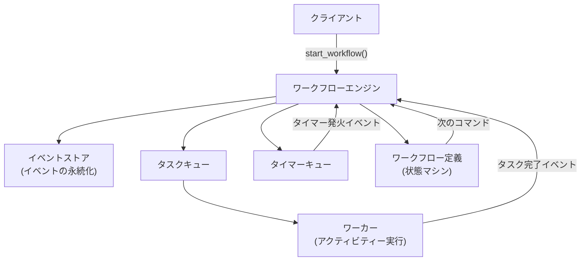
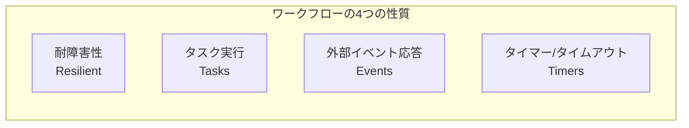
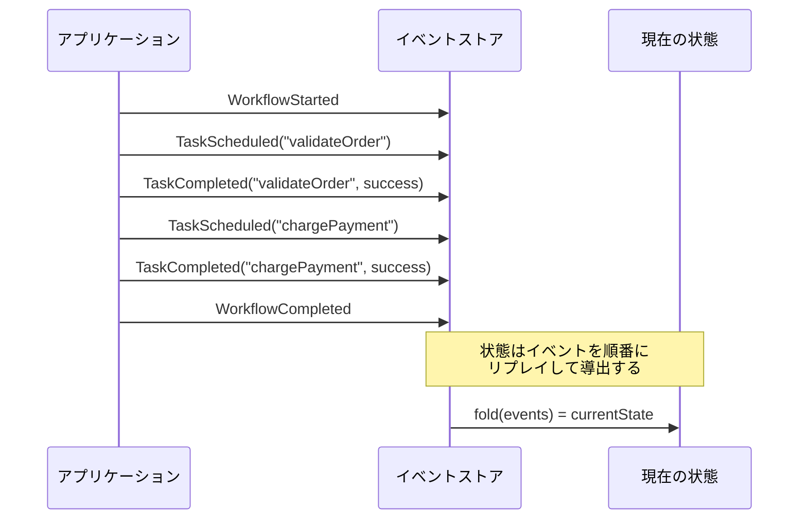
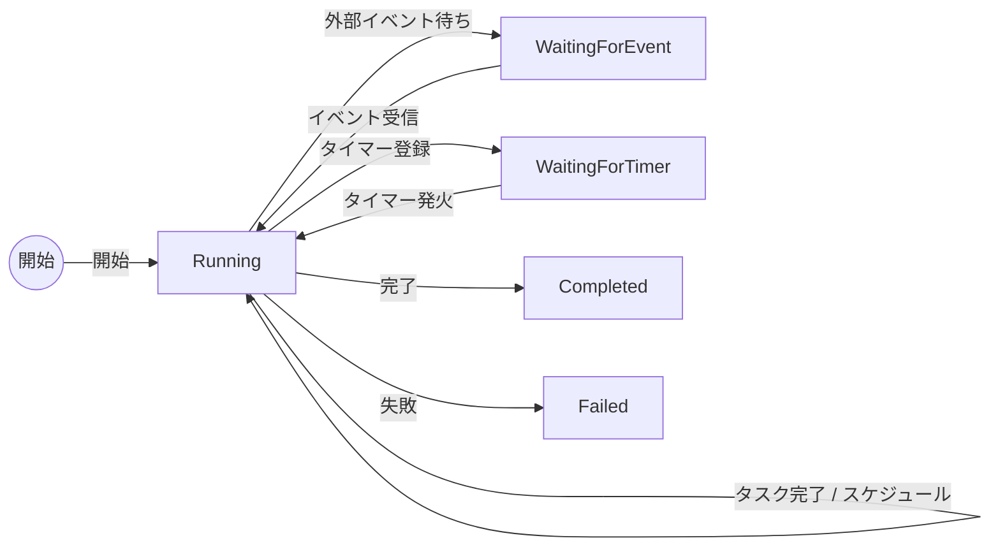
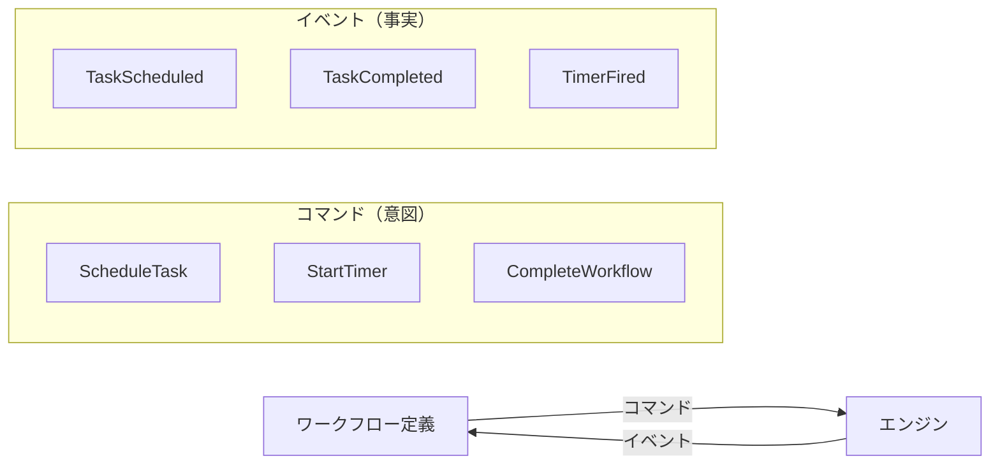
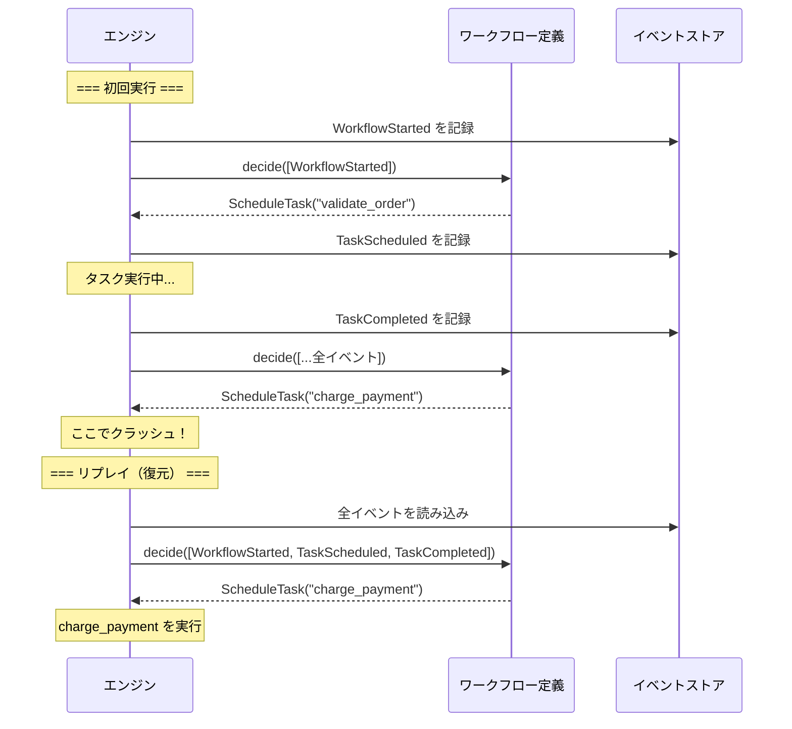
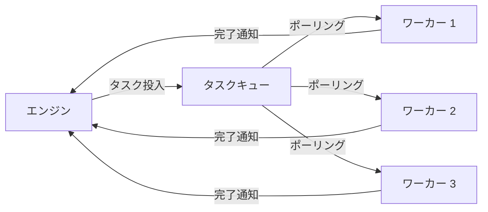
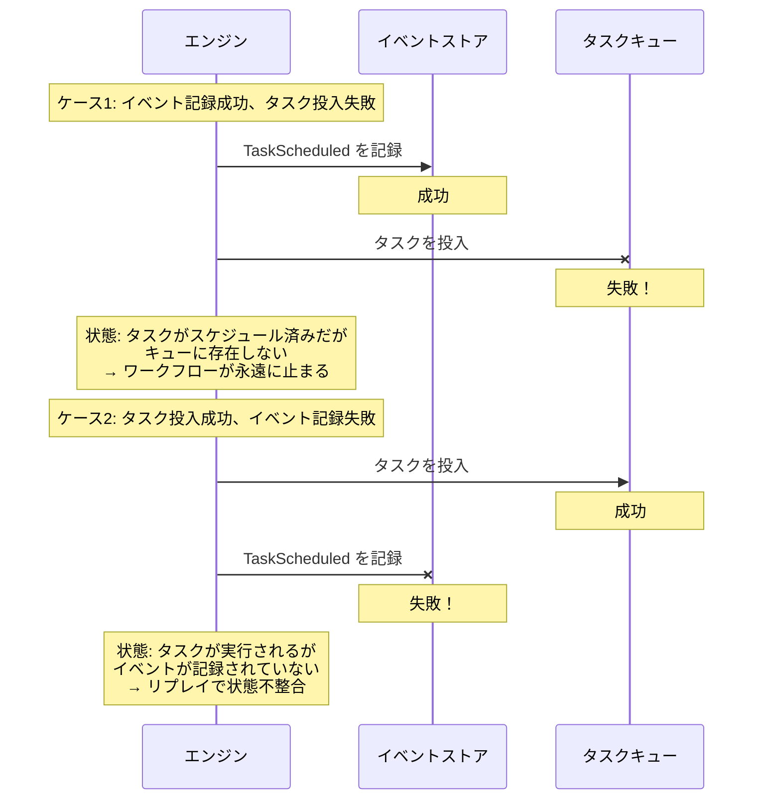
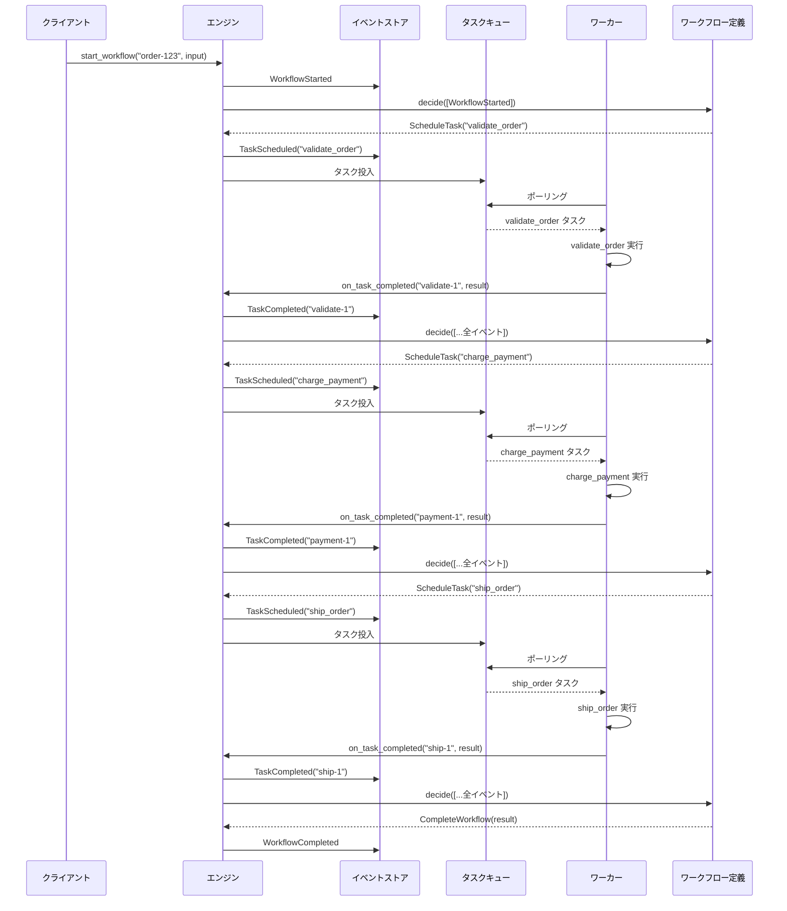
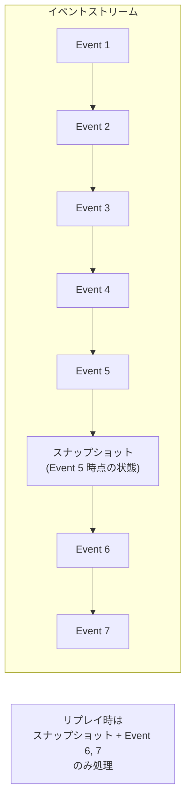

## はじめに

Temporal、Azure Durable Functions、AWS Step Functions などのワークフローエンジンは、EC サイトの注文処理、SaaS のユーザーオンボーディング、決済フローのように、複数のステップを確実に最後まで実行しなければならない処理を支えています。

ワークフローエンジンの内部で何が起きているかは、使うだけでは見えにくい部分です。自分で作ってみると、設計の根底にある原理が理解できます。

この記事では、イベントドリブンなワークフローエンジンを Python でゼロから実装します。使うのは `dataclass`、`ABC`（抽象基底クラス）、`collections.deque` などの標準ライブラリーだけで、外部ライブラリーのインストールは不要です。

### この記事で扱うトピック

1. ワークフローとは何か——4つの性質
2. イベントソーシング——状態を「イベントの列」として保存する
3. ワークフロー定義——決定論的な状態マシン
4. 決定論的リプレイ——クラッシュからの復元
5. タスクキューとワーカー
6. タイマーとタイムアウト
7. トランザクション整合性——Outbox パターン
8. すべてを組み合わせる——注文処理ワークフロー
9. スナップショットによる最適化
10. 商用エンジンとの対応

### 対象読者

- Python の基本文法（クラス、関数、辞書、リスト）を理解している方
- 分散システムやワークフローエンジンに興味があるが、内部の仕組みは知らない方
- Temporal や Azure Durable Functions を使っているが、設計の理由を知りたい方

## 全体アーキテクチャ

これから実装するワークフローエンジンの全体像を次の図に示します。



各コンポーネントの役割は次のとおりです。

- <strong>ワークフローエンジン</strong>——全体を統括するオーケストレーターです。イベントストアから履歴を読み込み、ワークフロー定義に問い合わせて次のアクションを決めます。
- <strong>イベントストア</strong>——起きたことをすべて記録する「帳簿」です。追記のみ可能で、既存の記録は変更しません。
- <strong>ワークフロー定義</strong>——ビジネスロジックを表す状態マシンです。「注文を検証→決済→発送」のような手順を定義します。
- <strong>タスクキュー</strong>——副作用のある処理（API 呼び出し、DB 操作など）をワーカーに委託するための待ち行列です。
- <strong>ワーカー</strong>——タスクキューから仕事を取り出して実際に実行するプロセスです。
- <strong>タイマーキュー</strong>——「30日後にリマインダーを送る」のような時間ベースの制御を管理します。

この構造は Temporal のアーキテクチャを大幅に簡略化したものですが、中心となる概念は同じです。Temporal は Uber 社内で開発された Cadence の後継プロジェクトで、世界中の企業が本番環境で運用しています。

## 第1章：ワークフローとは何か——4つの性質

### 「普通のプログラム」では何が足りないのか

ワークフローエンジンを使わずに、注文処理を普通の関数として書くと次のようになります。

```python
def process_order(order):
    validate_order(order)        # ステップ1: 注文の検証
    charge_payment(order)        # ステップ2: 決済
    ship_order(order)            # ステップ3: 発送
    send_confirmation(order)     # ステップ4: 確認メール
```

この書き方には次の問題があります。

- `charge_payment()` が成功した直後にプロセスがクラッシュすると、決済は済んでいるのに発送されません。最初からやり直せば、お客様に二重課金するかもしれません。
- `ship_order()` が外部配送 API のタイムアウトで失敗した場合、何分後にリトライするかを決め、リトライ中のクラッシュにも備える必要があります。
- 「お客様の承認を3日間待ち、期限を過ぎたらキャンセルする」ような待機を `time.sleep(3 * 86400)` で書くと、プロセスが再起動したときに待機状態が消えます。

ワークフローエンジンは、長時間にわたる複数ステップの処理を、障害があっても確実に最後まで実行するための仕組みです。

### ワークフローの4つの性質

Temporal の共同創設者 Maxim Fateev は、ワークフローを次の4つの性質で定義しています。

1. <strong>耐障害性のあるプログラム</strong>（Resilient Program）——プロセスがクラッシュしても実行を途中から継続できる
2. <strong>タスクを実行する</strong>（Executes Tasks）——外部の副作用を持つ処理（API 呼び出し、DB 書き込み等）を呼び出す
3. <strong>外部イベントに反応する</strong>（Reacts to External Events）——人間の承認ボタンや Webhook など、外部からの通知を受け取れる
4. <strong>タイマーとタイムアウト</strong>（Timers and Timeouts）——「30日間スリープ」「3日以内に承認がなければキャンセル」のような時間ベースの制御ができる



これらの性質を満たすために、ワークフローエンジンはイベントソーシングと決定論的リプレイという2つの仕組みを中心に据えています。第2章でイベントソーシング、第4章で決定論的リプレイを実装します。

## 第2章：イベントソーシング——すべては「イベントの列」

### なぜ「現在の状態」だけでは不十分なのか

従来の CRUD（Create/Read/Update/Delete）アプローチでは、データベースに「現在の状態」だけを保存します。たとえば注文テーブルに `status = "paid"` と書き込めば、それが「今の状態」です。

ワークフローエンジンでは、この方式に次の問題があります。

- <strong>監査証跡がない</strong>——`status` が `"paid"` になった経緯、つまりいつ誰がどういう理由で変更したのかが残りません。
- <strong>障害復旧ができない</strong>——プロセスがクラッシュすると、メモリー上の中間状態は消えます。DB の `status` が更新済みかどうかも分からず、途中まで進んだ状態を正しく復元できません。
- <strong>デバッグが困難</strong>——本番環境で問題が起きたとき、「どういう順序で何が起きたか」を後から再現できません。

### イベントソーシングという解決策

イベントソーシングでは、状態の変更を直接データベースに書き込む代わりに、起きた出来事（イベント）をすべて時系列順に記録します。現在の状態は、記録されたイベントを最初から順番に「リプレイ」（再生）して導出します。

身近な例が銀行の預金通帳です。通帳には「入金 10,000円」「出金 3,000円」「入金 5,000円」と記録され、残高（現在の状態）はこれらの取引履歴を上から順に計算すると求まります（10,000 - 3,000 + 5,000 = 12,000円）。残高だけをメモしていると途中の計算ミスを検証できませんが、取引履歴が全部残っていれば、いつでも正しい残高を計算し直せます。



### `dataclass` でイベントを表現する

まず、ワークフローで発生するイベントの種類を `dataclass` で定義します。

`dataclass` は Python 3.7 で導入されたデコレーターで、`__init__` や `__repr__` を自動生成します。`frozen=True` を指定すると、生成後にフィールドを変更できないイミュータブル（不変）なオブジェクトになります。イベントは起きた事実の記録で、後から書き換えてはいけないため、この制約をコードで強制します。

先頭の `from __future__ import annotations` は、型ヒント（`str`、`list[WorkflowEvent]` など）の評価を遅らせ、文字列として扱わせるためのインポートです。これにより、後で定義するクラス名も型ヒントに書けます。

```python
from __future__ import annotations

import time
from dataclasses import dataclass
from typing import Any


# ──────────────────────────────────────────────
# イベント：「起きたこと」を表すイミュータブルなデータ
# frozen=True により、生成後のフィールド変更を禁止する
# ──────────────────────────────────────────────

@dataclass(frozen=True)
class WorkflowStarted:
    workflow_id: str
    input_data: Any
    timestamp: float

@dataclass(frozen=True)
class TaskScheduled:
    task_id: str
    task_name: str
    input_data: Any
    timestamp: float

@dataclass(frozen=True)
class TaskCompleted:
    task_id: str
    result: Any
    timestamp: float

@dataclass(frozen=True)
class TaskFailed:
    task_id: str
    error: str
    timestamp: float

@dataclass(frozen=True)
class TimerScheduled:
    timer_id: str
    fire_at: float          # Unix タイムスタンプ（秒）
    timestamp: float

@dataclass(frozen=True)
class TimerFired:
    timer_id: str
    timestamp: float

@dataclass(frozen=True)
class ExternalEventReceived:
    event_name: str
    payload: Any
    timestamp: float

@dataclass(frozen=True)
class WorkflowCompleted:
    result: Any
    timestamp: float

@dataclass(frozen=True)
class WorkflowFailed:
    error: str
    timestamp: float


# すべてのイベント型をまとめた型エイリアス（Union 型）
WorkflowEvent = (
    WorkflowStarted | TaskScheduled | TaskCompleted | TaskFailed
    | TimerScheduled | TimerFired | ExternalEventReceived
    | WorkflowCompleted | WorkflowFailed
)
```

どのイベントクラスにも、イベントが起きた時刻を記録する `timestamp` フィールドがあります。第4章で述べるように、ワークフロー定義の中では `time.time()` の代わりにこの値を使い、リプレイしても同じ結果になるようにします。

### イベントストアの実装

次に、イベントを保存・取得するイベントストアを実装します。ここではメモリー上の辞書で実装しますが、本番システムでは PostgreSQL や DynamoDB などの永続ストレージに置き換えます。

```python
from collections import defaultdict


class EventStore:
    """追記専用（append-only）のイベントストア。

    ワークフロー ID ごとにイベントのリストを保持する。
    一度記録されたイベントは変更も削除もしない——
    これがイベントソーシングの根幹ルール。
    """

    def __init__(self) -> None:
        # dict のキーが workflow_id、値がイベントのリスト
        self._streams: dict[str, list[WorkflowEvent]] = defaultdict(list)

    def append(self, workflow_id: str, events: list[WorkflowEvent]) -> None:
        """イベントを末尾に追記する。既存イベントには触れない。"""
        self._streams[workflow_id].extend(events)

    def get_events(self, workflow_id: str) -> list[WorkflowEvent]:
        """指定ワークフローの全イベントを時系列順で返す。"""
        return list(self._streams[workflow_id])

    def get_events_since(
        self, workflow_id: str, after_index: int
    ) -> list[WorkflowEvent]:
        """指定インデックス以降のイベントのみ返す（スナップショット最適化用）。"""
        return list(self._streams[workflow_id][after_index:])
```

`defaultdict(list)` を使うと、まだ存在しないワークフロー ID に `append` したときに、空リストが自動で作られます。

イベントストアは追記専用（append-only）です。`append` メソッドは末尾にイベントを追加するだけで、記録済みのイベントは変更も削除もしません。これがイベントソーシングの基本ルールです。

過去のイベントを書き換えると、そこから導出される現在の状態も変わり、障害後のリプレイで以前とは別の状態が復元されて整合性が壊れます。通帳から過去の取引を消してはいけないのと同じ理由です。

## 第3章：ワークフロー定義——決定論的な状態マシン

### ワークフローは状態マシンである

次は、ワークフローのビジネスロジックを定義する仕組みを作ります。

あらゆるワークフローエンジンの根底には、状態マシン（ステートマシン）という概念があります。JSON ベースの Amazon States Language で宣言する AWS Step Functions も、コードベースの Temporal も同じです。状態マシンとは、「現在どの状態にいるか」と「どんなイベントが来たら次のどの状態に遷移するか」を定義するモデルです。

たとえば注文処理であれば、「注文受付」→「検証済み」→「決済済み」→「発送済み」→「完了」という状態があり、各ステップの完了イベントによって次の状態に遷移します。



エンジンのコアループは、次のサイクルを繰り返します。

1. イベントストアから全イベント履歴を読み込む
2. その履歴をワークフロー定義（状態マシン）に渡す
3. ワークフロー定義が「次に実行すべきコマンド」を返す（例：「タスク A を実行せよ」）
4. エンジンがコマンドを実行し、結果をイベントとして記録する
5. 1 に戻る

このループでは、ワークフロー定義が返す「コマンド」と、エンジンが記録する「イベント」をはっきり区別します。これはワークフローエンジンの重要な設計原理です。

### コマンドとイベントの分離

- <strong>コマンド</strong>（Command）は、ワークフロー定義が発行する意図です。「このタスクを実行してほしい」「タイマーを設定してほしい」という依頼に当たります。
- <strong>イベント</strong>（Event）は、エンジンが記録する事実です。「このタスクが完了した」「タイマーが発火した」という結果に当たります。



分離すると、「決済 API を呼ぶ」のような副作用の実行をエンジンとワーカーに任せられるので、ワークフロー定義は次に何をするかを判断する純粋なロジックだけになります。そのため、ワークフロー定義はテストしやすく、リプレイもできます。

### Python でコマンドとワークフロー定義を実装する

コマンドもイベントと同じく `dataclass` で定義し、ワークフロー定義のインターフェースは `ABC`（Abstract Base Class：抽象基底クラス）で定義します。

`ABC` を継承して `@abstractmethod` を付けたメソッドを持つクラスは直接インスタンス化できず、サブクラスでそのメソッドを実装する必要があります。Java や C# の `interface` に相当します。

```python
from abc import ABC, abstractmethod


# ──────────────────────────────────────────────
# コマンド：ワークフロー定義が発行する「意図」
# ──────────────────────────────────────────────

@dataclass(frozen=True)
class ScheduleTask:
    task_id: str
    task_name: str
    input_data: Any

@dataclass(frozen=True)
class StartTimer:
    timer_id: str
    delay_seconds: float

@dataclass(frozen=True)
class WaitForEvent:
    event_name: str

@dataclass(frozen=True)
class CompleteWorkflow:
    result: Any

@dataclass(frozen=True)
class FailWorkflow:
    error: str


WorkflowCommand = (
    ScheduleTask | StartTimer | WaitForEvent
    | CompleteWorkflow | FailWorkflow
)


# ──────────────────────────────────────────────
# ワークフロー定義の抽象インターフェース
# ──────────────────────────────────────────────

class WorkflowDefinition(ABC):
    """ワークフローのビジネスロジックを表す抽象基底クラス。

    サブクラスは decide() メソッドを実装する。
    decide() は「イベント履歴を受け取り、次のコマンドのリストを返す」
    純粋関数でなければならない。
    """

    @abstractmethod
    def decide(self, events: list[WorkflowEvent]) -> list[WorkflowCommand]:
        """イベント履歴から次に実行すべきコマンドを決定する。

        重要: このメソッドは **純粋関数** でなければならない。
        同じイベント列を入力すれば、必ず同じコマンド列を返すこと。
        """
        ...
```

`decide` メソッドは純粋関数でなければなりません。つまり、同じイベント列に対して必ず同じコマンド列を返し、副作用を持ちません。この記事で最も重要な制約で、第4章の決定論的リプレイはこの性質を前提に成り立っています。

### 具体例：注文処理ワークフロー

「注文検証 → 決済 → 発送 → 完了」と進む注文処理を、ワークフロー定義として実装します。

```python
class OrderWorkflow(WorkflowDefinition):
    """注文処理ワークフロー。

    検証 → 決済 → 発送 → 完了 の順に進む。
    途中でタスクが失敗したらワークフロー全体を失敗にする。
    """

    def decide(self, events: list[WorkflowEvent]) -> list[WorkflowCommand]:
        # まずイベント履歴から「今どのフェーズにいるか」を計算する
        state = self._build_state(events)

        # フェーズに応じて次のコマンドを返す
        if state["phase"] == "started":
            return [ScheduleTask(
                task_id="validate-1",
                task_name="validate_order",
                input_data=state["order_data"],
            )]

        if state["phase"] == "validated":
            return [ScheduleTask(
                task_id="payment-1",
                task_name="charge_payment",
                input_data=state["order_data"],
            )]

        if state["phase"] == "charged":
            return [ScheduleTask(
                task_id="ship-1",
                task_name="ship_order",
                input_data=state["order_data"],
            )]

        if state["phase"] == "shipped":
            return [CompleteWorkflow(result={
                "order_id": state["order_id"],
                "status": "delivered",
            })]

        if state["phase"] == "failed":
            return [FailWorkflow(error=state["error_message"])]

        # タスク実行中や外部イベント待ちの場合はコマンドなし
        return []

    def _build_state(self, events: list[WorkflowEvent]) -> dict:
        """イベント履歴を先頭から順に処理して現在の状態を構築する。

        この操作はイベントソーシングにおいて rehydration（再水和）と呼ばれる。
        関数型プログラミングでは fold（畳み込み）に相当する。
        """
        phase = "initial"
        order_data: Any = None
        order_id = ""
        error_message = ""

        for event in events:
            if isinstance(event, WorkflowStarted):
                phase = "started"
                order_data = event.input_data
                if isinstance(event.input_data, dict):
                    order_id = event.input_data.get("order_id", "")

            elif isinstance(event, TaskCompleted):
                if event.task_id == "validate-1":
                    phase = "validated"
                elif event.task_id == "payment-1":
                    phase = "charged"
                elif event.task_id == "ship-1":
                    phase = "shipped"

            elif isinstance(event, TaskFailed):
                phase = "failed"
                error_message = event.error

        return {
            "phase": phase,
            "order_data": order_data,
            "order_id": order_id,
            "error_message": error_message,
        }
```

`_build_state` メソッドは、イベントリストを先頭から順に処理して、現在のフェーズを計算します。この操作はイベントソーシングで rehydration（再水和）と呼ばれます。関数型プログラミングの fold（畳み込み）に当たり、`functools.reduce` と同じパターンです。

イベントの型は `isinstance` で判別し、型ごとに状態を更新します。TypeScript の `switch (event.type)` や Rust の `match` に相当する書き方です。Python 3.10 以降の `match` 文でも同じ分岐を書けます。

## 第4章：決定論的リプレイ——クラッシュからの復元

### なぜリプレイで復元できるのか

ワークフローエンジンで最も重要な特性は障害耐性です。プロセスがクラッシュしても、イベントストアに記録されたイベント列をリプレイすれば、クラッシュ前と同じ状態を復元できます。

復元できるのは、前章で実装した `decide` メソッドが純粋関数だからです。イベントストアに残っている履歴を `decide` に渡せば、どこまで進んでいて次に何をすべきかが一意に決まります。



図の「リプレイ（復元）」では、新しいプロセスがイベントストアから全履歴を読み込み、`decide` に渡します。`decide` はクラッシュ前と同じイベント列に対して同じコマンドを返すので、エンジンは検証までは済んでいると判断し、`charge_payment` から正しく再開できます。

### 決定論性の制約——`decide` の中でやってはいけないこと

この仕組みが成り立つには、`decide` メソッドが決定論的、つまり同じ入力に対して常に同じ出力を返す必要があります。そのため、`decide` の中では次の操作を禁止します。

| 禁止事項 | 理由 | 代替手段 |
|----------|------|---------|
| `random.random()` | リプレイ時に異なる値が返る | タスクとして実行し結果をイベントに記録 |
| `time.time()` | リプレイ時に異なるタイムスタンプが返る | イベントの `timestamp` フィールドを使用 |
| ネットワーク呼び出し | リプレイ時に副作用が再実行される | アクティビティー（タスク）として実行 |
| グローバル変数の参照 | プロセス間で値が異なることがある | イベントの入力として渡す |

Temporal も公式ドキュメントで、ワークフローコードは決定論的でなければならないと明記しています。副作用のある処理はすべてアクティビティー（タスク）として外に出し、その結果をイベントとして記録します。リプレイ時はアクティビティーを再実行せず、記録済みのイベント（結果）を使うので、決定論性が保たれます。

### リプレイエンジンの実装

ここで、イベントストア・ワークフロー定義・タスクキュー・タイマーキューを結び付けるワークフローエンジン本体を実装します。

```python
class WorkflowEngine:
    """ワークフローエンジン本体。

    責務:
    1. ワークフローの開始（start_workflow）
    2. イベント履歴からの状態復元と次コマンドの決定（process_workflow）
    3. コマンドの実行とイベントの記録（_execute_command）
    4. タスク完了/失敗/タイマー発火のコールバック
    """

    def __init__(
        self,
        event_store: EventStore,
        task_queue: "TaskQueue",
        timer_queue: "TimerQueue",
        registry: dict[str, WorkflowDefinition],
    ) -> None:
        self.event_store = event_store
        self._task_queue = task_queue
        self._timer_queue = timer_queue
        self._registry = registry

    # ─── ワークフローの開始 ───

    def start_workflow(
        self, workflow_id: str, workflow_type: str, input_data: Any
    ) -> None:
        """新しいワークフローを開始する。"""
        start_event = WorkflowStarted(
            workflow_id=workflow_id,
            input_data=input_data,
            timestamp=time.time(),
        )
        self.event_store.append(workflow_id, [start_event])
        self.process_workflow(workflow_id, workflow_type)

    # ─── コアループ ───

    def process_workflow(self, workflow_id: str, workflow_type: str) -> None:
        """イベント列から次のコマンドを決定し実行する。

        このメソッドが「決定論的リプレイ」の実体。
        同じイベント列に対して decide() は同じコマンド列を返すため、
        クラッシュ後でも正しい地点から再開できる。
        """
        definition = self._registry.get(workflow_type)
        if definition is None:
            raise ValueError(f"Unknown workflow type: {workflow_type}")

        events = self.event_store.get_events(workflow_id)

        # ① 決定論的リプレイ：同じイベント列 → 同じコマンド列
        commands = definition.decide(events)

        # ② 既にスケジュール済みのコマンドをスキップ（冪等性の確保）
        new_commands = self._filter_already_processed(events, commands)

        # ③ 新しいコマンドだけを実行
        for command in new_commands:
            self._execute_command(workflow_id, workflow_type, command)

    # ─── コマンドの実行 ───

    def _execute_command(
        self, workflow_id: str, workflow_type: str, command: WorkflowCommand
    ) -> None:
        """コマンドを実行し、対応するイベントを記録する。"""
        now = time.time()

        if isinstance(command, ScheduleTask):
            event = TaskScheduled(
                task_id=command.task_id,
                task_name=command.task_name,
                input_data=command.input_data,
                timestamp=now,
            )
            self.event_store.append(workflow_id, [event])
            self._task_queue.enqueue(TaskEntry(
                workflow_id=workflow_id,
                workflow_type=workflow_type,
                task_id=command.task_id,
                task_name=command.task_name,
                input_data=command.input_data,
            ))

        elif isinstance(command, StartTimer):
            fire_at = now + command.delay_seconds
            event = TimerScheduled(
                timer_id=command.timer_id,
                fire_at=fire_at,
                timestamp=now,
            )
            self.event_store.append(workflow_id, [event])
            self._timer_queue.schedule(TimerEntry(
                workflow_id=workflow_id,
                workflow_type=workflow_type,
                timer_id=command.timer_id,
                fire_at=fire_at,
            ))

        elif isinstance(command, CompleteWorkflow):
            event = WorkflowCompleted(result=command.result, timestamp=now)
            self.event_store.append(workflow_id, [event])

        elif isinstance(command, FailWorkflow):
            event = WorkflowFailed(error=command.error, timestamp=now)
            self.event_store.append(workflow_id, [event])

        # WaitForEvent はエンジン側では何もしない——
        # 外部イベントの到着を待つだけ

    # ─── コールバック ───

    def on_task_completed(
        self, workflow_id: str, workflow_type: str,
        task_id: str, result: Any,
    ) -> None:
        """ワーカーからタスク完了の通知を受け取る。"""
        event = TaskCompleted(
            task_id=task_id, result=result, timestamp=time.time()
        )
        self.event_store.append(workflow_id, [event])
        # ワークフローを再駆動して次のコマンドを決定
        self.process_workflow(workflow_id, workflow_type)

    def on_task_failed(
        self, workflow_id: str, workflow_type: str,
        task_id: str, error: str,
    ) -> None:
        """ワーカーからタスク失敗の通知を受け取る。"""
        event = TaskFailed(
            task_id=task_id, error=error, timestamp=time.time()
        )
        self.event_store.append(workflow_id, [event])
        self.process_workflow(workflow_id, workflow_type)

    def on_timer_fired(
        self, workflow_id: str, workflow_type: str,
        timer_id: str, now: float,
    ) -> None:
        """タイマーキューからタイマー発火の通知を受け取る。"""
        event = TimerFired(timer_id=timer_id, timestamp=now)
        self.event_store.append(workflow_id, [event])
        self.process_workflow(workflow_id, workflow_type)

    # ─── 冪等性フィルター ───

    def _filter_already_processed(
        self,
        events: list[WorkflowEvent],
        commands: list[WorkflowCommand],
    ) -> list[WorkflowCommand]:
        """既にスケジュール済みのコマンドをスキップする。

        リプレイ時に同じコマンドを二重実行しないための冪等性ガード。
        """
        scheduled_task_ids: set[str] = set()
        scheduled_timer_ids: set[str] = set()
        is_completed = False

        for e in events:
            if isinstance(e, TaskScheduled):
                scheduled_task_ids.add(e.task_id)
            elif isinstance(e, TimerScheduled):
                scheduled_timer_ids.add(e.timer_id)
            elif isinstance(e, (WorkflowCompleted, WorkflowFailed)):
                is_completed = True

        if is_completed:
            return []

        result: list[WorkflowCommand] = []
        for cmd in commands:
            if isinstance(cmd, ScheduleTask) and cmd.task_id in scheduled_task_ids:
                continue    # 既にスケジュール済み → スキップ
            if isinstance(cmd, StartTimer) and cmd.timer_id in scheduled_timer_ids:
                continue
            result.append(cmd)

        return result
```

各メソッドの役割は次のとおりです。

1. <strong>`process_workflow`</strong>——コアループです。イベントストアから全イベントを読み込み、`decide()` に渡して次のコマンドを計算し、まだ実行していないコマンドだけを実行します。
2. <strong>`_execute_command`</strong>——コマンドの種類に応じてイベントを記録し、タスクキューやタイマーキューに仕事を投入します。
3. <strong>`on_task_completed` / `on_task_failed` / `on_timer_fired`</strong>——外部からの通知を受け取ってイベントを記録し、`process_workflow` を再度呼び出して、ワークフローを次のステップへ進めます。
4. <strong>`_filter_already_processed`</strong>——冪等性のガードです。リプレイ時に `decide()` が「タスク A をスケジュールせよ」と返しても、イベントストアに「タスク A はスケジュール済み」の記録があればスキップし、同じコマンドの二重実行を防ぎます。

## 第5章：タスクキューとワーカー

### なぜキューが必要なのか

ワークフローエンジンが「決済 API を呼び出せ」と決定しても、エンジン自身は API を呼ばず、キューを経由してワーカーに実行させます。理由は3つあります。

1. <strong>流量制御</strong>——外部 API には秒間リクエスト数の上限（レートリミット）があります。キューを挟むと、ワーカーの処理能力に応じてタスクを分配できます。
2. <strong>可用性</strong>——ワーカーが一時的にダウンしても、タスクはキューに残ります。ワーカーが復旧したら、キューからタスクを取り出して処理を再開できます。
3. <strong>スケーラビリティー</strong>——ワーカーを水平スケール（台数追加）して、並列処理能力を上げられます。1台では処理しきれない量のタスクが来ても、10台に増やせば対応できます。



### タスクキューとワーカーの実装

`collections` モジュールの `deque`（両端キュー）は、両端での追加・削除を O(1) で行えるデータ構造です。`list` の `list.pop(0)` は O(n) ですが、`deque.popleft()` は O(1) なので、FIFO キューの実装に向いています。

アクティビティー関数の型は、`collections.abc` の `Callable` と `Awaitable` で表します。`Callable[[Any], Awaitable[Any]]` は「任意の型の引数を1つ受け取り、非同期の結果を返す関数」を意味します。

```python
from collections import deque
from collections.abc import Awaitable, Callable


@dataclass
class TaskEntry:
    """タスクキューに投入されるエントリ。"""
    workflow_id: str
    workflow_type: str
    task_id: str
    task_name: str
    input_data: Any


class TaskQueue:
    """シンプルなインメモリ FIFO タスクキュー。

    本番では RabbitMQ、Amazon SQS、Redis Streams 等に置き換える。
    """

    def __init__(self) -> None:
        self._queue: deque[TaskEntry] = deque()

    def enqueue(self, task: TaskEntry) -> None:
        """タスクをキューの末尾に追加する。"""
        self._queue.append(task)

    def dequeue(self) -> TaskEntry | None:
        """キューの先頭からタスクを取得する（FIFO）。

        キューが空の場合は None を返す。
        """
        if self._queue:
            return self._queue.popleft()
        return None

    def __len__(self) -> int:
        return len(self._queue)


# アクティビティ関数の型：入力を受け取り結果を返す非同期関数
ActivityFn = Callable[[Any], Awaitable[Any]]


class Worker:
    """ワーカー：タスクキューからタスクを取得し実行する。

    アクティビティ（副作用のある処理）を実行し、
    完了/失敗をエンジンに通知する。
    """

    def __init__(
        self,
        task_queue: TaskQueue,
        engine: WorkflowEngine,
        activities: dict[str, ActivityFn],
    ) -> None:
        self._task_queue = task_queue
        self._engine = engine
        self._activities = activities

    async def poll(self) -> None:
        """キューからタスクを1つ取得して実行する。

        本番ではこれをループで回し続ける（ロングポーリング）。
        """
        task = self._task_queue.dequeue()
        if task is None:
            return

        activity = self._activities.get(task.task_name)
        if activity is None:
            self._engine.on_task_failed(
                task.workflow_id, task.workflow_type,
                task.task_id, f"Unknown activity: {task.task_name}",
            )
            return

        try:
            result = await activity(task.input_data)
            self._engine.on_task_completed(
                task.workflow_id, task.workflow_type,
                task.task_id, result,
            )
        except Exception as exc:
            self._engine.on_task_failed(
                task.workflow_id, task.workflow_type,
                task.task_id, str(exc),
            )
```

ワーカーが実行するアクティビティーは、外部 API 呼び出し、データベース操作、メール送信など、副作用を持つ処理です。ワークフロー定義とは次のように性質が異なります。

- <strong>ワークフロー定義</strong>——純粋関数。副作用なし。決定論的。リプレイ可能。
- <strong>アクティビティー</strong>——副作用あり。非決定論的で構わない。実行結果はイベントとして記録される。

アクティビティーが非決定論的でも構わないのは、その結果がイベントとして記録されるからです。リプレイ時はアクティビティーを再実行せず、イベントストアに記録された結果（`TaskCompleted` や `TaskFailed`）を使います。そのため、外部 API の呼び出しのように毎回異なる結果を返す処理でも、リプレイの決定論性は損なわれません。

## 第6章：タイマーとタイムアウト

### 「30日間スリープ」をどう実現するか

ワークフローでは「承認待ちで3日間タイムアウト」「30日後にリマインダー送信」といった長時間の待機が必要になります。

`time.sleep(30 * 86400)` と書くと、プロセスが再起動したときにスリープ状態が消えます。30日間ずっとプロセスを動かし続けるのは非現実的で、その間メモリーも無駄に消費します。

そこで永続タイマーを使います。「何時何分に発火する」という予約情報をイベントとして記録し、別のプロセス（タイマーサービス）が定期的に確認して、時刻が来たらイベントを発火します。イベントストアに予約の記録が残っているので、プロセスが再起動しても、タイマーサービスがタイマーを自動で復元できます。

```python
@dataclass
class TimerEntry:
    """タイマーキューに登録されるエントリ。"""
    workflow_id: str
    workflow_type: str
    timer_id: str
    fire_at: float   # Unix タイムスタンプ（秒）


class TimerQueue:
    """永続タイマーキュー。

    発火時刻順にソートされたリストを保持し、
    定期的に check_and_fire() を呼ぶことで
    期限到来のタイマーを発火する。

    本番では Redis の Sorted Set や
    データベースのスケジューラに置き換える。
    """

    def __init__(self) -> None:
        self._timers: list[TimerEntry] = []

    def schedule(self, timer: TimerEntry) -> None:
        """タイマーを登録し、発火時刻順にソートする。"""
        self._timers.append(timer)
        self._timers.sort(key=lambda t: t.fire_at)

    def check_and_fire(
        self, engine: WorkflowEngine, now: float | None = None
    ) -> None:
        """発火時刻を過ぎたタイマーをすべて発火する。"""
        if now is None:
            now = time.time()

        while self._timers and self._timers[0].fire_at <= now:
            timer = self._timers.pop(0)
            engine.on_timer_fired(
                timer.workflow_id, timer.workflow_type,
                timer.timer_id, now,
            )
```

`check_and_fire` メソッドは、エンジンの `on_timer_fired` を呼び出します。前章のワーカーが `on_task_completed` を呼ぶのと同じパターンで、エンジンから見ればタイマーの発火もタスク完了も「イベントを記録し、`process_workflow` を再駆動する」という同じ流れです。

## 第7章：トランザクション整合性——Outbox パターン

### イベント記録とタスク投入の不整合

ワークフローエンジンの各操作では、状態変更と配信意図をアトミック（全部成功するか全部失敗するか）に永続化する必要があります。具体的には、次の3つを1つのトランザクションで書き込みます。

1. イベントストアにイベントを追記する
2. タスク投入メッセージを Outbox テーブルに記録する
3. タイマー登録メッセージを同じ Outbox テーブルに記録する

イベントの記録とタスクキューへの投入を別々に行うと、次のような不整合が起きます。



ケース1では、イベントストアに「タスクをスケジュールした」と記録されていても、タスクはキューに入っていません。ワーカーはそのタスクを処理せず、ワークフローは止まったままになります。

ケース2では、タスクはキューに入って実行されますが、イベントストアには記録がありません。リプレイ時に `decide` は同じコマンドをもう一度返し、`TaskScheduled` の記録がないため、エンジンは同じタスクを二重にスケジュールしてしまいます。

### Outbox パターンによる解決

Temporal のアーキテクチャでは、この問題を Transfer Queue で解決しています。マイクロサービスアーキテクチャでは、Chris Richardson が Transactional Outbox パターンとしてまとめた手法が広く知られています。

考え方は次のとおりです。

1. イベントとメッセージ（タスク投入やタイマー登録の依頼）を<strong>同じトランザクション</strong>でデータベースに書き込む
2. 別のプロセス（Outbox リレー）が非同期でメッセージを読み出し、実際のキューに配信する

こうすると、ケース1のように「イベントは記録されたがメッセージが配信されない」状態が残りません。Outbox リレーのプロセスがクラッシュしても、未配信のメッセージはデータベースに残っているので、再起動後に配信をリトライできます。

```python
import json


@dataclass
class OutboxEntry:
    """Outbox テーブルのエントリ。

    イベントストアと同じトランザクションで書き込まれ、
    Outbox リレーが非同期でタスクキュー/タイマーキューに配信する。
    """
    id: int
    workflow_id: str
    workflow_type: str
    message_type: str      # "task" または "timer"
    payload: str           # JSON 文字列
    processed: bool = False


class TransactionalEventStore:
    """Outbox パターン付きのトランザクショナルイベントストア。

    append_with_outbox() が「イベント追記 + Outbox メッセージ追加」を
    アトミックに行う。実際のシステムではデータベーストランザクションを使う。
    """

    def __init__(self) -> None:
        self._streams: dict[str, list[WorkflowEvent]] = defaultdict(list)
        self._outbox: list[OutboxEntry] = []
        self._next_outbox_id = 1

    def append_with_outbox(
        self,
        workflow_id: str,
        events: list[WorkflowEvent],
        messages: list[OutboxEntry],
    ) -> None:
        """アトミックにイベントを追記し Outbox メッセージを追加する。

        ──── ここがトランザクション境界 ────
        実際のシステムでは BEGIN / COMMIT で囲む：
          BEGIN;
            INSERT INTO event_store ...;
            INSERT INTO outbox ...;
          COMMIT;
        """
        self._streams[workflow_id].extend(events)
        for msg in messages:
            msg.id = self._next_outbox_id
            self._next_outbox_id += 1
            self._outbox.append(msg)

    def process_outbox(
        self,
        task_queue: TaskQueue,
        timer_queue: TimerQueue,
    ) -> None:
        """Outbox リレー：未処理メッセージをキューに配信する。"""
        for entry in self._outbox:
            if entry.processed:
                continue

            payload = json.loads(entry.payload)
            if entry.message_type == "task":
                task_queue.enqueue(TaskEntry(**payload))
            elif entry.message_type == "timer":
                timer_queue.schedule(TimerEntry(**payload))

            entry.processed = True

    def get_events(self, workflow_id: str) -> list[WorkflowEvent]:
        """指定ワークフローの全イベントを返す。"""
        return list(self._streams[workflow_id])
```

この実装はインメモリーで、トランザクション境界をコメントで示しているだけですが、パターンの要点は同じです。本番システムでは `append_with_outbox` の処理を SQL の `BEGIN` / `COMMIT` で囲み、アトミックに実行します。

> <strong>Outbox パターンの保証と注意点</strong>：メッセージは「少なくとも1回」配信されます（at-least-once）。Outbox リレーがメッセージを配信した直後にクラッシュすると、`processed = True` への更新が失われ、次回起動時に同じメッセージが再配信される可能性があります。そのため、コンシューマー（ワーカーやタイマー処理）は冪等でなければなりません。冪等とは「同じ操作を何回実行しても、1回実行したときと結果が同じ」という性質です。たとえば「残高を1,000円にする」は冪等ですが（何回繰り返しても1,000円）、「残高に1,000円を加算する」は冪等ではありません（繰り返した回数だけ加算される）。冪等にするには、処理済みの task_id を記録しておき、重複を検知してスキップする方法が一般的です。

## 第8章：すべてを組み合わせる——注文処理ワークフロー

### 完全な実行フロー

ここまでの部品を組み合わせたときの、注文処理ワークフローの実行フロー全体を次の図に示します。



流れを順に書くと次のようになります。

1. クライアントが `start_workflow` を呼ぶと、エンジンは `WorkflowStarted` イベントを記録し、`decide` を呼びます。
2. `decide` は「まだ検証していない」と判断し、`ScheduleTask("validate_order")` コマンドを返します。
3. エンジンは `TaskScheduled` イベントを記録し、タスクキューにタスクを投入します。
4. ワーカーがタスクキューからタスクを取得し、`validate_order` アクティビティーを実行します。
5. 成功したら、ワーカーはエンジンの `on_task_completed` を呼びます。
6. エンジンは `TaskCompleted` イベントを記録し、再び `decide` を呼びます。
7. `decide` は「検証は完了した。次は決済だ」と判断し、`ScheduleTask("charge_payment")` を返します。
8. 以下同様に、決済 → 発送 → 完了 と進みます。

ステップ6で `TaskCompleted` を記録した直後にクラッシュした場合も、新しいプロセスがイベントストアから全イベントを読み込んで `decide` に渡します。`decide` はイベント列から「検証は完了済み、次は決済」と決定論的に判断するため、ステップ7から正しく再開できます。

### エントリーポイント——すべてを配線する

シーケンス図だけでは、どこからどう起動するのかが分かりにくいかもしれません。次の `main` 関数で、これまで作った部品をすべて配線して起動します。

```python
import asyncio


# ─── アクティビティ関数（副作用のある実際のビジネスロジック） ───

async def validate_order(input_data: Any) -> dict:
    """注文内容を検証する。"""
    order_id = input_data["order_id"]
    # 実際には在庫確認や入力バリデーションを行う
    return {"valid": True, "order_id": order_id}


async def charge_payment(input_data: Any) -> dict:
    """決済処理を行う。"""
    order_id = input_data["order_id"]
    # 実際には決済ゲートウェイ API を呼び出す
    return {"charged": True, "order_id": order_id}


async def ship_order(input_data: Any) -> dict:
    """出荷処理を行う。"""
    order_id = input_data["order_id"]
    # 実際には配送業者 API を呼び出す
    return {"tracking_id": "TRK-456", "order_id": order_id}


# ─── メイン関数 ───

async def main() -> None:
    # 1. インフラ層を初期化
    event_store = EventStore()
    task_queue = TaskQueue()
    timer_queue = TimerQueue()

    # 2. ワークフロー定義を登録
    #    キー "order" は start_workflow の workflow_type に対応
    registry: dict[str, WorkflowDefinition] = {
        "order": OrderWorkflow(),
    }

    # 3. エンジンを組み立て
    engine = WorkflowEngine(event_store, task_queue, timer_queue, registry)

    # 4. アクティビティ関数を登録してワーカーを作成
    #    キーはワークフロー定義の decide() が返す task_name に対応
    activities: dict[str, ActivityFn] = {
        "validate_order": validate_order,
        "charge_payment": charge_payment,
        "ship_order": ship_order,
    }
    worker = Worker(task_queue, engine, activities)

    # 5. ワークフローを開始
    engine.start_workflow(
        workflow_id="order-123",
        workflow_type="order",
        input_data={"order_id": "ORD-123", "items": ["item-A", "item-B"]},
    )

    # 6. ワーカーでタスクを処理（キューが空になるまで）
    while len(task_queue) > 0:
        await worker.poll()

    # 7. 結果を確認
    events = event_store.get_events("order-123")
    for i, event in enumerate(events):
        print(f"[{i}] {type(event).__name__}")


asyncio.run(main())
```

`main` 関数は、ワークフローエンジンを構成する次の層を配線します。

- `EventStore`、`TaskQueue`、`TimerQueue` はインフラ層です。データの永続化とタスクの受け渡しを担当します。
- `OrderWorkflow` はビジネスロジック層です。次に何をすべきかを判断します。
- `WorkflowEngine` はオーケストレーション層です。イベントの記録、`decide` の呼び出し、コマンドの実行を統括します。
- `Worker` は実行層です。副作用のあるアクティビティーを実行し、結果をエンジンに報告します。

`main` 関数自身はこれらの層を組み立てて起動するだけで、ビジネスロジックもインフラの詳細も含みません。関心が層ごとに分離されているためです。

本番環境では、`while len(task_queue) > 0` のループは常駐プロセスのロングポーリングに置き換わり、`asyncio.run(main())` は Web フレームワークのエントリーポイント（例：FastAPI の `uvicorn` 起動）に統合されますが、配線の構造は変わりません。

### イベントストアの中身

実行が完了すると、イベントストアには次のイベントが記録されています。

```text
[0] WorkflowStarted      input={"order_id": "ORD-123", "items": [...]}
[1] TaskScheduled         task_id="validate-1"  task_name="validate_order"
[2] TaskCompleted         task_id="validate-1"  result={"valid": True, ...}
[3] TaskScheduled         task_id="payment-1"   task_name="charge_payment"
[4] TaskCompleted         task_id="payment-1"   result={"charged": True, ...}
[5] TaskScheduled         task_id="ship-1"      task_name="ship_order"
[6] TaskCompleted         task_id="ship-1"      result={"tracking_id": "TRK-456", ...}
[7] WorkflowCompleted     result={"order_id": "ORD-123", "status": "delivered"}
```

この履歴があれば任意の時点の状態を復元でき、監査証跡やデバッグに使えます。注文が失敗した理由を調べるときも、イベント列を上から追えば経緯が分かります。

## 第9章：スナップショットによる最適化

### リプレイのコスト問題

ここまでの実装では、`process_workflow` が呼ばれるたびに全イベントをイベントストアから読み込み、`decide` に渡しています。ワークフローが短ければ問題ありませんが、数千〜数万ステップのワークフロー（例：大規模バッチ処理や長期間の承認フロー）では、毎回すべてのイベントをリプレイするコストが無視できなくなります。

### スナップショットという解決策

そこでスナップショットを使います。N 件のイベントを処理するごとにその時点の状態をスナップショットとして保存し、次回のリプレイではスナップショットとそれ以降のイベントだけを処理します。



たとえば1,000件のイベントがあるワークフローで、500件目にスナップショットを取っていれば、リプレイ時に処理するのは 501〜1,000 の 500 件だけで、処理量は半分になります。

スナップショットはあくまで最適化のための仕組みで、正となるデータ（ソースオブトゥルース）はイベントストリームです。スナップショットが壊れたり失われたりしても、イベントストリームからいつでも再生成できるので、データは失われません。

## 第10章：商用ワークフローエンジンとの対応

この記事で実装した各概念が、商用のワークフローエンジンで何に対応するかを次の表にまとめます。名前は違っても、仕組みはほぼ対応しています。例外はリプレイ最適化で、どちらのエンジンも永続的なスナップショットは持ちません。

| 概念 | 本記事の実装 | Temporal | Azure Durable Functions |
|------|-------------|----------|------------------------|
| イベントストア | `EventStore` クラス | History Service（各ワークフローに Event History） | Azure Storage Table/Blob（History Table） |
| ワークフロー定義 | `WorkflowDefinition.decide()` | Workflow 関数（決定論コード） | Orchestrator 関数（`yield`/`await` で replay） |
| タスク実行 | `Worker` + `TaskQueue` | Activity + Task Queue | Activity 関数 + Durable Task Framework |
| タイマー | `TimerQueue` | Durable Timer（History Service 内） | Durable Timer（`create_timer()`） |
| Outbox パターン | `TransactionalEventStore` | Transfer Queue（各シャードにローカルキュー） | Control Queue + Work Item Queue |
| 決定論的リプレイ | `process_workflow()` | Workflow Task Processing | Orchestrator Replay |
| スナップショット / リプレイ最適化 | `get_events_since()` | Sticky Execution（ワーカー上のインメモリーキャッシュ。永続スナップショットではなく、ワーカー障害時はフルリプレイが行われる） | Extended Sessions / instance cache（インメモリーのリプレイキャッシュで、永続スナップショットではない。対応は storage provider に依存） |

Temporal の Sticky Execution はワーカープロセスのメモリー上に状態をキャッシュする仕組みで、第9章で説明した永続スナップショットとは性質が異なります。同じワーカーに連続して処理が割り当てられる場合はリプレイを省けますが、ワーカーがクラッシュするとキャッシュが失われ、フルリプレイが必要になります。

## まとめ

この記事で実装したワークフローエンジンは、次の6つの設計原理に基づいています。

1. <strong>イベントソーシング</strong>——状態を直接保存するのではなく、イミュータブルなイベントの列として記録する。現在の状態はイベントのリプレイで導出する。銀行の通帳と同じ原理。
2. <strong>決定論的ワークフロー定義</strong>——ワークフローのロジックは純粋関数として記述する。同じイベント列に対して必ず同じコマンドを返すことで、リプレイによる障害復旧を可能にする。
3. <strong>コマンドとイベントの分離</strong>——「やりたいこと」（コマンド）と「起きたこと」（イベント）を明確に分けることで、ワークフロー定義を副作用から隔離する。
4. <strong>タスクキューによる間接実行</strong>——副作用のある処理はワーカーに委譲し、キューで流量制御・可用性・スケーラビリティーを確保する。
5. <strong>永続タイマー</strong>——タイマーもイベントとして記録し、プロセスのライフサイクルから分離する。`time.sleep()` ではなく、イベントストアに保存された予約情報で実現する。
6. <strong>Outbox パターン</strong>——状態更新とメッセージ送信の意図をアトミックに永続化し、分散システムの整合性を確保する。後続のリレーは at-least-once 配信なのでコンシューマーには冪等性が必要。

これらの原理を押さえておくと、Temporal や Azure Durable Functions など、どのワークフローエンジンを使う場合でも、ワークフローコードに決定論性が求められる理由や、ワーカーなどのコンシューマーに冪等性が必要な理由といった設計判断の根拠が分かります。

## 参考資料

- [Designing a Workflow Engine from First Principles — Temporal Blog](https://temporal.io/blog/workflow-engine-principles)
- [Event Sourcing pattern — Microsoft Azure Architecture Center](https://learn.microsoft.com/en-us/azure/architecture/patterns/event-sourcing)
- [Transactional Outbox pattern — microservices.io (Chris Richardson)](https://microservices.io/patterns/data/transactional-outbox.html)
- [Event Sourcing — Martin Fowler](https://martinfowler.com/eaaDev/EventSourcing.html)
- [CQRS Documents (PDF) — Greg Young](https://cqrs.files.wordpress.com/2010/11/cqrs_documents.pdf)
- [Temporal Documentation — Concepts](https://docs.temporal.io/concepts)
- [Azure Durable Functions Documentation](https://learn.microsoft.com/en-us/azure/azure-functions/durable/durable-functions-overview)
