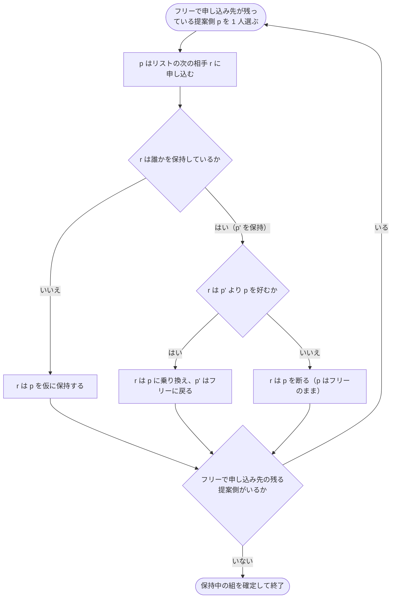

毎年秋、日本の医学部 6 年生は «研修を受けたい病院のプログラム» を希望順に並べた表を提出し、病院の側も «採用したい学生» を順に並べた表を提出します。組み合わせはコンピュータが決め、結果は全員に同じ日に公表されます。医師臨床研修マッチング（JRMP）です。この組み合わせを決めている手続きの核にあるのが、1962 年に David Gale と Lloyd Shapley がわずか 7 ページの論文で示した<strong>受入保留方式（deferred acceptance）</strong>、いわゆる Gale–Shapley アルゴリズムです。

アルゴリズム自体は 20 行ほどで書けます。ところがその背後には、意外なほど深い事実が並んでいます。

- <strong>安定な組み合わせは必ず存在し</strong>、$O(n^2)$ 時間で見つかる。
- 結果は申し込みの順序によらず、<strong>申し込む側にとって «安定な中で最良»、受ける側にとって «安定な中で最悪»</strong> になる。
- 申し込む側は<strong>嘘の好みを申告しても得をしない</strong>。受ける側は得をすることがある。
- 好みがランダムなら、申し込む側の平均順位は約 $\ln n$、受ける側は約 $n / \ln n$ と大きな差がつく。ところが<strong>片側に 1 人足すだけで、どちらが申し込むかはほとんど関係なくなる</strong>（人数の少ない側が、どちらが申し込んでも約 $\ln n$ を得る）。

この記事では、問題の定義から始めて、素朴な方法がなぜ失敗するか、アルゴリズムがなぜ正しいか、安定な組み合わせ全体がどんな構造をしているか、参加者の «戦略» はどう効くか、そして現実の制度でどう使われているかまでを、動くデモで確かめながら順に見ていきます。

<strong>用語について。</strong>原論文や多くの教科書は «男性が女性にプロポーズする結婚» の比喩で説明しますが、本記事では性別によらない «提案側／受理側» という言葉を使います。左側の参加者を A, B, C, D、右側を W, X, Y, Z と呼びます。左側を研修医・学生・応募者、右側を病院・学校・企業と読み替えると、イメージしやすいはずです。

<strong>読み方。</strong>アルゴリズムと実装だけを知りたいなら、1.1–1.2 節 → 3 章 → 4.5 節 → 10 章で足ります。なぜ正しいか・どの安定マッチングが選ばれるかは 4–5 章、嘘の申告は 6 章、ランダムな市場の振る舞いは 7 章、現実の制度設計は 8 章、変種と計算困難性は 9 章です。折りたたまれた証明や詳しい解説は、読み飛ばしても先へ進めます。主な用語と、それを定義している節は、ブロッキングペア（1.2 節）、受入保留（3 章）、安定パートナー（5.2 節）、回転（5.4–5.5 節）、切り捨て（6.2 節）、個人合理性（8.1 節）、境界（カットオフ、8.4 節）です。

<ArticleVideo slug="gale-shapley" />

## 1. 問題: 双方に好みがある組み合わせ

### 1.1 設定

左側の集合 $L$ と右側の集合 $R$ があり、ひとまず人数はどちらも $n$ とします。各参加者は、反対側の全員に<strong>同順位なしの順位</strong>を付けます。$x$ が $a$ を $b$ より好むことを $a \succ_x b$ と書きます。

<strong>マッチング</strong> $\mu$ は左右のペアの集合で、各人は高々 1 つのペアにしか属しません。$x$ の相手を $\mu(x)$ と書きます。

本記事を通して使う «基本例» は次の 4 対 4 です。

| 参加者 | 好み（左ほど好き） |
|---|---|
| A | W > X > Z > Y |
| B | Z > W > Y > X |
| C | Z > Y > W > X |
| D | Z > X > Y > W |
| W | C > B > D > A |
| X | D > B > A > C |
| Y | B > C > D > A |
| Z | A > D > C > B |

B, C, D の 3 人がそろって Z を第 1 希望にしている——人気の集中する «Z» の取り合いが、この例の見どころです。

### 1.2 ブロッキングペアと安定性

マッチング $\mu$ に対して、組になっていない左右の 2 人 $(a, w)$ が

$$
w \succ_a \mu(a) \quad \text{かつ} \quad a \succ_w \mu(w)
$$

を満たすとき、$(a, w)$ を $\mu$ の<strong>ブロッキングペア</strong>（blocking pair）と呼びます。2 人とも今の相手より互いのほうが好き、という状態です。相手のいない人は «誰とでも組むほうがまし» と考えるものとします（この仮定は 6 章の «切り捨て» と 8 章で外します）。

ブロッキングペアが 1 組もないマッチングを<strong>安定マッチング</strong>（stable matching）と呼びます。

例えば A–W, B–X, C–Y, D–Z の組（以下 «AW BX CY DZ» のように書きます）を見てみます。B は今の相手 X（第 4 希望）より W（第 2 希望）を好み、W も今の相手 A（第 4 希望）より B（第 2 希望）を好みます。したがって $(B, W)$ はブロッキングペアで、このマッチングは安定ではありません。

### 1.3 なぜ «安定» を求めるのか

ブロッキングペアの 2 人は、制度が決めた組み合わせを無視して «2 人だけで話をつける» 動機を持っています。そういう抜け駆けが一度でも起きると、残りの組み合わせも連鎖的に崩れかねません。安定性とは、<strong>誰も制度の外で取引をする動機を持たない</strong>という、組み合わせが «守られる» ための条件です。

これは机上の心配ではありません。米国の研修医市場では 1940 年代、病院が優秀な学生を早く押さえようと内定の時期をどんどん前倒しにし、卒業の 2 年近く前に採用を決めるまでになりました。1945 年に医学部側が成績や推薦状の提出時期をそろえて時期の前倒しを止めると、今度は返答期限が短くなり、1945 年に 10 日あった期限は数年のうちに 12 時間ほどまで縮みました。電話を切る前に返事を迫る «爆発するオファー（exploding offer）» です。1952 年に中央集権的なマッチング（現在の NRMP）が導入されると、この混乱は収まり、参加者は自発的に制度に留まり続けました。

なぜ留まったのか。Alvin Roth（1984）は、1952 年以来使われていた手続きが<strong>安定マッチングを返していた</strong>ことを指摘し、それが成功の理由だと論じました。さらに Roth（1991）は英国の地域ごとの研修医マッチングを比較し、安定なマッチングを返す仕組みは存続し、そうでない仕組みの多くは使われなくなったことを示しています。

### 1.4 «満足度の合計» を最大化するのではだめなのか

好みを点数に直して «満足度の合計» を最大化する（いわゆる割当問題をハンガリアン法などで解く）こともできます。しかしその解は安定とは限りません。例えば基本例で «左側の順位の合計» だけを最小にすると AW BZ CY DX（合計 6）になりますが、$(C, Z)$ と $(D, Z)$ がブロッキングペアになります。両側の順位の合計を最小にすると、基本例ではたまたま安定な 2 つ（AZ BW CY DX と AZ BY CW DX。5.5 節の «平等主義»）が選ばれますが、これも保証はありません。ランダムに作った 4 対 4 の例で試すと、およそ 4 回に 1 回は «両側の順位の合計が最小» のマッチングがすべて不安定になります。安定性は «合計» ではなく «誰も抜け駆けしない» という<strong>個々の参加者の動機</strong>に関する条件であり、しかも数値の効用を仮定せず順位だけで定義できます。この 2 点が実務向きです。

## 2. 素朴な方法: 不満なペアを 1 組ずつ直す

安定マッチングを作る最も素朴な方法は、«適当なマッチングから始めて、ブロッキングペアがあればその 2 人を組ませる» ことを繰り返すやり方です。2 人に取り残された元の相手同士は組ませることにすれば、全員に相手がいる状態が保たれます。

これはうまくいくでしょうか。下のデモで試してください。最初は 3 対 3 の例が表示されています。好みのチップをクリックすると組み合わせを手で変えられ、ブロッキングペアは赤い破線で表示されます。

<BlockingPairExplorer />

«循環シナリオ» を 4 回押すと、$(C, X) \to (C, Y) \to (A, Y) \to (A, X)$ の順に、その時点で実在するブロッキングペアを正しく解消しているにもかかわらず、<strong>出発点の AX BY CZ に戻ってきます</strong>。この選び方を続ける限り、手続きは永遠に終わりません。ブロッキングペアの解消が循環しうることは Knuth（1976）が指摘しています。

一方、出発点で $(C, X)$ ではなく $(C, Y)$ を選ぶと、1 手で安定な AX BZ CY に着きます。Roth と Vande Vate（1990）は、どんなマッチングから始めても «うまく選べば» 有限回の解消で安定マッチングに到達できること、ランダムに選べば確率 1 で到達することを示しました（彼らのモデルでは、取り残された人は独身に戻ります）。ただし «ランダムに選ぶ» 方法は、収束までの期待時間が指数的になる例も知られています（Ackermann ほか、2011）。

デモを «基本例（4×4）» に切り替えると、1.2 節の AW BX CY DZ から始まります。ブロッキングペアは $(B, W)$ と $(B, Y)$ の 2 組です。$(B, W)$ を解消すると、取り残された A と X が組になり、1 手で AX BW CY DZ に着きます。これは次章で Gale–Shapley が返す安定マッチングそのものです。

教訓は、<strong>局所的な修理を繰り返すだけでは不十分で、全体を見通した手順が必要</strong>だということです。それが次に見る Gale–Shapley アルゴリズムです。

## 3. Gale–Shapley アルゴリズム（受入保留方式）

### 3.1 手続き

片側（ここでは左側）を<strong>提案側</strong>、もう片側を<strong>受理側</strong>とします。

```text
全員フリー（相手なし）の状態から始める
while フリーで、まだ申し込んでいない相手が残っている提案側 p がいる:
    r ← p がまだ申し込んでいない相手のうち、p が最も好む人
    p は r に申し込む
    if r が誰も保持していない:
        r は p を «仮に» 保持する
    else if r が、いま保持している p' より p を好む:
        r は p を保持し、p' を手放す（p' はフリーに戻る）
    else:
        r は p を断る
保持されている組をそのまま確定して終了
```

要点は 2 つです。提案側は<strong>好きな順に 1 人ずつ</strong>申し込み、断られたら次へ進みます。受理側は届いた申し込みのうち<strong>いちばん良いものだけを «保留»</strong> し、それ以外を断ります。保留は確定ではないので、後からもっと良い申し込みが来れば乗り換えます。



### 3.2 動かしてみる

下のデモで基本例を 1 手ずつ再生してください。左右の表は各人の好みで、チップの見た目は、申し込み中（橙）、次に申し込む相手（橙の破線）、仮に保持（灰）、断られた・断った申し込み（取り消し線）、最終結果（緑）を表します。行末の «#k» は、その人の今の相手が自分のリストで何番目かを示します（相手のいない提案側には、次に申し込む相手の順位が «→#k» で出ます）。再生する前に、B が最後に誰と組むかを予想してみてください。

<GaleShapleyVisualizer />

基本例（A〜D が提案、1 人ずつ）では次の 7 回の申し込みで終わります。

1. A → W（第 1 希望）。W は空いているので A を仮に保持。
2. B → Z。Z は空いているので B を仮に保持。
3. C → Z。Z の好みは A > D > C > B なので、<strong>B を手放して C に乗り換え</strong>。B はフリーに戻る。
4. D → Z。Z は C より D を好むので、<strong>C を手放して D に乗り換え</strong>。C はフリーに戻る。
5. B → W（第 2 希望）。W の好みは C > B > D > A なので、<strong>A を手放して B に乗り換え</strong>。A はフリーに戻る。
6. C → Y（第 2 希望）。Y は空いているので保持。
7. A → X（第 2 希望）。X は空いているので保持。全員に相手ができて終了。

結果は <strong>AX BW CY DZ</strong> です。ブロッキングペアはありません。注目してほしいのは 3〜5 手目の連鎖です。Z をめぐる取り合いで押し出された B が W に申し込み、今度は W に保持されていた A を押し出します。<strong>受理側の «乗り換え» が、提案側の «玉突き» を生む</strong>——これが受入保留方式の動き方です。

### 3.3 «保留» がなければどうなるか

デモの «受入方式» を «即時受入（Boston）» に切り替えてみてください。即時受入では、第 $k$ ラウンドに未確定の全員が第 $k$ 希望に申し込み、受理側は受け入れた相手を<strong>その場で確定</strong>させます。後からもっと良い申し込みが来ても乗り換えられません。

基本例の結果は AW BX CY DZ になり、$(B, W)$ と $(B, Y)$ がブロッキングペアとして残ります。第 1 ラウンドで B は人気の Z に申し込んで断られ、その間に W は（W にとって最下位の）A を確定させてしまいました。W は本当は A より B を好むのに、もう席がありません。

この方式は、かつてボストン市の公立学校選択で使われていたことから «Boston 方式» と呼ばれます。受入保留の «保留» とは、まさにこの «確定を最後まで延ばす» ことを指しています。6.4 節で見るように、この違いは参加者の戦略にも決定的な差を生みます。

### 3.4 申し込みの順序は結果に影響しない

デモの «提案の順序» を切り替えてみてください。«全員同時（ラウンド）» は Gale と Shapley の原論文の書き方で、各ラウンドでフリーな提案側が一斉に申し込み、受理側は最良の 1 件だけを残します。基本例は 3 ラウンドで終わります。«キュー»«スタック»«ランダム» はどれもフリーな提案側を 1 人ずつ選んで申し込ませる、アルゴリズムの教科書でよく見る書き方です。スタック版はフリーに戻った人がすぐに次の申し込みをする «玉突き» の書き方（McVitie と Wilson、1971）に相当します。

どの順序で再生しても、最終結果は AX BW CY DZ、申し込み回数は 7 回のまま変わりません。これは偶然ではなく定理です（5 章）。

## 4. なぜ正しいのか

### 4.1 2 つの単調性

証明の材料は、アルゴリズムの動きから直接わかる 2 つの性質だけです。

- <strong>受理側は «良くなる一方»</strong>: 一度でも申し込みを受けた受理側は、以後ずっと誰かを保持し続ける。保持している相手は、乗り換えのたびに（その受理側にとって）良くなる。
- <strong>提案側は «悪くなる一方»</strong>: 提案側は自分のリストを上から順にたどる。同じ相手に 2 度申し込むことはなく、申し込み先はだんだん好みの低い相手になる。

3.2 節のデモの行末の «#k» を見ると、提案側の数字は増える一方、受理側の数字は減る一方であることが確かめられます。

### 4.2 停止性: 申し込みは高々 $n^2 - n + 1$ 回

各提案側は各受理側に高々 1 回しか申し込まないので、申し込みは $n^2$ 回以下で、アルゴリズムは必ず止まります。もう少し精密に数えることもできます。

全員が相手を持つのは、<strong>最後の受理側が初めて申し込みを受けた瞬間</strong>です（単調性から、一度申し込まれた受理側は保持し続けるので、全受理側が申し込みを受けた時点で全員に相手がいる）。その瞬間の直前まで、少なくとも 1 人の受理側 $r^*$ には誰も申し込んでいません。つまりどの提案側もそれまでに高々 $n - 1$ 回しか申し込んでいないので、直前までの申し込みは $n(n-1)$ 回以下です。最後の 1 回を足して、

$$
\begin{aligned}
\text{申し込み回数} &\le n(n-1) + 1 \\
&= n^2 - n + 1.
\end{aligned}
$$

この上界はちょうど達成されます。3.2 節のデモの «最悪ケース» は $n = 4$ で 13 回の申し込みが必要な例です。意外なことに、«全員同じ好み»（提案側の全員が W > X > Y > Z）という最も競争の激しい状況でも、全員が W に申し込んで 1 人だけ残り、残りが X に申し込んで…と進むので、受理側の好みによらず $4 + 3 + 2 + 1 = 10$ 回で済み、最悪ケースには届きません。最少は $n = 4$ 回で、全員の第 1 希望がばらばらなとき（5.1 節で受理側が申し込む場合など）がそうです。デモでは好みのチップをクリックして自由に編集できるので、«基本例» から出発して申し込み回数をどこまで増やせるか試してみてください。

### 4.3 全員に相手ができる

最後にフリーな提案側 $p$ が残ったとします。$p$ がフリーのまま止まるのは、リストの全員に申し込み終えたときだけです。すると受理側は全員が一度は申し込みを受けているので、全員が誰かを保持しています。受理側 $n$ 人がそれぞれ別の提案側を保持しているなら、提案側 $n$ 人全員が保持されていることになり、$p$ がフリーであることに矛盾します。

### 4.4 安定性

出力 $\mu$ にブロッキングペア $(p, r)$ があったとします。$r \succ_p \mu(p)$ なので、好きな順に申し込む $p$ は、$\mu(p)$ より前に $r$ に申し込んでいます。それでも最終的に組になっていないということは、$r$ はどこかの時点で（その場で、あるいは後から乗り換えで）$p$ を断っています。断った時点で $r$ は $p$ より好きな相手を保持しており、受理側は «良くなる一方» なので、最終的な相手 $\mu(r)$ も $p$ より好きです。これは $p \succ_r \mu(r)$ に矛盾します。

### 4.5 計算量と実装の要点

1 回の申し込みを $O(1)$ で処理できれば、全体は $O(n^2)$ です。そのための鍵は、受理側の好みを<strong>順位表</strong>に変換しておくことです。

- `rank[r][p]`: 受理側 $r$ の好みでの $p$ の順位。「$r$ は $p$ と $p'$ のどちらが好きか」が配列参照 2 回で決まる。
- `next[p]`: 提案側 $p$ が次に申し込むのはリストの何番目か。
- フリーな提案側の集合はキューかスタックで持つ。

順位表を作らずに「リストの中で $p$ が何番目か」を毎回線形探索すると、比較 1 回が $O(n)$ になり、全体が $O(n^3)$ に悪化します。

入力（$2n$ 本の長さ $n$ のリスト）自体のサイズが $\Theta(n^2)$ なので、$O(n^2)$ は<strong>入力サイズに対して線形</strong>です。そして、最悪の場合これ以上速くはできません。好みのリストへの問い合わせ回数で測ると、安定マッチングを見つけるには最悪 $\Omega(n^2)$ 回が必要です（Ng と Hirschberg、1990）。乱択アルゴリズムや通信量で測っても同様の下界が成り立ちます（Gonczarowski ほか、2019）。Python による実装とテストの書き方は 10 章にあります。

## 5. 誰にとって «良い» 安定マッチングか

### 5.1 安定マッチングは 1 つとは限らない

基本例で受理側（W〜Z）に申し込ませると、W→C, X→D, Y→B, Z→A の 4 回で終わり、結果は <strong>AZ BY CW DX</strong> になります。受理側は全員が第 1 希望の相手を得て、左側は A, B, C が第 3 希望、D が第 2 希望です。これも安定です。つまり<strong>どちらが申し込むかで結果が変わる</strong>。では Gale–Shapley は、たくさんある安定マッチングのうち «どれ» を返しているのでしょうか。

### 5.2 提案側最適性

提案側 $p$ と受理側 $r$ が、<strong>ある</strong>安定マッチングで組になっているとき、$r$ を $p$ の<strong>安定パートナー</strong>（valid partner）と呼びます。$p$ の安定パートナーのうち $p$ が最も好む相手を $\mathrm{best}(p)$ と書きます。

基本例には 4 つの安定マッチングがあり（5.4 節）、各提案側の安定パートナーは次のとおりです（太字が $\mathrm{best}(p)$）。

| 提案側 | 安定パートナー（好きな順） |
|---|---|
| A | <strong>X</strong>（第 2 希望）、Z（第 3 希望） |
| B | <strong>W</strong>（第 2 希望）、Y（第 3 希望） |
| C | <strong>Y</strong>（第 2 希望）、W（第 3 希望） |
| D | <strong>Z</strong>（第 1 希望）、X（第 2 希望） |

$\mathrm{best}$ を全員分集めた AX BW CY DZ が、ちょうど 3.2 節の出力になっています。各人が «自分にとっての最良» を選んだだけなのに、2 人が同じ相手を取り合うことがない——これが次の定理の中身です。

<strong>定理（Gale–Shapley, 1962）.</strong> 提案側が申し込む Gale–Shapley の出力では、すべての提案側 $p$ が $\mathrm{best}(p)$ と組になる。

<strong>証明.</strong> 実行中、提案側が<strong>安定パートナーに断られる</strong>ことが一度でもあったとして、その最初の瞬間を考えます。受理側 $r$ が、安定パートナーである $p$ を、$p'$ を選ぶために断ったとします（$p' \succ_r p$）。$r$ が $p$ の安定パートナーなので、$p$ と $r$ を組ませる安定マッチング $S$ が存在します。$S$ での $p'$ の相手を $r'$ とします。

$p'$ はいま $r$ に申し込んでいる（または $r$ に保持されている）ので、それまでにリストで $r$ より上の相手には全員断られています。ところが「最初の瞬間」を考えているので、それらの拒否はどれも «安定パートナーによる拒否» ではありません。$r'$ は $p'$ の安定パートナー（$S$ で組んでいる）なので、$r'$ は $r$ より上にはいない。つまり $r \succ_{p'} r'$ です。

すると $S$ において、$p'$ は今の相手 $r'$ より $r$ を好み、$r$ も今の相手 $p$ より $p'$ を好みます。$(p', r)$ は $S$ のブロッキングペアで、$S$ の安定性に矛盾します。よって提案側が安定パートナーに断られることはありません。特に $p$ は $\mathrm{best}(p)$ に断られないので、最終的な相手は $\mathrm{best}(p)$ 以上です。一方、出力は安定（4.4 節）なので最終的な相手は安定パートナーであり、$\mathrm{best}(p)$ より上にはいません。よって $p$ は $\mathrm{best}(p)$ と組みます。$\blacksquare$

この定理から、3.4 節の観察がすべて説明できます。

- 出力は «全員が $\mathrm{best}(p)$ と組む» マッチングそのものなので、<strong>申し込みの順序に依存しない</strong>。
- 各 $p$ は $\mathrm{best}(p)$ 以上の相手にちょうど 1 回ずつ申し込むので、<strong>申し込みの集合も順序に依存せず</strong>、その回数は «提案側の最終順位の合計» に等しい。基本例では $2 + 2 + 2 + 1 = 7$ 回です。

さらに Roth（1982）は、提案側最適な安定マッチングに対して、<strong>提案側の全員が厳密に得をする</strong>マッチングは（安定でないものまで含めても）存在しないことを示しています。

### 5.3 受理側最悪性

<strong>定理.</strong> 同じ出力で、すべての受理側は自分の安定パートナーのうち<strong>最も好まない</strong>相手と組む。

<strong>証明.</strong> 出力 $\mu_0$ で $r$ が $p$ と組み、ある安定マッチング $S$ で $r$ がもっと嫌いな $p''$ と組んでいたとします（$p \succ_r p''$）。$S$ での $p$ の相手は $r$ ではない安定パートナーなので、提案側最適性より $r = \mathrm{best}(p) \succ_p S(p)$。すると $(p, r)$ は $S$ のブロッキングペアになり、矛盾します。$\blacksquare$

つまり<strong>申し込む側に回ることは、それ自体が有利</strong>です。

<strong>直感.</strong> 提案側は «いちばん上» から交渉を始め、どの安定マッチングでも組めないと分かった相手からしか降りません（5.2 節の証明が示したのはまさにこれです）。一方の受理側は、届いた申し込みの中から選べるだけで、申し込んでこない相手を口説く手段がありません。入札者が «負けたときだけ» 値を上げる競り上げ式のオークションが、市場を均衡させる最も安い価格で止まって買い手に最も有利になる（Demange, Gale, Sotomayor, 1986）のと同じ構造です。

米国の研修医マッチングでは、1952 年以来使われてきた手続きが «病院側が申し込む» 形と同じ結果を返していたことがのちに明らかになり、学生側の不満もあって、1998 年に研修医側が申し込む方式（Roth–Peranson アルゴリズム）へ移行しました。

### 5.4 安定マッチングの束

安定マッチング全体には、きれいな構造があります。

<strong>利害の対立.</strong> 2 つの安定マッチング $\mu, \mu'$ について、提案側の全員が $\mu$ を $\mu'$ 以上に好むなら、受理側の全員は $\mu'$ を $\mu$ 以上に好みます。提案側にとっての改善は、受理側にとっての改悪とぴったり重なります。

<strong>束（lattice）.</strong> 2 つの安定マッチング $\mu, \mu'$ から、提案側の各人に «2 つのうち好きなほうの相手» を割り当てると、それもまた（ちゃんとしたマッチングであり）安定マッチングになります。«嫌いなほう» を割り当てても同様です。この 2 つの操作を結び（join）と交わり（meet）として、安定マッチング全体は<strong>分配束</strong>をなします。Knuth（1976）はこの結果を John Conway に帰しています。束の最上部が提案側最適（左側が申し込んだ Gale–Shapley の出力）、最下部が受理側最適（右側が申し込んだ出力）です。

下のデモは、$4! = 24$ 通りの完全マッチングを総当たりして安定なものだけを取り出し、«左側の全員が弱く好む» 順序で並べた図（ハッセ図）です。

<StableLatticeExplorer />

基本例の安定マッチングは 4 個で、ひし形の束になります。

- 最上部 AX BW CY DZ（左側の順位和 7、右側 9）
- 中段 AX BY CW DZ（9 / 7）と AZ BW CY DX（9 / 6）
- 最下部 AZ BY CW DX（11 / 4）

辺のラベル $\rho_1, \rho_2$ は «回転（rotation）» と呼ばれる操作です。$\rho_1$ は «B と C が相手を交換する»（B: W→Y, C: Y→W）、$\rho_2$ は «A と D が相手を交換する»（A: X→Z, D: Z→X）。2 つは独立なので、どちらを先に適用しても最下部にたどり着き、図はひし形になります。

デモの «クリックの動作» を «2 つ選んで結び・交わり» に切り替え、中段の 2 つを順にクリックしてみてください。AX BY CW DZ と AZ BW CY DX から、左側の各人に «好きなほうの相手» を与えると最上部 AX BW CY DZ が、«嫌いなほうの相手» を与えると最下部 AZ BY CW DX ができます。どちらも、ちゃんと 1 対 1 の組になっていて、しかも安定です。

«4×4 の最多（10 個）» に切り替えると、10 個の安定マッチングと 12 本の辺を持つ、もっと複雑な束が現れます。形をよく見ると、<strong>ひし形が 3 段に積み重なった</strong>構造です。回転は全部で 6 個あり、2 個ずつ 3 つの層に分かれています。同じ層の 2 つは互いに独立で、上の層の 2 つを両方適用しないと次の層には進めません。回転の «適用済みの集合» として許されるものがちょうど 10 通りあり、それが 10 個の安定マッチングに対応しています。

4 対 4 では 10 個が最大であることが知られています（Thurber, 2002 の表を参照）。一般に安定マッチングの数は $n$ について指数的に増えうる一方（Irving と Leather（1986）は $n$ が 2 のべき乗のときに約 $2.28^n$ 個を持つ例を構成しています）、上からも $c^n$ で抑えられます（Karlin、Oveis Gharan、Weber、2018）。他方、全員の好みが一様ランダムなら、安定マッチングの個数の期待値は約 $e^{-1} n \ln n$ にすぎません（Pittel, 1989）。漸近式に $n = 100$ を代入しても 170 個ほどです。

### 5.5 回転と «公平な» 安定マッチング

回転は、安定マッチング $\mu$ において «提案側の数人が輪になって、1 つずつ次の人の相手へずれる» 操作です。ずれた提案側は全員少しずつ損をし、関係する受理側は全員少しずつ得をします。

<details className="my-4 rounded-lg border border-border bg-muted/30 px-4 py-2">
<summary className="cursor-pointer font-semibold">回転を手で見つける（クリックで開く）</summary>

提案側 $p$ のリストを $\mu(p)$ より下へたどり、<strong>今の相手より $p$ を好む</strong>最初の受理側を $s(p)$、その受理側の今の相手を $\mathrm{next}(p)$ とします。$p \to \mathrm{next}(p) \to \cdots$ とたどって輪ができたら、それが回転で、輪の中の各 $p$ を $s(p)$ へずらすのが «回転の適用» です（$s(p)$ がない人に行き着いた道は行き止まりで、どこからたどっても輪ができなければ $\mu$ が最下部です）。基本例の最上部 AX BW CY DZ で確かめると、

- A のリストで X の下にある Z は、今の相手 D より A を好むので $s(A) = Z$、$\mathrm{next}(A) = D$。D のリストで Z の下にある X は、今の相手 A より D を好むので $s(D) = X$、$\mathrm{next}(D) = A$。輪 A → D → A が $\rho_2$（A: X→Z, D: Z→X）です。
- 同様に $s(B) = Y$、$\mathrm{next}(B) = C$、$s(C) = W$、$\mathrm{next}(C) = B$ で、輪 B → C → B が $\rho_1$ です。

</details>

Irving と Leather（1986）は、

- 回転は全部で $O(n^2)$ 個しかなく、最上部から最下部へはどの経路をたどっても各回転をちょうど 1 回ずつ適用する（ひし形の向かい合う辺に同じ $\rho$ が出るのはこのため）、
- 安定マッチングは «どの回転を適用したか» の集合（回転の半順序の閉集合）と 1 対 1 に対応する

ことを示しました。これにより、指数個あるかもしれない安定マッチングを、多項式サイズの «回転のグラフ» で表現できます。全回転は $O(n^2)$ 時間で列挙でき（Gusfield, 1987）、この対応は «有限分配束は、ある半順序集合の閉集合全体として表せる» という Birkhoff の表現定理の具体例にもなっています。

この表現を使うと、両極端以外の安定マッチングを選ぶ問題も扱えます。ただし、難しさは目的によって大きく違います。

- <strong>平等主義</strong>（egalitarian）: 全員の順位の総和が最小。多項式時間（Irving, Leather, Gusfield, 1987）。
- <strong>最小後悔</strong>（minimum regret）: 最も不幸な人の順位が最小。$O(n^2)$（Gusfield, 1987）。
- <strong>両側平等</strong>（sex-equal）: 両側の順位和の差が最小。NP 困難（Kato, 1993）。

デモのパネルには、選んだ安定マッチングがどの基準で最良かを表示しています。基本例では、順位の総和が最小（15）になるのは AZ BW CY DX と最下部の AZ BY CW DX、両側の順位和の差が最小（2）になるのは最上部の AX BW CY DZ と AX BY CW DZ です。最小後悔は 4 つとも «最悪の順位が 3» で同点なので、どのノードを選んでも表示されます。«誰にとっての良さか» によって、選ぶべきマッチングが変わります。

なお、1.4 節で «順位の合計を最小にすると安定とは限らない» と書きましたが、<strong>安定性を制約として加えれば</strong>話は別です。安定マッチング全体の凸包（安定結婚多面体）は、割当問題の制約に «各ペアにつき 1 本の安定性の不等式» を加えた、多項式個の線形不等式でちょうど表せます（Vande Vate, 1989）。この多面体の頂点はすべて安定マッチングなので、«安定マッチングの中で順位の合計を最小化する» 問題は線形計画法でも解けます。

## 6. 嘘の申告で得をできるか

### 6.1 提案側にとって正直は最善

Gale–Shapley は好みの申告を受け取って動くので、«嘘の好みを申告したら得をするか» が問題になります。ここでいう «申告» には、順位の入れ替えだけでなく、リストを途中で切る（切った先の相手は «受け入れ不可»、つまり組むくらいなら相手なしがよいと申告する）ものも含めます。このとき安定性には、«受け入れ不可と申告した相手と組まされていない»（個人合理性、8.1 節）という条件も加わります。

<strong>定理（Dubins と Freedman, 1981; Roth, 1982）.</strong> 提案側が申し込む Gale–Shapley では、他の参加者がどう申告していても、<strong>提案側にとって本当の好みを申告することが最善</strong>（支配戦略）である。

さらに Dubins と Freedman は、提案側が何人で結託して嘘をついても、結託した<strong>全員が</strong>厳密に得をすることはないことも示しています（論文の題名は «マキャヴェリと Gale–Shapley アルゴリズム»）。

<details className="my-4 rounded-lg border border-border bg-muted/30 px-4 py-2">
<summary className="cursor-pointer font-semibold">証明のスケッチ（クリックで開く）</summary>

鍵になるのは次の «ブロッキング補題» です（Gale と Sotomayor の 1985 年の論文「Some remarks on the stable matching problem」が J. S. Hwang に帰しているもの）。

> 誰も受け入れ不可の相手と組んでいないマッチング $\mu$ について、提案側最適な安定マッチング $\mu_0$ より $\mu$ を厳密に好む提案側の集合を $M'$ とする。$M'$ が空でなければ、$M'$ に<strong>属さない</strong>提案側 $m$ と、$M'$ の誰かの $\mu$ での相手である受理側 $w$ からなるブロッキングペア $(m, w)$ が存在する。

結託した提案側の集合 $C$ が嘘をつき、全員が本当の好みで得をしたとします。嘘の申告のもとでの出力を $\mu$ とします。結託の外の人は正直に申告しているので受け入れ不可の相手とは組んでおらず、結託のメンバーは得をしている（相手が $\mu_0$ より良い）ので、$\mu$ は本当の好みのもとで補題の前提を満たします。$C \subseteq M'$ なので、補題から $\mu$ のブロッキングペア $(m, w)$ が見つかります。$m$ は $M'$ の外、つまり結託の外にいて正直に申告しており、$w$ は受理側なので同じく正直です。すると $(m, w)$ は<strong>申告された好みのもとでも</strong> $\mu$ をブロックします。ところが $\mu$ は申告された好みに対する Gale–Shapley の出力なので安定のはずで、矛盾です。結託が 1 人なら、これがそのまま «1 人の提案側は嘘で得をしない» の証明になります。

</details>

次のデモでも、«提案側は何を申告しても得をしない» ことを総当たりで確かめられます。

### 6.2 受理側は «切り捨て» で得をしうる

受理側には同じ保証がありません。次のデモで確かめてください。最初は 3 対 3 の例で、受理側 X が選ばれています。

<MatchingStrategyLab />

この例では、A〜C が申し込むと結果は AX BY CZ で、X は第 2 希望の A と組みます。ところが X が「B 以外は受け入れない」と<strong>リストを切り詰めて</strong>申告すると、次のことが起きます。

1. A は X に断られて Y に申し込み、Y は保持していた B を手放して A に乗り換える。
2. フリーになった B が X に申し込み、X は B を保持する。

結果は AY BX CZ で、X は本当の第 1 希望 B を得ます（デモでは «長さ» を 1 にすると再現できます）。総当たりの表を見ると、X がとりうる 16 通りの申告のうち 3 通りがこの結果を生みます。このように順位を入れ替えずに «リストの下のほうを切り捨てる» 操作を<strong>切り捨て戦略</strong>（truncation）と呼びます。Gale と Sotomayor の論文「Ms. Machiavelli and the Stable Matching Problem」（1985）は、受理側が全員そろって «自分の受理側最適な相手より下» を切り捨てると、提案側が申し込む Gale–Shapley からでも受理側最適な安定マッチングが得られることを示しています。

注目すべきは、X の嘘で到達した AY BX CZ が、<strong>本当の好みのもとでの受理側最適な安定マッチング</strong>だということです。受理側の切り捨ては、束の上で結果を «受理側に有利な端» へ押しやります。一方で提案側の A と B は損をしています。

実は、受理側が嘘で得をできるかどうかは、安定パートナーの数だけで決まります。この切り捨ての議論と、Demange、Gale、Sotomayor（1987）の «どんな嘘でも、本当の好みのもとでの自分の最良の安定パートナーより良い相手は得られない» という結果を合わせると、<strong>他の全員が正直なとき、ある受理側が嘘で得をできるのは、その人の安定パートナーが 2 人以上いるとき、かつそのときに限ります</strong>。最良の安定パートナーのすぐ下でリストを切ればよく、それ以上は望めません。デモの «結果の比較» の欄には、選んだ人の安定パートナーと、どこで切ればよいかを表示しています。

デモで «嘘をつく人» を提案側（A〜C）に切り替えると、総当たりしても正直な申告より良い結果は 1 つも見つからないことが確認できます。

ただし、切り捨ては危険な賭けでもあります。デモを «切り捨てが裏目（3×3）» に切り替えてください。さきほどの例と違うのは Y の好み（B > A > C）だけですが、この市場の安定マッチングは AX BY CZ ただ 1 つです。ここで X が同じように «B だけ» と申告すると、A は Y にも断られて Z に移り、結果は AZ BY（C も相手なし）で X は «相手なし» になります（長さを 1 にすると確かめられます）。切り捨てで得をするには、他の全員の好みを正しく知っている必要があるのです。

### 6.3 全員にとって正直が最善な安定メカニズムは存在しない

受理側の操作の余地は、Gale–Shapley の欠陥というより、安定性そのものの性質です。

<strong>定理（Roth, 1982）.</strong> 常に安定マッチングを返すメカニズムで、<strong>すべての参加者</strong>にとって正直な申告が支配戦略になっているものは存在しない。

証明は 2 対 2 の例で足ります。A: Y > Z、B: Z > Y、Y: B > A、Z: A > B とすると、安定マッチングは AY BZ（左側に最適）と AZ BY（右側に最適）の 2 つです。

- メカニズムが AY BZ を選ぶなら、Y が «B だけ» と申告します。すると AY は Y にとって受け入れ不可になり、安定マッチングは AZ BY だけになるので、メカニズムはそれを選ぶしかなく、Y は本当の第 1 希望 B を得ます。
- メカニズムが AZ BY を選ぶなら、A が «Y だけ» と申告すれば、同じ理屈で AY BZ だけが安定になり、A が得をします。

どちらを選んでも、誰かが嘘で得をします。デモの «不可能性（2×2）» で確かめてください。最初は A〜B が提案し、Y が嘘をつく設定です。«Y〜Z が提案» に切り替えたら、«嘘をつく人» を A にしてください（«Y だけ» と申告すると得をします）。直感的には、安定マッチングが複数あるとき、どれを選んでも «もう一方の端を望む側» に嘘の動機が残る、ということです。それでも現実の市場では、この嘘の余地はたいてい小さくなります（7.4 節）。

### 6.4 Boston 方式との決定的な違い

3.3 節の即時受入（Boston 方式）では、話がまったく変わります。基本例で B は、第 1 希望の Z に申し込んで断られている間に、第 2 希望の W を A に取られてしまいました。もし B が «W を第 1 希望と申告» していれば、第 1 ラウンドで W は A より B を選んだはずです。つまり Boston 方式では、<strong>人気のある第 1 希望を正直に書くと損をしうる</strong>ので、参加者は «受かりそうなところを上に書く» 戦略を考えざるを得ません。6.2 節のデモで «基本例（4×4）» を選ぶと、即時受入のもとで B を選んだ状態になり、W を先頭にした申告で B が本当の第 4 希望から第 2 希望へ改善することを確かめられます。受入方式を DA に切り替えると、同じ B にとって正直より良い申告はなくなります。

Abdulkadiroğlu と Sönmez（2003）はこの問題を指摘し、学校選択に受入保留方式を使うことを提案しました。ボストン市は 2005 年に受入保留方式への切り替えを決めています。

日本の JRMP も、参加者への注意として «本当に希望する順番どおりに入力すること»、«人気があるからといって第 1 希望を変えてもマッチする確率は上がらない» ことを明記しています。同じ注意書きは組み合わせの決め方を «第一希望の研修プログラムとマッチできるかから調べていき» と説明しており、研修希望者の側から申し込む形であることが読み取れます。つまりこれは、6.1 節の定理を運用上の注意に翻訳したものです。

## 7. ランダムな市場で何が起きるか

好みが一様ランダムなとき、Gale–Shapley の振る舞いには驚くほど明快な法則があります。次のデモで確かめてください（«各 100 回» や «n ≤ 200» を選んだときは «シミュレーションを実行» を押してください）。

<RandomMarketLab />

### 7.1 申し込み回数は約 $n \ln n$

ランダムな好みのもとでの申し込み回数の期待値は、高々 $n H_n$（$H_n = 1 + 1/2 + \cdots + 1/n \approx \ln n$）です（Wilson, 1972）。最悪の $n^2 - n + 1$ に比べてはるかに少なく、$n = 100$ ならおよそ 500 回です。申し込み回数は «提案側の最終順位の合計» に等しいので、これは提案側の平均順位が高々 $H_n \approx \ln n$ 程度であることも意味します。

なぜ $n H_n$ なのでしょうか。4.2 節で見たとおり、手続きは «最後の受理側が初めて申し込みを受けた瞬間» に終わります。仮に提案側が «断られた相手を忘れて» 毎回一様ランダムな受理側に申し込むとすると、これは全種類がそろうまでランダムなおまけを集め続ける «クーポン収集問題» そのもので、申し込み回数の期待値はちょうど $n H_n$ です。実際の提案側は同じ相手に二度申し込まないので、回数はそれ以下に抑えられます。

### 7.2 $\ln n$ 対 $n / \ln n$

Pittel（1989）は、提案側最適な安定マッチングで、提案側の平均順位が約 $\ln n$、受理側の平均順位が約 $n / \ln n$ になることを示しました。デモの «同数（n 対 n）» の設定では、$n = 100$ のとき左側の平均順位は、左側が申し込めば約 5、右側が申し込めば約 21 です（参考値 $\ln 100 \approx 4.6$、$100 / \ln 100 \approx 21.7$）。2 本の線の大きな開きは、5.3 節の «申し込む側が有利» を定量的に示しています。表の下に出る «2 つの極端な安定マッチングで相手が異なる左側の割合» は 8 割近くあり、安定マッチングの選び方次第で大半の人の相手が変わることがわかります。6.2 節の結果から、これは «右側が申し込むとき、嘘で得をできる左側の人の割合» でもあります。

### 7.3 1 人の差がすべてを変える

ここで «右が 1 人多い» に切り替えてください。2 本の線はほぼ重なり、<strong>右側が申し込んでも左側の平均順位は約 5 のまま</strong>になります。相手が異なる左側の割合も 1 割程度に落ちます。

Ashlagi、Kanoria、Leshno（2017）は、人数がわずかでも不均衡な市場では、<strong>どの安定マッチングでも</strong>少ない側（ここでは左側）の平均順位が約 $\ln n$、多い側の平均順位が約 $n / \ln n$ になり、安定マッチングが実質的に 1 つに縮むことを示しました。«誰が申し込むか» より «どちらの側が多いか» のほうが、はるかに強く結果を左右するのです。«右が 1 人少ない» にすると、今度は左側がどちらの方式でも不利になります。（今度は人数の多い）左側が申し込む場合の申し込み回数が跳ね上がることにも注目してください。

この結果は実務の観察とも整合します。NRMP が病院側申し込みから研修医側申し込みへ切り替えた際、Roth と Peranson（1999）の分析では、実際の結果への影響はごくわずかでした。年に約 2 万のポストを埋めるこの市場で、安定マッチングの集合も戦略的操作の余地も «驚くほど小さい» ことがわかり、彼らはその理由として、各応募者が面接を受けるのが全ポストのごく一部にすぎない（したがって順位表が短い）ことを挙げています。現実の市場は人数が均衡しておらず、各人の希望順位表は短く、好みにも相関があるため、安定マッチングの «幅» がもともと狭いのです。

### 7.4 短いリストや不均衡な市場では嘘の余地がほとんど消える

6 章で見たように受理側には嘘の余地がありますが、それでも実務で Gale–Shapley が使われ続けている理由の一つは、<strong>多くの現実の市場では操作の余地がほとんどない</strong>ことです。Immorlica と Mahdian（2005）は、<strong>提案側のリストが短い</strong>（ランダムに選ばれた定数個の）市場では、受理側の好みが任意でも、嘘で得をできる受理側の割合が $n \to \infty$ で 0 に近づくことを示しました。Kojima と Pathak（2009）は、これを病院と研修医のような多対一の市場に拡張しています。

根本の理由は、6.2 節で見た一対一の市場での «安定パートナーが 2 人以上いる人だけが嘘で得をできる» という事実です。リストが短い市場や、7.3 節で見たように人数がわずかでも不均衡な市場では、ほとんどの参加者の安定パートナーは高々 1 人です。逆に 7.2 節の «同数で、全員が全員を順位付けする» 市場では大半の人に複数の安定パートナーがいるので、市場が大きいというだけでは操作の余地は消えません。

## 8. 多対一への拡張と現実の制度

### 8.1 定員のある問題

Gale と Shapley の原論文の題名は «College Admissions and the Stability of Marriage»、つまり主題はむしろ<strong>大学入試</strong>でした。大学 $h$ には定員 $q_h$ があり、学生は 1 校、大学は最大 $q_h$ 人を受け入れます。さらに一般に、

- リストは<strong>不完全</strong>でよい。リストに載せない相手は «組むくらいなら相手なしのほうがよい»（受け入れ不可）という意味。
- 両側の人数や定員の合計は一致しなくてよい。

このとき安定性は次の 2 つの条件で定義されます。

1. 誰も受け入れ不可の相手と組んでいない（個人合理性）。
2. 学生 $s$ と大学 $h$ で、$s$ が今の配属先より $h$ を好み、かつ $h$ が «定員に空きがあって $s$ を受け入れ可能» か «今いる誰かより $s$ を好む» ようなものがない。

アルゴリズムはほとんど変わりません。各大学は届いた応募のうち、順位の高い順に定員分だけを «順番待ちリスト» に保留し、残りを断ります。大学 $h$ を $q_h$ 個の «1 人用の席» に分けて一対一の問題に帰着させることもできます。

### 8.2 研修医マッチングを動かす

次のデモは、研修医 A〜F と病院 X・Y・Z（定員は各 2）の例です。リストは両側とも不完全です。Z は地方の病院という想定で、Z を志望する A・C・E のうち、Z の順位表に載っているのは C だけです。

<ResidencyMatchVisualizer />

4 ラウンドの動きを追うと、受入保留の特徴がよく見えます。

- 第 1 ラウンドで A は Z に、D は Y に申し込みますが、どちらも<strong>病院の順位表に載っていない</strong>ので即座に不採用になります。
- 第 2 ラウンドで A が Y に申し込むと、Y は保持していた E を<strong>押し出して</strong> A を入れます。
- 第 3 ラウンドで、押し出された E は第 2 希望の Z に申し込みますが、Z の順位表に載っていないので即座に不採用になります。
- 第 4 ラウンドで E が X に申し込むと、X は D を押し出します。D はリストを使い切って未配属に終わります。

結果は AY BX CZ EX FY（D は未配属）です。

### 8.3 地方病院定理

デモの最後のパネルの «病院が提案（病院最適）» の行を見ると、結果は AY BY CZ EX FX で、B と F の配属先が入れ替わります。ところが、<strong>未配属になるのはどちらでも D</strong>、<strong>定員割れの Z に来るのはどちらでも C だけ</strong>です。これは偶然ではありません。

<strong>地方病院定理（Rural Hospitals Theorem; Roth, 1986）.</strong> すべての安定マッチングで、

- 配属される研修医の集合は同じであり、
- 各病院が埋める席の数は同じであり、
- 定員を満たせない病院は、<strong>まったく同じ研修医の集合</strong>を受け入れる。

名前の由来は、米国で «研修医が集まらない地方病院に、安定性を保ったまま人を回せないか» という政策的な問いがあったことです。答えは «できない»。どの安定マッチングを選んでも、定員割れの病院が得る研修医は変わりません。

<details className="my-4 rounded-lg border border-border bg-muted/30 px-4 py-2">
<summary className="cursor-pointer font-semibold">証明: «相手のいる人の集合は同じ» と定員割れの病院（クリックで開く）</summary>

提案側最適な $\mu_0$ と任意の安定マッチング $\mu$ を比べます（«相手なし» を «どの受け入れ可能な相手よりも悪い» と読めば、5.2・5.3 節の証明は不完全なリストでもそのまま通ります）。$\mu$ で相手のいる提案側は、$\mu_0$ でもそれ以上の相手を持ちます（5.2 節）。$\mu_0$ で相手のいる受理側は、$\mu$ でもそれ以上の相手を持ちます（5.3 節）。相手のいる提案側・受理側の集合をそれぞれ $P(\cdot)$、$R(\cdot)$ と書くと、両側の «相手のいる人数» は等しいので

$$
\begin{aligned}
|P(\mu)| &\le |P(\mu_0)| = |R(\mu_0)| \\
&\le |R(\mu)| = |P(\mu)|
\end{aligned}
$$

となり、2 つの包含 $P(\mu) \subseteq P(\mu_0)$ と $R(\mu_0) \subseteq R(\mu)$ はどちらも等号です。$\blacksquare$

多対一でも、病院を席に分割すれば最初の 2 つの主張は同様に示せます。3 つ目の «定員割れの病院は同じ研修医の集合を受け入れる» が Roth（1986）の核心で、これも短く示せます。定員割れの病院 $h$ と任意の安定マッチング $\mu$ をとり、研修医側最適な $\mu_0$（席に分割すれば 5.2 節がそのまま使えます）で $h$ に配属された研修医 $s$ が、$\mu$ では $h$ にいないとします。$\mu_0$ は研修医にとって最良の安定マッチングなので、$s$ は $\mu(s)$ より $h$ を好みます。2 つ目の主張から $\mu$ でも $h$ には空き席があるので、$(s, h)$ は $\mu$ のブロッキングペアになり、矛盾します。よって $\mu_0(h) \subseteq \mu(h)$ で、人数も等しいので 2 つの集合は一致します。$\blacksquare$

</details>

### 8.4 病院側の操作と «カットオフ» による説明

多対一では、提案側の耐戦略性にも非対称性が生じます。研修医が申し込む方式では研修医にとって正直が最善のままですが、Roth（1985）は、多対一の問題では<strong>病院にとって正直が最善になる安定メカニズムは存在しない</strong>ことを示しました。病院が申し込む方式を使っても、病院は順位表を操作して得をしうるのです。

もう一つ、実務で役立つ見方があります。安定な多対一マッチングは «境界（カットオフ）» で説明できます。定員が埋まった各病院について «受け入れた中で最も順位の低い研修医» を境界とすると（空きのある病院に境界はありません）、各研修医は «自分が境界と同じかそれより上にいる（または空きがあって受け入れ可能な）病院のうち、最も好きなところ» に配属されています。そうでなければブロッキングペアがあるからです。«あなたが X に入れなかったのは、X の最後の採用者が X の順位表であなたより上だったから»——この形で結果を説明できることは、制度の透明性にとって重要です（Azevedo と Leshno, 2016 はこの見方を需給の枠組みに発展させています）。デモの病院の欄には、各ラウンドの時点での境界も表示しています。空きがある間は境界はなく、定員が埋まった後は、定員を超える受け入れ可能な応募が集まった（超過需要がある）ときにだけ境界が上がります。超過需要のある財の価格が上がるのとよく似ています。

デモの最後のパネルには、各病院のカットオフと «もっと好きな病院に入れなかった理由» を一覧にしてあります。例えば D は、第 1 希望の Y の順位表に載っておらず、第 2 希望の X では 6 位で境界の B（5 位）より下なので、どこにも入れません。E は第 1 希望の Y で 5 位、境界の F（4 位）より下で、第 2 希望の Z の順位表には載っていないので、第 3 希望の X に入ります。

### 8.5 現実の制度

<MatchingTimeline />

- <strong>NRMP（米国の研修医マッチング）</strong>: 1952 年に開始。1998 年に研修医側が申し込む Roth–Peranson アルゴリズムへ移行しました。このアルゴリズムは、同じ地域で研修したい 2 人組（多くは夫婦）の «カップル» など、現実の複雑な条件も扱えるよう設計されています。カップルがいると安定マッチングが存在しないことがあり、その判定は NP 完全ですが（Ronn, 1990）、カップルの割合が小さい大きな市場では高い確率で安定マッチングが存在します（Kojima, Pathak, Roth, 2013）。
- <strong>JRMP（日本の医師臨床研修マッチング）</strong>: 2004 年度に始まった新しい医師臨床研修制度とともに導入されました。協議会は «組み合わせ決定のアルゴリズムは理論的に確立されたもので、公開される»、«希望順位表にない組み合わせは生じない» ことを特徴として掲げています。また現在は、研修医の都市部への集中を抑えるため、都道府県ごとの募集定員に上限が設けられています。鎌田雄一郎と小島武仁（Kamada と Kojima, 2015）は、このような «地域ごとの上限» のもとで各病院の定員を前もって削って受入保留を動かす方式は、非効率で不安定な結果を生みうることを示し、上限の範囲内で定員を柔軟に融通する «柔軟な受入保留（flexible deferred acceptance）» を提案しています。
- <strong>学校選択</strong>: ニューヨーク市の高校入学（2003 年〜）、ボストン市の公立学校（2005 年に Boston 方式から移行を決定）。学校は «好み» ではなく «優先順位»（通学区域、兄弟の在籍など）を持ち、同順位の生徒をくじで並べる必要があります。
- <strong>Parcoursup（フランスの大学入学）</strong>: 2018 年から、受入保留を «人間が回す» 形で運用しています。学生は届いた合格の中から 1 つを保持し、より良い合格が来れば乗り換えます。
- <strong>システム設計</strong>: Akamai の Maggs と Sitaraman（2015）は、クライアントの集団をサーバクラスタに割り当てる大域的な負荷分散を、容量つきの安定マッチングとして定式化した例を紹介しています。

2012 年のノーベル経済学賞は «安定配分の理論とマーケットデザインの実践» に対して Shapley と Roth に贈られました。Gale は 2008 年に亡くなっていたため、受賞者に含まれていません。

### 8.6 安定性の代償: 効率性

同順位のない結婚モデルで両側の満足をともに考慮するなら、安定マッチングは常にパレート効率的です。ある人がより好きな相手と組み、しかも誰も損をしない組み替えがあるなら、その 2 人が元のマッチングのブロッキングペアになるからです。問題が生じるのは、片側の «好み» が満足（厚生）として考慮されない場合です。

学校選択では、学校の «優先順位» は学校自身の好みではなく、通学区域や兄弟の在籍といった規則にすぎません。そうなると «誰も損をせずに一部の生徒がより幸せになる» 組み替えがあるなら、それを優先すべきではないか、という問いが生まれます。次の例を見てください。学校 a, b, c の定員はそれぞれ 1 です。

| | 希望・優先順位（左ほど上） |
|---|---|
| 生徒 1 の希望 | b > a > c |
| 生徒 2 の希望 | a > b > c |
| 生徒 3 の希望 | a > c > b |
| 学校 a の優先順位 | 1 > 3 > 2 |
| 学校 b の優先順位 | 2 > 1 > 3 |
| 学校 c の優先順位 | 1 > 2 > 3 |

生徒が申し込む受入保留の結果は «1a 2b 3c» で、生徒 1 と 2 はどちらも第 2 希望です。1 と 2 が学校を交換すれば（1b 2a 3c）2 人とも第 1 希望になり、3 は何も失いません。ところが交換後は、3 が c より a を望み、a の優先順位では 3 が 2 より上なので、$(3, a)$ がブロッキングペア（学校選択の言葉では «正当な羨望»）になります。<strong>安定性を守る限り、誰も損をしないこの改善は実行できない</strong>のです。

これは 5.2 節で触れた Roth（1982）の結果と矛盾しません。生徒 3 は得をしていないからです。提案側最適な安定マッチングに対して «全員が厳密に得をする» 改善はありえませんが、«誰も損をせず一部が得をする» 改善までは排除されていないのです。

<SchoolChoiceTradeoff />

デモで «DA から 1 と 2 が交換» に切り替えると、$(3, a)$ が赤い破線（正当な羨望）として現れます。

Abdulkadiroğlu と Sönmez（2003）は、学校選択にもう一つの方式として «トップ・トレーディング・サイクル（TTC）» も提案しました。David Gale の考案として Shapley と Scarf（1974）が紹介した方式を学校選択に移したもので、各生徒は空きのある最も好きな学校を、各学校はまだ割り当てられていない中で優先順位の最も高い生徒を指し、できた輪の中で席を交換します。生徒にとっての耐戦略性は保ったまま、安定性の代わりに（生徒側の）パレート効率性をとる方式で、この例では 1b 2a 3c を選びます。デモの «TTC» でラウンドを切り替えると、1 → b → 2 → a → 1 の輪で席が交換される様子が見えます。

また Kesten（2010）は、受入保留の結果から出発する «効率調整済み受入保留（EADA）» を提案しています。ある学校での優先順位が自分の配属には役立たず、他の生徒を押し出すだけになっている生徒に、その優先順位を放棄してよいかの同意を求め、同意の分だけ他の生徒の配属を改善します。同意しても自分の配属は変わらず、全員が同意すれば結果はパレート効率的になります（その代わり、生徒にとっての耐戦略性は失われます）。安定性・効率性・耐戦略性のどれを優先するかは、制度ごとの価値判断です。

## 9. 一般化と計算困難性

基本の問題から少し条件を変えるだけで、状況は大きく変わります。

| 変種 | 安定マッチングの存在と計算量 |
|---|---|
| 一対一、完全なリスト | 常に存在。$O(n^2)$（Gale–Shapley） |
| 不完全なリスト、人数の不一致 | 常に存在（相手なしの人が出る）。入力サイズに線形。配属される人の集合はどの安定マッチングでも同じ |
| 多対一（定員つき） | 常に存在。入力サイズに線形。地方病院定理が成り立つ |
| 同順位あり（弱安定） | 常に存在（同順位を任意に崩せばよい）。完全なリストなら全員が組める。ただし<strong>同順位と不完全なリストが両方ある</strong>と、<strong>最大サイズ</strong>の弱安定マッチングを求めるのは NP 困難（Iwama, Manlove, Miyazaki, Morita, 1999; Manlove ほか, 2002） |
| 同順位あり（強安定・超安定） | 存在しないことがある。存在判定と構成は多項式時間（Irving, 1994） |
| ルームメイト問題（一つの集団の中で 2 人組を作る） | 存在しないことがある。存在判定と構成は $O(n^2)$（Irving, 1985） |
| カップルを含む研修医マッチング | 存在しないことがある。存在判定は NP 完全（Ronn, 1990） |
| 三者の組（3 次元）マッチング（各人が他の 2 種類の人の組に順位を付けるモデル） | 存在しないことがある。存在判定は NP 完全（Ng と Hirschberg, 1991） |
| 安定マッチングの数え上げ | #P 完全（Irving と Leather, 1986） |

同順位があるときの 3 つの安定性は、次のように «ブロッキングペア» の範囲で区別されます。<strong>弱安定</strong>は «互いを厳密に好むペア» がないこと、<strong>強安定</strong>は «一方が厳密に好み、他方が同等以上と見なすペア» もないこと、<strong>超安定</strong>は «両者とも同等以上と見なすペア» すらないことです。条件が厳しいほど、存在は保証されにくくなります。

ルームメイト問題で安定な組が存在しない例は、実は原論文に載っています。4 人 $\{a, b, c, d\}$ で、$a$ は $b > c > d$、$b$ は $c > a > d$、$c$ は $a > b > d$ の順に好み、3 人とも $d$ を最下位にする。$d$ と組まされた人を第 1 希望にしている人は、必ず第 1 希望と組めていないので、その 2 人がブロッキングペアになります（例えば $a$–$d$, $b$–$c$ なら、$c$ は $b$ より $a$ を好み、$a$ は $d$ より $c$ を好む）。<strong>«2 つの側» があること</strong>が、安定マッチングの存在を保証している構造だとわかります。

それでも、存在するかどうかの判定と構成は速くできます。Irving（1985）のアルゴリズムは 2 段階です。第 1 段階では全員が申し込む側と受ける側を兼ねて受入保留を行い、申し込みを保留した人は、それより好まない相手を自分のリストから消します（相手のリストからも自分を消します）。誰かのリストが空になれば安定な組はありません。第 2 段階では、5.5 節の回転とよく似た «輪になって 1 つずつずれる» 構造を短くなったリストから見つけて消去することを、全員のリストが 1 人になる（それが安定な組）か、誰かのリストが空になる（存在しない）まで繰り返します。全体で $O(n^2)$ です。

カップルが存在を壊す理由も、同じ «構造» の言葉で説明できます。多対一の理論がうまくいく鍵は、病院の好みが «代替的» であること（ある研修医を採りたい病院は、ほかの候補者の何人かが来られなくなっても、その研修医をやはり採りたい）です。この条件のもとで受入保留は、給与などの条件を含む «契約つきマッチング» にまで一般化でき、安定マッチングの存在と束の構造が保たれます（Kelso と Crawford, 1982; Hatfield と Milgrom, 2005）。ところがカップルは、研修医の側に «2 人分の席がそろって初めて意味がある» という «補完的» な好みを持ち込みます。理論の前提は «複数の相手を取る参加者の好みが代替的» であることなので、この前提が崩れ、存在の保証も失われます。

同順位の問題は実務で重要です。学校選択の優先順位は大量の同順位を含み、«同順位をどう崩すか»（全校共通のくじか、学校ごとのくじか）で効率性や公平性が変わります。ニューヨーク市のデータを使ったシミュレーションと理論は、全校共通のくじ（single tie-breaking）を支持しています（Abdulkadiroğlu, Pathak, Roth, 2009）。くじで崩したことで失われた効率性を安定性を保ったまま取り戻す «安定な改善サイクル» も提案されていますが（Erdil と Ergin, 2008）、Abdulkadiroğlu らの 2009 年の論文が示すように、その改善は生徒にとっての耐戦略性を損なわずには行えません。日本の研究者による貢献も大きく、岩間一雄・宮崎修一らの同順位つき安定結婚問題（SMTI）の計算量・近似アルゴリズムの研究や、加藤（1993）による両側平等安定マッチングの NP 困難性はその代表です。

## 10. 実装する

### 10.1 Python による実装

不完全なリストにも対応した、提案側が申し込む Gale–Shapley です。

```python
from collections import deque


def gale_shapley(proposer_prefs, receiver_prefs):
    """提案側が申し込む受入保留アルゴリズム。

    proposer_prefs[p]: p が受け入れる受理側の番号を、好きな順に並べたリスト
    receiver_prefs[r]: r が受け入れる提案側の番号を、好きな順に並べたリスト
    戻り値: match[p] = p の相手（いなければ None）
    """
    n_p, n_r = len(proposer_prefs), len(receiver_prefs)
    # rank[r][p]: r の好みでの p の順位（小さいほど好き）。リストにいなければ None
    rank = [[None] * n_p for _ in range(n_r)]
    for r, prefs in enumerate(receiver_prefs):
        for k, p in enumerate(prefs):
            rank[r][p] = k

    next_choice = [0] * n_p   # p が次に申し込むのはリストの何番目か
    holding = [None] * n_r    # r が «仮に» 保持している提案者
    free = deque(range(n_p))  # 相手のいない提案者

    while free:
        p = free.popleft()
        if next_choice[p] == len(proposer_prefs[p]):
            continue  # リストを使い切った: 未マッチのまま終わる
        r = proposer_prefs[p][next_choice[p]]
        next_choice[p] += 1
        if rank[r][p] is None:
            free.append(p)  # r は p を受け入れない
        elif holding[r] is None:
            holding[r] = p  # 空いているので仮に保持
        elif rank[r][p] < rank[r][holding[r]]:
            free.append(holding[r])  # 乗り換え: 前の相手をフリーに戻す
            holding[r] = p
        else:
            free.append(p)  # 今の相手のほうが好きなので拒否

    match = [None] * n_p
    for r, p in enumerate(holding):
        if p is not None:
            match[p] = r
    return match


# A..D = 0..3, W..Z = 0..3（基本例）
P = [[0, 1, 3, 2], [3, 0, 2, 1], [3, 2, 0, 1], [3, 1, 2, 0]]
R = [[2, 1, 3, 0], [3, 1, 0, 2], [1, 2, 3, 0], [0, 3, 2, 1]]
print(gale_shapley(P, R))  # [1, 0, 2, 3] → AX BW CY DZ
print(gale_shapley(R, P))  # [2, 3, 1, 0] → WC XD YB ZA
```

各反復は $O(1)$ で、申し込みは各リストの長さの合計を超えません。ただし順位表 `rank` を $n_p \times n_r$ の 2 次元配列で作っているので、計算時間が入力サイズに線形になるのは完全なリストの場合です。リストが短いなら、10.2 節の `blocking_pairs` のように受理側ごとの辞書で順位を持てば、リストの長さの合計に比例する時間で済みます。

### 10.2 テストの書き方

マッチングのアルゴリズムは、<strong>総当たりの «正解» と比べるテスト</strong>が書きやすい題材です。$n \le 6$ 程度なら $n!$ 通りのマッチングをすべて調べられるので、

1. 出力にブロッキングペアがないこと（安定性）
2. 出力が、総当たりで求めたすべての安定マッチングの中で提案側最適であること

をランダムな入力で大量に確かめられます。

```python
import itertools
import random


def blocking_pairs(proposer_prefs, receiver_prefs, match):
    """match[p] = r（または None）に対するブロッキングペアの一覧"""
    partner_of = {r: p for p, r in enumerate(match) if r is not None}
    rank_r = [{p: k for k, p in enumerate(prefs)} for prefs in receiver_prefs]
    pairs = []
    for p, prefs in enumerate(proposer_prefs):
        for r in prefs:  # p にとって良い順に見ていく
            if match[p] == r:
                break  # 今の相手より下は調べなくてよい
            if p not in rank_r[r]:
                continue  # r は p を受け入れない
            q = partner_of.get(r)
            if q is None or rank_r[r][p] < rank_r[r][q]:
                pairs.append((p, r))
    return pairs


def stable_matchings(proposer_prefs, receiver_prefs):
    n = len(proposer_prefs)
    for perm in itertools.permutations(range(n)):
        if not blocking_pairs(proposer_prefs, receiver_prefs, list(perm)):
            yield list(perm)


def check(trials=300, n=5, seed=0):
    rng = random.Random(seed)
    for _ in range(trials):
        P = [rng.sample(range(n), n) for _ in range(n)]
        R = [rng.sample(range(n), n) for _ in range(n)]
        gs = gale_shapley(P, R)
        assert not blocking_pairs(P, R, gs)  # 安定
        for m in stable_matchings(P, R):  # 提案側最適
            assert all(P[p].index(gs[p]) <= P[p].index(m[p]) for p in range(n))


check()  # 何も表示されなければ合格
```

このブログのデモも同じ方針で作っています。デモが使っている TypeScript の実装（[`src/lib/stable-matching.ts`](https://github.com/yoichiozaki/yoichiozaki.github.io/blob/main/src/lib/stable-matching.ts)）は、«順序を変えても結果と申し込みの集合が同じ»、«提案側最適・受理側最悪»、«申し込み回数が $n^2 - n + 1$ 以下»、«提案側は総当たりしても嘘で得をしない»、«結びと交わりが安定マッチングになる»、«地方病院定理» などを、総当たりや 2 つの極端な安定マッチングとの比較で確認しています。

### 10.3 実務で使うときの注意

- <strong>同順位をどう崩すか</strong>は設計上の大きな選択です。崩し方によって結果も効率性も変わり、その規則自体が «公平性» の議論の対象になります。
- <strong>受け入れ不可を明示的に扱う</strong>。リストに載っていない相手と組ませないこと（個人合理性）は、安定性の一部です。
- <strong>結果は申し込み順に依存しない</strong>ので、実装の細部（キューかスタックか、並列化するか）を変えても出力は変わりません。これは再現性の面でも、ラウンド単位で受理側ごとに並列処理する面でも、大きな利点です。
- <strong>説明可能性</strong>。8.4 節のカットオフで «なぜこの結果になったか» を一人ひとりに説明できます。
- <strong>どちらが申し込むかを意識的に選ぶ</strong>。申し込む側が有利です。しかも «正直が最善» の保証を得られるのは申し込む側だけで、多対一では 1 人 1 枠の側（研修医・学生）が申し込む場合に限られます（8.4 節）。制度の目的に照らして、誰を守るべきかを決める必要があります。
- <strong>順位表の長さに上限を設けない</strong>。上限があると、受入保留でも «どこをリストに入れるか» という戦略が必要になり、正直が最善という保証は崩れます（Haeringer と Klijn, 2009）。ニューヨーク市の高校入学では、順位付けできるのは学校内の課程である «プログラム» 12 個までという時期が長く続きましたが、現在は上限がなくなっています。
- <strong>両側から 1 回ずつ実行してみる</strong>。結果が一致すれば安定マッチングはただ 1 つで、一対一の市場なら、他の全員が正直な限り誰も嘘で得をできません。一致しなければ、相手が変わる人がちょうど安定パートナーを 2 人以上持つ人で、そのうち受理側に回る人には切り捨ての余地があります（6.2 節）。
- <strong>出力を検査し、再現できるようにする</strong>。10.2 節の `blocking_pairs` はリストの長さの合計に比例する時間で動くので、受け入れ不可の組がないことを先に確認すれば（`blocking_pairs` はこれを前提にしています）、一対一の出力ならそのまま本番の検査として使えます（多対一では、«空き席がある» か «受け入れた中で最下位の人より上» かで判定する版に直します）。同順位をくじで崩すなら、乱数の種を記録しておけば第三者が結果を再現・検証できます。

<strong>よくある誤解.</strong>

- «全体の満足度を最大化する» — しません。合計を最大化した組は不安定になりえます（1.4 節）。
- «処理順や並列化で結果が変わる» — 変わりません（3.4・5.2 節）。
- «選べる受理側のほうが有利» — 逆で、申し込む側が有利です（5.3 節）。
- «受入保留なら誰も嘘をつく意味がない» — 保証されるのは申し込む側だけです（6.1–6.2 節）。
- «安定なら効率的» — 同順位がなく両側の満足をともに考慮するなら安定マッチングはパレート効率的ですが、学校選択のように片側（生徒）の満足だけを考慮すると、誰も損をしない改善が残ることがあります（8.6 節）。
- «安定なら組の数も最大» — 不完全なリストでは最大とは限りません。ただし «互いに受け入れ可能なのに 2 人とも相手なし» という状態はブロッキングペアなので起こりません。つまり安定マッチングはこれ以上組を足せない（極大な）マッチングなので、組の数は最大の半分以上が保証されます。しかも組の数はどの安定マッチングでも同じです（8.3 節）。

## まとめ

- 安定マッチングとは<strong>ブロッキングペア（互いに今の相手より相手を好む 2 人）が存在しない</strong>組み合わせで、«誰も制度の外で取引をする動機を持たない» ための条件である。
- ブロッキングペアを 1 組ずつ直す素朴な方法は<strong>循環しうる</strong>。
- Gale–Shapley（受入保留）は、提案側が好きな順に申し込み、受理側が<strong>最良の申し込みを保留</strong>する手続きで、高々 $n^2 - n + 1$ 回の申し込みで必ず安定マッチングを返す。
- 出力は申し込みの順序によらず、<strong>提案側にとって安定な中で最良、受理側にとって最悪</strong>。安定マッチング全体は分配束をなし、回転によって効率よく表現できる。
- 提案側にとって正直な申告は支配戦略（結託しても全員は得をしない）。受理側は切り捨てで得をしうるが、それは<strong>安定パートナーが 2 人以上いるときに限られる</strong>。全員にとって正直が最善な安定メカニズムは存在しない。ただしリストが短い市場や人数が不均衡な市場では、操作の余地はほとんど消える。
- ランダムな市場では提案側の平均順位が約 $\ln n$、受理側が約 $n / \ln n$。しかし<strong>片側が 1 人多いだけで</strong>、どちらが申し込んでも結果はほぼ同じになる。
- 多対一への拡張は研修医マッチングや学校選択で実際に使われており、定員割れの病院が得る研修医はどの安定マッチングでも同じ（地方病院定理）。結果は «カットオフ» で一人ひとりに説明できる。
- 片側（学校選択の生徒）の満足だけを考慮すると、安定性は効率性と両立しないことがあり、TTC や EADA といった代替案も検討されている。
- 同順位、カップル、ルームメイト、三者の組といった一般化では、存在が保証されなかったり NP 困難になったりする。

## 参考文献

<strong>さらに学ぶには.</strong> 一般向けには、Roth 自身による『Who Gets What（フー・ゲッツ・ホワット）――マッチメイキングとマーケットデザインの新しい経済学』（日本経済新聞出版社, 2016）や、坂井豊貴『マーケットデザイン――最先端の実用的な経済学』（ちくま新書, 2013）が読みやすい入口です。理論の教科書としては Roth と Sotomayor（1990）、安定マッチングの構造とアルゴリズムは Gusfield と Irving（1989）、変種と計算量の全体像は D. F. Manlove の <em>Algorithmics of Matching Under Preferences</em>（World Scientific, 2013）が定番です。アルゴリズムの教科書では、J. Kleinberg と É. Tardos の <em>Algorithm Design</em>（Addison-Wesley, 2005）が第 1 章の最初の題材としてこの問題を取り上げています。

- D. Gale, L. S. Shapley. [College Admissions and the Stability of Marriage](https://doi.org/10.2307/2312726). <em>The American Mathematical Monthly</em>, 69(1):9–15, 1962.
- D. G. McVitie, L. B. Wilson. [The stable marriage problem](https://doi.org/10.1145/362619.362631). <em>Communications of the ACM</em>, 14(7):486–490, 1971.
- L. B. Wilson. [An analysis of the stable marriage assignment algorithm](https://doi.org/10.1007/BF01932966). <em>BIT</em>, 12(4):569–575, 1972.
- L. Shapley, H. Scarf. [On cores and indivisibility](https://doi.org/10.1016/0304-4068(74)90033-0). <em>Journal of Mathematical Economics</em>, 1(1):23–37, 1974.
- D. E. Knuth. <em>Mariages stables et leurs relations avec d'autres problèmes combinatoires</em>. Les Presses de l'Université de Montréal, 1976.（英訳: <em>Stable Marriage and Its Relation to Other Combinatorial Problems</em>, AMS, 1997）
- L. E. Dubins, D. A. Freedman. [Machiavelli and the Gale-Shapley Algorithm](https://doi.org/10.1080/00029890.1981.11995301). <em>The American Mathematical Monthly</em>, 88(7):485–494, 1981.
- A. E. Roth. [The Economics of Matching: Stability and Incentives](https://doi.org/10.1287/moor.7.4.617). <em>Mathematics of Operations Research</em>, 7(4):617–628, 1982.
- A. S. Kelso, V. P. Crawford. [Job Matching, Coalition Formation, and Gross Substitutes](https://doi.org/10.2307/1913392). <em>Econometrica</em>, 50(6):1483–1504, 1982.
- A. E. Roth. [The Evolution of the Labor Market for Medical Interns and Residents: A Case Study in Game Theory](https://doi.org/10.1086/261272). <em>Journal of Political Economy</em>, 92(6):991–1016, 1984.
- A. E. Roth. [The college admissions problem is not equivalent to the marriage problem](https://doi.org/10.1016/0022-0531(85)90106-1). <em>Journal of Economic Theory</em>, 36(2):277–288, 1985.
- D. Gale, M. Sotomayor. [Ms. Machiavelli and the Stable Matching Problem](https://doi.org/10.1080/00029890.1985.11971592). <em>The American Mathematical Monthly</em>, 92(4):261–268, 1985.
- D. Gale, M. Sotomayor. [Some remarks on the stable matching problem](https://doi.org/10.1016/0166-218X(85)90074-5). <em>Discrete Applied Mathematics</em>, 11(3):223–232, 1985.
- R. W. Irving. [An efficient algorithm for the "stable roommates" problem](https://doi.org/10.1016/0196-6774(85)90033-1). <em>Journal of Algorithms</em>, 6(4):577–595, 1985.
- A. E. Roth. [On the Allocation of Residents to Rural Hospitals: A General Property of Two-Sided Matching Markets](https://doi.org/10.2307/1913160). <em>Econometrica</em>, 54(2):425–427, 1986.
- R. W. Irving, P. Leather. [The Complexity of Counting Stable Marriages](https://doi.org/10.1137/0215048). <em>SIAM Journal on Computing</em>, 15(3):655–667, 1986.
- G. Demange, D. Gale, M. Sotomayor. [Multi-Item Auctions](https://doi.org/10.1086/261411). <em>Journal of Political Economy</em>, 94(4):863–872, 1986.
- R. W. Irving, P. Leather, D. Gusfield. [An efficient algorithm for the "optimal" stable marriage](https://doi.org/10.1145/28869.28871). <em>Journal of the ACM</em>, 34(3):532–543, 1987.
- D. Gusfield. [Three Fast Algorithms for Four Problems in Stable Marriage](https://doi.org/10.1137/0216010). <em>SIAM Journal on Computing</em>, 16(1):111–128, 1987.
- G. Demange, D. Gale, M. Sotomayor. [A further note on the stable matching problem](https://doi.org/10.1016/0166-218X(87)90059-X). <em>Discrete Applied Mathematics</em>, 16(3):217–222, 1987.
- B. Pittel. [The Average Number of Stable Matchings](https://doi.org/10.1137/0402048). <em>SIAM Journal on Discrete Mathematics</em>, 2(4):530–549, 1989.
- J. H. Vande Vate. [Linear programming brings marital bliss](https://doi.org/10.1016/0167-6377(89)90041-2). <em>Operations Research Letters</em>, 8(3):147–153, 1989.
- D. Gusfield, R. W. Irving. <em>The Stable Marriage Problem: Structure and Algorithms</em>. MIT Press, 1989.
- A. E. Roth, J. H. Vande Vate. [Random Paths to Stability in Two-Sided Matching](https://doi.org/10.2307/2938326). <em>Econometrica</em>, 58(6):1475–1480, 1990.
- A. E. Roth, M. Sotomayor. <em>Two-Sided Matching: A Study in Game-Theoretic Modeling and Analysis</em>. Cambridge University Press, 1990.
- C. Ng, D. S. Hirschberg. [Lower Bounds for the Stable Marriage Problem and Its Variants](https://doi.org/10.1137/0219004). <em>SIAM Journal on Computing</em>, 19(1):71–77, 1990.
- E. Ronn. [NP-complete stable matching problems](https://doi.org/10.1016/0196-6774(90)90007-2). <em>Journal of Algorithms</em>, 11(2):285–304, 1990.
- A. E. Roth. A Natural Experiment in the Organization of Entry-Level Labor Markets: Regional Markets for New Physicians and Surgeons in the United Kingdom. <em>American Economic Review</em>, 81(3):415–440, 1991.
- C. Ng, D. S. Hirschberg. [Three-Dimensional Stable Matching Problems](https://doi.org/10.1137/0404023). <em>SIAM Journal on Discrete Mathematics</em>, 4(2):245–252, 1991.
- A. Kato. [Complexity of the sex-equal stable marriage problem](https://doi.org/10.1007/BF03167200). <em>Japan Journal of Industrial and Applied Mathematics</em>, 10(1):1–19, 1993.
- R. W. Irving. [Stable marriage and indifference](https://doi.org/10.1016/0166-218X(92)00179-P). <em>Discrete Applied Mathematics</em>, 48(3):261–272, 1994.
- A. E. Roth, E. Peranson. [The Redesign of the Matching Market for American Physicians: Some Engineering Aspects of Economic Design](https://doi.org/10.1257/aer.89.4.748). <em>American Economic Review</em>, 89(4):748–780, 1999.
- K. Iwama, D. F. Manlove, S. Miyazaki, Y. Morita. [Stable Marriage with Incomplete Lists and Ties](https://doi.org/10.1007/3-540-48523-6_41). <em>ICALP 1999</em>, LNCS 1644, 443–452, 1999.
- D. F. Manlove, R. W. Irving, K. Iwama, S. Miyazaki, Y. Morita. [Hard variants of stable marriage](https://doi.org/10.1016/S0304-3975(01)00206-7). <em>Theoretical Computer Science</em>, 276(1–2):261–279, 2002.
- E. G. Thurber. [Concerning the maximum number of stable matchings in the stable marriage problem](https://doi.org/10.1016/S0012-365X(01)00194-7). <em>Discrete Mathematics</em>, 248(1–3):195–219, 2002.
- A. Abdulkadiroğlu, T. Sönmez. [School Choice: A Mechanism Design Approach](https://doi.org/10.1257/000282803322157061). <em>American Economic Review</em>, 93(3):729–747, 2003.
- A. Abdulkadiroğlu, P. A. Pathak, A. E. Roth. [The New York City High School Match](https://doi.org/10.1257/000282805774670167). <em>American Economic Review</em>, 95(2):364–367, 2005.
- A. Abdulkadiroğlu, P. A. Pathak, A. E. Roth, T. Sönmez. [The Boston Public School Match](https://doi.org/10.1257/000282805774669637). <em>American Economic Review</em>, 95(2):368–371, 2005.
- N. Immorlica, M. Mahdian. Marriage, Honesty, and Stability. <em>Proceedings of the 16th Annual ACM-SIAM Symposium on Discrete Algorithms (SODA)</em>, 53–62, 2005.
- J. W. Hatfield, P. R. Milgrom. [Matching with Contracts](https://doi.org/10.1257/0002828054825466). <em>American Economic Review</em>, 95(4):913–935, 2005.
- A. Erdil, H. Ergin. [What's the Matter with Tie-Breaking? Improving Efficiency in School Choice](https://doi.org/10.1257/aer.98.3.669). <em>American Economic Review</em>, 98(3):669–689, 2008.
- F. Kojima, P. A. Pathak. [Incentives and Stability in Large Two-Sided Matching Markets](https://doi.org/10.1257/aer.99.3.608). <em>American Economic Review</em>, 99(3):608–627, 2009.
- A. Abdulkadiroğlu, P. A. Pathak, A. E. Roth. [Strategy-Proofness versus Efficiency in Matching with Indifferences: Redesigning the NYC High School Match](https://doi.org/10.1257/aer.99.5.1954). <em>American Economic Review</em>, 99(5):1954–1978, 2009.
- G. Haeringer, F. Klijn. [Constrained school choice](https://doi.org/10.1016/j.jet.2009.05.002). <em>Journal of Economic Theory</em>, 144(5):1921–1947, 2009.
- O. Kesten. [School Choice with Consent](https://doi.org/10.1162/qjec.2010.125.3.1297). <em>The Quarterly Journal of Economics</em>, 125(3):1297–1348, 2010.
- H. Ackermann, P. W. Goldberg, V. S. Mirrokni, H. Röglin, B. Vöcking. [Uncoordinated Two-Sided Matching Markets](https://doi.org/10.1137/090753498). <em>SIAM Journal on Computing</em>, 40(1):92–106, 2011.
- F. Kojima, P. A. Pathak, A. E. Roth. [Matching with Couples: Stability and Incentives in Large Markets](https://doi.org/10.1093/qje/qjt019). <em>The Quarterly Journal of Economics</em>, 128(4):1585–1632, 2013.
- B. M. Maggs, R. K. Sitaraman. [Algorithmic Nuggets in Content Delivery](https://doi.org/10.1145/2805789.2805800). <em>ACM SIGCOMM Computer Communication Review</em>, 45(3):52–66, 2015.
- Y. Kamada, F. Kojima. [Efficient Matching under Distributional Constraints: Theory and Applications](https://doi.org/10.1257/aer.20101552). <em>American Economic Review</em>, 105(1):67–99, 2015.
- E. M. Azevedo, J. D. Leshno. [A Supply and Demand Framework for Two-Sided Matching Markets](https://doi.org/10.1086/687476). <em>Journal of Political Economy</em>, 124(5):1235–1268, 2016.
- I. Ashlagi, Y. Kanoria, J. D. Leshno. [Unbalanced Random Matching Markets: The Stark Effect of Competition](https://doi.org/10.1086/689869). <em>Journal of Political Economy</em>, 125(1):69–98, 2017.
- A. R. Karlin, S. Oveis Gharan, R. Weber. [A simply exponential upper bound on the maximum number of stable matchings](https://doi.org/10.1145/3188745.3188848). <em>Proceedings of the 50th Annual ACM SIGACT Symposium on Theory of Computing (STOC)</em>, 920–925, 2018.
- Y. A. Gonczarowski, N. Nisan, R. Ostrovsky, W. Rosenbaum. [A stable marriage requires communication](https://doi.org/10.1016/j.geb.2018.10.013). <em>Games and Economic Behavior</em>, 118:626–647, 2019.
- 医師臨床研修マッチング協議会. [マッチングの特徴](https://www.jrmp2.jp/features.html)、[参加する際の注意](https://www.jrmp2.jp/attention.html).
- Wikipedia. [Gale–Shapley algorithm](https://en.wikipedia.org/wiki/Gale%E2%80%93Shapley_algorithm)（Parcoursup についての記述）.
