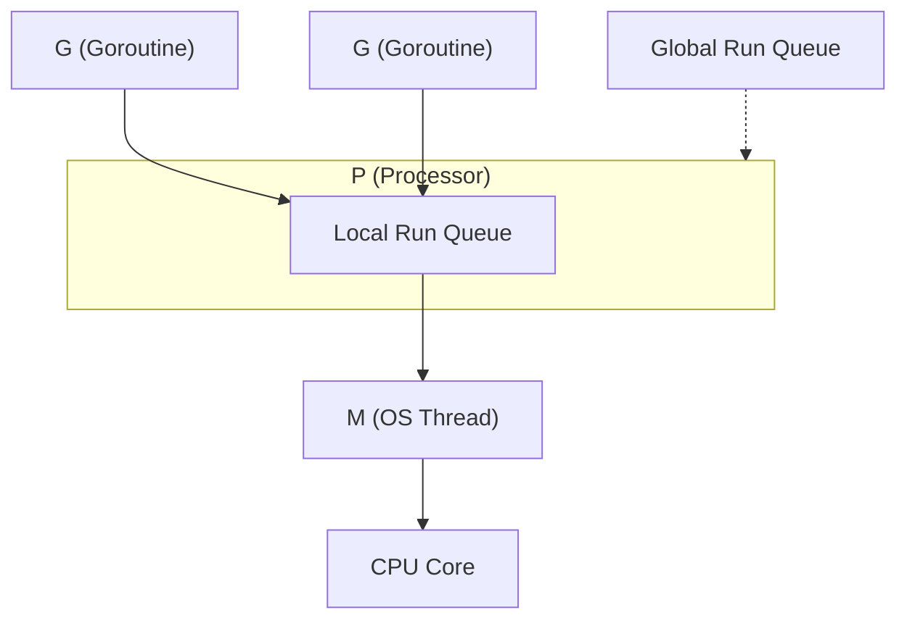

Go のランタイムスケジューラーは、<strong>G・M・P モデル</strong>で goroutine を OS スレッドに割り当てています。G（goroutine）は P（実行権）ごとのキューに入り、P を持つ M（OS スレッド）がそのキューから G を取り出して実行します。この流れを `runtime` パッケージの構造体と関数に沿って追い、同じ動きをアニメーションでも確かめられるようにしました。

<ArticleVideo slug="go-scheduler-gmp" />

## G・M・P モデルの概要



## G・M・P の内部構造

### G（Goroutine）— `runtime.g` 構造体

Goroutine の実態は [`runtime/runtime2.go`](https://github.com/golang/go/blob/master/src/runtime/runtime2.go) に定義された `runtime.g` 構造体です。

```go
type g struct {
    stack       stack   // lo, hi — 現在のスタック範囲
    stackguard0 uintptr // プリエンプションチェックに使用
    m           *m      // 現在この G を実行している M
    sched       gobuf   // コンテキストスイッチ用の状態
    atomicstatus atomic.Uint32 // G の状態フラグ
    goid         uint64 // goroutine ID
    // ... 他多数
}
```

重要なフィールド:

- <strong>`stack`</strong> — 各 G のスタックは 2KB から始まります（OS スレッドは 1〜8MB）。Go 1.19 以降は、ランタイムが平均的なスタック使用量に合わせて、より大きな初期サイズを割り当てることもあります。足りなくなると `runtime.morestack()` で拡張されます。
- <strong>`sched` (`gobuf`)</strong> — コンテキストスイッチ時に PC (Program Counter)、SP (Stack Pointer)、BP (Base Pointer) を保存する構造体です。G が中断・再開されるたびに読み書きされます。
- <strong>`stackguard0`</strong> — 通常はスタックの下限付近のアドレスです。プリエンプションを要求するときは、特別な値 `stackPreempt` が設定されます。
- <strong>`atomicstatus`</strong> — G のライフサイクルを表す状態: `_Gidle` → `_Grunnable` → `_Grunning` → `_Gsyscall` / `_Gwaiting` → `_Gdead`

### M（Machine）— `runtime.m` 構造体

M は OS スレッドを 1:1 で表す構造体です（[`runtime/runtime2.go`](https://github.com/golang/go/blob/master/src/runtime/runtime2.go)）。

```go
type m struct {
    g0      *g     // スケジューリング用の特殊 G（大きなスタック）
    curg    *g     // 現在実行中のユーザー G
    p       *p     // 紐付いている P
    nextp   *p     // 起床時に紐付ける P
    spinning bool  // steal 先を探している状態
    // ...
}
```

- <strong>`g0`</strong> — 各 M に 1 つ存在する特殊な goroutine。`schedule()`、`findRunnable()`、GC などのランタイムコードは `g0` のスタック上で実行されます。`mcall()` でユーザー G から g0 に切り替えます。
- <strong>`curg`</strong> — 現在 M 上で実行中のユーザー goroutine。`execute()` で設定され、`goexit()` やプリエンプションでクリアされます。
- <strong>`spinning`</strong> — M が work stealing のために実行可能な G を探し回っている状態を示すフラグです。ランタイムは spinning 状態の M の数を制限して、CPU の空回りを抑えます。

### P（Processor）— `runtime.p` 構造体

P は「ユーザー Go コードを実行する権利」を表す論理的なリソースです（[`runtime/runtime2.go`](https://github.com/golang/go/blob/master/src/runtime/runtime2.go)）。

```go
type p struct {
    status    uint32 // _Pidle, _Prunning, _Pgcstop, _Pdead（_Psyscall は Go 1.26 で廃止）
    runqhead  uint32 // ローカルキューの先頭インデックス
    runqtail  uint32 // ローカルキューの末尾インデックス
    runq      [256]guintptr // ローカル実行キュー（リングバッファ）
    runnext   guintptr      // 次に実行する G（キューよりも優先）
    gFree     struct { ... } // 再利用可能な G のフリーリスト
    // ...
}
```

- <strong>`runq`</strong> — 256 エントリーの固定長リングバッファーで、ロックを取らずに操作できます。G を tail に追加するのは所有者の P だけで、取り出すときは所有者も steal する側も head をアトミックな CAS で進めます。
- <strong>`runnext`</strong> — 現在の G が直前に実行可能にした G（新しく生成した G など）を入れる 1 スロットの枠です。キューより先に実行されるので、直前のデータがキャッシュに残っているうちに処理できます。
- P の数は現在の `GOMAXPROCS` 値に従います。`runtime.GOMAXPROCS` で実行中に変更でき、Go 1.25 以降では手動設定していなければ既定値も自動で再評価されます。

## `schedule()` ループの詳細

全てのスケジューリング判断は、[`runtime/proc.go`](https://github.com/golang/go/blob/master/src/runtime/proc.go) の `runtime.schedule()` 関数で行われます。M は g0 スタック上でこのループを回り続けます。

```go
func schedule() {
    // 公平性: 61回に1回はグローバルキューを優先
    if schedtick%61 == 0 {
        G = globrunqget(P)    // グローバルキューから取得
    }
    if G == nil {
        G = runqget(P)        // ① runnext → ② ローカルキュー
    }
    if G == nil {
        G = findRunnable(P)   // ③ ブロッキング探索
        // → globrunqget → netpoll → steal from random P
    }
    execute(G)  // gobuf 復元 → ユーザーコード実行
}
```

`schedule()` の周期的なグローバルキューの確認とローカルの `runqget()` で G が見つからなければ、`findRunnable()` がより広く探します。trace reader / GC worker の作業、グローバルキュー（2 度目の周期的な確認）、finalizer / cleanup goroutine、ローカルキュー、グローバルキューからのまとめ取り（`min(len/GOMAXPROCS+1, len, 128)` 個。128 はローカルキュー容量 256 の半分）、非ブロッキングの netpoll、work stealing、アイドル時の GC / trace 作業の順に調べ、最後に timer か netpoll でブロックして待ちます。正確な順序はリリースごとに変わるので、Go 1.27 時点の概略として読んでください。

## ステップ実行で見るスケジューラーの動き

下のビジュアライゼーションでは、ここまでの動きを 1 ステップずつ実行できます。各ステップの説明には、そのとき呼ばれるランタイム関数の名前を入れています。

<GoRoutineVisualizer />

## プリエンプション（Preemption）の内部実装

### 協調的プリエンプション（Go 1.2〜）

Go コンパイラーはほとんどの関数の先頭に<strong>スタックチェックのプロローグ</strong>を挿入します:

```asm
// 関数プロローグ（擬似コード）
MOV  AX, [G.stackguard0]
CMP  AX, SP
JBE  morestack          // スタック拡張 or プリエンプション
```

sysmon が `retake()` で 10ms 以上実行中の G を検知すると、`stackguard0` に `stackPreempt`（`0xfffffade`）を設定します。次の関数呼び出し時にプロローグでこの値が検出され、`morestack()` 経由で `gopreempt_m()` が呼ばれて G は `_Grunnable` に戻されます。

ただし、`for {}` のように関数呼び出しを含まないタイトループでは、プロローグを通らないのでプリエンプションが効きません。

### 非同期プリエンプション（Go 1.14〜）

Go 1.14 で<strong>シグナルベースの非同期プリエンプション</strong>が導入されました:

1. sysmon が `preemptone()` を呼ぶ
2. Unix 系では対象 M に `SIGURG` シグナルを送る（他の OS ではプラットフォーム固有の仕組みを使う）
3. シグナルハンドラー `doSigPreempt()` が実行され、現在の PC/SP を保存する
4. G のスタック上に `asyncPreempt` フレームを注入する
5. G は中断され、`schedule()` に制御が戻る

```go
// runtime/signal_unix.go — https://github.com/golang/go/blob/master/src/runtime/signal_unix.go
func doSigPreempt(gp *g, ctxt *sigctxt) {
    if wantAsyncPreempt(gp) && isAsyncSafePoint(gp, ctxt.sigpc(), ctxt.sigsp(), ctxt.siglr()) {
        ctxt.pushCall(abi.FuncPCABI0(asyncPreempt), ctxt.rip())
    }
}
```

`isAsyncSafePoint()` は、GC のルートセットが正確に列挙できる安全なポイントでのみプリエンプションを許可します。

## sysmon — 監視デーモン

`sysmon` はランタイムの system monitor 関数で、P を持たない専用の M / OS スレッド上でバックグラウンドループを回ります（[`runtime/proc.go`](https://github.com/golang/go/blob/master/src/runtime/proc.go)）。

```go
func sysmon() {
    for {
        usleep(delay) // 20μs 〜 10ms（適応的）
        // 1. Netpoller の結果を回収
        netpoll(0)
        // 2. 長時間の syscall → P を hand-off
        retake(now)
        // 3. 長時間実行中の G をプリエンプト
        // 4. GC の STW が必要な場合にシグナル送信
        // 5. 強制 GC のチェック（2分以上 GC がない場合）
    }
}
```

### [`retake()`](https://github.com/golang/go/blob/master/src/runtime/proc.go) の判定ロジック

```go
func retake(now int64) uint32 {
    for _, pp := range allp {
        if pp.status != _Prunning {
            continue // Go 1.26 以降、syscall 中の P も _Prunning のまま
        }
        // 10ms 以上実行 → preemptone()
        if pd.schedwhen + 10ms <= now {
            preemptone(pp)
        }
        if inSyscall(pp) { // P の G が _Gsyscall
            // 20μs 以上 syscall 中 & 他に仕事がある → handoffp()
            if runqempty(pp) && sched.nmspinning + sched.npidle > 0 {
                continue // すぐには hand-off しない
            }
            handoffp(pp) // P を M から切り離す
        }
    }
}
```

## Netpoller — 非同期 I/O 統合

Go の全てのネットワーク I/O（`net.Conn.Read()` など）は、netpoller を通じて非同期に処理されます。

1. 接続の fd は、作成された時点で epoll/kqueue/IOCP に登録される
2. G がネットワーク I/O を開始し、すぐに読み書きできなければ `runtime.pollWait()` で `gopark()` して `_Gwaiting` になる
3. `findRunnable()` や `sysmon` が定期的に `netpoll()` を呼び出す
4. I/O 完了した G を `injectglist()` で実行キューに戻す

```go
// ネットワーク I/O の内部フロー
conn.Read(buf)
  → internal/poll.FD.Read()
    → runtime.pollWait()
      → gopark(netpollblockcommit) // G を _Gwaiting に
// ... I/O 完了を epoll_wait で検知 ...
runtime.netpoll()
  → G を _Grunnable に戻す
  → injectglist() でキューに投入
```

syscall（`read(2)` 等）とは異なり、netpoller は <strong>M をブロックしません</strong>。そのため `net/http` サーバーは、大量の接続を少数の OS スレッドで処理できます。

## G のライフサイクル — 状態遷移

```text
_Gidle → _Gdead → _Grunnable → _Grunning → _Gdead
                       ↑            ↓
                       ← ←  preempt ← ←
                       ↑            ↓
                       ← _Gwaiting ←  (chan/mutex/IO)
                       ↑            ↓
                       ← _Gsyscall ←  (syscall)
```

- <strong>`_Grunnable`</strong> — 実行可能だがまだ M に割り当てられていない
- <strong>`_Grunning`</strong> — M 上で実行中
- <strong>`_Gwaiting`</strong> — chan 受信、mutex、I/O 待ちなどでブロック中
- <strong>`_Gsyscall`</strong> — システムコール実行中（M もブロック）
- <strong>`_Gdead`</strong> — 完了。構造体は `gFree` リストにプールされ再利用される

## コンテキストスイッチのコスト

goroutine の切り替えは、OS のスレッド切り替えより一桁ほど安く済みます。表の時間は公開されている測定例で、CPU や OS によって変わります。

| | Go goroutine | OS スレッド |
|---|---|---|
| 切り替え対象 | PC, SP, BP, 数個のレジスター（`gobuf`） | より多くのレジスターとカーネルスケジューラー状態。キャッシュ / TLB への影響もあり得る（ページテーブル切替は主にプロセス切替時） |
| 切り替えコスト | 約 170ns（[Bendersky の測定](https://eli.thegreenplace.net/2018/measuring-context-switching-and-memory-overheads-for-linux-threads/)） | 約 1〜2μs（同じ測定。キャッシュへの影響を除く直接コスト） |
| スタックサイズ | 初期 2KB 以上（動的拡張） | 固定 1〜8MB |
| 生成コスト | 約 200ns（[Go ランタイムのベンチマーク結果](https://github.com/golang/go/commit/52bd1c4d6cc691aa60c71513695dba03062deb59)） | 約 5μs（[`pthread_create` の測定](https://eli.thegreenplace.net/2018/launching-linux-threads-and-processes-with-clone/)） |

[`gobuf`](https://github.com/golang/go/blob/master/src/runtime/runtime2.go) の構造:

```go
type gobuf struct {
    sp   uintptr // スタックポインタ
    pc   uintptr // プログラムカウンタ
    g    guintptr
    ctxt unsafe.Pointer
    ret  uintptr
    lr   uintptr // ARM のリンクレジスタ
    bp   uintptr // ベースポインタ（フレームポインタ）
}
```

## GOMAXPROCS と実際のスレッド数

現在の P の数は `GOMAXPROCS` で決まりますが、実際の M（OS スレッド）の数はそれより多くなることがあります。

- syscall でブロックされた M は P を手放し、その P を動かすために新しい M が生成される
- M の最大数はデフォルトで 10,000（`runtime/debug.SetMaxThreads`）
- アイドル M はすぐには破棄されず、`midle` リストにプールされる

```go
runtime.GOMAXPROCS(4)  // P = 4 個
// でも M は 4 個以上存在しうる
// 例: 4つの P + syscall でブロック中の M が 10 個 = 合計 14 M
```

### コンテナーを意識する既定値（Go 1.25〜）

長らく `GOMAXPROCS` の既定値は起動時の論理 CPU 数（`runtime.NumCPU()`）でした。コンテナー環境では、これがよくある性能問題の原因になっていました。例えば 64 コアのノードで CPU limit を 2 コアに絞った Pod を動かすと、Go ランタイムは `GOMAXPROCS=64` として 64 個の P を作っていました。その結果、cgroup の CPU 制限でスロットリングされ、余分なコンテキストスイッチも増えてレイテンシーが悪化していました。従来は `automaxprocs` のような外部ライブラリーで対処するのが一般的でした。

[Go 1.25](https://go.dev/doc/go1.25#container-aware-gomaxprocs) でこの対処がランタイム本体に取り込まれました。

- <strong>Linux では cgroup の CPU 帯域制限を考慮する</strong> — 制限が論理 CPU 数より小さければ、そちらを `GOMAXPROCS` の既定値にする。Kubernetes でいう CPU limit が対象で、<strong>CPU requests は考慮されない</strong>
- <strong>全 OS で定期的に再評価する</strong> — 利用可能な論理 CPU 数や cgroup 制限が変われば `GOMAXPROCS` を追従させる

これらは `GOMAXPROCS` 環境変数や `runtime.GOMAXPROCS()` で手動設定した時点で自動的に無効化されます（GODEBUG の `containermaxprocs=0` / `updatemaxprocs=0` で個別に無効化することもできます）。逆に、一度手動設定した後で既定の振る舞いに戻したい場合は、新しい `runtime.SetDefaultGOMAXPROCS()` を使います。

## まとめ

Go スケジューラーの G・M・P モデルを構成する仕組みは、次の 7 つです。

1. <strong>M:N スケジューリング</strong> — 多数の G を少数の M に多重化する
2. <strong>ロックフリーのローカルキュー</strong> — P ごとの 256 エントリーのリングバッファーで、ロックを取らずに G を出し入れする
3. <strong>Work Stealing</strong> — 仕事のない P が他の P のキューから G を取ってきて負荷を分散する
4. <strong>Hand-off</strong> — M が syscall でブロックされても、P を別の M に渡して実行を続ける
5. <strong>Netpoller</strong> — ネットワーク I/O を epoll/kqueue で非同期に処理し、M をブロックしない
6. <strong>協調的 + 非同期プリエンプション</strong> — 関数プロローグのチェックとプラットフォーム固有の非同期プリエンプションで、1 つの G が CPU を占有し続けるのを防ぐ
7. <strong>sysmon</strong> — P を持たない専用スレッドで、長時間の syscall や実行を検知して対処する
