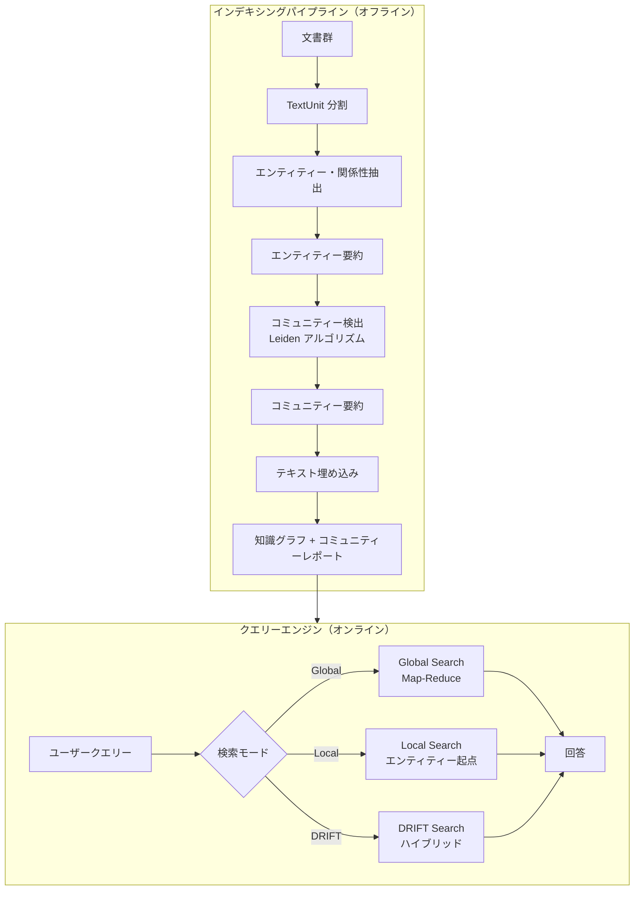
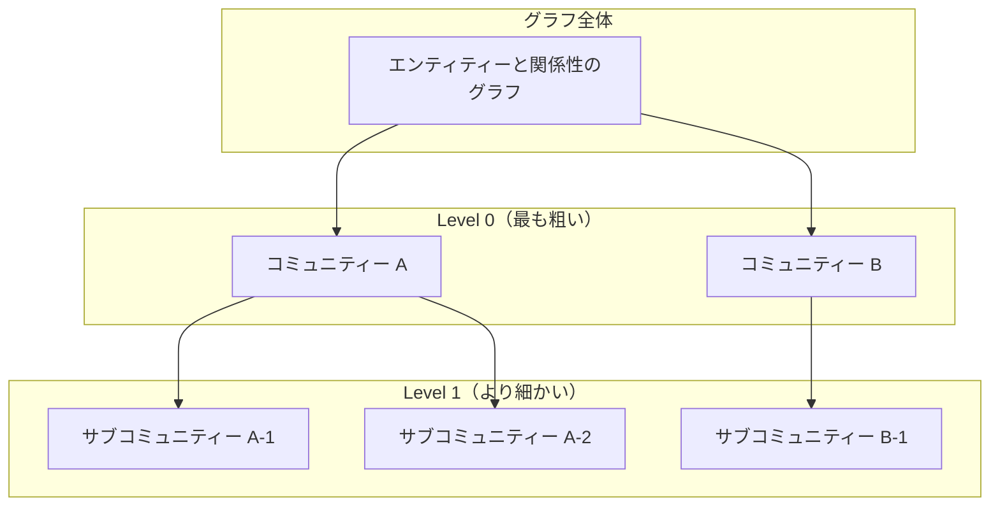
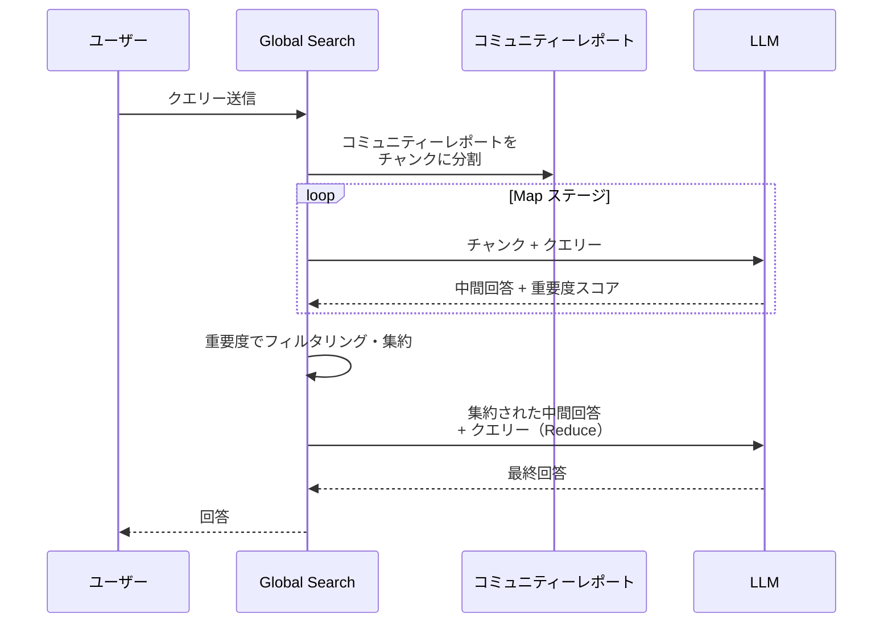
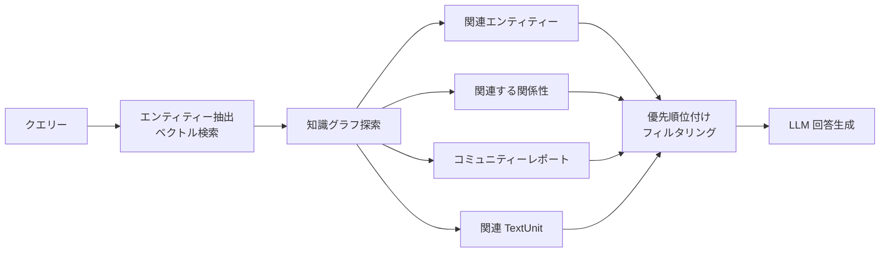
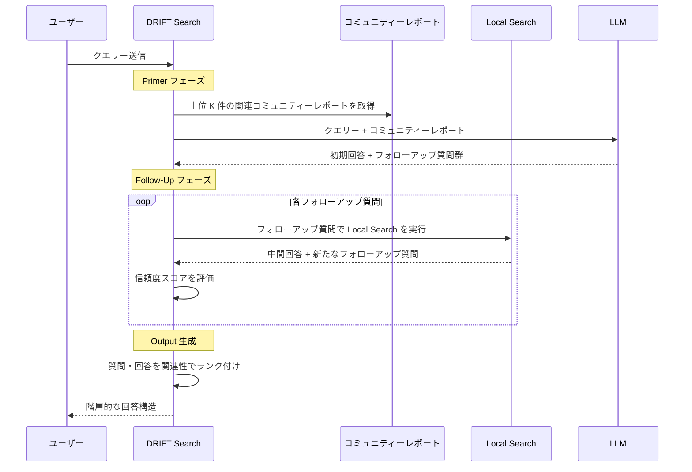

## はじめに ─ なぜ GraphRAG が必要なのか

Retrieval-Augmented Generation（RAG）は、LLM の回答を改善する技術として広く使われています。しかし、ベクトル類似度検索に基づく従来の **Baseline RAG** には、根本的な限界があります。

### Baseline RAG の限界

Baseline RAG は、ユーザーのクエリーをベクトル化し、コーパス内のテキストチャンクのうちコサイン類似度が高い上位 k 件を取得します。この方法では、次の 2 種類の質問にうまく答えられません。

#### 限界 1: 点と点をつなげない（Connect the dots）

回答に必要な情報が複数の文書に分散し、共通の属性をたどって推論する必要がある場合、ベクトル検索では適切なチャンクを取得できません。

例えば、ある企業の社内文書に「田中さんが関わったプロジェクトで、最終的に製品化されたものはどれか？」と質問するとします。答えるには、少なくとも次の情報が必要です。

- **文書 A**（人事記録）: 「田中太郎は 2023 年にプロジェクト Alpha に配属された」
- **文書 B**（議事録）: 「プロジェクト Alpha の成果物は品質検証フェーズに進んだ」
- **文書 C**（プレスリリース）: 「品質検証を通過した製品 X が 2024 年 3 月に発売された」

Baseline RAG は「田中さん」「製品化」に意味的に近いチャンクを探しますが、文書 B には田中さんの名前も「製品化」という単語も出てきません。結果として、Alpha → 品質検証 → 製品 X という情報の連鎖をたどれず、正しい回答を生成できません。

GraphRAG なら、「田中太郎」→「プロジェクト Alpha」→「品質検証」→「製品 X」というエンティティー間の関係をグラフ上でたどり、この質問に正しく答えられます。

#### 限界 2: 全体像を把握できない（Holistic understanding）

「このデータセットの主要テーマは何か？」のようにデータ全体の要約を求める質問では、ベクトル検索はクエリーに意味的に近いチャンクしか返せず、データセット全体の構造を捉えられません。

例えば、1,000 件のニュース記事に「この期間のニュースの主要トピック Top 5 は？」と質問したとします。Baseline RAG は「トピック」「主要」に近いチャンクを探しますが、「主要トピック」という言葉を含むチャンクが、実際の主要トピックとは全く関係しないこともあります。データセット全体に広く分散したテーマは、どのチャンクにも十分にはまとまっていません。その結果、LLM はたまたま取得した数件のチャンクから、根拠の乏しいテーマを作り上げることになります。

GraphRAG は、この問題に **コミュニティーレポート** で対処します。インデキシング時にデータセット全体をコミュニティーに分け、各コミュニティーの要約を事前に生成しておくため、「全体のテーマは？」という質問にも、データセット全体を踏まえて答えられます。

### GraphRAG のアプローチ

[GraphRAG](https://github.com/microsoft/graphrag) は、Microsoft Research が開発した RAG 手法です。LLM を使って非構造化テキストから知識グラフ（ナレッジグラフ）を構築し、そのグラフ構造を使ってクエリー時のコンテキストを補います。2026 年 9 月時点で、`microsoft/graphrag` リポジトリーは自身を「主にメンテナンスモード」と説明しており、活発に機能が追加される製品 SDK ではありません。手法とドキュメントは今も参考になりますが、本番で使う前に、パッケージの API と設定形式を最新のドキュメントで確認してください。

GraphRAG の中心となる考え方は次の 3 つです。

- **エンティティーと関係性の抽出**: LLM がテキストから人物・組織・場所・概念などのエンティティーと、それらの間の関係性を抽出し、知識グラフを構成する
- **階層的コミュニティー検出**: Leiden アルゴリズムを用いてグラフをクラスタリングし、意味的なコミュニティー階層を構築する
- **コミュニティーレポートの事前生成**: 各コミュニティーの内容を LLM で要約した「コミュニティーレポート」を事前に生成し、クエリー時に使う

これにより、Baseline RAG が苦手とする横断的な推論と全体像の把握の両方に対応できます。

> 📄 論文: [From Local to Global: A Graph RAG Approach to Query-Focused Summarization](https://arxiv.org/pdf/2404.16130) (arXiv, 2024)

### フラットなチャンクから意味グラフへ

Baseline RAG と GraphRAG では、知識ベースの構造が異なります。Baseline RAG は文書をフラットなチャンクの集合として扱い、ベクトル空間上の「点」同士の距離だけで検索します。知識ベースは、互いの関係が見えない断片の集まりです。

GraphRAG はそこに構造を与えます。エンティティー（人・組織・概念など）をノード、それらの関係をエッジとするグラフを構築し、誰が何に関わり、何が何に影響し、どの概念同士が近いかといった、データセット内の意味的なつながりを明示的に表します。さらに Leiden アルゴリズムでコミュニティー（意味的なクラスター）を検出して階層化するので、局所的な事実から全体的なテーマまで、異なる抽象度でデータを捉えられます。

GraphRAG は、**対象コーパスの意味空間をグラフとして構造化し、それを RAG の知識ベースとして使う手法**です。ここでいう意味空間は、入力文書から LLM が抽出したエンティティーと関係だけで構成されます。使える知識が文書の内容に限られる点は Baseline RAG と同じで、違いは文書内の情報を構造として整理する点にあります。

```text
Baseline RAG:  文書 → フラットなチャンク群 → ベクトル距離で検索
GraphRAG:     文書 → 構造化された意味グラフ → グラフ探索＋コミュニティ要約で回答
```

---

## アーキテクチャ全体像

GraphRAG は大きくインデキシングパイプライン（オフライン処理）とクエリーエンジン（オンライン処理）の 2 つのフェーズで構成されます。



---

## インデキシングパイプライン ─ 知識グラフ構築の 6 フェーズ

次のビジュアライザーで、インデキシングパイプラインの主なフェーズ（Phase 1・3・4・5）と、その結果を使う Global Search・Local Search を順にたどれます。

<GraphRAGPipelineVisualizer />

### Phase 1: TextUnit の構成

最初のフェーズでは、入力文書をトークン数で区切った **チャンク（TextUnit）** に分割します。TextUnit は以降のグラフ抽出の基本単位で、抽出された知識の出典参照（プロベナンス）としても使われます。

チャンクサイズのデフォルトは 1,200 トークンです。チャンクを大きくすると処理は速くなりますが、出力の粒度は粗くなります。各 TextUnit には、元の文書との対応が保持されます。

```text
Document 1 → [TextUnit 1] [TextUnit 2]
Document 2 → [TextUnit 3] [TextUnit 4]
```

### Phase 2: 文書処理

Documents テーブルを生成し、各文書と TextUnit の対応関係を記録します。この対応関係を使うと、回答の根拠を元の文書までたどれます。

### Phase 3: グラフ抽出

後続のフェーズが使う知識グラフを作るフェーズで、3 つのサブステップからなります。

#### 3a. エンティティー・関係性抽出

各 TextUnit を LLM に入力し、次の情報を抽出します。

- **エンティティー**: タイトル、タイプ（人物・組織・場所・イベントなど）、説明
- **関係性**: ソースエンティティー、ターゲットエンティティー、説明

同じタイトル＋タイプのエンティティーが複数の TextUnit から抽出された場合、それらの説明は配列としてマージされます。関係性も同様に、同じソース・ターゲットのペアの説明がマージされます。

```text
TextUnit → LLM → サブグラフ（エンティティ群 + 関係性群）
                    ↓
          グローバルグラフにマージ（説明は配列で集約）
```

#### 3b. エンティティー・関係性要約

マージされた説明の配列を LLM に渡し、各エンティティー・関係性の説明を 1 つの簡潔な説明にまとめます。

#### 3c. クレーム抽出（オプション）

TextUnit から、独立した処理として **コバリエイト（クレーム）** を抽出します。クレームはエンティティーに関する事実の主張で、それぞれ時間的な範囲と評価結果（ステータス）を持ちます。

> ⚠️ クレーム抽出はデフォルトで無効です。有用な結果を得るには、通常プロンプトチューニングが必要です。

### Phase 4: グラフ拡張 ─ コミュニティー検出

エンティティーと関係性のグラフが構築されたら、Leiden アルゴリズムを適用して階層的なコミュニティー構造を検出します。

#### Leiden アルゴリズムとは

Leiden アルゴリズム（[Traag et al., 2019](https://arxiv.org/pdf/1810.08473.pdf)）は、Louvain アルゴリズムを改良した、グラフのコミュニティー（クラスター）検出アルゴリズムです。主な特徴は次の 3 つです。

1. **モジュラリティー最適化**: グラフの接続密度に基づいて、密に接続されたノード群をコミュニティーとしてまとめる
2. **階層的検出**: コミュニティーを再帰的に検出し、コミュニティーサイズの閾値に達するまでクラスタリングを繰り返す
3. **接続性の保証**: Louvain と異なり、各コミュニティー内の接続性を保証する



この階層構造により、GraphRAG はデータセットを異なる粒度で扱えます。粗いレベルはデータセット全体のテーマを、細かいレベルは局所的な詳細をそれぞれ捉えます。GraphRAG はいちばん粗い階層を Level 0 と数え、番号が大きいほど小さなコミュニティーになります（クエリー時の `--community-level` もこの番号で指定します）。

### Phase 5: コミュニティー要約

各コミュニティーの内容を LLM で要約し、次の項目を含むコミュニティーレポートを生成します。

- **エグゼクティブサマリー**: コミュニティー全体の概要
- **主要エンティティー**: コミュニティー内の重要なエンティティーとその役割
- **関係性**: エンティティー間の主要な関係
- **クレーム**: 関連するクレーム（有効な場合）

レポートは階層の各レベルで生成され、粗いレベルほど広いテーマを、細かいレベルほど詳細な情報を扱います。クエリーエンジンは、このレポートをコンテキストとして使います。

### Phase 6: テキスト埋め込み

最後に、クエリー時のベクトル検索に使うテキスト埋め込みを、次の 3 種類について生成します。

- エンティティー説明の埋め込み
- TextUnit テキストの埋め込み
- コミュニティーレポートの埋め込み

生成した埋め込みは、設定したベクトルストアに書き込まれます。

---

## GraphRAG の知識モデル

GraphRAG のインデキシングパイプラインは、次のデータ型を出力します。

| データ型 | 説明 |
|---|---|
| Document | 入力文書。CSV の行または `.txt` ファイル |
| TextUnit | 分析用のテキストチャンク |
| Entity | TextUnit から抽出されたエンティティー（人物・場所・組織など） |
| Relationship | 2 つのエンティティー間の関係 |
| Covariate | 抽出されたクレーム情報（時間的境界付き） |
| Community | エンティティーのクラスタリング結果 |
| Community Report | コミュニティーの要約レポート |

出力はデフォルトで Parquet テーブルとして保存されます。

---

## クエリーエンジン ─ 4 つの検索モード

### Global Search ─ データセット全体の俯瞰

Global Search は、「データセット全体の主要テーマは何か？」のように、データセット全体にまたがる質問に向いた検索モードです。

#### Map-Reduce 方式の処理フロー



1. **Map ステージ**: コミュニティーレポートを事前定義サイズのチャンクに分割し、各チャンクに対して LLM で中間回答（ポイントリスト＋重要度スコア）を生成
2. **Reduce ステージ**: 最も重要なポイントを集約し、最終的な回答のコンテキストとして使用

> ⚠️ コミュニティー階層のどのレベルのレポートを使うかにより、回答の品質と処理コストが大きく変わります。細かいレベル（番号の大きいレベル）ほど詳細な回答が得られますが、処理コストが増加します。

### Local Search ─ 特定エンティティーの深掘り

Local Search は、「カモミールの治療効果は？」のように、特定のエンティティーに関する質問に向いています。

#### 処理フロー

1. クエリーに関連するエンティティーを抽出（エンティティー説明の埋め込みに対するベクトル検索）
2. 抽出したエンティティーをアクセスポイントとして知識グラフを探索
3. 関連するエンティティー、関係性、コバリエイト、コミュニティーレポート、元の TextUnit を収集
4. トークン予算内で優先順位付け・フィルタリング
5. コンテキストウィンドウに収めて LLM で回答生成



### DRIFT Search ─ Global と Local のハイブリッド

DRIFT Search（Dynamic Reasoning and Inference with Flexible Traversal）は、Local Search にコミュニティー情報を組み込んだハイブリッド検索です。3 つのフェーズで構成されます。

1. **Primer フェーズ**: ユーザークエリーと、意味的に関連する上位 K 件のコミュニティーレポートを比較し、初期回答とフォローアップ質問を生成
2. **Follow-Up フェーズ**: Local Search を使ってフォローアップ質問を精緻化し、追加の中間回答と新たなフォローアップ質問を生成
3. **Output Hierarchy**: 関連性でランク付けされた質問と回答の階層構造を出力

DRIFT Search は、Global Search と同じくコミュニティーレポートの広い文脈から始め、絞り込んだフォローアップ質問には Local Search の精度で答えます。



### Basic Search ─ 従来型ベクトル検索

GraphRAG には、比較用に従来型のベクトル RAG（Basic Search）も含まれています。上位 k 件の TextUnit チャンクをコンテキストとして使います。

---

## Baseline RAG vs GraphRAG ─ 実例比較

[Microsoft Research のブログ](https://www.microsoft.com/en-us/research/blog/graphrag-unlocking-llm-discovery-on-narrative-private-data/)では、ウクライナ・ロシア紛争に関するニュースデータセット（VIINA）を用いた比較が紹介されています。

### 例 1: 横断的な推論

**クエリー**: 「Novorossiya は何をしたか？」

| Baseline RAG | GraphRAG |
|---|---|
| テキストに具体的な情報がないため回答不可 | Novorossiya が関与した破壊活動の詳細を、エンティティー間の関係をたどって網羅的に回答（出典付き） |

Baseline RAG はクエリーに意味的に近いチャンクを取得しましたが、その中に「Novorossiya」に言及するものはなく、回答できませんでした。GraphRAG は、知識グラフ上で Novorossiya エンティティーを起点に関係をたどり、複数のソースの情報を統合して回答しました。

### 例 2: 全体テーマの把握

**クエリー**: 「データの主要テーマ Top 5 は？」

| Baseline RAG | GraphRAG |
|---|---|
| 無関係なテーマ（都市開発、経済など）を列挙 | 紛争・軍事活動、政治的動向、人道的影響など、データセットの内容に沿ったテーマを回答 |

Baseline RAG が挙げたテーマは、紛争とはほとんど関係のないものでした。ブログは、検索が「テーマ（theme）」という語に反応して無関係なチャンクを取得したためだろうと推測しています。GraphRAG は、データセット全体を対象にしたコミュニティーレポートから回答しました。

---

## Microsoft Agent Framework (C#) を用いた実装

ここからは、[Microsoft Agent Framework](https://github.com/microsoft/agent-framework) の C# ライブラリーで、GraphRAG 風のインデキシングと検索の骨組みを実装します。Agent Framework は、エージェントの構築・オーケストレーション・デプロイに使うフレームワークです。

### 前提条件

```text
- .NET 10 SDK 以降
- Azure OpenAI または OpenAI の API キー
- Azure CLI（Azure OpenAI 使用時: az login で認証）
```

### Step 1: プロジェクトセットアップ

新しいコンソールプロジェクトを作成し、Agent Framework と OpenAI 関連のパッケージを追加します。2026 年 9 月 10 日時点の Agent Framework クイックスタートでは、C# の例で `Microsoft.Agents.AI` と OpenAI .NET SDK を組み合わせ、Azure OpenAI の認証に `Azure.Identity` と `System.ClientModel` を使っています。この記事のコードは `AzureOpenAIClient` を使うので、`Azure.AI.OpenAI` も追加します。以降のコードは GraphRAG 風の実装を説明するための例なので、本番コードに転用する前に、Agent Framework の正確な API を最新のドキュメントで確認してください。

```bash
mkdir GraphRAGDemo
cd GraphRAGDemo
dotnet new console
dotnet add package Microsoft.Agents.AI
dotnet add package OpenAI
dotnet add package Azure.AI.OpenAI
dotnet add package Azure.Identity
dotnet add package System.ClientModel
```

Azure OpenAI を使う場合は、コードを実行する前に `az login` で認証しておきます。

### Step 2: 知識グラフのデータモデル定義

GraphRAG の公式実装（Python）が定義する知識モデルの主なテーブルに対応させて、C# の `record` 型を定義します。`record` は不変データを表すのに向いており、`with` 式で一部のプロパティーだけを変えたコピーを作れます。この `with` 式を使って、Step 5 では各エンティティーにコミュニティーの ID を、Step 9 では各コミュニティーにレポートを設定します。

```csharp
// Models/KnowledgeGraph.cs
// https://github.com/microsoft/graphrag — Knowledge Model の C# 表現

/// <summary>テキストチャンク — GraphRAG の分析基本単位</summary>
public record TextUnit(string Id, string Text, string DocumentId);

/// <summary>エンティティ — ナレッジグラフのノード</summary>
public record Entity(
    string Id,
    string Title,
    string Type,        // "person", "organization", "location", "event", ...
    string Description,
    int CommunityId,
    float[] Embedding);

/// <summary>関係性 — ナレッジグラフのエッジ</summary>
public record Relationship(
    string SourceId,
    string TargetId,
    string Description,
    double Weight);

/// <summary>コミュニティ — Leiden アルゴリズムで検出されたクラスター</summary>
public record Community(
    int Id,
    string Title,
    int Level,
    string Report);    // LLM 生成のコミュニティレポート
```

`Entity` の `Embedding` フィールドは Phase 6 のテキスト埋め込みで設定し、Local Search のベクトル検索に使います。

### Step 3: エンティティー・関係性抽出の関数ツール

Agent Framework では、C# のメソッドを関数ツール（Function Tools）として LLM から呼び出せます。`AIFunctionFactory.Create`（Step 4 で使います）がメソッドのシグネチャーから JSON Schema を生成し、`[Description]` 属性がそのスキーマに入る説明文になります。LLM はこのスキーマを Function Calling の仕組みで受け取ります。ここでは、TextUnit からエンティティーと関係性を抽出する関数ツールを定義します。

```csharp
// Agents/EntityExtractor.cs
// https://github.com/microsoft/agent-framework — Agent Framework の関数ツール機能を活用

using System.ComponentModel;
using Microsoft.Agents.AI;
using Microsoft.Extensions.AI;

public static class EntityExtractor
{
    /// <summary>
    /// TextUnit からエンティティと関係性を抽出する関数ツール。
    /// Agent Framework が自動的に JSON Schema を生成し、LLM の Function Calling で呼び出す。
    /// </summary>
    [Description("テキストからエンティティ（人物・組織・場所・概念）と関係性を抽出する")]
    public static string ExtractEntitiesAndRelationships(
        [Description("分析対象のテキストチャンク")] string textUnit,
        [Description("抽出対象のエンティティタイプ（カンマ区切り）")] string entityTypes = "person,organization,location,event,concept")
    {
        // この関数は LLM の Function Calling 経由で呼び出される。
        // 実際には、LLM からの構造化出力をパースして
        // エンティティと関係性のリストを返す。
        return $$"""
        {
            "entities": [
                {"title": "...", "type": "...", "description": "..."}
            ],
            "relationships": [
                {"source": "...", "target": "...", "description": "..."}
            ]
        }
        """;
    }
}
```

`ExtractEntitiesAndRelationships` は、LLM がテキストからエンティティーを抽出する必要があると判断したときに呼び出されます。ここではプレースホルダーを返すだけですが、本番の実装では、このメソッドの中で LLM の構造化出力（Structured Output）をパースし、型付きのエンティティー・関係性オブジェクトに変換します。

### Step 4: エンティティー抽出エージェントの構成

次に、この関数ツールを使うエージェントを構成します。Agent Framework の `AsAIAgent` 拡張メソッドは、`ChatClient` をラップしてエージェントとして扱えるようにします。`instructions` パラメーターでシステムプロンプトを、`tools` パラメーターで関数ツールを指定します。

```csharp
// Program.cs — エンティティ抽出エージェントの構成
// https://github.com/microsoft/agent-framework/blob/main/dotnet/samples/02-agents/Agents/

using Azure.AI.OpenAI;
using Azure.Identity;
using Microsoft.Agents.AI;
using Microsoft.Extensions.AI;

var endpoint = Environment.GetEnvironmentVariable("AZURE_OPENAI_ENDPOINT")
    ?? throw new InvalidOperationException("AZURE_OPENAI_ENDPOINT is not set.");
var deploymentName =
    Environment.GetEnvironmentVariable("AZURE_OPENAI_DEPLOYMENT_NAME") ?? "gpt-4o";

// エンティティ抽出エージェントを構成
AIAgent extractionAgent = new AzureOpenAIClient(
        new Uri(endpoint),
        new DefaultAzureCredential())
    .GetChatClient(deploymentName)
    .AsAIAgent(
        instructions: """
            あなたは知識グラフ構築の専門家です。
            与えられたテキストから、以下を JSON 形式で抽出してください:
            1. エンティティ: タイトル、タイプ（person/organization/location/event/concept）、説明
            2. 関係性: ソースエンティティ、ターゲットエンティティ、関係の説明
            重複するエンティティは同じタイトルで統一してください。
            """,
        tools: [AIFunctionFactory.Create(EntityExtractor.ExtractEntitiesAndRelationships)]);
```

`AzureOpenAIClient` → `GetChatClient` → `AsAIAgent` と呼び出しをつなげることで、Azure OpenAI の認証情報（`DefaultAzureCredential`）、モデルのデプロイメント名、エージェントの振る舞い（instructions / tools）を 1 か所にまとめて指定できます。`DefaultAzureCredential` は、開発環境では `az login` の認証情報を、本番環境ではマネージド ID を自動的に使い分けます。

### Step 5: コミュニティー検出の実装

インデキシングパイプラインの Phase 4 にあたるコミュニティー検出です。公式の GraphRAG は Python の `graspologic` ライブラリーで Leiden アルゴリズムを実行します。次の C# コードは、グラフクラスタリングの役割を示すための簡易なローカル移動ヒューリスティックで、Leiden を忠実に実装したものではありません。

処理の流れは次のとおりです。

1. エンティティー間の関係性から隣接リスト（adjacency list）を構築
2. 初期状態として、各エンティティーをそれぞれ独自のコミュニティーに配置
3. 各エンティティーを、隣接ノード数が最も多いコミュニティーに移動する（説明用の簡易スコア）
4. どのエンティティーの所属も変わらなくなるまでループを繰り返す
5. コミュニティーごとに ID を振り、各エンティティーの `CommunityId` に所属先の ID を設定する

```csharp
// Services/CommunityDetector.cs
// 説明用の簡易コミュニティ検出器。完全な Leiden 実装ではない

/// <summary>
/// 説明用の簡易階層的コミュニティ検出。
/// GraphRAG では graspologic (Python) を使用するが、
/// この C# 例は説明用の簡易ローカル移動ヒューリスティックのみを示す。
/// </summary>
public class CommunityDetector
{
    /// <summary>
    /// グラフからコミュニティを検出し、各エンティティの CommunityId を設定する。
    /// </summary>
    /// <param name="entities">エンティティのリスト</param>
    /// <param name="relationships">関係性のリスト</param>
    /// <param name="maxCommunitySize">コミュニティの最大サイズ閾値</param>
    /// <returns>コミュニティのリスト</returns>
    public List<Community> DetectCommunities(
        List<Entity> entities,
        List<Relationship> relationships,
        int maxCommunitySize = 10)
    {
        // 1. 隣接リストを構築
        var adjacency = BuildAdjacencyList(entities, relationships);

        // 2. 初期化: 各ノードを独自のコミュニティに配置
        var assignments = entities.ToDictionary(e => e.Id, e => e.Id);

        // 3. 説明用のローカル移動ループ（実際の Leiden は modularity/CPM をより厳密に最適化）
        bool improved;
        do
        {
            improved = false;
            foreach (var entity in entities)
            {
                var bestCommunity = FindBestCommunity(
                    entity, adjacency, assignments);
                if (bestCommunity != assignments[entity.Id])
                {
                    assignments[entity.Id] = bestCommunity;
                    improved = true;
                }
            }
        } while (improved);

        // 4. コミュニティをグループ化し、各エンティティの CommunityId を設定して返却
        var groups = assignments.GroupBy(a => a.Value).ToList();
        var labels = groups.Select(g => g.Key).ToList();
        for (int i = 0; i < entities.Count; i++)
        {
            var communityId = labels.IndexOf(assignments[entities[i].Id]);
            entities[i] = entities[i] with { CommunityId = communityId };
        }

        return groups
            .Select((g, i) => new Community(
                Id: i,
                Title: $"Community {i}",
                Level: 0,
                Report: "")) // レポートは後続フェーズで生成
            .ToList();
    }

    private Dictionary<string, List<string>> BuildAdjacencyList(
        List<Entity> entities,
        List<Relationship> relationships)
    {
        var adj = entities.ToDictionary(e => e.Id, _ => new List<string>());
        foreach (var rel in relationships)
        {
            if (adj.ContainsKey(rel.SourceId))
                adj[rel.SourceId].Add(rel.TargetId);
            if (adj.ContainsKey(rel.TargetId))
                adj[rel.TargetId].Add(rel.SourceId);
        }
        return adj;
    }

    private string FindBestCommunity(
        Entity entity,
        Dictionary<string, List<string>> adjacency,
        Dictionary<string, string> assignments)
    {
        // 説明用スコア: 隣接コミュニティごとの隣接ノード数を数える
        var neighbors = adjacency.GetValueOrDefault(entity.Id) ?? [];
        var communityScores = neighbors
            .GroupBy(n => assignments.GetValueOrDefault(n, n))
            .ToDictionary(g => g.Key, g => (double)g.Count());

        return communityScores.Count > 0
            ? communityScores.MaxBy(kv => kv.Value).Key
            : assignments[entity.Id];
    }
}
```

Leiden アルゴリズムには、このローカル移動に加えて次の処理があります。

- **リファインメントフェーズ**: ローカル移動の後にコミュニティー内の接続性を保証するリファインメントを実行（Leiden 独自の改良点）
- **集約フェーズ**: コミュニティーをスーパーノードとして集約し、再帰的にアルゴリズムを適用して階層構造を構築
- **解像度パラメーター**: コミュニティーの粒度を制御するパラメーター。GraphRAG の設定で指定するのは解像度ではなく `max_cluster_size` で、これを超える大きさのコミュニティーが階層的に再分割される。上の簡易版はこの再分割を実装しておらず、`maxCommunitySize` 引数も使っていない

本番環境では、公式の Python GraphRAG / graspologic パイプラインでインデックスを作成して Parquet 出力を .NET から読み込むか、保守が続いている Leiden 実装を備えたグラフライブラリーやランタイムを使うのが現実的です。

### Step 6: コミュニティーレポート生成

Phase 5 にあたるコミュニティーレポートの生成です。`CommunityReporter` クラスは、コミュニティー内のエンティティーと関係性を LLM に渡し、構造化されたレポートを生成します。Agent Framework では、`CreateSessionAsync` で作ったセッションを `RunAsync` に渡して、会話形式でエージェントとやり取りします。

```csharp
// Services/CommunityReporter.cs
// https://github.com/microsoft/agent-framework — エージェントを使ったコミュニティ要約

public class CommunityReporter
{
    private readonly AIAgent _agent;

    public CommunityReporter(AIAgent agent)
    {
        _agent = agent;
    }

    /// <summary>
    /// コミュニティ内のエンティティと関係性から要約レポートを生成する。
    /// </summary>
    public async Task<string> GenerateReportAsync(
        Community community,
        List<Entity> entities,
        List<Relationship> relationships)
    {
        var context = BuildCommunityContext(entities, relationships);

        var session = await _agent.CreateSessionAsync();
        var response = await _agent.RunAsync(
            $"""
            以下のコミュニティのエンティティと関係性に基づいて、
            コミュニティレポートを生成してください。

            レポートには以下を含めてください:
            1. エグゼクティブサマリー（2-3文）
            2. 主要エンティティとその役割
            3. 重要な関係性
            4. 主要テーマ・傾向

            コミュニティデータ:
            {context}
            """,
            session);

        return response.Text;
    }

    private string BuildCommunityContext(
        List<Entity> entities,
        List<Relationship> relationships)
    {
        var sb = new System.Text.StringBuilder();
        sb.AppendLine("=== エンティティ ===");
        foreach (var e in entities)
            sb.AppendLine($"- {e.Title} ({e.Type}): {e.Description}");

        sb.AppendLine("\n=== 関係性 ===");
        foreach (var r in relationships)
            sb.AppendLine($"- {r.SourceId} → {r.TargetId}: {r.Description}");

        return sb.ToString();
    }
}
```

`BuildCommunityContext` は、エンティティーと関係性の一覧を、LLM に渡すテキストに整形するヘルパーです。プロンプトでは、エグゼクティブサマリー、主要エンティティーとその役割、重要な関係性、主要テーマ・傾向をレポートに含めるよう指示しています。クエリー時には、Global Search がこのレポートから回答し、Local Search と DRIFT Search もこのレポートをコンテキストに含めます。

### Step 7: Global Search の実装

Global Search は GraphRAG のクエリーモードの中で最もリソースを消費しますが、データセット全体に関する質問に答えられます。ここでは Map-Reduce パターンで実装し、Map ステージで各コミュニティーレポートのチャンクを並列に処理し、Reduce ステージで中間結果を統合して最終回答を生成します。

```csharp
// Search/GlobalSearch.cs
// https://github.com/microsoft/graphrag — Global Search の C# 実装

public class GlobalSearch
{
    private readonly AIAgent _mapAgent;
    private readonly AIAgent _reduceAgent;
    private readonly int _maxTokensPerChunk;

    public GlobalSearch(
        AIAgent mapAgent,
        AIAgent reduceAgent,
        int maxTokensPerChunk = 2000)
    {
        _mapAgent = mapAgent;
        _reduceAgent = reduceAgent;
        _maxTokensPerChunk = maxTokensPerChunk;
    }

    /// <summary>
    /// コミュニティレポートを Map-Reduce で処理し、
    /// データセット全体に関する質問に回答する。
    /// </summary>
    public async Task<string> SearchAsync(
        string query,
        List<Community> communities)
    {
        // === Map ステージ ===
        // コミュニティレポートをチャンクに分割し、並列処理
        var reportChunks = ChunkReports(communities);
        var intermediateTasks = reportChunks.Select(chunk =>
            MapAsync(query, chunk));
        var intermediateResults = await Task.WhenAll(intermediateTasks);

        // === Reduce ステージ ===
        // 中間結果を集約して最終回答を生成
        var aggregated = intermediateResults
            .SelectMany(r => r.Points)
            .OrderByDescending(p => p.Score)
            .Take(20) // 上位 20 ポイントに絞る
            .ToList();

        return await ReduceAsync(query, aggregated);
    }

    private async Task<MapResult> MapAsync(
        string query, string reportChunk)
    {
        var session = await _mapAgent.CreateSessionAsync();
        var response = await _mapAgent.RunAsync(
            $"""
            以下のコミュニティレポートに基づいて、
            質問に関連するポイントを抽出し、
            各ポイントに 0-100 の重要度スコアを付けてください。

            質問: {query}

            レポート:
            {reportChunk}
            """,
            session);

        // 構造化出力をパース（簡略化）
        return ParseMapResult(response.Text);
    }

    private async Task<string> ReduceAsync(
        string query, List<ScoredPoint> points)
    {
        var context = string.Join("\n",
            points.Select(p => $"[Score: {p.Score}] {p.Text}"));

        var session = await _reduceAgent.CreateSessionAsync();
        var response = await _reduceAgent.RunAsync(
            $"""
            以下の情報ポイントに基づいて、質問に包括的に回答してください。
            各ポイントは元のデータセットから抽出された重要な情報です。

            質問: {query}

            情報ポイント:
            {context}
            """,
            session);

        return response.Text;
    }

    private List<string> ChunkReports(List<Community> communities)
    {
        // コミュニティレポートをトークン制限に基づいてチャンク化
        var chunks = new List<string>();
        var current = new System.Text.StringBuilder();

        foreach (var community in communities)
        {
            if (current.Length > _maxTokensPerChunk * 4) // おおよその文字数
            {
                chunks.Add(current.ToString());
                current.Clear();
            }
            current.AppendLine(community.Report);
        }
        if (current.Length > 0)
            chunks.Add(current.ToString());

        return chunks;
    }

    private MapResult ParseMapResult(string response)
        => new(new List<ScoredPoint>
        {
            new(response, 80) // 簡略化: 実際には構造化パースが必要
        });
}

public record MapResult(List<ScoredPoint> Points);
public record ScoredPoint(string Text, int Score);
```

Map ステージでは `Task.WhenAll` で各チャンクを並列に処理するため、コミュニティーレポートが多くても全体の待ち時間を抑えられます。Reduce ステージでは `OrderByDescending(p => p.Score).Take(20)` で重要度スコアの上位 20 ポイントだけを残します。これで最終プロンプトの大きさに上限がかかり、関連性の高い情報だけが最終回答のコンテキストに入ります。

### Step 8: Local Search の実装

Local Search は、特定のエンティティーに関する質問に答えるクエリーモードです。クエリーに関連するエンティティーをベクトル検索で特定し、そこを起点に知識グラフを探索して、関係性・コミュニティーレポート・元の TextUnit を集めます。

```csharp
// Search/LocalSearch.cs
// https://github.com/microsoft/graphrag — Local Search の C# 実装

public class LocalSearch
{
    private readonly AIAgent _agent;
    private readonly IVectorStore _vectorStore;

    public LocalSearch(AIAgent agent, IVectorStore vectorStore)
    {
        _agent = agent;
        _vectorStore = vectorStore;
    }

    /// <summary>
    /// 特定エンティティに関する質問に対して、
    /// 知識グラフの局所的な探索により回答する。
    /// </summary>
    public async Task<string> SearchAsync(
        string query,
        List<Entity> entities,
        List<Relationship> relationships,
        List<Community> communities,
        List<TextUnit> textUnits)
    {
        // 1. クエリに関連するエンティティをベクトル検索で特定
        var seedEntities = await _vectorStore.SearchAsync(
            query, topK: 5, collection: "entities");

        // 2. 知識グラフ上で近傍を探索
        var context = new SearchContext();
        foreach (var seed in seedEntities)
        {
            // 関連エンティティを収集
            var relatedRels = relationships
                .Where(r => r.SourceId == seed.Id || r.TargetId == seed.Id)
                .ToList();
            context.Relationships.AddRange(relatedRels);

            // 関連コミュニティレポートを収集
            var entity = entities.First(e => e.Id == seed.Id);
            var community = communities
                .FirstOrDefault(c => c.Id == entity.CommunityId);
            if (community != null)
                context.CommunityReports.Add(community.Report);

            // 関連 TextUnit を収集
            context.TextUnits.AddRange(
                textUnits.Where(tu => tu.Text.Contains(entity.Title)));
        }

        // 3. コンテキストを優先順位付けしてトークン予算内に収める
        var contextText = context.BuildContextString(maxTokens: 4000);

        // 4. LLM で回答生成
        var session = await _agent.CreateSessionAsync();
        var response = await _agent.RunAsync(
            $"""
            以下のコンテキスト情報に基づいて質問に回答してください。
            回答には可能な限り具体的な情報源を引用してください。

            質問: {query}

            コンテキスト:
            {contextText}
            """,
            session);

        return response.Text;
    }
}

public interface IVectorStore
{
    Task<List<Entity>> SearchAsync(
        string query, int topK, string collection);
}

public class SearchContext
{
    public List<Relationship> Relationships { get; } = [];
    public List<string> CommunityReports { get; } = [];
    public List<TextUnit> TextUnits { get; } = [];

    public string BuildContextString(int maxTokens)
    {
        var sb = new System.Text.StringBuilder();

        sb.AppendLine("=== コミュニティレポート ===");
        foreach (var report in CommunityReports.Take(3))
            sb.AppendLine(report);

        sb.AppendLine("\n=== 関係性 ===");
        foreach (var rel in Relationships.Take(10))
            sb.AppendLine($"- {rel.SourceId} → {rel.TargetId}: {rel.Description}");

        sb.AppendLine("\n=== ソーステキスト ===");
        foreach (var tu in TextUnits.Take(5))
            sb.AppendLine($"[{tu.Id}] {tu.Text[..Math.Min(200, tu.Text.Length)]}...");

        return sb.ToString();
    }
}
```

`SearchContext` クラスは、コミュニティーレポート・関係性・ソーステキスト（TextUnit）の 3 種類のコンテキストを集め、`BuildContextString` で種類ごとの件数を絞って 1 つの文字列にまとめます。`Take(3)`、`Take(10)`、`Take(5)` の値を変えると、コンテキストに占める各種類の割合を調整できます。この簡易版は `maxTokens` 引数を使っていないため、トークン予算によるコンテキストの切り詰めは行いません。実際の GraphRAG は、データソースごとにトークン予算を割り振ります。

### Step 9: パイプライン全体のオーケストレーション

`GraphRAGPipeline` クラスは、ここまでのコンポーネントを組み合わせて、TextUnit 分割、エンティティー・関係性抽出、コミュニティー検出、コミュニティーレポート生成を順に実行し、知識グラフインデックスを構築します。

```csharp
// Pipeline/GraphRAGPipeline.cs
// https://github.com/microsoft/agent-framework — ワークフローオーケストレーション

using Azure.AI.OpenAI;
using Azure.Identity;
using Microsoft.Agents.AI;
using Microsoft.Extensions.AI;

public class GraphRAGPipeline
{
    private readonly AIAgent _extractionAgent;
    private readonly AIAgent _summarizationAgent;
    private readonly CommunityDetector _communityDetector;
    private readonly CommunityReporter _communityReporter;

    public GraphRAGPipeline(string endpoint, string deploymentName)
    {
        var client = new AzureOpenAIClient(
            new Uri(endpoint),
            new DefaultAzureCredential());

        _extractionAgent = client
            .GetChatClient(deploymentName)
            .AsAIAgent(instructions: "エンティティと関係性を抽出する専門家エージェント");

        _summarizationAgent = client
            .GetChatClient(deploymentName)
            .AsAIAgent(instructions: "コミュニティレポートを生成する要約エージェント");

        _communityDetector = new CommunityDetector();
        _communityReporter = new CommunityReporter(_summarizationAgent);
    }

    /// <summary>
    /// GraphRAG インデキシングパイプラインを実行する。
    /// Phase 1〜5 を順に実行し、知識グラフインデックスを構築する。
    /// </summary>
    public async Task<KnowledgeGraphIndex> BuildIndexAsync(
        List<string> documents)
    {
        // Phase 1: TextUnit 分割
        var textUnits = ChunkDocuments(documents, chunkSize: 1200);

        // Phase 3: エンティティ・関係性抽出
        var (entities, relationships) =
            await ExtractGraphAsync(textUnits);

        // Phase 4: コミュニティ検出
        var communities = _communityDetector.DetectCommunities(
            entities, relationships);

        // Phase 5: コミュニティレポート生成
        for (var i = 0; i < communities.Count; i++)
        {
            var community = communities[i];
            var communityEntities = entities
                .Where(e => e.CommunityId == community.Id)
                .ToList();
            var communityRels = relationships
                .Where(r => communityEntities.Any(e => e.Id == r.SourceId))
                .ToList();

            var report = await _communityReporter.GenerateReportAsync(
                community, communityEntities, communityRels);

            // レポートを更新
            communities[i] = community with { Report = report };
        }

        return new KnowledgeGraphIndex(
            textUnits, entities, relationships, communities);
    }

    private List<TextUnit> ChunkDocuments(
        List<string> documents, int chunkSize)
    {
        var units = new List<TextUnit>();
        int unitId = 0;
        for (int docIdx = 0; docIdx < documents.Count; docIdx++)
        {
            var doc = documents[docIdx];
            // 簡易的な文字ベースのチャンキング
            // 実装では tiktoken などのトークナイザーを使う
            for (int i = 0; i < doc.Length; i += chunkSize)
            {
                var chunk = doc[i..Math.Min(i + chunkSize, doc.Length)];
                units.Add(new TextUnit(
                    $"tu-{unitId++}", chunk, $"doc-{docIdx}"));
            }
        }
        return units;
    }

    private async Task<(List<Entity>, List<Relationship>)>
        ExtractGraphAsync(List<TextUnit> textUnits)
    {
        var allEntities = new List<Entity>();
        var allRelationships = new List<Relationship>();

        foreach (var tu in textUnits)
        {
            var session = await _extractionAgent.CreateSessionAsync();
            var response = await _extractionAgent.RunAsync(
                $"""
                以下のテキストからエンティティと関係性を抽出してください。
                JSON 形式で出力してください。

                テキスト:
                {tu.Text}
                """,
                session);

            // レスポンスをパースしてエンティティ・関係性に変換
            // （実装の簡略化のため省略）
        }

        return (allEntities, allRelationships);
    }
}

public record KnowledgeGraphIndex(
    List<TextUnit> TextUnits,
    List<Entity> Entities,
    List<Relationship> Relationships,
    List<Community> Communities);
```

エントリーポイントは `BuildIndexAsync` で、文書のリストを受け取ってインデックスを返します。`ChunkDocuments` は文字数で区切る簡易的なチャンキングなので、`chunkSize: 1200` は 1,200 トークンではなく 1,200 文字です。本番の実装では、`tiktoken` などのトークナイザーでトークン数を数え、正確にチャンキングする必要があります。

### 使用例: パイプライン実行からクエリーまで

次のコードは、インデキシングパイプラインを実行し、構築した知識グラフインデックスに Global Search で質問するまでの流れです。

```csharp
// Program.cs — 完全な使用例

var endpoint = Environment.GetEnvironmentVariable("AZURE_OPENAI_ENDPOINT")!;
var model = Environment.GetEnvironmentVariable("AZURE_OPENAI_DEPLOYMENT_NAME")
    ?? "gpt-4o";

// 1. インデキシングパイプラインを実行
var pipeline = new GraphRAGPipeline(endpoint, model);
var documents = new List<string>
{
    File.ReadAllText("data/document1.txt"),
    File.ReadAllText("data/document2.txt"),
};

var index = await pipeline.BuildIndexAsync(documents);
Console.WriteLine(
    $"Index built: {index.Entities.Count} entities, " +
    $"{index.Relationships.Count} relationships, " +
    $"{index.Communities.Count} communities");

// 2. Global Search — データセット全体のテーマを質問
var client = new AzureOpenAIClient(
    new Uri(endpoint), new DefaultAzureCredential());
var mapAgent = client.GetChatClient(model)
    .AsAIAgent(instructions: "情報ポイントを抽出し重要度スコアを付ける");
var reduceAgent = client.GetChatClient(model)
    .AsAIAgent(instructions: "情報ポイントを統合して包括的に回答する");

var globalSearch = new GlobalSearch(mapAgent, reduceAgent);
var globalAnswer = await globalSearch.SearchAsync(
    "このデータセットの主要テーマは何ですか？",
    index.Communities);
Console.WriteLine($"\n[Global Search]\n{globalAnswer}");

// 3. Local Search — 特定エンティティについて質問
// （IVectorStore の実装が必要）
```

---

## プロンプトチューニング

既定のプロンプトのままでは独自のデータセットで最良の結果が得られないことがあるため、プロンプトのチューニングが推奨されています。この記事の CLI コマンドと設定ファイルの例は、2026 年 11 月時点の最新版 GraphRAG 3.3.0（2026 年 10 月 8 日リリース）に合わせています。GraphRAG には自動プロンプトチューニング機能があります。

```bash
# 自動プロンプトチューニングの実行
graphrag prompt-tune --root ./my-project
```

`graphrag prompt-tune` が生成するプロンプトは次の 3 つです。

| プロンプト | 用途 |
|---|---|
| `extract_graph` | エンティティー・関係性抽出の精度向上 |
| `summarize_descriptions` | エンティティー説明の品質向上 |
| `community_reports` | コミュニティーレポートの形式・内容の調整 |

クエリー時のプロンプト（Global Search の Map/Reduce プロンプト、Local Search のシステムプロンプトなど）は、手動でカスタマイズできます。カスタムプロンプトファイルを作成し、設定ファイルの対応する `prompt` フィールド（例: `local_search.prompt`、`global_search.map_prompt`）にそのパスを指定します。

---

## GraphRAG の評価指標

Microsoft Research は[論文](https://arxiv.org/pdf/2404.16130)で、LLM-as-a-judge による相対評価を使い、GraphRAG を次の 4 つの指標で評価しています。

1. **包括性（Comprehensiveness）**: 質問のあらゆる側面をどれだけ詳しく扱っているか
2. **多様性（Diversity）**: 異なる視点や見方をどれだけ含んでいるか
3. **エンパワーメント（Empowerment）**: 読者が誤解や誤った前提なしに、トピックを理解し情報に基づいた判断を行えるよう、回答がどれだけ支援しているか
4. **直接性（Directness）**: 質問に対してどれだけ具体的かつ明確に回答しているか（コントロール指標）

評価では、包括性と多様性で GraphRAG が Baseline RAG を一貫して大きく上回りました。エンパワーメントの結果はまちまち（mixed）で、具体的な引用や出典の提示に改善の余地があると報告されています。直接性では Baseline RAG が上回りましたが、直接性は包括性・多様性とトレードオフの関係にあるため、想定どおりの結果です。

> 📄 論文の Section 6.1 では、SelfCheckGPT を用いた忠実性（Faithfulness）の評価が今後の課題として言及されています。

---

## コストとパフォーマンスの考慮事項

GraphRAG のインデキシングは、多くの LLM 呼び出しと計算資源を必要とします。コストと処理時間に関わる主な要素は次のとおりです。

| 考慮事項 | 詳細 |
|---|---|
| LLM コスト | エンティティー抽出・要約・コミュニティーレポート生成で大量の LLM 呼び出しが発生 |
| チャンクサイズ | 1,200 トークン（デフォルト）。大きくすると高速だが粒度が低下 |
| コミュニティーレベル | Global Search で使用するレベルが細かい（番号が大きい）ほど詳細だがコスト増 |
| NLP 抽出モード | `graphrag index --method fast` による NLP ベースの高速抽出。LLM コストを大きく削減できる |

> 💡 まず小さなデータセットで試し、コストと品質のバランスを確認してから本番データセットに適用してください。

---

## GraphRAG のバリエーション

標準の GraphRAG よりインデキシングコストを抑えるバリエーションが 2 つあり、品質やクエリー時間への影響がそれぞれ異なります。

### NLP 抽出モード（`extract_graph_nlp`）

`graphrag index --method fast` でインデキシングすると、エンティティー・関係性の抽出を **LLM ではなく NLP（自然言語処理）** で行えます。この方式は GraphRAG のドキュメントでは FastGraphRAG と呼ばれ、NLP の設定は設定ファイルの `extract_graph_nlp` セクションで変更します。

- **メリット**: LLM 呼び出しを大幅に減らせるため、インデキシングコストを抑えられる
- **デメリット**: LLM による抽出と比べて、エンティティーの粒度や関係性の説明の質が下がる可能性がある
- **ユースケース**: 大規模データセットで予算が限られている場合や、まず素早くプロトタイプを作りたい場合

NLP 抽出モードでは、クレーム抽出は常にスキップされます。

### LazyGraphRAG

LazyGraphRAG は、Microsoft Research が [2024 年 11 月に発表した](https://www.microsoft.com/en-us/research/blog/lazygraphrag-setting-a-new-standard-for-quality-and-cost/)手法で、**LLM による処理をすべてクエリー時まで遅らせます**。

- **インデキシング時**: NLP（名詞句抽出）でコンセプトと共起関係を抽出し、グラフ統計でコミュニティー構造を検出（LLM は一切使用しない）
- **クエリー時**: クエリーに関連するテキストチャンクの関連性評価、クレーム抽出、回答生成に LLM を使用

```text
Standard GraphRAG: LLM ベースのインデキシング + 全レポートの事前生成（高コスト）
LazyGraphRAG:      NLP ベースのインデキシング、LLM 処理はすべてクエリ時に遅延実行（Microsoft Research の実験では、インデキシングコストはベクトル RAG と同等レベル、標準 GraphRAG の約 0.1% と報告）
```

LazyGraphRAG は、インデキシングコストをベクトル RAG 並みに抑えながら、GraphRAG を上回るクエリー品質を目指しています。一回限りのクエリー、探索的な分析、ストリーミングデータに特に向いています。

### バリエーション比較表

表の「高い」「低い」「良好」などの評価は、この節の説明をもとに 3 つの方式を相対的に比べた目安です。このうち報告値の裏付けがあるのは、LazyGraphRAG のインデキシングコスト（Microsoft Research の報告ではベクトル RAG と同じ）だけです。

| 特性 | Standard GraphRAG | NLP 抽出モード | LazyGraphRAG |
|---|---|---|---|
| エンティティー抽出 | LLM ベース | NLP ベース | NLP ベース |
| インデキシングコスト | 高い | 低い | 非常に低い（ベクトル RAG と同等） |
| クエリーレイテンシー | 低い | 低い | やや高い |
| 回答品質 | 高い | 良好 | 高い |
| コミュニティーレポート | 事前生成 | 事前生成 | クエリー時に遅延生成 |
| LLM 使用タイミング | インデキシング時 + クエリー時 | 要約 + クエリー時 | クエリー時のみ |
| 向いている用途 | 品質重視のエンタープライズ | 大規模データ・予算制約 | 一回限りのクエリー・探索的分析 |

---

## 構成設定の例

GraphRAG の動作は YAML 設定ファイル（`settings.yaml`）で細かく制御できます。テンプレートは `graphrag init` コマンドで生成できます。

```yaml
# settings.yaml — 主要な設定パラメータ（graphrag init で生成）
completion_models:
  default_completion_model:
    model_provider: openai
    model: gpt-4o
    api_key: ${GRAPHRAG_API_KEY}
    # Azure OpenAI の場合
    # model_provider: azure
    # azure_deployment_name: your-deployment
    # api_base: https://your-resource.openai.azure.com

embedding_models:
  default_embedding_model:
    model_provider: openai
    model: text-embedding-3-small
    api_key: ${GRAPHRAG_API_KEY}

chunking:
  size: 1200          # TextUnit のチャンクサイズ（トークン数）
  overlap: 100        # チャンク間のオーバーラップ（トークン数）

extract_graph:
  max_gleanings: 1    # 追加抽出の回数（精度向上、コスト増）
  entity_types:       # 抽出するエンティティタイプ
    - person
    - organization
    - geo
    - event

community_reports:
  max_length: 2000    # レポートの最大長

cluster_graph:
  max_cluster_size: 10  # コミュニティの最大サイズ
```

---

## 制限事項と注意点

GraphRAG を使う価値があるかは、インデキシングのコスト、データの性質、質問の種類によって変わります。

### コストに関する制限

- インデキシングには大量の LLM API 呼び出しが必要です。大まかな目安として、大規模データセットでは数百ドル規模の費用がかかることがあります。実際の費用は、使うモデルの料金やコーパスの量で大きく変わります
- GraphRAG のドキュメントは、インデキシングコストのおよそ 75% をグラフ抽出（Phase 3）が占めると見積もっています（[Indexing Methods](https://microsoft.github.io/graphrag/index/methods/)）。コミュニティーレポートの生成はコミュニティーごとに LLM を呼ぶため、コミュニティー数に応じて費用が増えます

### データ特性に関する制限

- **小規模データセット**: データが少ないと知識グラフが疎になり、コミュニティー検出の効果が薄れます。文書が数十件以下なら、Baseline RAG の方が効率的な場合があります
- **頻繁に更新されるデータ**: インデキシングが重いため、リアルタイムに近いデータ更新が必要な用途には向きません（LazyGraphRAG はこの問題を緩和します）
- **高度に専門的なドメイン**: ニッチな技術ドメインでは LLM がエンティティーを正確に抽出できず、プロンプトチューニングが必須になることがあります

### アーキテクチャ上の制限

- **質問の種類への依存**: 単純な事実検索では、Baseline RAG と同程度の性能にとどまることがあります
- **ハルシネーションリスク**: コミュニティーレポートは LLM が生成するため、元のテキストにない情報を含む可能性があります。回答の根拠にする前に、SelfCheckGPT などで忠実性を評価しておくべきです

---

## まとめ

GraphRAG は、知識グラフとコミュニティー構造を使って、Baseline RAG が苦手とする横断的な推論と全体像の把握に対応する手法です。要点は次のとおりです。

- **インデキシング**: テキスト→TextUnit→エンティティー・関係性→コミュニティー→コミュニティーレポート→埋め込みの 6 フェーズ
- **コミュニティー検出**: Leiden アルゴリズムによる階層的クラスタリングで、データセットを異なる粒度で扱う
- **クエリーモード**: Global（全体俯瞰）、Local（エンティティー中心）、DRIFT（ハイブリッド）を質問の種類に応じて使い分ける
- **実装**: Microsoft Agent Framework (C#) の関数ツールとエージェントの機能でパイプラインを構築できる

企業の非公開データに LLM で質問する場合、GraphRAG が特に役立つのは、複数の文書をまたいで「点と点をつなげる」推論や、データセット全体を俯瞰する理解が求められる場面です。

## 参考文献

- [GraphRAG GitHub リポジトリー](https://github.com/microsoft/graphrag)
- [GraphRAG 論文 (arXiv)](https://arxiv.org/pdf/2404.16130)
- [Microsoft Research Blog: GraphRAG](https://www.microsoft.com/en-us/research/blog/graphrag-unlocking-llm-discovery-on-narrative-private-data/)
- [Microsoft Agent Framework](https://github.com/microsoft/agent-framework)
- [Leiden アルゴリズム論文](https://arxiv.org/pdf/1810.08473.pdf)
- [GraphRAG ドキュメント](https://microsoft.github.io/graphrag/)
