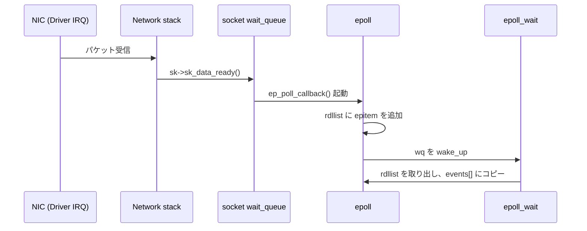
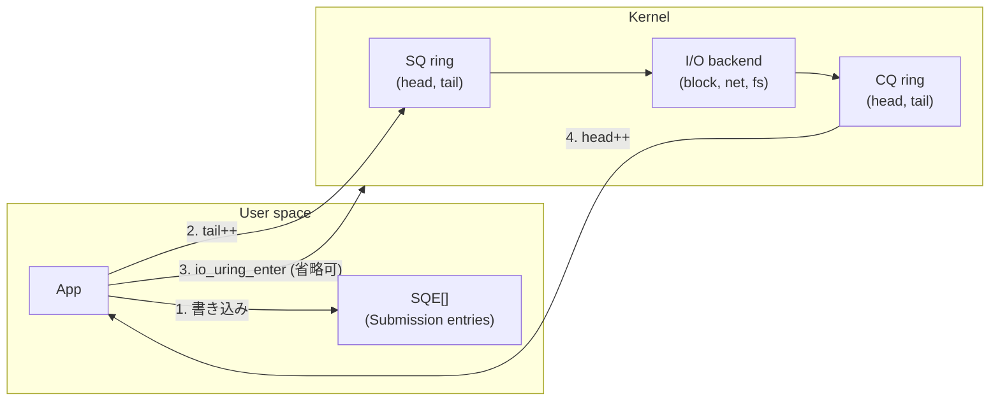
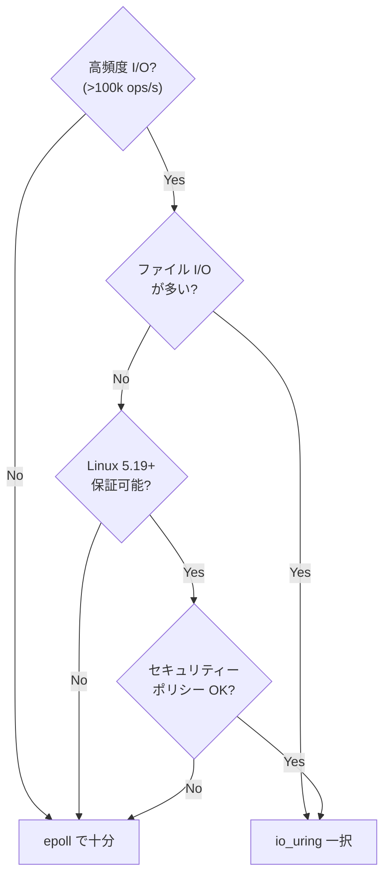

ネットワークサーバーやデータベースの性能を上げようとすると、多数の I/O を少ないスレッドでどう扱うかという <strong>I/O 多重化</strong>の問題に行き当たります。1 本のスレッドで 10 万本の TCP 接続を処理する場面や、1 台の SSD の IOPS（I/O Operations Per Second、1 秒あたりに処理できる I/O 回数）を使い切る場面では、`epoll` や `io_uring` といった Linux カーネルのインターフェースが性能を左右します。

`select → poll → epoll → io_uring` の順に、カーネルがイベント通知を効率化し、システムコールを減らしてきた仕組みを、カーネルの構造体とソースファイルをもとに説明します。Node.js・nginx・PostgreSQL・ScyllaDB・tokio がこれらの API をどう採用してきたかも取り上げます。

> <strong>コールセンターで考える</strong>
>
> 10 万本の電話回線を受け持つコールセンターを想像してください。
>
> - <strong>select / poll</strong> では、オペレーターが毎回 10 万台の電話を 1 台ずつ見て、鳴っているかを確かめます。鳴っていない電話を見る時間が無駄になります。
> - <strong>epoll</strong> では、鳴った電話のランプが掲示板に点灯し、オペレーターは点灯したものだけを見ます。どの電話を監視するかの台帳は電話局（カーネル）に一度預ければよく、毎回持ち歩く必要はありません。
> - <strong>io_uring</strong> では電話を使わず、依頼票と完了票をカウンター越しにやり取りします。通常モードでは、票がたまったらベルを 1 回だけ鳴らします（`io_uring_enter` を 1 回呼ぶ）。SQPOLL モードでは、カウンターに専任の担当者が常駐していて票を置くとすぐに取りに来るので、依頼側はベルを鳴らす（システムコールを呼ぶ）必要もありません。
>
> この変遷は、ユーザー空間とカーネルの間のやり取りをどこまで減らせるかを追求してきた歴史です。

<ArticleVideo slug="io-uring-and-epoll" />

## 1. なぜ非同期 I/O が必要なのか

### 1.1 同期 I/O のコスト構造

素朴なブロッキング I/O では、`read(fd, buf, n)` がデータの到着まで呼び出し元のスレッドを眠らせます。`fd` はファイルディスクリプターの略で、カーネルが開いたソケット・ファイル・パイプなどのリソースを指す整数のハンドルです。1 接続に 1 スレッドを割り当てるモデルでは、接続数に比例して次のコストが積み上がります。

- <strong>スレッドスタック</strong>: Linux の既定は 8MB（ユーザー空間の `ulimit -s`）。1 万接続で 80GB の仮想アドレス空間を使います。
- <strong>コンテキストスイッチ</strong>: 1 回あたり典型的には 1〜3µs かかります（キャッシュへの影響を除いた直接のコスト。Eli Bendersky の測定<sup>[8]</sup>では 1.2〜2.2µs）。メモリーアクセスが数十 ns、syscall が 1µs 未満であるのと比べると、スレッドが行う処理の中でも特に重い部類です。毎秒数十万回切り替わると、CPU 時間の多くがスイッチに取られます。
- <strong>カーネルのスレッド構造体</strong>: `task_struct` がスレッドごとに数 KB 常駐します。

このコストを避けるには、1 本のスレッドで複数の I/O を多重化する必要があります。方法は次の 3 つです。

1. <strong>準備完了通知（readiness）</strong>: どの fd が読み書きできるかをカーネルに問い合わせます。`select`・`poll`・`epoll` がこの方式です。
2. <strong>完了通知（completion）</strong>: I/O の実行をカーネルに依頼し、終わったら知らせてもらいます。`aio` と `io_uring` がこの方式です。
3. <strong>ユーザー空間ポーリング</strong>: DPDK や SPDK のようにカーネルを迂回します。

Linux は長らく (1) を中心に最適化されてきましたが、2019 年に `io_uring` が登場し、(2) も標準的な手段として使えるようになりました。

### 1.2 readiness モデルと completion モデル

| モデル | 代表 API | 仕組み | I/O 1 回あたりの syscall |
| --- | --- | --- | --- |
| Readiness | `select`, `poll`, `epoll`, `kqueue` (BSD) | カーネルが「準備できた」と通知し、ユーザーが実際の I/O を呼ぶ | 2 回（通知 + read/write） |
| Completion | Windows IOCP, POSIX `aio`, `io_uring` | カーネルに I/O を依頼し、完了だけを受け取る | 0-1 回 |

syscall（システムコール）は、ユーザー空間のプログラムがカーネルの機能を呼び出す仕組みで、CPU を特権モードに切り替えます。トラップ命令による CPU モードの遷移を伴うため、通常の関数呼び出しより桁違いに重い処理です。目安として、単純な syscall は 200〜500ns 程度、通常の関数呼び出しは 10ns 未満です。Ren らが 2.4GHz の Xeon で測った結果<sup>[9]</sup>では、短い `read` 1 回に 344ns かかりました。関数呼び出しは、引数が少なければ 15〜30 サイクル程度<sup>[10]</sup>で、数 GHz の CPU なら 10ns 未満に収まります。後述の KPTI が有効だと、syscall はさらに重くなります。

Linux では通常ファイルが常に「読み込み可能」とみなされるため、readiness モデルはファイル I/O に使えません（`epoll` は通常ファイルの登録を受け付けません）。ファイル I/O を非同期にするには completion モデルの API が必要で、これが `io_uring` が生まれた大きな動機です。

## 2. 歴史: select → poll → epoll の系譜

### 2.1 `select(2)` — 1983 年、BSD 4.2

最初期の I/O 多重化 API です。

```c
int select(int nfds, fd_set *readfds, fd_set *writefds,
           fd_set *exceptfds, struct timeval *timeout);
```

`fd_set` はビットマップで、glibc では大きさが `FD_SETSIZE = 1024` に固定されているため、1024 以上の fd は扱えません。呼び出しのたびに次の処理が行われます。

1. ユーザー空間で fd_set を組み立てる — $O(N)$
2. カーネルに全ビットマップをコピー — $O(N)$
3. カーネルが全 fd を舐めて状態を確認 — $O(N)$
4. 結果ビットマップをユーザー空間へコピー — $O(N)$

呼び出しのたびに監視対象全体を $O(N)$ で処理するので、1 万接続の規模には耐えられません。

### 2.2 `poll(2)` — System V 由来（Linux は 2.1.23, 1997）

```c
int poll(struct pollfd *fds, nfds_t nfds, int timeout);

struct pollfd {
    int   fd;
    short events;   // 監視するイベント
    short revents;  // 返ってきたイベント
};
```

`fd_set` の 1024 個という制限はなくなりましたが、呼び出しのたびに配列をコピーして全体を走査する点は `select` と同じです。

### 2.3 C10K 問題と `epoll` — 2002 年、Linux 2.5.44

1999 年、Dan Kegel は論考「The C10K problem」で、1 台のサーバーで 1 万のクライアントを同時に扱うという課題を提起しました。Davide Libenzi が実装した `epoll` は、次の 2 点でこの課題に応えました。

- 監視対象の状態をカーネル側に保持し、呼び出しのたびにコピーしない。
- 準備完了した fd だけを返し、全体を走査しない。

## 3. `epoll` の内部

### 3.1 インターフェース

```c
int epoll_create1(int flags);
int epoll_ctl(int epfd, int op, int fd, struct epoll_event *event);
int epoll_wait(int epfd, struct epoll_event *events, int maxevents, int timeout);

struct epoll_event {
    uint32_t     events;
    epoll_data_t data;
};
```

- `epoll_create1()` は epoll インスタンスを作成し、その fd を返します。
- `epoll_ctl()` は `EPOLL_CTL_ADD / MOD / DEL` で監視対象を追加・変更・削除します。
- `epoll_wait()` は準備完了した fd の配列を返します。ブロックする、すぐ戻る、タイムアウトまで待つ、のいずれかを選べます。

### 3.2 カーネル内データ構造

Linux カーネルの `fs/eventpoll.c` では、epoll の中心は 3 つの構造体です。`eventpoll` は epoll インスタンス 1 個全体、`epitem` は監視している fd 1 個の情報、`eppoll_entry` はその fd の待機キューに差し込むフックを表します。フックが発火すると、`epitem` が `rdllist` につながれます（以下、主要フィールドのみ抜粋。以降の `struct` も同様）。

```c
// eventpoll.c
struct eventpoll {
    struct mutex       mtx;
    wait_queue_head_t  wq;          /* epoll_wait している task の待機列 */
    wait_queue_head_t  poll_wait;
    struct list_head   rdllist;     /* ready 状態のアイテム */
    struct rb_root_cached rbr;      /* 全監視アイテムの赤黒木 */
    struct epitem      *ovflist;    /* 通知中のオーバーフロー */
    /* ... */
};

struct epitem {
    struct rb_node       rbn;       /* eventpoll->rbr 内のノード */
    struct list_head     rdllink;   /* rdllist 内のリンク */
    struct epoll_filefd  ffd;       /* 監視対象の fd */
    struct eventpoll     *ep;
    struct list_head     pwqlist;   /* コールバック登録用 */
    struct epoll_event   event;
    /* ... */
};

struct eppoll_entry {
    struct list_head    llink;      /* epitem->pwqlist 内 */
    struct epitem       *base;
    wait_queue_entry_t  wait;       /* 監視対象ファイルの待機列に登録 */
    wait_queue_head_t   *whead;
};
```

主な要素の役割は次のとおりです。

- <strong>赤黒木 `rbr`</strong>: 監視中の全 fd を保持する平衡二分探索木です。追加・削除・検索が $O(\log N)$ で済みます。
- <strong>ready list `rdllist`</strong>: イベントが発生した `epitem` だけがつながる双方向リストです。`epoll_wait` はここから取り出すだけなので、準備完了した fd 1 個あたり $O(1)$ で返せます。
- <strong>`eppoll_entry`</strong>: 監視対象ファイルごとの待機キュー（wait queue）に登録されるコールバックです。待機キュー（`wait_queue_head_t`）は、タスクを眠らせて後で起こすためのカーネルの仕組みで、条件変数に近いものです。ソケットやパイプなど、ブロックしうるカーネルオブジェクトはそれぞれ自分の待機キューを持っています。

### 3.3 イベントが `rdllist` に載る経路

TCP ソケットに新しいパケットが届いたときの流れは次のとおりです。



- `sock_def_readable` → `wake_up_interruptible_sync_poll` → `ep_poll_callback`（`fs/eventpoll.c`）の順にコールバックが呼ばれます。
- コールバックは `rdllist` にアイテムを追加するだけなので、割り込みコンテキストからでも安全に呼べます。保護には `spin_lock` を使います。割り込みハンドラーはスケジューラーを呼べないため、スリープするミューテックスは使えず、CPU を手放さずに待つスピンロックが必要です。
- 最後に、`epoll_wait` で待っているタスクを待機キューから起こします。

### 3.4 Level Trigger (LT) と Edge Trigger (ET)

epoll には 2 つのトリガーモードがあります。違いを取り違えると、イベントを取りこぼしてループが止まるバグにつながります。

| モード | 意味 | `read/write` の挙動 |
| --- | --- | --- |
| LT（レベルトリガー、既定） | 読める・書ける状態が続くあいだ、通知し続ける | 1 回だけ読んで戻ってもよい。次の `epoll_wait` でも通知される |
| ET（エッジトリガー） | 状態が変化したときだけ通知する | `EAGAIN` が返るまで読み切る必要がある。読み残すと、新しいデータが届くまで通知されない |

ET の挙動は、`epoll_wait` がアイテムを `rdllist` から取り出すときの処理で決まります。

```c
/* ep_send_events_proc (簡略化) */
list_for_each_entry_safe(epi, tmp, &txlist, rdllink) {
    revents = ep_item_poll(epi, ...);
    if (revents) {
        copy_to_user(events, ...);
        if (epi->event.events & EPOLLET) {
            /* ET: ready から外す。次にコールバックが来るまで出てこない */
        } else if (!(epi->event.events & EPOLLONESHOT)) {
            /* LT: ready に戻す */
            list_add_tail(&epi->rdllink, &ep->rdllist);
        }
    }
}
```

ET では同じ状態について重複した通知が来ないぶん効率は上がりますが、ノンブロッキングの読み取りループを正しく書く責任はアプリケーション側にあります。nginx や HAProxy は ET を使っており、イベントごとに `while (n = read(fd, ...), n > 0)` のように読み切るのが標準的な書き方です。

### 3.5 Thundering Herd と `EPOLLEXCLUSIVE`

複数のプロセスやスレッドが同じ listening socket を `epoll` で待っていると、接続が 1 つ届いただけで全員が起こされます。`accept()` に成功するのは 1 つだけで、残りは `EAGAIN` で戻ります。この無駄を <strong>thundering herd</strong> と呼びます。驚いた家畜の群れが一斉に駆け出す様子から付いた名前です。

対策は 2 つあります。

- <strong>`SO_REUSEPORT`</strong>（Linux 3.9+）: 同じポートに複数の listening socket を作り、カーネルが新しい接続をそれらに振り分けます。nginx でよく使われます。
- <strong>`EPOLLEXCLUSIVE`</strong>（Linux 4.5+）: epoll が対象ファイルの待機キューに登録するエントリーに `WQ_FLAG_EXCLUSIVE` を立てます。待っている全員ではなく、1 つまたは少数の waiter だけが起こされます。

### 3.6 epoll の限界

epoll でも解決できない問題が残ります。

1. <strong>ファイル I/O に使えない</strong>: 通常ファイルは常に「読める」と報告されるので、ディスクからの読み込みでスレッドがブロックするのを防げません。
2. <strong>I/O 1 回につき syscall が 2 回必要</strong>: `epoll_wait` と `read/write` です。どちらも vDSO で置き換えられません。
3. <strong>Spectre/Meltdown 以降の syscall コスト増</strong>: KPTI（Kernel Page-Table Isolation。ユーザー空間とカーネル空間でページテーブルを分ける Meltdown 対策）は、カーネルに出入りするたびにページテーブルを切り替えます。Ren らの測定<sup>[9]</sup>では、この切り替えの固定コストだけで出入り 1 回あたり 400〜500 サイクル（KPTI なしでは 100 サイクル未満）かかり、TLB ミスの増加分がこれに加わります。これらを合わせて syscall 1 回を 0.1〜1µs と見積もると、100 万 IOPS では I/O 1 回につき syscall 1 回と数えても、毎秒 0.1〜1 秒、つまり CPU 1 コアの 10〜100% を syscall だけに使う計算になり、これが性能の上限を決めます。
4. <strong>I/O の連鎖を 1 回で依頼できない</strong>: `accept → read → parse → write` のような一連の処理を、まとめてカーネルに渡せません。

これらが `io_uring` が作られた理由です。

## 4. `io_uring` 以前: `aio(7)` などの試み

### 4.1 POSIX AIO と `libaio`

Linux には POSIX AIO（`aio_read`, `aio_write`）と、それとは別の Kernel AIO（`io_setup`, `io_submit`, `io_getevents`）がありました。POSIX AIO は glibc がユーザー空間のスレッドでエミュレートしています。

Kernel AIO（ライブラリー名から通称 `libaio`）には次の制約がありました。

- <strong>Direct I/O（`O_DIRECT`）でしか非同期にならない</strong>: `O_DIRECT` はページキャッシュを迂回し、アプリケーションのバッファーとデバイスの間で直接 DMA させるフラグで、自前でキャッシュし、I/O の順序も自分で決めるデータベース向けです。バッファー付き I/O では実質的に同期的に動きます。
- <strong>インターフェースが扱いにくい</strong>: `struct iocb` の配列で依頼し、完了は `io_getevents` で回収します。
- `open`、`stat`、`close` のようなメタデータ操作は対象外です。

MySQL（InnoDB）などは `libaio` を使っていましたが、汎用 API としては普及しませんでした。PostgreSQL は `libaio` を使わず、v18（2025）で独自の非同期 I/O 層を実装しました。`io_method` で `worker` / `io_uring` / `sync` を選べます。

### 4.2 `eventfd`・`timerfd`・`signalfd`

Linux では、さまざまなサブシステムを fd として表し、`epoll` に登録して待つ方法が使われてきました。`timerfd` はタイマー、`signalfd` はシグナルを fd として受け取ります。`eventfd` はカウンターを 1 つ持つ fd で、`libaio` の完了通知やプロセス間の通知に使われます。何でも fd にして epoll で待つというこの慣習が、Linux のイベントループの設計を形作ってきました。

## 5. `io_uring` — 2019 年、Linux 5.1 から

### 5.1 設計目標

Jens Axboe の文書「Efficient IO with io_uring」<sup>[1]</sup> は、設計目標を重要度の低いものから順に次のように挙げています。

1. 使いやすく、誤用しにくい。
2. 拡張できる。ブロック単位のストレージ I/O だけでなく、ネットワークなどにも使える。
3. 機能が豊富。一部のアプリケーションにしか使えない Linux AIO と違い、アプリケーションに必要な機能をそろえる。
4. 効率的。リクエスト 1 件あたりのオーバーヘッドが小さい。
5. スケーラブル。ピーク性能をアプリケーションまで引き出せる。

初期の設計は効率を中心にしており、依頼と完了のどちらでもメモリーコピーをしないことを狙いました。これを実現するのが、カーネルと共有する<strong>リングバッファー</strong>です。

### 5.2 アーキテクチャ: SQ と CQ

`io_uring` はカーネルとユーザー空間で 2 本のリングバッファーを共有します。



- <strong>SQ（Submission Queue）</strong>: ユーザーが依頼のエントリー（SQE、Submission Queue Entry）を書き込むリングです。
- <strong>CQ（Completion Queue）</strong>: カーネルが完了のエントリー（CQE、Completion Queue Entry）を書き込むリングです。
- どちらのリングも、ユーザーとカーネルが共有する mmap 領域に置かれます。`mmap` はファイル・デバイスメモリー・匿名メモリーをプロセスの仮想アドレス空間に割り当てる syscall で、ここではカーネルとユーザーの両方から読み書きできる共有メモリーとして使われます。

エントリーの書き込みと読み出しには syscall が要りません。syscall が必要なのは `io_uring_enter()` を呼ぶときだけで、そのときも複数のエントリーをまとめて渡せます。epoll では I/O のたびにカーネルを呼び出しますが、io_uring では依頼票と完了票を共有メモリー上でやり取りし、カーネルを呼ぶのはまとめて渡すときだけです。

<IoUringRingVisualizer />


### 5.3 SQE と CQE の構造

```c
/* <linux/io_uring.h> */
struct io_uring_sqe {
    __u8    opcode;     /* IORING_OP_READ, WRITE, ACCEPT, ... */
    __u8    flags;
    __u16   ioprio;
    __s32   fd;
    union {
        __u64 off;      /* オフセット */
        __u64 addr2;
    };
    union {
        __u64 addr;     /* バッファ */
    };
    __u32   len;
    union {
        __kernel_rwf_t rw_flags;
        __u32 fsync_flags;
        __u16 poll_events;
        /* ... */
    };
    __u64   user_data;  /* CQE でそのまま返ってくる任意値 */
    /* ... */
};

struct io_uring_cqe {
    __u64 user_data;    /* SQE で指定した値 */
    __s32 res;          /* syscall と同じ戻り値 (>= 0 or -errno) */
    __u32 flags;
};
```

`user_data` は、どの依頼の完了なのかをアプリケーションが識別するための任意の 64 ビット値です。カーネルは SQE の `user_data` をそのまま CQE にコピーして返すので、アプリケーションはここにポインターや ID を入れておき、戻ってきた CQE から元の依頼のコンテキストを引きます。

### 5.4 リングバッファーのセットアップ

ユーザー空間では次の手順を踏みます（通常は `liburing` が隠蔽します）。

1. `io_uring_setup(entries, params)` を呼ぶと、カーネルが SQ と CQ のメモリーを確保し、各リングの mmap オフセットを返します。
2. `mmap` で SQ リング、CQ リング、SQE 配列をプロセスに割り当てます。カーネル 5.4 以降は `IORING_FEAT_SINGLE_MMAP` により SQ と CQ を 1 回の `mmap` でまとめて割り当てられるので、mmap は合計 2 回で済みます（それより古いカーネルでは 3 回）。
3. リングのヘッダーから `sq_head`/`sq_tail`/`cq_head`/`cq_tail` の位置を取得します。

SQ のエントリー数は、`io_uring_setup` に渡した `entries` を 2 のべき乗に切り上げた値です（上限 32768）。CQ は既定でその 2 倍の大きさになり、`IORING_SETUP_CQSIZE` を指定すれば別の大きさにできます<sup>[5]</sup>。

### 5.5 送信と完了のフロー

```c
/* シンプルな非 SQPOLL 例（liburing 使用） */
struct io_uring ring;
io_uring_queue_init(32, &ring, 0);

struct io_uring_sqe *sqe = io_uring_get_sqe(&ring);
io_uring_prep_read(sqe, fd, buf, len, offset);
io_uring_sqe_set_data(sqe, user_ptr);

io_uring_submit(&ring);     /* これが io_uring_enter(SUBMIT) を発行 */

struct io_uring_cqe *cqe;
io_uring_wait_cqe(&ring, &cqe);   /* 完了を待つ */
process_completion(cqe);
io_uring_cqe_seen(&ring, cqe);    /* head++ */
```

複数の SQE を 1 回の `io_uring_enter` でまとめて送れるので、1000 個の read を 1 回の syscall で依頼でき、syscall のコストが依頼の数で割られます。epoll 風のループでは、I/O 1 回ごとに syscall を 2 回払います。

### 5.6 メモリー順序とリング操作

`head` と `tail` を共有メモリーで管理しているため、メモリーバリアが必要です。カーネルのドキュメント（`io_uring.txt`）とヘッダー（`<linux/io_uring.h>`）は次の順序を求めています。

- SQE を書いてから `sq->tail` を更新するまでの間に `smp_wmb`（`io_uring_smp_wmb`。x86 ではコンパイラーバリアだけ、ARM では `dmb ish`）を入れる。
- `cq->tail` を読んでから CQE の中身を読むまでの間に `smp_rmb` を入れる。

`smp_wmb` は、それより前の書き込みが後の書き込みより先に他のコアから見えることを保証します。`smp_rmb` は読み込みについて同じことを保証します。これがないと、カーネルが更新後の `tail` を見たのに SQE の中身はまだ古い、ということが起こりえます。

`liburing` の `io_uring_submit` / `io_uring_peek_cqe` がこれを正しく実装しているので、通常は直接扱う必要はありません。

## 6. 高度なモード

ここで紹介する SQPOLL・IOPOLL・Linked SQE・registered files/buffers・multishot・provided buffers は、syscall や準備のコストをさらに減らすためのオプションで、基本 API で足りないときに使います。

### 6.1 `IORING_SETUP_SQPOLL` — カーネルスレッドでポーリング

`io_uring_setup` に `IORING_SETUP_SQPOLL` を指定すると、カーネルが専用のスレッドを作って SQ を監視し続けます。このスレッドが起きていてリングが忙しいあいだは、ユーザー空間は共有メモリーに SQE を置くだけで、`io_uring_enter` を呼ばずに依頼と回収ができます。ただし、SQ スレッドがアイドル状態で眠って `IORING_SQ_NEED_WAKEUP` を立てた場合は、起こすために `io_uring_enter` を呼ぶ必要があります。冒頭のたとえで言えば、カウンターに専任の担当者が常駐していて、暇が続くと仮眠に入る形です。

```c
struct io_uring_params params = {
    .flags = IORING_SETUP_SQPOLL,
    .sq_thread_idle = 2000,  /* 2 秒アイドルで眠る */
};
io_uring_queue_init_params(entries, &ring, &params);
```

注意点は 2 つあります。

- カーネルスレッドが CPU を 1 コア使います（`sq_thread_idle` ミリ秒のあいだ依頼がなければ眠ります）。
- Linux 5.11 で root（`CAP_SYS_ADMIN`）の要件が外れ、SQPOLL は非特権ユーザーでも使えるようになりました。ただし、`IORING_SETUP_SQ_AFF` で SQ スレッドを特定の CPU に固定する場合は、今も `CAP_SYS_NICE` が必要です。

SQPOLL が効くのは、1 プロセスで NVMe の性能を使い切りたい用途です。データベース、高頻度取引、コアごとにシャードを割り当てる ScyllaDB などが該当します。

### 6.2 `IORING_SETUP_IOPOLL` — ブロックデバイスのビジーポーリング

`O_DIRECT` のブロック I/O で、ファイルシステムとデバイスがポーリングに対応している場合、ブロックレイヤーの完了を割り込みではなくビジーポーリングで取りに行けます。NVMe のようにレイテンシーが µs オーダーのデバイスでは、このほうが速いことがあります。ポーリングで完了を回収するときも `io_uring_enter` を使います。

### 6.3 Linked SQEs (`IOSQE_IO_LINK`)

複数の操作を、順序の決まったチェーンとして依頼できます。

```c
/* 例: 既知の fd に対して read → write を 1 回の enter で */
sqe1 = io_uring_get_sqe(); io_uring_prep_read(sqe1, fd, buf, len, 0);
sqe1->flags |= IOSQE_IO_LINK;

sqe2 = io_uring_get_sqe(); io_uring_prep_write(sqe2, fd, buf, len, 0);
io_uring_submit(&ring);
```

先行する操作が失敗する（`res < 0`）と、後続の操作は自動でキャンセルされます。`IOSQE_IO_LINK` 自体が保証するのは実行順序だけで、前の SQE の結果を次の SQE に渡すことはしません。`accept → read` のように accept で得た fd をそのまま使う処理を 1 回の submit で行いたい場合は、<strong>direct descriptor</strong> を使います（`IORING_FILE_INDEX_ALLOC` と `IOSQE_FIXED_FILE`、およびカーネル 5.17+ の `IORING_FEAT_LINKED_FILE` による fd の遅延解決）。

### 6.4 Registered files / buffers

- <strong>`io_uring_register_files()`</strong>: fd の配列をカーネルに事前登録します。SQE で fd の代わりにインデックスを指定すると、`fget()/fput()` による参照カウントの操作を省けます。
- <strong>`io_uring_register_buffers()`</strong>: ユーザーバッファーを事前にピン留めして登録し、I/O ごとの `get_user_pages` を省きます。`get_user_pages` は、ユーザー空間の仮想アドレスに対応する物理ページを固定し、カーネルやデバイスが安全に DMA できるようにするカーネル関数です。

高い IOPS が必要な場合の定番の最適化です。ScyllaDB が公開した fio のベンチマーク<sup>[11]</sup>（Direct I/O で 1KB のランダムリード、CPU が飽和する条件）では、バッファーとファイルの登録などの機能を使った io_uring が、基本的な使い方より 4.9% 多い IOPS を出しました。

### 6.5 Multishot (`IORING_ACCEPT_MULTISHOT`, Linux 5.19+)

1 つの SQE で複数回の完了を受け取れます。`accept` や `recv` で、キャンセルされるまで完了を生成し続ける仕組みです。accept の multishot は `IORING_OP_ACCEPT` に `IORING_ACCEPT_MULTISHOT` フラグを付けて使います。完了のたびに SQE を投入し直すループが不要になり、SQE の消費も抑えられます。

### 6.6 Provided buffers (`IORING_OP_PROVIDE_BUFFERS`)

受信バッファーの選択をカーネルに任せる機能です。データが届いた時点で空いているバッファーをカーネルが選ぶので、何千もの接続のためにバッファーを事前に確保しておく必要がありません。接続数の多い HTTP サーバーで効果があります。

### 6.7 Operation opcodes (抜粋)

| 分類 | 主な opcode |
| --- | --- |
| ネット | `ACCEPT`, `CONNECT`, `SEND`, `RECV`, `SENDMSG`, `RECVMSG`, `SHUTDOWN`, `CLOSE` |
| ファイル | `READ`, `WRITE`, `READV`, `WRITEV`, `FSYNC`, `FALLOCATE`, `OPENAT`, `STATX`, `RENAMEAT` |
| poll 系 | `POLL_ADD`（multishot はフラグで指定）, `POLL_REMOVE` |
| 同期 | `LINK_TIMEOUT`, `TIMEOUT`, `NOP`, `ASYNC_CANCEL` |
| メモリー | `MADVISE`, `FADVISE`, `SPLICE`, `TEE` |
| プロセス | `WAITID` (6.7+) |

カーネルは opcode の種類ごとに実装ファイル（`io_uring/net.c`、`io_uring/rw.c`、`io_uring/fs.c` など）を持ち、既存の VFS やソケットの内部関数を呼び出します。VFS（Virtual File System）は、ファイルシステムの種類の違いを吸収する Linux の抽象層です。

## 7. カーネル内部: `io_uring/` の中身

1 つの SQE は、カーネル内で `io_kiocb` というリクエスト構造体になります。すぐ実行できればその場で実行し、ブロックしそうなら専用のスレッドプール `io-wq` に回します。完了したら共有の CQ リングに結果を書き込み、待っているタスクを起こします。

Linux 6.0 で、`fs/io_uring.c` の単一ファイルだった実装がトップレベルの `io_uring/` ディレクトリーに分割されました。主なファイルは次のとおりです。

```text
io_uring/
├── io_uring.c      # リング管理、enter syscall
├── sqpoll.c        # SQPOLL カーネルスレッド
├── rw.c            # read/write 系 opcode
├── net.c           # ネット系 opcode
├── fs.c            # openat/statx 系
├── poll.c          # IORING_OP_POLL_ADD
├── timeout.c       # TIMEOUT, LINK_TIMEOUT
├── cancel.c        # ASYNC_CANCEL
└── ... 30+ files
```

### 7.1 リクエスト構造体 `io_kiocb`

1 つの SQE ごとにカーネル内で割り当てられる構造体です。

```c
struct io_kiocb {
    union {
        struct file     *file;
        struct io_cmd_data cmd;
    };
    u8                      opcode;
    io_req_flags_t          flags;
    struct io_cqe           cqe;           /* user_data, res, cflags */
    struct io_ring_ctx      *ctx;
    struct io_uring_task    *tctx;
    /* opcode-specific data, task work node, etc. */
    /* ... */
};
```

slab キャッシュ（`req_cachep`）から確保され、完了後は再利用されます。ホットパスでのメモリー確保を避けるため、`io_ring_ctx` ごとに事前確保した小さなキャッシュ（バージョンによって 128 前後）を持っています。

### 7.2 非同期実行: `io-wq` プール

ディスクの `read` でページキャッシュに当たらなかったときのように、実際にブロックしうる操作は、カーネルのスレッドプール `io-wq` に回されます。Linux 5.12 以降、`io-wq` はリングごとではなく submit したタスクごとに作られ、ディスク用の `bounded` とネットワーク用の `unbounded` の 2 種類のワーカーを持ちます。アイドル状態のワーカーは終了するので、負荷が高いときに `ps` で多数の `iou-wrk` スレッドが見えても、負荷が下がれば減ります。

汎用の `workqueue` を使わずに専用のプールを持つのは、`io-wq` のワーカーが submit したタスクのクレデンシャル（uid/gid、cgroup、nsproxy など）を引き継ぐ必要があり、NUMA ローカリティーと優先度も制御したいためです。

この仕組みはユーザーからは見えません。非同期に完了できない操作はワーカースレッドで待つので、どの opcode でも submit した側がブロックすることはありません。epoll は、ブロックしない操作だけを通知の対象にすることでブロックを避けていました。io_uring は、ブロックする操作も裏のスレッドで引き受けるという点で、epoll とは考え方が違います。

### 7.3 完了パス

```c
/* io_uring.c (概念コード) */
void io_req_task_complete(struct io_kiocb *req, io_tw_token_t tw)
{
    struct io_ring_ctx *ctx = req->ctx;
    io_cq_lock(ctx);
    io_fill_cqe_req(ctx, req);   /* CQE を ring に書く */
    io_cq_unlock_post(ctx);      /* タスクを起こす */
}
```

CQ リングへの書き込みは `spin_lock` で保護したうえで、ユーザー空間と共有している mmap 領域に直接行われるため、追加のコピーは発生しません。

## 8. `io_uring` の落とし穴と運用

### 8.1 CVE とセキュリティー

`io_uring` は複雑で、カーネル内の広い範囲に触れる API なので、これまでに多くの LPE（Local Privilege Escalation、ローカル権限昇格）脆弱性が報告されてきました。

- 例として CVE-2022-29582、CVE-2023-2598、CVE-2023-21400、CVE-2024-0582 があります。
- そのため、Android や ChromeOS などセキュリティーを強化した一部のプラットフォームは、`io_uring` を既定で無効化または制限しています。汎用のサーバー向けディストリビューションの方針はまちまちなので、実際の環境のポリシーを確認する必要があります。
- RHEL 9.5 以降では、`sysctl kernel.io_uring_disabled=1/2` で、root のみ許可するか全面的に禁止するかを選べます。

本番環境で `io_uring` を使う場合は、カーネルを最新の LTS に保ってください。必要に応じて seccomp で `io_uring_*` syscall そのものを禁止・制限し、opcode 単位の制限が必要なら `IORING_REGISTER_RESTRICTIONS` や LSM ベースの制御を使います。

### 8.2 観測性

- `strace` では `io_uring_enter` の呼び出ししか見えず、SQE の中身はわかりません。
- 代わりに `bpftrace` や `perf trace` で tracepoint（`io_uring:io_uring_submit_req` など）を取るか、`iouring-tools` のダンプを使います。
- 対応しているカーネルでは、`/proc/<pid>/fdinfo/<ring-fd>` でリングごとの情報を見られます。動いているプロセスを調べるときは、tracepoint のほうが役に立つことが多いです。

### 8.3 バッファー所有権

ユーザーが submit したバッファーは、完了するまでカーネルが使い続けます。Rust の借用モデルでは、所有権をカーネルに渡している期間を表現しにくいので、安全なラッパーを書くのが難しくなります。`tokio-uring` が独自のバッファートレイト（`IoBuf`）を導入したのはこのためです。

### 8.4 対応状況（2026 年時点）

- <strong>カーネル</strong>: 5.1（2019）で導入され、5.19（2022）で主要な機能がそろい、6.x でも改善が続いています。
- <strong>glibc</strong>: `io_uring` のラッパーは提供しておらず、`liburing` を使うのが一般的です。
- <strong>Node.js</strong>: libuv v1.45（2023）で非同期ファイル I/O に io_uring が導入されました。v1.49（2024 年 9 月）では、一部のカーネルでの不具合を受けて SQPOLL モードが既定で無効になりました（通常の io_uring パスは残っています）。環境によって挙動が分かれるので、実際のバージョンで確認してください。
- <strong>PostgreSQL</strong>: 18（2025）で新設された AIO サブシステムで `io_method=io_uring` を選べます（`--with-liburing` 付きのビルドが必要）。既定値は `worker` です。
- <strong>Rust</strong>: `tokio-uring` は別のクレートで、`tokio` 本体は互換性のため epoll ベースのままです。
- <strong>nginx</strong>: 実験的なモジュールはありますが、公式には採用されていません。
- <strong>ScyllaDB</strong>: Seastar フレームワークの上で非同期 I/O を前提に設計されており（初期は Linux AIO ベース）、io_uring に早期に移行した採用例の 1 つです。SPDK も NVMe を直接操作する経路で io_uring を使っています。
- <strong>Netty / JVM</strong>: Netty 4.2 で `IOUring` transport が提供されています。

### 8.5 運用上の注意点

- <strong>cgroup v1 と SQPOLL の CPU 計上</strong>: SQPOLL 用のカーネルスレッドは、submit したタスクとは別のタスクとして動きます。このため cgroup v1 の環境では、submit した側の cgroup に CPU 使用量が正しく計上されない場合があります。cgroup v2 では改善されていますが、古いホストでは SQPOLL を使うワークロードの CPU 使用が、どこのものかわからないカーネルの CPU 時間として見えることがあります。
- <strong>seccomp では opcode を絞れない</strong>: seccomp-bpf は syscall 単位でしか判断できないので、`io_uring_enter` が運ぶ opcode ごとにフィルターすることはできません。opcode を細かく制限したい場合は、BPF-LSM、比較的新しい seccomp notify、または io_uring 自身のリング単位の許可リスト（`IORING_REGISTER_RESTRICTIONS`）を組み合わせます。

## 9. 性能比較: 何がどれだけ速いのか

低負荷では epoll と io_uring の差はほとんどありません。io_uring が効くのは、NVMe を飽和させる、100 万 IOPS を狙う、fsync を含むファイル I/O が多い、といった場合です。

<SyscallCostVisualizer />

### 9.1 ベンチマーク例 (概観)

次の表のうち、ネットワークと DB の行の倍率は差の出方を示すための説明用の目安で、測定値ではありません。実際の差はカーネル、CPU、io_uring の使い方で大きく変わり、echo サーバーでは epoll のほうが速かったという報告もあります<sup>[12]</sup>。NVMe の行は、Axboe が 2019 年に 1 つの CPU コアで 4KB のランダムリードを測った値です<sup>[1]</sup>。

| ワークロード | epoll | io_uring (ポーリングなし) | io_uring (SQPOLL + registered) |
| --- | --- | --- | --- |
| ネットワーク echo 1M conn | 基準 | ~1.2x | ~2-3x |
| NVMe random read 4KB | —（通常ファイルには使えない） | ~1.2M IOPS | ~1.7M IOPS（IOPOLL） |
| DB commit (fsync-heavy) | 基準 | ~1.1x | ~1.3-1.5x |

NVMe の行の右端の値は、SQPOLL ではなく、完了をポーリングする `IORING_SETUP_IOPOLL` を使ったときのものです。同じ測定で libaio は 60.8 万 IOPS でした。差が大きく出るのは IOPS が高くレイテンシーが低い領域で、低負荷では移行の手間に見合わないことも多くあります。

### 9.2 いつ `io_uring` を選ぶべきか



## 10. まとめ

非同期 I/O の API は、40 年ほどかけて次のように変わってきました。

1. <strong>select</strong>（1983）: fd_set の大きさが固定で、呼び出しのたびに $O(N)$。
2. <strong>poll</strong>（1997）: fd_set の上限はなくなったが、計算量は変わらない。
3. <strong>epoll</strong>（2002）: 監視対象をカーネル側に保持し、ready list で準備完了した fd だけを返す。C10K 問題を実用的に解決した。
4. <strong>io_uring</strong>（2019）: 共有リングで syscall を減らし、ファイル I/O も含めて非同期にした。1 台で 1000 万接続を扱う C10M 問題や、1 台で NVMe を飽和させる用途に対応する。

どの段階も、次の 3 つのどれかを進めています。(a) 状態をカーネルに置いて、同じデータを何度もコピーしない。(b) 1 回の syscall でできる仕事を増やす。(c) ブロックしうる操作も非同期に扱えるようにする。

epoll はこれからも安定した選択肢です。1 ノードで NVMe を使い切る、1000 万接続を扱う、ファイル I/O と fsync を含む非同期処理を組む、といった要件があるときに `io_uring` を検討する価値があります。

それぞれのインターフェースがどのコスト（データのコピー、全件の走査、syscall の回数、ブロック）を減らすために作られたかを知っておけば、自分のワークロードでどれが効くかを判断しやすくなります。

## 参考文献

1. J. Axboe, "Efficient IO with io_uring", [io_uring.pdf](https://kernel.dk/io_uring.pdf), 2019.
2. D. Libenzi, "Improving (network) I/O performance" (epoll), 2002.
3. D. Kegel, "The C10K problem", 1999.
4. [Linux kernel source: `fs/eventpoll.c`](https://git.kernel.org/pub/scm/linux/kernel/git/torvalds/linux.git/tree/fs/eventpoll.c)
5. [Linux kernel source: `io_uring/`](https://git.kernel.org/pub/scm/linux/kernel/git/torvalds/linux.git/tree/io_uring)
6. [`liburing`](https://github.com/axboe/liburing) — ユーザー空間ヘルパーと公式ドキュメント。
7. LWN: "The rapid growth of io_uring", 2020 / "Security considerations for io_uring", 2023.
8. E. Bendersky, "Measuring context switching and memory overheads for Linux threads", 2018. [eli.thegreenplace.net](https://eli.thegreenplace.net/2018/measuring-context-switching-and-memory-overheads-for-linux-threads/)
9. X. Ren et al., "An Analysis of Performance Evolution of Linux's Core Operations", *SOSP*, 2019. [doi:10.1145/3341301.3359640](https://doi.org/10.1145/3341301.3359640)
10. ITHare, "Infographics: Operation Costs in CPU Clock Cycles", 2016. [ithare.com](http://ithare.com/infographics-operation-costs-in-cpu-clock-cycles/)
11. G. Costa, "How io_uring and eBPF Will Revolutionize Programming in Linux", ScyllaDB blog, 2020. [scylladb.com](https://www.scylladb.com/2020/05/05/how-io_uring-and-ebpf-will-revolutionize-programming-in-linux/)
12. axboe/liburing issue #189, "io_uring is slower than epoll", 2020. [github.com](https://github.com/axboe/liburing/issues/189)
