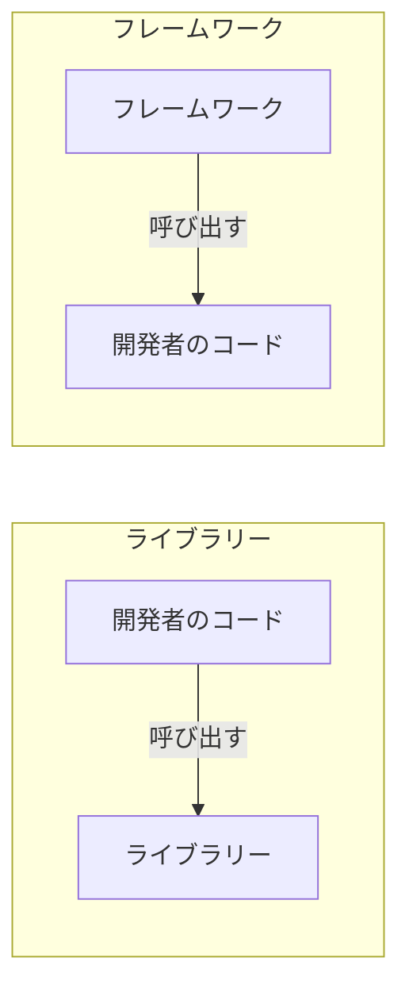

「ライブラリー」と「フレームワーク」はどちらもソフトウェア開発でよく使う言葉ですが、違いを聞かれるとはっきり答えにくい言葉でもあります。両者を分けるのは、どちらがどちらを呼ぶかです。開発者のコードがライブラリーを呼ぶのに対し、フレームワークは開発者のコードを呼びます。この記事では、この違いを制御の反転（Inversion of Control, IoC）という考え方からコード例で説明します。

## ライブラリーとは

ライブラリーは、特定の機能を提供するコードの集合体です。開発者が自分のコードからライブラリーの関数やクラスを呼び出して使います。

<strong>制御の主導権は開発者のコードにあります</strong>。ライブラリーの機能をいつ、どのように、どの順番で使うかは、すべて開発者が決めます。

```python
# ライブラリの例: requests
import requests

# 開発者が制御の主導権を握っている
response = requests.get("https://api.example.com/users")
data = response.json()

for user in data:
    print(user["name"])
```

この例では、`requests` ライブラリーをいつ呼び出すか、結果をどう処理するかを開発者のコードが決めています。

代表的なライブラリー:

| 言語 | ライブラリー | 用途 |
|---|---|---|
| Python | Requests | HTTP クライアント |
| JavaScript | Lodash | ユーティリティー関数 |
| Java | Guava | コレクション・キャッシュ |
| Go | zap | 構造化ロギング |
| C | libcurl | HTTP/ネットワーク通信 |

## フレームワークとは

フレームワークは、アプリケーション全体の骨格を提供するソフトウェア基盤です。アプリケーションの構造と実行フローはフレームワークが決め、開発者はフレームワークが用意した拡張ポイントに自分のコードを差し込みます。

<strong>制御の主導権はフレームワーク側にあります</strong>。

```python
# フレームワークの例: Flask
from flask import Flask

app = Flask(__name__)

# フレームワークが「いつ」この関数を呼ぶかを決める
@app.route("/users")
def get_users():
    return [{"name": "Alice"}, {"name": "Bob"}]

# フレームワークにアプリケーションの実行を委ねる
if __name__ == "__main__":
    app.run()
```

この例では、`get_users` 関数をいつ呼び出すかはフレームワーク（Flask）が決めています。HTTP リクエストが `/users` に届くと、Flask が開発者のコードを呼び出します。

代表的なフレームワーク:

| 言語 | フレームワーク | 用途 |
|---|---|---|
| Python | Django, Flask | Web アプリケーション |
| JavaScript | Next.js | フルスタック Web |
| Java | Spring | エンタープライズアプリケーション |
| Ruby | Ruby on Rails | Web アプリケーション |
| Go | Gin | Web API |

## 制御の反転（Inversion of Control）

ライブラリーとフレームワークの違いは、<strong>制御の反転（Inversion of Control, IoC）</strong>と呼ばれるソフトウェア設計の原則で説明できます。



- <strong>ライブラリー</strong>: 開発者のコード → ライブラリーを呼ぶ（開発者がコールする）
- <strong>フレームワーク</strong>: フレームワーク → 開発者のコードを呼ぶ（フレームワークがコールバックする）

この呼び出し関係の逆転が「制御の反転」です。"Hollywood Principle: Don't call us, we'll call you"（ハリウッドの原則: こちらから電話するので、電話してこないでください）とも呼ばれます。Martin Fowler は [IoC に関する記事](https://martinfowler.com/bliki/InversionOfControl.html) で、この原則をフレームワークとライブラリーを分ける重要な要素として挙げています。

### コードで比較する

同じ HTTP サーバーでも、ライブラリー的に書くかフレームワーク的に書くかでコードの構造は大きく変わります。

ライブラリー的なアプローチ（Go の `net/http` を直接使う場合。ハンドラーは `net/http` から呼ばれるが、アプリケーション全体の構造はほとんど強制しない）:

```go
package main

import (
    "encoding/json"
    "log"
    "net/http"
)

func main() {
    // 開発者がサーバーの構築、起動、アプリ構造の大部分を制御する
    mux := http.NewServeMux()

    mux.HandleFunc("/users", func(w http.ResponseWriter, r *http.Request) {
        users := []map[string]string{
            {"name": "Alice"},
            {"name": "Bob"},
        }
        w.Header().Set("Content-Type", "application/json")
        json.NewEncoder(w).Encode(users)
    })

    log.Fatal(http.ListenAndServe(":8080", mux))
}
```

フレームワーク的なアプローチ（Next.js の App Router）:

```typescript
// app/users/page.tsx
// フレームワークがルーティング、レンダリング、配信を制御する

export default async function UsersPage() {
  const users = [
    { name: "Alice" },
    { name: "Bob" },
  ];

  return (
    <ul>
      {users.map((user) => (
        <li key={user.name}>{user.name}</li>
      ))}
    </ul>
  );
}
```

Next.js の例では、ファイルの置き場所がルートになり、コンポーネントをいつレンダリングするかはフレームワークが管理します。開発者が書くのは「何を表示するか」の部分です。

## よくある誤解

### 「React はライブラリー？フレームワーク？」

React は[公式サイト](https://react.dev/)で自らを "The library for web and native user interfaces"（Web とネイティブのユーザーインターフェースのためのライブラリー）と説明しています。React 単体はコンポーネントのレンダリングを担い、ルーティングなどは別のライブラリーに任せます。

ただし、コンポーネントのライフサイクルや再レンダリングのタイミングは React が制御するので、フレームワーク的な面もあります。Next.js は React の上にルーティング、データフェッチ、ビルドシステムなどを加えたフレームワークです。

実際に使うときは、どちらに分類されるかより、どの処理を React が制御し、どこを開発者が決めるのかを見るほうが役に立ちます。

### 「サイズが大きいとフレームワーク？」

コードの規模では区別できません。小さなフレームワークも、大きなライブラリーもあります。

- <strong>Express.js</strong> — 軽量ですがフレームワークです（リクエスト処理の制御フローを Express が管理する）
- <strong>TensorFlow</strong> — 巨大ですが、多くの場合はライブラリーとして使われます（モデル構築やトレーニングループを開発者が制御できる。一方で Keras などの高水準 API はフレームワーク的な規約を加える）

## ライブラリーとフレームワークの選び方

次の表は、制御がどちら側にあるかによって生じやすい違いを、一般的な傾向としてまとめたものです。

| 観点 | ライブラリー | フレームワーク |
|---|---|---|
| 制御 | 開発者が制御 | フレームワークが制御 |
| 柔軟性 | 高い（自由な組み合わせ） | 低い（規約に従う） |
| 学習コスト | 低い（必要な API だけ学ぶ） | 高い（全体の規約を理解する必要がある） |
| 一貫性 | チームに依存 | フレームワークが強制 |
| 開発速度 | 初期は速い、規模拡大で低下しやすい | 初期は遅い、規模拡大で安定しやすい |
| 適したケース | 特定機能の追加 | アプリケーション全体の構築 |

実際の開発では、フレームワークの中でライブラリーを使うことがよくあります。例えば、Next.js（フレームワーク）のアプリケーションで date-fns（ライブラリー）を使って日付をフォーマットする、といった組み合わせです。

## まとめ

ライブラリーは開発者のコードが呼び出す道具で、制御の主導権は開発者にあります。フレームワークは開発者のコードを呼び出す基盤で、主導権はフレームワークにあります。両者の違いは制御の反転（IoC）、つまり「誰が誰を呼ぶか」です。

実際のツールはきれいに二分できるわけではなく、その間のどこかに位置します。ツールを選ぶときは、制御がどちら側にあるかを確かめておくと判断しやすくなります。