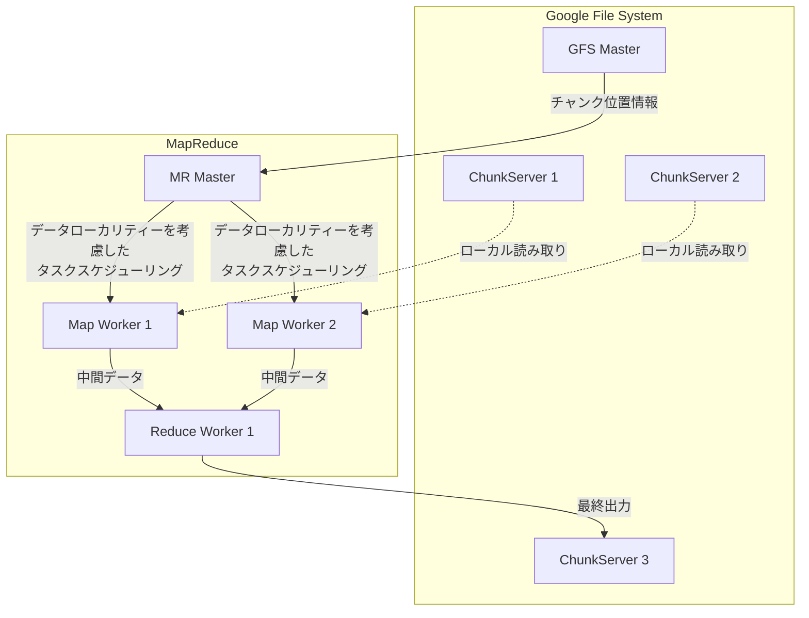

## はじめに — MapReduce が変えたこと

2004 年、Google のジェフ・ディーン (Jeff Dean) とサンジェイ・ゲマワット (Sanjay Ghemawat) は OSDI'04 で "[MapReduce: Simplified Data Processing on Large Clusters](https://research.google/pubs/mapreduce-simplified-data-processing-on-large-clusters/)" を発表しました。MapReduce を使うと、プログラマーは map と reduce の 2 つの関数を書くだけで数千台規模のクラスターに処理を分散できます。並列・分散処理の経験がなくても大規模な計算を書けるようになった点が、この論文の大きな成果です。

当時の Google は、ウェブクローラーが収集した数十ペタバイトのデータを日常的に処理していました。インデックス構築、PageRank の計算、アクセスログ分析はいずれも数千台のマシンに処理を分散させる必要があり、エンジニアはそのたびに次の問題を解いていました。

- データの分割と分配: データをどうやって均等にマシンへ配るか
- 並列実行の制御: 数千のプロセスをどう協調させるか
- 障害復旧: マシンが壊れたら (そして毎日のように壊れる) どうするか
- ネットワーク帯域の節約:  テラバイト単位のデータをどう効率よく移動するか

これらを扱うコードは計算のロジックとは無関係なのに、プログラムの大部分を占めていました。MapReduce は、この「配管工事」をフレームワークに引き受けさせ、プログラマーには計算そのものだけを書かせます。

<ArticleVideo slug="mapreduce" />

<MapReduceTimeline />

## MapReduce 以前の世界

### MPI (Message Passing Interface) の時代

2000 年代初頭、大規模計算には MPI (Message Passing Interface) が使われていました。MPI は強力ですが、データの分割から通信、集約、障害への対処まで すべてをプログラマーが書く必要があります。

```c
// MPI による Word Count (疑似コード) — 地獄のような複雑さ
MPI_Init(&argc, &argv);
MPI_Comm_rank(MPI_COMM_WORLD, &rank);
MPI_Comm_size(MPI_COMM_WORLD, &size);

// 手動でデータを分割
if (rank == 0) {
    // マスターがファイルを読み、各ワーカーにチャンクを送信
    for (int i = 1; i < size; i++) {
        MPI_Send(chunk[i], chunk_size, MPI_CHAR, i, 0, MPI_COMM_WORLD);
    }
}

// 各ワーカーがローカルで処理
MPI_Recv(my_chunk, chunk_size, MPI_CHAR, 0, 0, MPI_COMM_WORLD, &status);
local_count = count_words(my_chunk);

// 結果をマスターに集約 — 一体何通りのエラーが起こりうる？
MPI_Reduce(&local_count, &global_count, 1, MPI_INT, MPI_SUM, 0, MPI_COMM_WORLD);

// ワーカーが死んだら？ → プログラマが全部書く
// ネットワークが遅延したら？ → プログラマが全部書く
// データが偏ったら？ → プログラマが全部書く
MPI_Finalize();
```

このコードには障害に対処する処理が一切ありません。1,000 台のクラスターで 1 台でも落ちれば、ジョブは最初からやり直しです。Google の規模では、マシンが落ちないことを前提にできません。

### 論文が挙げる Google 社内の問題

MapReduce 論文の Introduction は、Google 社内の状況を次のように説明しています。

> 当初、計算の概念は単純だが、入力データが膨大で、合理的な時間内に計算を終えるためには数百〜数千台のマシンに分散させる必要があった。並列化・データ分散・障害処理の複雑さにより、本来単純であるはずの計算が大量の複雑なコードで覆い隠されていた。
>
> (意訳: 論文 Section 1 より)

MapReduce は、並列化・データ分散・障害処理をフレームワーク側に移し、インフラのコードと計算のコードを分けることでこの問題を解決しました。

<MapReduceComparison />

## プログラミングモデル — 2 つの関数

MapReduce のプログラミングモデルは、関数型プログラミングの `map` と `fold` (reduce) から着想を得ています。計算はすべて次の 2 つの関数で表します。

```text
map    (k1, v1)       → list(k2, v2)
reduce (k2, list(v2)) → list(k3, v3)
```

### map 関数

**入力**: キーと値のペア `(k1, v1)`（例: ファイル名と内容）

**出力**: 中間キーと値のペアのリスト `list(k2, v2)`

**責務**: 入力データから必要な情報を取り出し、中間キーを付ける

### reduce 関数

**入力**: 中間キーと、そのキーに対応するすべての値のリスト `(k2, list(v2))`

**出力**: 最終的な結果 `list(k3, v3)`

**責務**: 同じキーの値を集約して最終結果を作る

### Word Count — MapReduce の "Hello, World!"

MapReduce の代表例は、単語の出現回数を数える Word Count です。Google の論文でも最初の例として登場します。

```python
# map 関数
def map(filename: str, contents: str):
    for word in contents.split():
        emit(word, 1)

# reduce 関数
def reduce(word: str, counts: list[int]):
    emit(word, sum(counts))
```

ユーザーが書くのはこの 6 行だけで、ペタバイト規模のデータを数千台のマシンで並列処理できます。処理の分散、障害復旧、データ転送はフレームワークが担当します。

<MapReduceVisualizer />

### 他の応用例

論文は、同じ 2 つの関数の形で書ける計算の例をほかにも挙げています。

#### 分散 grep

```python
def map(filename, contents):
    for line in contents.split('\n'):
        if pattern.match(line):
            emit(filename, line)

def reduce(filename, lines):
    for line in lines:
        emit(filename, line)
```

#### URL アクセス頻度の集計

```python
def map(logfile, log_entry):
    url = parse_url(log_entry)
    emit(url, 1)

def reduce(url, counts):
    emit(url, sum(counts))
```

#### 逆リンクグラフの構築 (ウェブ検索の基礎)

```python
def map(url, page_content):
    for target_url in extract_links(page_content):
        emit(target_url, url)  # target ← source の関係

def reduce(target_url, source_urls):
    emit(target_url, list(source_urls))
```

#### 転置インデックスの構築 (検索エンジンの心臓部)

```python
def map(doc_id, contents):
    for word in tokenize(contents):
        emit(word, doc_id)

def reduce(word, doc_ids):
    emit(word, sorted(set(doc_ids)))
```

map と reduce の中身を変えるだけで、まったく異なる計算ができます。フレームワーク側のコードは変更しません。

## 実行モデルの内部実装

論文の図 1 にあたる実行の流れを、段階ごとに説明します。

### 全体の流れ

```mermaid
flowchart LR
    subgraph Input["入力 (GFS)"]
        I1[Split 0]
        I2[Split 1]
        I3[Split 2]
        I4[Split ...]
    end

    subgraph MapPhase["Map Phase"]
        M1[Worker 1<br/>map&#40;&#41;]
        M2[Worker 2<br/>map&#40;&#41;]
        M3[Worker 3<br/>map&#40;&#41;]
    end

    subgraph Shuffle["Shuffle"]
        S1[Partition &<br/>Sort by Key]
    end

    subgraph ReducePhase["Reduce Phase"]
        R1[Worker A<br/>reduce&#40;&#41;]
        R2[Worker B<br/>reduce&#40;&#41;]
    end

    subgraph Output["出力 (GFS)"]
        O1[Output 0]
        O2[Output 1]
    end

    I1 --> M1
    I2 --> M2
    I3 --> M3
    I4 --> M3

    M1 --> S1
    M2 --> S1
    M3 --> S1

    S1 --> R1
    S1 --> R2

    R1 --> O1
    R2 --> O2
```



### Step 1: 入力の分割 (Splitting)

ユーザープログラムは入力データを M 個の **スプリット** (通常 16〜64 MB) に分割します。

上限の 64 MB は、GFS (Google File System) がデータを保存するチャンクの大きさと同じです。スプリットをチャンクに揃えると、データが保存されているマシンでそのまま処理を実行しやすくなります。これを **データローカリティー** と呼びます。ネットワーク越しにデータを転送するより、ローカルディスクから読む方がはるかに速く処理できます。

### Step 2: Master の起動

フレームワークはプログラムのコピーをクラスター上に複数起動します。その 1 つが **Master** になり、残りは **Worker** になります。Master は Map タスク M 個と Reduce タスク R 個を、空いている (idle な) Worker に割り当てます。

```go
// Master のタスク管理（概念的なコード）
type Master struct {
    mapTasks    []Task    // M 個の Map タスク
    reduceTasks []Task    // R 個の Reduce タスク
    workers     []Worker  // 利用可能な Worker
}

type Task struct {
    State    TaskState  // idle | in-progress | completed
    WorkerID int        // 割り当てられた Worker
    Input    string     // 入力ファイルの場所
}

func (m *Master) schedule() {
    for _, task := range m.mapTasks {
        if task.State == Idle {
            worker := m.findIdleWorker()
            // データローカリティを考慮: データがローカルにある Worker を優先
            task.assign(worker)
        }
    }
}
```

### Step 3: Map フェーズ

Map Worker は入力スプリットを読み込み、ユーザー定義の map 関数を各レコードに適用して、中間キー/値ペアをメモリーにためます。

ためたペアは定期的にローカルディスクへ書き出されます。このとき **パーティション関数** (デフォルトは `hash(key) mod R`) によって R 個の領域に振り分けられます。Worker は、ローカルディスク上の中間ファイルの位置を Master に報告します。

```text
Map Worker のディスク上のファイル:
  /tmp/mr-0-0  (Partition 0 の中間データ)
  /tmp/mr-0-1  (Partition 1 の中間データ)
  ...
  /tmp/mr-0-(R-1)  (Partition R-1 の中間データ)
```

Map の出力は GFS ではなくローカルディスクに書かれます。中間データは一時的なもので、Shuffle で Reducer に転送された後は不要になるからです。その代わり、Worker が故障すると、その Worker で完了した Map タスクも再実行が必要になります。

### Step 4: Shuffle と Sort

Shuffle では全 Map Worker から全 Reduce Worker へデータが移動するため、MapReduce の中で最もコストが高い段階になります。

Reduce Worker は Master から通知された場所の情報を使い、全 Map Worker のローカルディスクから自分が担当するパーティションのデータを RPC で読み取ります。

すべて読み終えたら、中間キーでソートして同じキーのレコードをまとめます。通常は多くの異なるキーが同じ Reduce タスクに割り当てられるため、ソートが必要です。

```text
Shuffle のネットワーク転送量:
  M 個の Map * R 個の Reduce のパーティション = 最大 M×R 回のネットワーク転送

  例: M=10,000, R=5,000 の場合
      → 最大 50,000,000 回のネットワーク呼び出し
      → これが MapReduce のボトルネック
```

<strong>Combiner による最適化</strong>: ネットワーク転送量を減らすため、Map 側で Combiner 関数を実行できます。Combiner は Reduce と同じコードで実装されることが多いものの、安全に使えるのは次の 2 つの条件を満たす場合だけです。フレームワークが各 Mapper の出力の一部に 0 回・1 回・複数回適用しても最終結果が変わらないこと、そして出力型が中間 key/value 型と一致することです。例えば Word Count なら、`(hello, 1), (hello, 1), (hello, 1)` の 3 つをネットワークに送る代わりに、Combiner で `(hello, 3)` にまとめてから送ります。

### Step 5: Reduce フェーズ

Reduce Worker はソート済みの中間データを先頭から読み、中間キーごとに、キーと対応する値の集合をユーザーの reduce 関数に渡します。reduce 関数の出力は、その Reduce タスクの最終出力ファイルに追記されます。

### Step 6: 完了

すべての Map タスクと Reduce タスクが完了すると、Master は待機していたユーザープログラムを再開させ、MapReduce の呼び出しがユーザーコードに戻ります。出力は R 個のファイル (Reduce タスクごとに 1 つ) に格納されています。

## アーキテクチャ

<MapReduceArchitecture />

## 「フレームワークに複雑さを押し込む」の実態 — Hadoop のソースコードで見る

Google のオリジナル実装は公開されていませんが、Apache Hadoop はフレームワーク側も含めてオープンソースです。Hadoop のコードを読むと、ユーザーが書く map と reduce の裏でフレームワークが何を処理しているかが分かります。

### ユーザーが触る API: Mapper.java — ~150 行

ユーザーが継承する [`Mapper.java`](https://github.com/apache/hadoop/blob/trunk/hadoop-mapreduce-project/hadoop-mapreduce-client/hadoop-mapreduce-client-core/src/main/java/org/apache/hadoop/mapreduce/Mapper.java) の本体は、次のように短いクラスです。

```java
// Mapper.java (Apache Hadoop) — 全体で約 150 行 (ライセンスヘッダーと Javadoc 含む)
// https://github.com/apache/hadoop/blob/trunk/.../mapreduce/Mapper.java
public class Mapper<KEYIN, VALUEIN, KEYOUT, VALUEOUT> {

  protected void setup(Context context) throws IOException, InterruptedException {
    // NOTHING
  }

  protected void map(KEYIN key, VALUEIN value, Context context)
      throws IOException, InterruptedException {
    context.write((KEYOUT) key, (VALUEOUT) value);  // デフォルトは恒等関数
  }

  protected void cleanup(Context context) throws IOException, InterruptedException {
    // NOTHING
  }

  public void run(Context context) throws IOException, InterruptedException {
    setup(context);
    try {
      while (context.nextKeyValue()) {
        map(context.getCurrentKey(), context.getCurrentValue(), context);
      }
    } finally {
      cleanup(context);
    }
  }
}
```

Word Count を書く場合、ユーザーがオーバーライドするのは `map()` メソッド 1 つだけです。

### フレームワークが隠している実装: MapTask.java — 2,100 行超

この `map()` を実際に動かしているのが [`MapTask.java`](https://github.com/apache/hadoop/blob/trunk/hadoop-mapreduce-project/hadoop-mapreduce-client/hadoop-mapreduce-client-core/src/main/java/org/apache/hadoop/mapred/MapTask.java) です。このファイルは 2,100 行以上あり、次のような処理を含んでいます。

**`MapOutputBuffer` — 循環バッファーによるソート・スピル機構** (約 800 行)

```java
// MapTask.java 内の MapOutputBuffer (抜粋)
// https://github.com/apache/hadoop/blob/trunk/.../mapred/MapTask.java
public static class MapOutputBuffer<K, V> implements MapOutputCollector<K, V>, IndexedSortable {
    private IntBuffer kvmeta;    // メタデータ用の循環バッファ
    byte[] kvbuffer;             // シリアライズデータ用のメインバッファ
    int kvstart, kvend, kvindex; // メタデータの境界管理
    int equator;                 // メタ領域とデータ領域の境界点
    int bufstart, bufend, bufmark, bufindex, bufvoid; // バッファポインタ群

    final ReentrantLock spillLock = new ReentrantLock();
    final Condition spillDone = spillLock.newCondition();
    final Condition spillReady = spillLock.newCondition();
    // ...

    // ユーザーの map() から emit された KV ペアを受け取る
    public synchronized void collect(K key, V value, final int partition)
        throws IOException {
      // バッファ残量チェック → 足りなければスピルを開始
      bufferRemaining -= METASIZE;
      if (bufferRemaining <= 0) {
        spillLock.lock();
        try {
          // スピルスレッドとの協調ロジック (数十行のバッファ管理)
          // ...
        } finally {
          spillLock.unlock();
        }
      }
      // キーとバリューをバッファにシリアライズ
      keySerializer.serialize(key);
      valSerializer.serialize(value);
      // メタデータ (パーティション, オフセット) を記録
      kvmeta.put(kvindex + PARTITION, partition);
      kvmeta.put(kvindex + KEYSTART, keystart);
      // ...
    }

    // ソートしてディスクにスピル
    private void sortAndSpill() throws IOException {
      // QuickSort でパーティション→キー順にソート
      sorter.sort(MapOutputBuffer.this, mstart, mend, reporter);
      // 各パーティションの中間データを IFile 形式で書き出し
      for (int i = 0; i < partitions; ++i) {
        Writer<K, V> writer = new Writer<>(job, partitionOut, keyClass, valClass, codec, ...);
        if (combinerRunner == null) {
          // Combiner なし: 直接書き出し
        } else {
          // Combiner あり: ローカル集約してから書き出し
          combinerRunner.combine(kvIter, combineCollector);
        }
      }
    }

    // 複数のスピルファイルをマージ
    private void mergeParts() throws IOException {
      // N 個のスピルファイルを k-way マージ
      for (int parts = 0; parts < partitions; parts++) {
        RawKeyValueIterator kvIter = Merger.merge(job, rfs, keyClass, valClass, ...);
        // マージ結果を最終出力ファイルに書き出し
      }
    }
}
```

`MapTask.java` には、ほかに次のクラスも含まれています。

- `SpillThread` — バックグラウンドでバッファー→ディスクのスピルを行うスレッド (ReentrantLock + Condition で同期)
- `TrackedRecordReader` — 入力バイト数・レコード数のカウンター管理
- `SkippingRecordReader` — 不正レコードのスキップと記録
- `NewOutputCollector` — パーティション関数の適用とバッファーへの振り分け
- `BlockingBuffer` — スピル中の書き込みブロッキング制御

ユーザーが `context.write(word, 1)` と 1 行書くと、裏では次の処理が順に動きます。循環バッファーへのシリアライズ、バッファー満杯の検知、バックグラウンドスレッドによるソート、パーティション別のディスク書き出し、Combiner の適用、最後の k-way マージです。「フレームワークに複雑さを押し込む」とは、これらをユーザーのコードから切り離すことを指します。

### 行数の比較

```text
ユーザーが書くコード:
  Mapper.java     ~150 行   (うち map() は 3 行、残りは Javadoc)
  Reducer.java    ~180 行   (うち reduce() も 3 行)

フレームワーク側 (タスク実行の中核):
  MapTask.java    ~2,100 行  (バッファ管理, ソート, スピル, マージ)
  ReduceTask.java ~650 行   (Shuffle, ソート, マージ)
  Merger.java     ~870 行   (k-way マージソート)
  IFile.java      ~500 行   (中間ファイルフォーマット)
  合計            ~4,100 行+
```

タスク実行を担うフレームワーク側の中核ファイルは、ユーザーが継承する API クラスの 12 倍以上の行数があります。ジョブのスケジューリングや Shuffle のネットワーク転送層は含めていないため、フレームワーク全体ではこの差はさらに大きくなります。

## 耐障害性 — なぜ数千台で動くのか

MapReduce は、数千台のコモディティーハードウェアでマシンが故障しても、ジョブを最後まで完了させる仕組みをフレームワークの中に持っています。

### 論文で使われたクラスター

論文の性能測定に使われたクラスターは次の構成でした。

- 約 1,800 台のマシン
- 各マシンに 2 GHz Intel Xeon プロセッサー × 2 基 (Hyper-Threading 有効)、4 GB メモリー、160 GB IDE ディスク × 2 本
- ネットワークはギガビットイーサネット (1 Gbps)

この規模のクラスターでは、ディスク、メモリー、ネットワークなどの障害が日常的に起きます。1 台が壊れるたびにジョブを最初からやり直していては、大規模なジョブはいつまでも完了しません。

<FaultToleranceDiagram />

### Worker 障害の詳細

Master は定期的に全 Worker へ ping を送り、一定時間応答がない Worker を故障とみなします。

**Map Worker が壊れた場合:**

1. その Worker で実行中だった Map タスクを `idle` に戻し、再スケジュールする
2. その Worker で完了済みの Map タスクも `idle` に戻し、再実行する。Map の出力はその Worker のローカルディスクにあり、Worker が壊れると読めなくなるため
3. Map タスクが Worker A から Worker B に移ったことを、Reduce タスクを実行中の全 Worker に通知する。A からまだデータを読んでいない Reduce タスクは B から読む

**Reduce Worker が壊れた場合:**

1. その Worker で実行中だった Reduce タスクだけを `idle` に戻し、再スケジュールする
2. 完了済みの Reduce タスクは再実行しない。出力が GFS (グローバルなファイルシステム) に保存されているため

### 決定性と原子的コミット

MapReduce は、完了した Map タスクと Reduce タスクの出力を原子的にコミットします。

- Map タスク: Worker は一時ファイルに出力を書き、完了時に Master へファイル名を報告します。完了済みのタスクについて再び報告を受けた場合、Master はそれを無視します (冪等性)
- Reduce タスク: Worker は一時ファイルに出力を書き、完了時にそれを最終出力ファイルの名前にリネームします。GFS のリネームがアトミックであることを利用しています

map と reduce 関数が **決定的** (同じ入力に対して常に同じ出力) であれば、分散実行の結果は逐次実行と同じになります。非決定的な場合でも、個々の Reduce タスクの出力は、いずれかの逐次実行の結果と一致します。

### Straggler 対策: 投機的実行

MapReduce ジョブの実行時間を大きく延ばす原因の 1 つが **Straggler**、つまり最後に残った少数のタスクが異常に遅くなる現象です。原因には次のようなものがあります。

- ディスクの劣化: 読み書き速度が通常の 1/10 以下に落ちる
- CPU の過負荷: 同じマシンで他のタスクが動いている
- ネットワーク輻輳:  特定のラック間の帯域が飽和している

いずれもマシンが停止したわけではないため、障害としては検知されません。

Google はこの問題を **バックアップタスク** (投機的実行) で解決しました。ジョブの終盤で残りのタスクが少なくなると、実行中のタスクすべてについてバックアップコピーを別のマシンで起動し、元のタスクとバックアップのうち先に完了した方の結果を採用します。

論文によれば、バックアップタスクを無効にすると、ジョブの完了時間が 44% 増加しました。

## パフォーマンス特性

### データローカリティー

ネットワーク帯域は限られた資源なので、MapReduce は入力データが保存されているマシン (またはそれと同じラックのマシン) で Map タスクを実行しようとします。GFS は各チャンクを (通常 3 ヵ所に) 複製しており、Master はその複製の位置を使ってタスクを割り当てます。

論文によれば、クラスター内の Worker の多くを使う大規模な MapReduce ジョブでは、入力データの大部分がローカルから読まれ、ネットワーク帯域を消費しません。

### Combiner と帯域幅の最適化

Step 4 で説明した Combiner を使うと、Shuffle のネットワーク転送量を大きく減らせます。Word Count の例では次のようになります。

```text
Combiner なし: 各 Mapper が (the, 1) を何千回も送信
Combiner あり: 各 Mapper が (the, 4832) のように事前集約して送信

転送データ量: 数桁のオーダーで削減可能
```

Combiner を安全に使えるのは、フレームワークが 0 回・1 回・複数回実行しても、部分的な集約が最終結果を変えない場合だけです。sum、max、min のように結合法則と交換法則を満たす演算は使えますが、平均はそのままでは使えません。平均を求めるには、分子と分母 (sum と count) を別々に Combine する必要があります。

### パーティション関数のカスタマイズ

デフォルトのパーティション関数は `hash(key) mod R` ですが、用途によっては変更が必要です。例えば、出力キーが URL で、同じホストの URL を同じ出力ファイルにまとめたい場合は次のようにします。

```python
def partition(key: str, num_reducers: int) -> int:
    hostname = urlparse(key).hostname
    return hash(hostname) % num_reducers
```

## 論文の実験結果

論文では、前述の約 1,800 台のクラスターで実行した 2 つのベンチマークが報告されています。

### Grep

$10^{10}$ 個の 100 バイトレコード (約 1 TB) から、特定の 3 文字パターンを検索します。

- 1,764 台の Worker マシン
- 入力を 64 MB のスプリット 15,000 個に分割 ($M = 15000$)
- 起動時のオーバーヘッド (プログラムの配布、GFS 上のファイルのオープン、ローカリティー情報の取得) に約 60 秒
- 全体で約 150 秒で完了

### Sort

$10^{10}$ 個の 100 バイトレコード (約 1 TB) をソートします。

- 1,764 台の Worker マシン
- $M = 15000$, $R = 4000$
- 全体で約 891 秒 (約 15 分) で完了
- この時間はバックアップタスクを有効にした場合で、無効にすると前述のとおり 44% 長くなる

## GFS との共生関係

Google の MapReduce は、入力の読み込みと最終出力の書き込みに GFS を使い、タスクの割り当てにも GFS のチャンク位置を利用します。そのため GFS と組み合わせて初めて、ここまで説明した性能と耐障害性が得られます。



### GFS が提供するもの

1. 大容量ストレージ: コモディティーサーバーの組み合わせでペタバイト規模
2. レプリケーション: 各チャンクを 3 ヵ所に複製し、可用性を確保
3. チャンク位置情報: Map タスクのスケジューリングに使うデータローカリティー情報
4. アトミックなリネーム: Reduce 出力の原子的コミットに利用

### MapReduce が GFS に求める特性

- 高スループットの逐次読み書き (ランダムアクセスは不要)
- 最終 Reduce 出力の atomic rename / commit セマンティクス（中間 Map 出力は GFS ではなく各 Worker のローカルディスクに置かれる）
- 大きなファイルに最適化 (小さなファイルは苦手)

GFS の設計は、後に Hadoop エコシステムで、GFS に着想を得たオープンソースの HDFS (Hadoop Distributed File System) として実装されます。

## MapReduce が生んだエコシステム

MapReduce の影響は Google 社内にとどまらず、オープンソースのビッグデータ処理基盤が次々に生まれました。

### 直系の子孫: Hadoop

2006 年、Doug Cutting と Mike Cafarella は、Google の MapReduce 論文と GFS 論文に着想を得たオープンソース実装として Apache Hadoop を開発しました。開発は Yahoo! が大きく支援しています。HDFS と Hadoop MapReduce の組み合わせにより、Google 以外の企業でもペタバイト規模のデータを処理できるようになりました。

Hadoop の上には、次のようなプロジェクトが急速に増えました。

- Hive: MapReduce 上の SQL インターフェース (Facebook 開発)
- Pig: MapReduce 上のデータフロー言語 (Yahoo! 開発)
- HBase: Bigtable のオープンソース実装 (HDFS 上で動作)
- ZooKeeper: 分散協調サービス

### MapReduce の限界

一方で、利用が広がるにつれて MapReduce の限界も明らかになりました。

**1. 反復処理の非効率性**

k-means、PageRank、勾配降下法などのアルゴリズムは、同じ計算を何度も繰り返します。MapReduce では反復のたびに 1 つのジョブを実行し、中間結果を毎回ディスクに書き出します。

```text
反復 1: 読み込み → Map → Shuffle → Reduce → ディスクに書き出し
反復 2: ディスクから読み込み → Map → Shuffle → Reduce → ディスクに書き出し
反復 3: ディスクから読み込み → Map → Shuffle → Reduce → ディスクに書き出し
...
```

反復ごとにディスク I/O が発生するため、処理が非常に遅くなります。

**2. インタラクティブクエリーへの不適合**

MapReduce ジョブの起動には数十秒のオーバーヘッドがかかるため、その場で結果を見たいアドホッククエリーには向きません。

**3. 表現力の制約**

すべての計算を map → shuffle → reduce の形に落とし込む必要があります。複雑な DAG (有向非巡回グラフ) は複数の MapReduce ジョブをつないで表すしかなく、効率が悪くなります。

**4. Shuffle の固定的なパターン**

すべての Map 出力が必ず Shuffle を経由するため、Shuffle が不要な処理でもそのオーバーヘッドがかかります。

### 後継技術

#### Apache Spark (2010〜)

UC Berkeley の AMPLab で開発された Spark は、**RDD (Resilient Distributed Dataset)** という概念を導入し、中間データをメモリーに保持できるようにしました。

```python
# Spark による Word Count — データがメモリに残る
text = sc.textFile("hdfs://input")
counts = text.flatMap(lambda line: line.split()) \
             .map(lambda word: (word, 1)) \
             .reduceByKey(lambda a, b: a + b)
counts.saveAsTextFile("hdfs://output")
```

- 反復処理で 10〜100 倍の高速化
- DAG ベースの実行エンジン (map → reduce の固定パイプラインではない)
- 対話型シェル (Spark Shell) でアドホッククエリーを実行できる

#### Apache Flink (2014〜)

ストリーム処理をネイティブにサポートし、バッチ処理をストリーム処理の特殊な場合として扱います。

#### Google Cloud Dataflow / Apache Beam (2014–2016)

Google 自身が MapReduce の後継として開発しました (Dataflow SDK は 2014 年、Apache Beam の初期リリースは 2016 年)。バッチ処理とストリーム処理を同じモデルで書けます。

```python
# Apache Beam — バッチもストリームも同じコード
import apache_beam as beam

with beam.Pipeline() as p:
    (p
     | beam.io.ReadFromText('input.txt')
     | beam.FlatMap(lambda line: line.split())
     | beam.combiners.Count.PerElement()
     | beam.io.WriteToText('output'))
```

## MapReduce の思想的遺産

MapReduce の実装そのものは既に主流ではありませんが、その考え方は現在のデータ処理基盤に受け継がれています。

### 1. 抽象化による民主化

「分散処理の複雑さをフレームワークに押し込め、ユーザーにはシンプルなインターフェースだけを見せる」

Spark、Flink、Beam はこの考え方を引き継いでおり、Kubernetes のような汎用オーケストレーターにも同じ発想が見られます。

### 2. データローカリティーの原則

「データを計算に持っていくのではなく、計算をデータに持っていく」

クラウドでは計算とストレージが分離されがちですが、この原則は今もパフォーマンスチューニングの基本です。

### 3. 障害は例外ではなく常態

「大規模システムでは障害は必ず起きる。設計段階で障害を前提とすべきである」

同じ考え方は、Google の SRE (Site Reliability Engineering) や、本番環境で意図的に障害を起こす Netflix の Chaos Monkey にも見られます。

### 4. シンプルなモデルのスケーラビリティー

「制約のあるシンプルなモデルの方が、何でもできる複雑なモデルよりもスケールしやすい」

MapReduce は MPI のような任意の通信パターンを許しません。その代わりにデータの流れが決まっているため、フレームワークがタスクの配置や再実行を最適化できます。

## まとめ

2004 年に Google が発表した MapReduce は、コモディティーハードウェア上の大規模データ処理を、map と reduce の 2 つの関数を書くだけで扱えるものにしました。分割、スケジューリング、Worker 障害時の再実行、Straggler への投機的実行はフレームワークが担い、その設計は Hadoop を通じてビッグデータ処理の基盤に広がりました。

現在では Spark や Flink に取って代わられましたが、MapReduce が確立した「計算とインフラの分離」「障害を前提とした設計」「シンプルな抽象化による大規模化」という原則は、今も分散システム設計の基礎になっています。

## 参考文献

- Dean, J., & Ghemawat, S. (2004). [MapReduce: Simplified Data Processing on Large Clusters](https://research.google/pubs/mapreduce-simplified-data-processing-on-large-clusters/). OSDI'04.
- Ghemawat, S., Gobioff, H., & Leung, S.-T. (2003). [The Google File System](https://research.google/pubs/the-google-file-system/). SOSP'03.
- Zaharia, M., et al. (2010). [Spark: Cluster Computing with Working Sets](https://www.usenix.org/legacy/event/hotcloud10/tech/full_papers/Zaharia.pdf). HotCloud'10.
- White, T. (2015). *Hadoop: The Definitive Guide*. O'Reilly Media.
