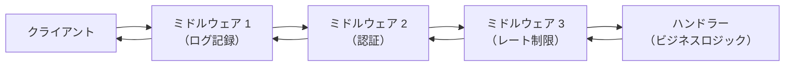
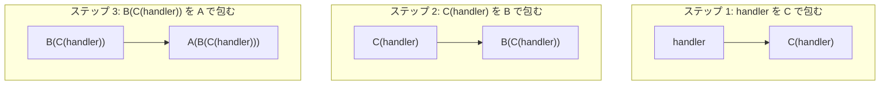
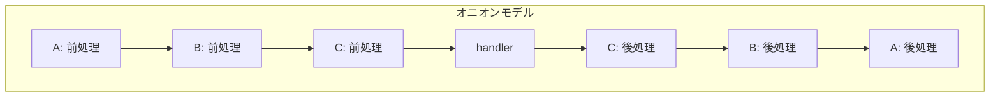
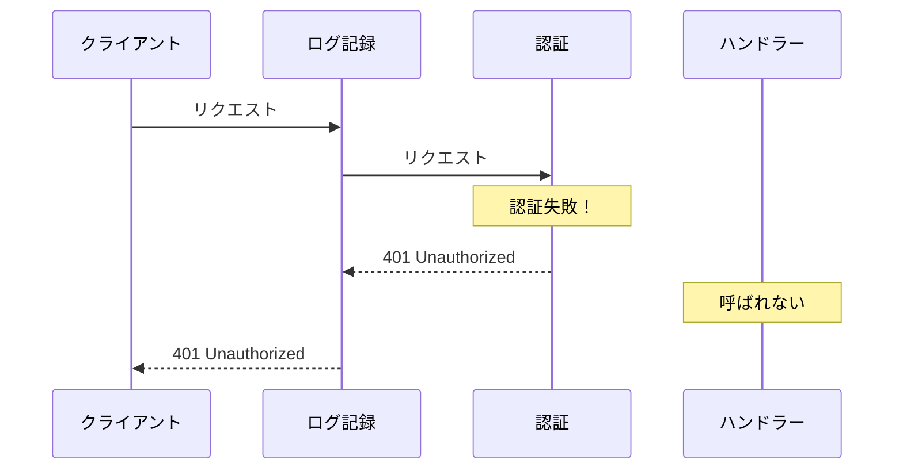
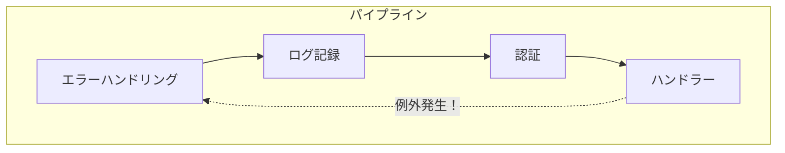

## はじめに

Express.js の `next()`、Django の `get_response`、ASP.NET Core の `Use()` / `Run()`、Go の `http.Handler` ラッパーは、どれも「ミドルウェアチェーン」という同じアーキテクチャパターンの実装です。

ミドルウェアチェーンを使うと、HTTP リクエストとレスポンスの処理パイプラインに、認証・ログ記録・エラーハンドリングなどの処理を差し込んだり外したりできます。フレームワークを使うだけなら API を知っていれば足ります。しかし、なぜ `next()` を呼ぶ必要があるのか、なぜ登録順序が効くのかを理解するには、自分で実装してみるのが近道です。

ここではミドルウェアチェーンを Python でゼロから実装し、それを Express.js・Django・ASP.NET Core・Go のミドルウェア API と比べます。比べてみると、各フレームワークの `next()` が自分で作った仕組みのどこに当たるかがわかります。

### この記事で学ぶこと

1. ミドルウェアとは何か、なぜチェーンになるのか
2. GoF デザインパターンとの関係（Chain of Responsibility、Decorator）
3. `next` の正体：関数合成とクロージャ
4. `compose` によるチェーンの組み立てとオニオンモデル
5. ショートサーキット：パイプラインの早期終了
6. エラーハンドリングミドルウェア
7. 登録順序と実行順序
8. Express.js・Django・ASP.NET Core・Go との比較
9. ミドルウェアのテスト
10. クラスベースのミドルウェア

### 対象読者

Web フレームワークでミドルウェアを使ったことがあり、内部の仕組みを知りたい人を想定しています。デザインパターンを実装しながら学びたい人にも向いています。Python の関数、クラス、デコレーターの基本を知っていれば読めます。

### ミドルウェアがない世界——動機となる問題

ミドルウェアがなければ、ログ記録、認証、エラーハンドリングのコードを各ハンドラーに繰り返し書くことになります。

```python
def handle_users(request):
    # ログ記録（コピペ 1/3）
    print(f"{request.method} {request.path}")
    # 認証チェック（コピペ 1/3）
    if "Authorization" not in request.headers:
        return Response(status=401, body="Unauthorized")
    # エラーハンドリング（コピペ 1/3）
    try:
        return Response(status=200, body="User list")
    except Exception:
        return Response(status=500, body="Internal Server Error")


def handle_orders(request):
    # ログ記録（コピペ 2/3）
    print(f"{request.method} {request.path}")
    # 認証チェック（コピペ 2/3）
    if "Authorization" not in request.headers:
        return Response(status=401, body="Unauthorized")
    # エラーハンドリング（コピペ 2/3）
    try:
        return Response(status=200, body="Order list")
    except Exception:
        return Response(status=500, body="Internal Server Error")


def handle_products(request):
    # ログ記録（コピペ 3/3）
    print(f"{request.method} {request.path}")
    # 認証チェック（コピペ 3/3）
    if "Authorization" not in request.headers:
        return Response(status=401, body="Unauthorized")
    # エラーハンドリング（コピペ 3/3）
    try:
        return Response(status=200, body="Product list")
    except Exception:
        return Response(status=500, body="Internal Server Error")
```

この例では、ログ記録・認証チェック・エラーハンドリングという<strong>横断的関心事</strong>（cross-cutting concerns）が、すべてのハンドラーにコピペされています。ハンドラーが3つならまだ管理できますが、50や100に増えると次の問題が出ます。

- ログの出力形式を変えるには、全ハンドラーを探して修正する
- 認証ロジックにバグがあれば、全ハンドラーに同じ修正を入れる
- ハンドラーを追加するたびに同じ定型処理をコピペし、一部を書き忘れやすい

ミドルウェアチェーンは、横断的関心事をハンドラーから切り離し、パイプラインとして一か所で定義することで重複をなくします。各ハンドラーにはビジネスロジックだけが残ります。

```python
# ミドルウェアチェーンがあれば、ハンドラーはビジネスロジックだけ
def handle_users(request):
    return Response(status=200, body="User list")

def handle_orders(request):
    return Response(status=200, body="Order list")

def handle_products(request):
    return Response(status=200, body="Product list")

# 横断的関心事はミドルウェアとして1箇所で定義
app = compose(router, [error_handling, logging, auth])
```

この分離を支える `compose` とミドルウェアを、次の章からゼロから実装します。

## 第1章：ミドルウェアとは何か

### 基本的な定義

ミドルウェアとは、リクエストとレスポンスの間に挟まる処理レイヤーです。リクエストを受け取り、ログ記録、認証チェック、ヘッダー追加などの処理を行ったうえで、次のミドルウェアに処理を渡すか、自分でレスポンスを返します。

Express.js の公式ドキュメントは、ミドルウェアができることとして次の4つを挙げています。

1. 任意のコードを実行する
2. リクエストオブジェクトとレスポンスオブジェクトを変更する
3. リクエスト・レスポンスサイクルを終了する
4. スタック内の次のミドルウェア関数を呼び出す

### なぜ「チェーン」なのか

複数のミドルウェアは一列につながり、リクエストは先頭から順に通過します。各ミドルウェアは、次のミドルウェアを呼ぶ（`next()`）か、自分で応答を返す（ショートサーキット）かを選びます。



矢印は往復しています。リクエストは左から右へ流れ、レスポンスは同じミドルウェアを通って右から左へ戻ります。各ミドルウェアが内側のミドルウェアを玉ねぎの皮のように包むため、この構造は<strong>オニオンモデル</strong>（玉ねぎモデル）と呼ばれます。

## 第2章：デザインパターンのルーツ

### GoF の Chain of Responsibility パターン

ミドルウェアチェーンの元になっているのは、GoF（Gang of Four）の Chain of Responsibility パターンです。同書はこのパターンを次のように定義しています。

> 「リクエストの送信者と受信者の結合を避け、複数のオブジェクトにリクエストを処理する機会を与える。リクエストはチェーン上の各オブジェクトを渡り歩き、いずれかのオブジェクトが処理するまで転送される。」— Gang of Four, Design Patterns (1994)


Web ミドルウェアは、GoF の定義と次の3点で異なります。

| 特性 | GoF Chain of Responsibility | Web ミドルウェアチェーン |
|------|---------------------------|----------------------|
| 処理するハンドラーの数 | チェーン内の1つだけ | 全員が処理に関与できる |
| 処理の方向 | 単方向（リクエストのみ） | 双方向（リクエスト＋レスポンス） |
| 委譲の意味 | 「自分では処理できない」 | 「次の処理に進む」 |

### Decorator パターンとの類似性

Wikipedia が指摘するように、Chain of Responsibility は構造的に Decorator パターンとほぼ同じです。Decorator パターンでは、各デコレーターがラップ対象に振る舞いを足し、処理を委譲します。Web ミドルウェアも前処理、委譲、後処理の順に動くので、Decorator に近い振る舞いをします。一方で、自分でレスポンスを返してチェーンを止められる点は Chain of Responsibility のハンドラーと同じです。そのため Web ミドルウェアチェーンは、<strong>Chain of Responsibility と Decorator を組み合わせた</strong>ものといえます。

## 第3章：核心の抽象——`next` の正体

### `next` とは関数合成である

ミドルウェアチェーンの中身は、突き詰めると<strong>関数合成</strong>です。

各ミドルウェアは「次の処理」を表す関数を受け取り、それを呼ぶかどうかを決めます。この関数は、後続のミドルウェアすべてと最終ハンドラーを1つにまとめたものです。

型を Python で定義すると次のようになります。

```python
from __future__ import annotations

from dataclasses import dataclass, field
from collections.abc import Callable


# ──────────────────────────────────────────────
# リクエストとレスポンスの型定義
# ──────────────────────────────────────────────

@dataclass
class Request:
    """HTTP リクエストを模倣するシンプルなデータクラス。"""
    method: str = "GET"
    path: str = "/"
    headers: dict[str, str] = field(default_factory=dict)
    body: str = ""


@dataclass
class Response:
    """HTTP レスポンスを模倣するシンプルなデータクラス。"""
    status: int = 200
    headers: dict[str, str] = field(default_factory=dict)
    body: str = ""


# ──────────────────────────────────────────────
# 型エイリアス
# ──────────────────────────────────────────────

# Handler: リクエストを受け取りレスポンスを返す関数
Handler = Callable[[Request], Response]

# Middleware: 次のハンドラーを受け取り、新しいハンドラーを返す関数
Middleware = Callable[[Handler], Handler]
```

設計の要はこの2つの型エイリアスです。`Handler` はリクエストをレスポンスに変換する関数で、`Middleware` はハンドラーを受け取って新しいハンドラーを返す高階関数です。

### 最初のミドルウェアを書く

ログ記録ミドルウェアは次のようになります。

```python
def logging_middleware(next_handler: Handler) -> Handler:
    """リクエストとレスポンスをログ出力するミドルウェア。"""
    def handler(request: Request) -> Response:
        # ── 前処理（リクエストがハンドラーに届く前） ──
        print(f"--> {request.method} {request.path}")

        # ── next を呼ぶ ──
        response = next_handler(request)

        # ── 後処理（レスポンスがクライアントに返る前） ──
        print(f"<-- {response.status}")

        return response

    return handler
```

以降に出てくるミドルウェアは、すべて同じ構造です。

1. `next_handler` を引数として受け取る（「次の処理」への参照）
2. 新しい `handler` 関数を定義して返す
3. その `handler` は次の順に動く
   - `next_handler` を呼ぶ前に前処理を走らせる
   - `next_handler(request)` を呼んで処理を委譲する
   - `next_handler` が返った後に後処理を走らせる

`next_handler` は、次のミドルウェア、その先のミドルウェアすべて、最終ハンドラーを1つの関数にまとめたものです。これが `next` の正体です。

### なぜ `next_handler` が保持されるのか——クロージャの仕組み

`logging_middleware(some_handler)` を呼ぶと、内側の `handler` 関数が返ります。`handler` の引数は `request` だけですが、後で呼ばれたときにも `next_handler` を呼べます。これはクロージャ（closure）の働きです。Python では、内側の関数が外側の関数のローカル変数を参照すると、内側の関数はその変数を「捕捉」します。

```python
def logging_middleware(next_handler: Handler) -> Handler:
    #           ↑ next_handler はここでローカルスコープに入る

    def handler(request: Request) -> Response:
        #     ↑ handler は next_handler を「キャプチャ」している
        print(f"--> {request.method} {request.path}")
        response = next_handler(request)  # ← クロージャ経由でアクセス
        print(f"<-- {response.status}")
        return response

    return handler
    # ← logging_middleware のスタックフレームが終了しても、
    #    handler が next_handler への参照を保持し続ける
```

`compose` がミドルウェアをネストするとき、各レイヤーのクロージャは次のレイヤーへの参照を持ちます。この参照がつながって、チェーン全体ができあがります。

> クロージャは JavaScript、Go、Ruby、Rust など、主要な言語のほとんどにあります。Express.js の `next()` が次のミドルウェアを知っているのも、Go の `func(http.Handler) http.Handler` がチェーンを作れるのも、クロージャによるものです。

## 第4章：ミドルウェアチェーンの組み立て

### `compose` 関数——チェーンを構築する

リストの先頭のミドルウェアを最初に実行するには、それを一番外側に置く必要があります。そのため `compose` は最後のミドルウェアからハンドラーを包み始め、最後に登録したミドルウェアが一番内側（ハンドラーに近い側）になります。これが<strong>逆順の畳み込み</strong>（reduce）です。

```python
def compose(handler: Handler, middlewares: list[Middleware]) -> Handler:
    """ミドルウェアのリストを合成して1つのハンドラーにする。

    middlewares = [A, B, C] の場合、実行順序は A -> B -> C -> handler となる。
    内部的には handler を C で包み、それを B で包み、さらに A で包む。
    """
    composed = handler
    for middleware in reversed(middlewares):
        composed = middleware(composed)
    return composed
```

`[A, B, C]` を包む3つのステップを図にすると次のとおりです。



できあがった `A(B(C(handler)))` にリクエストが届くと、処理は次の順に進みます。

1. A の前処理 → B の前処理 → C の前処理 → handler （リクエスト方向）
2. handler → C の後処理 → B の後処理 → A の後処理 （レスポンス方向）

この順序がオニオンモデルです。

### オニオンモデルの視覚化



### コールスタックを追いかける

`compose(handler, [logging, timing, auth])` で組み立てたパイプラインに1つのリクエストが流れるときのコールスタックを追うと、次のようになります。

```text
compose 実行時（起動前の配線フェーズ）:
  composed = handler
  composed = auth(handler)           → auth_handler   (handler をクロージャで保持)
  composed = timing(auth_handler)    → timing_handler  (auth_handler をクロージャで保持)
  composed = logging(timing_handler) → logging_handler (timing_handler をクロージャで保持)

app = logging_handler  ← これが最終的なエントリーポイント
```

```text
app(Request("GET /")) 呼び出し時（実行フェーズ）:

  logging_handler(request)
  │  print("--> GET /")                      # logging 前処理
  │
  ├──▶ timing_handler(request)               # next_handler 呼び出し
  │    │  start = time.perf_counter()        # timing 前処理
  │    │
  │    ├──▶ auth_handler(request)            # next_handler 呼び出し
  │    │    │  Authorization ヘッダー確認     # auth 前処理
  │    │    │
  │    │    ├──▶ handler(request)            # next_handler 呼び出し
  │    │    │    │  return Response(200)     # ビジネスロジック実行
  │    │    │    ▼
  │    │    │  response = Response(200)
  │    │    │  return response               # auth 後処理なし → そのまま返す
  │    │    ▼
  │    │  elapsed_ms = ...                   # timing 後処理
  │    │  response.headers["X-Response-Time"] = "1.23ms"
  │    │  return response
  │    ▼
  │  print("<-- 200")                        # logging 後処理
  │  return response
  ▼
```

このトレースから、チェーンの性質が3つ読み取れます。

- 配線フェーズ（`compose` 実行時）と実行フェーズ（`app(request)` 呼び出し時）は分かれています。配線は一度だけ行われ、以降のリクエストはすべて同じパイプラインを通ります。
- 呼び出しはネストしています。各ミドルウェアの前処理は呼び出すときに、後処理は戻るときに実行されます。これがオニオンモデルの往復を生みます。
- スタックの一番深いところにハンドラー（ビジネスロジック）があります。ミドルウェアを増やしても、ハンドラーを変える必要はありません。

Django の公式ドキュメントも、この構造を玉ねぎにたとえています。

> 「各ミドルウェアクラスは、玉ねぎの1つの『層』であり、ビューが玉ねぎの芯にあると考えてください。リクエストが玉ねぎの全ての層を通過し（各層が `get_response` を呼んで次の層にリクエストを渡す）、芯のビューまで到達すると、レスポンスは逆順に全ての層を通って戻ってきます。」— Django ドキュメント

### チェーンを動かす

次のコードでは認証ミドルウェアと計測ミドルウェアを追加し、`Authorization` ヘッダーありとなしのリクエストを1つずつ送ります。

```python
def auth_middleware(next_handler: Handler) -> Handler:
    """認証チェックを行うミドルウェア。

    Authorization ヘッダーが無ければ 401 を返す（ショートサーキット）。
    """
    def handler(request: Request) -> Response:
        if "Authorization" not in request.headers:
            # next_handler を呼ばずにレスポンスを返す → ショートサーキット
            return Response(status=401, body="Unauthorized")

        return next_handler(request)

    return handler


def timing_middleware(next_handler: Handler) -> Handler:
    """処理時間を計測するミドルウェア。"""
    import time

    def handler(request: Request) -> Response:
        start = time.perf_counter()
        response = next_handler(request)
        elapsed_ms = (time.perf_counter() - start) * 1000
        response.headers["X-Response-Time"] = f"{elapsed_ms:.2f}ms"
        return response

    return handler


# ── 最終ハンドラー ──
def my_handler(request: Request) -> Response:
    return Response(status=200, body="Hello, World!")


# ── チェーンの組み立てと実行 ──
app = compose(my_handler, [logging_middleware, timing_middleware, auth_middleware])

# 認証ヘッダーありのリクエスト
print("=== With Auth ===")
resp = app(Request(method="GET", path="/", headers={"Authorization": "Bearer token123"}))
print(f"Body: {resp.body}\n")

# 認証ヘッダーなしのリクエスト（ショートサーキットされる）
print("=== Without Auth ===")
resp = app(Request(method="GET", path="/"))
print(f"Status: {resp.status}, Body: {resp.body}")
```

実行結果：

```text
=== With Auth ===
--> GET /
<-- 200
Body: Hello, World!

=== Without Auth ===
--> GET /
<-- 401
Status: 401, Body: Unauthorized
```

認証ヘッダーがない場合、`auth_middleware` は `next_handler` を呼ばずに 401 を返します。それでも `logging_middleware` と `timing_middleware` の後処理は実行されるので、ログに `<-- 401` が出ます。ショートサーキットしたミドルウェアより外側にあるミドルウェアは、リクエストとレスポンスの両方を必ず通します。

## 第5章：ショートサーキット——パイプラインの早期終了

### ショートサーキットとは

ショートサーキット（短絡）とは、ミドルウェアが `next` を呼ばずにレスポンスを返し、パイプラインの残りを飛ばすことです。

前章の `auth_middleware` はショートサーキットをしています。認証に失敗したらハンドラーを実行しても意味がないので、そこでパイプラインを打ち切ります。



ショートサーキットを使うと不要な処理を避けられます。ASP.NET Core のドキュメントも次のように説明しています。

> 「リクエストパイプラインのショートサーキットは、不要な処理を回避するためにしばしば望ましいことです。たとえば、Static File Middleware は静的ファイルへのリクエストを処理してパイプラインの残りをショートサーキットするターミナルミドルウェアとして機能できます。」— ASP.NET Core ドキュメント

### ショートサーキットの設計上の注意点

ショートサーキットするミドルウェアを設計するときは、次の3点に気をつけます。

- ショートサーキットしたミドルウェアより外側にあるミドルウェアの後処理は実行されます。前章の例で `logging_middleware` が 401 のログを出したのはこのためです。
- 登録順序が結果を変えます。認証ミドルウェアをログ記録ミドルウェアより前に置くと、認証失敗時にログが残りません。ログ記録は通常、一番外側に置きます。
- ASP.NET Core のドキュメントは、レスポンスをクライアントに送信した後に `next` を呼ばないよう警告しています。開始済みのレスポンスを変更すると例外が発生するためです。

### 実践例：キャッシュミドルウェア

キャッシュミドルウェアもショートサーキットを使います。キャッシュにヒットしたら、パイプラインの残りを呼ばずに保存済みのレスポンスを返します。

```python
class CacheMiddleware:
    """レスポンスをキャッシュし、同じリクエストにはキャッシュから応答する。

    キャッシュヒット時はパイプラインの残りを完全にスキップする。
    これにより DB アクセスや外部 API 呼び出しを回避し、
    レスポンス時間を大幅に短縮できる。
    """

    def __init__(self) -> None:
        self._cache: dict[str, Response] = {}

    def __call__(self, next_handler: Handler) -> Handler:
        def handler(request: Request) -> Response:
            cache_key = f"{request.method}:{request.path}"

            # キャッシュヒット → ショートサーキット
            if cache_key in self._cache:
                cached = self._cache[cache_key]
                cached.headers["X-Cache"] = "HIT"
                return cached  # next_handler を呼ばない！

            # キャッシュミス → パイプラインを続行
            response = next_handler(request)

            # 成功レスポンスのみキャッシュ
            if response.status == 200:
                response.headers["X-Cache"] = "MISS"
                self._cache[cache_key] = response

            return response

        return handler
```

ASP.NET Core の Static File Middleware も同じ考え方で動きます。公開静的ファイルや公開済みの計算済みレスポンスなら、認証・認可・ビジネスロジックを実行せずに返せます。認証より前で返してよいのは公開コンテンツだけです。保護されたファイルは、適切な認証・認可ミドルウェアの内側に置きます。

## 第6章：エラーハンドリングミドルウェア

### 例外をミドルウェアで捕捉する

パイプラインの一番外側にエラーハンドリングミドルウェアを置くと、内側のどこで発生した例外も捕捉できます。

```python
def error_handling_middleware(next_handler: Handler) -> Handler:
    """例外を捕捉して 500 レスポンスに変換するミドルウェア。"""

    def handler(request: Request) -> Response:
        try:
            return next_handler(request)
        except Exception as exc:
            print(f"[ERROR] {type(exc).__name__}: {exc}")
            return Response(status=500, body="Internal Server Error")

    return handler
```

`next_handler(request)` の呼び出しを `try/except` で囲んでいるので、この短い関数で、内側にあるすべてのミドルウェアとハンドラーの例外を捕捉できます。

### なぜ最外層に置くのか



エラーハンドリングミドルウェアを一番外側に置くと、次の3つの効果があります。

1. 内側のすべてのミドルウェアとハンドラーからの例外を捕捉できます。
2. 未捕捉の例外がクライアントまで届くと、フレームワーク固有のエラーページやスタックトレースが露出するおそれがあります。このミドルウェアは代わりに同じ 500 レスポンスを返します。
3. `error_handling_middleware` は 500 を返す前に例外を出力します。内側のログ記録ミドルウェアは、例外で後処理が飛ばされるため、これらのリクエストのステータスをログに出しません。

ASP.NET Core のミドルウェア順序ガイドラインも、例外ハンドリングミドルウェアをパイプラインの最初の位置に置いています。

### Express.js のエラーハンドリングミドルウェア

Express.js は、引数の数でエラーハンドリングミドルウェアと通常のミドルウェアを区別します。引数が4つ（`err, req, res, next`）の関数がエラーハンドリングミドルウェアとして扱われます。

```javascript
// Express.js のエラーハンドリングミドルウェア
// 引数が4つ（err を含む）であることが識別子
app.use((err, req, res, next) => {
  console.error(err.stack)
  res.status(500).send('Something broke!')
})
```

## 第7章：ミドルウェアの合成と実行順序

### 典型的な登録順序

ミドルウェアの登録順序は、アプリケーションのセキュリティー、パフォーマンス、正確性に影響します。

ASP.NET Core のドキュメントに基づく典型的な順序は次のとおりです（簡略化）。

1. 例外ハンドリング
2. HTTPS リダイレクト
3. 静的ファイル配信
4. ルーティング
5. CORS
6. 認証（Authentication）
7. 認可（Authorization）
8. カスタムミドルウェア
9. エンドポイント

このうち3つの位置には、はっきりした理由があります。

- 例外ハンドリングを最初に置くと、後続のすべてのミドルウェアの例外を捕捉できます。
- 公開 CSS や画像の配信に認証・認可はいらないので、公開静的ファイルは早めに返してパイプラインをショートサーキットし、処理を省きます。保護されたアセットは認証の内側に置きます。
- 認可はユーザーに何ができるかを判定するので、先に認証で確定した身元が必要です。そのため認可は認証の後に置きます。

### 順序を間違えるとどうなるか

よくある2つの間違いを見ると、順序を誤ったときに何が壊れるかがわかります。

<strong>失敗パターン 1：エラーハンドリングが認証の内側にある</strong>

```python
# 危険な順序：認証がエラーハンドリングの外側
bad_pipeline = compose(my_handler, [
    auth_middleware,              # ← 最外層
    error_handling_middleware,    # ← 内側
    timing_middleware,
])
```

この順序では、`auth_middleware` 自体が例外を投げたとき（たとえばヘッダーのパースで予期しない値に出会ったとき）、`error_handling_middleware` はその内側にあるので例外を捕捉できません。フレームワークや環境設定によっては、未処理の例外がフレームワークのエラーページやスタックトレースとして露出するおそれがあり、セキュリティーリスクになります。

```python
# 正しい順序：エラーハンドリングが最外層
good_pipeline = compose(my_handler, [
    error_handling_middleware,    # ← 最外層：全例外を捕捉
    auth_middleware,
    timing_middleware,
])
```

<strong>失敗パターン 2：ログ記録が認証の内側にある</strong>

```python
# 問題のある順序
bad_pipeline = compose(my_handler, [
    auth_middleware,
    logging_middleware,   # ← 認証の内側
])
```

認証に失敗したリクエストは `auth_middleware` でショートサーキットされ、`logging_middleware` まで届きません。そのため不正アクセスの試行がログに残りません。試行の記録が必要なセキュリティー監査にとっては、大きな欠落です。

```python
# 正しい順序
good_pipeline = compose(my_handler, [
    logging_middleware,   # ← 最外層：全リクエストを記録
    auth_middleware,
])
```

どちらの例でも、エラーハンドリングとログ記録のミドルウェアがどの失敗を観測できるかは、登録順序で決まります。つまり登録順序は、アプリケーションの<strong>セキュリティーの境界</strong>を定めています。

### 合成関数のテスト——実行順序の確認

次のトレースミドルウェアは、各レイヤーが動いたタイミングを出力します。

```python
def make_trace_middleware(name: str) -> Middleware:
    """実行順序を確認するためのトレースミドルウェアを生成する。"""

    def middleware(next_handler: Handler) -> Handler:
        def handler(request: Request) -> Response:
            print(f"  [{name}] 前処理")
            response = next_handler(request)
            print(f"  [{name}] 後処理")
            return response
        return handler

    return middleware


def trace_handler(request: Request) -> Response:
    print(f"  [handler] 実行")
    return Response(status=200, body="OK")


# ── A -> B -> C -> handler の順序で合成 ──
pipeline = compose(trace_handler, [
    make_trace_middleware("A"),
    make_trace_middleware("B"),
    make_trace_middleware("C"),
])

print("実行順序:")
pipeline(Request())
```

出力：

```text
実行順序:
  [A] 前処理
  [B] 前処理
  [C] 前処理
  [handler] 実行
  [C] 後処理
  [B] 後処理
  [A] 後処理
```

前処理は A → B → C（登録順）、後処理は C → B → A（逆順）で、オニオンモデルの予測どおりの順序です。

## 第8章：実フレームワークの実装比較

ここからは、自分で作った仕組みを4つのフレームワークに対応づけます。

### Express.js（Node.js）

Express.js では、ミドルウェアは `(req, res, next)` を受け取る関数です。`next()` を呼ぶと次のミドルウェアに進みます。

```javascript
const express = require('express')
const app = express()

// ミドルウェア 1: ログ記録
app.use((req, res, next) => {
  console.log(`${req.method} ${req.url}`)
  next()  // 次のミドルウェアへ
})

// ミドルウェア 2: 認証
app.use((req, res, next) => {
  if (!req.headers.authorization) {
    return res.status(401).send('Unauthorized') // ショートサーキット
  }
  next()
})

// ハンドラー
app.get('/', (req, res) => {
  res.send('Hello!')
})
```

私たちの実装との対応：
- `next()` = 私たちの `next_handler(request)`
- `res.send()` で `next()` を呼ばない = ショートサーキット
- `app.use()` の呼び出し順 = ミドルウェアの実行順序

### Django（Python）

Django のミドルウェアは、`get_response` を受け取ってコーラブルを返すファクトリーです。私たちの `Middleware = Callable[[Handler], Handler]` とほぼ同じ形をしています。

```python
# Django のミドルウェア（関数スタイル）
def simple_middleware(get_response):
    # 1回だけ実行される初期化

    def middleware(request):
        # 前処理
        response = get_response(request)
        # 後処理
        return response

    return middleware


# Django のミドルウェア（クラススタイル）
class SimpleMiddleware:
    def __init__(self, get_response):
        self.get_response = get_response

    def __call__(self, request):
        # 前処理
        response = self.get_response(request)
        # 後処理
        return response
```

Django のドキュメントから：

> 「Django が提供する `get_response` は、実際のビュー（これが最後のミドルウェアの場合）かチェーン内の次のミドルウェアかもしれません。現在のミドルウェアは、それが正確に何であるかを知る必要も気にする必要もありません——ただそれが次に来るものを表しているということだけです。」

`get_response` は、私たちの `next_handler` と同じ役割を持ちます。先にある処理すべてを1つにまとめた関数です。

### ASP.NET Core（C#）

ASP.NET Core は `Use()` と `Run()` で明示的にパイプラインを構築します。

```csharp
var app = builder.Build();

// Use(): 次のミドルウェアを呼ぶことができる
app.Use(async (context, next) =>
{
    Console.WriteLine("Middleware 1: before");
    await next.Invoke(context);
    Console.WriteLine("Middleware 1: after");
});

app.Use(async (context, next) =>
{
    Console.WriteLine("Middleware 2: before");
    await next.Invoke(context);
    Console.WriteLine("Middleware 2: after");
});

// Run(): ターミナルミドルウェア（next を受け取らない）
app.Run(async context =>
{
    await context.Response.WriteAsync("Hello!");
});
```

このコードの出力は次のとおりです。

```text
Middleware 1: before
Middleware 2: before
Middleware 2: after
Middleware 1: after
```

前処理は 1 → 2、後処理は 2 → 1 で、私たちのオニオンモデルと同じ順序です。

### Go（net/http）

Go では、ミドルウェアは `http.Handler` を受け取って `http.Handler` を返す関数です。

```go
func loggingMiddleware(next http.Handler) http.Handler {
    return http.HandlerFunc(func(w http.ResponseWriter, r *http.Request) {
        log.Printf("%s %s", r.Method, r.URL.Path)
        next.ServeHTTP(w, r)  // 次のハンドラーへ
    })
}

func authMiddleware(next http.Handler) http.Handler {
    return http.HandlerFunc(func(w http.ResponseWriter, r *http.Request) {
        if r.Header.Get("Authorization") == "" {
            http.Error(w, "Unauthorized", http.StatusUnauthorized)
            return // ショートサーキット
        }
        next.ServeHTTP(w, r)
    })
}

// チェーンの組み立て
handler := loggingMiddleware(authMiddleware(myHandler))
```

Go の `func(http.Handler) http.Handler` は、私たちの `Callable[[Handler], Handler]` と構造的に対応しています。どちらもハンドラーを包んで別のハンドラーを返します。ただし Go の具体的なハンドラーのシグネチャは `ResponseWriter` と `*Request` を使います。

### フレームワーク比較表

| 特性 | 私たちの実装 | Express.js | Django | ASP.NET Core | Go net/http |
|------|------------|------------|--------|-------------|-------------|
| ミドルウェアの型 | `Handler -> Handler` | `(req, res, next) -> void` | `get_response -> callable` | `RequestDelegate -> RequestDelegate` | `Handler -> Handler` |
| 次への委譲 | `next_handler(request)` | `next()` | `get_response(request)` | `next.Invoke(context)` | `next.ServeHTTP(w, r)` |
| ショートサーキット | `next` を呼ばない | `res.send()` して `next()` を呼ばない | `get_response` を呼ばずにレスポンスを返す | `next` を呼ばない, または `Run()` を使う | `return` して `next` を呼ばない |
| 合成方法 | `compose()` (逆順畳み込み) | `app.use()` (登録順) | `MIDDLEWARE` リスト (設定順) | `app.Use()` / `app.Run()` (登録順) | 関数のネスト |
| エラーハンドリング | `try/except` で囲む | 4引数 `(err,req,res,next)` | 例外が自動的に HTTP レスポンスに変換される | `UseExceptionHandler()` | `recover()` で `panic` を捕捉 |

## 第9章：テスト戦略

### ミドルウェアのテストが容易な理由

ミドルウェアはハンドラーを受け取ってハンドラーを返すので、モックハンドラーを渡せば単体テストが書けます。

```python
def test_auth_middleware_rejects_unauthenticated() -> None:
    """認証ヘッダーがないリクエストは 401 になることをテスト。"""
    # ── モックハンドラー（呼ばれないはず） ──
    called = False

    def mock_handler(request: Request) -> Response:
        nonlocal called
        called = True
        return Response(status=200, body="OK")

    # ── テスト対象のミドルウェアを適用 ──
    protected = auth_middleware(mock_handler)

    # ── 認証なしリクエストでテスト ──
    response = protected(Request(method="GET", path="/secret"))

    assert response.status == 401
    assert response.body == "Unauthorized"
    assert not called, "ハンドラーは呼ばれないはず"


def test_auth_middleware_passes_authenticated() -> None:
    """認証ヘッダーがあるリクエストはハンドラーまで到達することをテスト。"""
    def mock_handler(request: Request) -> Response:
        return Response(status=200, body="Secret Content")

    protected = auth_middleware(mock_handler)

    response = protected(Request(
        method="GET",
        path="/secret",
        headers={"Authorization": "Bearer token123"},
    ))

    assert response.status == 200
    assert response.body == "Secret Content"


def test_compose_order() -> None:
    """compose が登録順で前処理、逆順で後処理を実行することをテスト。"""
    order: list[str] = []

    def make_tracker(name: str) -> Middleware:
        def middleware(next_handler: Handler) -> Handler:
            def handler(request: Request) -> Response:
                order.append(f"{name}:pre")
                response = next_handler(request)
                order.append(f"{name}:post")
                return response
            return handler
        return middleware

    def final_handler(request: Request) -> Response:
        order.append("handler")
        return Response(status=200)

    pipeline = compose(final_handler, [make_tracker("A"), make_tracker("B")])
    pipeline(Request())

    assert order == ["A:pre", "B:pre", "handler", "B:post", "A:post"]
```

これらのテストは関数を直接呼ぶだけで、HTTP サーバーを起動しません。ミドルウェアを高階関数として扱っているから、こう書けます。

## 第10章：クラスベースのミドルウェア

### 関数からクラスへ

ここまでのミドルウェアは関数でした。設定値やカウンターのような内部状態を持つミドルウェアなら、クラスで実装するほうが向いています。Django もクラスベースのミドルウェアをサポートしています。

```python
class RateLimitMiddleware:
    """一定時間内のリクエスト数を制限するミドルウェア。

    クラスベースにすることで、リクエスト数のカウンターを
    インスタンス変数として保持できる。
    """

    def __init__(self, max_requests: int = 100, window_seconds: float = 60.0) -> None:
        self.max_requests = max_requests
        self.window_seconds = window_seconds
        self._request_counts: dict[str, list[float]] = {}

    def __call__(self, next_handler: Handler) -> Handler:
        import time

        def handler(request: Request) -> Response:
            client_ip = request.headers.get("X-Forwarded-For", "unknown")
            now = time.time()

            # ウィンドウ外の古い記録を除去
            timestamps = self._request_counts.get(client_ip, [])
            timestamps = [t for t in timestamps if now - t < self.window_seconds]

            if len(timestamps) >= self.max_requests:
                return Response(status=429, body="Too Many Requests")

            timestamps.append(now)
            self._request_counts[client_ip] = timestamps

            return next_handler(request)

        return handler


# クラスベースミドルウェアの使用例
rate_limiter = RateLimitMiddleware(max_requests=10, window_seconds=60.0)
app = compose(my_handler, [logging_middleware, rate_limiter, auth_middleware])
```

`__call__` を実装すると、インスタンスを関数のように呼び出せる（コーラブルになる）ので、関数スタイルのミドルウェアと同じ `Callable[[Handler], Handler]` の型に合います。

## まとめ

ミドルウェアチェーンを Python で実装すると、その背後にある設計原理が見えてきます。

1. ミドルウェアは高階関数：ハンドラーを受け取り、新しいハンドラーを返します。`next` は、チェーンの残りを1つにまとめた関数です。
2. オニオンモデル：前処理は登録順、後処理は逆順に実行されるので、リクエストとレスポンスは同じレイヤーを逆向きに通ります。
3. ショートサーキット：`next` を呼ばずにレスポンスを返すと不要な処理を飛ばせます。外側のミドルウェアの後処理は実行されます。
4. 関数合成：`compose` が逆順の畳み込みで、複数のミドルウェアを1つのハンドラーにまとめます。
5. 登録順序：セキュリティー（認証の後に認可）、パフォーマンス（公開静的ファイルを早めに返す）、正確性（例外ハンドリングを一番外側に置く）は、どれも順序で決まります。
6. テストのしやすさ：モックハンドラーを渡せば単体テストが書け、HTTP サーバーはいりません。

Express.js の `next()`、Django の `get_response`、ASP.NET Core の `next.Invoke()`、Go の `next.ServeHTTP()` は、名前も文法も違いますが、同じ設計原理に基づいています。自分の実装を頭に置いておけば、どのフレームワークのミドルウェアのドキュメントを読んでも、自分で作った仕組みに対応づけられます。

## 参考資料

- [Express.js — Using middleware](https://expressjs.com/en/guide/using-middleware.html)
- [Django — Middleware](https://docs.djangoproject.com/en/5.1/topics/http/middleware/)
- [ASP.NET Core — Middleware](https://learn.microsoft.com/en-us/aspnet/core/fundamentals/middleware/?view=aspnetcore-9.0)
- [Go — Writing Web Applications (net/http)](https://go.dev/doc/articles/wiki/)
- [Gang of Four — Design Patterns: Elements of Reusable Object-Oriented Software (1994)](https://en.wikipedia.org/wiki/Design_Patterns)
- [Chain-of-responsibility pattern — Wikipedia](https://en.wikipedia.org/wiki/Chain-of-responsibility_pattern)
