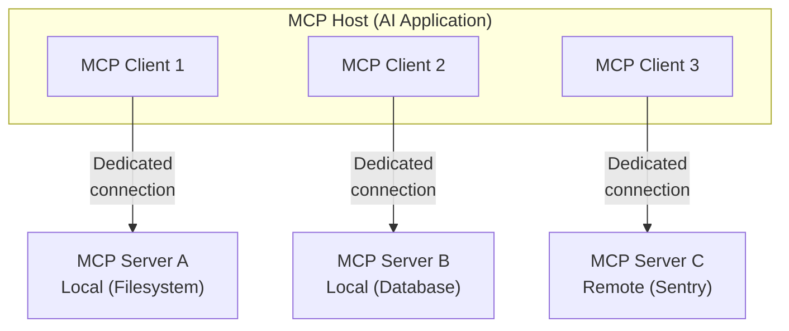
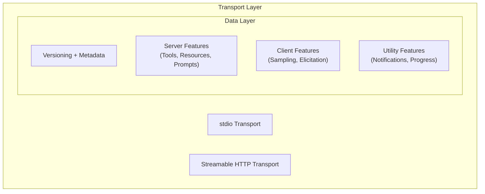
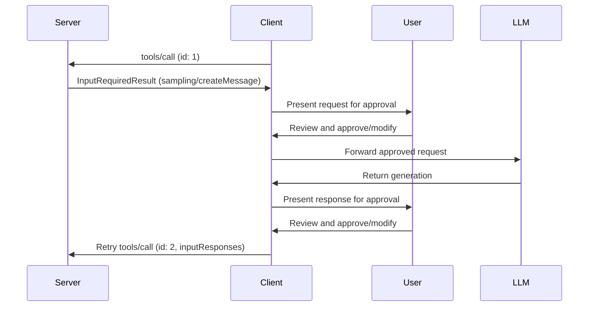
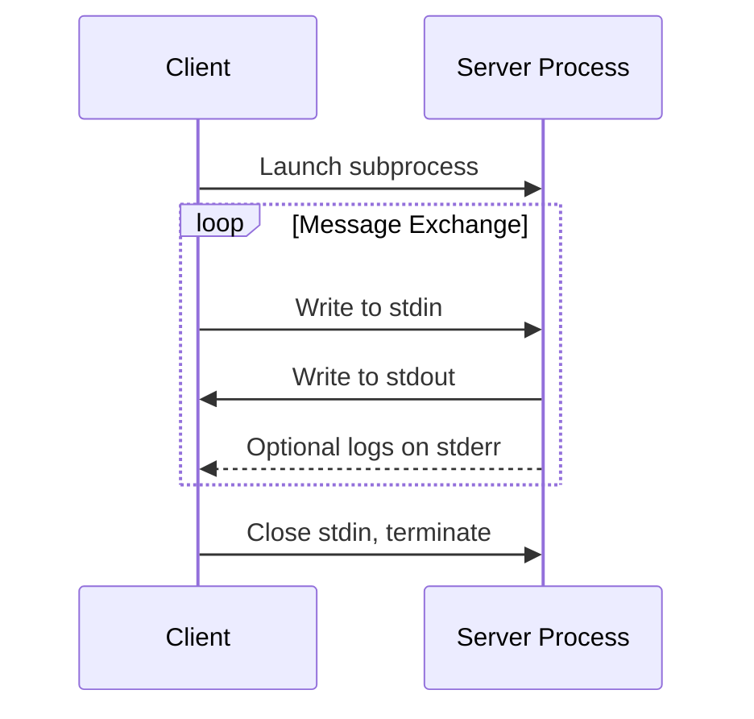
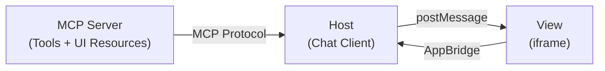
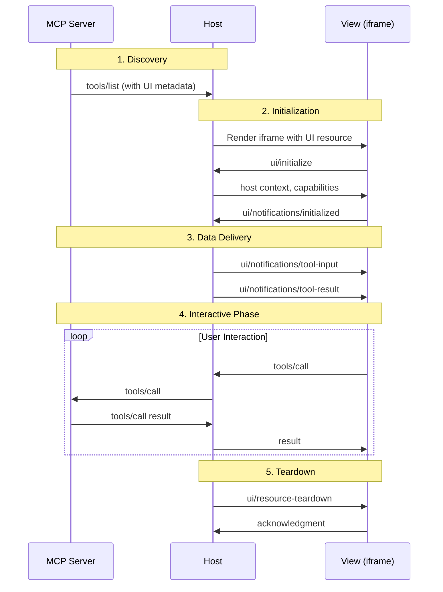

## はじめに ─ MCP とは何か

<strong>Model Context Protocol（MCP）</strong>は、AI アプリケーションと外部システムを接続するためのオープンソースの標準プロトコルです。Claude や ChatGPT のような AI アプリケーションは、MCP を通じてデータソース（ローカルファイル、データベース）、ツール（検索エンジン、計算機）、ワークフロー（専用プロンプト）に接続し、必要な情報を取得したりタスクを実行したりできます。

MCP はよく「AI アプリケーション版の USB-C ポート」に例えられます。USB-C が電子機器の接続方法を標準化したように、MCP は AI アプリケーションと外部システムの接続方法を標準化します。

### MCP がない世界とある世界

開発者が AI アシスタントに「本番環境でエラーが急増している。Sentry の最新エラーを確認して、関連するソースコードを修正して GitHub に PR を出して」と頼む場面を例にします。

<strong>MCP がない場合</strong>: AI アシスタントは Sentry のデータにアクセスできず、「すみません、外部システムにはアクセスできません」と答えます。ユーザーは Sentry の画面を開いてエラー情報をコピー&ペーストし、コードを自分で修正し、GitHub の UI で PR を作成することになります。

<strong>MCP がある場合</strong>: AI アシスタントが Sentry MCP Server 経由でエラーを取得し、Filesystem MCP Server でソースコードを読み書きし、GitHub MCP Server で PR を作成します。3 つのサーバーとの通信はすべて MCP という共通プロトコルで行われるため、ユーザーは 1 つのプロンプトで一連の作業を完了できます。

MCP は以下のプロジェクトで構成されます。

- [MCP Specification](https://modelcontextprotocol.io/specification/latest) — プロトコルの仕様
- [MCP SDK](https://modelcontextprotocol.io/docs/sdk) — 各言語向けの SDK
- [MCP Inspector](https://github.com/modelcontextprotocol/inspector) — 開発ツール
- [MCP Reference Servers](https://github.com/modelcontextprotocol/servers) — リファレンス実装

Claude、ChatGPT、Visual Studio Code（GitHub Copilot）、Cursor など多くのクライアントが MCP をサポートしているため、一度作った MCP Server をこれらのクライアントから共通に利用できます。

この記事では、現行 MCP 仕様 `2026-07-28` に基づき、プロトコルのアーキテクチャ、その拡張である MCP Apps、Microsoft の実装サンプルを順に説明します。

> <strong>仕様バージョンについて</strong>
>
> MCP の仕様は `YYYY-MM-DD` 形式でリビジョン管理されており、この日付は最後に後方互換性のない変更を加えた日を表します。現行版は [`2026-07-28`](https://modelcontextprotocol.io/specification/2026-07-28/) です。このリビジョンでは、従来の接続単位の `initialize` ライフサイクルがコアプロトコルから削除されました。バージョン・クライアント識別情報・クライアント capability は各リクエストの `_meta.io.modelcontextprotocol/*` で送り、サーバーの対応バージョンと capability は必須 RPC の `server/discover` で確認します。Streamable HTTP の GET ストリームエンドポイント、プロトコルレベルのセッション、SSE の再開配信も削除されました。SSE は独立した HTTP+SSE トランスポートではなく、POST や `subscriptions/listen` に対するレスポンス形式の 1 つです。

---

## アーキテクチャ概観

### 参加者（Participants）

MCP はクライアント - サーバーアーキテクチャに従い、次の 3 つの参加者で構成されます。

| 参加者 | 役割 | 例 |
|---|---|---|
| MCP Host | AI アプリケーション本体。1 つ以上の MCP Client を作成・管理する | Claude Desktop, VS Code, ChatGPT |
| MCP Client | MCP Server との接続を維持し、コンテキストを取得するコンポーネント | Host の内部に生成されるオブジェクト |
| MCP Server | MCP Client にコンテキストと機能を提供するプログラム | Filesystem Server, Sentry MCP Server |

Host は、接続する MCP Server ごとに MCP Client インスタンスを 1 つずつ生成します。

例として、VS Code（Host）の `.vscode/mcp.json` に 3 つの MCP Server を設定した場合を考えます。

```json
// .vscode/mcp.json の設定例
{
  "servers": {
    "filesystem": {
      "command": "npx",
      "args": ["-y", "@modelcontextprotocol/server-filesystem", "/workspace"]
    },
    "github": {
      "command": "npx",
      "args": ["-y", "@modelcontextprotocol/server-github"],
      "env": { "GITHUB_TOKEN": "${env:GITHUB_TOKEN}" }
    },
    "sentry": {
      "type": "http",
      "url": "https://mcp.sentry.dev/mcp"
    }
  }
}
```

VS Code はこの設定を読み取り、`filesystem`、`github`、`sentry` のそれぞれに独立した MCP Client オブジェクトを生成します。`filesystem` と `github` は stdio トランスポートのローカルプロセスとして起動し、`sentry` には Streamable HTTP でリモート接続します。



MCP Server は「サーバー」という名前ですが、リモートで動くとは限りません。stdio トランスポートではローカルマシン上のサブプロセスとして実行され、Streamable HTTP トランスポートではリモートサーバーとして動作します。

### 2 つのレイヤー

MCP は概念的に次の 2 つのレイヤーで構成されます。



<strong>データレイヤー（内側）</strong>は JSON-RPC 2.0 ベースのメッセージ交換を実装し、メッセージの構造と意味を定義します。リクエスト単位のバージョン／capability メタデータ、サーバー機能（Tools, Resources, Prompts）、クライアント機能（Sampling, Elicitation）、ユーティリティー機能（通知、進捗追跡）がここに含まれます。

<strong>トランスポートレイヤー（外側）</strong>はクライアントとサーバー間の通信チャネルと認証を管理し、接続の確立、メッセージのフレーミング、通信の保護を担います。

---

## データレイヤー ─ JSON-RPC 2.0 プロトコル

MCP は [JSON-RPC 2.0](https://www.jsonrpc.org/) を RPC の基盤に使います。現行 MCP では、クライアントが JSON-RPC のリクエストと通知を送り、サーバーはレスポンスと、リクエスト単位またはサブスクリプション単位の通知を返します。サーバーから JSON-RPC リクエストを送ることはありません。通知は `id` フィールドを持たず、レスポンスを返しません。MCP は JSON-RPC 2.0 より制約が厳しく、リクエスト ID は文字列または整数に限られ、`null` は使えません。

### リクエスト単位のバージョン・Capability メタデータ

MCP `2026-07-28` はプロトコルレベルではステートレスで、`initialize` ハンドシェイクはありません。すべてのリクエストが `params._meta` にプロトコルメタデータを含み、サーバーはリクエストごとに受け付けるか拒否するかを決めます。

次のインタラクティブな図は、旧版 `2025-06-18` の初期化フローを示しています。新規実装では、この節で説明するリクエスト単位のフローに従います。

<MCPProtocolVisualizer />

#### リクエスト単位メタデータの詳細

リクエスト単位のフローは、次の 3 つの要素で成り立ちます。

<strong>1. プロトコルバージョン宣言</strong>

`io.modelcontextprotocol/protocolVersion` フィールド（例: `"2026-07-28"`）で、そのリクエストが使うプロトコルバージョンを宣言します。サーバーがそのバージョンに対応していなければ、対応バージョンの一覧を含む `UnsupportedProtocolVersionError` を返します。

<strong>2. クライアント Capability 宣言</strong>

`io.modelcontextprotocol/clientCapabilities` オブジェクトで、そのリクエストにおける elicitation、sampling、roots、明示的に opt-in した拡張などのクライアント機能を宣言します。クライアント自身の識別情報は `io.modelcontextprotocol/clientInfo` で送ります。

```json
{
  "jsonrpc": "2.0",
  "id": 1,
  "method": "tools/list",
  "params": {
    "_meta": {
      "io.modelcontextprotocol/protocolVersion": "2026-07-28",
      "io.modelcontextprotocol/clientInfo": {
        "name": "ExampleClient",
        "version": "1.0.0"
      },
      "io.modelcontextprotocol/clientCapabilities": {
        "elicitation": { "form": {}, "url": {} },
        "sampling": {}
      }
    }
  }
}
```

<strong>3. サーバー発見とアイデンティティー</strong>

サーバーは `server/discover` を実装しなければなりません。この RPC は、対応プロトコルバージョン、サーバー capability、任意のサーバー識別情報（`_meta.io.modelcontextprotocol/serverInfo`）を返します。クライアントは他の RPC の前にこれを呼んでもよく、呼ばずに任意のメソッドを直接呼び、`UnsupportedProtocolVersionError` が返ったら対処する方法も取れます。

```json
// server/discover response の capabilities 例
{
  "supportedVersions": ["2026-07-28"],
  "capabilities": {
    "tools": { "listChanged": true },
    "resources": { "subscribe": true },
    "prompts": { "listChanged": true }
  }
}
```

---

## サーバープリミティブ ─ Tools, Resources, Prompts

MCP はサーバーが公開できる 3 つのコアプリミティブを定義しています。これらによって、AI アプリケーションと共有できるコンテキストの種類と、実行できるアクションが決まります。

| プリミティブ | 制御主体 | 説明 | 典型的な用途 |
|---|---|---|---|
| Tools | Model（LLM） | LLM が呼び出し可能な実行関数 | API 呼び出し、DB クエリー、ファイル操作 |
| Resources | Application | コンテキスト情報を提供するデータソース | ファイル内容、DB スキーマ、API レスポンス |
| Prompts | User | LLM との対話を構造化する再利用可能テンプレート | システムプロンプト、Few-shot 例 |

各プリミティブには、一覧取得（`*/list`）と取得（`*/get` または `*/read`）のメソッドがあり、Tools には実行（`tools/call`）のメソッドもあります。

以下のリクエスト／レスポンス例の一部は、メソッド固有のフィールドだけを示し、必須の `params._meta` リクエストメタデータと `result.resultType` を省いています。MCP `2026-07-28` では、すべてのリクエストが `_meta` に `io.modelcontextprotocol/protocolVersion`、`io.modelcontextprotocol/clientInfo`、`io.modelcontextprotocol/clientCapabilities` を含み、すべての result レスポンスが `resultType` を含みます。

### Tools ─ LLM が呼び出す関数

Tools は LLM が呼び出せる関数で、MCP のプリミティブの中で最も重要です。各 Tool は一意の名前で識別され、スキーマなどのメタデータを持ちます。

ユーザーが「今日の東京の天気を教えて」と入力した場合、内部では次の流れで処理が進みます。

1. Host が LLM に「利用可能な Tool 一覧」とユーザーのメッセージを渡す
2. LLM が `get_weather` Tool を呼び出すべきだと判断し、`{"location": "Tokyo"}` という引数を生成
3. Host が MCP Client 経由で `tools/call` を送信
4. MCP Server が天気 API に問い合わせて結果を返却
5. Host が結果を LLM に渡し、LLM が自然言語でユーザーに応答

LLM は `get_weather` の `inputSchema` から `location` が必須の文字列パラメーターだと判断し、それに合う引数を生成します。

#### Tools の能力宣言

```json
{
  "capabilities": {
    "tools": {
      "listChanged": true
    }
  }
}
```

`listChanged` は、利用可能なツールの一覧が変わったときにサーバーが通知を送るかどうかを示します。

#### Tool の定義

各 Tool オブジェクトは次のフィールドを持ちます。

- `name` — サーバーの名前空間内で一意な識別子
- `title` — ユーザーに表示する名前（オプション）
- `description` — ツールの機能と用途の説明
- `inputSchema` — 入力パラメーターを定義する JSON Schema
- `outputSchema` — 出力の構造を定義する JSON Schema（オプション）
- `annotations` — ツールの動作を記述するプロパティー（オプション）

```json
{
  "name": "get_weather",
  "title": "Weather Information Provider",
  "description": "Get current weather information for a location",
  "inputSchema": {
    "type": "object",
    "properties": {
      "location": {
        "type": "string",
        "description": "City name or zip code"
      }
    },
    "required": ["location"]
  }
}
```

#### Tool 結果のコンテンツタイプ

Tool の実行結果は `content` 配列で返り、次のコンテンツタイプを使えます。

| コンテンツタイプ | 説明 |
|---|---|
| `text` | プレーンテキスト |
| `image` | Base64 エンコードされた画像データ |
| `audio` | Base64 エンコードされた音声データ |
| `resource_link` | リソースへの URI リンク |
| `resource` | 埋め込みリソース |

構造化 JSON の結果は `structuredContent` フィールドで返せます。`outputSchema` が定義されている場合、サーバーはそのスキーマに従う構造化結果を返さなければなりません（MUST）。

#### エラーハンドリング

Tools のエラーは 2 種類の方法で報告されます。

1. <strong>プロトコルエラー</strong> — 不明なツールや無効な引数などを示す JSON-RPC エラー
2. <strong>ツール実行エラー</strong> — ツール結果に `isError: true` を付けて報告する業務エラー

```json
{
  "content": [
    {
      "type": "text",
      "text": "Failed to fetch weather data: API rate limit exceeded"
    }
  ],
  "isError": true
}
```

#### セキュリティー上の考慮事項

- サーバーはすべてのツール入力を検証しなければならない（MUST）
- サーバーは適切なアクセス制御を実装しなければならない（MUST）
- サーバーはツール呼び出しにレート制限を実装しなければならない（MUST）
- サーバーはツール出力をサニタイズしなければならない（MUST）
- クライアントは機密操作についてユーザーの確認を促すべきである（SHOULD）
- 悪意のある、または偶発的なデータ流出を防ぐため、クライアントはツール入力をサーバーに送る前にユーザーに表示すべきである（SHOULD）
- クライアントはツール結果を LLM に渡す前に検証すべきである（SHOULD）
- クライアントはツール呼び出しにタイムアウトを実装すべきである（SHOULD）
- クライアントは監査目的でツール使用状況をログに記録すべきである（SHOULD）

### Resources ─ コンテキストデータの提供

Resources は、サーバーがクライアントにデータを公開するための標準的な仕組みです。ファイル、データベーススキーマ、アプリケーション固有の情報など、言語モデルのコンテキストとして使うデータを提供します。各リソースは URI で一意に識別されます。

Tools との違いを、データベース MCP Server の例で示します。Resource はテーブル一覧やスキーマ情報などの読み取り専用のコンテキストを提供し、Tool は SQL クエリーの実行などのアクションを提供します。

- `db://schema/users` → Resource（users テーブルのカラム定義を返す）
- `run_query({"sql": "SELECT * FROM users LIMIT 10"})` → Tool（クエリーを実行して結果を返す）

LLM は Resource でスキーマを把握してから、Tool でクエリーを実行できます。

#### Resources の能力宣言

```json
{
  "capabilities": {
    "resources": {
      "subscribe": true,
      "listChanged": true
    }
  }
}
```

- `subscribe` — クライアントが個々のリソースの変更通知を購読できるか
- `listChanged` — 利用可能なリソースの一覧が変わったときにサーバーが通知を送るか

#### リソースの一覧取得と読み取り

```json
// resources/list レスポンス
{
  "resources": [
    {
      "uri": "file:///project/src/main.rs",
      "name": "main.rs",
      "title": "Rust Software Application Main File",
      "description": "Primary application entry point",
      "mimeType": "text/x-rust"
    }
  ]
}
```

```json
// resources/read レスポンス
{
  "contents": [
    {
      "uri": "file:///project/src/main.rs",
      "mimeType": "text/x-rust",
      "text": "fn main() {\n    println!(\"Hello world!\");\n}"
    }
  ]
}
```

#### リソーステンプレート

リソーステンプレートを使うと、サーバーは [URI テンプレート（RFC 6570）](https://datatracker.ietf.org/doc/html/rfc6570) でパラメーター化したリソースを公開できます。

```json
{
  "uriTemplate": "weather://forecast/{city}/{date}",
  "name": "weather-forecast",
  "title": "Weather Forecast",
  "description": "Get weather forecast for any city and date",
  "mimeType": "application/json"
}
```

#### サブスクリプション

クライアントは、`subscriptions/listen` に `resourceSubscriptions` フィルターを指定して、特定のリソースの変更を購読します。この仕組みは、以前の `resources/subscribe` RPC に代わるものです。

```json
// subscriptions/listen リクエスト
{
  "jsonrpc": "2.0",
  "id": 1,
  "method": "subscriptions/listen",
  "params": {
    "notifications": {
      "resourceSubscriptions": ["file:///project/src/main.rs"]
    }
  }
}
```

```json
// 変更時の通知
{
  "jsonrpc": "2.0",
  "method": "notifications/resources/updated",
  "params": {
    "_meta": {
      "io.modelcontextprotocol/subscriptionId": 1
    },
    "uri": "file:///project/src/main.rs"
  }
}
```

#### 一般的な URI スキーム

| スキーム | 用途 |
|---|---|
| `https://` | Web 上のリソース（クライアントが直接フェッチ可能な場合） |
| `file://` | ファイルシステム的に振る舞うリソース |
| `git://` | Git バージョン管理との統合 |
| カスタム | RFC 3986 に準拠した任意のスキーム |

#### アノテーション

リソースとコンテンツブロックには、次のアノテーションを任意で付けられます。

- `audience` — 対象者を示す配列（`"user"` や `"assistant"`）
- `priority` — 重要度を示す 0.0 〜 1.0 の数値
- `lastModified` — 最終変更の ISO 8601 タイムスタンプ

### Prompts ─ 対話のテンプレート化

Prompts は、サーバーがプロンプトテンプレートをクライアントに公開するための仕組みです。言語モデルとの対話で使う、構造化されたメッセージと指示を提供します。

Prompts はユーザー制御を前提に設計されており、自動では実行されず、ユーザーが明示的に呼び出します。多くの場合、スラッシュコマンドやコマンドパレットなどの UI から選べるようになっています。

たとえば、GitHub MCP Server が `/code-review` という Prompt を提供しているとします。ユーザーがチャットで `/code-review` と入力すると、クライアントがコードを入力する欄を表示し、入力されたコードを含む構造化されたメッセージが LLM に渡されます。Tool は LLM の判断で呼ばれますが、Prompt はユーザーが明示的に選んだときだけ使われます。これが両者の大きな違いです。

```json
{
  "name": "code_review",
  "title": "Request Code Review",
  "description": "Asks the LLM to analyze code quality and suggest improvements",
  "arguments": [
    {
      "name": "code",
      "description": "The code to review",
      "required": true
    }
  ]
}
```

`prompts/get` の結果には、LLM に渡すメッセージのリストが入ります。各メッセージは `role`（`"user"` または `"assistant"`）と、テキスト・画像・音声・埋め込みリソースなどの `content` を持ちます。

---

## クライアント機能 ─ Sampling, Elicitation, Roots

MCP では、サーバーだけでなくクライアントも機能を公開できます。サーバーはこれらを使って、LLM の補完を依頼したり、ユーザーに入力を求めたり、操作してよいファイルシステムの範囲を知ったりできます。

### Sampling ─ サーバーからの LLM 呼び出し

Sampling は、MCP サーバーがクライアント側の LLM にアクセスするための仕組みです。LLM を使いたいが特定のモデルに依存したくないサーバーは、`sampling/createMessage` input request でクライアントの AI アプリケーションに言語モデルの補完を依頼できます。ただし、MCP `2026-07-28` の時点で Sampling は非推奨です。互換性のため仕様には残っていますが、新規実装では LLM プロバイダーの API を直接使うことが推奨されています。

航空券検索の MCP Server に `findBestFlight` という Tool がある場合を例にします。ユーザーが「来月バルセロナ行きの最適なフライトを予約して」と依頼すると、Tool は航空会社 API から 47 件のフライトを取得します。安い深夜便と便利な午前便のどちらがよいかを決めるには、AI による分析が必要です。

このときサーバーは、`sampling/createMessage` と 47 件のフライトデータを含む `InputRequiredResult` を返します。クライアントはユーザーの承認を得て LLM を呼び出し、`inputResponses` を付けて元のリクエストを再試行します。サーバーは LLM の SDK や API キーを持たずに、クライアント側のモデルを利用できます。これが Sampling の利点ですが、前述のとおり新規実装には推奨されません。



この設計では、Human-in-the-loop の確認が複数か所にあります。ユーザーは LLM に送るリクエストと、生成されたレスポンスの両方を確認し、修正できます。

#### Model Preferences（モデル選択の抽象化）

サーバーとクライアントが別の AI プロバイダーを使う場合もあるため、サーバーは特定のモデル名を必須として指定できません。代わりに MCP は、抽象的な能力の優先度と任意のモデルヒントを組み合わせて希望を伝える仕組みを用意しています。

```json
{
  "hints": [
    { "name": "claude-sonnet-4-20250514" },
    { "name": "claude" }
  ],
  "costPriority": 0.3,
  "speedPriority": 0.2,
  "intelligencePriority": 0.9
}
```

- `costPriority` — コストを抑えることの重要度（0〜1）
- `speedPriority` — 応答の速さ（低レイテンシー）の重要度（0〜1）
- `intelligencePriority` — モデルの能力の高さの重要度（0〜1）

ヒントはモデル名の部分文字列として照合されます。クライアントは、ヒントを別プロバイダーの同等のモデルに対応付けてもかまいません（MAY）。

### Elicitation ─ ユーザーへの情報リクエスト

Elicitation は、サーバーが処理の途中でユーザーに追加情報を求めるための仕組みです。現行プロトコルでは `InputRequiredResult` を通じて届きます。通常の構造化入力には form mode を使い、MCP クライアントを経由させてはならない機密性の高い操作には URL mode を使います。サーバーは、必要な情報をすべて最初に求めたり、データ不足で失敗したりせずに、処理を一時停止して必要な入力だけをユーザーに求められます。

```json
// InputRequiredResult.inputRequests に入る elicitation/create の例
{
  "method": "elicitation/create",
  "params": {
    "message": "Please confirm your Barcelona vacation booking details:",
    "requestedSchema": {
      "type": "object",
      "properties": {
        "confirmBooking": {
          "type": "boolean",
          "description": "Confirm the booking (Flights + Hotel = $3,000)"
        },
        "seatPreference": {
          "type": "string",
          "enum": ["window", "aisle", "no preference"],
          "description": "Preferred seat type for flights"
        }
      },
      "required": ["confirmBooking"]
    }
  }
}
```

Elicitation のレスポンスは、次の 3 つのアクションのいずれかを返します。

| アクション | 意味 |
|---|---|
| `accept` | ユーザーがデータを承認・送信 |
| `decline` | ユーザーが明示的に拒否 |
| `cancel` | ユーザーが明示的な選択なしに閉じた |

form mode の `requestedSchema` は、実装を簡単にするためフラットなオブジェクトに限られています。プロパティーに使える型には、`string`、`number` / `integer`、`boolean`、単一選択の文字列 enum、`items` を使う限定的な複数選択 enum 配列があります。パスワード、API キー、アクセストークン、決済認証情報などの秘密情報には、form mode ではなく URL mode を使わなければなりません。

#### セキュリティー上の制約

- サーバーは form mode の Elicitation で機密情報を要求してはならず（MUST NOT）、機密操作には URL mode を使わなければならない（MUST）
- クライアントはどのサーバーが情報を要求しているかを明確に表示すべき（SHOULD）
- クライアントはレート制限を実装すべき（SHOULD）

### Roots ─ ファイルシステム境界の伝達

Roots は、サーバーがアクセスしてよいファイルシステムの範囲をクライアントが伝えるための仕組みです。`file://` スキームのファイル URI で、サーバーが操作できるディレクトリーを示します。Sampling と同じく、Roots も MCP `2026-07-28` の時点で非推奨です。

```json
{
  "uri": "file:///Users/agent/travel-planning",
  "name": "Travel Planning Workspace"
}
```

Roots はクライアントとサーバーが協調するための仕組みで、セキュリティー境界ではありません。仕様の要求は「サーバーはルート境界を尊重すべき（SHOULD）」であり、「強制しなければならない（MUST）」ではありません。実際のアクセス制限は、OS のファイルパーミッションやサンドボックスで実施する必要があります。

---

## トランスポートレイヤー

MCP は JSON-RPC でメッセージをエンコードし、メッセージは UTF-8 でエンコードしなければなりません（MUST）。標準のトランスポートは現在 2 種類定義されています。

### stdio トランスポート

stdio トランスポートでは、クライアントが MCP サーバーをサブプロセスとして起動します。たとえば VS Code は `npx @modelcontextprotocol/server-filesystem /workspace` を子プロセスとして起動し、そのプロセスの stdin/stdout で JSON-RPC メッセージをやり取りします。ネットワーク設定も認証も不要なので、ローカル開発に向いています。

- サーバーは `stdin` から JSON-RPC メッセージを読み取り、`stdout` にメッセージを書き出す
- メッセージは改行で区切り、メッセージ内に改行を含めてはならない（MUST NOT）
- サーバーはログ用の UTF-8 文字列を `stderr` に書き込んでもよい（MAY）
- ネットワークを経由しないため、その分のオーバーヘッドがない



### Streamable HTTP トランスポート

Streamable HTTP トランスポートでは、サーバーは複数のクライアントを扱える独立したプロセスとして動作します。Sentry や Stripe などの SaaS が提供するリモート MCP Server が代表例です。現行仕様では、サーバーは単一の MCP エンドポイントパス（例: `https://example.com/mcp`）で POST を受け付けます。旧 HTTP+SSE トランスポートと、Streamable HTTP の GET ストリームエンドポイントは削除されました。

#### クライアント → サーバー：HTTP POST

クライアントからサーバーへの JSON-RPC メッセージは、1 つずつ MCP エンドポイントへの新しい HTTP POST リクエストとして送ります。

- `Accept` ヘッダーに `application/json` と `text/event-stream` の両方を含める必要がある
- POST ボディーは単一の JSON-RPC リクエストまたは通知で、クライアントは JSON-RPC レスポンスを送ってはならない
- リクエストには `MCP-Protocol-Version: 2026-07-28` と `Mcp-Method` のヘッダーを付け、`tools/call`・`resources/read`・`prompts/get` では `Mcp-Name` も付ける。バージョンヘッダーは `params._meta.io.modelcontextprotocol/protocolVersion` と一致しなければならない
- サーバーは `Content-Type: application/json`（単一の JSON-RPC レスポンス）または `Content-Type: text/event-stream`（リクエスト単位の SSE 通知と最終的な JSON-RPC レスポンス）で応答する

#### サーバー → クライアント：SSE レスポンスストリーム

SSE は独立したトランスポートではなく、レスポンス形式の 1 つです。サーバーは最終レスポンスの前に `notifications/progress` などのリクエスト単位の通知をストリームで送れますが、独立した JSON-RPC リクエストを送ってはなりません。sampling、elicitation、roots のようにサーバーがクライアントに何かを求めるやり取りは、`InputRequiredResult` と、`inputResponses` を付けたクライアントの再試行で表します。

長期間にわたる変更通知は、クライアントから送る `subscriptions/listen` リクエストで受け取ります。レスポンスストリームは `notifications/subscriptions/acknowledged` で始まり、その後は `notifications/tools/list_changed` や `notifications/resources/updated` など、クライアントが指定した種類の通知だけが流れます。

#### プロトコルレベルのセッションと再開性はない

現行の Streamable HTTP には、プロトコルレベルの `Mcp-Session-Id`、HTTP DELETE によるセッション終了、`Last-Event-ID` による SSE の再開配信がありません。リクエストやサブスクリプションストリームが切断されたら、クライアントが再試行します。

#### セキュリティー上の要件

- DNS リバインディング攻撃を防ぐため、サーバーはすべての受信接続で `Origin` ヘッダーを検証しなければならない（MUST）
- ローカルで実行するサーバーは `127.0.0.1` にのみバインドすべき（SHOULD）
- すべての接続に適切な認証を実装すべき（SHOULD）

### カスタムトランスポート

クライアントとサーバーは独自のトランスポートを実装してもかまいません（MAY）。プロトコルは特定のトランスポートに依存しないため、双方向にメッセージを交換できる通信チャネルであれば実装できます。

---

## 通知（Notifications）

MCP は、リクエストの進捗や購読した更新を伝えるリアルタイム通知をサポートしています。通知は `id` フィールドを持たない JSON-RPC 2.0 の通知メッセージとして送られ、レスポンスは返りません。

通知があると、クライアントは変化するサーバーに追従できます。サーバーの状態、外部依存関係、ユーザー権限によって Tool は増減します。サーバーがその変化を通知するので、クライアントはポーリングせずに済み、利用できるサーバー機能を正確に把握でき、AI アプリケーションは変わったコンテキストにすぐ対応できます。

`2026-07-28` では、リストの変更やリソースの更新を受け取るには、クライアントが先に `subscriptions/listen` を開きます。サーバーは、リクエストやサブスクリプションのストリーム以外で変更通知を送ってはなりません。

---

## Tasks

Tasks は、結果を後から取得し、状態を追跡するための永続的な実行ラッパーです。コストの高い計算、ワークフローの自動化、バッチ処理、複数ステップの操作などで、リクエストの実行状況を追跡できます。

以前の仕様では、Tasks はアーキテクチャ概要で触れられるだけの実験的機能でした。現行の `2026-07-28` 仕様では [MCP Tasks 拡張](https://modelcontextprotocol.io/extensions/tasks/overview) として正式に定義され、ポーリング、実行途中での入力受付（mid-flight input）、永続的なハンドルを含む非同期タスク実行を扱います。拡張なので、クライアントとサーバーの両方が明示的にオプトインする必要があります。片方が対応していない場合は、コアの動作にフォールバックするか、明示的にエラーを返さなければなりません。

---

## MCP Apps ─ インタラクティブ UI の拡張

### MCP Apps とは

<strong>MCP Apps</strong> は Model Context Protocol の拡張で、MCP サーバーがホストにインタラクティブなユーザーインターフェースを配信できるようにします。サーバーが UI リソースを宣言する方法、ホストがそれをサンドボックス化された iframe 内で安全にレンダリングする方法、両者が通信する方法を定めています。

### なぜ MCP Apps が必要なのか

標準の MCP では、サーバーのレスポンスはテキストと構造化データに限られます。一方、次のような用途ではそれ以上の表示が必要です。

- <strong>データ可視化</strong> — チャート、グラフ、ダッシュボード
- <strong>リッチメディア</strong> — ビデオプレーヤー、音声波形、3D モデル
- <strong>インタラクティブフォーム</strong> — マルチステップウィザード、設定パネル、承認ワークフロー
- <strong>リアルタイム表示</strong> — ライブログ、進捗インジケーター、ストリーミングコンテンツ

MCP Apps 以前は、各ホストが独自に UI サポートを実装していました。MCP Apps はこれを標準化したので、サーバーが UI を一度宣言すれば、仕様に準拠したどのホストでもその UI を表示できます。

### Progressive Enhancement（漸進的拡張）

MCP Apps では、UI は必須要件ではなく、対応ホストで体験を上乗せするプログレッシブエンハンスメントです。ホストは接続時に UI サポートの有無を宣言し、サーバーはその宣言を確認してから UI 対応ツールを登録します。ホストが MCP Apps をサポートしていなくても、ツールはテキストで結果を返して動作します（graceful degradation）。

### MCP Apps のアーキテクチャ

MCP Apps では次の 3 つのエンティティーが連携します。



- <strong>Server</strong> — ツールと UI リソースを宣言する、標準の MCP サーバー
- <strong>Host</strong> — サーバーに接続し、View を iframe に埋め込み、両者間の通信を中継するチャットクライアント（例: Claude Desktop, M365 Copilot）
- <strong>View</strong> — サンドボックス化された iframe 内で動く UI。ホストからツールのデータを受け取り、サーバーのツールを呼び出したり、チャットにメッセージを送ったりできる

View は MCP クライアントとして、Host はプロキシーとして働きます。

### MCP Apps のライフサイクル



1. <strong>Discovery</strong> — ホストはサーバーに接続するときに、ツールとその UI リソースを把握する
2. <strong>Initialization</strong> — UI 付きのツールが呼び出されると、ホストが iframe をレンダリングする。View は `ui/initialize` を送り、ホストコンテキスト（テーマ、機能、コンテナーの寸法）を受け取る。このハンドシェイクで、View がデータを受け取れる状態になったことを確かめる
3. <strong>Data Delivery</strong> — ホストがツールの引数と結果を View に送る。結果には `content`（モデルのコンテキストに入れるテキスト）と、任意の `structuredContent`（UI の描画に使うデータ）が含まれる
4. <strong>Interactive Phase</strong> — ユーザーが View を操作する。View はツールを呼び出したり、メッセージを送ったり、コンテキストを更新したりできる
5. <strong>Teardown</strong> — ホストはアンマウントの前に View に通知し、View が状態を保存したりリソースを解放したりできるようにする

### UI リソース

UI リソースは、サーバーが `ui://` URI スキームで宣言する HTML テンプレートで、MIME タイプは `text/html;profile=mcp-app` でなければなりません。ツールとは、ツールの `_meta.ui.resourceUri` フィールドで事前に関連付けます。

```json
"_meta": {
  "ui": { "resourceUri": "ui://weather/forecast" }
}
```

ホストはツールを実行するとき、この `ui://` URI を指定して `resources/read` でテンプレートを取得し、iframe 内にレンダリングします。

```json
// resources/read レスポンスの例
{
  "contents": [{
    "uri": "ui://weather/forecast",
    "mimeType": "text/html;profile=mcp-app",
    "text": "<!DOCTYPE html><html>...</html>"
  }]
}
```

UI テンプレートをツール結果と別のリソースにしているため、次のことができます。

- <strong>プリフェッチ</strong> — ホストはツールを実行する前にテンプレートをキャッシュできる
- <strong>関心の分離</strong> — テンプレート（表示）とツール結果（データ）を分けて扱える
- <strong>レビュー</strong> — ホストは接続のセットアップ時に UI テンプレートを検査できる

### Tool Visibility（ツールの可視性）

ツールは、モデル、アプリ、またはその両方から見えるように設定できます。デフォルトでは両方から見えます（`visibility: ["model", "app"]`）。

<strong>アプリ専用ツール</strong>（`visibility: ["app"]`）は、リフレッシュボタン、ページネーション、フォーム送信など、エージェントのコンテキストに入れる必要のない UI 操作に使います。モデルからはこれらのツールが見えません。

### 双方向通信

View は `postMessage` 上の JSON-RPC でホストと通信し、次の操作を行えます。

<strong>サーバーとのインタラクション：</strong>
- サーバーツールの呼び出し（`tools/call`）
- サーバーリソースの読み取り（`resources/read`）

<strong>チャットとのインタラクション：</strong>
- 会話へのメッセージ送信（`ui/message`）
- モデルコンテキストの更新（`ui/update-model-context`）

<strong>ホストアクションの要求：</strong>
- 外部リンクを開く（`ui/open-link`）

### Display Modes（表示モード）

| モード | 説明 | 用途 |
|---|---|---|
| `inline` | チャットフローに埋め込み | チャート、プレビュー、フォーム |
| `fullscreen` | ウィンドウ全体を使用 | エディター、ゲーム、複雑なダッシュボード |
| `pip` | ピクチャー・イン・ピクチャー | 音楽プレーヤー、タイマーなどの持続ウィジェット |

View は自身が対応するモードを、ホストは提供できるモードをそれぞれ宣言します。View はモードの変更を要求できますが、最終的に決めるのはホストです。

### Host Context（ホストコンテキスト）

View の初期化時に、ホストは次のコンテキスト情報を渡します。

- <strong>Theme</strong> — ライト / ダークモードの設定
- <strong>Locale / Timezone</strong> — 日付、数値、テキストのフォーマット
- <strong>Display Mode</strong> — inline, fullscreen, pip
- <strong>Container Dimensions</strong> — 利用可能なスペース
- <strong>Platform</strong> — Web, Desktop, Mobile

ホストはコンテキストが変わったとき（例: ダークモードへの切り替え）に View へ通知するので、View はリロードせずに表示を更新できます。

### テーマ対応

ホストは CSS カスタムプロパティー（カラー、タイポグラフィー、ボーダー）を提供します。View はフォールバック値付きの CSS 変数を使い、ホストの見た目に合わせます。

```css
.container {
  background: var(--color-background-primary, #ffffff);
  color: var(--color-text-primary, #000000);
}
```

### セキュリティーモデル

- すべての View はサンドボックス化された iframe 内で実行され、ホストの DOM、Cookie、ストレージにはアクセスできない
- 通信は `postMessage` だけで行われるため、監査できる
- サーバーは、UI が必要とするネットワークドメインを CSP メタデータで宣言する
- ホストはこの宣言を適用し、宣言されていないドメインへの外部接続を許可しない
- デフォルトで制限的なので、宣言されていないサーバーへのデータ流出を防げる

### Adaptive Cards との違い

M365 Copilot のエコシステムでは、これまで Adaptive Cards がリッチな応答 UI の標準でした。MCP Apps は、Adaptive Cards とアーキテクチャが根本的に異なります。

| 観点 | Adaptive Cards | MCP Apps |
|---|---|---|
| UI の記述方式 | JSON スキーマ（宣言的） | HTML / CSS / JS（命令的） |
| レンダリング | ホストが JSON を解釈しネイティブに描画 | サンドボックス化された iframe 内で実行 |
| 表現力 | 定義済み要素のみ（TextBlock, Image, Input 等） | 制限なし（React, チャート, 地図, 動画, 3D モデル等） |
| カスタムコード実行 | 不可（スキーマで表現できる範囲のみ） | 可（任意の JS が iframe 内で動作） |
| 双方向通信 | `Action.Submit` でホストにデータを返す程度 | `tools/call`, `ui/message`, `ui/update-model-context` 等の JSON-RPC 通信 |
| プロトコル | Adaptive Card スキーマ（独自） | MCP 拡張（JSON-RPC over `postMessage`） |
| セキュリティーモデル | ホストが JSON を解釈して描画するため外部コード実行なし | iframe サンドボックス + CSP でネットワーク・DOM アクセスを制限 |

Adaptive Cards では、構造化されたカードを宣言するとホストがネイティブに描画します。外部のコードを実行しないので安全性は高い一方、使える要素は定義済みのものに限られます。MCP Apps では、フル機能の Web アプリを iframe でホスト内に埋め込みます。表現の制限はありませんが、安全性はサンドボックスと CSP で確保します。

M365 Copilot では、従来の Declarative Agent が Adaptive Cards で応答を返していました。MCP サーバーを使うアクションでは、MCP Apps によって、よりリッチなインタラクティブ UI を返せるようになりました。

---

## microsoft/mcp-interactiveUI-samples ─ 実装例

Microsoft は MCP Apps の実装例として [mcp-interactiveUI-samples](https://github.com/microsoft/mcp-interactiveUI-samples) リポジトリーを公開しています。このリポジトリーには、Microsoft 365 Copilot 内でインタラクティブな UI ウィジェットを表示する MCP サーバーのサンプルが入っています。

### リポジトリー構成

```text
mcp-apps/                        # MCP Apps SDK サンプル
  employee-training/node/        # 学習コース推薦
  fieldops/node/                 # フィールドサービスディスパッチ
  trey-research/node/            # HR コンサルタント管理
  zava-insurance/node/           # 保険クレーム管理

oai-apps-sdk/                    # OpenAI Apps SDK サンプル
  fieldops/node/                 # フィールドサービスディスパッチ
  trey-research/node/            # HR コンサルタント管理
  zava-insurance/node/           # 保険クレーム管理
```

Field Service Dispatch、Trey Research、Zava Insurance の 3 つのサンプルには、MCP Apps 版と OpenAI Apps SDK 版の 2 つの実装があり、同じユースケースを 2 つの方式で実装した例として比べられます。Employee Training は MCP Apps 版だけです。

- <strong>MCP Apps</strong> — MCP 標準の `ui://` リソーススキームを使い、MCP に準拠した任意のホストで動作する
- <strong>OpenAI Apps SDK</strong> — ChatGPT アプリを作るための開発ツール。MCP Apps 標準に基づきつつ、ChatGPT 固有の機能を追加している

### サンプル 1: Trey Research — HR コンサルタント管理

HR コンサルタント、プロジェクト、割り当てを管理するサーバーで、UI には Fluent UI React のウィジェットを使います。

#### ウィジェットツール

| ツール名 | ウィジェット | 機能 |
|---|---|---|
| `show-hr-dashboard` | Dashboard | KPI、コンサルタントカード、プロジェクトリスト |
| `show-consultant-profile` | Profile | 連絡先、スキル、認定資格、役割、割り当ての詳細プロフィール |
| `show-project-details` | Dashboard | 割り当てコンサルタントと予測工数のプロジェクト詳細 |
| `search-consultants` | Bulk Editor | スキルまたは名前でコンサルタントを検索 |
| `show-bulk-editor` | Bulk Editor | コンサルタントレコードの表示・編集 |

#### データツール

| ツール名 | 機能 |
|---|---|
| `update-consultant` | 名前、メール、電話、スキル、役割の単一更新 |
| `bulk-update-consultants` | 複数コンサルタントレコードの一括更新 |
| `assign-consultant-to-project` | コンサルタントをプロジェクトに割り当て |
| `bulk-assign-consultants` | 複数コンサルタントの一括プロジェクト割り当て |
| `remove-assignment` | コンサルタントのプロジェクト割り当て解除 |

#### アーキテクチャの特徴

1. MCP サーバーは Streamable HTTP トランスポートで `http://localhost:3001/mcp` にエンドポイントを公開する
2. React + Fluent UI のウィジェットは単一ファイルの HTML アセットとしてビルドされ、`assets/` フォルダーに出力される
3. データストアには Azurite（ローカルの Azure Table Storage エミュレーター）を使う
4. Dev Tunnel でローカルの MCP サーバーを公開し、M365 Copilot の Declarative Agent から接続する

#### セットアップ手順

```bash
# 依存関係のインストール
npm run install:all

# Azurite の起動（別ターミナル）
npm run start:azurite

# データベースのシード
npm run seed

# Dev Tunnel の作成
devtunnel host -p 3001 --allow-anonymous

# ウィジェットのビルド
npm run build:widgets

# MCP サーバーの起動
npm run start:server

# MCP Inspector でテスト
npm run inspector
```

#### 使用例

たとえば、次のように複数の操作を含む依頼を自然言語で出せます。

> 「Copilot プロジェクトの Consolidated Messenger に React 開発者が必要です。React スキルを持つ人を見つけ、プロフィールを表示し、Developer として割り当ててください。」

このプロンプト 1 つで、スキルによるコンサルタント検索、プロフィールカードの表示、プロジェクトへの割り当てという 3 つの操作が順に実行されます。

### サンプル 2: Field Service Dispatch

フィールドサービスのディスパッチ業務を管理するサーバーで、割り当ての受付、地図表示、ディスパッチ計画、確認の各画面があります。地図ウィジェットの描画には Mapbox トークンを使います。

| プロンプト | 動作 |
|---|---|
| 「直近 24 時間の新しい割り当てを見せて」 | リストウィジェットに受付アイテムを表示 |
| 「これらの割り当てを地図上に表示して」 | インタラクティブな地図上に割り当てをレンダリング |
| 「これらの割り当てに対するディスパッチ計画を作成して」 | 技術者割り当てのディスパッチ計画 UI を表示 |

### サンプル 3: Zava Insurance — 保険クレーム管理

保険クレームのダッシュボード、地図付きのクレーム詳細、契約者リストのウィジェットを備えた保険クレーム管理サーバーです。

複数のツール呼び出しを 1 つの依頼で連続して実行できます。

> 「クレーム 1 の詳細を表示して。保留中の発注書を承認し、検査を完了として修理が満足できる旨のメモを追加して。」

このプロンプト 1 つで、クレーム詳細の表示、発注書の承認、検査の更新という 3 つのステップが実行され、複数の手作業が 1 回の会話で済みます。

### サンプル 4: Employee Training

学習コースを推薦するサーバーで、埋め込みのビデオプレビュー、インラインのエンティティーカード、フルスクリーンのコース画面があります。

| プロンプト | 動作 |
|---|---|
| 「AI エージェントについてのトレーニングコースを推薦して」 | 埋め込みビデオ付きのコースカードを表示 |
| 「Semantic Kernel のコースを見せて」 | ビデオプレーヤー付きのコースウィジェットをレンダリング |

---

## MCP サーバーの具体的な実装パターン

microsoft/mcp-interactiveUI-samples の Trey Research サンプルを例に、MCP Apps に対応したサーバーの実装パターンを示します。

### ツール定義における UI リンク

```typescript
// MCP Apps 対応ツールの定義例
{
  name: "show-hr-dashboard",
  description: "Show HR consultant dashboard with KPIs and cards",
  inputSchema: {
    type: "object",
    properties: {
      consultantName: { type: "string", description: "Filter by name" },
      skill: { type: "string", description: "Filter by skill" },
      billable: { type: "boolean", description: "Filter billable only" }
    }
  },
  _meta: {
    ui: {
      resourceUri: "ui://trey-research/hr-dashboard"
    }
  }
}
```

`_meta.ui.resourceUri` は、このツールに関連付けた UI テンプレートを指します。ホストはツールを呼び出すときにこの UI リソースを取得し、iframe 内にレンダリングします。

### ウィジェット（View）側の実装

ウィジェットは React + Fluent UI で作られ、単一ファイルの HTML にバンドルされます。ウィジェットからは `AppBridge` を通じて次の操作ができます。

```typescript
// View から MCP サーバーのツールを呼び出す例
const result = await app.callTool("update-consultant", {
  consultantId: "123",
  skills: ["React", "TypeScript"]
});

// チャットにメッセージを送信する例
await app.sendMessage("Consultant profile updated successfully.");

// モデルコンテキストを更新する例
await app.updateModelContext({
  type: "text",
  text: "The consultant's skills have been updated."
});
```

---

## その他の仕様機能

MCP 仕様 `2026-07-28` には、ほかに次の機能も定義されています。

- <strong>Authorization（認可）</strong> — HTTP ベースのトランスポート向けの、OAuth 2.1 に基づく認可フロー。Protected Resource Metadata（[RFC 9728](https://datatracker.ietf.org/doc/html/rfc9728)）、Authorization Server Metadata（[RFC 8414](https://datatracker.ietf.org/doc/html/rfc8414)）、Dynamic Client Registration（[RFC 7591](https://datatracker.ietf.org/doc/html/rfc7591)）を組み合わせて実装する
- <strong>Pagination（ページネーション）</strong> — `tools/list`、`resources/list`、`prompts/list` などの一覧操作は、カーソルによるページネーションに対応する。レスポンスに `nextCursor` があれば、クライアントはその値を次のリクエストの `cursor` パラメーターに渡す
- <strong>Completion</strong> — `completion/complete` で引数の入力候補を返す。IDE の補完機能のような操作感を実現できる
- <strong>Logging</strong> — サーバーが `notifications/message` で構造化ログを送る。重大度は syslog に準拠したレベル（debug 〜 emergency）を使う
- <strong>Progress</strong> — リクエストの `_meta.progressToken` と `notifications/progress` で、時間のかかる操作の進捗を通知する
- <strong>Cancellation</strong> — 実行中のリクエストを、stdio では `notifications/cancelled` で、Streamable HTTP ではそのリクエストの SSE レスポンスストリームを閉じることでキャンセルする

詳細は [現行の MCP 仕様](https://modelcontextprotocol.io/specification/latest) と [バージョニング方針](https://modelcontextprotocol.io/specification/2026-07-28/basic/versioning) を参照してください。

---

## 全体のまとめ

Model Context Protocol は、AI アプリケーションと外部システムの接続を標準化するオープンプロトコルです。各節の要点は次のとおりです。

### アーキテクチャ

- <strong>Host / Client / Server</strong> の 3 つの参加者で構成され、Host は Server ごとに Client を 1 つ生成する
- <strong>データレイヤー</strong>（JSON-RPC 2.0）と<strong>トランスポートレイヤー</strong>（stdio / Streamable HTTP）の 2 層からなる

### サーバープリミティブ

- <strong>Tools</strong> — LLM が呼び出す関数。`tools/list` で一覧を取得し、`tools/call` で実行する
- <strong>Resources</strong> — アプリケーションが制御するコンテキストデータ。URI で一意に識別する
- <strong>Prompts</strong> — ユーザーが選んで使う対話テンプレート

### クライアント機能

- <strong>Sampling</strong> — サーバーがクライアント経由で LLM の補完を依頼する仕組み。`2026-07-28` の時点で非推奨で、新規実装では LLM プロバイダーの API を直接使うことが推奨される
- <strong>Elicitation</strong> — サーバーが `InputRequiredResult` を通じてユーザーに構造化された情報を求める仕組み。form mode で秘密情報を求めてはならず、機密性の高い操作には URL mode を使う
- <strong>Roots</strong> — サーバーが操作してよいファイルシステムの範囲を伝える協調の仕組み。`2026-07-28` の時点で非推奨

### トランスポート

- <strong>stdio</strong> — ローカルのサブプロセスとの通信。ネットワークのオーバーヘッドがない
- <strong>Streamable HTTP</strong> — POST によるリモート通信。SSE は、個々のリクエストや `subscriptions/listen` に対して選べるレスポンス形式の 1 つ。`2026-07-28` でプロトコルレベルのセッションと再開機能（resumability）は削除された

### MCP Apps 拡張

- MCP にインタラクティブな UI を追加する拡張仕様
- View はサンドボックス化された iframe で動き、ホストとは `postMessage` で双方向に通信する
- UI に対応しないホストでも、ツールはテキストで結果を返して動作する（Progressive Enhancement）

### microsoft/mcp-interactiveUI-samples

- HR 管理、フィールドサービス、保険クレーム、研修コースの 4 つのサンプルがある
- Employee Training 以外の 3 つは、MCP Apps 版と OpenAI Apps SDK 版の両方を提供している
- Fluent UI React で作ったウィジェットを M365 Copilot 内に表示する

MCP は、AI アプリケーションがコンテキストを共有し、アクションを実行するための共通のプロトコルです。一度作った MCP Server を、MCP に対応した複数のクライアントから利用できます。

---

## 参考リンク

- [MCP Specification](https://modelcontextprotocol.io/specification/latest)
- [MCP Architecture](https://modelcontextprotocol.io/docs/learn/architecture)
- [MCP Server Concepts](https://modelcontextprotocol.io/docs/learn/server-concepts)
- [MCP Client Concepts](https://modelcontextprotocol.io/docs/learn/client-concepts)
- [MCP Apps Overview](https://apps.extensions.modelcontextprotocol.io/api/documents/Overview.html)
- [MCP Apps Specification](https://github.com/modelcontextprotocol/ext-apps/blob/main/specification/2026-01-26/apps.mdx)
- [microsoft/mcp-interactiveUI-samples](https://github.com/microsoft/mcp-interactiveUI-samples)
