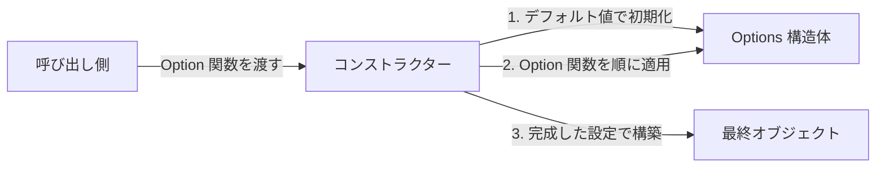
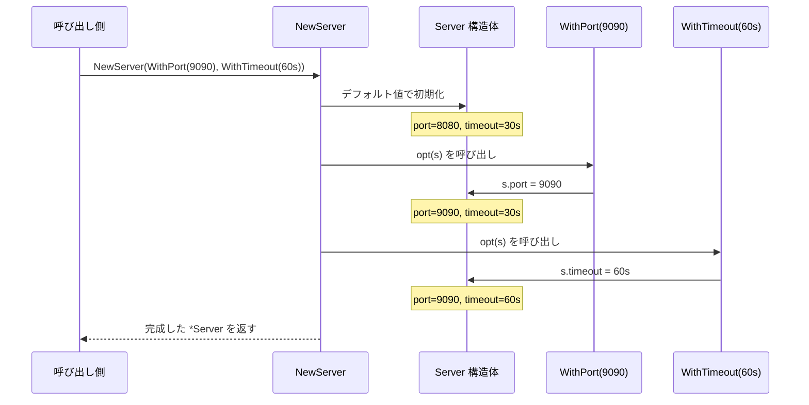
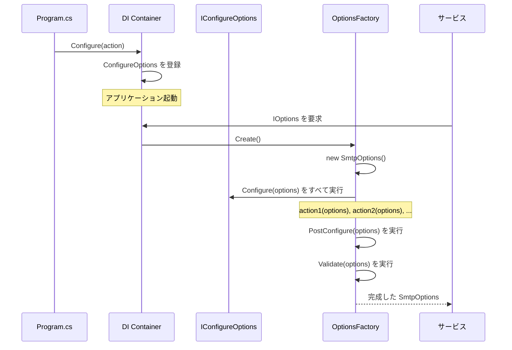
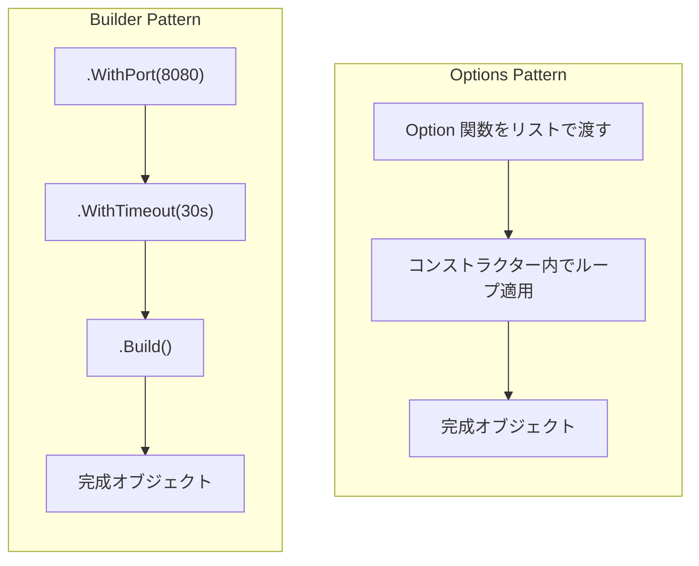
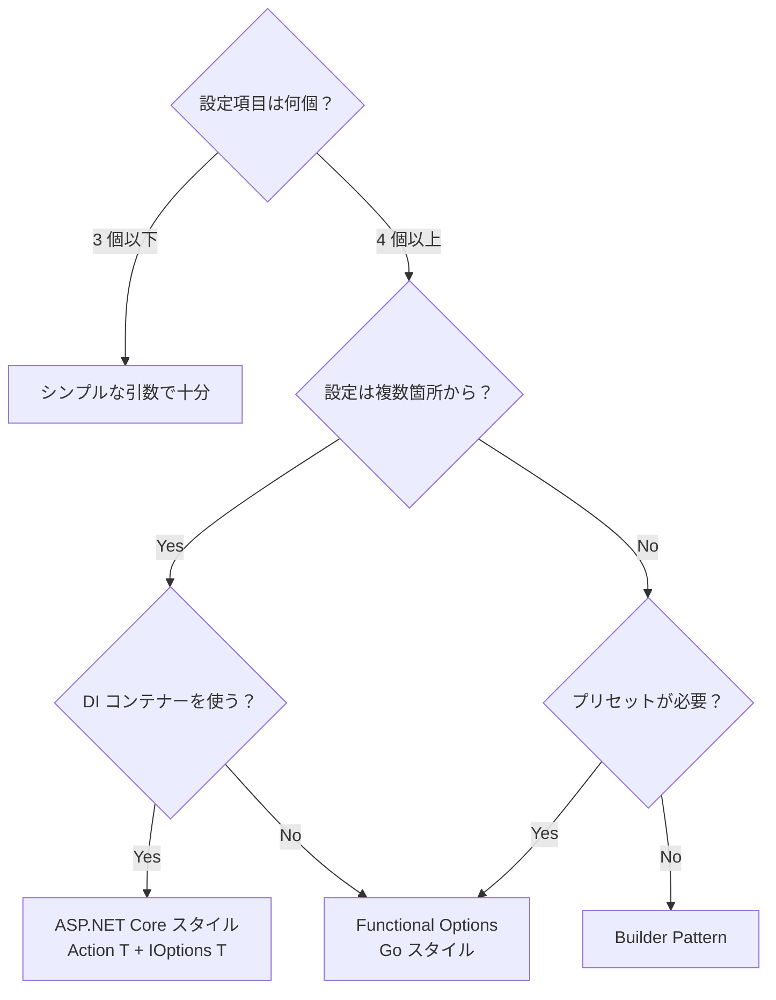

## はじめに

ライブラリーやフレームワークの API では、設定を無名関数で渡す書き方をよく見かける。ASP.NET Core ではこう書く。

```csharp
builder.Services.AddAuthentication(options =>
{
    options.DefaultScheme = "Bearer";
    options.DefaultChallengeScheme = "Bearer";
});
```

Go ではこう書く。

```go
server := NewServer(
    WithPort(8080),
    WithTimeout(30 * time.Second),
    WithLogger(myLogger),
)
```

どちらも **Options Pattern**（オプションパターン）と呼ばれるデザインパターンの実装で、無名関数（ラムダ / クロージャ）を使ってオブジェクトの設定を組み立てる。設定を値ではなく関数として渡すので、デフォルト値を保ったまま必要な項目だけを上書きでき、設定項目を増やしても既存の呼び出しは変わらない。

## 問題: Telescoping Constructor

### コンストラクター引数の爆発

HTTP サーバーを作る関数を考える。最初は引数が少ない。

```go
func NewServer(port int) *Server {
    return &Server{port: port}
}
```

機能が増えるにつれて、引数も増えていく。

```go
func NewServer(
    port int,
    host string,
    timeout time.Duration,
    maxConnections int,
    logger Logger,
    tlsConfig *tls.Config,
    middleware []Middleware,
    readTimeout time.Duration,
    writeTimeout time.Duration,
    idleTimeout time.Duration,
) *Server {
    // ...
}
```

Java などでは、引数を 1 つずつ増やしたコンストラクターのオーバーロードを並べてこれに対処し、その形は **Telescoping Constructor**（望遠鏡型コンストラクター）と呼ばれる。オーバーロードのない Go では、1 つの関数の引数がこのように増えていく。どちらの場合も、引数がこれだけ多いと呼び出し側は順番を間違えやすい。また、ほとんどの引数にはデフォルト値を使いたいのに、Go の関数では省略できない。

### 「全部入り Config 構造体」の限界

よくある対策は、Config 構造体を 1 つ渡す方法だ。

```go
type ServerConfig struct {
    Port           int
    Host           string
    Timeout        time.Duration
    MaxConnections int
    Logger         Logger
    // ...
}

func NewServer(cfg ServerConfig) *Server { ... }
```

呼び出しは短くなるが、次の問題が残る。

- `Port: 0` が「ポート 0 を使いたい」のか「デフォルトを使いたい」のか区別できない（ゼロ値問題）
- すべてのフィールドが同じレベルに並び、必須の項目と任意の項目を区別できない
- 新しいフィールドを追加すると、既存のコンストラクター呼び出しに影響する可能性がある
- 「A を設定したなら B の設定は不要」といった、項目の組み合わせに関する制約を表現しにくい

## 設定を関数として渡す

Options Pattern では、設定を値ではなく関数として渡す。「Port は 8080」という値の代わりに、「Port を 8080 に設定する操作」を渡す。コンストラクターはデフォルト値で初期化してから、受け取った操作を順に適用する。



設定を関数として渡すと、次の利点がある。

| 利点 | 説明 |
|-----|------|
| デフォルト値が安全 | Option 関数が呼ばれなければデフォルト値がそのまま使われる |
| 順序の自由 | 別々の項目を設定する Option はどの順番で渡してもよい。同じ項目を設定する Option は後に渡したものが勝つ |
| 拡張に開放 | 新しい Option 関数を追加しても既存コードに影響しない（Open-Closed Principle） |
| 型安全 | 各 Option 関数が正しい型のフィールドだけを操作する |
| 組み合わせ可能 | Option 関数をスライスにまとめて「プリセット」を作れる |

## Go での実装 — Functional Options

まず Go を取り上げる。このパターンを最も体系的に提唱し、広めたのが Go コミュニティーだからだ。[Rob Pike](https://commandcenter.blogspot.com/2014/01/self-referential-functions-and-design.html) と [Dave Cheney](https://dave.cheney.net/2014/10/17/functional-options-for-friendly-apis) が提唱したこの書き方は、Go では **Functional Options** の名前で知られている。Go にはコンストラクターのオーバーロードもデフォルト引数もないため、Functional Options が事実上の標準的な設定パターンになった。

### 基本実装

Functional Options は 3 つの要素でできている。設定を保持する `Server` 構造体、その設定を変更する関数型 `Option`、デフォルト値で初期化してから Option を順に適用するコンストラクター `NewServer` だ。

```go
package server

import (
    "log"
    "time"
)

// Server は HTTP サーバーの本体
type Server struct {
    port         int
    host         string
    timeout      time.Duration
    maxConns     int
    logger       *log.Logger
}

// Option は Server の設定を変更する関数型
type Option func(*Server)

// WithPort はポート番号を設定する Option
func WithPort(port int) Option {
    return func(s *Server) {
        s.port = port
    }
}

// WithHost はホスト名を設定する Option
func WithHost(host string) Option {
    return func(s *Server) {
        s.host = host
    }
}

// WithTimeout はタイムアウトを設定する Option
func WithTimeout(d time.Duration) Option {
    return func(s *Server) {
        s.timeout = d
    }
}

// WithMaxConnections は最大接続数を設定する Option
func WithMaxConnections(n int) Option {
    return func(s *Server) {
        s.maxConns = n
    }
}

// WithLogger はロガーを設定する Option
func WithLogger(l *log.Logger) Option {
    return func(s *Server) {
        s.logger = l
    }
}

// NewServer は Option を適用して Server を生成する
func NewServer(opts ...Option) *Server {
    // 1. デフォルト値で初期化
    s := &Server{
        port:     8080,
        host:     "localhost",
        timeout:  30 * time.Second,
        maxConns: 100,
        logger:   log.Default(),
    }

    // 2. Option 関数を順に適用
    for _, opt := range opts {
        opt(s)
    }

    return s
}
```

### 使い方

引数を渡さなければデフォルト値で動き、指定した項目だけが上書きされる。Option をスライスにまとめれば、本番環境用のプリセットのように再利用できる設定のセットも作れる。

```go
// デフォルト設定
s1 := server.NewServer()

// カスタム設定
s2 := server.NewServer(
    server.WithPort(9090),
    server.WithTimeout(60 * time.Second),
    server.WithLogger(customLogger),
)

// プリセット: 本番環境向け設定をまとめておく
var ProductionDefaults = []server.Option{
    server.WithPort(443),
    server.WithTimeout(10 * time.Second),
    server.WithMaxConnections(10000),
}

s3 := server.NewServer(ProductionDefaults...)
```

### 内部で何が起きているか

`NewServer(WithPort(9090), WithTimeout(60s))` を呼んだときの処理は次のように進む。



この流れを支えるのはクロージャ（closure）だ。`WithPort(9090)` は引数 9090 をキャプチャした関数を返し、`NewServer` がその関数を後から `Server` に適用する。

### バリデーション付きの実装

プロダクションコードでは、範囲外のポート番号や負のタイムアウトといった無効な設定を早く検出したい。Go では、`Option` がエラーを返す形が推奨される。`NewServer` はエラーを受け取った時点で失敗するので、不正な設定のままサーバーが起動することはない。

```go
// Option はエラーを返せるバージョン
type Option func(*Server) error

func WithPort(port int) Option {
    return func(s *Server) error {
        if port < 0 || port > 65535 {
            return fmt.Errorf("invalid port: %d", port)
        }
        s.port = port
        return nil
    }
}

func NewServer(opts ...Option) (*Server, error) {
    s := &Server{
        port:     8080,
        host:     "localhost",
        timeout:  30 * time.Second,
        maxConns: 100,
    }

    for _, opt := range opts {
        if err := opt(s); err != nil {
            return nil, fmt.Errorf("applying option: %w", err)
        }
    }

    return s, nil
}
```

### 主なライブラリーでの使用例

Go の主要なライブラリーでも Functional Options が広く使われている。

| ライブラリー | 使用箇所 |
|-----------|---------|
| [gRPC-Go](https://github.com/grpc/grpc-go) | `grpc.NewServer(opts...)` |
| [Zap](https://github.com/uber-go/zap) | `zap.New(core, opts...)` |
| [Fx](https://github.com/uber-go/fx) | `fx.New(opts...)` |
| [client-go](https://github.com/kubernetes/client-go) | 一部の API で Functional Options を使用 |

## C# / ASP.NET Core での実装

ASP.NET Core の Options Pattern は、Go の Functional Options と同じ原理を DI（Dependency Injection）コンテナーの上に構築したものだ。Go では Option をコンストラクターの引数として渡すが、ASP.NET Core では DI コンテナーに登録した設定関数をコンテナーが内部で適用する。適用が依存関係の解決時まで遅れるので、複数の箇所で登録した設定関数を段階的に重ねられる。

### 基本パターン: `Action<TOptions>`

```csharp
// Options クラスの定義
public class SmtpOptions
{
    public string Host { get; set; } = "localhost";
    public int Port { get; set; } = 25;
    public bool UseSsl { get; set; } = false;
    public string? Username { get; set; }
    public string? Password { get; set; }
}

// サービス登録時に Action<T> で設定
builder.Services.Configure<SmtpOptions>(options =>
{
    options.Host = "smtp.example.com";
    options.Port = 587;
    options.UseSsl = true;
});
```

Go の `func(*Server)` と C# の `Action<SmtpOptions>` は言語機能としては別物だが、どちらも設定を保持するオブジェクトを受け取ってそのフィールドを変更する関数で、設計意図は同じだ。

### `IOptions<T>` インターフェース群

ASP.NET Core には Options を受け取るインターフェースが 3 つあり、設定値を作り直すタイミングが異なる。起動後に変わらない設定、リクエストごとに最新値を取得したい設定、`appsettings.json` の変更を実行中に反映したい設定で使い分ける。

| インターフェース | ライフタイム | リロード | 用途 |
|---------------|-----------|---------|------|
| `IOptions<T>` | Singleton | 不可（初回アクセス時に作成され、その後キャッシュ） | アプリ全体で変わらない設定 |
| `IOptionsSnapshot<T>` | Scoped | スコープごと（Web では通常リクエストごと） | リクエスト単位で再計算された値を取得。Singleton には注入しない |
| `IOptionsMonitor<T>` | Singleton | 変更通知と現在値の再読み込み | Singleton からも利用できるホットリロード対応 |

### DI 内部での動作

`Configure<T>()` は設定関数を DI コンテナーに登録するだけで、関数を実行するのは、Options が要求されたときの `OptionsFactory` だ。



`Configure()` は同じ型に対して何度でも呼べる。

```csharp
// 基本設定
builder.Services.Configure<SmtpOptions>(options =>
{
    options.Host = "smtp.example.com";
    options.Port = 587;
});

// 追加設定（上書き可能）
builder.Services.Configure<SmtpOptions>(options =>
{
    options.UseSsl = true;
});

// appsettings.json からもバインド可能
builder.Services.Configure<SmtpOptions>(
    builder.Configuration.GetSection("Smtp"));
```

登録した設定はすべて登録順に実行され、同じプロパティーには最後に書いたものが残る。Go の `for _, opt := range opts { opt(s) }` と同じ仕組みだ。

### 拡張メソッドパターン

ASP.NET Core でよく見る `AddXxx(options => ...)` は、ライブラリー作者が用意する設定の入口だ。利用者は `Action<SmtpOptions>` を渡すだけで、Options の登録、バリデーション、サービス登録といった内部の詳細を知らなくても正しく設定できる。実装は次のようになる。

```csharp
// AddSmtp 拡張メソッドの実装
public static class SmtpServiceCollectionExtensions
{
    public static IServiceCollection AddSmtp(
        this IServiceCollection services,
        Action<SmtpOptions> configure)
    {
        // 1. Options インフラを登録
        services.AddOptions<SmtpOptions>()
            .Configure(configure)        // ユーザーの設定を適用
            .ValidateDataAnnotations()   // バリデーション
            .ValidateOnStart();          // 起動時検証

        // 2. サービス本体を登録
        services.AddSingleton<ISmtpClient, SmtpClient>();

        return services;
    }
}

// 使用側
builder.Services.AddSmtp(options =>
{
    options.Host = "smtp.example.com";
    options.Port = 587;
    options.UseSsl = true;
});
```

`AddSmtp` では、次の 3 つを別々の場所で定義している。

1. デフォルト値 → `SmtpOptions` クラスのプロパティー初期化子
2. ユーザー設定 → `Action<SmtpOptions>` で受け取った無名関数
3. バリデーション → `ValidateDataAnnotations()` で宣言的に定義

### PostConfigure と Validate

ASP.NET Core は設定の処理を 3 段階に分け、値の設定・調整・検証の責務を分離している。`Configure` で基本値を設定し、すべての `Configure` の後に実行される `PostConfigure` で、ほかの値との整合性を調整する（例: SSL が有効なのにポートがデフォルトのままなら 465 に変更する）。最後に `Validate` で最終的な値を検証する。

```csharp
builder.Services.AddOptions<SmtpOptions>()
    // Stage 1: Configure — 設定値を注入
    .Configure(o => o.Host = "smtp.example.com")

    // Stage 2: PostConfigure — すべての Configure 後に実行される
    .PostConfigure(o =>
    {
        // SSL が有効なのにポートがデフォルトなら 465 に変更
        if (o.UseSsl && o.Port == 25)
            o.Port = 465;
    })

    // Stage 3: Validate — 最終的なバリデーション
    .Validate(o => !string.IsNullOrEmpty(o.Host),
              "SMTP host must not be empty")
    .ValidateDataAnnotations()
    .ValidateOnStart();
```


### Named Options

同じ型の設定を名前で区別して、複数持たせることもできる。

```csharp
// "Primary" と "Backup" の 2 つの SMTP 設定
builder.Services.Configure<SmtpOptions>("Primary", options =>
{
    options.Host = "smtp-primary.example.com";
    options.Port = 587;
});

builder.Services.Configure<SmtpOptions>("Backup", options =>
{
    options.Host = "smtp-backup.example.com";
    options.Port = 2525;
});

// 使用側
public class EmailService
{
    private readonly SmtpOptions _primary;
    private readonly SmtpOptions _backup;

    public EmailService(IOptionsSnapshot<SmtpOptions> optionsSnapshot)
    {
        _primary = optionsSnapshot.Get("Primary");
        _backup = optionsSnapshot.Get("Backup");
    }
}
```

### `OptionsFactory<T>` の内部実装

ASP.NET Core の Options 解決は [`OptionsFactory<TOptions>`](https://github.com/dotnet/runtime/blob/main/src/libraries/Microsoft.Extensions.Options/src/OptionsFactory.cs) が行う。`IOptions<T>` は生成した値をキャッシュし、`IOptionsSnapshot<T>` はスコープ内でキャッシュし、`IOptionsMonitor<T>` は変更通知と `IOptionsMonitorCache<T>` によって現在値を管理する。ファクトリーの `Create()` を簡略化すると、次のようになる。

```csharp
// OptionsFactory<TOptions>.Create() の内部実装（簡略化）
public TOptions Create(string name)
{
    // 1. 新しいインスタンスを生成（デフォルト値）
    TOptions options = new TOptions();

    // 2. すべての IConfigureOptions<T> を実行
    foreach (var setup in _setups)
    {
        if (setup is IConfigureNamedOptions<TOptions> namedSetup)
            namedSetup.Configure(name, options);
        else if (name == Options.DefaultName)
            setup.Configure(options);
    }

    // 3. すべての IPostConfigureOptions<T> を実行
    foreach (var post in _postConfigures)
        post.PostConfigure(name, options);

    // 4. すべての IValidateOptions<T> を実行（エラーは集約）
    var failures = new List<string>();
    foreach (var validate in _validations)
    {
        var result = validate.Validate(name, options);
        if (result.Failed)
            failures.AddRange(result.Failures);
    }
    if (failures.Count > 0)
        throw new OptionsValidationException(name, typeof(TOptions), failures);

    return options;
}
```

処理の骨格は Go の `NewServer` にある `for _, opt := range opts { opt(s) }` ループと同じだ。ASP.NET Core はこれを Configure → PostConfigure → Validate の 3 段階に分け、名前付きの設定にも対応させている。

## TypeScript での実装

TypeScript では、オブジェクトのスプレッド構文と `Partial<T>` を使って、デフォルト値に部分的な設定を型安全にマージできる。関数で設定する形としては、Go スタイルの Functional Options も、ASP.NET Core スタイルのコールバックも書ける。

### 基本: `Partial<T>` パターン

最も単純なのは `Partial<T>` を使う方法だ。

```typescript
interface ServerOptions {
  port: number;
  host: string;
  timeout: number;
  maxConnections: number;
}

const defaults: ServerOptions = {
  port: 8080,
  host: "localhost",
  timeout: 30_000,
  maxConnections: 100,
};

function createServer(overrides?: Partial<ServerOptions>): Server {
  const options = { ...defaults, ...overrides };
  return new Server(options);
}

// 使用
const server = createServer({ port: 9090, timeout: 60_000 });
```

ただし、ここでの設定は値のマージで、関数の適用ではないので、Options Pattern とは言えない。`Partial<T>` のマージは単純で分かりやすい反面、バリデーションや設定値同士の依存関係（例: SSL を有効にしたらポートも変える）を表現しにくい。これらを Option 関数の中に書けるのが、次の Functional Options だ。

### Functional Options

Go スタイルの Functional Options を TypeScript で書くと次のようになる。

```typescript
interface ServerConfig {
  port: number;
  host: string;
  timeout: number;
  maxConnections: number;
  logger: Logger;
}

type ServerOption = (config: ServerConfig) => void;

function withPort(port: number): ServerOption {
  return (config) => {
    if (port < 0 || port > 65535) throw new RangeError(`Invalid port: ${port}`);
    config.port = port;
  };
}

function withHost(host: string): ServerOption {
  return (config) => { config.host = host; };
}

function withTimeout(ms: number): ServerOption {
  return (config) => { config.timeout = ms; };
}

function withMaxConnections(n: number): ServerOption {
  return (config) => { config.maxConnections = n; };
}

function createServer(...opts: ServerOption[]): Server {
  const config: ServerConfig = {
    port: 8080,
    host: "localhost",
    timeout: 30_000,
    maxConnections: 100,
    logger: console,
  };

  for (const opt of opts) {
    opt(config);
  }

  return new Server(config);
}

// 使用
const server = createServer(
  withPort(9090),
  withTimeout(60_000),
  withMaxConnections(5000),
);

// プリセット
const productionDefaults: ServerOption[] = [
  withPort(443),
  withTimeout(10_000),
  withMaxConnections(10000),
];

const prodServer = createServer(...productionDefaults);
```

### Callback パターン（ASP.NET Core スタイル）

ASP.NET Core のように、無名関数 1 つですべてを設定する形も書ける。

```typescript
function createServer(configure: (options: ServerConfig) => void): Server {
  const config: ServerConfig = {
    port: 8080,
    host: "localhost",
    timeout: 30_000,
    maxConnections: 100,
    logger: console,
  };

  configure(config);

  return new Server(config);
}

// 使用
const server = createServer((options) => {
  options.port = 9090;
  options.timeout = 60_000;
  options.maxConnections = 5000;
});
```

両者を組み合わせ、コールバックで全体を設定してから、Go スタイルの Option で個別に上書きすることもできる。

```typescript
function createServer(
  configure?: (options: ServerConfig) => void,
  ...opts: ServerOption[]
): Server {
  const config: ServerConfig = {
    port: 8080, host: "localhost",
    timeout: 30_000, maxConnections: 100, logger: console,
  };
  configure?.(config);
  for (const opt of opts) opt(config);
  return new Server(config);
}
```

## Rust での実装

Rust のクロージャはそれぞれ固有の型を持つ。そのため、異なるクロージャを同じ `ServerOption` 型として返したり、配列や `Vec` にまとめてプリセットにしたりするには、`Box<dyn FnOnce>` としてヒープに確保する必要がある。Go の `func(*Server)` のようにそのままスライスへ入れることはできず、Option ごとにヒープ確保のコストがかかる。

### `Box<dyn FnOnce>` で Option を表す

Rust では Builder Pattern が主流だが、Functional Options も同じ考え方で書ける。`with_host` のようにキャプチャした `String` を設定へ移す Option があるので、ここでは一度だけ呼べる `FnOnce` を使う。

```rust
pub struct ServerOptions {
    pub port: u16,
    pub host: String,
    pub timeout: std::time::Duration,
    pub max_connections: usize,
}

impl Default for ServerOptions {
    fn default() -> Self {
        Self {
            port: 8080,
            host: "localhost".into(),
            timeout: std::time::Duration::from_secs(30),
            max_connections: 100,
        }
    }
}

// Option は FnOnce で表現する
type ServerOption = Box<dyn FnOnce(&mut ServerOptions)>;

pub fn with_port(port: u16) -> ServerOption {
    Box::new(move |opts| { opts.port = port; })
}

pub fn with_host(host: impl Into<String>) -> ServerOption {
    let host = host.into();
    Box::new(move |opts| { opts.host = host; })
}

pub fn with_timeout(duration: std::time::Duration) -> ServerOption {
    Box::new(move |opts| { opts.timeout = duration; })
}

pub struct Server { /* ... */ }

impl Server {
    pub fn new(opts: impl IntoIterator<Item = ServerOption>) -> Self {
        let mut options = ServerOptions::default();
        for opt in opts {
            opt(&mut options);
        }
        Server::from_options(options)
    }

    fn from_options(_options: ServerOptions) -> Self {
        Server { /* ... */ }
    }
}

// 使い方
let server = Server::new([
    with_port(9090),
    with_timeout(std::time::Duration::from_secs(60)),
]);
```

`Box<dyn FnOnce>` のヒープ確保があるため、Rust で大規模に使う場合は従来の Builder Pattern のほうが好まれることが多い。目安としては、オプションが少数で静的に決まる場合は Builder、実行時にオプションの組み合わせが変わる場合は Functional Options が向いている。

## Python での実装

Python ではキーワード引数（`**kwargs`）で設定を受け取るのが一般的だが、Options Pattern を明示的に実装することもできる。Python の関数はファーストクラスオブジェクトで、クロージャもそのまま返せるので、Rust のように `Box` で包む必要はない。`@dataclass` を使えば、デフォルト値もフィールドの宣言に書ける。

```python
from dataclasses import dataclass
from typing import Callable

@dataclass
class ServerOptions:
    port: int = 8080
    host: str = "localhost"
    timeout: float = 30.0
    max_connections: int = 100

# Option 型
Option = Callable[[ServerOptions], None]

def with_port(port: int) -> Option:
    def apply(opts: ServerOptions) -> None:
        if not 0 <= port <= 65535:
            raise ValueError(f"Invalid port: {port}")
        opts.port = port
    return apply

def with_host(host: str) -> Option:
    def apply(opts: ServerOptions) -> None:
        opts.host = host
    return apply

def with_timeout(seconds: float) -> Option:
    def apply(opts: ServerOptions) -> None:
        opts.timeout = seconds
    return apply

class Server:
    def __init__(self, *opts: Option):
        self.options = ServerOptions()
        for opt in opts:
            opt(self.options)

# 使い方
server = Server(
    with_port(9090),
    with_timeout(60.0),
)

# プリセット
production_defaults: list[Option] = [
    with_port(443),
    with_timeout(10.0),
]

prod_server = Server(*production_defaults)
```

## パターン比較

### Options Pattern vs Builder Pattern



| 観点 | Options Pattern | Builder Pattern |
|------|----------------|-----------------|
| 構文 | 関数をリストで渡す | メソッドチェーン |
| 状態管理 | コンストラクターが一元管理 | Builder オブジェクトが中間状態を持つ |
| 組み合わせ | 関数のスライス/配列で簡単にプリセット化 | Builder の途中状態を流用するのは難しい |
| 段階的な設定 | DI コンテナーとの相性が良い（複数箇所から Configure 可能） | 通常 1 箇所で完結 |
| 型安全性 | 個別の Option 関数で保証 | メソッドの返却型で保証 |
| 学習コスト | クロージャの理解が必要 | クロージャの理解は不要 |

### Options Pattern vs Config 構造体

| 観点 | Options Pattern | Config 構造体 |
|------|----------------|---------------------|
| デフォルト値 | コンストラクター内で安全に設定 | ゼロ値問題がある |
| バリデーション | 各 Option 関数内で実行可能 | 別途バリデーション層が必要 |
| 拡張性 | 新しい Option 関数を追加するだけ | 構造体にフィールド追加 |
| 組み合わせ | 関数を合成して自由に組み合わせられる | 構造体のマージが必要 |

### 使い分けの指針

設定項目が 3 個以下なら、シンプルな引数で足りる。4 個以上で、設定を複数の箇所から重ねるか、プリセットを使い回すなら Options Pattern を、どちらでもなければ Builder Pattern を選ぶ。複数の箇所から設定し、DI コンテナーも使うなら ASP.NET Core スタイルになる。



## Option 関数の応用

### Option 関数の合成

複数の Option を 1 つの Option にまとめることもできる。

```go
// 複数の Option を 1 つにまとめる
func ComposeOptions(opts ...Option) Option {
    return func(s *Server) {
        for _, opt := range opts {
            opt(s)
        }
    }
}

// プリセットの定義
var HighPerformance = ComposeOptions(
    WithMaxConnections(50000),
    WithTimeout(5 * time.Second),
)

var SecureDefaults = ComposeOptions(
    WithPort(443),
    WithTimeout(10 * time.Second),
)

// プリセットの合成
s := NewServer(
    HighPerformance,
    SecureDefaults,
    WithHost("api.example.com"), // 個別の上書き
)
```

`ComposeOptions` は、受け取った Option を順に適用する 1 つの Option を返す関数合成だ。Option が関数なので、プリセット同士もこのように関数として組み合わせられる。

### 条件付き Option

```go
// 条件付きで Option を適用する
func WithPortIf(port int, condition bool) Option {
    return func(s *Server) {
        if condition {
            s.port = port
        }
    }
}

// 環境変数に基づく設定
func WithEnvConfig() Option {
    return func(s *Server) {
        if port := os.Getenv("PORT"); port != "" {
            s.port, _ = strconv.Atoi(port)
        }
        if host := os.Getenv("HOST"); host != "" {
            s.host = host
        }
    }
}
```

### Self-Referential Functions（元の値を返す）

Rob Pike の元の記事では、Option 関数が以前の値に戻す Option を返し、設定をロールバックできるようにする手法が紹介されている。

```go
type Option func(*Server) Option

func WithPort(port int) Option {
    return func(s *Server) Option {
        prev := s.port   // 以前の値を保存
        s.port = port     // 新しい値を設定
        return WithPort(prev) // 以前の値に戻す Option を返す
    }
}

// ロールバックの例
func temporarilyChangePort(s *Server, port int) {
    restore := WithPort(port)(s)  // ポートを変更
    defer restore(s)               // 関数終了時に元に戻す
    // ... 一時的に変更されたポートで処理 ...
}
```

プロダクションコードではあまり見かけないが、設定の変更を関数として表すと、元に戻す操作も同じ `Option` 型の関数として返せることが分かる。

## まとめ

Options Pattern は、設定を値ではなく関数として渡すデザインパターンだ。言語ごとの呼び方とシグネチャは次のとおり。

| 言語 | 呼称 | シグネチャ |
|------|------|----------|
| Go | Functional Options | `func(*T)` / `func(*T) error` |
| C# | Options Pattern / `Action<T>` | `Action<TOptions>` |
| TypeScript | Functional Options / Callback パターン | `(options: T) => void` |
| Rust | Functional Options | `Box<dyn FnOnce(&mut T)>` |
| Python | Functional Options | `Callable[[T], None]` |

どの言語でも、処理は次の 3 段階で進む。

1. デフォルト値で初期化する
2. Option 関数を順に適用する
3. 完成したオブジェクトを使う

この形にすると Telescoping Constructor の問題を避けられる。引数を増やさずに設定項目を追加でき（Open-Closed Principle）、DI コンテナーとも組み合わせやすい。特に、設定が複数の箇所から段階的に行われる場合は、Builder Pattern より Options Pattern のほうが適している。

ASP.NET Core の `AddXxx(options => ...)` が `Action<T>` を受け取るのも、Go のライブラリーが `WithXxx` 関数を公開するのも、デフォルト値を保ったまま、必要な設定だけを関数として後から適用するためだ。

## 参考リンク

- [Rob Pike — Self-referential functions and the design of options (2014)](https://commandcenter.blogspot.com/2014/01/self-referential-functions-and-design.html)
- [Dave Cheney — Functional options for friendly APIs (2014)](https://dave.cheney.net/2014/10/17/functional-options-for-friendly-apis)
- [Microsoft — Options pattern in ASP.NET Core](https://learn.microsoft.com/en-us/aspnet/core/fundamentals/configuration/options)
- [.NET Runtime — OptionsFactory source code](https://github.com/dotnet/runtime/blob/main/src/libraries/Microsoft.Extensions.Options/src/OptionsFactory.cs)
