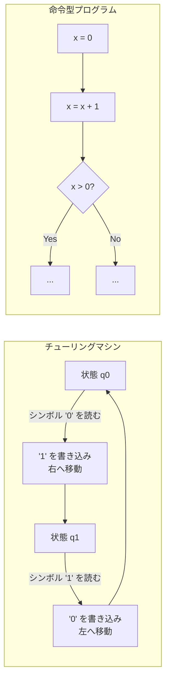
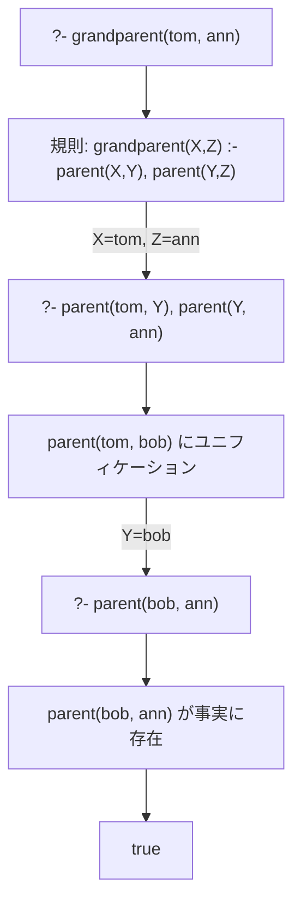
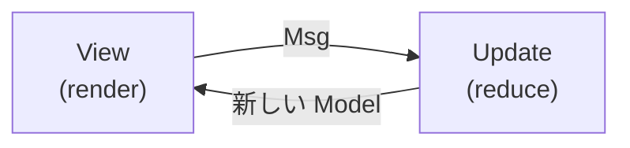

プログラミング言語を学ぶときは文法やライブラリーに目が行きがちですが、言語を越えて効いてくるのはパラダイム、つまり問題をどう捉え、解をどう組み立てるかという考え方です。

Python から Haskell に移ると、戸惑うのは文法よりも「ループの代わりに再帰を使う」「変数を再代入しない」といった考え方の転換です。逆に、関数型の考え方を一度身につければ、Scala でも Rust でも Elixir でも同じパターンを使えます。パラダイムは、個別の言語に依存しないソフトウェア設計の共通言語です。

この記事では、1936年のラムダ計算とチューリングマシンから、主要なプログラミングパラダイムの系譜をたどります。命令型・宣言型・関数型・オブジェクト指向・論理型・リアクティブ・並行指向のそれぞれについて、理論的基盤とコード例を示し、どんな問題に向くかを説明します。最後に、現代のマルチパラダイム言語がこれらをどう組み合わせているかを扱います。

## パラダイムとは何か

<strong>プログラミングパラダイム</strong>とは、プログラムをどう構成し、問題をどう解くかについての基本的な考え方です。Robert Floyd は 1978 年のチューリング賞講演で、パラダイムについて次のように述べています：

> If the advancement of the general art of programming requires the continuing invention and elaboration of paradigms, advancement of the art of the individual programmer requires that he expand his repertory of paradigms.

同じ問題でも、手続き型・関数型・オブジェクト指向のどれで考えるかによって、解の形は大きく変わります。

たとえば「リストから偶数だけを取り出して合計する」場合、手続き型では `for` ループと `if` 文で要素を一つずつ処理します。関数型では `filter` と `reduce` を合成します。SQL（宣言型）なら `SELECT SUM(x) FROM t WHERE x % 2 = 0` と書くだけです。結果は同じでも、問題の捉え方が違います。パラダイムを学ぶことは、Floyd の言う問題の捉え方のレパートリーを広げることです。

## パラダイムの歴史的系譜

現代の開発者が日常的に使うパターンの多くは、数十年前の理論的な議論に根ざしています。主要なパラダイムと言語が登場した順序は、次の年表のとおりです。

<ParadigmTimeline />

年表からは、次の流れが読み取れます：

1. <strong>1936年の二つの理論</strong> — Church のラムダ計算と Turing のチューリングマシンが、それぞれ関数型と命令型の数学的基盤を独立に築いた
2. <strong>1960年代の OOP の誕生</strong> — Simula がクラスとオブジェクトの概念を導入し、Smalltalk が純粋 OOP として洗練させた
3. <strong>1990年代以降のマルチパラダイム化</strong> — Scala, Rust, Kotlin など、複数のパラダイムを統合する言語が主流に

新しいパラダイムが登場しても古いパラダイムは消えず、積み重なってきました。命令型は今でも OS カーネルや組み込みシステムの主力であり、関数型は 80 年以上の歴史を経て、データ処理や並行システムで再び注目されています。

## パラダイムの分類

プログラミングパラダイムはまず命令型（Imperative）と宣言型（Declarative）に分けるのが一般的ですが、並行指向のパラダイムはこの軸と直交する面を持ちます。そのため下の図では、すべてが厳密な包含関係にあるようには描かず、並行指向を別枠にしています。各パラダイムをクリックすると説明が表示されます。

<ParadigmTaxonomy />

---

## 命令型パラダイム — 「どのように」を記述する

命令型パラダイムは、多くのプログラマーが最初に出会うパラダイムです。C, Python, JavaScript, Go で書くコードの大部分は命令型です。変数に値を代入し、条件分岐で処理を分け、ループで繰り返すという書き方の理論的基盤は、コンピューターの誕生より前に遡ります。

### 理論的基盤：チューリングマシン

命令型プログラミングの理論的基盤は、1936年に Alan Turing が提案したチューリングマシンです。チューリングマシンは次の要素で構成されます：

- <strong>テープ</strong> — 無限に続くメモリー（セルの列）
- <strong>ヘッド</strong> — テープ上の現在位置を読み書きする
- <strong>状態遷移表</strong> — 現在の状態と読み取ったシンボルに基づいて、次の動作を決定する

状態を持ち、命令に従ってその状態を逐次的に変更するというこのモデルが、命令型プログラミングの考え方です。現代の CPU もメモリー・プログラムカウンター・命令セットで動作します。チューリングマシンそのものではありませんが、同じく状態遷移として計算を進めます。



### 手続き型プログラミング

命令型パラダイムの最も基本的な形が手続き型プログラミングです。プログラムをプロシージャ（手続き/関数）に分割し、それらを順に呼び出して実行します。FORTRAN（1957年）や C（1972年）が代表的な手続き型言語で、C は今日でもシステムプログラミングの主力です。

```c
// C: 手続き型プログラミングの代表例
#include <stdio.h>

// 手続き（関数）の定義
int factorial(int n) {
    int result = 1;            // ミュータブルな状態
    for (int i = 2; i <= n; i++) {
        result = result * i;   // 状態の変更
    }
    return result;
}

int main(void) {
    int n = 5;
    int result = factorial(n); // 手続きの呼び出し
    printf("%d! = %d\n", n, result);
    return 0;
}
```

手続き型では、次の 3 つでプログラムを組み立てます：
- ミュータブルな変数で状態を管理する
- 制御構文（if/for/while）で実行の流れを制御する
- 関数（プロシージャ）で処理を分割・再利用する

手続き型は直感的に読めますが、プログラムの規模が大きくなると、どの関数がどの状態を変更するのかを追うのが難しくなります。この課題に対して、コードの構造を整える構造化プログラミングと、状態とそれを操作する関数をまとめるオブジェクト指向という 2 つのアプローチが生まれました。オブジェクト指向は後の節で扱い、ここでは構造化プログラミングを説明します。

### 構造化プログラミング

1968年、Edsger Dijkstra は有名な論文 "Go To Statement Considered Harmful" を発表し、構造化プログラミングを提唱しました。

```text
構造化定理（Böhm–Jacopini の定理）:
  任意のフローチャートは、以下の3つの構造の組み合わせで等価に表現できる：

  1. 順次（Sequence）    — 命令を順番に実行
  2. 選択（Selection）   — if-then-else による分岐
  3. 反復（Iteration）   — while ループによる繰り返し

  → goto 文は不要
```

この定理により、goto 文に頼らずに構造的なプログラムを書けることが数学的に証明されました。C, Pascal, Ada などの言語はこの考え方に沿って設計されています。構造化プログラミングはパラダイムそのものを変えたのではなく、命令型の中でより良いコードを書くための指針を確立しました。

---

## 宣言型パラダイム — 「何を」を記述する

命令型が「<strong>どのように（How）</strong>」計算するかを記述するのに対し、宣言型は「<strong>何を（What）</strong>」求めるかを記述し、具体的な手順は処理系に委ねます。

レストランにたとえると、「鶏肉を 180 度のオーブンで 20 分焼いて、塩胡椒をふり、皿に盛り付けてください」と指示するのが命令型、「チキンのグリルをください」と注文するのが宣言型です。SQL が典型的な宣言型言語なのはこのためです。`SELECT` で何が欲しいかを書けば、インデックスの走査順序やジョイン方式はデータベースエンジンが最適化します。

次のデモでは、同じタスクを命令型と宣言型で実行したときの違いを比べられます。

<ImperativeVsDeclarative />

宣言型では、フィルタリングと変換という「何をしたいか」だけを書き、ループ変数の管理や配列へのプッシュといった「どうやるか」は処理系に任せます。その結果、コードの意図が読み取りやすくなり、処理系は実行方法を自由に最適化できます。関数型・論理型・リアクティブプログラミングは、いずれも宣言型の流れを汲むパラダイムです。

---

## 関数型プログラミング — 数学としてのプログラミング

関数型プログラミングは、宣言型パラダイムの中で最も影響力のある流派です。命令型がプログラムを「状態を変更する命令の列」として捉えるのに対し、関数型は「入力を出力に変換する数学的な関数の合成」として捉えます。この見方を取ると、副作用を避けた、結果を予測しやすいコードになります。テストも容易になり、並行処理も安全に書けます。

### 理論的基盤：ラムダ計算

関数型プログラミングの理論的基盤は、1936年に Alonzo Church が提案したラムダ計算（λ-calculus）です。ラムダ計算の構文は、次の 3 つの要素だけでできています：

```text
ラムダ計算の構文:
  e ::= x          // 変数
       | λx. e     // ラムダ抽象（関数定義）
       | e₁ e₂     // 関数適用

これだけで、チューリング完全な計算モデルが構成できる。
```

ラムダ計算の中心的な操作は β簡約（β-reduction）です。次のデモで、簡約を 1 ステップずつ実行できます。

<LambdaCalculusVisualizer />

Church エンコーディングが示すように、数値もブール値もデータ構造も、すべて関数として表現できます。この表現力が、関数型プログラミングの「関数がファーストクラス」という考え方の源流です。

ラムダ計算は、「計算とは何か」を関数の定義と適用だけで定義した体系です。この理論の上に、Haskell, ML, Erlang, Lisp といった関数型言語が作られました。ラムダ計算に由来する無名関数、クロージャ、高階関数、カリー化は、今では Java, C#, Python, JavaScript といった関数型以外の言語にも標準的に取り入れられています。

### 純粋関数と参照透過性

ラムダ計算の「関数は入力に対して出力を返すだけ」という考え方を実用プログラミングに持ち込んだのが、純粋関数（Pure Function）です。

```haskell
-- Haskell: 純粋関数
-- 同じ入力に対して常に同じ出力を返す（参照透過性）
-- 副作用がない
double :: Int -> Int
double x = x * 2

-- 関数合成
doubleAndAdd3 :: Int -> Int
doubleAndAdd3 = (+3) . double
-- doubleAndAdd3 5 = (5 * 2) + 3 = 13
```

<strong>参照透過性</strong>（Referential Transparency）とは、式をその値に置き換えてもプログラムの意味が変わらない性質です：

```text
参照透過性の例:
  f(x) が純粋関数であるとき、
  f(3) の結果がいつでも同じなら、
  プログラム中の f(3) をすべてその結果で置き換えても
  プログラムの意味は変わらない。

  これにより:
  - 等式推論（equational reasoning）が可能
  - コンパイラの最適化が容易
  - テストが容易（入力→出力の検証のみ）
  - 並行処理が安全（共有ミュータブル状態がない）
```

### 不変性とデータ変換

純粋関数の利点を活かすには、データそのものも変更しないようにします。関数型プログラミングでは、<strong>既存のデータを変更せず、新しいデータを生成する</strong>のが基本です。命令型で `array.push(item)` と書くところを、関数型では `[...array, item]` と書きます。元のデータが変更されないため、この変数はどこで書き換えられたのかを追う必要がなくなり、並行処理では共有データへの同時書き込みによるデータ競合が起こらなくなります。

```erlang
%% Erlang: 不変性と再帰
%% 変数は一度束縛したら変更できない（single assignment）

%% リストの各要素を2倍にする — 再帰で新しいリストを生成
double_list([]) -> [];
double_list([H|T]) -> [H * 2 | double_list(T)].

%% ソートも新しいリストを返す（元のリストは不変）
merge_sort([]) -> [];
merge_sort([X]) -> [X];
merge_sort(List) ->
    {Left, Right} = lists:split(length(List) div 2, List),
    merge(merge_sort(Left), merge_sort(Right)).
```

### 高階関数とクロージャ

純粋関数と不変データだけでは、プログラムを柔軟に組み立てにくい場面があります。そこで使うのが高階関数（Higher-Order Function）、つまり関数を引数に取るか、関数を返す関数です。高階関数を使うと、繰り返し現れる処理のパターンを関数として抽象化し、「何を処理するか」と「どう処理するか」を分離できます。

```javascript
// JavaScript: 高階関数
// map, filter, reduce — 関数を引数に取る
const numbers = [1, 2, 3, 4, 5];

const doubled = numbers.map(x => x * 2);        // [2, 4, 6, 8, 10]
const evens = numbers.filter(x => x % 2 === 0); // [2, 4]
const sum = numbers.reduce((acc, x) => acc + x, 0); // 15

// 関数を返す関数（カリー化）
const multiply = (a) => (b) => a * b;
const double = multiply(2);  // (b) => 2 * b
const triple = multiply(3);  // (b) => 3 * b
console.log(double(5));  // 10
console.log(triple(5));  // 15
```

### 代数的データ型とパターンマッチング

関数型プログラミングのもう一つの柱が、ML 系の関数型言語が普及させた代数的データ型（Algebraic Data Types, ADT）です。ADT はデータの構造を型で正確に表現します。命令型言語では「無効な状態」をランタイムのバリデーションで防ぐことが多いですが、ADT とパターンマッチングを使えば、<strong>多くの無効な状態をそもそも表現できなくし、コンパイル時に検出</strong>できます。

```rust
// Rust: 代数的データ型（enum）とパターンマッチング
enum Shape {
    Circle(f64),           // 半径
    Rectangle(f64, f64),   // 幅, 高さ
    Triangle(f64, f64),    // 底辺, 高さ
}

fn area(shape: &Shape) -> f64 {
    match shape {
        Shape::Circle(r) => std::f64::consts::PI * r * r,
        Shape::Rectangle(w, h) => w * h,
        Shape::Triangle(b, h) => 0.5 * b * h,
    }
}

// コンパイラが網羅性を検証 — case の書き忘れをコンパイル時に検出
```

直和型（Sum Type）と直積型（Product Type）の組み合わせにより、ドメインモデルを型レベルで正確に表現できます。

```text
代数的データ型の数学的背景:
  直積型（Product Type）: A × B    — 構造体, タプル
    例: (Int, String) は Int の値 × String の値
  直和型（Sum Type）:    A + B     — enum, tagged union
    例: Result<T, E> は Ok(T) | Err(E)

  「代数的」と呼ばれる理由:
    型の値の数が代数的に計算できる
    Bool = True | False → 値は 2 個
    Option<Bool> = None | Some(True) | Some(False) → 値は 3 個 = 1 + 2
```

### モナド — 純粋な世界で副作用を扱う

ここまでの純粋関数・不変性・高階関数・ADT は、どれも副作用のない世界の話です。しかし現実のプログラムは、ファイルを読み書きし、ネットワーク通信を行い、ユーザー入力を受け取る必要があります。純粋関数型言語 Haskell では、純粋さを保ったまま外部とやり取りする方法が大きな課題でした。その解決策がモナド（Monad）です。

```haskell
-- Haskell: IO モナド
-- 副作用のある処理を「値」として扱い、合成可能にする
main :: IO ()
main = do
    putStrLn "What is your name?"  -- IO アクション
    name <- getLine                 -- IO アクションから値を取り出す
    putStrLn ("Hello, " ++ name)

-- モナドの本質: bind (>>=) による処理の連鎖
-- m >>= f は「m を順に実行し、それが生成した値を f に渡す」
-- Maybe モナドの例:
safeDivide :: Int -> Int -> Maybe Int
safeDivide _ 0 = Nothing
safeDivide x y = Just (x `div` y)

-- 連鎖: どこかで Nothing になったら全体が Nothing
calculate :: Int -> Int -> Int -> Maybe Int
calculate x y z = do
    a <- safeDivide x y    -- y=0 なら Nothing
    b <- safeDivide a z    -- z=0 なら Nothing
    return (a + b)
```

```text
モナドの公理（モナド則）:
  1. 左単位元: return a >>= f  ≡  f a
  2. 右単位元: m >>= return    ≡  m
  3. 結合律:   (m >>= f) >>= g ≡  m >>= (λx → f x >>= g)

モナドは「プログラマブルなセミコロン」とも呼ばれる。
命令型の ; がステートメントを連鎖させるように、
>>= がモナド値の連鎖を制御する。
```

---

## オブジェクト指向プログラミング — メッセージとオブジェクトの世界

オブジェクト指向プログラミング（OOP）は、おそらく最も広く採用されているパラダイムです。Java, C#, Python, Ruby, Swift など、産業界の主力言語の多くが OOP を中心に設計されています。ただし、OOP の本質が何かについては、開発者の間で理解が分かれます。クラスと継承が OOP だと考える人もいれば、メッセージパッシングこそが本質だと主張する人もいます。この二つの見方は、OOP の歴史的な二つの系譜に対応しています。

### 二つの系譜：Simula 系と Smalltalk 系

1. <strong>Simula 系</strong> — クラスと継承を中心とする「抽象データ型」のアプローチ。C++, Java, C# に影響。
2. <strong>Smalltalk 系</strong> — メッセージパッシングを中心とする「すべてがオブジェクト」のアプローチ。Ruby, Objective-C に影響。

Smalltalk の設計者 Alan Kay は、OOP の本質について次のように述べています：

> I thought of objects being like biological cells and/or individual computers on a network, only able to communicate with messages.

Kay にとって、OOP の本質は継承ではなくメッセージパッシングでした。次のデモでは、Simula/C++ 系のクラスベースの OOP と、Smalltalk/Ruby 系のメッセージパッシングによる OOP の違いを図で比べられます。

<OOPVisualizer />

### SOLID 原則

OOP を使っても、自動的に良い設計になるわけではありません。クラス設計を誤ると、変更に弱くテストしにくいコードになります。Robert C. Martin が広めた SOLID 原則（SOLID という頭字語は Michael Feathers が後に命名）は、OOP で変更に強い設計を作るための 5 つの指針として広く知られています：

| 原則 | 名称 | 説明 |
|------|------|------|
| S | Single Responsibility Principle（単一責任の原則） | クラスを変更する理由は一つだけにすべき |
| O | Open/Closed Principle（開放/閉鎖の原則） | 拡張に対して開いていて、修正に対して閉じているべき |
| L | Liskov Substitution Principle（リスコフの置換原則） | サブタイプはスーパータイプと置換可能であるべき |
| I | Interface Segregation Principle（インターフェース分離の原則） | クライアントが使わないメソッドへの依存を強制すべきでない |
| D | Dependency Inversion Principle（依存性逆転の原則） | 高レベルモジュールは低レベルモジュールに依存すべきでなく、両者とも抽象に依存すべき |

### Composition over Inheritance

OOP の初期には継承が多用されましたが、実際のプロジェクトでは、深い継承階層が変更を難しくするという問題が繰り返し報告されました。Gang of Four の『Design Patterns』（1994年）も「クラス継承よりオブジェクトのコンポジションを好め」と明言しています。現在では、継承よりコンポジション（合成）が推奨されています。

```go
// Go: インターフェースによるコンポジション
// Go にはクラスも継承もない — インターフェースと埋め込みで構成

type Reader interface {
    Read(p []byte) (n int, err error)
}

type Writer interface {
    Write(p []byte) (n int, err error)
}

// インターフェースの合成
type ReadWriter interface {
    Reader
    Writer
}

// メソッドが処理を委譲するフィールドによるコンポジション（継承ではない）
type BufferedReadWriter struct {
    reader Reader
    writer Writer
    buf    []byte
}

func (brw *BufferedReadWriter) Read(p []byte) (int, error) {
    return brw.reader.Read(p)
}

func (brw *BufferedReadWriter) Write(p []byte) (int, error) {
    return brw.writer.Write(p)
}
```

Go は意図的にクラスと継承を持たず、インターフェース、埋め込み（上の `ReadWriter`）、メソッドが処理を委譲する構造体フィールドを組み合わせてコンポジションを実現します。"Composition over Inheritance" の考え方を言語仕様に組み込んだ例です。

---

## 論理型プログラミング — 宣言と推論の世界

命令型・関数型・OOP では、多くの場合、どの変換や操作を行うかをプログラマーが定義します。論理型プログラミングでは、プログラマーは何が真であるかを宣言し、答えの導き方は推論エンジンに任せます。

SQL で `SELECT` を書くときにインデックスの走査方法を指定しないのと同じように、Prolog で問い合わせを書くときも探索アルゴリズムは指定しません。ただし論理型は SQL よりはるかに表現力が高く、再帰的な推論やパターンマッチングを使えるため、人工知能・自然言語処理・定理証明といった分野で強みを発揮します。

### 理論的基盤：述語論理

論理型プログラミングの基盤は一階述語論理（First-Order Predicate Logic）です。プログラムは事実（Fact）と規則（Rule）の集合であり、実行とは問い合わせ（Query）に対する推論です。

```prolog
%% Prolog: 論理型プログラミング

%% 事実（Fact）— 何が真であるかを宣言
parent(tom, bob).
parent(tom, liz).
parent(bob, ann).
parent(bob, pat).

%% 規則（Rule）— 事実から新しい知識を導出
grandparent(X, Z) :- parent(X, Y), parent(Y, Z).
sibling(X, Y) :- parent(Z, X), parent(Z, Y), X \= Y.
ancestor(X, Y) :- parent(X, Y).
ancestor(X, Y) :- parent(X, Z), ancestor(Z, Y).

%% 問い合わせ（Query）— 推論エンジンが解を探索
%% ?- grandparent(tom, ann).
%% true.
%% ?- ancestor(tom, Who).
%% Who = bob ; Who = liz ; Who = ann ; Who = pat.
```

Prolog の推論エンジンは、次の 3 つの仕組みで動作します：

1. <strong>ユニフィケーション（Unification）</strong> — 2つの項を等しくする変数束縛を探す。例えば `parent(X, bob)` と `parent(tom, bob)` を照合すると `X = tom` という束縛が得られる
2. <strong>バックトラッキング（Backtracking）</strong> — 解が見つからない場合、直前の選択点に戻って別の道を探索する。解空間を深さ優先で探索する
3. <strong>SLD 解消（SLD Resolution）</strong> — 節（clause）を選択し、ユニフィケーションで書き換え、残りのゴールを再帰的に解消する



### 制約論理プログラミング

論理型の発展形に制約論理プログラミング（Constraint Logic Programming, CLP）があります。通常の論理型が事実と規則からの推論で答えを求めるのに対し、CLP は制約を満たす値の組を探します。プログラマーが制約を宣言すると、制約ソルバーが解を見つけます。

```prolog
%% CLP(FD): 有限領域の制約
%% 数独ソルバの例（概念コード。length_/2 や blocks/3 などの補助述語は省略）
sudoku(Rows) :-
    length(Rows, 9),
    maplist(length_(9), Rows),
    append(Rows, Vs), Vs ins 1..9,   %% すべてのセルは1-9
    maplist(all_distinct, Rows),       %% 各行は重複なし
    transpose(Rows, Columns),
    maplist(all_distinct, Columns),    %% 各列は重複なし
    Rows = [A,B,C,D,E,F,G,H,I],
    blocks(A,B,C), blocks(D,E,F), blocks(G,H,I), %% 各ブロック
    maplist(label, Rows).              %% 解を探索
```

この数独の例で書いているのは、行・列・ブロックが満たすべき制約だけです。解き方の手順は書かず、解の導出は制約ソルバーに任せています。

---

## リアクティブプログラミング — ストリームと伝播の世界

ここまでのパラダイムは、主に入力を受け取って処理し、出力を返す一回きりの計算を扱ってきました。しかし GUI、Web フロントエンド、IoT データ処理、金融システムなどのアプリケーションは、次々に到着するイベントやデータの変化に反応し続ける必要があります。リアクティブプログラミングは、データストリームと変更の自動伝播を中心に、この要求に応えるパラダイムです。

| ステップ | 伝統的なアプローチ | リアクティブなアプローチ |
|----------|--------------------|--------------------------|
| `a = 3, b = 4` | a=3, b=4 | a=3, b=4 |
| `c = a + b` | c = 7 | c = 7 |
| `a = 10` | c = 7（変わらない） | c = 14（自動で更新） |

伝統的なアプローチでは、`c = a + b` はその時点の計算結果を `c` に代入するだけです。リアクティブなアプローチでは `c` と `a + b` の<strong>関係</strong>が維持され、`a` を変更すると `c` も自動で更新されます。

### 関数リアクティブプログラミング（FRP）

リアクティブプログラミングの理論的基盤を築いたのが、Conal Elliott と Paul Hudak が 1997 年に提案した関数リアクティブプログラミング（FRP）です。FRP は、時間とともに変化する値（Behavior）と離散的なイベント（Event）を、関数型の枠組みの中で一級市民として扱います。RxJS などの ReactiveX ファミリーは、FRP の考え方を実用に持ち込んだライブラリーです。

```typescript
// RxJS: リアクティブプログラミング
import { fromEvent, map, filter, debounceTime, switchMap } from 'rxjs';

// DOM イベントをストリームとして扱う
const searchInput = document.getElementById('search');

const search$ = fromEvent(searchInput, 'input').pipe(
  map(event => (event.target as HTMLInputElement).value),
  filter(query => query.length >= 3),      // 3文字以上
  debounceTime(300),                        // 300ms 待機
  switchMap(query => fetch(`/api/search?q=${encodeURIComponent(query)}`)),
);

// ストリームを購読
search$.subscribe(results => renderResults(results));
```

### Elm Architecture

Elm は当初 FRP の考え方に基づいて設計されましたが（Evan Czaplicki の 2012 年の論文は「Elm: Concurrent FRP for Functional GUIs」）、バージョン 0.17 で FRP のモデルを離れ、メッセージパッシングに基づく The Elm Architecture（TEA）に一本化しました。TEA 自体は 0.17 より前から使われていた設計で、React/Redux にも大きな影響を与えました。

The Elm Architecture は次の 3 つの要素で構成されます：

- <strong>Model</strong> — アプリケーションの状態（不変のデータ構造）
- <strong>Update</strong> — `(Msg, Model) -> Model`（純粋関数で状態遷移）
- <strong>View</strong> — `Model -> Html Msg`（純粋関数で UI を生成）



View が UI を描画し、ユーザー操作が Msg を生成します。Update は Msg と現在の Model から新しい Model を計算し、View はその Model で再描画します。この一方向のデータの流れ（単方向データフロー）が、TEA の中心です。

---

## 並行指向パラダイム

マルチコア CPU が普及した現在、並行処理の安全性はソフトウェア開発の大きな課題の一つです。命令型プログラミングでスレッドと共有メモリーを使って並行処理を書くと、ロック忘れによる競合状態、デッドロック、ライブロックといった再現しにくいバグが起こりがちです。並行指向パラダイムは、並行処理を<strong>言語やランタイムのレベルで安全にする</strong>アプローチで、代表的なモデルにアクターモデルと CSP があります。

### アクターモデル

1973年に Carl Hewitt が提案したアクターモデルでは、並行計算の基本単位を「アクター」とします。各アクターは自分だけの状態を持ち、他のアクターとはメッセージの送受信だけでやり取りします。共有メモリーがないため、ロックもミューテックスも必要ありません。Erlang/OTP はこのモデルを言語レベルで採用しており、Erlang/OTP で構築した通信システムでは 99.9999999%（ナインナイン）の可用性が報告されています。

```elixir
# Elixir: アクターモデル（Erlang VM 上）
defmodule Counter do
  def start(initial_count) do
    spawn(fn -> loop(initial_count) end)
  end

  defp loop(count) do
    receive do
      {:increment, caller} ->
        new_count = count + 1
        send(caller, {:count, new_count})
        loop(new_count)  # 再帰で次のメッセージを待つ

      {:get, caller} ->
        send(caller, {:count, count})
        loop(count)
    end
  end
end

# 使用例
pid = Counter.start(0)
send(pid, {:increment, self()})
receive do
  {:count, n} -> IO.puts("Count: #{n}")  # Count: 1
end
```

```text
アクターモデルの公理:
  アクターは以下の3つの操作のみを行える：
  1. 新しいアクターを生成する（create）
  2. 他のアクターにメッセージを送る（send）
  3. 受信したメッセージに対する振る舞いを決定する（become）

  共有状態なし — すべてがメッセージパッシング
  → 共有メモリ由来のデータ競合は設計上避けられる。ただしプロトコル設計次第でデッドロックは起こり得る
  → 分散システムへの自然な拡張
```

### CSP（Communicating Sequential Processes）

アクターモデルとよく比較されるのが、1978年に Tony Hoare が提唱した CSP です。CSP で通信の単位になるのはアクター（プロセス）ではなくチャネルです。プロセスは匿名で、名前付きチャネルを介してデータを送受信します。Go 言語はこのモデルを採用しており、`go` キーワードで goroutine を起動し、`chan` で作成したチャネルで通信するのが Go の並行処理の基本パターンです。

```go
// Go: CSP モデル — goroutine + channel
func producer(ch chan<- int) {
    for i := 0; i < 10; i++ {
        ch <- i  // チャネルに送信
    }
    close(ch)
}

func consumer(ch <-chan int, done chan<- bool) {
    for v := range ch {  // チャネルから受信
        fmt.Printf("received: %d\n", v)
    }
    done <- true
}

func main() {
    ch := make(chan int)  // バッファなしチャネル（同期ランデブー）
    done := make(chan bool)

    go producer(ch)       // goroutine でプロデューサーを起動
    go consumer(ch, done) // goroutine でコンシューマーを起動

    <-done // 完了を待つ
}
```

| | CSP | アクターモデル |
|---|---|---|
| 名前の対象 | チャネルに名前がある（プロセスは匿名） | アクターに名前（アドレス）がある（チャネルは暗黙的） |
| 通信方式 | 古典的 CSP や Go の unbuffered channel では同期 rendezvous。buffered channel ではキューイングも可能 | 非同期通信（メールボックスにキューイング） |
| 代表的な言語 | Go（goroutine + channel） | Erlang / Elixir（プロセス） |

---

## マルチパラダイムの時代

現実のソフトウェア開発で、一つのパラダイムだけでプログラムを書くことはまれです。現在の主要言語の多くはマルチパラダイムで、問題に応じてアプローチを選べます。

たとえば Rust は所有権システムを軸に、命令型・関数型・並行プログラミングの要素を組み合わせています。Scala は OOP と関数型を対等に扱い、ドメインモデリングには OOP を、データ変換には関数型を使うといった書き方ができます。

### Rust — 所有権システムとマルチパラダイム

```rust
// Rust: 関数型 + 命令型 + 並行プログラミング

// 関数型スタイル — イテレータとクロージャ
fn functional_sum(numbers: &[i32]) -> i32 {
    numbers.iter()
        .filter(|&&x| x > 0)
        .map(|&x| x * 2)
        .sum()
}

// 命令型スタイル — ミュータブルな状態
fn imperative_sum(numbers: &[i32]) -> i32 {
    let mut sum = 0;
    for &x in numbers {
        if x > 0 {
            sum += x * 2;
        }
    }
    sum
}

// 所有権 + トレイト — Rust 独自のパラダイム
trait Drawable {
    fn draw(&self);
}

struct Circle { radius: f64 }
struct Square { side: f64 }

impl Drawable for Circle {
    fn draw(&self) { println!("○ r={}", self.radius); }
}

impl Drawable for Square {
    fn draw(&self) { println!("□ s={}", self.side); }
}

// トレイトオブジェクトによるポリモーフィズム
fn draw_all(shapes: &[&dyn Drawable]) {
    for shape in shapes {
        shape.draw();
    }
}
```

### Scala — OOP と FP の融合

```scala
// Scala: OOP + 関数型の統合

// case class — 代数的データ型 + OOP
sealed trait Expr
case class Num(value: Double) extends Expr
case class Add(left: Expr, right: Expr) extends Expr
case class Mul(left: Expr, right: Expr) extends Expr

// パターンマッチング — 関数型スタイル
def eval(expr: Expr): Double = expr match {
  case Num(v) => v
  case Add(l, r) => eval(l) + eval(r)
  case Mul(l, r) => eval(l) * eval(r)
}

// 高階関数 + コレクション — 関数型スタイル
val numbers = List(1, 2, 3, 4, 5)
val result = numbers
  .filter(_ % 2 == 0)
  .map(_ * 3)
  .foldLeft(0)(_ + _)  // 18

// for 内包表記 — モナドの構文糖
val pairs = for {
  x <- List(1, 2, 3)
  y <- List('a', 'b')
} yield (x, y)
// List((1,a), (1,b), (2,a), (2,b), (3,a), (3,b))
```

---

## パラダイムの比較

次の比較表では、各パラダイムの強みと適用領域を並べて比べられます。

<ParadigmComparison />

---

## パラダイムの選択指針

どの問題にも最良というパラダイムはなく、問題の性質によって適したものが変わります。次の表は大まかな目安です。実際のプロジェクトではほとんどの場合、複数のパラダイムを組み合わせます。チームの経験、エコシステムの成熟度、性能要件なども選択に影響します。

| 問題の性質 | 適したパラダイム | 代表的な言語 | 理由 |
|------------|-----------------|-------------|------|
| システムプログラミング（OS, ドライバー） | 手続き型 / 命令型 | C, Rust | ハードウェアに近い制御が必要 |
| ビジネスロジック（Web アプリ） | OOP + 関数型 | Java, Kotlin, TypeScript | ドメインモデルの表現 + データ変換 |
| データ処理・変換パイプライン | 関数型 | Elixir, Scala, Haskell | 不変データの変換チェーン |
| 並行・分散システム | アクターモデル / CSP | Erlang, Go | メッセージパッシングによる安全な並行性 |
| AI・知識表現 | 論理型 | Prolog, Datalog | 宣言的な推論と探索 |
| UI・リアルタイム処理 | リアクティブ | Elm, RxJS, React | イベントストリームの宣言的な処理 |

## まとめ

プログラミングパラダイムの歴史は、<strong>計算とは何か</strong>という問いへの答え方の歴史として読むこともできます。

1. <strong>命令型</strong>は「計算とは状態の変更である」と捉える（チューリングマシン）
2. <strong>関数型</strong>は「計算とは値の変換である」と捉える（ラムダ計算）
3. <strong>OOP</strong>は「計算とはオブジェクト間のメッセージ交換である」と捉える（Smalltalk）
4. <strong>論理型</strong>は「計算とは論理的推論である」と捉える（述語論理）
5. <strong>リアクティブ</strong>は「計算とはデータフローの伝播である」と捉える（FRP）

これらは互いに排他的ではなく、現在の言語の多くは複数を組み合わせています。一つのパラダイムに固執するより、<strong>問題に応じて考え方を選べるようになること</strong>のほうが役に立ちます。パラダイムを学んで身につくのは問題の捉え方そのもので、言語やフレームワークが変わっても使い続けられます。

Peter Van Roy の ["Programming Paradigms for Dummies"](https://www.info.ucl.ac.be/~pvr/VanRoyChapter.pdf) では、約 30 のパラダイムが分類されています。この記事で扱ったのはその一部です。