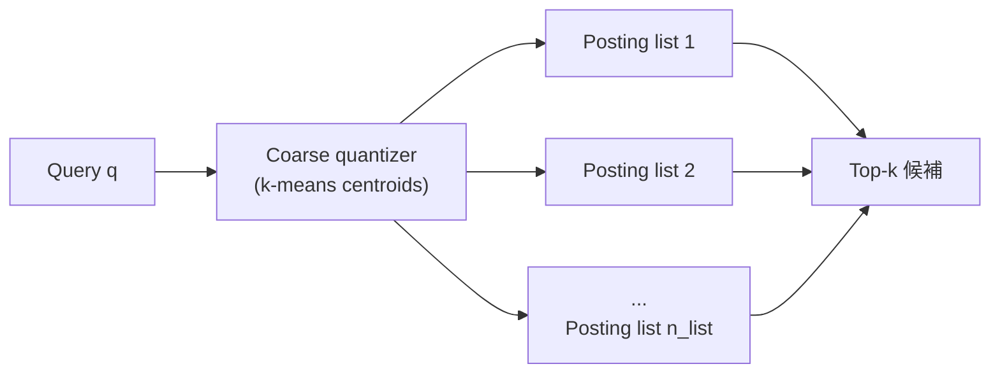
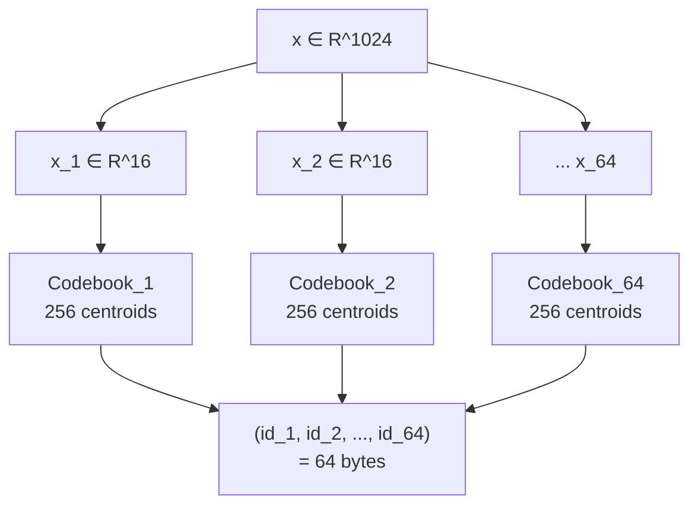
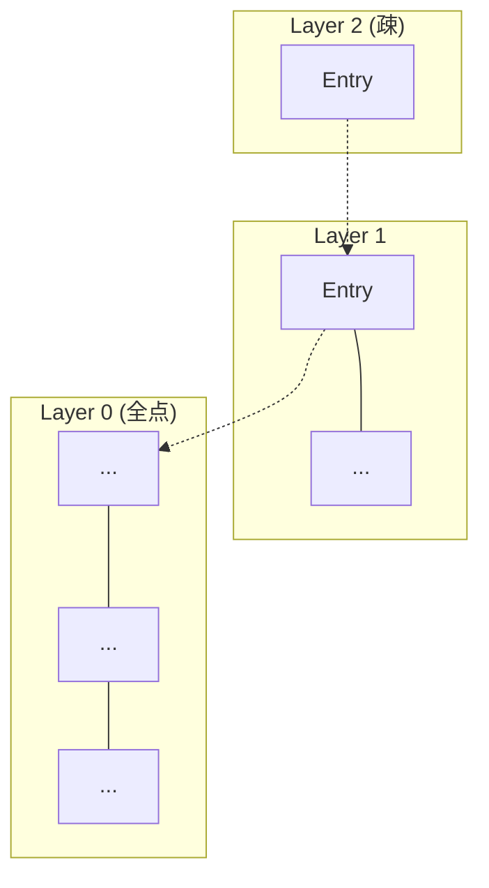
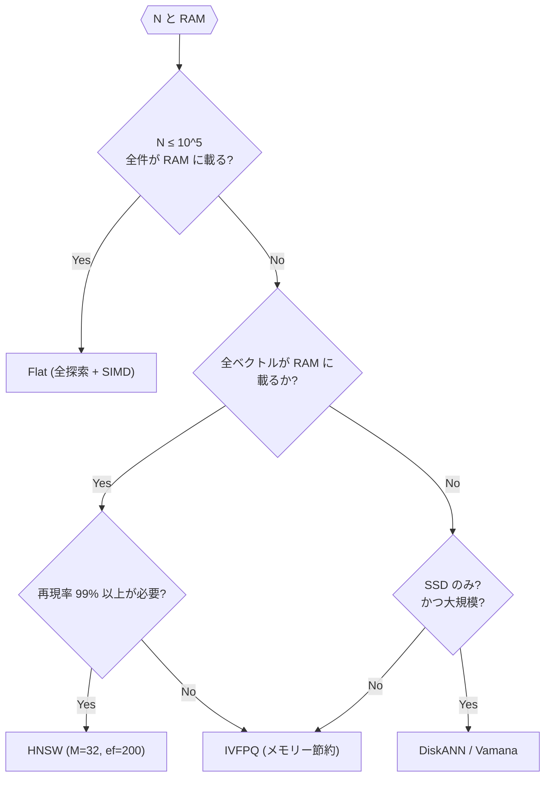
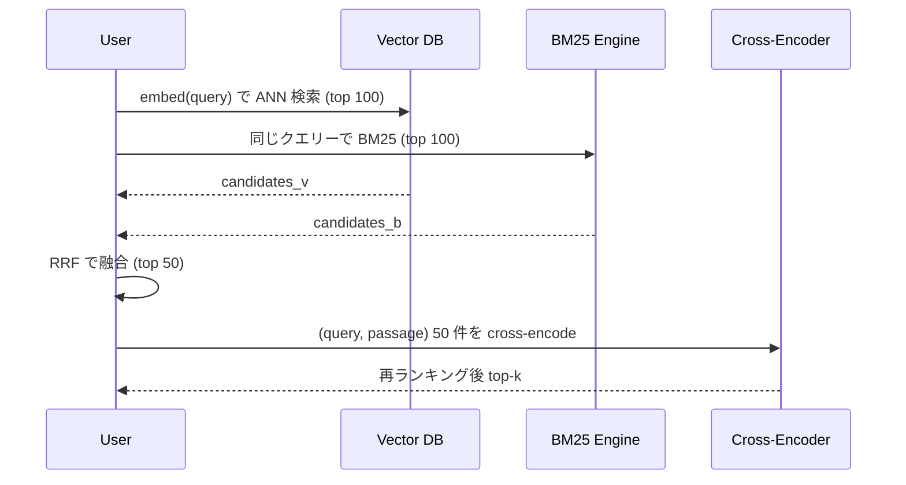

大規模言語モデル (LLM) の普及とともに、埋め込み (embedding) ベクトルを保存して検索する「ベクトルデータベース」が、検索・推薦・RAG (Retrieval-Augmented Generation) の基盤として広く使われるようになりました。その内部で解いているのは、数十年にわたって研究されてきた<strong>高次元空間の近似最近傍探索 (Approximate Nearest Neighbor Search; ANN)</strong> です。

ANN は厳密な答えを諦める代わりに、調べるベクトルの数を減らすか、1 本あたりの距離計算を軽くするか、その両方で検索を速くします。この記事では、素朴な全探索から始めて IVF (Inverted File)、Product Quantization (PQ)、HNSW (Hierarchical Navigable Small World)、DiskANN (Vamana) の順に中核アルゴリズムを説明します。設計判断は、論文と OSS 実装（FAISS、Milvus、pgvector、Qdrant）のコードに沿って取り上げます。

> <strong>図書館にたとえた全体像</strong>
>
> 巨大な図書館で、探している本に似た本を見つける場面を考えます。全探索は、1 冊ずつ手に取って似ているかを確かめる方法で、蔵書が 10 億冊あれば終わりません。
>
> - <strong>IVF</strong>：本棚ごとに分類カードを立てておき、探している本に近いカードの本棚を 10 棚だけ選んで、その中を探します。
> - <strong>Product Quantization</strong>：各本の表紙を、256 色のパレットから選んだ 64 個の色コードで要約します。表紙ではなく色コードで比べるので比較はずっと速くなり、その代わり精度が少し下がります。
> - <strong>HNSW</strong>：似た本同士を「友達」としてリンクしておき、疎な世界地図から密な市街地図へズームするように、リンクをたどって目的の本に近づきます。
> - <strong>DiskANN</strong>：そのリンクのネットワークを SSD に置きます。RAM には全冊分の縮刷版 (PQ で圧縮したベクトル) だけを置き、有望な本だけ SSD から原本を読み出します。

<ArticleVideo slug="vector-database-internals" />

## 1. なぜベクトル検索が難しいのか

### 1.1 埋め込みベクトルとは

テキスト・画像・音声などを、意味が近いものほどユークリッド空間上で近くなるように<strong>固定次元の実数ベクトル</strong>へ写像したものが、埋め込みベクトルです。代表的なモデルの次元数は次のとおりです。

| モデル | 次元 | 距離指標 |
| --- | --- | --- |
| OpenAI `text-embedding-3-small` | 1536 | cosine |
| OpenAI `text-embedding-3-large` | 3072 | cosine |
| Cohere `embed-v3` | 1024 | cosine / dot |
| BGE-M3 | 1024 | cosine |
| CLIP ViT-L/14 | 768 | cosine |

次元数 $d$ は 1000 を超えることが多く、この規模で大量のベクトルを全探索するのは現実的ではありません。

### 1.2 距離・類似度の定義

ベクトル $\mathbf{x}, \mathbf{y} \in \mathbb{R}^d$ に対する代表的な指標は 3 つです。

<strong>ユークリッド距離 (L2)：</strong>

$$
d_{L2}(\mathbf{x}, \mathbf{y}) = \sqrt{\sum_{i=1}^{d} (x_i - y_i)^2}
$$

<strong>内積 (Inner Product, IP; 対応する要素同士を掛けて足し合わせた値)：</strong>

$$
\text{IP}(\mathbf{x}, \mathbf{y}) = \sum_{i=1}^{d} x_i y_i
$$

<strong>コサイン類似度：</strong>

$$
\cos(\mathbf{x}, \mathbf{y}) = \frac{\mathbf{x} \cdot \mathbf{y}}{\|\mathbf{x}\|\,\|\mathbf{y}\|}
$$

ベクトルを単位ベクトルに正規化 ($\|\mathbf{x}\|=1$) すると、

$$
d_{L2}(\mathbf{x}, \mathbf{y})^2 = 2 - 2\,\mathbf{x}\cdot\mathbf{y}
$$

が成り立ちます。このとき<strong>コサイン類似度・内積・L2 距離は、互いに単調変換 (値の大小の順序を保つか、そっくり逆にする変換) で移り合う</strong>ので、どれを使っても検索結果の順位は同じです。そのため多くの ANN ライブラリーは内部で L2 か内積のどちらかに統一し、事前に正規化するかどうかで三者を切り替えます。

### 1.3 次元の呪い (Curse of Dimensionality)

高次元空間では、低次元での直感が通じなくなります。

- <strong>距離の集中</strong>：点対の距離の比 $\max/\min$ が $1$ に近づき、最近傍と遠い点の差が相対的に小さくなる。
- <strong>体積の偏り</strong>：単位球の体積のほぼすべてが表面近くに集中する。
- <strong>空間分割の非効率</strong>：kd-tree (座標軸に沿って空間を二分していく古典的な最近傍索引) のような軸平行の分割は、低次元では有効だが、$d > 20$ 程度になると全探索と同程度のノードを訪問する。

そのため実用的なベクトル検索では、厳密解を諦め、再現率 (真の上位 k 件のうち、ANN が実際に返せた件数の割合) 95% 以上を狙って<strong>近似的に解きます</strong>。

## 2. ベースライン: 全探索 (Flat)

全探索で十分速い条件なら、全探索を使えば済みます。FAISS の `IndexFlatL2` / `IndexFlatIP` がこれに当たります。

```python
# 素朴な全探索 (pseudocode)
def search(query: np.ndarray, xb: np.ndarray, k: int):
    # xb: (N, d), query: (d,)
    dists = np.linalg.norm(xb - query, axis=1)  # O(Nd)
    idx = np.argpartition(dists, k)[:k]         # O(N)
    return idx[np.argsort(dists[idx])]
```

計算量は $O(Nd)$ です。$N=10^6$、$d=1024$ の単精度 float なら、1 クエリーごとに 4GB のメモリーを走査します。それでも SIMD (AVX-512 / NEON; 1 命令で複数の数値をまとめて計算する CPU の機構) と BLAS の GEMM (高度に最適化された行列積ルーチン) を使えば、$N \le 10^5$ 程度までは全探索のほうが HNSW より速い場合もあります。FAISS の `IndexFlat` は、こうした規模の検索に使えるうえ、ANN の結果と比べる正解を求めるリファレンスにもなります。

ANN は、この $O(Nd)$ を <strong>(a) 調べるベクトルの数を減らす</strong>か、<strong>(b) 1 本あたりの距離計算を軽くする</strong>かの 2 方向で削ります。IVF は (a)、PQ は (b) です。HNSW は IVF とは別の方法で (a) を実現し、DiskANN は (a) と (b) を組み合わせます。

## 3. IVF: 空間分割による候補削減

> 全部を調べず、近い本棚だけを調べる方法です。インデックス構築時にデータを似たもの同士のグループに分けておき、検索時はクエリーに近いグループを数個だけ開いて中を全探索します。開かなかったグループに正解があると見逃す点が、この手法の弱点です。

### 3.1 k-means クラスタリングによる粗分割

IVF (Inverted File index) という名前は、文書検索の転置索引になぞらえたものです。

1. 学習：全データに k-means を適用し、$n_{\text{list}}$ 個のセントロイド (各グループの中心を表す代表ベクトル) $\{\mathbf{c}_1, \dots, \mathbf{c}_{n_{\text{list}}}\}$ を求める。
2. 構築：各ベクトルを最も近いセントロイドに割り当て、その ID をセントロイドごとの <strong>posting list</strong> (本の巻末索引で、1 つの見出し語に並ぶページ番号のリストに当たる) に格納する。
3. 検索：クエリー $\mathbf{q}$ に近いセントロイドを上位 $n_{\text{probe}}$ 個選び、それらの posting list だけを走査する。



### 3.2 パラメーターの設計

- <strong>`nlist`</strong>：大きいほど 1 リストが短くなって検索は速くなるが、同じ再現率を保つには `nprobe` も増やす必要がある。$N$ が 100 万本未満なら、$n_{\text{list}} \approx 4\sqrt{N} \sim 16\sqrt{N}$ が目安（[FAISS wiki](https://github.com/facebookresearch/faiss/wiki/Guidelines-to-choose-an-index)）。
- <strong>`nprobe`</strong>：検索時に走査する posting list の数。各 posting list は、1 つのセントロイドが受け持つ領域（セル）に対応する。$n_{\text{probe}} = 1$ は非常に速いが、真の最近傍が隣のセルにあると見逃すため再現率が下がる。FAISS の SIFT1M（128 次元、100 万件、`nlist=16384`）での測定では、上位 1 件の再現率は `nprobe=16` で 0.83、64 で 0.95、256 で 0.99 だった（[FAISS wiki](https://github.com/facebookresearch/faiss/wiki/Indexing-1M-vectors)）。
- <strong>訓練データ量</strong>：FAISS のクラスタリングの既定値は `min_points_per_centroid = 39`、`max_points_per_centroid = 256`。`nlist` の 39〜256 倍のサンプル数が目安で、下回ると警告が出て、上回ると自動でサブサンプリングされる。

### 3.3 IVF 単体の限界

IVF もセル内は全探索なので、1 つのセルに含まれる点が多いと速くなりません。そのため、次節の Product Quantization と組み合わせて使うのが一般的です（FAISS の `IndexIVFPQ`）。

## 4. Product Quantization (PQ)

> ベクトルを短い要約コードに置き換えて比べる方法です。長いベクトルをいくつかの区間に切り、区間ごとに 256 色のパレットから 1 色を選ぶようにラベルを付けて、ベクトル 1 本を数十バイトの整数列に圧縮します。メモリー使用量が減り、距離計算も桁違いに速くなる代わりに、要約の粗さの分だけ精度が下がります。

### 4.1 アイデア: ベクトルを「部分ベクトルのコード」に分解

PQ は 2011 年に Jégou ら<sup>[1]</sup> が提案した手法で、<strong>高次元ベクトルを少ないビット数の整数に圧縮</strong>して距離計算を速くします。
1. ベクトル $\mathbf{x} \in \mathbb{R}^d$ を $m$ 個の部分ベクトルに分割する：$\mathbf{x} = [\mathbf{x}^{(1)}, \dots, \mathbf{x}^{(m)}]$、各 $\mathbf{x}^{(i)} \in \mathbb{R}^{d/m}$。
2. 部分空間ごとに独立に k-means を適用し、$k^* = 256$ 個のセントロイドからなるコードブック (部分空間ごとの 256 色のパレット) $\{\mathbf{c}^{(i)}_1, \dots, \mathbf{c}^{(i)}_{256}\}$ を得る。
3. 各 $\mathbf{x}^{(i)}$ を、最も近いセントロイドの 8 ビットの ID で置き換える。

その結果、$d$ 次元 float32（$4d$ バイト）のベクトルが $m$ バイトになります。$d=1024$、$m=64$ なら 4096 バイトが 64 バイトになり、64 分の 1 に圧縮されます。



### 4.2 非対称距離計算 (ADC)

PQ が速い理由は Asymmetric Distance Computation にあります。クエリー $\mathbf{q}$ は圧縮せず浮動小数点数のまま使い、検索時に次のルックアップテーブル (LUT) を先に計算します。

1. クエリーも同じく $m$ 個の部分に分割する：$\mathbf{q} = [\mathbf{q}^{(1)}, \dots, \mathbf{q}^{(m)}]$。
2. 各部分空間 $i$ について、コードブックの 256 個のセントロイドすべてとの距離を計算しておく：
   $$
   \text{LUT}_i[j] = \|\mathbf{q}^{(i)} - \mathbf{c}^{(i)}_j\|^2, \quad j \in \{0, \dots, 255\}
   $$
3. データ点 $\mathbf{x}$ のコード $(id_1, \dots, id_m)$ に対する近似距離は、$m$ 回のテーブル参照の総和で求まる：
   $$
   d(\mathbf{q}, \mathbf{x})^2 \approx \sum_{i=1}^{m} \text{LUT}_i[id_i]
   $$

LUT を作った後は、<strong>距離 1 回あたりの浮動小数点数の乗算は 0 回</strong>です。$d$ 次元の差の二乗和の代わりに表の値を足すだけなので、PQ は桁違いに速くなります。$m=64$ なら、格納されたコード 1 つにつき、バイト ID による 64 回のテーブル参照と、その値の加算で済みます。

<ProductQuantizationVisualizer />


<strong>小さな計算例</strong>：$d=4$、$m=2$（部分ベクトルは 2 次元）、$k^*=4$（2 ビットの ID）とします。クエリー $\mathbf{q} = [1, 0, 0, 1]$ を 2 つに分けると $\mathbf{q}^{(1)} = [1, 0]$、$\mathbf{q}^{(2)} = [0, 1]$ です。部分空間 1 のコードブックが $\{[1,0], [0,1], [-1,0], [0,-1]\}$（ID 0〜3）なら、

$$
\text{LUT}_1 = [\,0,\ 2,\ 4,\ 2\,]
$$

（各要素は $\|\mathbf{q}^{(1)} - \mathbf{c}^{(1)}_j\|^2$）です。部分空間 2 も同じコードブックなら $\text{LUT}_2 = [2, 0, 2, 4]$ です。格納済みベクトルの PQ コードが $(id_1, id_2) = (0, 1)$（つまり $\hat{\mathbf{x}} \approx [1, 0, 0, 1]$）なら、近似距離の二乗は $\text{LUT}_1[0] + \text{LUT}_2[1] = 0 + 0 = 0$ です。乗算は一度もなく、2 回のテーブル参照と 1 回の加算だけで求まります。実際のインデックスでは 256 要素の LUT が 64 個並びます。FAISS の fast-scan 実装 (`pq4_fast_scan`) はさらに、ID を 4 ビットにして各 LUT を 16 要素に縮め、それを SIMD レジスターに載せて、32 個のコードの参照と加算をまとめて実行します（[FAISS wiki](https://github.com/facebookresearch/faiss/wiki/Fast-accumulation-of-PQ-and-AQ-codes-(FastScan))）。

### 4.3 誤差とチューニング

PQ は非可逆な圧縮なので誤差が出ます。経験的なパラメーターの目安は次のとおりです。

- <strong>`m`</strong>：部分ベクトルの数。$d$ を割り切る必要があり、$d/m$ が 4〜16 程度だと精度と速度のバランスが良い。FAISS のガイドラインは、`m` を通常 64 以下とし、OPQ と組み合わせるときは部分ベクトル 1 つを 4 次元にする構成を勧めている（[FAISS wiki](https://github.com/facebookresearch/faiss/wiki/Guidelines-to-choose-an-index)）。
- <strong>`nbits`</strong>：通常は 8（256 セントロイド）。16 ビット（65536 セントロイド）も使えるが、コードブックの訓練が重くなる。
- <strong>Optimized Product Quantization (OPQ)</strong><sup>[2]</sup>：部分空間に分ける前に直交行列 $R$ でベクトルを回転させ、部分空間ごとの分散を均す前処理。改善の幅はデータと構成によって変わり、論文の SIFT1B（10 億件）での比較では、PQ を OPQ に置き換えると再現率が 1〜5 ポイント上がった。

### 4.4 IVFPQ: 二段構成

実用的なベクトルDBで最も広く使われる構成の 1 つが IVF + PQ です。

- IVF で、調べるセルを数個に絞る。
- セル内のベクトルは PQ コードで保持する。
- PQ で符号化するのはベクトルそのものではなく、セルのセントロイドからの残差 $\mathbf{x} - \mathbf{c}$ にする（<strong>residual PQ</strong>）。

残差を符号化する理由は幾何的に説明できます。生のベクトル $\mathbf{x}$ は広い空間に散らばっていますが、所属セルのセントロイド $\mathbf{c}$ を引いた残差 $\mathbf{x} - \mathbf{c}$ は、そのセルの内側でのずれだけを表す小さなベクトルです。分布がまとまる分、同じ 256 個のセントロイドで細かい差を表現でき、量子化誤差が下がります。セル数 $n_{\text{list}}$ が多いほど、この効果は強くなります。

FAISS の `IndexIVFPQ` は $N=10^9$ 規模 (10 億ベクトル) まで単機でスケールします（FAISS wiki の [Indexing 1G vectors](https://github.com/facebookresearch/faiss/wiki/Indexing-1G-vectors) に、10 億件のデータセットでの速度と再現率の測定があります）。レイテンシーは、ハードウェア、`nprobe`、再現率の目標によって大きく変わります。再現率は HNSW より低くなりがちですが、メモリー使用量が小さく GPU でも動くので、GPU 検索（FAISS GPU）、大量のメモリーを確保できない環境、ディスクを併用する構成では第一候補になります。

<strong>本番での落とし穴</strong>：学習データが本番のデータ分布に合っていないと、<strong>コードブック崩壊</strong>（ほぼ全ベクトルが一握りのセントロイドに割り当てられ、残りが空になる現象）が起きて、再現率が急落することがあります。予防策は、FAISS が警告を出さないだけの学習サンプル（セントロイド 1 個あたり `min_points_per_centroid` 個以上）を確保することと、本番と同じ分布からサンプリングして訓練する（例：多言語 BGE を使うなら言語の比率も本番に合わせる）ことです。IVF 側でも、データが一部のトピックに偏るとセルのサイズが不均衡になり、長い posting list を開いたクエリーが p99 レイテンシーを押し上げます。セルの最大・最小サイズを定期的にメトリクスとして記録しておくと、早く気付けます。

## 5. HNSW: 階層的ナビゲーション可能スモールワールド

> 似たベクトル同士を「友達」としてリンクしたグラフを前もって作り、検索時は 1 点から出発して、よりクエリーに近い友達へ移動を繰り返す方法です。世界地図、国の地図、市街地図と層を下りながら近づきます。メモリー内のベクトル検索では現在の標準的な選択肢ですが、<strong>全データが RAM に載ることが前提</strong>です。

### 5.1 着想: スキップリスト × スモールワールドグラフ

HNSW<sup>[3]</sup>（Malkov & Yashunin, 2016）は、グラフベースの ANN で現在最も広く使われる手法です。次の 2 つの考え方を組み合わせています。

1. <strong>Navigable Small World (NSW)</strong>：近傍へのエッジに加えて長距離エッジも持つグラフでは、貪欲ルーティング (各ステップで、今いる点の隣人のうちクエリーに最も近い点へ進み続ける単純な探索) が、少ないホップ数で任意のノードに到達できる（Kleinberg 2000 のスモールワールドモデル）。Kleinberg は、格子モデルでノード間距離 $r$ に対して確率 $\propto 1/r^d$ で長距離エッジを張る場合、かつその場合に限り、局所的な情報だけを使う貪欲アルゴリズムが $O(\log^2 N)$ ホップで目的地に着くことを示した。HNSW は確率的な階層と、多様性を重視した近傍選択でこの考え方を取り入れているが、Kleinberg の長距離エッジの分布を明示的にサンプリングするわけではない。
2. <strong>スキップリスト</strong>：確率的に階層を作ると、探索を粗い層から始めて徐々に細かい層へ進められる。

### 5.2 構造

HNSW は多層グラフです。



- すべての点は Layer 0 に含まれる。
- 各点が属する最上位の層は、指数分布に従う $\ell = \lfloor -\ln(U(0,1)) \cdot m_L \rfloor$ でランダムに決まる（既定は $m_L = 1/\ln(M)$）。
- 各層のノードは最大 $M$ 本のエッジを持つ（Layer 0 では $M_{\max 0} = 2M$）。

### 5.3 検索アルゴリズム

<HNSWSearchVisualizer />

疑似コードで書くと次のとおりです。

```text
search(q, k):
    ep = entry_point
    for level L in [top_level ... 1]:
        ep = greedy_search_layer(q, ep, ef=1, level=L)
    W = greedy_search_layer(q, ep, ef=efSearch, level=0)
    return top-k of W

greedy_search_layer(q, ep, ef, level):
    visited = {ep}
    candidates = min-heap([(dist(q, ep), ep)])   # 優先度: 距離小
    W         = max-heap([(dist(q, ep), ep)])    # 上位 ef 件保持
    while candidates not empty:
        c = candidates.pop_min()
        f = W.peek_max()
        if dist(q, c) > dist(q, f): break        # 枝刈り条件
        for each neighbor n of c at `level`:
            if n in visited: continue
            visited.add(n)
            if dist(q, n) < dist(q, f) or |W| < ef:
                candidates.push((dist(q, n), n))
                W.push((dist(q, n), n))
                if |W| > ef: W.pop_max()
    return W
```

探索は二段構えです。上位層ではおおまかに近い方向へ降り、最下層では複数の候補を並行にたどります。

- <strong>`efSearch`</strong>：候補集合のサイズ。大きいほど再現率が上がるが遅くなる。既定値は FAISS が 16、pgvector が 40。FAISS の SIFT1M（`M=32`）での測定では、上位 1 件の再現率は `efSearch=16` で 0.87、64 で 0.98、256 で 0.99 だった（[FAISS wiki](https://github.com/facebookresearch/faiss/wiki/Indexing-1M-vectors)）。
- <strong>上位層では `ef=1`</strong>：クエリーに最も近い方向へ貪欲に進むだけ。
- <strong>Layer 0 では `ef=efSearch`</strong>：ビームサーチ (複数の候補を同時に保持し、並行して探索を進める方法) で候補を広げる。

### 5.4 挿入アルゴリズムとエッジ選択

```text
insert(x):
    ℓ = floor(-ln(rand()) * m_L)
    ep = entry_point
    for L in [top_level ... ℓ+1]:
        ep = greedy_search_layer(x, ep, ef=1, L)
    for L in [min(top_level, ℓ) ... 0]:
        W = search_layer(x, ep, ef=efConstruction, L)
        neighbors = select_neighbors_heuristic(x, W, M)
        add bidirectional edges between x and neighbors
        for each n in neighbors:
            if degree(n) > M_max:
                W' = neighbors(n)
                neighbors(n) = select_neighbors_heuristic(n, W', M_max)
        ep = W
    if ℓ > top_level: top_level = ℓ; entry_point = x
```

HNSW の品質は、エッジの選び方に左右されます。単純に最も近い $M$ 本を選ぶのではなく、<strong>近傍の多様性を保つヒューリスティック (select_neighbors_heuristic)</strong> を使います。

```text
select_neighbors_heuristic(x, W, M):
    R = []
    sort W by dist(x, ·) ascending
    for e in W:
        if |R| == M: break
        if ∀ r ∈ R: dist(x, e) < dist(r, e):
            R.append(e)
    return R
```

このルールでは、候補 $e$ を、既に採用したどの近傍よりも $x$ のほうが $e$ に近い場合だけ採用します。既存の近傍と同じ方向にある候補は除かれるので、近傍がさまざまな方向に散らばります。その結果、グラフが局所的なクラスターに閉じず、検索中に局所最適に陥りにくくなります。FAISS では `faiss/impl/HNSW.cpp` の `shrink_neighbor_list` がこれを実装しています。

論文の完全版 Algorithm 4 には、さらに 2 つのオプションがあります。`extendCandidates` は候補集合 $W$ を各候補の近傍で広げてから選別するもので、論文は既定を false とし、極端にクラスター化したデータでだけ役立つとしています。`keepPrunedConnections` は、$|R| < M$ で終わった場合に除外した候補から距離の近い順に補い、各ノードの接続数を一定に保ちます。FAISS を含む多くの実装は、既定ではどちらも使いません。

### 5.5 パラメーターと性能

- <strong>`M`</strong>：hnswlib のドキュメントは、12〜48 でほとんどの用途に足りるとしている（[ALGO_PARAMS.md](https://github.com/nmslib/hnswlib/blob/master/ALGO_PARAMS.md)）。大きいほど再現率が上がるが、メモリーを多く使う（Layer 0 だけで 1 点あたり $2M \cdot 4$ バイトのリンク。[FAISS wiki](https://github.com/facebookresearch/faiss/wiki/Guidelines-to-choose-an-index)）。
- <strong>`efConstruction`</strong>：構築時だけに使う候補リストのサイズ。既定値は FAISS が 40、pgvector が 64、Qdrant が 100。大きいほどインデックスの品質が上がるが、構築に時間がかかる。論文で 10 億件の SIFT から取った 2 億件を使った測定では、`M=16` で 40 から 500 に上げると、構築時間が 42 分から 5.6 時間に伸びた<sup>[3]</sup>。
- <strong>計算量</strong>：検索は期待値で $O(\log N)$、構築は $O(N \log N)$。
- <strong>メモリー</strong>：$N$ 本のベクトルに加えて、約 $N \cdot M_0 \cdot 4$ バイトのリンク（大半のノードは Layer 0 にしか存在しないので、上位層のリンクは無視できるほど小さい）。$M=16$ ($M_0=2M=32$)、$d=1024$、$N=10^6$ なら、ベクトル 4GB に対してリンクは約 128MB で、ベクトル本体の 3% 程度になる。

HNSW の弱点は、メモリー使用量が大きいことと削除が難しいことです。グラフからノードを実際に取り除いてエッジを張り替えると、連結性が壊れるおそれがあります。そのため多くの実装は、削除したノードに <strong>tombstone</strong>（削除済みフラグ。ノードはグラフに残したまま、検索結果からは除外する）を付けておき、定期的な再構築 (compaction; tombstone の付いたノードをまとめて物理削除し、インデックスを作り直す処理) で取り除きます。削除が累積するとグラフが疎になって到達できない領域が生まれ、最悪の場合は `efSearch` を大きくしても再現率が戻らなくなります。そこで、tombstone の割合がしきい値を超えたら作り直す実装があります。たとえば Qdrant は、データを分けて保持する単位（セグメント）ごとに削除済みのベクトルの割合を見て、既定では 20% 以上になったセグメントを作り直しの対象にします（[Qdrant のドキュメント](https://qdrant.tech/documentation/ops-optimization/optimizer/)）。

## 6. DiskANN / Vamana: SSD 向けグラフ索引

> HNSW と同じく近傍のリンクをたどる方式のまま、ベクトル本体を SSD に置き、RAM には圧縮版だけを置く設計です。RAM に載らない 10 億本規模のデータも扱えますが、同時クエリーが増えると SSD の IOPS がボトルネックになりやすくなります。

### 6.1 動機

HNSW は全データが RAM に載ることを前提にしたアルゴリズムです。1024 次元の float32 ベクトルが $10^9$ 本あると、生データだけで 4TB になります。索引をメモリーに置く方式ではこの量の RAM が必要になり、費用が大きく、扱えるデータ量も RAM の量で決まります。DiskANN<sup>[4]</sup> は Microsoft が 2019 年に発表した、<strong>SSD を前提とする単層グラフ索引</strong>です。論文では、RAM 64GB と安価な SSD を備えたワークステーション 1 台で 10 億点を索引・検索しています。

### 6.2 Vamana グラフ

HNSW と同じく貪欲検索を使いますが、階層を持たず、単層のグラフに長いエッジと短いエッジを混在させます。検索のエントリーポイントはグラフ全体の<strong>メドイド（medoid）</strong>で、構築時に一度計算して固定します。セントロイド (centroid) は計算で求めた点で、実在のデータ点とは限りません。一方メドイドは、既存のデータ点のうち全体の平均に最も近い点です。データの中心付近にある実在のノードから始めるので、多くのクエリーで目的地までのホップ数が少なくて済むと期待できます。構築は次の手順で、$\alpha$-pruning と呼ばれる規則を使います。

```text
build_vamana(X, R, α):
    G = ランダムグラフ (各点 R 個のエッジ)
    for two passes (α=1.0, then α=1.2):
        for p in random permutation of X:
            V = greedy_search(G, p, ep, L)   # 候補集合
            neighbors(p) = robust_prune(p, V, α, R)
            for n in neighbors(p):
                add edge n→p
                if degree(n) > R:
                    neighbors(n) = robust_prune(n, N(n)∪{p}, α, R)
```

<strong>robust_prune ($\alpha$-pruning)</strong>：

```text
robust_prune(p, V, α, R):
    V = V sorted by dist(p, ·)
    P = []
    while V not empty and |P| < R:
        p* = V.pop_closest()
        P.append(p*)
        V = {v ∈ V : α · dist(p*, v) > dist(p, v)}   # p* に「覆われた」v を除外し、多様な (長距離) エッジを残す
    return P
```

論文では第 1 パスを $\alpha=1$、第 2 パスをユーザーが指定する $\alpha \ge 1$ で実行し、実験では $\alpha=2$ を使っています。microsoft/DiskANN の実装の既定値は 1.2 です（[defaults.h](https://github.com/microsoft/DiskANN/blob/cpp_main/include/defaults.h)）。$\alpha > 1$ にすると、HNSW の多様性ヒューリスティックよりも<strong>長距離エッジが多く残ります</strong>。$\alpha$ を大きくすると除外の条件が厳しくなり、採用済みの近傍と同じ方向にある点でも、十分遠ければ除かれずに残るので、1 ホップでグラフ上をより遠くまで移動できます。SSD 上では 1 ホップが 1 回のランダムリードにあたるので、ホップ数が減ればそのままレイテンシーが下がります。

### 6.3 SSD レイアウト

- ベクトル本体と隣接リストを、ディスク上の同じページにまとめて配置する（Vamana page layout）。
- ノードのベクトルと隣接リストが 4KB に収まれば、検索経路上のノードを訪問するときに 1 回の 4KB ランダムリードで両方を取得できる（論文の SIFT1B では、128 バイトのベクトルと、次数 128 の隣接リスト 512 バイトが 1 セクターに収まる）。
- メモリーには PQ 圧縮版を常駐させ、探索中の距離計算と枝刈りにはこの近似距離を使う。ディスクから読んだ元の精度のベクトルで候補を並べ替えて (re-rank)、圧縮による精度の低下を抑える。

### 6.4 ディスク IOPS とレイテンシー

論文の SIFT1B（10 億点）での測定では、RAM 64GB と SSD 2 台（RAID0）を備えた 16 コアのワークステーションで、上位 1 件の再現率 95% 以上を、平均レイテンシー 3ms 未満、毎秒 5000 クエリー以上で返しています。論文は、クエリーあたりのランダムリードを数十回、SSD との往復を 10 回未満（できれば 5 回）に抑えることを設計の目標にしています。DiskANN は、同じ予算の RAM では HNSW が扱えない規模（10 億ベクトル超）にも対応できます。FreshDiskANN（2021）では、挿入・削除と再構築をバックグラウンドで行う方式も提案されています。

<strong>本番での落とし穴</strong>：同時クエリーが増えると、SSD の <strong>IOPS (1 秒あたりのランダム I/O 回数) が飽和し、テールレイテンシーが急激に悪化</strong>します。論文によると、安価な SSD はランダムリード 1 回に数百 µs かかり、処理できるのは毎秒約 30 万回です。QPS (1 秒あたりのクエリー数) ×（クエリーあたりのリード数）がこの上限に近づくと待ち行列ができ、読み出し 1 回に 1ms 以上かかるようになります。このとき、中央値はあまり変わらないまま p99 (遅いほうから 1% のレイテンシー) が大きく跳ね上がることがあります。論文は、ビーム幅を 2〜8 程度に抑えるとレイテンシーとスループットの釣り合いが取れるとしており、この設定での SSD の負荷率は 30〜40% でした。よく使われる対策は、RAID0 による複数 SSD のストライピング、探索ノード数を抑える `beam_width` の調整、メモリー上の PQ コードを長くして（圧縮を弱めて）近似距離を正確にし、メモリー側の枝刈りを強めることです（[DiskANN のドキュメント](https://github.com/microsoft/DiskANN/blob/cpp_main/workflows/SSD_index.md)）。

## 7. ScaNN: Google の異方性量子化

ScaNN<sup>[5]</sup> は、§4 の PQ を内積検索向けに改良したものです。Google が 2020 年に発表し、内積最大化に特化した量子化 (ベクトルを少数のビット列に圧縮する操作の総称) を提案しました。

通常の PQ は再構成誤差 $\|\mathbf{x} - \hat{\mathbf{x}}\|^2$ を最小化します。しかし検索で問題になるのは内積 $\mathbf{q} \cdot \mathbf{x}$ の誤差です。データ点 $\mathbf{x}$ が上位に来るべきクエリーとは、$\mathbf{x}$ との内積が大きいクエリーで、そのようなクエリーは $\mathbf{x}$ とほぼ同じ向きを向いています。そのため、内積の誤差には $\mathbf{x}$ と平行な成分の誤差が大きく効きます。ScaNN の <strong>anisotropic quantization loss</strong> は次の式です。

$$
L(\mathbf{x}, \hat{\mathbf{x}}) = h_\parallel(\mathbf{x}) \cdot \|(\mathbf{x} - \hat{\mathbf{x}})_\parallel\|^2 + h_\perp(\mathbf{x}) \cdot \|(\mathbf{x} - \hat{\mathbf{x}})_\perp\|^2
$$

ここで $\parallel$ は $\mathbf{x}$ と平行な成分、$\perp$ は直交する成分です。$h_\parallel \gg h_\perp$ とすることで、$\mathbf{x}$ と平行な方向の誤差を特に小さくする量子化器を学習します。論文の Glove1.2M（100 次元の単語埋め込み 120 万件）での実験では、同じビット数で再構成誤差を最小化する量子化より再現率が高くなりました。

## 8. フィルター付き検索 (Pre-filter / Post-filter / In-filter)

実際のサービスでは、「公開済みのドキュメントだけ」「ユーザー X が持つデータだけ」といったメタデータフィルター付きの ANN が必要になります。

- <strong>Post-filter</strong>：ANN で $k'$ 件（$k' \gg k$）を取得してからフィルターを適用する。選択率 (全件のうちフィルターを通過する行の割合) が低いと、$k'$ 件の大半が除外されて $k$ 件に届かず、$k'$ を大きくして再検索することになる。
- <strong>Pre-filter</strong>：フィルターに合う ID 集合を作り、その集合の中だけを全探索する。部分集合が小さければ速いが、ANN グラフを活用できない。
- <strong>In-filter (統合)</strong>：グラフ探索の途中で、フィルターに合うノードだけを候補に残す。到達可能性が損なわれないよう、各 DB が独自の工夫を入れている。たとえば Qdrant は filterable HNSW index を採用し、payload のカテゴリーに基づいて HNSW グラフに追加のリンクを張ることで、フィルター適用後も連結性を保つ（カーディナリティーが低い場合は HNSW を使わず、payload index の走査に切り替える）。

Milvus は、スカラー条件で先に絞り込んでから ANN 検索する standard filtering（先に絞り込む点で pre-filter にあたる）を標準とし、フィルター式が複雑なときのために iterative filtering も用意しています。iterative filtering は、ベクトル検索の結果を iterator で順に取り出してスカラー条件で絞り込み、top-$k$ がそろうまで続ける方式で、検索リクエストのパラメーターで指定します（[Milvus のドキュメント](https://milvus.io/docs/filtered-search.md)）。

選択率ごとの向き不向きの目安は次のとおりです。

| 方式 | 強い場面 | 弱い場面 | 代表例 |
| --- | --- | --- | --- |
| Post-filter | 選択率 ≥ 50%（ほとんど通る） | 選択率 ≤ 1% だと top-$k$ が空になり破綻 | pgvector、素朴な Elasticsearch |
| Pre-filter | 選択率 ≤ 1%（部分集合が小さい） | 中間だと ANN が効かず遅い | Milvus standard filtering |
| In-filter | 選択率 1〜50% の中間帯 | 実装が複雑、グラフ連結性の維持が難しい | Qdrant filterable HNSW、Filtered-DiskANN |

最近の研究では、Filtered-DiskANN (2023) がグラフの構築時にフィルターラベルも考慮する手法を提案しています。[ACORN](https://arxiv.org/abs/2403.04871) (2024) は、特定のフィルター条件を前提にせずにグラフを構築し、検索時に条件を満たすノードだけをたどる手法です。

## 9. 実装の比較

§2〜§8 のアルゴリズムを、主な OSS や SaaS がどう組み合わせて提供しているかを表にまとめます。FAISS はライブラリー、Milvus・Qdrant・Weaviate は分散処理や永続化まで含む DB 製品、pgvector は PostgreSQL の拡張、Pinecone はフルマネージド SaaS です。

| 実装 | 主なアルゴリズム | 特徴 |
| --- | --- | --- |
| FAISS | Flat, IVF, IVFPQ, HNSW, OPQ | Meta 製。GPU/SIMD 最適化。研究のリファレンス実装。 |
| Milvus | FAISS/HNSW/DiskANN をラップ | 分散・永続化・フィルター・マルチテナント。Kubernetes 前提。 |
| Qdrant | HNSW (独自 Rust 実装) | HNSW の探索に payload フィルターを組み込む。gRPC / REST。 |
| Weaviate | HNSW | モジュール型ベクトライザー。GraphQL API。 |
| pgvector | IVFFlat, HNSW | PostgreSQL 拡張。既存 SQL と JOIN 可能。 |
| Pinecone | 独自ハイブリッド（非公開） | フルマネージド SaaS。 |
| LanceDB | IVFPQ, HNSW + Arrow/Parquet | カラムナー永続化。埋め込みベクトル向けの DuckDB のような位置づけ。 |
| Elasticsearch/OpenSearch | Lucene HNSW | 既存全文検索との BM25 ハイブリッド。 |

### 9.1 アルゴリズム選択の指針



## 10. ハイブリッド検索: BM25 + ベクトル

実務では ANN 単独より、語彙の一致 (BM25; クエリーと文書に同じ単語がどれだけ現れるかを TF-IDF 系の重みで測る古典的なスコア) と意味の類似 (vector) を組み合わせたほうが品質が上がります。代表的な結合方法は次の 2 つです。

### 10.1 Reciprocal Rank Fusion (RRF)

$$
\text{score}(d) = \sum_{r \in R} \frac{1}{k + \text{rank}_r(d)}
$$

$R$ は複数の検索系（BM25、vector など）で、$k \approx 60$ が経験的な値です。順位だけを使うので<strong>スコアのスケールを揃える必要がない</strong>のが利点で、Elasticsearch や Weaviate でもハイブリッド検索の結合方法として選べます。

### 10.2 Cross-encoder re-rank

ANN で 100 件を取得し、その中を BERT 系の cross-encoder で採点し直します。RAG の本番環境でよく使われる構成です。

<strong>bi-encoder と cross-encoder の違い</strong>：ベクトル検索で使うのは bi-encoder で、クエリーと文書を別々に埋め込み、コサイン類似度で比べます（文書側の埋め込みをオフラインで計算しておけるので高速）。一方 cross-encoder は、クエリーと文書を連結して 1 回の Transformer に通し、Attention で両者を相互作用させて関連スコアを直接出すモデルです。<strong>精度は高いものの、クエリーごとに全文書を計算し直す必要があるので遅く</strong>なります。そこで、計算の安い bi-encoder で 100 件まで絞り、計算の重い cross-encoder ではその 100 件だけを評価し直す 2 段構成にすると、コストを抑えながら精度を上げられます。



## 11. ベクトルDBの運用で見るべき指標

| 指標 | 意味 |
| --- | --- |
| Recall@k | ANN が返す top-k に真の top-k がどれだけ含まれるか |
| QPS (Queries/sec) | スループット |
| p50 / p95 / p99 レイテンシー | 中央値 / 上位 5% / 上位 1% のレイテンシー。特に p99 (テール) は GC・ディスク I/O の影響を大きく受ける |
| 構築時間 | バッチ全再構築の所要時間 |
| インデックスサイズ | ベクトル圧縮効率を示す |
| Insert / delete 速度 | ストリーミング更新可能か |

[ann-benchmarks](https://github.com/erikbern/ann-benchmarks) は、HNSW・IVFPQ・ScaNN などを同じ条件で比較する定番のベンチマークです。比較には、再現率を x 軸、QPS を y 軸にとった Pareto frontier プロットを使うのが一般的です。Pareto frontier（パレート境界）は、再現率を下げずに QPS を上げることも、その逆も、もうできない点を結んだ曲線です。あるアルゴリズムの曲線全体が他より外側にあれば、どの動作点でもそちらが優れています。曲線が交差する場合は、<strong>再現率 95% では A が速いが、99% では B が速い</strong>といったトレードオフになり、「A は B より速い」という 1 つの数値では比較できません。

## 12. 最新動向 (〜2026)

2026 年時点で注目されている研究や実装には、さらなる大規模化、さらなる圧縮、更新のしやすさといったテーマがあります。

- <strong>SPANN / SPFresh</strong> (Microsoft, 2021〜2023)：IVF 系の方式で、セントロイドをメモリーに、posting list を SSD に置く。SPFresh は posting list をその場で更新できるようにした。DiskANN と同じく、SSD 上で 10 億規模を扱うことを狙っている。
- <strong>Learned indexes</strong>：セントロイドの選択や階層構造をニューラルネットで学習し、データ分布に合わせる研究分野（FAISS 本体には取り込まれていない）。
- <strong>RaBitQ</strong>：距離の推定誤差に理論的な上限を保証する、ランダム化したバイナリー量子化（Gao & Long, SIGMOD 2024<sup>[6]</sup>）。PQ とその派生手法にはこの保証がない。FAISS は [v1.11.0](https://github.com/facebookresearch/faiss/releases/tag/v1.11.0) から `faiss::IndexRaBitQ` / `IndexIVFRaBitQ` として実装している。pgvector には 2026 年 11 月時点で含まれておらず、既存の IVFFlat・HNSW 索引への組み込みが [issue #1003](https://github.com/pgvector/pgvector/issues/1003) で提案されている。
- <strong>GPU 向けグラフ索引 (CAGRA, 2023)</strong>：NVIDIA RAPIDS (cuVS) の一部。HNSW の移植ではなく、GPU での並列処理向けに設計した階層を持たないグラフ索引の CUDA 実装。
- <strong>Hybrid DRAM / CXL レイアウト</strong>：Intel Optane の終息後は NVMe と大容量 RAM の組み合わせが主流だが、CXL メモリープールを使った新しい構成が研究されている。

## 13. まとめ

ベクトル検索の設計の選択肢は、次の 3 つの軸で整理できます。

| 軸 | 手法 |
| --- | --- |
| 候補を減らす | IVF / Graph (HNSW, Vamana) |
| 距離計算を軽くする | PQ / OPQ / ScaNN / RaBitQ |
| メモリー階層を活用する | DiskANN / SPANN (SSD), CAGRA (GPU) |

実際のプロジェクトでは、データ量、メモリー予算、更新頻度、再現率の目標で選択肢が絞られます。データ量とメモリー予算、既存の環境、分散の要否で分けた目安は次のとおりです。

- $N \le 10^5$ → Flat
- $10^5 \le N \le 10^7$ かつ RAM に余裕がある → HNSW
- $10^7 \le N$ かつ RAM に制約がある → IVFPQ
- $N \ge 10^9$ → DiskANN / SPANN
- 既存の PostgreSQL がある → pgvector (HNSW)
- 分散が必要 → Milvus / Qdrant / Weaviate

ベクトルDBは、<strong>古典的な転置索引のアイデアを高次元空間に拡張したもの</strong>と見ることができます。IVF はクラスターごとの posting list、PQ は圧縮による距離計算の軽量化、HNSW と DiskANN は候補をたどるグラフです。この仕組みを知っていれば、再現率が落ちたときにどのパラメーター (`efSearch`、`nprobe` など) を疑うか、メモリーと SSD のどちらに費用をかけるか、p99 が悪化したときに何を見るかを判断できます。

## 参考文献

1. H. Jégou, M. Douze, C. Schmid, "Product quantization for nearest neighbor search", *IEEE TPAMI*, 2011.
2. T. Ge et al., "Optimized Product Quantization", *IEEE TPAMI*, 2014.
3. Y. Malkov, D. Yashunin, "Efficient and robust approximate nearest neighbor search using Hierarchical Navigable Small World graphs", 2016. [arXiv:1603.09320](https://arxiv.org/abs/1603.09320)
4. S. Jayaram Subramanya et al., "DiskANN: Fast Accurate Billion-point Nearest Neighbor Search on a Single Node", *NeurIPS*, 2019.
5. R. Guo et al., "Accelerating Large-Scale Inference with Anisotropic Vector Quantization", *ICML*, 2020.
6. J. Gao, C. Long, "RaBitQ: Quantizing High-Dimensional Vectors with a Theoretical Error Bound for Approximate Nearest Neighbor Search", *SIGMOD*, 2024. [arXiv:2405.12497](https://arxiv.org/abs/2405.12497)
7. [FAISS wiki](https://github.com/facebookresearch/faiss/wiki) — ANN の事実上のリファレンス実装である FAISS のドキュメント。
8. [ann-benchmarks](https://github.com/erikbern/ann-benchmarks) — 再現率/スループット比較。
