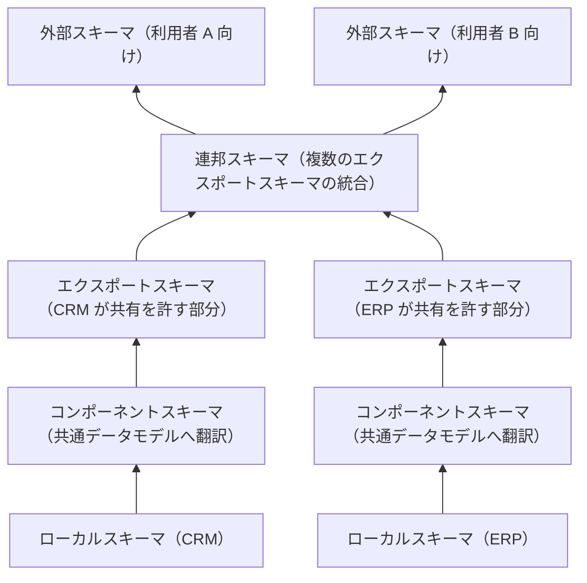
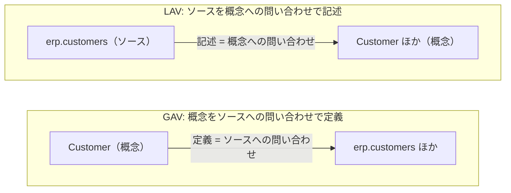
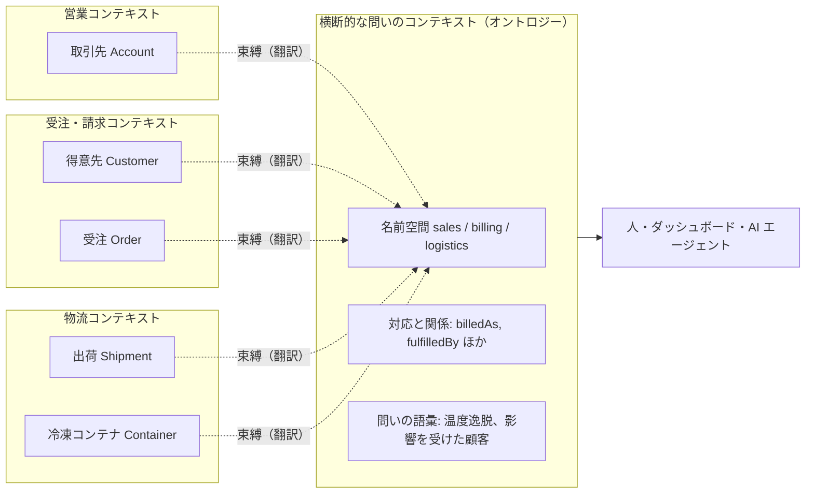
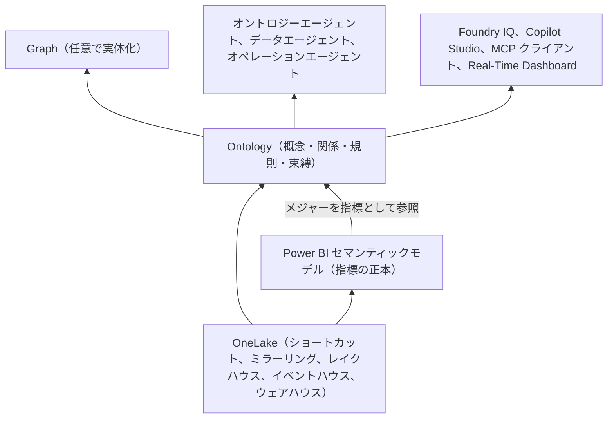

## はじめに

Microsoft Fabric が「Fabric IQ」の中核として推している <strong>Ontology（オントロジー）</strong> について周囲と話していると、人によって思い描いているものがかなり違うことに気づく。

- テーブルや列に、業務上の意味を説明するディスクリプションを付けるもの
- CRM の「取引先」と ERP の「得意先」は同じものだ、と異なるデータソース間の意味を対応付けるもの
- ノードとエッジでできたナレッジグラフのこと
- Power BI のセマンティックモデルの言い換え、あるいはその発展形
- AI エージェントに渡すための、気の利いたデータ辞書

どれも半分ずつ正しく、どれも全体ではない。本稿では「それって要するに何なのか、どう使うのか、何が便利なのか」に、できるだけ根拠を示しながら答えてみたい。

本稿の出発点は、筆者が持っている次の 2 つの仮説である。

> <strong>仮説 1（意味論的ビュー）</strong>　全部がひとつのデータベースに統合されているなら、ビューを作っておけばよい。オントロジーは、ビューを作れない領域で作る意味論的なビューではないか。別システム、別スキーマ、別の所有者、別の語彙——JOIN が欲しいのに書けないところにこそ、オントロジーが要る。
>
> <strong>仮説 2（コンテキストマッピング）</strong>　ドメインモデルは境界付けられたコンテキストの内側にあり、そのコンテキストのチームや組織が所有する。一方オントロジーは、複数のドメインやデータソースの語彙を取り込み、コンテキストの外側のモデルとして置かれる。各コンテキストがすでに所有している概念を外から見て、境界を越えてどう対応・関連するかを書くのがオントロジーなら、それは実質的にコンテキストマッピングではないか。しかもそれは、物理データからのボトムアップではなく、業務からのトップダウンで定義される。

仮説 2 の「境界付けられたコンテキスト」や「コンテキストマッピング」は、DDD（ドメイン駆動設計）の用語である（4 章で説明する）。DDD と厳密に対応付けるつもりはない。ただ、この 2 つの仮説は、オントロジーという言葉のぶれを整理するのにちょうどよい物差しになる。以下では、哲学と知識工学におけるオントロジーの定義、データベース研究が 30 年以上かけて育ててきたデータ統合の理論、DDD の戦略的設計、そして Fabric IQ の Ontology の実際の仕様を順に当てて、仮説がどこまで正しく、どこを直すべきかを検証する。

Fabric IQ の Ontology は本稿の執筆時点（2026 年 10 月）でプレビューであり、ドキュメントでは「新しいエクスペリエンス」が既定になっている（旧エクスペリエンスは 2027 年 1 月 31 日に廃止予定）。製品の記述は [Microsoft Learn のドキュメント](https://learn.microsoft.com/fabric/iq/ontology/overview)の 2026 年 10 月時点の内容に基づくので、細部は今後変わりうる。

## 先に結論

| 問い | 本稿の答え | 章 |
|---|---|---|
| オントロジーとは何か | ある共同体が、ある目的のために合意した概念化（世界の切り取り方）を、明示的に、できれば形式的に書き下したもの。企業データの文脈では「語彙・構造・束縛・運用」の 4 層の束として現れる | 1、2 |
| テーブルに意味の説明を付けるものか | 違う。それは語彙の層の一部を、物理構造に直付けしたものにすぎない。オントロジーでは説明は<strong>概念</strong>に付き、テーブルはその概念の束縛先の 1 つになる。説明の付け先が逆になる | 1 |
| データソース間の意味マッピングか | 半分正しい。束縛（マッピング）はオントロジーの半身だ。ただしソースどうしを直接つなぐ対応表ではなく、共通の概念を立て、各ソースをそこへ写す | 1、3 |
| 「JOIN を書けない場所のビュー」か | 束縛の部分は、データ統合理論でいう GAV 写像——つまりビューそのものだ。仮説 1 は古典的な理論と一致する。ただしビューは「どう計算するか」を定めるもので、オントロジーは「それが何を意味し、何が成り立つべきか」の理論を併せ持つ。また、置かれるのは JOIN を物理的に書けない場所というより、書く資格を誰も単独では持たない場所だ | 3 |
| JOIN を書けない理由は何か | 物理的に届かない、キーが突き合わない、意味が揃わない、書く資格を誰も単独では持たない、の 4 つ。OneLake が 1 つ目を、MDM（マスターデータ管理）が 2 つ目を引き受ける。オントロジーは主に 3 つ目を引き受け、4 つ目については合意の結果を書き留める器になる。結合キーそのものは作らない | 3、7 |
| コンテキストマッピングか | 翻訳の部分は、コンテキストマップに書くべき中身そのものだ。ただしオントロジーはコンテキストの「外側」に浮いているのではなく、横断的な問いを持つ人とエージェントのための、独自のコンテキストの「内側」にある。だから所有者が要る。言うなれば「言語を持ったコンテキストマップ」である | 4 |
| トップダウンで定義するものか | 能力質問（competency question）から始めるのは、学術的にも正道だ。ただし実務は、中核の概念から始めて業務と物理の両側を往復する、いわばミドルアウトになる。既存資産からの自動生成はボトムアップの叩き台と割り切る | 5 |
| Fabric IQ の Ontology は何者か | 業務の概念（エンティティ型・関係・指標・規則）を定義し、OneLake 上のソースに束縛する、データを自分では持たない仮想的な意味レイヤー。形式論理の OWL ではなく「フレーム＋単一継承」級の表現力で、主な消費者は AI エージェントである | 6 |
| 何が便利になるか | 翻訳のコストを一度だけ払えばよくなる。エージェントに共通の地図を渡せる。指標と規則を再利用できる。関係を多段でたどれる。ソースの変化を束縛で吸収できる。外部の語彙と行き来できる | 7 |
| 何が便利にならないか | 同一性の解決（名寄せ）、表記の正規化、規則の実行、合意形成と所有、形式的な推論。これらは別の仕組みと組織の仕事として残る | 7 |

## 1. 「オントロジー」がぶれる理由

### 1.1 同じ言葉で呼ばれているもの

オントロジーという言葉がぶれる理由の 1 つは、この言葉が少なくとも 4 つの世界をくぐり抜けてきたことにある。哲学（何が存在するのかを問う学問）、人工知能の知識表現（システム間で知識を共有するための仕様）、セマンティック Web（RDF や OWL という Web 標準）、そして企業のデータ基盤（業務の概念をデータに結び付ける層）だ。世界が変わるたびに、同じ言葉が少しずつ違うものを指すようになった。

もう 1 つの理由は、企業の現場で「オントロジー」と呼ばれる成果物が、実際には性格の違う部品の束だということにある。冒頭に挙げた理解はどれも、その束のどこか一部を見ている。

### 1.2 4 つの層に分けてみる

そこで本稿では、企業データの文脈でオントロジーと呼ばれるものを、次の 4 つの層に分けて考える。

| 層 | 答える問い | 例 |
|---|---|---|
| 語彙 | その言葉は何を指すのか | 名前、定義文、同義語、表記 |
| 構造 | 概念どうしはどう関係し、何をもって同一とみなすのか | 型、is-a（上位・下位）、関係とその基数、キー、制約 |
| 束縛 | その概念の実例はどのデータにあるのか | 「顧客」は ERP のこの表、「温度」は IoT のこの時系列 |
| 運用 | その意味を何に使うのか | 指標（KPI の計算式）、業務規則、アクション |

テーブルへのディスクリプションは語彙の層の一部だ。データソース間の対応表は束縛の層だ。ナレッジグラフは、構造の層を薄く持ちながら、束縛された実例そのものを主役にしたものだ。そして Fabric IQ の Ontology は、4 層すべてに手を伸ばしているが、それぞれの深さは一様ではない。

次の表で、よく「オントロジー」と呼ばれる成果物を 4 層で比べてみてほしい。

<OntologyInterpretationMap />

### 1.3 説明の「付け先」が逆になる

なかでも「テーブル定義に意味のディスクリプションを付けるもの」という理解は、オントロジーとの違いが最もわかりにくい。違いは、説明の量や丁寧さではなく、<strong>説明をどこに付けるか</strong>にある。

データカタログで列 `CUST_KBN` に「顧客区分（1: 法人、2: 個人）」と書くとき、主役は列であり、説明は列に付いた注釈だ。列が消えれば説明も消える。別のシステムに `customer_type` という似た列があっても、両者が同じものを指すのかは、どちらの説明を読んでもわからない。説明はそれぞれの物理構造の中に閉じている。

オントロジーでは向きが逆になる。まず「顧客区分」という概念を立て、定義を書く。そのうえで、その概念の実例が ERP の `CUST_KBN` にも、EC サイトの `customer_type` にもある、と<strong>束縛</strong>（バインディング）する。主役は概念で、列は束縛先の 1 つにすぎない。列が改名されても、束縛を張り替えれば概念は生き残る。そして 2 つの列が同じ概念に束縛されていること自体が、「この 2 つは同じものを指す」という主張になる。

後で見るように、オントロジーの設計基準として知られるグルーバー（Thomas R. Gruber）の原則の 1 つは、まさにこの点——概念の定義を特定の記号表現（物理的な符号化）に依存させないこと——を求めている。ディスクリプションは必要だが、それを物理に直付けしているうちは、まだオントロジーではない。

## 2. 学術的な定義をたどる

### 2.1 哲学のオントロジー: 何が存在するのか

オントロジー（ontology）はもともと哲学の言葉で、日本語では「存在論」と訳される。「存在するとはどういうことか」「世界にはどんな種類のものが存在するのか」を問う、形而上学の一分野だ。問い自体はアリストテレスの『範疇論』（実体・量・質・関係……という存在のカテゴリー分け）にまで遡る。一方、「ontologia」という語が書物に現れるのは 17 世紀初頭で、ヤーコプ・ローアハルト（Jacob Lorhard）の『Ogdoas Scholastica』（1606 年）やルドルフ・ゴクレニウス（Rudolf Goclenius）の『Lexicon philosophicum』（1613 年）が初出として挙げられる。18 世紀にクリスティアン・ヴォルフ（Christian Wolff）が『Philosophia prima, sive Ontologia』（1730 年）で体系化し、哲学の用語として定着した。

企業データの話にとって示唆が大きいのは、20 世紀の分析哲学が持ち込んだ<strong>存在論的コミットメント（ontological commitment）</strong>という考え方だ。クワイン（W. V. O. Quine）は 1948 年の論文「[On What There Is](https://www.pdcnet.org/revmetaph/content/revmetaph_1948_0002_0021_0038)」で、「存在者として想定されるとは、純粋かつ単純に、変項の値とみなされることである」と書いた。ある理論が何の存在を認めているかは、その理論の量化された変項が何を値として取らねばならないかで決まる。「〜であるような x が存在する」と言った時点で、その理論は x の存在に賭けている。

これを業務システムに引き寄せると、次のような問いになる。

- 受注は、顧客なしに存在しうるのか（スポット取引の受注に「顧客」は要るのか）
- 「顧客」はものの種類なのか、それとも組織がたまたま担っている役割なのか（同じ会社が顧客でも仕入先でもありうる）
- CRM の取引先と ERP の得意先は、同じものを 2 回数えているのか、別のものを 1 回ずつ数えているのか

データモデルは、意識していようといまいと、こうした問いに答えてしまっている。テーブルを 1 つ作るたびに「この種類のものが存在し、それぞれはこのキーで区別される」と宣言しているからだ。オントロジーを作るとは、この暗黙の宣言を明示的に書き出し、関係者の間で合意し直すことだと言える。

### 2.2 知識工学のオントロジー: 概念化の明示的な仕様

1980 年代から 90 年代にかけて、人工知能の知識表現の分野がこの言葉を借りてきた。目的は哲学とは違い、<strong>別々に作られたシステムの間で知識を共有・再利用すること</strong>だった。米国の Knowledge Sharing Effort と呼ばれる研究プログラムでは、知識ベースどうしが知識をやり取りするための共通の語彙として、オントロジーが位置づけられた。この取り組みを報告したネチェスらの論文（[Neches ほか 1991](https://doi.org/10.1609/aimag.v12i3.902)）は、オントロジーを「ある主題領域の語彙を構成する基本的な用語と関係、そして用語と関係を組み合わせて語彙を拡張するための規則を定めるもの」と説明している。語彙だけでなく、それを組み合わせる規則までを含む点に注意したい。

この流れの中で最も引用される定義が、グルーバーによるものだ（[Gruber 1993](https://doi.org/10.1006/knac.1993.1008)）。

> An ontology is an explicit specification of a conceptualization.
> （オントロジーとは、概念化の明示的な仕様である）

ここでいう<strong>概念化（conceptualization）</strong>は、ジェネセレスとニルソン（Genesereth & Nilsson 1987）に由来する用語で、グルーバーは「何らかの目的のために表現したい世界についての、抽象化され単純化された見方」と説明している。どの知識ベースも、明示的であれ暗黙的であれ、何らかの概念化にコミットしている。オントロジーはそれを明示的に書き出したもの、というわけだ。

その後、ボルスト（Borst 1997）が「共有された概念化の形式的な仕様」と言い換え、ステューダー、ベンジャミンズ、フェンゼル（[Studer, Benjamins & Fensel 1998](https://doi.org/10.1016/S0169-023X(97)00056-6)）が両者を統合した定義を示した。

> An ontology is a formal, explicit specification of a shared conceptualisation.
> （オントロジーとは、共有された概念化の、形式的で明示的な仕様である）

この定義の 4 つの語は、それぞれ次のことを要求している。

| 語 | 意味 | 企業データに引き寄せると |
|---|---|---|
| 概念化（conceptualization） | ある現象を、関連する概念で捉えた抽象モデル | 物理スキーマではなく、業務の概念の水準で書く |
| 明示的（explicit） | 概念の種類と、その使い方の制約が明示されている | 「顧客」の定義と、何をもって同一の顧客とみなすかを書く |
| 形式的（formal） | 機械が読める | 人間向けの Wiki ではなく、ツールやエージェントが解釈できる形にする |
| 共有された（shared） | 個人ではなく、ある集団が受け入れた合意である | 誰がこの定義に合意し、誰が保守するのかが決まっている |

さらにグアリーノ（[Guarino 1998](https://www.loa.istc.cnr.it/old/Papers/FOIS98.pdf)）は、オントロジーを「形式的な語彙の意図された意味を説明する論理的理論」として捉え直した。要点は、オントロジーが概念化そのものではなく、その<strong>近似</strong>だということだ。語彙に公理（制約）を足すほど、その語彙のありうる解釈は絞られ、意図した意味に近づく。「受注にはちょうど 1 人の顧客がいる」と書けば、顧客のいない受注を許すような解釈は排除される。オントロジーの仕事は、意味を言い当てることではなく、<strong>ありえない解釈を削ること</strong>だと言ってもいい。

この節から持ち帰りたいのは、次の 2 点である。

1. オントロジーは<strong>概念</strong>の水準のものであり、データそのものでも、特定のデータベースのスキーマでもない。
2. オントロジーは<strong>「何らかの目的のため」に「共有された」</strong>ものであり、中立的な神の視点ではない。誰が、何のために合意したのかが、定義の一部に含まれている。

2 点目は、後で DDD と突き合わせるときに効いてくる。

### 2.3 グルーバーの設計基準

グルーバーは 1995 年の論文（[Gruber 1995](https://doi.org/10.1006/ijhc.1995.1081)）で、知識共有のためのオントロジーを設計する 5 つの基準を挙げた。

| 基準 | 内容 | 企業データでの読み替え |
|---|---|---|
| 明瞭性（clarity） | 定義は客観的で、可能なら必要十分条件として書く | 「アクティブ顧客」を、担当者の感覚ではなく条件で定義する |
| 一貫性（coherence） | 定義から導かれることが矛盾しない | 「受注には顧客が 1 人」と「顧客なしのスポット受注」を同居させない |
| 拡張性（extendibility） | 既存の定義を改訂せずに、新しい語を足せる | 新しい事業の概念を、既存の型の特殊化として足せる |
| 符号化バイアスの最小化（minimal encoding bias） | 概念の定義を、特定の記号表現（符号化）に依存させない | 列名や区分コードの都合を、概念の定義に持ち込まない |
| 存在論的コミットメントの最小化（minimal ontological commitment） | 知識共有に必要な最小限のことだけを主張する | 各部門が自分で決めればよいことまで、全社で決めない |

最後の 2 つは、冒頭の仮説に直接かかわる。符号化バイアスの最小化は「定義を物理の都合から切り離せ」という要請で、仮説 2 の「物理からではなく業務から」という直観と同じ方向を向いている。ただしこれは出来上がった定義への要求であって、作る順番への要求ではない（5 章で見るとおり、ボトムアップの叩き台から始めても満たせる）。存在論的コミットメントの最小化は「共有に必要なことだけを書け」という要請で、4.4 節で見るように、オントロジーが各ドメインのモデルを飲み込もうとする失敗への、学術側からの歯止めになっている。

グルーバーは同じ論文で、エージェントがオントロジーにコミットするとは、その<strong>観測可能な振る舞い</strong>がオントロジーの定義と整合していることだ、と述べている。内部でどんな表現を持っていてもかまわない。共有された語彙で話すときに、その定義に反することを言わなければよい。だからエージェントどうしは、大域的に共有された単一の理論を持たなくても、互いに話ができる。この「内部は自由、境界でだけ合意する」という構図は、DDD の境界付けられたコンテキストとほぼ同じ形をしている（4 章）。

### 2.4 オントロジーのスペクトル

では、どこからがオントロジーなのか。ラッシラとマクギネス（[Lassila & McGuinness 2001](https://www.ida.liu.se/ext/epa/cis/2001/005/tcover.html)）は、「オントロジー」と呼ばれうるものを、表現力の弱いものから強いものへと並べたスペクトルを示した。

```text
弱い ←─────────────────────────────────────────────────────→ 強い
カタログ/ID → 用語集 → シソーラス → 非形式的な is-a → 形式的な is-a
  → 形式的なインスタンス → フレーム（プロパティ） → 値の制約 → 一般的な論理制約
```

左端はただの語のリストで、右端は任意の論理式で制約を書ける形式オントロジーだ。どこから先を「オントロジー」と呼ぶべきかは論者によって違い、厳密な上位・下位関係（形式的な is-a）を持つものに限る立場もあれば、用語集やシソーラスまで含める立場もある。ここに、冒頭のぶれの正体の一端がある。テーブルのディスクリプションも、用語集も、OWL で書いた公理の体系も、このスペクトルのどこかには乗る。ぶれているのは定義ではなく、<strong>スペクトル上の位置</strong>なのだ。

Fabric IQ の Ontology は、後で詳しく見るとおり、型・プロパティ・関係・単一継承までを持ち、論理制約は持たない。スペクトルで言えば「フレーム＋形式的な is-a」のあたりに位置する。

### 2.5 セマンティック Web の道具立てと「開いた世界」

2000 年代以降、W3C がオントロジーを書くための Web 標準を整備した。

| 標準 | 役割 |
|---|---|
| [RDF](https://www.w3.org/TR/rdf11-concepts/) | 「主語・述語・目的語」の 3 つ組でデータを表す土台 |
| [RDFS](https://www.w3.org/TR/rdf-schema/) | クラス、サブクラス、プロパティの定義域と値域など、最小限の語彙 |
| [OWL 2](https://www.w3.org/TR/owl2-overview/) | クラスの同値・排他、基数制約、推移性などを論理的に書ける言語 |
| [SKOS](https://www.w3.org/TR/skos-reference/) | 用語集やシソーラス（上位語・下位語・同義語）を表すための語彙 |
| [SPARQL](https://www.w3.org/TR/sparql11-query/) | RDF の問い合わせ言語 |
| [SHACL](https://www.w3.org/TR/shacl/) | RDF データが満たすべき形（シェイプ）を検証する言語 |
| [R2RML](https://www.w3.org/TR/r2rml/) | リレーショナルデータベースを RDF として見せるための写像言語 |

記述論理（OWL の理論的な基盤）の用語では、概念と関係の定義の部分を <strong>TBox</strong>、個々の事実（「A 社は顧客である」）の部分を <strong>ABox</strong> と呼ぶ。厳密な定義があるわけではないが、オントロジーは主に TBox を指し、TBox と ABox を合わせてグラフとして持ったものがナレッジグラフと呼ばれることが多い。「オントロジーとナレッジグラフは何が違うのか」という問いには、ひとまず「型の側か、実例の側か」と答えられる。ただしこれは慣用上の区別で、OWL の仕様では、個体についての主張も含めた公理の集まり全体を 1 つのオントロジーと呼ぶ。

ここで 1 つ、データベースに慣れた人がつまずく点がある。OWL は<strong>開世界仮定（open-world assumption）</strong>に立つ。書かれていないことは「偽」ではなく「不明」だ。顧客の電話番号が登録されていなくても、電話番号を持たないとは結論しない。また OWL は<strong>一意名仮定（unique name assumption）</strong>を置かないので、名前の違う 2 つの個体が同一である可能性を排除しない（[OWL 2 Primer](https://www.w3.org/TR/owl2-primer/) を参照）。一方、データベースは閉世界で考える。表にない行は存在しない。

この違いは、論理の上では、記述論理が一階述語論理の意味論を引き継いでいることの帰結である。同時に、オントロジーが「誰も全体を知らない、開かれた環境での知識の統合」のために使われてきたこととも噛み合っている。複数のソースが部分的な事実を持ち寄る状況では、「書かれていない＝偽」とは言えないからだ。逆に、データの検査をしたいときには閉世界の発想が要る。SHACL が後から標準化されたのは、そのためである。

## 3. オントロジーは「ビュー」か — データ統合理論から読む

仮説 1 は「オントロジーは、ビューを作れない場所の意味論的なビューだ」というものだった。結論から言えば、これはデータベース研究が 1990 年代から積み上げてきた<strong>データ統合（data integration）</strong>の理論と、驚くほどよく一致する。

### 3.1 ひとつのデータベースの中では、意味はビューで足りる

1975 年に ANSI/X3/SPARC の研究グループが示した<strong>3 層スキーマ構造</strong>は、データベースを次の 3 つの水準で捉えた。

- <strong>外部スキーマ</strong>: 利用者や業務ごとの見え方。今日でいうビューに当たる
- <strong>概念スキーマ</strong>: 組織全体から見たデータの論理構造。どんな実体があり、どう関係するか
- <strong>内部スキーマ</strong>: 物理的な格納方法

ひとつのデータベースの中では、概念スキーマが組織の共通理解を担い、ビューが利用者ごとの切り口を担う。「顧客」の範囲や結合の仕方で揉めても、最後は同じスキーマの中でビューを 1 本書けば決着がつく。仮説 1 の前半「全部ひとつのデータベースにあるならビューを作ればよい」は、この世界の話だ。

興味深いのは、概念スキーマという発想そのものが、組織全体の概念モデルを 1 つ持とうとする試みだったことだ。オントロジーは、ある意味で、この概念スキーマが<strong>複数のデータベースにまたがる世界</strong>で復活したものだと言える。

### 3.2 ビューを作れない場所: 分散・異種性・自律性

では、ビューを作れないのはどんなときか。シェスとラーソン（[Sheth & Larson 1990](https://doi.org/10.1145/96602.96604)）は、複数のデータベースを束ねる<strong>連邦データベース（federated database）</strong>を整理した古典的なサーベイで、問題の次元を<strong>分散</strong>・<strong>異種性</strong>・<strong>自律性</strong>の 3 つに分けた。

| 次元 | 内容 | 仮説 1 の言葉では |
|---|---|---|
| 分散 | データが物理的に別の場所にある | 別システム |
| 異種性 | データモデル、スキーマ、意味が違う | 別スキーマ、別の語彙 |
| 自律性 | 各データベースが、自分の設計・運用・共有範囲を自分で決める | 別の所有者 |

特に自律性は、さらに細かく分類されている。どんなデータをどんな意味で持つかを自分で決める<strong>設計の自律性</strong>、他と通信するかを決める<strong>通信の自律性</strong>、自分の処理を他に邪魔されずに実行する<strong>実行の自律性</strong>、連邦に加わるか、何をどこまで共有するかを決める<strong>参加の自律性</strong>（association autonomy）である。仮説 1 の「別の所有者」は、技術的な制約というより、この自律性の問題だ。

シェスとラーソンは、連邦データベースのスキーマを 5 つの層で整理した。



各ソースは自分のスキーマを共通のデータモデルに翻訳し（コンポーネントスキーマ）、そのうち外部に見せてよい部分を切り出す（エクスポートスキーマ）。複数のエクスポートスキーマを統合したものが<strong>連邦スキーマ</strong>で、利用者はさらにその上に自分用のビュー（外部スキーマ）を持つ。

この連邦スキーマこそ、「どのデータベースの中にも作れないビュー」である。そしてエクスポートスキーマという層があることは、各ソースの所有者が「どこまで見せるか」を自分で決めるという、自律性の尊重を表している。仮説 1 の直観は、30 年以上前にこの形で定式化されていた。

### 3.3 グローバルスキーマと写像: GAV と LAV

この構図を理論として磨き上げたのが、レンツェリーニ（[Lenzerini 2002](https://doi.org/10.1145/543613.543644)）のデータ統合の形式化だ。データ統合システムを次の 3 つ組で表す。

$$
\mathcal{I} = \langle \mathcal{G}, \mathcal{S}, \mathcal{M} \rangle
$$

$\mathcal{G}$ は利用者に見せる<strong>グローバルスキーマ</strong>、$\mathcal{S}$ は<strong>ソース</strong>の集まり、$\mathcal{M}$ は両者をつなぐ<strong>写像（マッピング）</strong>だ。写像の書き方には大きく 2 つの流儀がある。

- <strong>GAV（global-as-view）</strong>: グローバルスキーマの各要素を、ソースに対する問い合わせとして定義する。「グローバルスキーマはソースのビューである」
- <strong>LAV（local-as-view）</strong>: 各ソースを、グローバルスキーマに対する問い合わせとして記述する。「ソースはグローバルスキーマのビューである」



GAV は、まさに仮説 1 が言う「ビュー」だ。グローバルな「顧客」を、ソースに対する問い合わせとして書く。もし CRM と ERP と対応表がひとつのデータベースにあれば、次のビューとして書けたはずのものである。

```sql
-- GAV: グローバルスキーマの要素 Customer を、ソースへの問い合わせとして定義する
-- （実際には各テーブルは別のシステムにあり、この SQL をそのまま実行できる場所はない）
CREATE VIEW global_customer AS
SELECT e.sold_to_code AS customer_id,
       e.legal_name,
       c.segment
FROM erp_customers e
LEFT JOIN mdm_customer_xref x ON x.sold_to_code = e.sold_to_code
LEFT JOIN crm_accounts c      ON c.account_id   = x.account_id;
```

GAV では、グローバルスキーマに制約がない限り、そこへの問い合わせは、定義を展開（unfolding）するだけでソースへの問い合わせになる。ビューの展開と同じで、処理は素直だ（キーなどの制約が加わると、この素直さは失われる。後で見るオントロジーの公理も、この種の制約に当たる）。その代わり、ソースが増えたり変わったりするたびに、グローバルスキーマ側の定義を書き換えなければならない。

LAV では向きが逆になる。グローバルスキーマ（業務の概念モデル）を先に、ソースから独立して設計し、各ソースを「このソースは、概念モデルのこの部分を持っている」と記述する。ソースの追加は、そのソースの記述を 1 つ足すだけで済む。その代わり、問い合わせに答えるには「ビューを使った問い合わせの書き換え（answering queries using views）」という難しい処理が必要になる。

どちらを選ぶかについて、レンツェリーニ自身の整理は明快だ。LAV の典型として、データ統合システムが<strong>企業モデルやオントロジー</strong>に基づく場合を挙げ、それは組織の中で安定し、確立したグローバルスキーマがあるときに有効だとする。一方 GAV は、ソースの集合が安定しているときに有効だとしている。仮説 2 の「業務からのトップダウン」は、発想としては LAV に近い。概念モデルを先に立て、ソースをそこへ位置づけるからだ。後で見るように、Fabric IQ の Ontology は、概念はトップダウンにも設計できる一方、束縛は GAV 的に書く、という組み合わせになっている。

### 3.4 OBDA: オントロジーをグローバルスキーマにする

グローバルスキーマの位置にオントロジーを置いたのが、<strong>OBDA（ontology-based data access）</strong>だ（[Poggi ほか 2008](https://doi.org/10.1007/978-3-540-77688-8_5)）。OBDA は次の 3 つで構成される。

1. <strong>オントロジー</strong>: 業務の概念と関係、その公理（TBox）
2. <strong>写像</strong>: ソースへの SQL 問い合わせと、オントロジーの概念・関係との対応
3. <strong>ソース</strong>: 既存のリレーショナルデータベース群

利用者はオントロジーの語彙で問い合わせる。システムはオントロジーの公理を使って問い合わせを書き換え、写像を使って SQL に展開し、ソースで実行する。データはソースに置いたままで、オントロジーの水準のデータは仮想的にしか存在しない。後の文献では、この構成は<strong>仮想ナレッジグラフ（virtual knowledge graph）</strong>とも呼ばれる。

W3C の R2RML は、この写像を書くための標準言語だ。次の例を見てほしい。

```turtle
@prefix rr: <http://www.w3.org/ns/r2rml#> .
@prefix ex: <http://example.com/ns#> .

<#CustomerFromErp>
  rr:logicalTable [ rr:sqlQuery """
      SELECT sold_to_code, legal_name FROM erp_customers
  """ ] ;
  rr:subjectMap [
      rr:template "http://example.com/customer/{sold_to_code}" ;
      rr:class ex:Customer
  ] ;
  rr:predicateObjectMap [
      rr:predicate ex:legalName ;
      rr:objectMap [ rr:column "legal_name" ]
  ] .
```

`rr:logicalTable` の中身は、文字どおり SQL の問い合わせ——つまりビュー——だ。その結果の各行を `ex:Customer` という概念の実例とみなし、列を概念のプロパティに対応させている。

ここまで来ると、仮説 1 は「当たらずといえども遠からず」どころではない。<strong>オントロジー＋写像＝JOIN を書けない場所の意味論的ビュー</strong>というのは、OBDA のアーキテクチャそのものである。

### 3.5 それでも、オントロジーはビューではない

ただし、「オントロジーはビューだ」と言い切ると、大事なものを取りこぼす。ビューに当たるのは写像（束縛）の半身であって、オントロジー本体ではないからだ。違いは少なくとも 5 つある。

<strong>(a) ビューは計算の定義で、オントロジーは理論だ。</strong>ビューは、宣言的にではあれ、「どう計算するか」を定める。オントロジーは「何が存在し、何が成り立つべきか」を書く。OBDA では、オントロジーの公理が問い合わせの答えそのものを変える。「冷凍コンテナはコンテナの一種」という公理があれば、「すべてのコンテナ」を問うたときに、別の表に束縛された冷凍コンテナも答えに含まれる。ビューでも UNION を書き足せば同じ答えは出せる。だがそれは、推論の結果を手で書き写したものにすぎない。「冷凍コンテナはコンテナの一種」という知識そのものはそのビューに埋もれ、ほかの問い合わせが再利用できる形では残らない。

<strong>(b) ビューは同一性を前提にし、オントロジーは同一性を問題にする。</strong>JOIN は、結合キーが同じ値を持つことを前提に書かれる。しかし境界をまたぐと、その前提がまず成り立たない。CRM の `account_id` と ERP の `sold_to_code` は別の体系だ。オントロジーは「何をもって同じ顧客とみなすか」という同一性の基準を書く場所になる。ただし書けるのは基準であって、対応表そのものではない。基準に沿って実際のレコードを突き合わせる名寄せ（エンティティ解決）は、MDM（マスターデータ管理）などの仕事として残る。

<strong>(c) 意味の対応は「等しい」だけではない。</strong>オントロジーマッチングの研究（[Euzenat & Shvaiko](https://doi.org/10.1007/978-3-642-38721-0)）では、概念どうしの対応を、同値だけでなく、包含（一方が他方の下位）や排他などの関係として扱う。企業のデータでは、さらに「部分的に重なる」という関係が頻繁に現れる。CRM の取引先は見込み客を含み、ERP の得意先はスポットの顧客を含む。両者は「同じ」ではなく「重なる」。このとき、ビューで内部結合を書くか外部結合を書くかは、SQL の書き方の問題ではなく、<strong>意味の主張</strong>だ。内部結合を書けば「両方にいる者だけが顧客だ」と主張したことになる。オントロジーは、この主張を名前の付いた知識として残す。

<strong>(d) 消費者が違う。</strong>ビューの消費者は SQL を書く人と BI ツールだ。今日の企業向けオントロジーが主に想定する消費者は、自然言語で問いを立てる人と AI エージェントである。だから名前・定義文・同義語・規則といった、機械が実行するわけではない情報が、オントロジーでは一級の構成要素になる。

<strong>(e) 運用の層がある。</strong>ビューは基本的に読むためのものだ。企業向けのオントロジー製品は、指標や業務規則、さらにはデータを書き戻すアクションまで、意味の上に載せようとする。たとえば Palantir Foundry の [Ontology](https://www.palantir.com/docs/foundry/ontology/overview/) は、自らを「組織のための運用の層」と呼ぶ。オブジェクト・プロパティ・リンクという意味の要素（semantic elements）に加えて、アクション・関数といった変化を起こす要素（kinetic elements）を持つ、組織のデジタルツインという位置づけだ。Fabric IQ の Ontology がどこまでを持つのかは 6 章で見る。

### 3.6 「ひとつのデータベースにあれば足りる」は本当か

もう 1 つ、仮説 1 の前半にも修正が要る。「全部ひとつのデータベースにあるなら、ビューを作ればよい」は、物理的な統合が意味の統合を連れてくる、と暗に仮定している。だが、それは成り立たない。

Microsoft 自身が、Fabric IQ を発表した [Fabric のブログ](https://community.fabric.microsoft.com/blog/fbc_fabricupdatesblogs/fabric-iq-the-semantic-foundation-for-enterprise-ai/5172473)で、こう書いている。「Microsoft Fabric や OneLake のようなプラットフォームがデータの置き場所を統合しても、そのデータの意味は依然として断片化している」。OneLake は、Fabric で組織全体が共有する 1 つの論理的なデータレイクだ。ショートカットやミラーリングを使えば、物理的にばらばらだったデータもそこに集まり、技術的に JOIN を書ける場面は大きく増える。それでも、その JOIN が正しいと誰が言えるのか、という問題は残る。

JOIN を書けない理由を分解すると、次の 4 つになる。

| JOIN を書けない理由 | 例 | 主な受け皿 |
|---|---|---|
| 届かない（分散） | 別のクラウド、別の SaaS、オンプレミス | OneLake のショートカット、ミラーリング、データ連携 |
| 突き合わない（同一性） | CRM の ID と ERP のコードが別体系 | MDM、名寄せ、対応表 |
| 揃わない（意味） | 「顧客」の範囲・粒度・単位・時点が違う | オントロジーの語彙・構造・束縛 |
| 書く資格がない（所有） | 誰の「顧客」の定義を採るのか、誰も単独では決められない | 合意の手続き、名前空間ごとの所有、変更管理 |

OneLake が 1 行目を、MDM が 2 行目を引き受ける。オントロジーが主に引き受けるのは 3 行目だ。4 行目については、合意した結果を書き留め、名前空間で所有の境界を示す器にはなるが、合意そのものは、7.2 節で見るとおり人と組織の仕事として残る。

ひとつのデータベースの中でさえ、ビューだけでは意味を運べない、という事情もある。たとえば Snowflake は、データベースの中に置くスキーマレベルのオブジェクトとして「[Semantic View](https://docs.snowflake.com/en/user-guide/views-semantic/overview)」を提供している。論理テーブル、関係、指標、次元を定義し、AI エージェント（Cortex Agents）がその定義を読んで SQL を生成する。物理的には JOIN を書ける場所でも、名前と定義と計算の正本を別に持たないと、人間にも AI にも意味が伝わらないのだ。

ここまでを踏まえて、仮説 1 を次のように修正したい。

> <strong>仮説 1（修正版）</strong>　オントロジーは、JOIN を物理的に書けない場所というより、<strong>JOIN を書く資格を誰も単独では持たない場所</strong>に置かれる意味論的なビューである。その束縛の半身はデータ統合理論の GAV 写像そのものだが、本体は、その JOIN が何を意味し、何をもって同じものとみなすのかという理論と、それに誰が合意し、誰が責任を持つのかという取り決めの記録のほうにある。

## 4. オントロジーは「コンテキストマップ」か — DDD から読む

### 4.1 境界付けられたコンテキストとコンテキストマップ

エヴァンス（Eric Evans）の『[Domain-Driven Design](https://www.domainlanguage.com/ddd/)』（2003 年）は、モデルを「解こうとしている問題に関係する側面を抽象し、それ以外を無視した、現実の解釈」として扱う。モデルは目的に対して相対的であり、目的が違えば同じ言葉でも別のモデルになる。そこでエヴァンスは、1 つのモデルが一貫して通用する範囲を<strong>境界付けられたコンテキスト（Bounded Context）</strong>として明示し、その内側では、開発者と業務の専門家が同じ言葉——<strong>ユビキタス言語</strong>——を使うよう求めた。

大きな組織で全社に通用する単一のモデルを作ることについて、エヴァンスははっきり懐疑的だ。大きなシステムのドメインモデルを完全に統一することは、実現可能でも費用対効果に見合うものでもない、と述べている。代わりに勧めるのは、複数のコンテキストの存在を受け入れ、その関係を<strong>コンテキストマップ（Context Map）</strong>として描くことだ。コンテキストマップには、各コンテキストの境界と、コンテキストどうしの接点——どこで何を翻訳し、どこで何を共有しているか——を書く。

コンテキストどうしの関係には、いくつかの典型的なパターンがある。

| パターン | 内容 |
|---|---|
| 共有カーネル（Shared Kernel） | 2 つのチームが、モデルの一部を共有し、共同で変更を管理する |
| 顧客／供給者（Customer/Supplier） | 下流の要求を、上流が計画に取り込む |
| 順応者（Conformist） | 下流が、上流のモデルをそのまま受け入れる |
| 腐敗防止層（Anticorruption Layer） | 下流が翻訳層を設け、上流のモデルが自分のモデルを汚さないようにする |
| 公開ホストサービス（Open Host Service） | 上流が、多くの利用者向けにプロトコルを公開する |
| 公表された言語（Published Language） | よく文書化された共有言語を、コンテキスト間のやり取りの共通の媒体にし、必要に応じてそこへ、またそこから翻訳する |
| 別々の道（Separate Ways） | 統合をやめ、それぞれが独立に解決する |

後年の『Domain-Driven Design Reference』（2015 年）では、パートナーシップ（Partnership）と大きな泥団子（Big Ball of Mud）も加えられている。

### 4.2 重なるところ: 翻訳と「公表された言語」

仮説 2 が言うとおり、オントロジーとコンテキストマップが重なる部分は大きい。

第一に、オントロジーの<strong>束縛と対応</strong>は、コンテキストマップに書くべき「明示的な翻訳」そのものだ。「営業コンテキストの取引先は、請求コンテキストの得意先と、MDM の対応表を介して対応する。ただし両者は同じ集合ではなく重なる集合だ」——これはコンテキストマップに書かれるべき接点の記述であり、同時にオントロジーの関係と束縛でもある。

第二に、オントロジーの<strong>語彙</strong>は、公表された言語の役割を果たす。各コンテキストは内部では自分のモデルを使い続け、境界を越えて話すときだけ、その言葉が共有の語彙に翻訳される（ただし 4.5 節で見るとおり、その翻訳を持つのは各ソースの側ではなく、オントロジーの側の束縛である）。2.3 節で見たグルーバーの存在論的コミットメント——内部表現は自由で、観測可能な振る舞いがオントロジーと整合していればよい——は、公表された言語と腐敗防止層の組み合わせと、ほぼ同じ構図をしている。知識工学と DDD は、異なる出自からよく似た結論にたどり着いていたわけだ。

第三に、Fabric IQ の Ontology は、この構図を受け入れる機能を製品として備えている。ドキュメントは名前空間について、営業ドメインの Customer と財務ドメインの Customer は多くの場合別のものを意味する、と書いたうえで、両方の Customer を同じオントロジーの中に、修飾された別々の識別子で共存させられるとしている（[Namespaces in ontology](https://learn.microsoft.com/fabric/iq/ontology/how-to-use-namespaces)）。名前空間は、モデルの中にガバナンスと所有の境界を設ける手段としても位置づけられている。少なくともこの機能は、全社で唯一の「顧客」を定義させる方向ではなく、コンテキストごとの語彙を並べたうえで、その間をつなぐ方向を向いている。もっとも [Fabric IQ の概要](https://learn.microsoft.com/fabric/iq/overview)は、Customer のような概念を一度だけ定義して再利用することも勧めており、どちらに倒すかは使う側の設計判断になる（4.4 節）。

### 4.3 ずれるところ: オントロジーにも「内側」がある

一方で、仮説 2 の「オントロジーはコンテキストの外側に置かれるモデル」という部分には、修正が要る。

2.2 節で見たとおり、オントロジーは「何らかの目的のため」に「共有された」概念化だった。目的があり、それを共有する共同体があるなら、そのオントロジーもまた、1 つのモデルとして<strong>あるコンテキストの内側</strong>にある。そのコンテキストとは、「温度逸脱の影響を受けた顧客は誰か」のような、ドメインをまたぐ問いを立てる人とエージェントのコンテキストだ。経営企画、オペレーションの監視、横断的な分析、そして AI エージェントがそこの住人であり、彼らの問いの言葉が、そのコンテキストのユビキタス言語になる。

この見方の違いは、実務では大きい。オントロジーを「どのコンテキストにも属さない、中立的で客観的な外側のモデル」だと考えると、次のことが見えなくなる。

- <strong>所有者が要る。</strong>どのコンテキストにも属さないモデルは、誰のものでもないモデルになり、誰も保守しない。横断的な問いのコンテキストを担うチーム（あるいは連邦的な合議体）を、明示的に決める必要がある。
- <strong>視点がある。</strong>横断的な問いのための「顧客」は、営業の「取引先」とも請求の「得意先」とも違う、第三の概念でありうる。オントロジーは既存の概念の対応表であるだけでなく、自分の問いのための新しい概念を立てる。
- <strong>オントロジーは 1 つとは限らない。</strong>サプライチェーンの問いとマーケティングの問いでは、必要な概念も粒度も違う。問いの共同体が違えば、別のオントロジーがあってよい。Fabric の Ontology が、別のオントロジーで定義されたエンティティ型から継承できる（クロスオントロジーの継承）のは、この分割を前提にした機能だと読める。

また、コンテキストマップはチームどうしの<strong>力関係</strong>も描く。どちらが上流でどちらが下流か、下流は上流に順応するのか、腐敗防止層で身を守るのか。オントロジーの定義の中には、この力学は現れない。対応関係は書けても、「ERP のコード体系が変わったら誰が束縛を直すのか」を表す構成要素はない。説明やメタデータに担当者を書き添えることはできるが、それを決め、守らせるのは、オントロジーの外の運用と組織の取り決めだ。

### 4.4 失敗の型: 全社統一モデルへの逆戻り

オントロジーの取り組みが陥りやすい失敗の型も、ここから見えてくる。オントロジーを「全社の正しいモデル」だと位置づけ、各ドメインにその語彙で考えるよう求めた瞬間、それはエヴァンスが実現不可能だと言った全社統一モデルに逆戻りする。統合パターンの文脈で言えば、ホープとウルフ（[Hohpe & Woolf 2003](https://www.enterpriseintegrationpatterns.com/patterns/messaging/CanonicalDataModel.html)）の<strong>正準データモデル（Canonical Data Model）</strong>を、全員に押し付ける形だ。正準データモデルは、どのアプリケーションからも独立した共通の形式を設計し、各アプリケーションにその形式でメッセージを生成・消費させるパターンである。アプリケーションどうしの個別の翻訳を減らす効用は確かにある。だが、それを各ドメインの内部モデルにまで広げると、変更のたびに全社調整が必要な、巨大な共有カーネルになる。

学術側の歯止めは、グルーバーの「存在論的コミットメントの最小化」だった。共有に必要なことだけを書き、各ドメインが自分で決めればよいことには踏み込まない。データメッシュ（[Dehghani 2022](https://www.oreilly.com/library/view/data-mesh/9781492092384/)）は、異なるドメインにまたがって共有される概念——同じ実体を指しながら、ドメインごとに固有の属性を持つもの（同書の例では「アーティスト」「リスナー」「曲」）——を<strong>ポリセミー（polysemes）</strong>と呼ぶ。そして、ポリセミーをどうモデル化し、識別し、ドメイン間で対応付けるかの標準化を、グローバルなガバナンスの機能に位置づけている。オントロジーが責任を持つべきなのは、まさにこのポリセミーの層だ。

### 4.5 位置づけの提案: 言語を持ったコンテキストマップ

以上をまとめると、DDD の語彙では、オントロジーを次のように位置づけるのがよいと考える。



- オントロジーは、横断的な問いのための<strong>独自のコンテキスト</strong>であり、各ソースのコンテキストに対しては<strong>下流</strong>に立つ。上流のチームに表記の正規化や対応表の提供を頼めるなら、その関係は顧客／供給者になり、頼めないなら自分の側のビューや変換で吸収することになる。
- 各ソースのモデルを書き換えさせるのではなく、オントロジーの側で束縛（翻訳）を持つ。これは腐敗防止層のうち写像の部分を、宣言的に、1 か所にまとめて書いたものに近い。値の変換や名寄せは束縛では書けないので（6.3 節、7.2 節）、腐敗防止層の全体は、束縛の手前のビューや変換、MDM と組み合わせて初めて揃う。
- 横断的な問いの語彙は、オントロジーの消費者——人、ダッシュボード、エージェント——に対して<strong>公表された言語</strong>として働く。ソース側のチームが、自分のデータをこの語彙に沿って公開するようになれば、その部分は上流の公開ホストサービスと公表された言語の関係に変わっていく。
- 各ソースの語彙は、名前空間ごとに残す。全社唯一の定義に統合しない。統合が必要なのはポリセミーの対応だけだ。

一言でいえば、オントロジーは<strong>言語を持ったコンテキストマップ</strong>である。コンテキストマップが人間向けに描いていた「どこで何をどう翻訳するか」を、機械が実行できる形で書き下し、そのうえで横断的な問いのための語彙を、1 つのコンテキストとして立てたもの。仮説 2 の「実質的にコンテキストマッピングだ」は、翻訳の部分については正しい。修正が要るのは主に、オントロジーが「外側」に浮いているという部分だ。もっとも、言語を持ってもコンテキストマップの全部になるわけではない。上流と下流の力関係やチームどうしの取り決めは、オントロジーの外で描き続ける必要がある（4.3 節）。

> <strong>仮説 2（修正版）</strong>　オントロジーは、各ソースのコンテキストの外側にあるが、どのコンテキストにも属さないわけではない。横断的な問いを持つ共同体のコンテキストの内側にあり、各ソースのコンテキストへの翻訳（束縛と対応）を宣言的に持つ。コンテキストマップの翻訳の部分を機械が実行できる形にし、そこに独自の語彙を与えたもの——言語を持ったコンテキストマップ——である。だから所有者と、共有する範囲を最小に保つ規律が要る。

## 5. トップダウンか、ボトムアップか

仮説 2 のもう 1 つの主張は、オントロジーは物理データからのボトムアップではなく、業務からのトップダウンで定義する、というものだった。

### 5.1 能力質問から始める

オントロジー工学には、この主張を裏付ける確立した方法がある。グリュニンガーとフォックス（[Grüninger & Fox 1995](https://eil.mie.utoronto.ca/wp-content/uploads/enterprise-modelling/papers/gruninger-ijcai95.pdf)）が提案した<strong>能力質問（competency question）</strong>だ。オントロジーを作る前に、そのオントロジーが答えられなければならない問いを、まず自然言語で列挙する。問いの集合が、オントロジーの範囲を決める要求仕様になり、完成したオントロジーを評価する受け入れテストにもなる。ノイとマクギネスの入門的な指針（[Noy & McGuinness 2001](https://protege.stanford.edu/publications/ontology_development/ontology101-noy-mcguinness.html)）も、範囲を決める手段として能力質問を書くことを勧めている。

面白いことに、Microsoft の Ontology のチュートリアル（[Lakeshore Retail](https://learn.microsoft.com/fabric/iq/ontology/tutorial-0-introduction)）も、まさにこの形で始まる。目標は 1 つの具体的な問いとして与えられる。

> 西部地域の優先度の高い店舗のうち、冷凍商品が安全在庫を下回り、最近冷蔵設備の温度異常があり、棚の在庫可用性が目標を下回っている店舗はどこか。各店舗について、次に入荷する出荷とその到着予定を示せ。

そのうえでチュートリアルは、この問いに答えるためにオントロジーがエージェントに理解させるべきことを並べる。冷凍商品は商品の一種であること（is-a）、安全在庫割れや温度異常が何を意味するか（定義と規則）、商品がどう店舗に在庫されるか、どの冷蔵設備がどの店舗で稼働しているか、入荷する出荷が物流センターと店舗をどうつなぐか（関係）、そして棚の在庫可用性を、ガバナンスされた Power BI のメジャーでどう計算するか（指標）。問いから逆算して概念を立てるという、教科書どおりのトップダウンである。

### 5.2 実際には中間から往復する

ただし、学術的にも、オントロジーは純粋なトップダウンだけで作るものとはされていない。ウショルドとグリュニンガー（Uschold & Gruninger 1996）は、概念の階層を作る方法として、最も一般的な概念から特殊化していく<strong>トップダウン</strong>、具体的な概念から一般化していく<strong>ボトムアップ</strong>、そして最も重要な概念から始めて上下に広げる<strong>ミドルアウト</strong>を挙げている。ここでの上下は概念の一般性の向きのことで、仮説 2 の「業務から／物理から」とは軸が違う。ただ、どちらの軸についても、一方の端から一方向に作れば済むとはされていない。ノイとマクギネスも、ドメインをモデル化する唯一の正しい方法はなく、オントロジーの開発は必然的に反復的なプロセスになると強調している。

Fabric IQ の Ontology も、両方向の入口を用意している。

| 方向 | Fabric の機能 | 使いどころ |
|---|---|---|
| トップダウン | データを束縛しないままエンティティ型を作り、型を決めない（Unknown）プロパティで概念だけを先に置ける | ソースが決まる前に、業務の意味から設計する |
| ボトムアップ | Power BI セマンティックモデルから生成する（表→エンティティ型、列→プロパティ、リレーションシップ→関係型、メジャー→指標） | 既存の分析資産から叩き台を作る |
| ボトムアップ | オントロジーエージェントがワークスペースのアイテムを探索し、数行をサンプリングして定義と束縛を提案する | 未整理のデータから当たりを付ける |
| 外部から | RDF・OWL・Turtle のファイルを空のオントロジーに取り込む | 業界標準の語彙を出発点にする |

ドキュメントは、型を決めないプロパティの用途として、業務の意味を決める概念モデリングと、データの構造を決める物理モデリングを分けたいとき、と明記している。グルーバーの「符号化バイアスの最小化」を、少なくとも設計の初期段階で支える機能だと言える（束縛した時点で、プロパティの型はソース列の型に決まるのだが）。

実務的な落としどころは、能力質問でトップダウンに範囲と中核の概念を決め、生成機能やエージェントでボトムアップに叩き台を作り、両者を突き合わせて直す、という往復になる。生成された結果は、あくまで物理から見た仮説として扱う。

### 5.3 物理の写し絵になっていないかを点検する

ボトムアップの叩き台は、放っておくと物理スキーマの写し絵になる。次の点を点検するとよい。

- <strong>名前が業務の言葉になっているか。</strong>`Fact_Sales` や `DimCustomer` というエンティティ型は、物理の名前が残っている兆候だ。
- <strong>同一性の基準を、業務の言葉で言えるか。</strong>「得意先コードが同じ」ではなく「同じ法人」と言えるか。言えないなら、その型はまだ表の言い換えにすぎない。
- <strong>種類と役割を区別しているか。</strong>グアリーノとウェルティの OntoClean（[Guarino & Welty 2002](https://doi.org/10.1145/503124.503150)）は、概念を<strong>剛性</strong>（rigidity）などのメタ性質で点検する方法を示した。「組織」は剛的な種類で、ある組織が組織でなくなるのは、それが存在しなくなるときだけだ。一方「顧客」は組織が担う反剛的な役割で、取引をやめても組織は存在し続ける。「顧客」の下位型として「組織」を置くような階層は、ここで弾かれる。同じ会社が顧客にも仕入先にもなる、という業務の現実を素直に表せるかどうかの分かれ目でもある。
- <strong>関係が動詞で読めるか。</strong>「Customer places Order」と読めるか。向きと基数を、業務の言葉で説明できるか。
- <strong>1 つの型に 2 つの意味を詰めていないか。</strong>営業の取引先と請求の得意先を 1 つの型に混ぜていないか。後で見るとおり、Fabric の「エンティティ型ごとに静的な束縛は 1 つまで」という制約は、この混同をむしろ防ぐ方向に働く。
- <strong>どの能力質問にも使われない要素がないか。</strong>使われない概念は、共有する必要のない概念かもしれない。存在論的コミットメントは最小に保つ。

## 6. Microsoft Fabric IQ の Ontology を分解する

ここからは、Fabric IQ の Ontology を、ここまでの物差しで分解する。

### 6.1 Fabric IQ の中の位置

Fabric IQ は、Microsoft が「Microsoft IQ」と呼ぶ、企業向けインテリジェンスの層の一部だ。[ドキュメント](https://learn.microsoft.com/fabric/iq/overview)によれば、Work IQ が従業員の働き方の文脈を、Foundry IQ が組織の方針や権威ある文書の文脈を、Web IQ が Web の文脈を、そして Fabric IQ がビジネスの実体とデータの文脈を、それぞれ提供する。

Fabric IQ は Fabric のワークロードとして、Ontology（プレビュー）と Power BI セマンティックモデルを中核に、Graph、データエージェント、オペレーションエージェント、Planning といったアイテムを束ねている。土台は OneLake だ。Ontology は 2025 年 11 月の Microsoft Ignite で Fabric IQ とともに発表され、パブリックプレビューとして提供が始まった。執筆時点のドキュメントでは、名前空間・継承・指標・自然言語の規則・オントロジーエージェント・任意で実体化するグラフなどを備えた「新しいエクスペリエンス」が既定になっている。



### 6.2 構成要素

新しいエクスペリエンスの Ontology は、次の要素でできている（[概要](https://learn.microsoft.com/fabric/iq/ontology/overview)、[用語集](https://learn.microsoft.com/fabric/iq/ontology/resources-glossary)）。

| 要素 | 何か | 押さえどころ |
|---|---|---|
| エンティティ型 | Customer、Shipment のような業務概念の再利用可能な定義 | 名前・説明・プロパティ・識別子・指標・規則・関係を持つ。特定の表から独立した業務の意味を表す |
| エンティティインスタンス | 束縛されたデータから解決される実例 | オントロジーが保持するのではなく、消費側が束縛から解決する |
| プロパティ | 型の性質。静的な値と時系列の値がある | 型を決めない（Unknown）プロパティで、束縛より先に概念を置ける |
| エンティティ型キー | 実例を一意に識別するもの | 文字列か整数のプロパティから作る。キーを持たない型も作れるが、グラフの実体化にはキーが要る |
| 関係型 | 2 つの型の向き付きのつながり | 起点と終点の列の一致か、対応表（mapping table）で束縛する |
| 指標 | Power BI セマンティックモデルの DAX メジャー | DAX 式の所有者はセマンティックモデルのまま。オントロジーは参照と業務の文脈を持つ |
| 業務規則 | 自然言語で書いた規則。型・プロパティ・関係にリンクする | オントロジー自身は規則を実行しない |
| 名前空間 | 概念を分類し、修飾された識別子を与えるスコープ | RDF の名前空間モデルに従う。同名の概念をドメインごとに共存させられる |
| 継承 | 単一継承の is-a | 継承されるのはプロパティと is-a の関係で、束縛や is-a 以外の関係は継承されない。基底型への問い合わせは直下の派生型まで含む（ただし執筆時点では既知の問題により、オントロジーエージェントと MCP からは使えない） |
| メタデータ | 説明、同義語、キーと値の属性 | エージェントの回答の正確さに効く |
| データバインディング | 定義をソースのデータに対応付けるもの（本稿でいう束縛） | 静的な束縛はエンティティ型ごとに 1 つまで。時系列の束縛は複数持てる |

4 層の物差しに当てはめると、語彙の層は説明・同義語・メタデータ・名前空間が、構造の層はエンティティ型・関係型・キー・継承が、束縛の層はデータバインディングが、運用の層は指標と規則が担っている。冒頭に挙げた最初の 2 つの理解——表への説明か、ソース間の対応か——にも、この仕様で決着がつく。説明や同義語などのメタデータを付ける先は、表や列ではなく、エンティティ型・プロパティ・関係型であり（[用語集](https://learn.microsoft.com/fabric/iq/ontology/resources-glossary)）、表や列は束縛の先に現れる。ソース間の対応も、ソースどうしを直接つなぐのではなく、各ソースの概念を別々の型として束縛したうえで、型どうしの関係型として書く。[概要](https://learn.microsoft.com/fabric/iq/ontology/overview)の言葉では、オントロジーは表・列・メジャー・結合の解釈を消費者ごとに任せる代わりに、ドメインをまたいで、再利用できる業務の概念とソースへの対応付けを提供する。つまり答えは二択のどちらでもなく、概念が先に立ち、説明も対応もその概念に付く。1.3 節で見た付け先の逆転は、Fabric ではこの形をとっている。

### 6.3 データを持たない意味レイヤー

Fabric の Ontology で最も重要な設計判断は、<strong>データを自分では持たない</strong>ことだ。ドキュメントは Ontology を「ソースの上の仮想的な意味と文脈の層」と呼ぶ。ソースデータはそれを所有するシステムに残り、消費側はデータを丸ごとコピーするのではなく、束縛されたライブのソースに問い合わせる、という説明だ。ただし「ライブ」なのは束縛先の表であって、その表が日次で取り込まれた写しなら、答えの鮮度もその取り込みに従う。Ontology は定義と束縛を保持して提供するものであり、それ自体は汎用の問い合わせエンジンではない。

問い合わせを実行するのは消費側だ。たとえば組み込みのオントロジーエージェントは、イベントハウスに束縛された型には KQL を、レイクハウスに束縛された型には SQL を、セマンティックモデルの表や指標には DAX を、関係をたどる問いにはグラフが実体化されていれば GQL を選んで実行する。実行したクエリは、結果とともに示される（[オントロジーエージェント](https://learn.microsoft.com/fabric/iq/ontology/how-to-use-ontology-agent)）。

束縛できるソースは、イベントハウス、KQL データベース、レイクハウス、ミラーリングされたデータベース、セマンティックモデル、SQL データベース、ウェアハウスだ。概要のページは、ショートカット、ビュー、マテリアライズドビューといった OneLake の構成要素も挙げている。

これは 3 章の言葉では、OBDA とほぼ同じ構図である。オントロジーがグローバルスキーマで、データバインディングが写像、OneLake 上のソースがソースだ。違うのは問い合わせの展開である。OBDA ではそれが形式的な書き換えの手続きとして行われ、答えの正しさを意味論が裏付ける。Fabric ではそれを消費側のエージェント（多くは生成 AI）が担うので、正しさは生成されたクエリを見て確かめるしかない。

束縛は「この型の実例はこの表の行、このプロパティはこの列」という GAV 的な対応で書く。ただし、束縛そのものが表現できるのは、表と列の選択と、関係のための列の一致や対応表の指定程度までだ。表記の正規化、複数の表の合併、重複の除去といった変換は、束縛の手前——OneLake 上のビューや ETL——で済ませておくことが前提になる（ドキュメントも、束縛するデータは業務上必要な ETL を経て整理されていることを前提条件に挙げている）。

つまり、Fabric で「意味論的なビュー」を作るとき、その実体は 2 つに分かれる。<strong>計算は OneLake 上のビューや変換に、意味はオントロジーの定義と束縛に</strong>置かれる。

グラフは任意だ。オントロジーから導かれるスキーマのグラフは、既定では実例のデータを読み込まない。多段の経路そのものが重要な問い——依存関係の分析、到達可能性、最短経路、影響範囲——があるときだけ、必要な型と関係を選んで実体化する（[グラフの実体化](https://learn.microsoft.com/fabric/iq/ontology/how-to-use-ontology-graph)）。実体化できるのは、エンティティ型キーを持ち、レイクハウスかミラーリングされたデータベースの Delta テーブルに束縛された型と関係だけだ。セマンティックモデルに束縛された型や、複数の表に束縛された型は対象外になる。実体化したグラフはソースのデータの写しなので、ソース側の更新を反映するにはリフレッシュが要る。定期的にリフレッシュすれば、そのぶん容量も消費する。

### 6.4 スペクトル上の位置: OWL ではない

Fabric の Ontology は、RDF・RDFS・OWL の定義を取り込み、Turtle（TTL）か RDF の形式で書き出せる。ただし対応しているのは一部だ（[インポートとエクスポート](https://learn.microsoft.com/fabric/iq/ontology/how-to-import-export)）。

- `owl:Class` はエンティティ型に、`owl:DatatypeProperty` はプロパティに、`owl:ObjectProperty` は関係型に対応する
- 単一の `rdfs:subClassOf` は継承に対応する。多重継承は、1 つの親だけを基底型にし、残りの親はプロパティセットへの所属として表す
- `rdfs:label`、`rdfs:comment`、`skos:altLabel` は、表示名、説明、同義語に対応する
- 複雑なクラス式や制約（restriction）、推移性や対称性といったプロパティの性質、RDF の具体化（reification）などは、直接には表現できない。取り込み時に無視されるか、メタデータとして残るか、近い表現に変換される

ドキュメントの対応表に沿って書けば、エクスポートされる定義はおおよそ次のような形になる（手で書いた例で、実際の出力そのものではない）。

```turtle
@prefix owl:     <http://www.w3.org/2002/07/owl#> .
@prefix rdfs:    <http://www.w3.org/2000/01/rdf-schema#> .
@prefix skos:    <http://www.w3.org/2004/02/skos/core#> .
@prefix xsd:     <http://www.w3.org/2001/XMLSchema#> .
@prefix billing: <https://example.com/ontology/billing#> .

billing:Customer a owl:Class ;
    rdfs:label "Customer" ;
    rdfs:comment "受注・請求・与信の単位となる法人。見込み客は含まない。" ;
    skos:altLabel "得意先", "受注先" .

billing:Order a owl:Class ;
    rdfs:label "Order" .

billing:places a owl:ObjectProperty ;
    rdfs:domain billing:Customer ;
    rdfs:range  billing:Order .

billing:legalName a owl:DatatypeProperty ;
    rdfs:domain billing:Customer ;
    rdfs:range  xsd:string .
```

2.4 節のスペクトルで言えば、Fabric の Ontology は「フレーム＋形式的な is-a（単一継承）」の位置にある。「値の制約」はプロパティのデータ型と関係の両端の型を決める程度にとどまり、OWL の制約（restriction）で書く基数などの条件や、「一般的な論理制約」には届かない。記述論理の推論器でクラスの包含関係を導いたり、矛盾を検出したりする道具ではない。

これは欠点というより、設計の選択だと読むべきだろう。Fabric の Ontology の主な消費者は推論器ではなく、束縛されたデータに問い合わせる AI エージェントとダッシュボードであり、これらの消費者にとっては論理的な完全さより、業務の語彙と束縛と文脈が確実に渡ることのほうが効く。ただし、閉世界のデータベースと OWL が相容れないわけではない。3.4 節の OBDA は、OWL 2 QL のような軽量な公理なら、SQL のソースに対する問い合わせの書き換えに使えることを示している。だからこれは技術的な必然ではなく、費用と想定する消費者についての選択であり、代償もある。3.5 節 (a) で見た「公理が答えを変える」効用は、Fabric では単一継承による多態的な問い合わせ程度にとどまる。それも直下の派生型までの 1 段で、is-a の推移性は答えに反映されない。残りの「理論」は、自然言語の説明と規則として、エージェントの解釈に委ねられる。形式的な推論が必要なら、それは別の道具の仕事になる。

### 6.5 使い方: 能力質問から消費者まで

ここまでを、作業の順番に並べ直すと次のようになる。

1. <strong>能力質問を書く。</strong>誰のための、何のためのオントロジーかを決める。問いの共同体が、このオントロジーのコンテキストになる。
2. <strong>データを OneLake に届かせる。</strong>束縛できるのは Fabric 内のデータだ。外部のデータは、ショートカットやミラーリングで届かせる。オントロジーエージェントを使うなら、関連するアイテムを同じワークスペースに集め、無関係なアイテムを除いておく（執筆時点でエージェントが扱えるソースは、レイクハウス、イベントハウス、セマンティックモデル、実体化したグラフだ）。エージェントの処理は米国か EU で行われる。それ以外の地域（日本を含む）の容量では、管理者がテナント設定で地域外での処理を許可するまで、エージェントは既定で無効になっている。
3. <strong>同一性と表記を上流で整える。</strong>境界をまたぐ関係に必要な対応表を MDM や名寄せで作り、表記の揺れを正規化したビューを用意する。オントロジーはこれをやってくれない。束縛するレイクハウスの表は、マネージドテーブルで、Delta の列マッピング（column mapping）が無効なものにしておく（列名に空白や記号を含むと、列マッピングは自動で有効になる）。
4. <strong>オントロジーを作る。</strong>空から作るか、セマンティックモデルから生成するか、オントロジーエージェントに下書きさせるか、RDF・OWL を取り込む。
5. <strong>名前空間を切り、エンティティ型とプロパティを定義して束縛し、キーを決める。</strong>各ソースのコンテキストの語彙は、名前空間ごとに残す。
6. <strong>関係型を定義して束縛する。</strong>列の一致で結べない関係は、対応表で束縛する。
7. <strong>説明・同義語・指標・規則を足す。</strong>エージェントが語を概念に解決するための材料であり、運用の層の中身だ。指標は、セマンティックモデルから生成するときか、オントロジーエージェントでセマンティックモデルを取り込むときに加わる。
8. <strong>能力質問で試す。</strong>オントロジーエージェントに問い、生成されたクエリが意図どおりの束縛と結合を使っているかを確認する。既定の Plan モードでも問い合わせや説明はできるが、定義の変更は提案と検証にとどまり、Act モードに切り替えて初めて適用される。適用には組み込みのロールバックがないので、その前に名前付きの版を作っておくとよい。答えが空なら、まず手順 3 の同一性と表記を疑い、必要ならそこへ戻る。
9. <strong>必要ならグラフを実体化する。</strong>経路そのものが問いの中心にあるときだけでよい。実体化したグラフは写しなので、リフレッシュの頻度を決め、それが消費する容量も見積もっておく。
10. <strong>消費者をつなぐ。</strong>データエージェント、オペレーションエージェント、Foundry IQ、Copilot Studio、MCP サーバーとしての公開、Real-Time Dashboard など。どの消費者が指標や規則を使えるかは、執筆時点ではまちまちだ（7.1 節 (3)、7.2 節 (3)）。
11. <strong>版を切り、権限と変更を管理する。</strong>名前付きの版を作って戻せるようにし、ワークスペースとアイテムの権限で誰が編集できるかを決める。束縛先の OneLake セキュリティや行レベルセキュリティは、問い合わせのときにも尊重される。逆に、オントロジーを共有しても、束縛先のデータを読む権限は付かない。共有で得られるのは、そのオントロジー自体へのアクセスだけだ。

### 6.6 歩いてみる: JOIN を書けない場所の問い

具体例で確かめよう。次のデモは、架空の食品メーカーの問いを、5 つのシステムとセマンティックモデルにまたがって解く様子をたどる。営業の CRM（取引先）、受注・請求の ERP（得意先と受注）、輸配送の TMS（出荷と冷凍コンテナ）、冷凍コンテナの IoT（庫内温度）、MDM（取引先と得意先の対応表）があり、それぞれ所有者が違う。受注金額の計算は、経営企画が所有するセマンティックモデルのメジャーにある。なお現在のプレビューでは、指標は、そのメジャーを定義したセマンティックモデルの表に対応するエンティティ型の下に現れる。デモでは話を簡単にするため、ERP に束縛した Order に付けている。

問いは「先週、温度逸脱を起こした冷凍コンテナで運ばれた出荷があった顧客を、影響を受けた受注の金額が大きい順に挙げて。営業 CRM 上の取引先名も添えて」だ。2 つのスイッチを切り替えて、どこが壊れるかも見てほしい。

<SemanticViewWalkthrough />

このデモから読み取ってほしいことは 4 つある。

第一に、問いを立てた人は、どのシステムのどの表を見ればよいかを知らなくてよい。語を概念に、概念を経路に、経路を束縛に、束縛を結合キーとクエリに展開する仕事を、オントロジーとそれを読むエージェントが引き受けている。これが「意味論的なビュー」の効用だ。

第二に、境界をまたぐ関係（`billedAs` と `fulfilledBy`）は、オントロジーの定義が正しくても、データの側で成り立たなければ実例を持たない。対応表がなければ取引先名は出ず、受注番号の表記が揃っていなければ答えは 0 行になる。オントロジーは JOIN の意味を宣言する場所であって、JOIN のキーを発明する装置ではない。

第三に、Fabric の「エンティティ型ごとに静的な束縛は 1 つまで」という制約のもとでは、CRM の取引先と ERP の得意先を 1 つの型に合流させることはできない。別々の型として、名前空間を分け、関係で結ぶことになる。これは制約であると同時に、2 つのコンテキストの概念を混同しないための、よいモデリングへの誘導でもある。どうしても 1 つの「顧客」型にしたいなら、MDM でゴールデンレコード（統合済みの正本となるレコード）を作り、それを束縛することになる。

第四に、「単一 DB の SQL ビューと比べる」を押すと、もし全部がひとつのデータベースにあり、ひとつのチームが所有していたら書けたはずのビューが表示される。FROM と JOIN は束縛と関係に、CTE の `excursions` とその WHERE は規則の翻訳に対応する。しかし「顧客」がどちらの意味か、温度逸脱の定義は何か、受注金額の計算は誰のものか、CRM と ERP の顧客集合はなぜ外部結合でつなぐのか——こうしたことは、ビューのどこにも現れない。3.5 節で見た、ビューとオントロジーの差そのものである。

### 6.7 セマンティックモデルとの分担

Fabric IQ には、意味を扱う中核アイテムがもう 1 つある。Power BI のセマンティックモデルだ。両者の違いは次のように整理できる。

| 観点 | Power BI セマンティックモデル | Ontology |
|---|---|---|
| 中心にあるもの | 表と指標（集計） | 概念と関係（実体） |
| 典型的な問い | 「地域別、月別の売上は？」 | 「この温度逸脱の影響を受けた顧客は誰か？」 |
| 範囲 | 1 つの分析の主題 | 複数のドメインとソースにまたがる |
| 表現 | 表、列、リレーションシップ、DAX メジャー、階層 | エンティティ型、関係型、継承、名前空間、規則、指標への参照 |
| データ | インポートで自ら持つか、DirectQuery や Direct Lake でソースを参照する | 持たない。束縛だけを持つ（実体化したグラフは別アイテムの写し） |
| 主な消費者 | レポート、ダッシュボード、データエージェント | エージェント、グラフ、Real-Time Dashboard |

[Fabric IQ の概要](https://learn.microsoft.com/fabric/iq/overview)は、両者の関係を「セマンティックモデルが信頼できる KPI を提供し、オントロジーがその KPI のための共有された業務の言語を定義する」と表現している。オントロジーはメジャーを指標として参照するが、DAX 式の所有者はセマンティックモデルのままだ。計算を二重に定義しないこの分担は、存在論的コミットメントの最小化の、よい実例になっている。ただし、オントロジーの側でも指標の式や説明を編集できる。その変更はセマンティックモデルには戻らず、逆にメジャーの変更も、オントロジーをリフレッシュするまで反映されない。二重定義を避けるには、運用の規律も要る。

## 7. 何が便利になり、何が便利にならないのか

### 7.1 便利になること

<strong>(1) 翻訳のコストを一度だけ払えばよくなる。</strong>横断的な問いのたびに、誰かが「顧客はどの表か」「受注と出荷はどう結ぶか」を調べ、SQL やプロンプトに書き込んできた。消費者が $m$ 種類、ソースが $n$ 個あれば、最悪 $n \times m$ 通りの翻訳が、ばらばらに、少しずつ違う形で書かれる。オントロジーを挟めば、翻訳はソースからオントロジーへの束縛（$n$ 本）と、消費者からオントロジーの語彙への対応（$m$ 本）に集約される。これは統合パターンの世界で正準データモデルが約束してきた効用と同じで、4.4 節で見た副作用——全員に押し付けると巨大な共有カーネルになる——も同じだ。だから、共有の範囲は最小に保つ。

<strong>(2) AI エージェントに共通の地図を渡せる。</strong>自然言語からクエリを作るとき、AI にとって難しいのは SQL の文法ではない。「顧客」がどの表のことか（スキーマの対応付け）、表をどの経路で結ぶか、「アクティブ」とは何か、売上はどう計算するのか——つまり意味の側だ。オントロジーは、名前空間と同義語で語を概念に、関係で経路に、指標で計算に、規則で業務の制約に結び付ける材料をまとめて渡す。セケーダらのベンチマーク（[Sequeda, Allemang & Jacob 2023](https://arxiv.org/abs/2311.07509)）では、保険業の企業データモデルに対する 43 問の質問応答で、GPT-4 にゼロショットで SQL を直接書かせた場合の正答率が 16.7% だったのに対し、同じデータベースをナレッジグラフとして表現し、SPARQL を書かせた場合には 54.2% に上がった。小さなベンチマークで、数字はモデルと時期に依存する。SPARQL で問う構成なので、SQL・KQL・DAX・GQL を生成する Fabric のエージェントにそのまま当てはまるわけでもない。それでも、意味の層が AI の正確さに効く、という方向性を示す結果だ。そして、同じオントロジーを共有するエージェントは、同じ定義を参照して答えられるようになる（ただし、どの情報をどこまで使うかは、消費者によってまだ差がある）。

<strong>(3) 指標と規則を再利用できる。</strong>指標はセマンティックモデルが所有する DAX メジャーを参照するので、エージェントごとに売上の計算式を作り直さずに済む。業務規則は自然言語のまま、関連する型・プロパティ・関係にリンクして置かれ、MCP の `list_ontology_rules` ツールなどを通じて、権限のある消費者なら同じものを取り出せる。プロンプトごとに業務規則を書き写す必要がなくなる。ただし執筆時点では、どちらにも消費者の側の制約がある。ドキュメントによれば、オントロジーが持つセマンティックモデル由来の文脈を使えるのは組み込みのオントロジーエージェントだけで、データエージェントとオペレーションエージェントには、セマンティックモデルを束縛に使うオントロジーでは動かないという既知の問題がある。規則の側の既知の問題は 7.2 節 (3) で触れる。

<strong>(4) 関係を多段でたどれる。</strong>Microsoft が例に挙げる「受注 → 出荷 → 温度センサー → コールドチェーンの逸脱」のような因果の連鎖は、表の JOIN を何段も重ねる問いだ。関係が名前の付いた一級の構成要素になっていれば、経路として問える。経路そのものが主役の問いには、グラフを実体化して GQL でたどる選択肢もある。

<strong>(5) ソースの変化を束縛で吸収できる。</strong>ソースの表が改名されたり、システムが入れ替わったりしても、束縛を張り替えれば、消費者は同じ概念の名前で問い続けられる（張り替え自体は、3.3 節で見た GAV の代償として、オントロジーの所有者の仕事になる）。オントロジーエージェントの変更提案は、安定した識別子を保つので、下流の問い合わせや連携が壊れにくい。ビューがスキーマの変化を吸収してきたのと同じ効用を、システムの境界を越えて得られる。

<strong>(6) 外部の語彙と行き来できる。</strong>名前空間は URI で識別される。RDF・OWL の定義を取り込むことも、Turtle などで書き出すこともできる。業界標準のオントロジー（金融の FIBO など）を出発点にしたり、自社の定義を他のツールに渡したりする道が開いている。ただし取り込めるのは空のオントロジーにだけで、対応も部分的だ（6.4 節）。

### 7.2 便利にならないこと

<strong>(1) 同一性は作ってくれない。</strong>境界をまたぐ関係には、列の値が一致するか、対応表があることが必要だ。CRM のどの取引先が ERP のどの得意先に当たるのかを突き合わせる作業——名寄せ——は、MDM などの仕組みの仕事として残る。複数のソースの顧客を 1 つの「顧客」型にまとめたいなら、ゴールデンレコードを上流で作り、それを束縛する必要がある。

<strong>(2) 表記の揺れは直してくれない。</strong>`SO-000123` と `123` は、等値の結合では一致しない。正規化は、OneLake 上のビューや変換で、束縛の手前に済ませておく。

<strong>(3) 規則は実行されない。</strong>新しいエクスペリエンスの業務規則は自然言語の記述で、オントロジー自身は規則をデータに対して評価しないし、アクションも起こさない。規則を使うのは消費側のエージェントで、その解釈が正しいかは、生成されたクエリで確かめる必要がある。しかも執筆時点では、組み込みのオントロジーエージェントが、問い合わせに答えるときに規則を考慮しないという既知の問題がある。規則を効かせるには、MCP の `list_ontology_rules` で規則を取り出して使う消費者を別に用意するなどの工夫が要る。条件を検知して通知や処理を起こしたいなら、Activator やオペレーションエージェントを別に構成することになる。

<strong>(4) 合意と所有は肩代わりしない。</strong>名前空間は所有の境界を表すのに役立つが、「受注金額は税込か税抜か」を決めるのは人と組織だ。オントロジーの変更は、複数のコンテキストの合意を要する変更になる。誰が承認し、誰が束縛を保守するのかという運用を決めないまま作ると、4.3 節で見た「誰のものでもないモデル」になる。

<strong>(5) 形式的な推論はしない。</strong>OWL の制約は、そのままの意味では取り込まれず（6.4 節）、オントロジー自身も推論をしない。分類の自動導出や論理的な矛盾の検出が必要なら、専用の道具を併用することになる。

<strong>(6) まだプレビューである。</strong>機能、制約、エクスペリエンスは変わり続けている。旧エクスペリエンスから新エクスペリエンスへの移行では、エージェントやダッシュボードの接続し直しや、規則の作り直しが必要になる、とドキュメントは案内している。費用も見積もっておきたい。定義の読み出し、オントロジーエージェントと MCP の AI 処理、実体化したグラフは、それぞれ別のメーターで Fabric の容量を消費し、その料率も変わりうる（ドキュメントは、ワークスペースから下書きを作らせる処理を約 20 CU（容量ユニット）時間と例示している）。本稿の記述も、2026 年 10 月時点のドキュメントに基づくスナップショットである。

## 8. 結論: 仮説はどこまで正しかったか

冒頭の 2 つの仮説を振り返ろう。

<strong>仮説 1（意味論的ビュー）</strong>は、データ統合の理論によって強く裏付けられた。オントロジーの束縛の半身は、GAV 写像——グローバルスキーマをソースへの問い合わせとして定義すること——そのものであり、オントロジーをグローバルスキーマに置いた OBDA は、「ビューを作れない場所の意味論的なビュー」を文字どおり実現するアーキテクチャだった。Fabric IQ の Ontology も、データを持たない仮想的な意味レイヤーとして、この系譜に連なっている。

修正すべきだったのは 2 点だ。1 つは、ビューに当たるのは束縛の半身だけで、オントロジーの本体は、語彙・同一性・関係の意味・制約という「理論」の側にあること。もう 1 つは、JOIN を書けない理由が、物理的な分断よりも、意味と所有の分断にあることだ。OneLake で物理的に JOIN を書けるようになっても、その JOIN に名前と定義を与え、誰がそれに責任を持つのかを書き留めておく場所が要る。それがオントロジーである。

<strong>仮説 2（コンテキストマッピング）</strong>も、翻訳の部分については正しかった。オントロジーの束縛と対応は、コンテキストマップに書くべき「明示的な翻訳」を、機械が実行できる形にしたものだ。知識工学の存在論的コミットメントと、DDD の公表された言語＋腐敗防止層は、よく似た構図をしていた。一方、オントロジーは「どのコンテキストにも属さない外側」にあるのではなく、横断的な問いを持つ共同体のコンテキストの内側にある。だから所有者が要り、共有の範囲を最小に保つ規律が要る。トップダウンについては、能力質問から始めるのが正道だが、実務は物理との往復になる。

最後に、冒頭の 3 つの問いに短く答えておく。

- <strong>要するに何なのか。</strong>境界を越えて現れる概念について、その語彙と、何をもって同じとみなすかと、概念どうしの関係を、横断的な問いを持つ人たちが合意して明示的に書き下し、各コンテキストのデータに束縛したもの。言語を持ったコンテキストマップであり、JOIN を書く資格を誰も単独では持たない場所に置く、意味論的なビューである。
- <strong>どう使うのか。</strong>能力質問から始め、データを OneLake に届かせ、同一性と表記を上流で整え、名前空間ごとに概念を立てて束縛し、関係・説明・指標・規則を足し、能力質問で試してから、エージェントやダッシュボードにつなぐ。
- <strong>何が便利なのか。</strong>横断的な問いのたびに払っていた翻訳のコストを一度で済ませ、人と AI が同じ言葉で同じデータを指せるようになる。ただし、名寄せも、正規化も、合意も、オントロジーの外に残る。

逆に言えば、問いが 1 つのドメインの中で閉じていて、1 つのチームがデータも定義も所有しているなら、オントロジーは要らないかもしれない。そこではセマンティックモデルとビューで十分だ。オントロジーが効くのは、同じ言葉がドメインごとに違う意味を持ち、そのせいで横断的な問いのたびに誰かが翻訳を書き直している組織——そして、その翻訳を AI エージェントにも任せたい組織——である。

## 参考文献

<strong>哲学・知識工学</strong>

- W. V. O. Quine, "[On What There Is](https://www.pdcnet.org/revmetaph/content/revmetaph_1948_0002_0021_0038)," <em>Review of Metaphysics</em>, 2(5):21–38, 1948.
- M. R. Genesereth, N. J. Nilsson, <em>Logical Foundations of Artificial Intelligence</em>, Morgan Kaufmann, 1987.
- R. Neches, R. Fikes, T. Finin, T. Gruber, R. Patil, T. Senator, W. Swartout, "[Enabling Technology for Knowledge Sharing](https://doi.org/10.1609/aimag.v12i3.902)," <em>AI Magazine</em>, 12(3):36–56, 1991.
- T. R. Gruber, "[A Translation Approach to Portable Ontology Specifications](https://doi.org/10.1006/knac.1993.1008)," <em>Knowledge Acquisition</em>, 5(2):199–220, 1993.
- T. R. Gruber, "[Toward Principles for the Design of Ontologies Used for Knowledge Sharing](https://doi.org/10.1006/ijhc.1995.1081)," <em>International Journal of Human-Computer Studies</em>, 43(5–6):907–928, 1995.
- M. Grüninger, M. S. Fox, "[Methodology for the Design and Evaluation of Ontologies](https://eil.mie.utoronto.ca/wp-content/uploads/enterprise-modelling/papers/gruninger-ijcai95.pdf)," <em>IJCAI-95 Workshop on Basic Ontological Issues in Knowledge Sharing</em>, 1995.
- M. Uschold, M. Gruninger, "[Ontologies: Principles, Methods and Applications](https://doi.org/10.1017/S0269888900007797)," <em>Knowledge Engineering Review</em>, 11(2):93–136, 1996.
- W. N. Borst, <em>[Construction of Engineering Ontologies for Knowledge Sharing and Reuse](https://doi.org/10.3990/1.9789036509886)</em>, PhD thesis, University of Twente, 1997.
- R. Studer, V. R. Benjamins, D. Fensel, "[Knowledge Engineering: Principles and Methods](https://doi.org/10.1016/S0169-023X(97)00056-6)," <em>Data & Knowledge Engineering</em>, 25(1–2):161–197, 1998.
- N. Guarino, "[Formal Ontology and Information Systems](https://www.loa.istc.cnr.it/old/Papers/FOIS98.pdf)," in <em>Formal Ontology in Information Systems: Proceedings of FOIS'98</em>, IOS Press, pp. 3–15, 1998.
- O. Lassila, D. McGuinness, "[The Role of Frame-Based Representation on the Semantic Web](https://www.ida.liu.se/ext/epa/cis/2001/005/tcover.html)," Stanford KSL Technical Report KSL-01-02, 2001 (also <em>Linköping Electronic Articles in Computer and Information Science</em>, 6(5), 2001).
- N. F. Noy, D. L. McGuinness, "[Ontology Development 101: A Guide to Creating Your First Ontology](https://protege.stanford.edu/publications/ontology_development/ontology101-noy-mcguinness.html)," Stanford KSL Technical Report KSL-01-05, 2001.
- N. Guarino, C. Welty, "[Evaluating Ontological Decisions with OntoClean](https://doi.org/10.1145/503124.503150)," <em>Communications of the ACM</em>, 45(2):61–65, 2002.
- N. Guarino, D. Oberle, S. Staab, "[What Is an Ontology?](https://doi.org/10.1007/978-3-540-92673-3_0)," in <em>Handbook on Ontologies</em> (2nd ed.), Springer, pp. 1–17, 2009.
- J. Euzenat, P. Shvaiko, <em>[Ontology Matching](https://doi.org/10.1007/978-3-642-38721-0)</em> (2nd ed.), Springer, 2013.

<strong>データベースとデータ統合</strong>

- ANSI/X3/SPARC Study Group on Data Base Management Systems, Interim Report, <em>FDT (Bulletin of ACM SIGMOD)</em>, 7(2), 1975.
- A. P. Sheth, J. A. Larson, "[Federated Database Systems for Managing Distributed, Heterogeneous, and Autonomous Databases](https://doi.org/10.1145/96602.96604)," <em>ACM Computing Surveys</em>, 22(3):183–236, 1990.
- G. Wiederhold, "[Mediators in the Architecture of Future Information Systems](https://doi.org/10.1109/2.121508)," <em>IEEE Computer</em>, 25(3):38–49, 1992.
- M. Lenzerini, "[Data Integration: A Theoretical Perspective](https://doi.org/10.1145/543613.543644)," <em>PODS 2002</em>, pp. 233–246, 2002.
- A. Poggi, D. Lembo, D. Calvanese, G. De Giacomo, M. Lenzerini, R. Rosati, "[Linking Data to Ontologies](https://doi.org/10.1007/978-3-540-77688-8_5)," <em>Journal on Data Semantics X</em>, LNCS 4900, pp. 133–173, 2008.
- J. Sequeda, D. Allemang, B. Jacob, "[A Benchmark to Understand the Role of Knowledge Graphs on Large Language Model's Accuracy for Question Answering on Enterprise SQL Databases](https://arxiv.org/abs/2311.07509)," arXiv:2311.07509, 2023.

<strong>ソフトウェア設計とデータアーキテクチャ</strong>

- E. Evans, <em>[Domain-Driven Design: Tackling Complexity in the Heart of Software](https://www.domainlanguage.com/ddd/)</em>, Addison-Wesley, 2003.
- E. Evans, <em>[Domain-Driven Design Reference](https://www.domainlanguage.com/wp-content/uploads/2016/05/DDD_Reference_2015-03.pdf)</em>, Domain Language, 2015.
- G. Hohpe, B. Woolf, <em>[Enterprise Integration Patterns](https://www.enterpriseintegrationpatterns.com/patterns/messaging/CanonicalDataModel.html)</em>, Addison-Wesley, 2003.
- Z. Dehghani, <em>[Data Mesh: Delivering Data-Driven Value at Scale](https://www.oreilly.com/library/view/data-mesh/9781492092384/)</em>, O'Reilly, 2022.

<strong>標準</strong>

- W3C, [RDF 1.1 Concepts and Abstract Syntax](https://www.w3.org/TR/rdf11-concepts/), 2014.
- W3C, [OWL 2 Web Ontology Language Document Overview (Second Edition)](https://www.w3.org/TR/owl2-overview/), 2012 / [OWL 2 Primer](https://www.w3.org/TR/owl2-primer/).
- W3C, [SKOS Simple Knowledge Organization System Reference](https://www.w3.org/TR/skos-reference/), 2009.
- W3C, [R2RML: RDB to RDF Mapping Language](https://www.w3.org/TR/r2rml/), 2012.
- W3C, [Shapes Constraint Language (SHACL)](https://www.w3.org/TR/shacl/), 2017.

<strong>製品ドキュメント</strong>

- Microsoft Learn, [What is Fabric IQ?](https://learn.microsoft.com/fabric/iq/overview)
- Microsoft Learn, [What is ontology (preview)?](https://learn.microsoft.com/fabric/iq/ontology/overview) および [glossary](https://learn.microsoft.com/fabric/iq/ontology/resources-glossary)、[data binding](https://learn.microsoft.com/fabric/iq/ontology/how-to-bind-data)、[relationship types](https://learn.microsoft.com/fabric/iq/ontology/how-to-create-relationship-types)、[business rules](https://learn.microsoft.com/fabric/iq/ontology/how-to-use-rules)、[namespaces](https://learn.microsoft.com/fabric/iq/ontology/how-to-use-namespaces)、[inheritance](https://learn.microsoft.com/fabric/iq/ontology/how-to-use-inheritance)、[import and export](https://learn.microsoft.com/fabric/iq/ontology/how-to-import-export)、[graph](https://learn.microsoft.com/fabric/iq/ontology/how-to-use-ontology-graph)、[ontology agent](https://learn.microsoft.com/fabric/iq/ontology/how-to-use-ontology-agent)、[metrics](https://learn.microsoft.com/fabric/iq/ontology/how-to-use-metrics)、[agent integration](https://learn.microsoft.com/fabric/iq/ontology/concepts-agent-integration)、[data agent](https://learn.microsoft.com/fabric/iq/ontology/how-to-create-data-agent)、[operations agent](https://learn.microsoft.com/fabric/iq/ontology/how-to-create-operations-agent)
- Microsoft Fabric Blog, [Fabric IQ: The Semantic Foundation for Enterprise AI](https://community.fabric.microsoft.com/blog/fbc_fabricupdatesblogs/fabric-iq-the-semantic-foundation-for-enterprise-ai/5172473)
- Palantir, [Ontology overview](https://www.palantir.com/docs/foundry/ontology/overview/)
- Snowflake, [Overview of semantic views](https://docs.snowflake.com/en/user-guide/views-semantic/overview)
